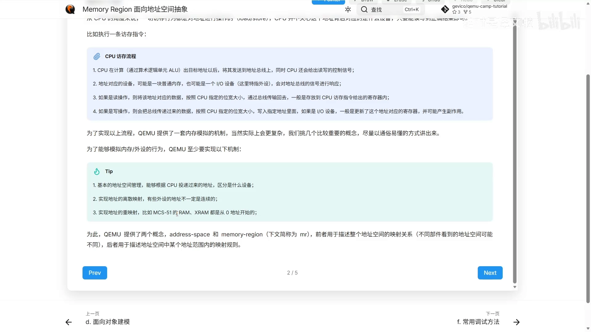
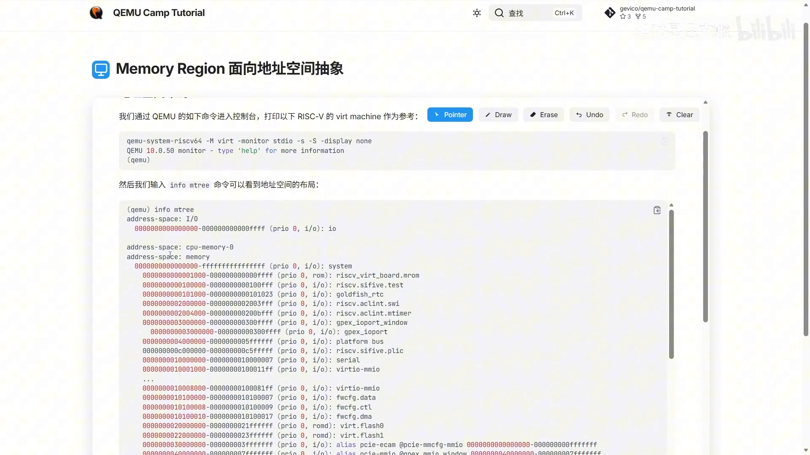
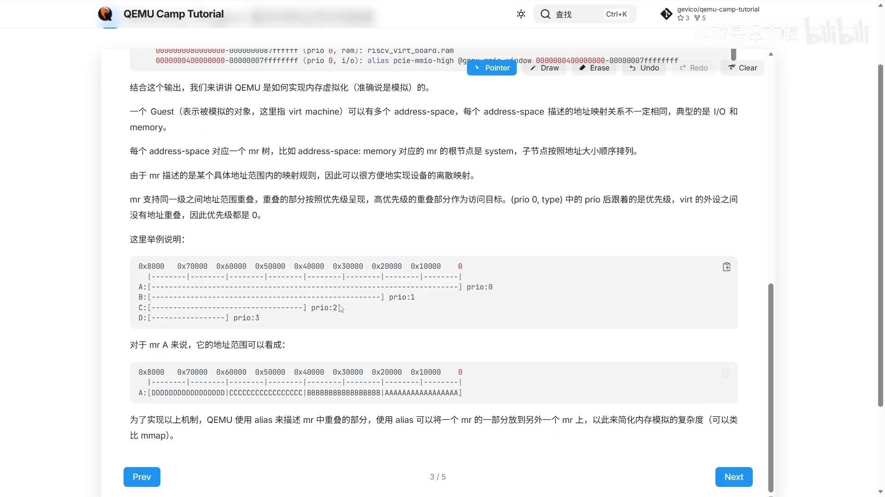
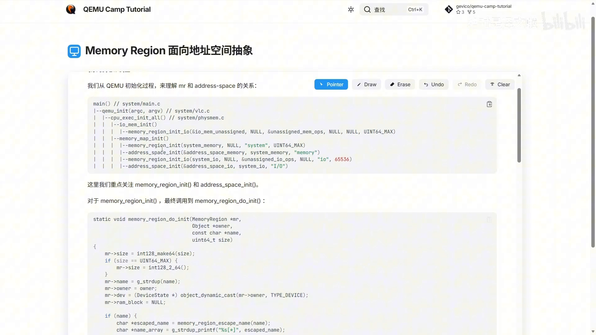
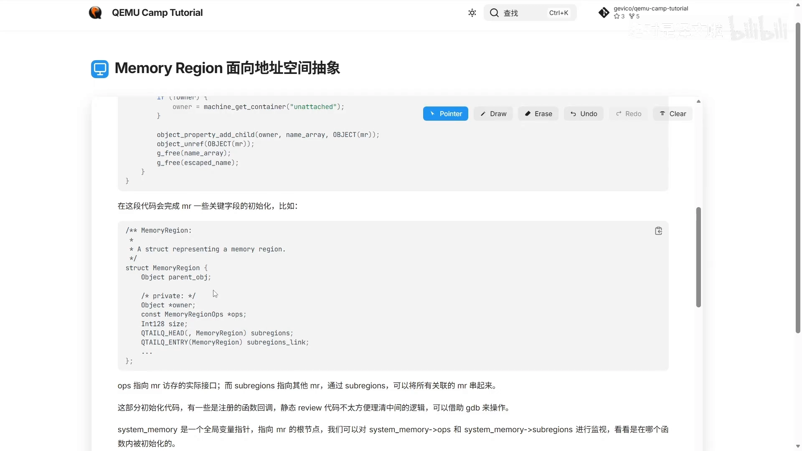
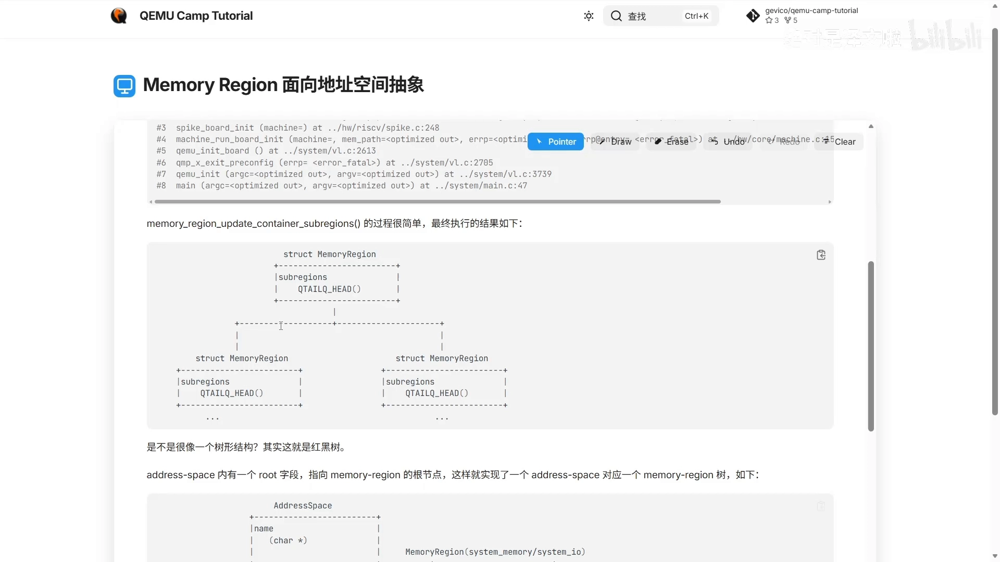

# QEMU 的地址空间抽象：MemoryRegion 树如何把 MMIO 落到设备模型

> 视频来源：[QEMU 训练营 | 基础阶段 MemoryRegion 面向地址空间抽象](https://www.bilibili.com/video/BV1sSwuzZEXr/)（Bilibili · 绝对是泽文啦）｜时长约 23 分钟
> 导读：上一篇讲清了"客户机访问设备 → EPT 陷入 → QEMU 处理"这条往返路径，但跳过了中间那一步：QEMU 拿到一个客户机物理地址，凭什么知道该交给哪个设备？这支视频就是答案——AddressSpace 作入口、MemoryRegion 树描述层级、`ops` 指向设备行为。本文按视频顺序梳理抽象、`info mtree` 观察、重叠与别名、初始化流程与 GDB 追踪，最后回到 exit 路径上说明它对应哪一步。

## 本讲要解决的核心问题（SCQA）

**背景**：客户机访问设备寄存器时会陷入用户态 VMM，VMM 拿到的是一个客户机物理地址、访问宽度、读写方向。

**冲突**：真实硬件的地址空间并不整齐——外设地址是离散的，中间有空洞；同一段地址还可能被重映射到不同存储（比如 8051 的 RAM 和 XRAM 都从 0 地址开始）；甚至多个设备会声明重叠的地址范围。

**疑问**：QEMU 用什么数据结构，把"一个地址"稳定地解析成"某个设备的某个读写回调"？

**回答（中心思想）**：QEMU 用 **AddressSpace 作入口、MemoryRegion（简称 MR）树描述层级**：每个 MR 描述一段地址区间的映射规则，`ops` 指向这段区间的读写接口；MR 之间可以重叠，按优先级决定谁生效，重叠的胜出者用别名（alias）表达；设备在创建时把自己的 MR 挂到 `system_memory` 这棵树上。**所谓"查地址找设备"，就是在这棵树上走一遍。**

## 一、要让访存落到设备，QEMU 必须先解决三个问题

### 1.1 起点：一条访存指令的四步

从 CPU 的角度看，一切访存行为都是对地址做操作，就是 `load` 和 `store`；CPU 并不关心这个地址后面对应的是什么设备，只要能正常读写到正确的结果就行 [【跳转到 01:15】](https://www.bilibili.com/video/BV1sSwuzZEXr/?t=75)。

一条访存指令可以拆成四步 [【跳转到 01:40】](https://www.bilibili.com/video/BV1sSwuzZEXr/?t=100)：

1. CPU 通过计算单元算出目标地址，把地址发送到地址总线上，同时给出读写的控制信号；
2. 地址上对应的设备——可能是一块普通内存（RAM）、一块 ROM，也可能是一块 IO——对总线信号作出响应；
3. 读操作：设备把该地址的数据按 CPU 指定的位宽通过总线返回，一般存到访存指令指定的 CPU 寄存器里 [【跳转到 02:30】](https://www.bilibili.com/video/BV1sSwuzZEXr/?t=150)；
4. 写操作：更新对应地址空间的位置；如果访问的是 IO，可能是更新一个寄存器，并且**可能有副作用**，比如产生一个读写请求去访问其他外设 [【跳转到 03:20】](https://www.bilibili.com/video/BV1sSwuzZEXr/?t=200)。

### 1.2 QEMU 必须实现的三个机制

要模拟这套流程，QEMU 至少得做三件事 [【跳转到 03:45】](https://www.bilibili.com/video/BV1sSwuzZEXr/?t=225)：

1. **基本的地址空间管理**：CPU 投递过来一个地址，QEMU 要能区分出这个地址属于什么设备；
2. **地址的离散映射**：有些外设的地址不连续，真实的硬件也是这样——中间一块、下面一块，两块地址中间是空腔、没有实际的东西；
3. **地址的重映射**：比如 8051 这个经典微控制器，它的 RAM 和 XRAM 都从零地址开始，地址空间是重叠的，但实际上指向不同的存储区域 [【跳转到 04:10】](https://www.bilibili.com/video/BV1sSwuzZEXr/?t=250)。



### 1.3 两个抽象：谁在看，看到什么

为满足这三个需求，QEMU 提供了两个概念：**AddressSpace** 和 **MemoryRegion** [【跳转到 04:35】](https://www.bilibili.com/video/BV1sSwuzZEXr/?t=275)。

- **AddressSpace 描述"谁在看"**：整个地址空间的映射关系。这里有个关键点——**不同的部件看到的地址空间是不同的**：CPU 有 CPU 的视角，IO 设备比如 DMA 也有自己的访存视角，IO 地址空间和 memory 地址空间可能是分开的，PCI/PCIe 设备也有自己的地址空间视角 [【跳转到 05:00】](https://www.bilibili.com/video/BV1sSwuzZEXr/?t=300)。
- **MemoryRegion 描述"看到什么"**：地址空间里某一块地址范围的具体映射规则。一般来说每个 MR 对应一块地址区间，定义了这个区间的访存行为 [【跳转到 05:25】](https://www.bilibili.com/video/BV1sSwuzZEXr/?t=325)。

这两个概念相互配合：AddressSpace 是入口，MR 是内容。**从 exit 路径的角度看，"多个 AddressSpace"正好对应"这次访问是从 CPU 发起的、还是从设备 DMA 发起的"——查的树不一样。**

## 二、用 `info mtree` 把地址空间打印出来

### 2.1 进控制台

视频用 riscv64 的 virt 机器做示例，启动时指定监视器作为控制台，先暂停不让它输出，再把前端 UI 禁掉，就进到了 QEMU 的控制台界面 [【跳转到 05:50】](https://www.bilibili.com/video/BV1sSwuzZEXr/?t=350)。然后执行 `info mtree` 打印完整的地址空间布局 [【跳转到 06:15】](https://www.bilibili.com/video/BV1sSwuzZEXr/?t=375)。



### 2.2 一个 guest，多个 AddressSpace

输出里能看到多个 AddressSpace：有 CPU 的、有 IO 的、有 memory 的，它们描述的地址映射关系就是不一样的 [【跳转到 06:40】](https://www.bilibili.com/video/BV1sSwuzZEXr/?t=400)。其中 `system` 是 virt 模式最主要的地址空间描述的根节点。

`system` 下面挂了这些东西 [【跳转到 07:05】](https://www.bilibili.com/video/BV1sSwuzZEXr/?t=425)：

| 区间（示例） | 类型 | 设备 |
| :--- | :--- | :--- |
| `0x1000`–`0x1FFFF` | ROM | 启动时的只读存储 |
| `0x10000000`–`0x1000100FF` | IO | `riscv.sifive.test` 测试设备 |
| `0x101000`–`0x1010023` | IO | RTC 时钟 |
| `0x2000000`–`0x2003FFF` | IO | `riscv.aclint.swi` 中断控制器 |
| `0x2004000`–`0x200BFFF` | IO | `riscv.aclint.mtimer` |
| `0x10000000` 附近 | IO | serial 串口、`virtio-mmio`、`fw_cfg` |
| `0x80000000` 起 | RAM | 主内存 |

（表格按视频讲解整理，具体数值以 `info mtree` 实际输出为准。）

这里能直接看出**离散映射**：每个 MR 描述的就是一个具体地址范围内的映射规则，所以设备的地址都是不连续的，各自占据自己的地址空间 [【跳转到 07:55】](https://www.bilibili.com/video/BV1sSwuzZEXr/?t=475)。

> **对 exit 路径的意义**：客户机访问 `0x10001000` 触发 exit 后，QEMU 就是拿这个客户机物理地址到 `system` 这棵树里查，命中 `virtio-mmio` 那个 MR，再调用它的 `ops`。**这就是上一篇里"第三步：QEMU 按地址找到设备模型"的内部实现。**

## 三、重叠、优先级与别名

### 3.1 MR 支持同级地址范围重叠

MR 支持同一级之间的地址范围重叠：你可以在相同的地址范围内定义多个 MR，重叠的部分就需要有一个优先级，因为重叠了你肯定要决定访问哪一个 [【跳转到 08:20】](https://www.bilibili.com/video/BV1sSwuzZEXr/?t=500)。

规则是：**高优先级覆盖低优先级**。`info mtree` 输出里每个 MR 都会标注优先级（`prio`），默认是 0，创建时不指定就是 0 [【跳转到 08:45】](https://www.bilibili.com/video/BV1sSwuzZEXr/?t=525)。

### 3.2 一个具体的折叠例子

视频给了一个四块 MR 重叠的例子：A、B、C、D 的地址范围都重叠，优先级分别是 0、1、2、3，D 最高。那么对 A 来说，它的地址范围实际会变成这样 [【跳转到 09:10】](https://www.bilibili.com/video/BV1sSwuzZEXr/?t=550)：

- 从 `0x8000` 到某一段属于 D 的优先级最高，被 D 覆盖掉；
- 再往下一段 C 的优先级比 B 高，这块变成 C 的；
- 再往下这块变成 B 的；
- 最后这块只剩下 A 的，保留原样 [【跳转到 09:35】](https://www.bilibili.com/video/BV1sSwuzZEXr/?t=575)。



### 3.3 别名：把重映射表达成"平坦"

为了实现这种机制，QEMU 用**别名（alias）**来描述 MR 重叠的部分：可以把一个 MR 的一部分映射到另一个 MR 上去，用来简化内存模拟的复杂度。这种情况最终就变成一个平坦的状态，可以类比成 `mmap` 操作——把一块地址空间映射到另一个地方 [【跳转到 10:00】](https://www.bilibili.com/video/BV1sSwuzZEXr/?t=600)。

在 `info mtree` 里也能看到别名的实现，比如把某段 PCIe 地址映射到对应的 MR；除了 QEMU 自己处理，你也可以通过 API 手动创建别名。在主板或系统建模比较复杂时，别名用得比较常见 [【跳转到 10:25】](https://www.bilibili.com/video/BV1sSwuzZEXr/?t=625)。

> **对应到真实场景**：PCI 设备的 BAR 就是典型的"重映射"——客户机把 BAR 写成某个地址，设备寄存器窗口就出现在那个地址上。QEMU 侧的表达方式之一就是地址空间里的 alias。这也解释了为什么上一篇里"BAR 决定设备落在哪"和这里"别名"讲的是同一件事的两个视角。

## 四、这棵树是怎么长出来的

### 4.1 初始化调用链

视频用 GDB 抓了初始化流程的调用栈，关键节点如下 [【跳转到 11:15】](https://www.bilibili.com/video/BV1sSwuzZEXr/?t=675)：

```
main()
|--qemu_init(argc, argv)
   |--cpu_exec_init_all()
      |--io_mem_init()                 // 处理"未分配地址"的默认 MR
      |--memory_map_init()
         |--memory_region_init(system_memory, NULL, "system", UINT64_MAX)
         |--address_space_init(&address_space_memory, system_memory, "memory")
         |--memory_region_init_io(system_io, ...)        // 64KB 的 IO 空间
         |--address_space_init(&address_space_io, system_io, "I/O")
```



拆开看 `memory_map_init` 做了四件事 [【跳转到 11:40】](https://www.bilibili.com/video/BV1sSwuzZEXr/?t=700)：

1. 调用 `memory_region_init` 创建 `system` 这个根节点，它是全局默认创建的，覆盖整个 64 位地址空间；
2. 调用 `address_space_init` 创建一个 AddressSpace，把根节点作为它的根 MR——**这样地址空间和 MemoryRegion 就关联起来了** [【跳转到 12:05】](https://www.bilibili.com/video/BV1sSwuzZEXr/?t=725)；
3. 创建 `system_io` 这个 MR，它是 64KB 的 IO 空间；
4. 创建它对应的 AddressSpace，再把 IO 作为它的根节点。

另外 `io_mem_init` 初始化的是那个**用来处理未分配地址的默认 MR** [【跳转到 11:15】](https://www.bilibili.com/video/BV1sSwuzZEXr/?t=675)。这一点对 exit 路径很关键：**如果客户机访问了一个没有任何设备声明的地址，命中的就是它**——在 KVM 场景下，这类地址通常根本不会登记给 KVM，于是访问直接以 MMIO exit 的形式冒到用户态。

### 4.2 `memory_region_do_init` 做了什么

`memory_region_init` 最终会调用到 `memory_region_do_init`，它做几件事 [【跳转到 12:55】](https://www.bilibili.com/video/BV1sSwuzZEXr/?t=775)：

- 设置 MR 的大小、名字、`owner` 所属；
- 把 `ram_block` 初始化为 NULL；
- 把整个 MR 作为一个 QOM 对象，挂载到 owner 下面；如果没有 owner，就放到 object 的 container 下面 [【跳转到 13:20】](https://www.bilibili.com/video/BV1sSwuzZEXr/?t=800)。

### 4.3 结构体里的三个关键字段



```c
struct MemoryRegion {
    Object parent_obj;
    /* private: */
    Object *owner;
    const MemoryRegionOps *ops;      /* 访存接口：读/写回调 */
    Int128 size;                     /* 这段区间多大 */
    QTAILQ_HEAD(, MemoryRegion) subregions;        /* 子节点链表头 */
    QTAILQ_ENTRY(MemoryRegion) subregions_link;    /* 用于挂到父节点 */
    ...
};
```

- `ops` 指向这个 MR 的**访存接口**，也就是用来做读和写操作的函数，不同的 MR 可以注册不同的 `ops` [【跳转到 13:45】](https://www.bilibili.com/video/BV1sSwuzZEXr/?t=825)。**设备模型的行为，最终就落在 `ops` 里的回调上。**
- `subregions` 是链表头，用来指向这个 MR 的子节点。MR 之间可能是地址上的重叠，但 MR 内部也可以包含更多的次级节点，通过 `subregions` 把关联的 MR 串成一棵树，方便管理 [【跳转到 14:10】](https://www.bilibili.com/video/BV1sSwuzZEXr/?t=850)。
- `subregions_link` 用来把自己挂到父节点的 `subregions` 下面，这样上下层就关联起来了 [【跳转到 14:35】](https://www.bilibili.com/video/BV1sSwuzZEXr/?t=875)。

### 4.4 用 GDB 看字段是什么时候被填的

这部分初始化代码有一些是通过函数回调注册的，静态看代码不太方便理解逻辑，最好用 GDB 跟一下数据的变化 [【跳转到 14:35】](https://www.bilibili.com/video/BV1sSwuzZEXr/?t=875)。

一个很实用的技巧：`system_memory` 是一个全局变量指针，指向 MR 的根节点，可以对 system_memory 的 ops 字段 和 system_memory 的 subregions 字段 下 watchpoint，看它们是在哪个函数里被初始化的 [【跳转到 15:00】](https://www.bilibili.com/video/BV1sSwuzZEXr/?t=900)。视频演示的结果是：首次写入发生在某处，往下执行又改了一次，那次才是真正的初始化，前面的都是 reset 操作 [【跳转到 15:25】](https://www.bilibili.com/video/BV1sSwuzZEXr/?t=925)。

调用栈显示 `memory_region_initfn` 是在 object 的 `instance_init` 里被调用的，对应 QEMU 的 QOM 模块——可以简单理解成它是对 MR 对象的初始化，这个方法是通过函数指针注册上去的 [【跳转到 15:50】](https://www.bilibili.com/video/BV1sSwuzZEXr/?t=950)。用同样的办法跟踪 `subregions`，会发现核心字段的初始化基本都集中在 `memory_region_initfn` 里 [【跳转到 16:40】](https://www.bilibili.com/video/BV1sSwuzZEXr/?t=1000)。

### 4.5 子节点是怎么挂上来的

接下来是"节点之间怎么组织起来"的问题。跟踪 `subregions` 就能看到其他 MR 是怎么被添加进来的 [【跳转到 17:05】](https://www.bilibili.com/video/BV1sSwuzZEXr/?t=1025)：

- 关键函数是 memory_region_update_container_subregions()，它负责把一个子节点插入到父节点的 `subregions` 列表里 [【跳转到 17:30】](https://www.bilibili.com/video/BV1sSwuzZEXr/?t=1050)；
- 调用它的是 memory_region_add_subregion_common()，这是添加子 MR 的通用入口；
- 再往上是具体设备的创建函数：设备创建时就会把这个设备对应的 MR 挂载到 `system_memory` 里 [【跳转到 17:55】](https://www.bilibili.com/video/BV1sSwuzZEXr/?t=1075)。

视频举的例子是 virt 里的 CLINT（一个中断控制器）封装函数，它做两件事：把 CLINT 的 QOM 对象创建出来；把对象所关联的 IO 地址空间（也就是 MemoryRegion）创建出来并添加到对应的父 MR 里 [【跳转到 18:20】](https://www.bilibili.com/video/BV1sSwuzZEXr/?t=1100)。



于是结构就清楚了：每个 MR 通过 `subregions` 指向自己的子节点，子节点又可以有自己的子节点，形成一棵树；AddressSpace 通过 `root` 字段指向这棵树的根节点，**一个 AddressSpace 对应一棵 MR 树** [【跳转到 19:10】](https://www.bilibili.com/video/BV1sSwuzZEXr/?t=1150)。

### 4.6 ram_block 与 MR 的类型

每个 MR 还会有一个对应的 `ram_block`。`ram_block` 就是 host 里真实申请的内存，作为 guest 外设的存储后端；但不是所有 MR 都有 `ram_block`，要看类型 [【跳转到 19:35】](https://www.bilibili.com/video/BV1sSwuzZEXr/?t=1175)。常见类型有 [【跳转到 20:00】](https://www.bilibili.com/video/BV1sSwuzZEXr/?t=1200)：

- `RAM`：普通内存，有后端；
- `ROM`：只读存储；
- `MMIO`：IO 内存管理单元，**没有后端内存，访问要走 `ops` 回调**；
- `container`：容器，本身不直接处理缓存，作用是包含其他 MR，并记录每个 MR 的 offset [【跳转到 20:50】](https://www.bilibili.com/video/BV1sSwuzZEXr/?t=1250)。

关于 `offset` 有个有意思的点：每个 MR 只记录它内部的 MR 相对它的偏移，最顶层根节点 `system` 的偏移从零地址开始，往下各级的地址空间都是用 offset 描述的，而不是绝对地址 [【跳转到 21:15】](https://www.bilibili.com/video/BV1sSwuzZEXr/?t=1275)。实际应用里可以用容器创建不同的地址层级，比如一个 SoC 里有多个子系统，每个子系统用自己的容器管理 MR，地址空间就能很清晰地表达子系统之间的关系 [【跳转到 21:40】](https://www.bilibili.com/video/BV1sSwuzZEXr/?t=1300)。

## 五、回到 exit 路径：这棵树到底在哪一步被用到

把这一讲和上一篇对齐，可以得到一张很干净的对应表：

| exit 路径上的步骤 | MemoryRegion 体系里的对应物 |
| :--- | :--- |
| 客户机访问设备地址，触发 EPT violation | 该地址没有登记给 KVM（对应 MMIO 类型 MR，或未分配地址的默认 MR） |
| `KVM_RUN` 返回 `KVM_EXIT_MMIO`，带上客户机物理地址 | — |
| QEMU 按地址找设备 | 在对应 AddressSpace 的 MR 树里查区间，重叠按优先级裁决 |
| 执行设备行为 | 调用命中 MR 的 `ops` 读写回调 |
| 填返回值、重新 `KVM_RUN` | 回调返回，`ops` 调用结束 |

由此能得出两个实践结论：

1. **设备代码不等于设备存在**。视频里那句总结很到位：设备代码并不等于设备已经存在了，只有真正把它接到机器里、把 MR map 进 AddressSpace，guest 才能看到它。这也解释了为什么新增一个设备要改 machine 的初始化代码。
2. **"地址 → 设备"是纯用户态的事**。KVM 只负责把访问拦下来并报告地址，怎么解释这个地址完全是 VMM 的地址空间模型决定的。这也是为什么同一个 KVM 可以跑 QEMU，也可以跑 Cloud Hypervisor、Firecracker——它们的地址空间模型各不相同。

## 小结

- QEMU 要模拟访存，必须解决三件事：地址空间管理、离散映射、地址重映射。
- 两个抽象分工明确：**AddressSpace 描述"谁在看"**（CPU、DMA、PCI 各有视角），**MemoryRegion 描述"看到什么"**（某段区间的映射规则与 `ops`）。
- `info mtree` 是观察地址空间的最快手段：能看到多个 AddressSpace、`system` 根节点下的 ROM/RTC/中断控制器/串口/virtio-mmio/fw_cfg/RAM，以及每个 MR 的优先级。
- MR 之间允许重叠，按优先级裁决；重叠胜出者用别名表达，别名本质是一次"地址重映射"，类似 `mmap`。
- 初始化顺序是 `io_mem_init` → `memory_map_init`（建 system 根节点 + 两个 AddressSpace）；`memory_region_do_init` 填 size/name/owner/`ram_block`；`memory_region_initfn` 填 `ops` 与 `subregions`。
- 设备创建时通过 `memory_region_add_subregion_common` → `memory_region_update_container_subregions` 把自己的 MR 挂到 `system_memory` 上，形成一棵树；AddressSpace 的 `root` 指向树根。
- 在 exit 路径上，"查地址找设备"就是在这棵树上走一遍，命中后调用 `ops`——**设备模拟的落点就是 `MemoryRegionOps`**。

## 关键术语速查

| 术语 | 一句话解释 |
| :--- | :--- |
| AddressSpace | 地址空间入口，一个 guest 可以有多个（CPU、IO、memory 各一个视角），`root` 指向一棵 MR 树 |
| MemoryRegion（MR） | 描述一段地址区间的映射规则，含 `ops`、`size`、`subregions` |
| MemoryRegionOps | MR 的读写回调集合，设备行为真正执行的地方 |
| subregions | MR 的子节点链表，用来表达地址空间的层级 |
| 优先级（prio） | 同级 MR 地址重叠时的裁决依据，高优先级覆盖低优先级 |
| alias | 把一段地址映射到另一个 MR 上，用来表达重映射，类似 `mmap` |
| container | 只负责包含其他 MR 并记录相对 offset 的 MR 类型，不直接处理访存 |
| ram_block | MR 背后真实申请的宿主内存，只有 RAM 类 MR 才有 |
| `info mtree` | QEMU 监视器命令，打印全部 AddressSpace 与 MR 布局 |
| `system_memory` | 指向 MR 树根节点的全局变量，也是 GDB 追踪的常用入口 |