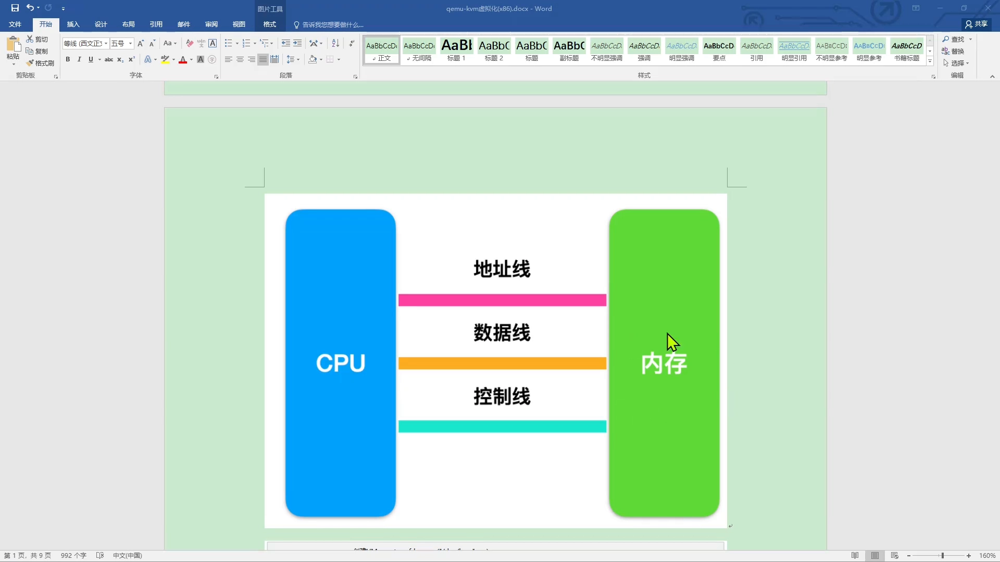
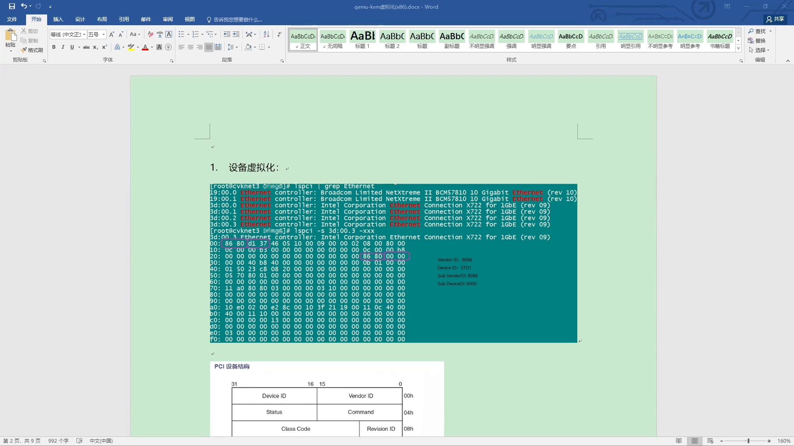
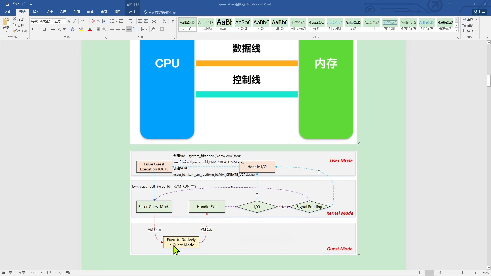
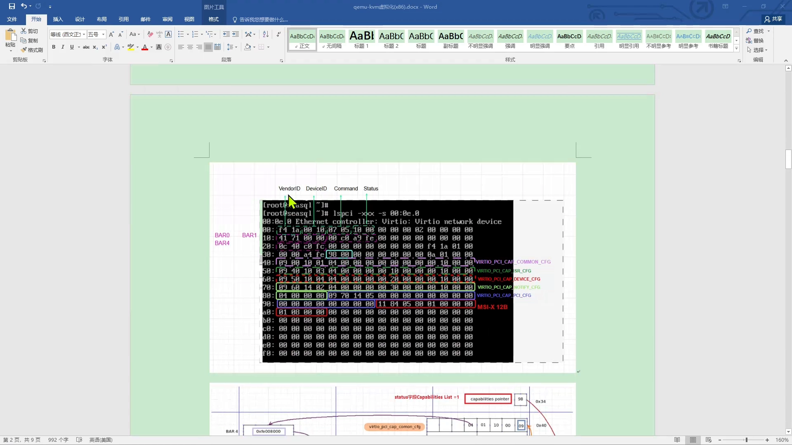
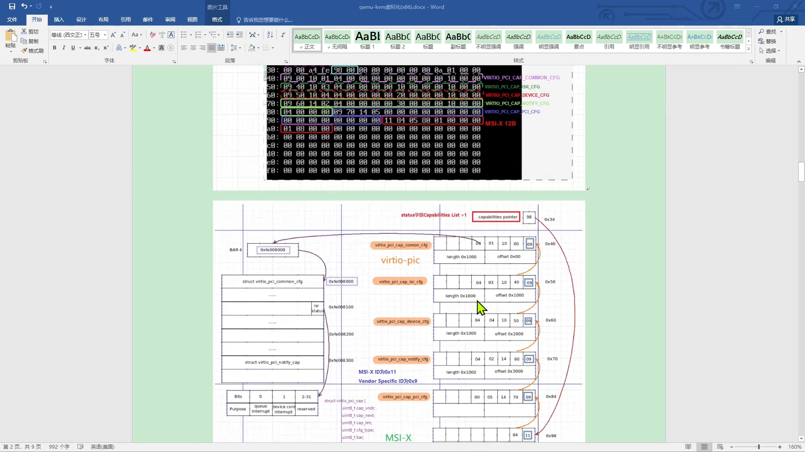
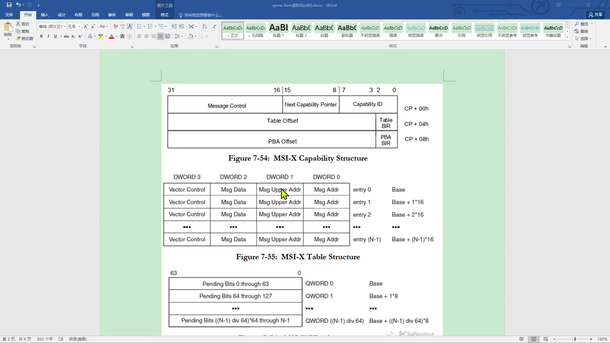

# 一次 MMIO 访问的完整往返：EPT 陷入与 QEMU 回填

> 视频来源：[虚拟化学习1：设备虚拟化](https://www.bilibili.com/video/BV1ur8x6KERq/)（Bilibili · 码农丁分享）｜时长约 14 分钟
> 导读：这支视频从一块物理网卡的 PCI 配置空间讲起，把"客户机读一个设备寄存器"这件事拆成 EPT 陷入 → KVM 放手 → QEMU 处理 → ioctl 回到客户机四段，是理解设备模拟为什么必须挂在 VM exit 路径上的最短路径。本文只取其中与 1.3.3 相关的部分：设备访问如何陷入用户态 VMM、VMM 拿到的是什么、处理完怎么回去。视频后半段关于 MSI-X 中断表与 KVM 中断路由的内容只作收尾简述，virtio 队列细节留给第 3 章。

## 本讲要解决的核心问题（SCQA）

**背景**：客户机里的驱动读写设备，用的指令和读写普通内存完全一样——都是 `load` / `store`，都是给一个地址。

**冲突**：这个地址在宿主物理内存里并不存在对应的页。它是 QEMU 进程里的一块内存，甚至根本不对应内存，而是一个"设备"。

**疑问**：既然指令是普通的访存指令，那一次访问是怎么从客户机"跳"到用户态 VMM 手里的？VMM 处理完之后，又是怎么回到客户机接着跑下一条指令的？

**回答（中心思想）**：设备模拟之所以能工作，靠的是**把设备地址故意留在"没有映射"的状态**：客户机一访问就触发 EPT violation，KVM 发现自己处理不了，于是让 `KVM_RUN` 带着 `KVM_EXIT_MMIO` 返回用户态；QEMU 按地址找到对应的设备模型、执行读写与副作用，再通过 ioctl 重新进入客户机。**设备模型就是 exit 处理函数的一个分支**——这就是"设备模拟在 exit 路径上的位置"。

## 一、设备寄存器为什么一定要"被陷入"

### 1.1 CPU 只认地址，不认设备

从 CPU 的角度看，一切访存行为都是对地址做操作，就是 `load` 和 `store`。CPU 并不关心这个地址后面对应的是什么设备，只要能正常读写到正确的结果就行 [【跳转到 01:15】](https://www.bilibili.com/video/BV1ur8x6KERq/?t=75)。

一条访存指令可以拆成四步 [【跳转到 01:40】](https://www.bilibili.com/video/BV1ur8x6KERq/?t=100)：

1. CPU 计算出目标地址，把地址发送到地址总线上，同时给出读写的控制信号；
2. 这个地址上对应的设备——可能是一块普通内存，也可能是一块 ROM，也可能是一块 IO——对总线信号作出响应；
3. 如果是读操作，设备把该地址的数据按 CPU 指定的位宽通过总线返回，一般存到访存指令指定的 CPU 寄存器里；
4. 如果是写操作，就把数据按位宽写进指定地址；如果目标是 IO 设备，一般是更新这个地址对应的寄存器，并且**可能产生副作用** [【跳转到 02:55】](https://www.bilibili.com/video/BV1ur8x6KERq/?t=175)。

在真实服务器里，地址要经过 MMU、RC 桥等部件做物理转换，最终把空间分成两大类：一类是 DDR RAM 空间，另一类是 PCIe 空间 [【跳转到 04:14】](https://www.bilibili.com/video/BV1ur8x6KERq/?t=254)。**设备寄存器就住在 PCIe 空间里**，所以"访问设备"在指令层面就是"访问一段地址"。

### 1.2 设备的配置空间本身就是一片寄存器

视频用一块英特尔的 X722 物理网卡开场：用 `lspci` 就能看到它的配置信息，而这些信息本身保留在物理网卡的寄存器中，CPU 通过读写这片配置空间来控制网卡的行为 [【跳转到 00:25】](https://www.bilibili.com/video/BV1ur8x6KERq/?t=25)。

配置空间里几个关键字段 [【跳转到 01:00】](https://www.bilibili.com/video/BV1ur8x6KERq/?t=60)：

- **Vendor ID / Device ID**：制造商与型号。系统启动时用它们匹配驱动，由驱动来管理这个设备 [【跳转到 01:54】](https://www.bilibili.com/video/BV1ur8x6KERq/?t=114)。
- **Status**：如果这一位为 1，说明 **Capability Pointer** 指向一个能力链表，大多数设备都支持这种能力扩展 [【跳转到 02:04】](https://www.bilibili.com/video/BV1ur8x6KERq/?t=124)。
- **BAR 空间**：把 PCIe 设备内部的存储空间地址映射到 CPU 可以访问的存储空间中去 [【跳转到 02:29】](https://www.bilibili.com/video/BV1ur8x6KERq/?t=149)。**BAR 是"设备寄存器落在哪个地址"的登记表**，也是后面陷入机制能成立的前提。

### 1.3 虚拟化的关键一步：让这片地址"没有映射"

那怎么模拟一个设备的配置空间呢？做法很朴素：**在 QEMU 进程里开辟一片内存**，让客户机去访问，对应的动作由 QEMU 的 vCPU 线程去完成 [【跳转到 04:39】](https://www.bilibili.com/video/BV1ur8x6KERq/?t=279)。

关键在于：由于这片内存保存在 QEMU 的进程空间里（而不是登记给 KVM 的客户机内存里），客户机 CPU 去访问时就会产生 **EPT 中断**（EPT violation）[【跳转到 04:50】](https://www.bilibili.com/video/BV1ur8x6KERq/?t=290)。

> **术语**：EPT（Extended Page Tables，扩展页表）是 Intel 的二级页表硬件，负责把客户机物理地址翻译成宿主物理地址。翻译时如果发现这个客户机物理地址**没有对应的宿主页**，硬件就触发 EPT violation，把控制权交给 hypervisor。设备地址就是被故意留成"没有对应宿主页"的那一类。

视频用缺页中断做类比：物理服务器里地址经过 MMU 做四级页表映射时会产生异常，叫 page fault exception，发生异常后内核会重新调度内存、给进程分配新空间；EPT 中断之后，CPU 会从 Guest Mode 进入 Kernel Mode [【跳转到 05:15】](https://www.bilibili.com/video/BV1ur8x6KERq/?t=315)。区别在于：缺页是"页还没准备好"，而设备访问是"这里永远不会有页"——**陷入本身就是正常路径，不是异常路径**。

## 二、一次 MMIO 访问的完整往返

把上面几段串起来，就是本节要讲的主线。视频里那张三层框图把整条路径画得非常清楚：

### 2.1 第一步：客户机执行访存指令，硬件触发 EPT violation

客户机里的驱动对一个 BAR 内的地址做读写。这个客户机物理地址在 EPT 里没有映射，于是触发 EPT violation，CPU 从 Guest Mode 掉到 Kernel Mode [【跳转到 05:40】](https://www.bilibili.com/video/BV1ur8x6KERq/?t=340)。

### 2.2 第二步：KVM 发现自己处理不了，`KVM_RUN` 返回

进入 KVM 线程后，KVM 先尝试处理这个 EPT 中断。但**设备语义不在 KVM 里**——KVM 只懂 CPU 和内存，不懂"这个寄存器写 1 表示启动队列"。所以 KVM 发现处理不了，就退出到 QEMU 进程中 [【跳转到 06:05】](https://www.bilibili.com/video/BV1ur8x6KERq/?t=365)。

在接口层面，这就是 vCPU 线程上那个阻塞的 `KVM_RUN` ioctl 返回了，返回码是 `KVM_EXIT_MMIO`（或 PIO 场景下的 `KVM_EXIT_IO`），并且 `kvm_run` 结构体里填好了这次访问的**客户机物理地址、访问宽度、读还是写、写的数据**。

> 这就是 1.3.2 里"exit 原因分类"的一个具体成员：MMIO 类 exit 的归属处理者是**用户态 VMM**，而不是内核。

### 2.3 第三步：QEMU 按地址找到设备模型

QEMU 拿到地址后，要在自己的地址空间里查出"这个地址属于哪个设备"。这一步是查表：QEMU 维护一棵 MemoryRegion 树（下一篇博客专门讲），按地址区间找到对应的设备模型，进而找到它的读写回调。

### 2.4 第四步：设备模型执行行为、算出返回值

由 QEMU 来完成虚拟配置空间的读写以及对应的动作 [【跳转到 06:30】](https://www.bilibili.com/video/BV1ur8x6KERq/?t=390)。注意"对应的动作"这四个字：设备模型不只是返回一个值，它还要更新内部状态、可能触发中断、可能发起 DMA。**设备的行为全部发生在用户态**，这是全模拟设备的本质。

### 2.5 第五步：填好返回值，再次 `KVM_RUN`

处理完之后，QEMU 通过 ioctl 再次进入虚拟机，继续执行对应的代码 [【跳转到 06:30】](https://www.bilibili.com/video/BV1ur8x6KERq/?t=390)。如果是读操作，返回值已经写进 `kvm_run` 的共享页（或由 KVM 写回客户机寄存器），客户机看到的是一次"正常完成"的 load。

用一张表总结这五步：

| 步骤 | 谁在执行 | 关键动作 |
| :--- | :--- | :--- |
| 1 | 客户机 CPU + EPT 硬件 | 访问未映射地址，触发 EPT violation |
| 2 | KVM（内核态） | 判断无法处理，`KVM_RUN` 返回 `KVM_EXIT_MMIO` |
| 3 | QEMU（用户态） | 按客户机物理地址查 MemoryRegion，定位设备模型 |
| 4 | QEMU（用户态） | 调用设备读写回调，更新状态、产生副作用 |
| 5 | QEMU → KVM | 填好返回值，`KVM_RUN` ioctl 重新进入客户机 |

## 三、陷入之后，QEMU 手里拿到的是什么

理解了往返路径，还要知道"设备模型"到底长什么样。视频用一块 virtio 虚拟网卡做例子，因为它把"配置空间 + 能力链表 + BAR 窗口"三件套都占全了。

### 3.1 配置空间：和物理网卡同构

在虚拟机里用 `lspci` 看到的虚拟网卡配置信息，也遵循物理网卡那套配置规范：前面几个字段就是 Vendor ID、Device ID、Command、Status [【跳转到 07:04】](https://www.bilibili.com/video/BV1ur8x6KERq/?t=424)。Status 为 1 时，固定偏移 `0x34` 处写着 Capability 链表的头指针（这里是 `0x98`）[【跳转到 07:19】](https://www.bilibili.com/video/BV1ur8x6KERq/?t=439)。

### 3.2 能力链表：一个"位置信息"的链表

Capability 链表里每个节点的编码格式是固定的：第一个字节是 Vendor Specific ID（这五个节点统一是 `0x09`），然后是下一个节点的指针、节点总长度、节点类型、BAR 索引，最后是 `length` 和 `offset` [【跳转到 08:19】](https://www.bilibili.com/video/BV1ur8x6KERq/?t=499)。

这里有个容易被忽略的要点：**节点本身并不存放扩展能力，它只保存扩展能力的"位置信息"**——即"在哪个 BAR 的哪个偏移、有多长" [【跳转到 09:09】](https://www.bilibili.com/video/BV1ur8x6KERq/?t=549)。真正的寄存器在 BAR 窗口里。

对虚拟网卡来说重点关注 `common config` 和 `device config`：前者配置的是虚拟网卡收发队列的信息（virtqueue 的地址与大小），后者配置的是网卡的 MAC 信息 [【跳转到 09:59】](https://www.bilibili.com/video/BV1ur8x6KERq/?t=599)。

**这一段正好解释了为什么"查地址"这一步不能省**：客户机访问的是 BAR 里的某个偏移，设备模型必须知道这个偏移落在哪个能力窗口里、对应哪个寄存器，才能给出正确的行为。而这套映射关系，正是 QEMU 的 MemoryRegion 树 + 设备自己的偏移判断一起完成的。

### 3.3 中断侧：MSI-X 表如何落到 KVM 的中断路由

设备行为里最常触发副作用的是中断。视频最后一段讲了 MSI-X：能力项里存的同样是位置信息，可以索引到 MSI Table 和 MSI PBA 两张表 [【跳转到 10:17】](https://www.bilibili.com/video/BV1ur8x6KERq/?t=617)。

物理网卡里，队列收发报文时把 Msg Data 写进 Msg Addr 拼接出的地址就会产生中断；而在虚拟网卡里，这张表被翻译成 **KVM 的中断路由表**，每个条目对应一个 eventfd 和一个 GSI，需要注入中断时只要向对应的 eventfd 发一个信号，内核里的 KVM 就会对虚拟机产生一个中断 [【跳转到 12:22】](https://www.bilibili.com/video/BV1ur8x6KERq/?t=742)。

这段内容的意义在于：**设备模拟的"执行行为"并不总是同步返回一个值**。很多情况下它只是往一个 eventfd 里写一下，真正的注入由内核完成——这是后来 virtio、vhost 一系列优化的起点，具体机制留给第 3 章。

## 四、这条路径为什么慢，以及它注定了要被优化

把上面的路径走一遍，一次设备寄存器访问要经历：Guest → 内核（EPT violation）→ 用户态（`KVM_RUN` 返回）→ QEMU 查表 → 设备回调 → 内核（`KVM_RUN`）→ Guest。**两次模式切换、一次地址空间查表、一次设备模型逻辑**，全都发生在一条 `load` 指令里。

这带来两个直接结论：

1. **全模拟设备的性能上限由陷入次数决定**。寄存器访问越频繁，代价越高。所以真实设备模型都会尽量把"高频操作"挪出 MMIO：virtio 用共享内存里的 virtqueue 传数据，MMIO 只用来做通知（doorbell）；再往后就是 ioeventfd、vhost 这类把通知路径也搬进内核的做法。
2. **设备模型的正确性比性能更难**。因为设备行为是"状态 + 副作用"，一次写寄存器可能改变中断线、可能发起 DMA、可能让后续读操作返回不同的值。设备模型写错，客户机看到的就是一台"行为古怪的机器"。

下一篇博客会接着讲：QEMU 到底用什么数据结构，把"客户机物理地址"映射到"某个设备的某个回调"——也就是上面第三步"查地址"的内部实现。

## 小结

- 客户机访问设备用的仍是普通 `load` / `store`，设备寄存器住在 PCIe 地址空间里，靠 BAR 登记位置。
- 设备虚拟化的关键手法是**让这片地址在 EPT 里没有映射**，从而把"访问设备"变成一次必然发生的陷入。
- 一次 MMIO 访问的往返是五步：EPT violation → KVM 处理不了 → `KVM_RUN` 返回 `KVM_EXIT_MMIO` → QEMU 查地址并执行设备模型 → `KVM_RUN` ioctl 回到客户机。
- 设备模型就是 exit 处理路径上的一个分支：**KVM 负责"停下来"，QEMU 负责"解释这个地址是什么意思"**。
- 陷入之后 QEMU 看到的是标准 PCI 结构：配置空间、能力链表、BAR 窗口；能力项只存位置信息，真正的寄存器在 BAR 里。
- 中断注入走的是另一条路：设备模型写 eventfd，KVM 按中断路由表注入，不必同步返回。
- 这条路径的代价由"陷入次数"决定，这也是 virtio、ioeventfd、vhost 一系列优化的出发点。

## 关键术语速查

| 术语 | 一句话解释 |
| :--- | :--- |
| MMIO | Memory-Mapped I/O，把设备寄存器映射到地址空间，用访存指令访问设备 |
| PIO | Port I/O，x86 独立的 IO 端口空间，用 `in` / `out` 指令访问，同样会触发 exit |
| EPT violation | 客户机物理地址在 EPT 里没有对应宿主页时硬件触发的陷入 |
| `KVM_EXIT_MMIO` | `KVM_RUN` 的返回原因之一，表示客户机访问了一段 KVM 不认识的 MMIO 地址 |
| BAR | Base Address Register，PCI 配置空间里登记"设备寄存器窗口落在哪段地址"的字段 |
| Capability 链表 | 配置空间里一串用指针连起来的扩展能力描述项，每项只记录"能力在哪个 BAR 的哪个偏移" |
| 设备模型 | 用户态 VMM 里描述某设备寄存器语义与副作用的代码，负责响应 exit |
| MSI-X | 一种基于内存写入的中断方式，表项由 Msg Addr 与 Msg Data 组成 |
| eventfd / GSI | 用户态与内核之间传递中断通知的文件描述符 / 客户机中断号 |