# 虚拟机的 CPU 不是一颗芯片，而是一张 CPUID 特性清单

> 视频来源：[Effective Virtual CPU Configuration with QEMU and libvirt](https://www.youtube.com/watch?v=cV1xSt4eh6A)（YouTube · NLUUG 2019，讲者 Kashyap Chamarthy，Red Hat 云工程团队）｜时长约 38 分钟
> 导读：这场演讲从 2018 年那一连串侧信道漏洞讲起，把"给虚拟机配 CPU"这件事拆成三层：QEMU 的 CPU 型号、libvirt 的抽象、Nova 的配置项。本文按"客户机看到的 CPU 从哪来 → 三种给法 → 迁移怎么收敛 → 安全怎么挂钩"的顺序组织，适合第一次认真配置 `-cpu` 参数的人。

## 本讲要解决的核心问题（SCQA）

**背景**：KVM 让客户机的指令直接在物理 CPU 上执行，所以客户机跑得多快，取决于它以为自己拿到了一颗什么样的 CPU。

**冲突**：客户机对"我是什么 CPU"的全部认知，来自一条指令——`CPUID`。如果 VMM 把宿主的真实 CPUID 原样交给客户机，那么同一台虚拟机换到另一台宿主机上就可能起不来；反过来，如果 VMM 给得太保守，客户机连 AES 加速和 PCID 都没有，TLS 性能和安全缓解措施一起丢。

**疑问**：VMM 到底是怎么决定客户机"看到"哪颗 CPU 的？为什么同一个虚拟机镜像，在这台机器上能跑、换一台就崩？这些特性位和"安全"又是什么关系？

**回答（中心思想）**：**客户机看到的 CPU 不是硬件，而是 VMM 拼出来的一份 CPUID 特性清单**。这份清单有三个来源——原样抄宿主（host-passthrough）、按型号名固定（named CPU model）、由 libvirt 按宿主能力生成（host-model）；清单越贴近宿主性能越好、可迁移性越差，所以跨异构机器时必须把清单"收敛"到所有宿主型号的交集（baseline）上；而安全补丁也是通过往这份清单里加特性位来下发的。

## 一、CPUID 是客户机认识 CPU 的唯一入口，而答案由 VMM 代写

### 1.1 客户机问"我是什么 CPU"，答话的是 VMM

讲者先给了一张 KVM 的执行循环图。QEMU 通过 ioctl 让 KVM 创建一个 vCPU、拿到文件描述符，然后反复调用 `KVM_RUN`；KVM 借助 Intel VT-x 或 AMD-V 的硬件扩展，让客户机代码直接跑在物理 CPU 上。

关键在"跑不下去"的那一刻：客户机执行了某条硬件无法直接代为完成的动作，CPU 退出到 KVM（VM exit）。这时 KVM 先判断自己能不能处理：

- 能处理，就在**内核里模拟**，然后立刻回到客户机——这叫**轻量 exit**（lightweight exit）；
- 处理不了，才一路返回用户态的 QEMU——这叫**重量 exit**（heavyweight exit）。

讲者点名了两个"内核就能处理"的例子：**时钟**和 **CPUID 指令** [【跳转到 05:29】](https://www.youtube.com/watch?v=cV1xSt4eh6A&t=329)。

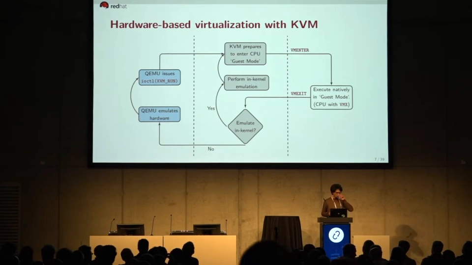

这一点值得停一下：**CPUID 之所以必须被拦截，恰恰因为它在真实硬件上是一条普通指令**。如果让它直接在物理 CPU 上执行，客户机读到的就是宿主的厂商字符串、宿主支持的每一个特性位——VMM 就再也无法"伪造"一颗 CPU 了。把它放进内核模拟，VMM 才有机会按自己的清单逐位回答。

### 1.2 客户机看到的每个特性位，都是 VMM 选择的结果

由此可以推出本文的主线：客户机的 CPU 是**一组位**，而不是一块硅片。厂商是谁、支持不支持 AVX2、有没有 PCID、是不是跑在 hypervisor 上，全都是 VMM 在模拟 CPUID 时一位一位填进去的。后面所有关于"型号""迁移""安全"的讨论，本质都是在讨论**这份位图怎么填**。

## 二、CPU 型号是"特性位的集合"，不是硬件的名字

### 2.1 默认型号为什么是糟糕的选择

QEMU 在 x86 上如果什么都不指定，默认用 `qemu64` 这个型号。讲者的评价很直接：这类默认型号（`qemu32`、`qemu64`）的设计目标是"在任何宿主 CPU 上都能跑"，因此不需要做任何兼容性检查，迁移永远不成问题——代价是它**缺了一批关键特性位** [【跳转到 07:11】](https://www.youtube.com/watch?v=cV1xSt4eh6A&t=431)：

- 没有 **AES / AES-NI**：TLS 性能会明显受损；
- 没有 **RDRAND**：客户机初始化熵池会受影响；
- 没有 **PCID**：这个位在 Meltdown 之后同时变成性能和安全的关键。

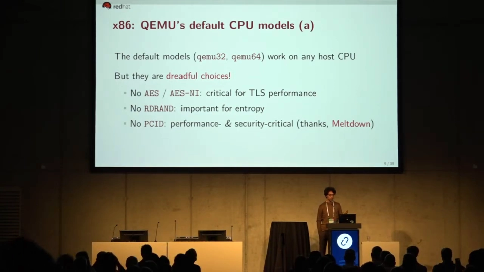

讲者还现场演示了后果：用默认 `qemu64` 启动的客户机，去 `/sys/devices/system/cpu/vulnerabilities/` 下逐项检查缓解措施，会发现它**仍然暴露在某个 Spectre 变体之下** [【跳转到 08:01】](https://www.youtube.com/watch?v=cV1xSt4eh6A&t=481)。也就是说，"默认型号"不只是慢，它连补丁都拿不到。

现场提问还补了一个反例：`qemu64` 号称"任何宿主都能跑"，其实并不总成立——它的定义里带了 AMD 的 SVM 指令位，而某些 Intel 处理器并不支持这一位。讲者把这称为"历史遗留的意外" [【跳转到 33:50】](https://www.youtube.com/watch?v=cV1xSt4eh6A&t=2030)。这也说明：**型号名是一份固定清单，它和你的宿主是否匹配，需要逐位核对，而不是看名字猜**。

### 2.2 在命令行上点名一个型号，再逐位加减

最简单的接口就是 QEMU 命令行。指定型号：

```bash
qemu-system-x86_64 -cpu IvyBridge-IBRS [...]
```

在型号名后面还可以继续追加一串 `特性=on/off`，对这份清单做**增量修改**。讲者给了一个 Nova 实例真实的 QEMU 命令行片段：

```bash
qemu-system-x86_64 -cpu Broadwell-IBRS,\
  vme=on,f16c=on,rdrand=on,\
  tsc_adjust=on,xsaveopt=on,\
  hypervisor=on,arat=off,\
  pdpe1gb=on,abm=on [...]
```


这张图信息量很大，值得逐项看：

- **型号名只是起点**，真正决定客户机看到什么的是后面这一串位；
- `hypervisor=on` 这一位对应的就是"我跑在 hypervisor 上"的标记——客户机据此知道自己被虚拟化了；
- `arat=off` 说明**减法同样重要**：宿主有、但客户机不该看到的位，要靠 `off` 抹掉。

### 2.3 QEMU 怎么把"我支持哪些型号和位"告诉上层

libvirt 不会去猜 QEMU 支持什么。它在守护进程启动时通过 QMP（QEMU monitor protocol，基于 JSON-RPC）问一遍，然后**缓存结果**——因为对同一个 QEMU 版本，这些能力不会变 [【跳转到 10:56】](https://www.youtube.com/watch?v=cV1xSt4eh6A&t=656)。

其中 `query-cpu-definitions` 返回的每一项都值得读一遍：

```json
{ "typename": "Westmere-IBRS-x86_64-cpu",
  "unavailable-features": [],
  "migration-safe": true,
  "static": false,
  "name": "Westmere-IBRS" }
```

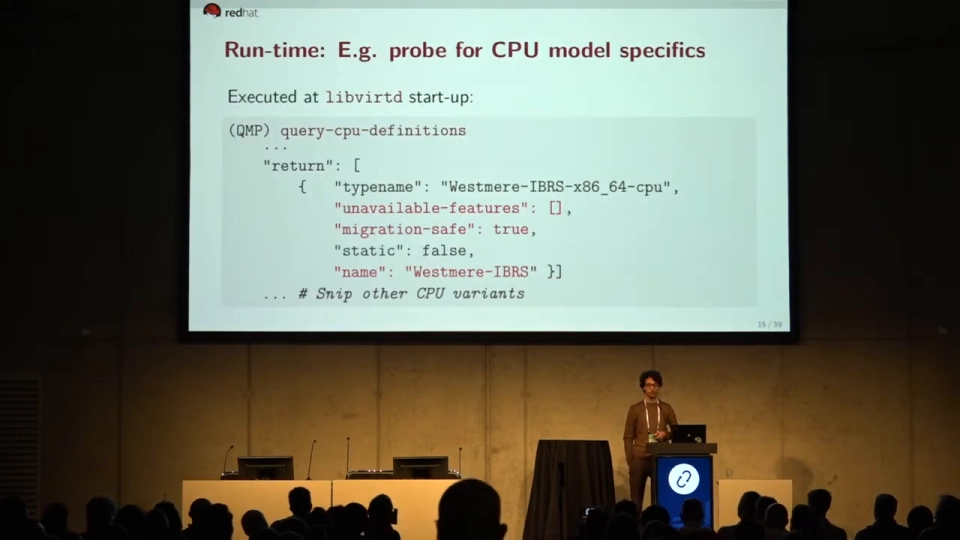

两个字段直接对应本节主题：

- **`unavailable-features`**：如果这里是空数组，说明这个型号在当前宿主上"原样就能跑"；如果里面列了特性，你必须**显式关掉**它们，这个型号才能在这台宿主上启动——这就是"过滤"在工程上的落点；
- **`migration-safe`**：表示 QEMU 不会在启动时偷偷往这个型号里加特性，否则迁移兼容性就断了。

再往下是 `-cpu help`，它把可用型号和 QEMU 认识的 CPUID 特性位名一次性列出来：


## 三、把 CPU 交给客户机的三种方式

讲者把配置方式归成三类，这是全文的骨架。

### 3.1 host-passthrough：把宿主 CPUID 原样抄给客户机

```bash
qemu-system-x86_64 -cpu host [...]
```

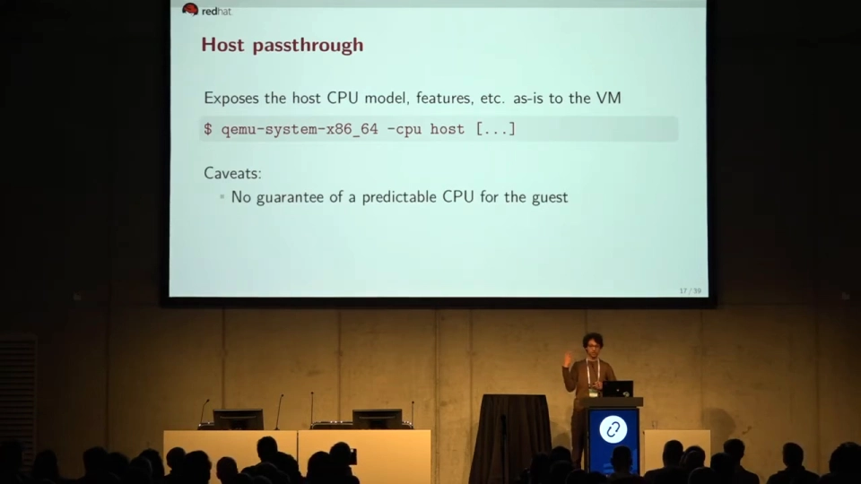

它做的事就是"把宿主的 CPUID 位原样交给客户机"，性能最好，但讲者列了两条硬伤：

1. **客户机的 CPU 不可预测**——QEMU 和 libvirt 都不保证你拿到什么；
2. **异构环境里热迁移是绝对禁区**。只要数据中心里的 CPU 型号不统一，这台虚拟机就搬不走。

只有在"整个机房都是同一款 CPU"时它才成立。而即便型号统一，还有两个容易漏掉的前提：**微码版本要一致**、**内核版本要一致**。讲者解释过为什么微码版本必须精确匹配：即使两个微码版本对外暴露的特性位完全相同，**性能计数器**也可能不同，这足以影响热迁移的可靠性 [【跳转到 14:52】](https://www.youtube.com/watch?v=cV1xSt4eh6A&t=892)。

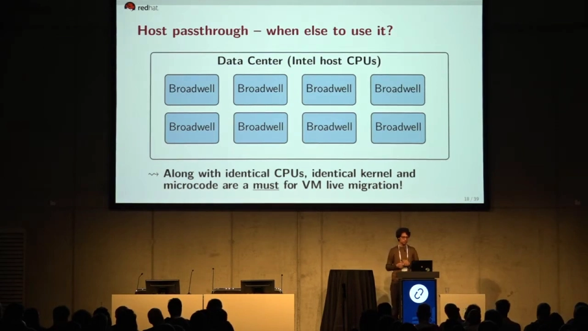

### 3.2 named CPU model：用型号名固定一份清单

第二种是直接点名一个厂商型号（`IvyBridge`、`Haswell`、`Broadwell-IBRS`……）。它的好处是**清单被固定住了**：同一份型号定义在任何宿主上展开出的特性位集合是一样的，因此比 host-passthrough 好迁移。你还可以在型号基础上增删特性位，为自家机房定制一份"专属清单"。

代价是：型号是**别人定义的**，未必贴合你的宿主；而如果你需要某个新特性，就得等 QEMU 出一个新型号——这一点在第五节会变成一个政策问题。

### 3.3 host-model：libvirt 的折中抽象

第三种是 libvirt 自己发明的 `host-model`。它不是 QEMU 的型号，而是 libvirt 在**启动时探测宿主能力、现场合成**出来的一份 CPU 定义。它想同时拿到三样东西 [【跳转到 17:22】](https://www.youtube.com/watch?v=cV1xSt4eh6A&t=1042)：

- 尽可能多的宿主特性（接近 host-passthrough 的性能）；
- 仍然保持热迁移能力；
- **自动补上关键的安全特性位**（例如 `spec-ctrl`），前提是宿主上的微码、内核、QEMU、libvirt 都已更新到位。


正因为它是"折中"，Nova 把它设成了默认值。在 Nova 里，这三种方式对应 `cpu_mode` 配置项的取值：`host-passthrough`、`custom`（即命名型号）、`host-model`；再配合 `cpu_model` 与 `cpu_model_extra_flags` 两个配置项 [【跳转到 19:52】](https://www.youtube.com/watch?v=cV1xSt4eh6A&t=1192)。


一个真实的计算节点配置长这样：

```ini
[libvirt]
cpu_mode = custom
cpu_model = IvyBridge-IBRS
cpu_model_extra_flags = ssbd, pdpe1gb
```

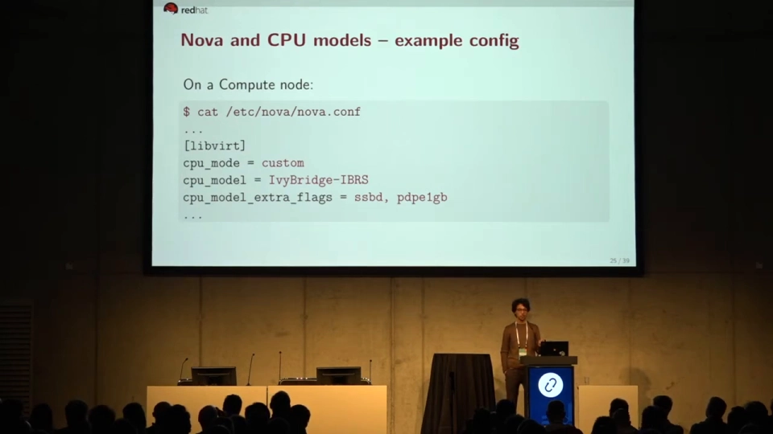

注意这里的组合逻辑：`custom` + 一个固定的 `-IBRS` 型号，等于"清单固定、可迁移"；再手工追加 `ssbd`，等于"把某个安全缓解位补进清单"。

## 四、迁移兼容性：把 CPUID 收敛到基线

### 4.1 host-model 的坑：迁移后冷重启会"长出新特性"

host-model 有一个反直觉的陷阱。热迁移时，**源端的客户机 CPU 定义会原样传到目标端**，所以迁移过去的客户机看到的 CPU 与源端完全一致，哪怕目标端更强。但一旦这台虚拟机**冷重启**（stop 再 start），host-model 会重新按目标端宿主合成定义——于是它"长出"了新的特性位。此后它就再也迁不回原来那台较旧的宿主了 [【跳转到 18:37】](https://www.youtube.com/watch?v=cV1xSt4eh6A&t=1117)。

结论很实用：**如果双向热迁移是硬需求，host-model 不是最佳选择**；如果只要求单向迁移，它很好用。

### 4.2 baseline：求所有宿主型号的交集

真实机房里 CPU 型号是混的。讲者画了一张图：Haswell、Westmere、IvyBridge、SandyBridge、Nehalem、Broadwell……你要在这堆型号里找出一份"大家都能接受"的清单。

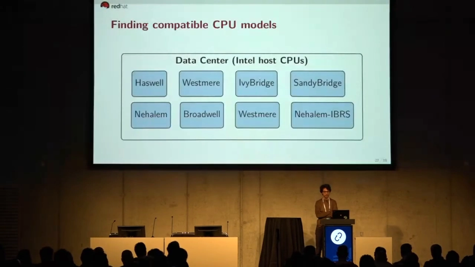

做法是给 libvirt 一份"多宿主 CPU"的 XML，里面写清楚每个型号要求什么、禁用什么：

```xml
<cpu mode='custom' match='exact'>
  <model fallback='forbid'>Haswell-noTSX-IBRS</model>
  <vendor>Intel</vendor>
  <feature policy='require' name='vmx'/>
  <feature policy='require' name='rdrand'/>
</cpu>
<!-- Second CPU -->
<cpu mode='custom' match='exact'>
  <model fallback='forbid'>Skylake-Client-IBRS</model>
  <vendor>Intel</vendor>
  <feature policy='disable' name='pdpe1gb'/>
  <feature policy='disable' name='pcid'/>
</cpu>
```

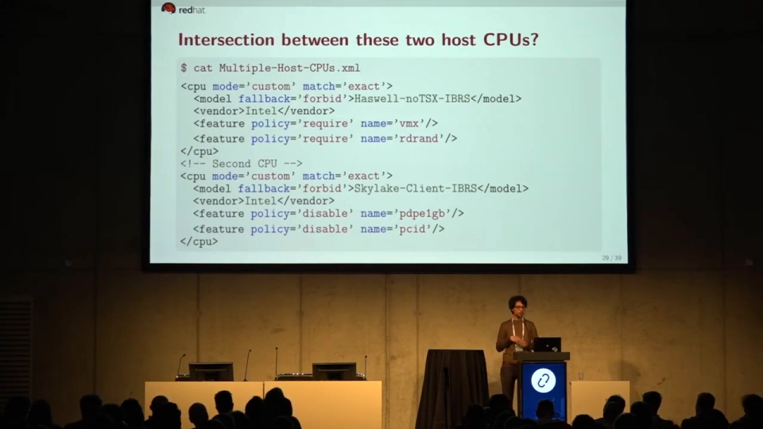

然后让 libvirt 算交集：

```bash
virsh hypervisor-cpu-baseline Multiple-Host-CPUs.xml
```


输出的这份定义就是**基线（baseline）CPU 型号**：它在所有列出的宿主上都能展开成同一份特性位清单，因此可以在它们之间热迁移。讲者还提到 libvirt 4.4 之后新增了 `hypervisor-cpu-baseline` 这类接口，与旧的 `baseline` 相比，它把 **hypervisor（KVM + QEMU）本身的能力**也纳入计算，而不只是比较宿主 CPU [【跳转到 22:17】](https://www.youtube.com/watch?v=cV1xSt4eh6A&t=1337)。

### 4.3 机器类型：另一条会偷偷改动 CPU 特性的暗线

QEMU 的机器类型（machine type，可以理解为"虚拟芯片组"）有两个目标：一个 QEMU 二进制能模拟多种芯片组（`pc`/i440FX 和 `q35`）；更重要的是提供**稳定的客户机 ABI**——无论你升级宿主软件、硬件还是热迁移，客户机看到的虚拟硬件都保持不变 [【跳转到 24:47】](https://www.youtube.com/watch?v=cV1xSt4eh6A&t=1487)。

之所以在这里提它，是因为**机器类型有时会改动 CPU 特性**。而且换机器类型是一件很"物理"的事：相当于把宿主硬件拔了换一块。libvirt 和 Nova 都不会替你自动升级机器类型版本，你必须显式要求，而且必须**冷重启**客户机才能生效。所以换机器类型前，先评估客户机里的负载。

## 五、安全：特性位既是性能开关，也是补丁开关

### 5.1 少了某个位，就等于少了某个缓解措施

回到 2.1 的结论：默认型号缺 AES、RDRAND、PCID，客户机在 `vulnerabilities/` 目录下就仍然显示"易受攻击"。**特性位不是抽象的性能选项，它直接决定客户机内核能不能启用某项缓解措施**。

### 5.2 补丁是往清单里加位

2018 年那一串漏洞之后，QEMU 的做法是给 CPU 型号加后缀，例如 `-IBRS`、`-IBPB` 系列，这些型号里**内置**了对应的缓解特性位。讲者列了当时最关键的几个位 [【跳转到 30:12】](https://www.youtube.com/watch?v=cV1xSt4eh6A&t=1812)：

- Intel：`ssbd`、`pcid`、`spec-ctrl`
- AMD：`virt-ssbd`、`amd-ssbd`、`amd-no-ssb`、`ibpb`

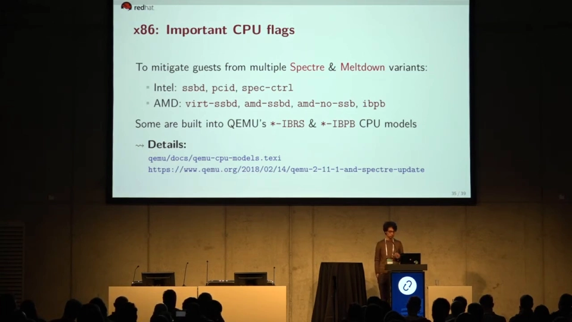

升级路径也因此变成一条"从底往上"的链条：先更新宿主微码和内核（含客户机内核），再更新 libvirt 与 QEMU 让它们认识新型号，然后显式告诉 Nova 把客户机 CPU 切到打了补丁的型号，最后**冷重启**客户机——因为 CPUID 位只在客户机启动时被读取一次 [【跳转到 28:32】](https://www.youtube.com/watch?v=cV1xSt4eh6A&t=1712)。

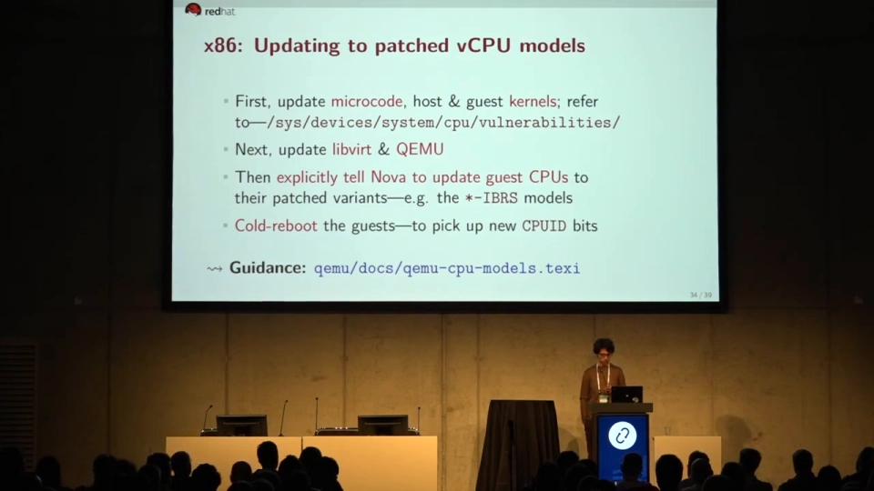

### 5.3 政策变了：不再为每个 CVE 造一个新型号

讲者最后讲了一个正在发生的转向。过去每来一个 CVE，QEMU 就加一个"修好的"命名型号，libvirt 跟着加一份等价定义。但 2018 年漏洞来得太密，这条路走不通了。QEMU 与 libvirt 上游的共同决定是：**从此不再为新的 CPU 漏洞新增命名型号**，而是要求上层应用（Nova 这类管理程序）**按需显式打开对应的 CPU 特性位**；不提供这种能力的应用被视为"坏的"。

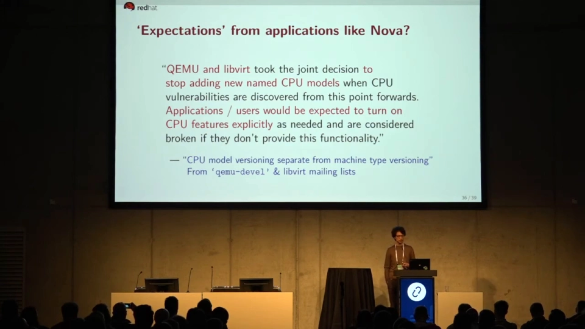

这对使用者的含义是：**"选个型号"已经不够了，你得能精确地往清单里加位、减位**。讲者也承认 Nova 当时只能加、不能减（`cpu_model_extra_flags` 只能 enable），这是他自己认领的一个待办。

## 六、把选择落到一张决策表上

讲者最后给了总结性的取舍，可以直接当决策表用：

| 场景 | 选择 | 代价 |
| --- | --- | --- |
| 机房 CPU 完全同款、追求极致性能 | host-passthrough | 客户机 CPU 不可预测；微码与内核版本必须一致，否则热迁移不可靠 |
| 机房 CPU 异构、需要双向热迁移 | host-model（Nova 默认） | 冷重启后会按新宿主"长特性"，可能迁不回去 |
| 想固定一份清单、自己掌控增删 | custom / named CPU model | 型号是别人定义的，新型号要等上游；加减位需要工具支持 |
| 机房异构且熟悉自家 CPU | 自己算 baseline | 需要维护一份多宿主 XML 并随硬件更新 |

## 小结

- **客户机看到的 CPU 是 VMM 拼出来的一份 CPUID 位图**，不是物理芯片。CPUID 之所以必须被拦截，是因为它在硬件上本是一条普通指令，放行就等于把宿主 CPU 的全部信息交出去。
- KVM 把 CPUID 模拟放在**内核里**完成，走轻量 exit，不必每次都陷到 QEMU。
- QEMU 的默认型号（`qemu64`）为了"到处都能跑"而砍掉了 AES-NI、RDRAND、PCID，代价是性能与安全缓解措施一起丢。
- 三种给法各有取舍：**host-passthrough** 最快但不可迁移；**named CPU model** 清单固定、可定制；**host-model** 由 libvirt 现场合成，兼顾性能与迁移，是 Nova 的默认值。
- 跨异构宿主迁移的关键是 **baseline**：把所有宿主的型号求交集，得到一份大家都能展开成同样位图的清单。
- 安全补丁通过**往清单里加位**下发（`spec-ctrl`、`ssbd`、`pcid` 等），且必须冷重启客户机才生效；上游已不再为每个 CVE 新增型号，改由上层应用显式开关特性位。
- 机器类型是另一条会改动 CPU 特性的暗线，换它需要显式操作并冷重启。

## 关键术语速查

| 术语 | 一句话解释 |
| --- | --- |
| CPUID | x86 上查询 CPU 信息的非特权指令，输入 leaf 与 subleaf，输出四个寄存器的位域；虚拟化时由 VMM 代答 |
| 轻量 exit / 重量 exit | 前者由 KVM 在内核里处理完就返回客户机（如 CPUID、时钟），后者要一路返回用户态 QEMU |
| CPU model（CPU 型号） | 一份预定义的 CPUID 特性位清单，用型号名引用，如 `IvyBridge-IBRS` |
| host-passthrough | 把宿主 CPU 的 CPUID 位原样暴露给客户机，`-cpu host` |
| host-model | libvirt 的抽象：启动时按宿主能力合成 CPU 定义，兼顾性能、迁移与自动补安全位 |
| baseline CPU | 对多个宿主型号求交集得到的清单，保证客户机可在这些宿主间热迁移 |
| machine type | QEMU 的虚拟芯片组版本，提供稳定的客户机 ABI，偶尔会改动 CPU 特性 |
| `-IBRS` / `-IBPB` 型号 | 内置了对应侧信道缓解特性位的 CPU 型号变体 |
| `migration-safe` | 表示 QEMU 不会在启动时给该型号偷偷加特性，从而不破坏迁移 |