# 客户机内核眼里的物理内存是假的：CR3 与四级页表如何把 GVA 走成 GPA

> 视频来源：[Lec24 x86 64 Page Directory And Ttable Entries](https://www.youtube.com/watch?v=Ex9uh91_muQ)（YouTube · Tommy Li，Caltech CS24 课程录像）｜时长约 51 分钟
> 导读：这是一堂把 x86-64 页表拆到底的课——48 位地址怎么切、页表项 64 位里每一位干什么、TLB 怎么把四级遍历压成一次查表、缺页时内核凭什么判断该不该杀进程。本文只取其中「客户机内部这一级翻译」：GVA 怎么变成 GPA。GPA 怎么变成宿主物理地址（HPA）、影子页表与 EPT 的取舍，留给同节的 2.1.2 与 2.1.3。视频本身讲的是裸机上的这套机制，本文在需要处点明它放进虚拟机后哪一部分换了名字。

## 本讲要解决的核心问题（SCQA）

**背景**：一台虚拟机跑起来之后，客户机内核会做一件和裸机上一模一样的事：给每个进程建一套页表，把进程看到的虚拟地址（GVA，guest virtual address）翻译成它以为的物理地址。它把页表根地址写进 CR3，然后该跑就跑。

**冲突**：可客户机内核手里那块「物理内存」是假的——它是 VMM 分配给它的一段内存，编号从 0 开始，叫客户机物理地址（GPA，guest physical address）。客户机内核对此一无所知，也不会去问。于是问题变成：这一级翻译到底是怎么完成的？页表项里那个「物理页号」字段，装的是谁家的页号？

**疑问**：客户机内部的页表遍历具体分几步、每一步读什么？页表项 64 位里除了物理页号还有什么？硬件什么时候查页表、什么时候查 TLB？这一级出错时客户机内核又凭什么决定是杀进程还是补一页？

**回答（中心思想）**：这一级就是标准的 x86-64 四级页表遍历——CR3 给出顶层页表基址，48 位虚拟地址切成 4 段 9 位索引加 12 位页内偏移，逐级查到最底层的页表项（PTE），取出物理页号再和偏移拼起来。**对客户机内核来说，这个「物理页号」就是它眼里的物理内存编号（GPA），它不需要、也无法知道后面还有一层翻译**。也正因为如此，客户机里这一级的代码、页表格式、TLB 行为，和裸机上完全一样。

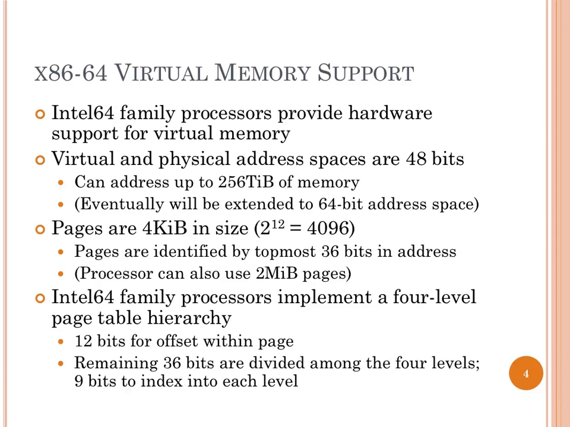

## 一、先把这一级的输入输出定下来

### 1.1 客户机内核拿到的地址空间是 48 位、页 4 KiB

视频一进入正题就给了一组硬数字（[【跳转到 05:07】](https://www.youtube.com/watch?v=Ex9uh91_muQ&t=307)）：Intel x86-64 处理器上的虚拟地址空间是 **48 位**，明显少于 64 位；处理器实际能寻址 **256 TiB**。讲者顺带吐槽：Intel 当年大概是觉得 256 GB 就够用了，后来发现不够，才一路加到 256 TB；再往后要扩到完整 64 位，但他们觉得现在没必要。

页的大小是 **4 KiB**，也就是 $2^{12} = 4096$ 字节。所以一个地址可以拆成两截：

- **低 12 位**：页内偏移（offset），它在这页里是第几个字节；
- **高 36 位**：页号，它标识这是哪一页。

「页号 + 偏移」这个拆法不是 x86 独有的，而是所有分页机制的共同前提：**翻译只针对页，不针对字节**。讲者在另一处专门解释过为什么以页为单位（[【跳转到 08:27】](https://www.youtube.com/watch?v=Ex9uh91_muQ&t=507)）：如果一个字节一个字节地转换，开销完全不可接受。

### 1.2 为什么必须是四级：一张平坦页表要 512 GB

初学者最容易卡住的地方是「为什么非要搞四级」。视频用一道算术把答案摆了出来（[【跳转到 05:57】](https://www.youtube.com/watch?v=Ex9uh91_muQ&t=357)）：

48 位地址去掉 12 位偏移，剩下 36 位页号，也就是 $2^{36}$ 个页。如果只用一张平坦（单级）页表来记录「每个虚拟页对应哪个物理页」，每个页表项 8 字节，那么一张表就是

$$
2^{36} \times 8\ \text{B} = 2^{39}\ \text{B} = 512\ \text{GiB}
$$

而且**每个进程都要有一份**。谁愿意为一个进程浪费半个 TB？

四级页表把这张大表拆成树：顶层只需要一个 4 KiB 的页（512 项），每一项指向下一层的 4 KiB 页，用到哪一支才建哪一支。讲者给了一个更有说服力的数字（[【跳转到 06:22】](https://www.youtube.com/watch?v=Ex9uh91_muQ&t=382)）：**即使你把四级页表的整棵树全部填满，总共也只有 513 GB**——和那张平坦表的 512 GB 几乎一样。也就是说，这套稀疏结构的「最坏情况」并不比稠密表示贵多少，而它的「常见情况」便宜得离谱。

常见情况有多便宜？讲者现场 dump 了 GCC 的页表（[【跳转到 07:12】](https://www.youtube.com/watch?v=Ex9uh91_muQ&t=432)）：GCC 算是个大程序了，但运行它所需的整棵页表结构，大概只要**六七页**就能表示。这就是四级页表存在的全部理由——**用深度换空间**。

### 1.3 四级的名字，以及每一级为什么正好 9 位

四个层级在 Intel 和 Linux 里各有一套名字（[【跳转到 07:37】](https://www.youtube.com/watch?v=Ex9uh91_muQ&t=457)、[【跳转到 08:02】](https://www.youtube.com/watch?v=Ex9uh91_muQ&t=482)）：

| 层级 | Intel 的叫法 | Linux 里的叫法 | 缩写 |
| --- | --- | --- | --- |
| 第 1 级（最顶） | Page Global Directory | 页全局目录 | PGD / PML4 |
| 第 2 级 | Page Upper Directory | 页上级目录 | PUD / PDPT |
| 第 3 级 | Page Middle Directory | 页中间目录 | PMD / PD |
| 第 4 级（最底） | Page Table | 页表 | PT |

讲者说这几层的命名过程「相当痛苦，你能看出他们当时在纠结」：IA-32 时代只有两级，叫页目录和页表；到了 64 位，只好在上面继续加「upper」「middle」。

每级用多少位索引？答案是**每级 9 位**，而且这个 9 是被页大小和页表项大小反推出来的（[【跳转到 08:02】](https://www.youtube.com/watch?v=Ex9uh91_muQ&t=482)）：

- 一页 4 KiB = 4096 字节；
- 一个页表项 8 字节（64 位）；
- 所以一页正好装 $4096 / 8 = 512$ 个页表项；
- $512 = 2^9$，于是每级正好用 9 位地址来选中其中一项。

四级的账就这样对上了（[【跳转到 08:27】](https://www.youtube.com/watch?v=Ex9uh91_muQ&t=507)）：

$$
4 \times 9\ \text{位} + 12\ \text{位偏移} = 48\ \text{位}
$$

讲者的原话是「他们就是照着这个凑出来的，所以一切都对得上」。

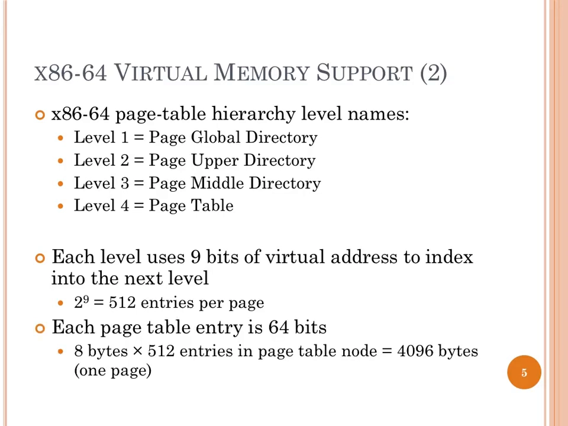

### 1.4 CR3 是这一级的总开关，而它只有内核能改

遍历的起点是一个寄存器。Intel 上它叫 **CR3**（也叫 PDBR，page directory base register），里面存的是当前进程顶层页表（PGD）的基址（[【跳转到 13:27】](https://www.youtube.com/watch?v=Ex9uh91_muQ&t=807)）。处理器一共有大约 6 个控制寄存器，控制运行模式、寻址模式这类最基础的东西；发生缺页时，引发缺页的地址放在 CR2 里，内核可以取出来存到某处、再传回用户程序。

关键约束是（[【跳转到 13:52】](https://www.youtube.com/watch?v=Ex9uh91_muQ&t=832)、[【跳转到 14:17】](https://www.youtube.com/watch?v=Ex9uh91_muQ&t=857)）：**CR3 只有内核态代码能改**。讲者的评价是「这很聪明，我们只希望内核能改页表结构，用户程序必须通过 mmap、brk 之类的操作来请求」。

这一点放到虚拟机里尤其重要：客户机的 CR3 由客户机内核自己写，VMM 完全不参与——客户机内核改 CR3 时不会触发任何 VM exit，它只是在写一个普通寄存器。

## 二、一次页表遍历：48 位被切成 4 段 9 位

### 2.1 偏移直通，页号逐级查

视频用一张图把整个流程画完了（[【跳转到 09:17】](https://www.youtube.com/watch?v=Ex9uh91_muQ&t=557)）：

1. **低 12 位偏移直接原样传过去**，变成物理地址的页内偏移。讲者的说法很形象：「它只是块内的偏移，直接搬过去就行，反正只是连线，很快。」
2. **剩下的 36 位切成四个 9 位**，每一段在对应那一级做一次索引查找。
3. 从 **PDBR（CR3）** 指向的页全局目录开始，一级一级往下查，最后一级的页表项里给出**物理页号**。
4. 物理页号 + 页内偏移 = 物理地址。

顺带一个新手常困惑的现象（[【跳转到 09:17】](https://www.youtube.com/watch?v=Ex9uh91_muQ&t=557)）：为什么调试时看到的地址最高两个字节永远是 0？因为 48 位地址被放在 64 位的容器里，高 16 位没有用上。

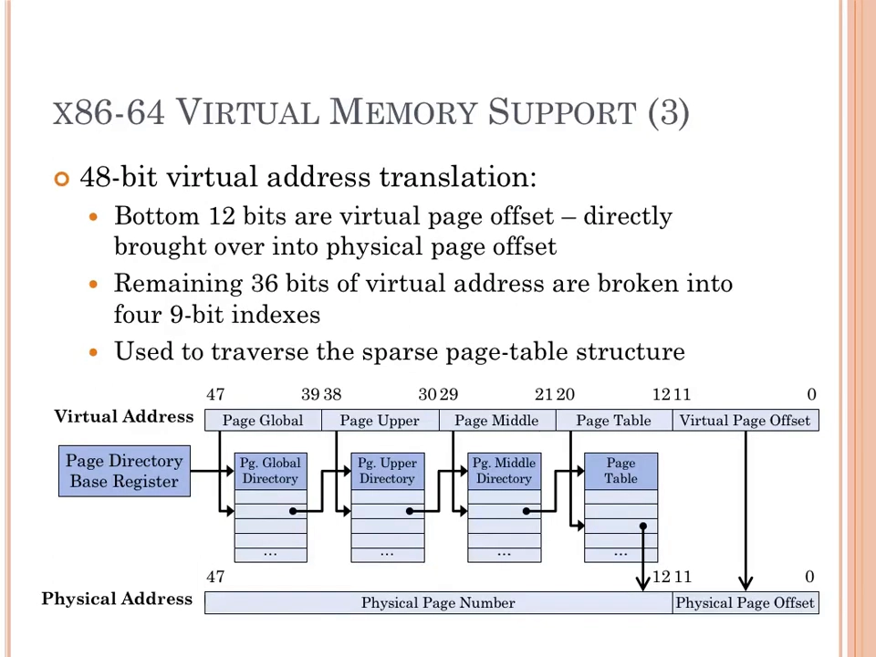

### 2.2 上层节点存「下一级在哪」，最底层存「页在哪」

这是初学者最容易记混的一点，讲者专门点出来（[【跳转到 10:07】](https://www.youtube.com/watch?v=Ex9uh91_muQ&t=607)）：

- **上层节点**（PGD、PUD、PMD）的项里存的是「下一级页表节点在这棵结构的哪个位置」，也就是下一级页表的**基址**；
- **最底层**（PT）的项里存的才是**物理页号**，也就是数据页在哪。

所以「查页表」这件事，本质上是沿着一条指针链走到底：CR3 → PGD 项 → PUD 项 → PMD 项 → PT 项 → 物理页号。走完这条链，一共读了 **4 次内存**。

### 2.3 把这一级放回虚拟机：那个「物理页号」是 GPA

到这里，视频讲的还是裸机。把它放进一台虚拟机，唯一变化的是「物理地址」这个角色由谁扮演：

- 客户机 CR3 里存的基址，是一个 **GPA**；
- 每一级页表项里那个「下一级页表基址」「物理页号」字段，存的也都是 **GPA**；
- 拼出来的「物理地址」，是 **GPA**。

客户机内核对此毫无察觉。它按裸机的规矩建表、填表、写 CR3，然后理直气壮地去访问它以为的物理内存——这正是本文标题说的「客户机内核眼里的物理内存是假的」。**这一级对客户机内核来说和裸机完全一样，不是因为它特殊，而是因为它真的什么都没变**：变的是这些 GPA 之后还有没有人再翻译一次。

也正因为如此，客户机的页表本身也躺在客户机内存里。硬件要读一个页表项，得先知道那张页表在客户机物理内存的哪个位置——而这个位置本身是个 GPA。这就是 2.1.2「GPA → HPA」要接手的地方：客户机这一级走完，交出去的是一个 GPA，剩下的翻译不归它管。

## 三、页表项：物理页号在中间，其余全是权限与状态

### 3.1 present 位为 0 时，其余 63 位归内核用

页表项是 64 位、8 字节。第 0 位是 **present 位**（有效位），它说明这个项里到底有没有有效信息，还是应该被 MMU 直接忽略——因为操作系统还没在这段地址映射上做任何事（[【跳转到 14:32】](https://www.youtube.com/watch?v=Ex9uh91_muQ&t=872)）。

如果一次访问落到 present 为 0 的项上，就会触发缺页，内核必须介入。而 present 为 0 时，**其余 63 位都可以给内核自由使用**（[【跳转到 14:57】](https://www.youtube.com/watch?v=Ex9uh91_muQ&t=897)）。视频给了两种典型用法：

1. **存交换位置**：一部分位标识是哪个交换设备（swap device），剩下的位当作索引，指出这块数据存在那个设备的哪个位置。Linux 早期就是这么干的，讲者猜 64 位 Linux 也类似。
2. **存一个指针**：指向描述这段地址的更多信息。这种结构体的地址通常按 8 字节或 16 字节对齐，最低几位永远是 0——正好和 present 位为 0 完美配合（[【跳转到 15:47】](https://www.youtube.com/watch?v=Ex9uh91_muQ&t=947)）。

### 3.2 present 为 1 时：物理页号在 12 位往上

present 为 1 之后，这个项才真正描述一段地址（[【跳转到 16:17】](https://www.youtube.com/watch?v=Ex9uh91_muQ&t=977)）。讲者的做法很直接：把物理页号的低位补零（页内偏移我们不关心），再用按位或把各个控制位拼上去（[【跳转到 16:42】](https://www.youtube.com/watch?v=Ex9uh91_muQ&t=1002)）。

也就是说，**第 12 位往上存物理页号，低 12 位和最高位是标志位**。讲者提醒：这里存的页目录地址、页表地址「是一个物理地址，光这一部分就够复杂了」——在虚拟机里，这句话要读成「是一个 GPA」。

页目录项和页表项长得几乎一样，唯一区别是页表项多一个 **D（dirty）位**（[【跳转到 17:07】](https://www.youtube.com/watch?v=Ex9uh91_muQ&t=1027)）。

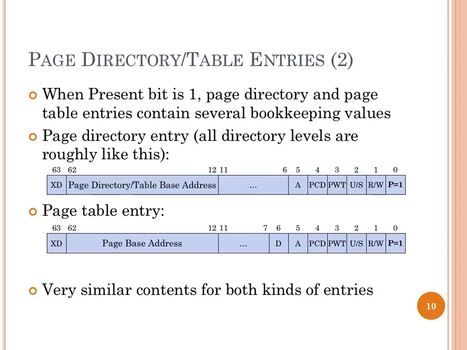

### 3.3 三个最该记住的权限位

视频把权限位讲得很细（[【跳转到 17:32】](https://www.youtube.com/watch?v=Ex9uh91_muQ&t=1052)、[【跳转到 17:57】](https://www.youtube.com/watch?v=Ex9uh91_muQ&t=1077)）：

- **第 1 位 R/W**：1 表示可读可写，0 表示只读。
- **第 2 位 U/S**：1 表示用户态可访问，0 表示只有内核（超级用户）能访问。Intel 的说法里用户态就是 ring 3。
- **第 63 位 XD**（execute disable，执行禁用）：1 表示**不允许从这段地址取指令执行**。

XD 位为什么重要？因为 MMU 知道这次访问是来干什么的——你有指令缓存和数据缓存，CPU 执行指令时不同类型的访问同时在发生（[【跳转到 18:22】](https://www.youtube.com/watch?v=Ex9uh91_muQ&t=1102)）。于是 MMU 可以说：我这次是取指，XD 是 1，不行；或者：我这次是读数据、写数据，XD 是 0 也没关系（[【跳转到 18:47】](https://www.youtube.com/watch?v=Ex9uh91_muQ&t=1127)）。

讲者对它的评价很直接：「**缓冲区溢出这类攻击突然就行不通了**」——你可以规定任何从栈上取指令的行为都不可信，把栈和数据页设成不可执行，把代码页设成可执行且只读（[【跳转到 04:17】](https://www.youtube.com/watch?v=Ex9uh91_muQ&t=257)）。

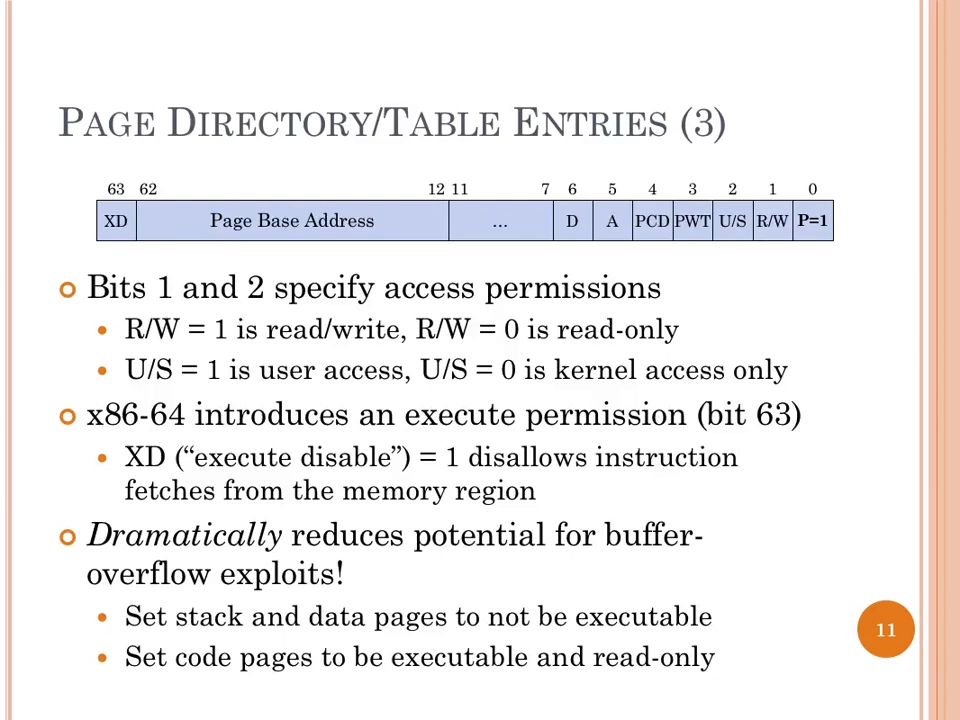

### 3.4 PWT 与 PCD：为 MMIO 准备的缓存开关

第 3、4 位是 **PWT** 和 **PCD**，用来控制这段地址的缓存策略（[【跳转到 19:12】](https://www.youtube.com/watch?v=Ex9uh91_muQ&t=1152)）：

- **PWT**（write-through）：写操作是否一路写到内存，还是先攒在缓存里、之后再写回（write-back）。
- **PCD**：这段地址的缓存是使能还是禁用。

讲者很诚实地承认他不清楚 PWT 在现实中怎么落实——如果涉及磁盘，CPU 自己显然做不到，肯定要有设备驱动参与（[【跳转到 19:37】](https://www.youtube.com/watch?v=Ex9uh91_muQ&t=1177)）。但 PCD 的用途很清楚：**把 DRAM 和 CPU 之间的其他硬件缓存都关掉**（[【跳转到 20:02】](https://www.youtube.com/watch?v=Ex9uh91_muQ&t=1202)）。

为什么要关缓存？因为有些外设是真的映射在地址总线上的（[【跳转到 20:27】](https://www.youtube.com/watch?v=Ex9uh91_muQ&t=1227)）：地址线连到设备上，片选信号在当地址被访问时变高，你就可以在这个「内存位置」上读或写，看起来就像一块内存——但其实你是在和一个设备对话。这种时候你不希望缓存来干扰这次交互。典型例子是图形硬件被映射到某个地址范围，你要确保那次读写真的打到显存，而不是打到你自己的本地缓存（[【跳转到 20:52】](https://www.youtube.com/watch?v=Ex9uh91_muQ&t=1252)）。

> 对 MicroVM 读者来说，这一段是后面「MMIO 退出」的伏笔：客户机访问设备的那块地址，在客户机页表里就是一个 PCD 置位的映射；而它背后的 GPA 并不对应真实 RAM，于是访问会在下一级翻译里出事。

### 3.5 A 位、D 位，以及没有这两位的处理器

第 5 位是 **A（accessed）位**：一次访问经过 MMU 并且成功了，MMU 就把这一位置 1，内核据此知道「这一页被访问过」；**清这一位是内核的责任**（[【跳转到 21:17】](https://www.youtube.com/watch?v=Ex9uh91_muQ&t=1277)、[【跳转到 21:42】](https://www.youtube.com/watch?v=Ex9uh91_muQ&t=1302)）。第 6 位是 **D（dirty）位**：这段地址上是否发生过写操作，也就是内存里的数据可能已经和交换设备上的副本不一致了（[【跳转到 22:07】](https://www.youtube.com/watch?v=Ex9uh91_muQ&t=1327)）。

有意思的是，**很多处理器根本没有这两位**（[【跳转到 22:32】](https://www.youtube.com/watch?v=Ex9uh91_muQ&t=1352)）。讲者举着自己的 iPhone 说：它里面是 ARM 处理器，ARM 确实有 MMU，但页表项里没有脏位。顺带他还解释了一个常见误解（[【跳转到 01:47】](https://www.youtube.com/watch?v=Ex9uh91_muQ&t=107)）：手机没有磁盘、只有闪存，但它照样有虚拟内存——因为**进程地址空间隔离仍然需要**；只是「把数据存到交换设备」这一整套不完整，偶尔还会缺页，但大多数时候走不到那条路径。那怎么知道哪些页脏了、哪些被访问过？

唯一办法是实现某种**陷入机制**（[【跳转到 22:57】](https://www.youtube.com/watch?v=Ex9uh91_muQ&t=1377)）：强制制造一次缺页来标记「被访问过」，强制制造一次保护错误来标记「变脏了」。所以 Android——它构建在 Linux 上——实际上维护着**两套页表**：处理器用的那套没有这些位，操作系统维护的那套有，内核要让两套保持同步（[【跳转到 23:22】](https://www.youtube.com/watch?v=Ex9uh91_muQ&t=1402)）。

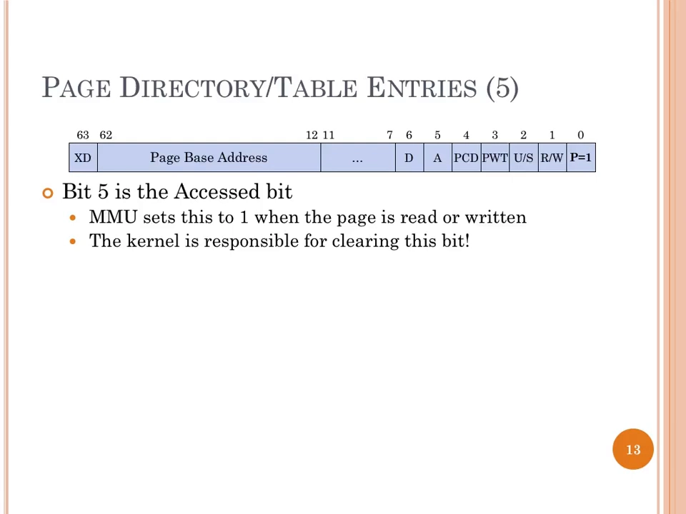

## 四、TLB：把四级遍历压成一次查表

### 4.1 页表在 DRAM 里，所以每次遍历都很贵

页目录和页表都存在 DRAM 主存里（[【跳转到 25:57】](https://www.youtube.com/watch?v=Ex9uh91_muQ&t=1557)）。DRAM 访问的最坏情况是 **50–100 ns**；如果需要的块恰好在 L1 里，那是 1–3 个时钟周期。四级遍历意味着一次访存要额外读 4 次内存——这显然不能接受。

所以 CPU 里有一个 **TLB**（translation lookaside buffer，地址翻译旁路缓冲）：一个和 SRAM 缓存同样设计的硬件缓存（[【跳转到 25:57】](https://www.youtube.com/watch?v=Ex9uh91_muQ&t=1557)）。x86-64 上它是组相联缓存，具体结构各代不同；**输入是虚拟页号，每一项里存的是一个页表项的细节，包括物理页号和权限**（[【跳转到 25:32】](https://www.youtube.com/watch?v=Ex9uh91_muQ&t=1532)）。而且 TLB 自己还有多级。

### 4.2 命中、部分命中、未命中

视频用一张图把三条路径画在了一起（[【跳转到 26:31】](https://www.youtube.com/watch?v=Ex9uh91_muQ&t=1591)）：

- **命中**：直接取出物理页号，再检查权限，一切允许就完成翻译。可能花一个时钟周期，也可能不花——TLB 非常快。
- **未命中**：回到前面那套流程，开始访问内存、走四级遍历（[【跳转到 26:56】](https://www.youtube.com/watch?v=Ex9uh91_muQ&t=1616)）。
- **部分命中**（partial TLB hit）：TLB 项里除了最后一部分，其他都有——虚拟地址里用于索引 PGD、PUD、PMD 的那几段都对得上，只有页表那一段不对（[【跳转到 30:21】](https://www.youtube.com/watch?v=Ex9uh91_muQ&t=1821)）。这时可以把已经对上的信息取出来，只付剩下那次页表查找的代价（[【跳转到 30:46】](https://www.youtube.com/watch?v=Ex9uh91_muQ&t=1846)）。

讲者对部分命中的评价是「这确实很聪明，你得承认」（[【跳转到 31:11】](https://www.youtube.com/watch?v=Ex9uh91_muQ&t=1871)）。

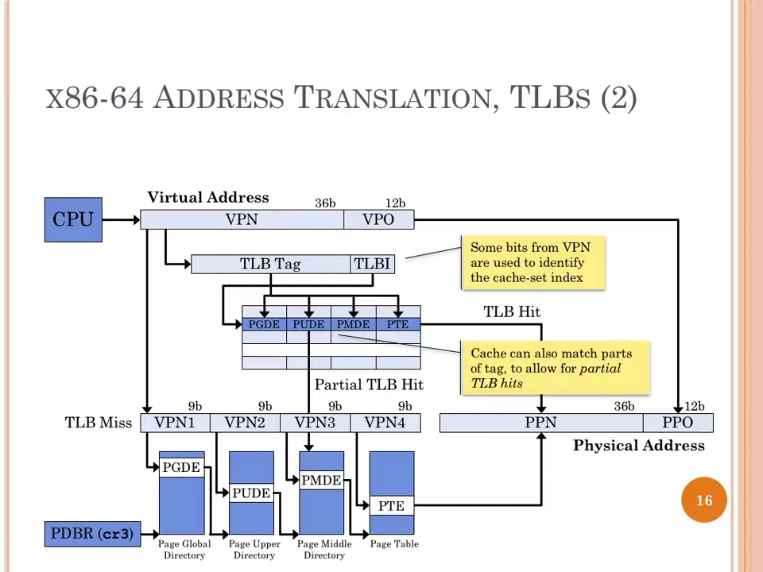

### 4.3 地址空间越大，层级越多，代价越高

讲者在这里抛了一个问题（[【跳转到 27:21】](https://www.youtube.com/watch?v=Ex9uh91_muQ&t=1641)）：地址空间变大，什么代价也跟着变大？答案是**间接层数**——为了走到真正的物理页号，要跳的级数越来越多（[【跳转到 27:46】](https://www.youtube.com/watch?v=Ex9uh91_muQ&t=1666)）。

他给了两个极端例子：

- **Sun 的一款处理器**有真正的 64 位地址空间，虚拟到物理的翻译机制有**七级**。这时 TLB 未命中就要付出八次内存访问——一次是访问本身，七次用来做地址翻译（[【跳转到 28:11】](https://www.youtube.com/watch?v=Ex9uh91_muQ&t=1691)、[【跳转到 28:36】](https://www.youtube.com/watch?v=Ex9uh91_muQ&t=1716)）。
- **反置页表**（inverted page table）：把每个物理页号放进一个数组，数组项里存虚拟页号。问题是每个物理页号只能属于一个进程，共享内存就不好办了；而且做翻译时你手里是虚拟地址，数组却按物理地址索引，只能哈希（[【跳转到 29:01】](https://www.youtube.com/watch?v=Ex9uh91_muQ&t=1741)）。于是这类处理器在 TLB 未命中时会**产生一次 TLB miss fault**，让内核自己算哈希、查反置页表、顺着溢出链找到那一条，才能完成翻译（[【跳转到 29:26】](https://www.youtube.com/watch?v=Ex9uh91_muQ&t=1766)）。

讲者的结论是：这套机制看起来很精巧，但地址空间一大就开始吃力、呻吟（[【跳转到 29:51】](https://www.youtube.com/watch?v=Ex9uh91_muQ&t=1791)）。

### 4.4 一个能自己动手验证的实验

「故事时间」里，讲者讲了他写的一个程序（[【跳转到 31:36】](https://www.youtube.com/watch?v=Ex9uh91_muQ&t=1896)）：它只访问固定数量的缓存行，这些行本来总能装进 L1；然后他把这些行越摊越开，从一个缓存行跳到另一个缓存行时跨过巨大的内存块。按道理这不该造成任何 L1 未命中，但**应该会造成 TLB 未命中**。结果确实如此：某些地址范围访问起来总是慢得多，远慢于 L1 命中的代价——他笔记本上是 50 到 100 个时钟周期（[【跳转到 32:01】](https://www.youtube.com/watch?v=Ex9uh91_muQ&t=1921)、[【跳转到 32:26】](https://www.youtube.com/watch?v=Ex9uh91_muQ&t=1946)）。

但这个实验的结果并不稳定：动一下鼠标、切到另一个程序，或者有别的程序在大量用内存，你已经在产生 TLB 未命中了——因为**每次切换页表，TLB 就过期了，反正得刷掉**（[【跳转到 32:51】](https://www.youtube.com/watch?v=Ex9uh91_muQ&t=1971)）。讲者的总结是：有太多精巧的机制被塞进系统这一部分，只为了让虚拟地址机制足够快——「它必须快，否则程序就没法用了」（[【跳转到 33:16】](https://www.youtube.com/watch?v=Ex9uh91_muQ&t=1996)）。

> 这条「切页表就要刷 TLB」在虚拟化里会被放大成一个大问题：客户机切 CR3 时，硬件怎么知道 TLB 里哪些项属于哪个客户机？这正是 2.1.3 里 VPID 一类机制要解决的事。

## 五、大页：少走一级，页就大 512 倍

### 5.1 用几级，决定页多大

页大小从哪来？就来自你在查找路径上走多远（[【跳转到 10:32】](https://www.youtube.com/watch?v=Ex9uh91_muQ&t=632)）：

- 想要 **4 KiB** 的页，四级全用上；
- 想要 **2 MiB** 的页，只用三级，让页中间目录（PMD）的那一项**直接指向一个 2 MiB 页的起始位置**（[【跳转到 10:57】](https://www.youtube.com/watch?v=Ex9uh91_muQ&t=657)）；
- 再往上只用两级，就是 GB 级的大页。

为什么「少一级正好大 512 倍」？因为最底层页表节点里的每一项对应 4 KiB 地址空间，$4\ \text{KiB} \times 512 = 2\ \text{MiB}$（[【跳转到 11:22】](https://www.youtube.com/watch?v=Ex9uh91_muQ&t=682)）。所以想要 2 MB 页，走三级寻址、把最后一级扔掉就行。

讲者在这里对具体数字不太确定（「这个数你得自己算，我对自己的算术不太有信心」），但规律是确定的：**每少走一级，页就大 512 倍**（[【跳转到 11:47】](https://www.youtube.com/watch?v=Ex9uh91_muQ&t=707)）。他也提醒，读 Intel 64 手册会发现处理器支持多种页大小——那本手册有四千页厚，「除非你要写操作系统，否则没人愿意自己啃」。

### 5.2 操作系统为什么要用大页

视频给了两个理由（[【跳转到 12:12】](https://www.youtube.com/watch?v=Ex9uh91_muQ&t=732)）：

1. **DMA 传输**：用页来做 DMA 时，操作系统可能想要大得多的缓冲区。
2. **某些权限位只在特定层级可用**：比如你在页表这一级可能没法指定执行位，但在页中间目录这一级可以，于是你可以说「这 2 MB 的块没有执行权限」或者「有执行权限」。

讲者自己也说这些属于偏门知识，除非你决定去写一个用上全部这些特性的操作系统，否则不用管（[【跳转到 12:37】](https://www.youtube.com/watch?v=Ex9uh91_muQ&t=757)）。但对 MicroVM 读者来说这条很实用：**大页是减少页表层级、提高 TLB 命中率的直接手段**，后面 2.2.1 讲 mmap 与大页时会再遇到它。

## 六、这一级出错时，客户机内核怎么判断

### 6.1 缺页不是「杀进程」的同义词

如果 present 位是 0，处理器产生缺页，然后**内核有得选**（[【跳转到 23:47】](https://www.youtube.com/watch?v=Ex9uh91_muQ&t=1427)）。讲者的原话是：「内核并不总是『哦缺页了，杀掉进程』——那是个糟糕的操作系统。」

如果一次访问**违反了那块内存区域的保护属性**，你会得到保护错误，而答案同样不总是杀掉进程，因为你可能在做一件很聪明的事——比如**写时复制**（copy-on-write），fork 之所以快就是靠它（[【跳转到 24:12】](https://www.youtube.com/watch?v=Ex9uh91_muQ&t=1452)）。

### 6.2 补充页表：内核另有一份「这块地址是什么」的记录

页表是给 CPU 用的，但内核还需要另一份信息来回答「这个地址属于谁、该有什么权限」。Linux 的做法是维护一串 **VMA（virtual memory area，虚拟内存区域）** 结构，串成一个**有序链表**（[【跳转到 42:09】](https://www.youtube.com/watch?v=Ex9uh91_muQ&t=2529)）：

- `vm_start` / `vm_end`：这个区间的起止地址；
- `vm_prot` / `vm_flags`：权限与标志；
- `vm_next`：链表里的下一个区域。

结构体里还记录着这个区间是从哪个文件映射来的（[【跳转到 42:34】](https://www.youtube.com/watch?v=Ex9uh91_muQ&t=2554)）。讲者提醒：你们调用 `mmap`、`mprotect` 的时候，其实就是在疯狂地改这个数据结构，所以它没出 bug 是件好事——几年前 `mmap` 里出过一个提权漏洞（[【跳转到 42:59】](https://www.youtube.com/watch?v=Ex9uh91_muQ&t=2579)）。

这份信息处在更高的抽象层次，很多时候被称为**补充页表**（supplemental page table）（[【跳转到 45:09】](https://www.youtube.com/watch?v=Ex9uh91_muQ&t=2709)）。

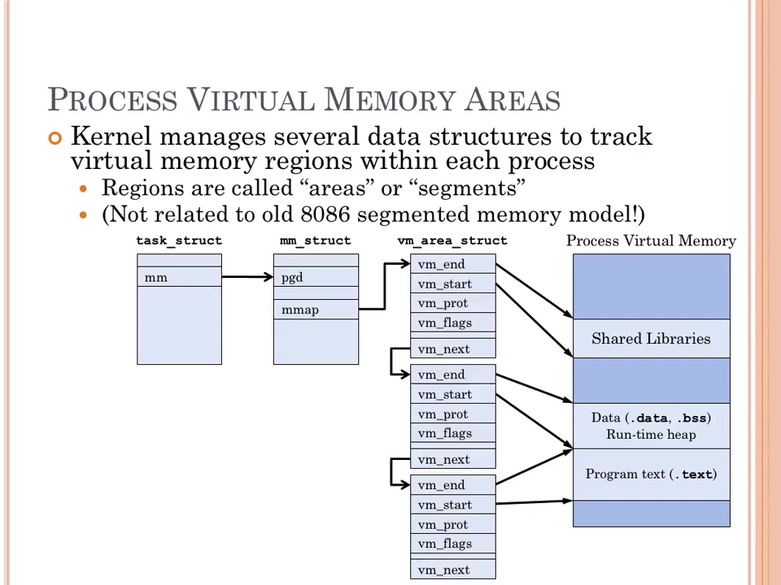

### 6.3 正常访问根本不碰 VMA

这是整堂课里最值得记住的一句话（[【跳转到 43:49】](https://www.youtube.com/watch?v=Ex9uh91_muQ&t=2629)）：**正常的访存，MMU 根本不需要任何干预，这些 VMA 结构从来不会被碰到**。处理器有自己的页表，它不需要看这些东西；这些是留给内核在出错时用的（[【跳转到 44:14】](https://www.youtube.com/watch?v=Ex9uh91_muQ&t=2654)）。

只有在因为访问而产生异常时，VMA 才真正重要（[【跳转到 44:19】](https://www.youtube.com/watch?v=Ex9uh91_muQ&t=2659)）。异常的原因可以分成几类：

- **非法访问**：想写只读内存、想访问内核专用内存；
- **合法但页被换出去了**：地址落在合法区间内，但那一页在交换设备上，需要换回来；
- **合法但页还没加载**：你访问的是程序的一部分（比如堆），那一页还没被载入（[【跳转到 44:44】](https://www.youtube.com/watch?v=Ex9uh91_muQ&t=2684)）。

### 6.4 从空指针到补一页：内核的决策树

**空指针**：程序访问一个不存在的地址（讲者说「这个我应该放在最前面讲，因为我们老干这事：因为某个蠢理由解引用空指针」），内核去查 VMA 链表，问「这个地址落在这些区间中的某一个里吗」（[【跳转到 45:34】](https://www.youtube.com/watch?v=Ex9uh91_muQ&t=2734)）。如果找不到对应项，它就知道这不是一个已映射的地址，于是产生 SIGSEGV 发给进程，通常就会直接杀掉进程（[【跳转到 45:59】](https://www.youtube.com/watch?v=Ex9uh91_muQ&t=2759)）。

**写只读区**：如果一次写落在某个 VMA 区间里，但那个区间是只读的，MMU 产生保护错误，内核一看「这是一段只读区域」，又给你一个 SIGSEGV（[【跳转到 46:24】](https://www.youtube.com/watch?v=Ex9uh91_muQ&t=2784)、[【跳转到 46:49】](https://www.youtube.com/watch?v=Ex9uh91_muQ&t=2809)）。

**合法缺页**：查过 VMA、确认地址合法、权限也允许之后，内核知道「也许我需要把一页载入内存，或者为这次访问做按需分配」（[【跳转到 47:14】](https://www.youtube.com/watch?v=Ex9uh91_muQ&t=2834)）。接着：

1. **选一个牺牲页换出去**——这又要回到物理页框上，得空出一个页框；
2. **如果它是脏的，先写回磁盘**；
3. **把请求的虚拟页载入内存**；
4. **从缺页处理程序返回**，回到引发异常的那条指令，再试一次（[【跳到 47:39】](https://www.youtube.com/watch?v=Ex9uh91_muQ&t=2859)、[【跳转到 48:04】](https://www.youtube.com/watch?v=Ex9uh91_muQ&t=2884)）。

讲者顺带点出一个优化：如果你挑的牺牲页最近没被访问过、而且不脏，那你就不用写回，省下解决这次缺页所需的时间。

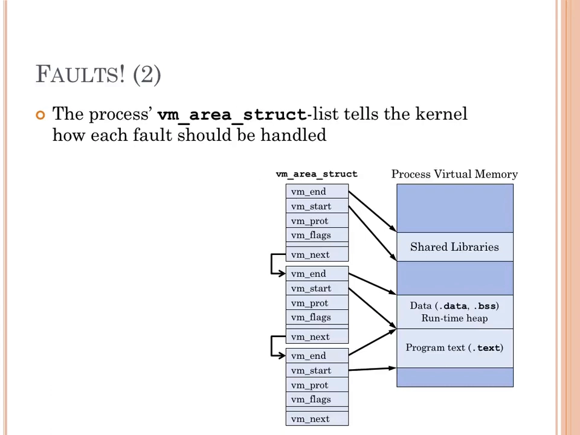

### 6.5 后台回写，以及「缺页其实是好事」

如果指令重试时，操作系统别太差、也没有严重的内存压力把你刚换进来的页又立刻换出去（讲者说「那是最糟的」），这条指令就会成功，程序愉快地继续跑（[【跳转到 48:29】](https://www.youtube.com/watch?v=Ex9uh91_muQ&t=2909)）。

操作系统还会做一件主动的事（[【跳转到 49:14】](https://www.youtube.com/watch?v=Ex9uh91_muQ&t=2954)）：**在后台遍历脏页，以很慢的速率把它们写回**。这样那些页就变干净了，之后换出它们的代价比换出一个脏页小得多。

最后是一个反直觉的结论（[【跳转到 50:04】](https://www.youtube.com/watch?v=Ex9uh91_muQ&t=3004)）：缺页几乎总是**一个绝佳的上下文切换机会**，因为这个进程接下来会被暂停几毫秒，等着页数据被搬进内存。所以「有一些缺页是可以的，甚至是好事」；但如果缺页太多，就会压垮 I/O 子系统的能力，整个系统开始爬行（[【跳转到 50:29】](https://www.youtube.com/watch?v=Ex9uh91_muQ&t=3029)）。

## 七、客户机眼里的地址空间长什么样

### 7.1 128 TB 分界：下面用户，上面内核

64 位 Linux 上程序的布局大致是固定的（[【跳转到 33:44】](https://www.youtube.com/watch?v=Ex9uh91_muQ&t=2024)）。注意那个分界点：`0x8` 后面跟一串零，也就是 `0x800000000000`，即 $2^{47}$，**128 TB 的边界**——下面属于用户程序，上面属于内核（[【跳到 34:09】](https://www.youtube.com/watch?v=Ex9uh91_muQ&t=2049)）。

讲者提醒：这只是边界，不是说这些内存都可用，因为你显然没有那么多物理内存，连磁盘上都没有——「我就没有 128 TB 的硬盘，有的话挺酷的，但我没有」。

从下往上依次是（[【跳转到 34:34】](https://www.youtube.com/watch?v=Ex9uh91_muQ&t=2074)）：

```
高地址
  ┌──────────────────────────────┐
  │ 进程相关的数据结构 / 内核栈     │ ← 每个进程不同
  ├──────────────────────────────┤
  │ 物理内存的直接映射             │ ← 每个进程相同
  ├──────────────────────────────┤  0x800000000000 (128 TB)
  │ 内核代码与全局数据             │
  ├──────────────────────────────┤
  │ 用户栈（%rsp 指向这里）        │
  ├──────────────────────────────┤
  │ 共享库映射区（地址随机化）      │
  ├──────────────────────────────┤
  │ 运行时堆（brk / malloc）       │
  ├──────────────────────────────┤
  │ 未初始化数据 .bss             │
  │ 已初始化数据 .data            │
  │ 程序代码 .text                │
  ├──────────────────────────────┤
  │ 禁止访问区（低地址）           │
  └──────────────────────────────┘
低地址
```

其中「进程相关的数据结构」里就包括**内核栈**，讲者特意强调它非常重要也非常酷：你们在作业六、七里写用户态线程库时做的事，几乎就是内核的工作方式（[【跳转到 41:14】](https://www.youtube.com/watch?v=Ex9uh91_muQ&t=2474)）。

注意 `.text` / `.data` / `.bss` 这三段的来历（[【跳转到 03:02】](https://www.youtube.com/watch?v=Ex9uh91_muQ&t=182)）：二进制文件其实就是在说「这里有一些数据字节，这是我希望它出现在地址空间里的起始地址，这是长度」，操作系统照着做。而 `.bss` 特殊在——ELF 文件（Windows 上叫 PE）只说「有这么多个字节」，不说明这些值应该是多少，由操作系统全部初始化成 0（[【跳到 03:52】](https://www.youtube.com/watch?v=Ex9uh91_muQ&t=232)）。所以任何被初始化为 0 的全局变量都在 `.bss` 里。

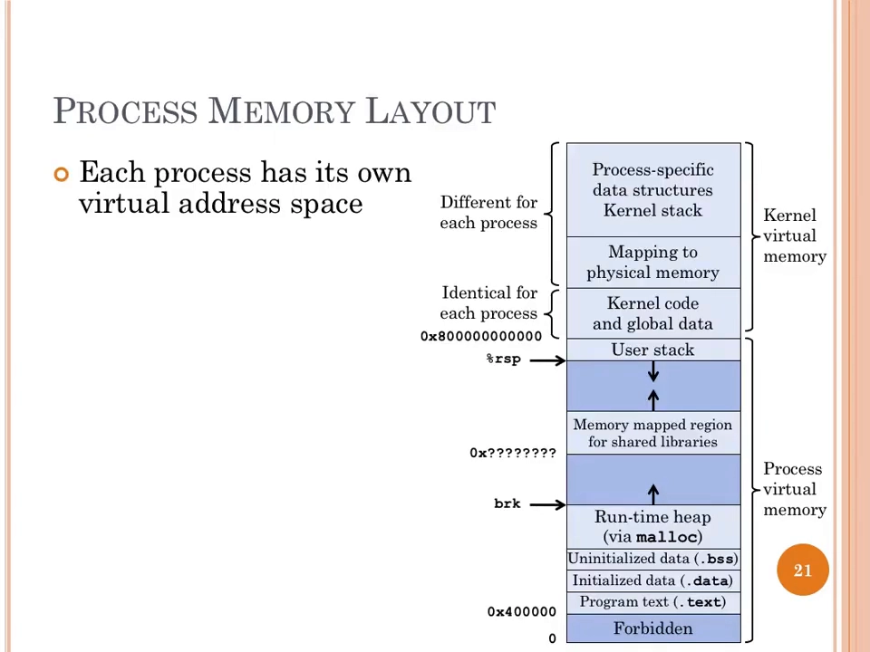

### 7.2 内核部分对每个进程都相同，这是调度的前提

地址空间的上半部分里，有一部分是**每个进程都不同**的（进程相关的数据结构、内核栈），另一部分是**每个进程都相同**的（内核代码与全局数据、物理内存的直接映射）（[【跳转到 34:59】](https://www.youtube.com/watch?v=Ex9uh91_muQ&t=2099)）。

另外，页目录里还映射了少量内核代码和共享库代码（[【跳转到 13:02】](https://www.youtube.com/watch?v=Ex9uh91_muQ&t=782)）：库代码其实一直都在那儿，因为这样才合理，但它也会被映射进进程的地址空间。于是有些物理页框会同时出现在很多不同程序的地址空间里——因为它们被共享，而我们希望这些页是只读的。

为什么内核部分必须相同？因为上下文切换时，我们从某个进程的地址空间进入内核，内核的东西都已经映射好了；然后我们调度，最终离开到另一个进程的地址空间。**如果这两个进程的内核映射方式完全相同，内核做调度时就不会看到自己的环境被换掉**——真正变化的只有用户态那部分，内核态那部分是相同的（[【跳到 35:24】](https://www.youtube.com/watch?v=Ex9uh91_muQ&t=2124)）。

这也解释了系统调用为什么容易做：内核代码映射在每个进程的地址空间里，`syscall` 指令用特殊控制寄存器里的值直接跳到内核，这些寄存器由内核在初始化时设置好（[【跳转到 38:44】](https://www.youtube.com/watch?v=Ex9uh91_muQ&t=2324) 附近）。

### 7.3 Meltdown 改掉了这个布局

理想情况下，MMU 应该在硬件层面阻止用户态代码访问内核空间的数据（[【跳转到 35:49】](https://www.youtube.com/watch?v=Ex9uh91_muQ&t=2149)）。但处理器为了快，会把多条指令流水起来：一条在取指、一条在译码、一条在取数、一条在计算；遇到条件指令还会**推测执行**（speculation）——猜你会走哪个分支（[【跳到 37:04】](https://www.youtube.com/watch?v=Ex9uh91_muQ&t=2224)）。

AMD 的做法是：用户态代码对内核空间发起推测访问时，**等到提交阶段再看是否允许**，不允许就产生异常（[【跳到 37:29】](https://www.youtube.com/watch?v=Ex9uh91_muQ&t=2249)）。为什么等？因为你甚至不知道自己会不会执行到那条指令，也许中途就跳走了（[【跳到 37:54】](https://www.youtube.com/watch?v=Ex9uh91_muQ&t=2274)）。

Intel 做了个糟糕的选择：**真的去做了那次推测访问**。于是本不该进缓存的信息进了缓存，而这是一个时间侧信道——你可以测量不同内存访问的耗时，看出哪些信息、从哪个地址被载入了缓存（[【跳到 38:19】](https://www.youtube.com/watch?v=Ex9uh91_muQ&t=2299)）。

修复办法（KPTI）是（[【跳到 38:44】](https://www.youtube.com/watch?v=Ex9uh91_muQ&t=2324)、[【跳到 39:09】](https://www.youtube.com/watch?v=Ex9uh91_muQ&t=2349)）：**重要的内核信息不再映射进进程地址空间**，只留一小段内核代码用来处理系统调用；进了内核就安全了，内核再切换到一个真正映射了全部内核数据的页表。

代价是（[【跳到 39:34】](https://www.youtube.com/watch?v=Ex9uh91_muQ&t=2374)）：现在每次系统调用都要切换虚拟地址映射，TLB 被清掉之类的一堆事，所以**系统调用变慢了**。讲者说：「如果你听人说过『现在系统调用变慢了』，希望你现在明白原因了。」

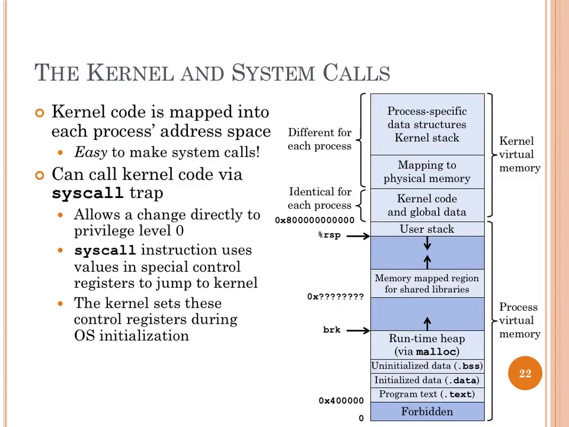

## 小结

- **这一级只做一件事**：CR3 给出顶层页表基址，48 位虚拟地址切成 4 段 9 位索引加 12 位偏移，逐级查到 PTE，取出物理页号与偏移拼接。四级、每级 512 项、每项 8 字节，都是被 4 KiB 页大小反推出来的。
- **为什么是四级**：一张覆盖 48 位空间的平坦页表要 512 GB，且每个进程一份；四级稀疏树即使全填满也只有 513 GB，而运行 GCC 只要六七页。
- **页表项里物理页号在 12 位往上**，低位是 P、R/W、U/S、PWT、PCD、A、D，最高位是 XD。present 为 0 时其余 63 位归内核用（存交换位置或指针）。
- **TLB 把四级遍历压成一次查表**，输入虚拟页号、输出页表项；还有「部分命中」这种只差最后一级的情形。地址空间越大，层级越多，未命中的代价越高（Sun 的七级、反置页表都是这条路上的尝试）。
- **少走一级，页就大 512 倍**：4 KiB 用四级、2 MiB 用三级、GB 级用两级。
- **正常访存不碰 VMA**：页表是给 CPU 用的；只有在出错时，内核才去查 VMA 链表判断「该不该映射、允不允许」，然后决定发 SIGSEGV 还是补一页。
- **放回虚拟机**：客户机 CR3 里、每一级页表项里、拼出来的「物理地址」里，装的都是 GPA。客户机内核对此一无所知——这一级和裸机完全一样，剩下的翻译不归它管。

## 关键术语速查

| 术语 | 一句话解释 |
| --- | --- |
| GVA / GPA / HPA | 客户机虚拟地址 / 客户机物理地址 / 宿主物理地址；本文只讲 GVA → GPA 这一级 |
| CR3（PDBR） | 存当前进程顶层页表基址的控制寄存器，只有内核能改 |
| PGD / PUD / PMD / PT | x86-64 四级页表的四层：页全局目录、页上级目录、页中间目录、页表 |
| PTE | 页表项，64 位；第 12 位往上存物理页号，低位是标志位 |
| present 位 | 第 0 位，说明这一项是否有有效映射；为 0 时触发缺页 |
| R/W、U/S、XD | 可写、用户态可访问、禁止取指三条权限 |
| PWT / PCD | 直写策略、缓存禁用；MMIO 区间常需要后者 |
| A / D 位 | 访问过、脏；由 MMU 置位，由内核清零 |
| TLB | 地址翻译缓存，输入虚拟页号、输出页表项；命中则免去四级遍历 |
| 大页 | 少走一级得到的 2 MiB / 1 GB 页，减少页表层级与 TLB 压力 |
| VMA | Linux 用 `vm_area_struct` 链表描述进程的地址区间，只在缺页时被查询 |
| 补充页表 | 对 VMA 这套「更高抽象层次」的地址描述信息的另一种叫法 |
| KPTI | Meltdown 之后的内核页表隔离：内核不再整体映射进用户地址空间，系统调用变慢 |