# 影子页表的成本不在翻译，而在同步：一次页表写一次陷入

> 视频来源：[Memory Virtualization and Shadow Page Table](https://www.youtube.com/watch?v=w5NOmYE1p8Y)（YouTube · Piyush Kumawat）｜时长约 19 分钟
> 导读：这是一支少见的、整篇只讲影子页表的讲解视频：从内存虚拟化的动机出发，讲清影子页表怎么由两张映射"合并"出来、同步要走哪五步、TLB 在其中扮演什么角色，最后列出三条局限并与嵌套分页对照。本文按"代价模型"这条线重排它的内容——**影子页表把翻译变便宜了，却把成本挪到了同步上**。写保护的具体做法、EPT violation 的触发条件属于 2.1.3 的范围，本文只在算账时点到。

## 本讲要解决的核心问题（SCQA）

**背景**：上一小节已经看过客户机自己那套页表：程序给出客户机虚拟地址（GVA），客户机内核用自己的页表把它翻译成客户机物理地址（GPA）。客户机操作系统坚信自己控制着物理内存。

**冲突**：可 GPA 不是真的。hypervisor 还得把它翻译成宿主物理地址（HPA）。于是**一次内存访问要做两段翻译**：客户机一段、hypervisor 一段。硬件只会走一套页表，所以早期 hypervisor 干脆自己造一套"已经算好两段"的表——影子页表（shadow page table）。翻译是变快了，可这套表得跟客户机页表保持一致，而客户机随时都在改页表。

**疑问**：影子页表到底把成本挪到了哪里？它贵在翻译，还是贵在别处？当虚拟机变多、进程变多、映射变多时，这套账会怎么恶化？

**回答（中心思想）**：**影子页表的成本不在翻译，而在同步。** 翻译一侧它确实更便宜——一步到位映射到 HPA，TLB 命中直接取地址，不需要任何硬件支持。但每一条"便宜"都要用同步来换：客户机每改一次页表，就必须被捕获（trap）、校验、让旧影子表项失效、建新表项；影子表是由"客户机页表 + hypervisor 的 GPA→HPA 知识"合并出来的，所以它天然是**多对一**——一套客户机页表对应一份影子表，客户机一换 CR3（切进程）就要换一份影子表并刷 TLB；再加上影子表自身的内存开销，三条成本叠加。**这套模型在 2008 年前后硬件二级翻译（Intel EPT / AMD NPT）落地后基本退场，因为硬件把"每次写都管"的频率成本换成了"多走几级页表"的深度成本，而深度是可以被 TLB 和分页结构缓存吸收的。**

## 一、影子页表要解决的不是"翻译对不对"，而是"翻译太贵"

### 1.1 两段翻译意味着一次访存查两次页表

先看内存虚拟化本身在做什么：它让每台虚拟机以为自己有一块私有、连续的地址空间（客户机物理内存），而 hypervisor 负责把这块"以为的内存"映射到真实的宿主物理内存页帧上，于是多台 VM 可以安全地共用同一块 RAM [【跳转到 03:37】](https://www.youtube.com/watch?v=w5NOmYE1p8Y&t=217)。

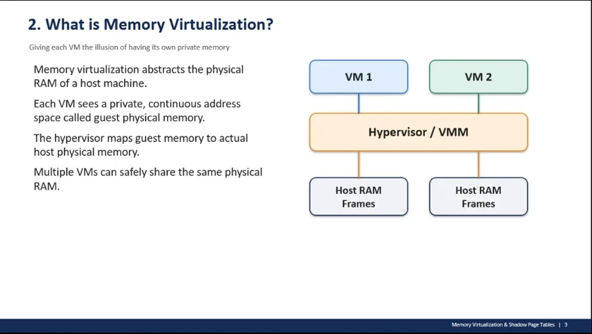

"以为"这两个字就是全部麻烦的来源。虚拟化环境里有三种地址 [【跳转到 05:42】](https://www.youtube.com/watch?v=w5NOmYE1p8Y&t=342)：

- **客户机虚拟地址（GVA）**：虚拟机里的程序产生的地址；
- **客户机物理地址（GPA）**：客户机操作系统以为的物理地址，实际不是物理 RAM 里的真实地址；
- **宿主物理地址（HPA）**：真实计算机里物理内存的实际地址。

翻译链是 GVA → GPA → HPA。**客户机做第一段，hypervisor 做第二段** [【跳转到 06:07】](https://www.youtube.com/watch?v=w5NOmYE1p8Y&t=367)。

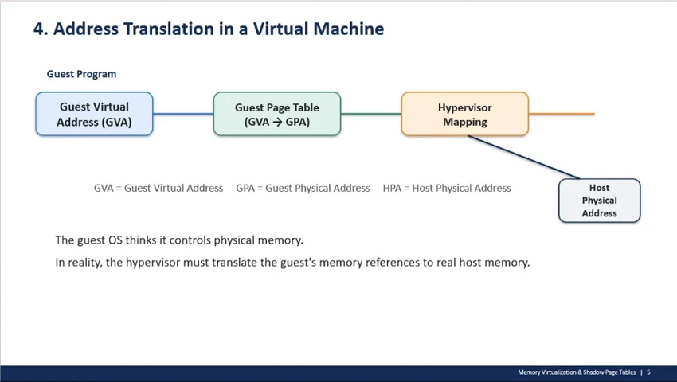

问题就出在"两段"上。视频的原话是：这可能要做**多次页表查询**，因此**一次内存访问可能变得很贵** [【跳转到 06:57】](https://www.youtube.com/watch?v=w5NOmYE1p8Y&t=417)；当一台虚拟机做大量内存访问时，这个问题尤其严重。

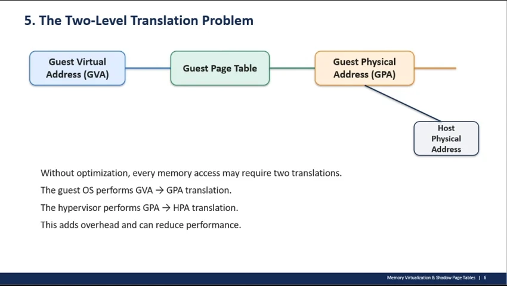

### 1.2 解法：把两张映射"合并"成一张

影子页表的定义很干脆：**由 hypervisor 维护的、把 GVA 直接映射到 HPA 的页表**。它怎么造出来的？视频给了一个很关键的描述 [【跳转到 07:46】](https://www.youtube.com/watch?v=w5NOmYE1p8Y&t=466)：

- 客户机操作系统有自己的一套页表，负责 GVA → GPA；
- hypervisor 同时知道 GPA → HPA 的映射；
- **hypervisor 把这两张映射合并起来，造出影子页表**，直接存 GVA → HPA，把中间的 GPA 消掉。

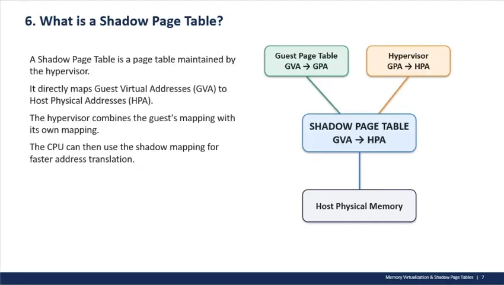

合并的结果长这样：客户机的 GVA `0x1000`、`0x2000` 分别对应 GPA `0xA000`、`0xB000`，而这两个 GPA 落在宿主页帧 `0x5000`、`0x9000` 上；影子表里就直接写 `GVA 0x1000 → HPA 0x5000`、`GVA 0x2000 → HPA 0x9000`，正常执行时 CPU 查一次表就到头了 [【跳转到 10:07】](https://www.youtube.com/watch?v=w5NOmYE1p8Y&t=607)。

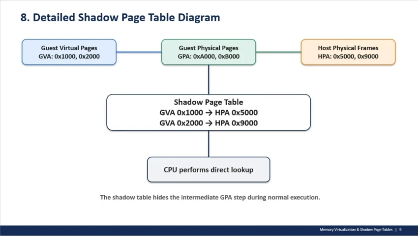

这一步是理解后面所有代价的前提：**影子表不是"另一套页表"，而是"两张映射的合成物"**。合成物一旦落后于原件，就是错的。

## 二、五步同步：代价的源头在这里

### 2.1 一次客户机页表写，要走五步

视频把影子页表的运作拆成五步 [【跳转到 08:56】](https://www.youtube.com/watch?v=w5NOmYE1p8Y&t=536)：

1. 客户机操作系统**创建或更新**自己的页表；
2. hypervisor **检测到这个动作**——视频的原话是"这可能通过一次陷入（trap），也可能通过其他监控机制"；
3. hypervisor **校验**这个客户机映射是有效还是无效；
4. hypervisor 在影子页表里**创建或更新**对应的表项；
5. CPU 之后就可以用影子页表做翻译了。

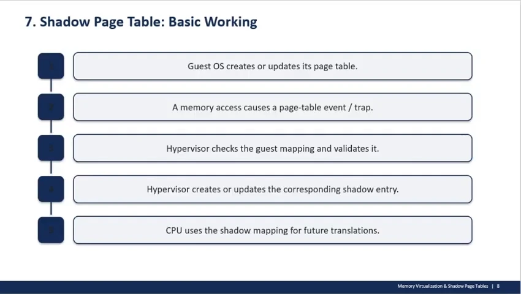

注意第 2 步的位置：**它在客户机的每一次页表写之后**。这就是整个代价模型的支点——不是"每次内存访问"，而是"每次页表修改"。而页表修改在 `fork`、`mmap`、缺页、进程创建这些路径上出现的频率，比内存访问高得多的量级。

### 2.2 为什么"必须检测"：客户机随时在改

视频用一整页讲这件事 [【跳转到 10:57】](https://www.youtube.com/watch?v=w5NOmYE1p8Y&t=657)：客户机操作系统随时可能改自己的页表。原先一个虚拟地址指向某个物理页，后来它指向另一个物理页。**如果 hypervisor 不更新影子页表，影子表里就可能留着错误的映射。**

所以每次变化，hypervisor 都要走一遍完整的动作：**检测更新 → 校验新映射 → 让旧影子表项失效 → 建立新影子表项**。视频的结论很直接：这个同步过程**本身就带来开销，是影子页表的主要缺点之一** [【跳转到 11:22】](https://www.youtube.com/watch?v=w5NOmYE1p8Y&t=682)。

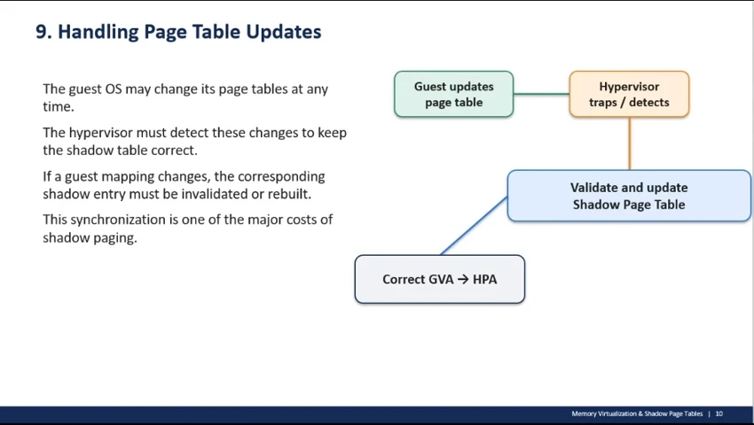

把这一步写成代价公式，就是本文的中心思想：

$$
\text{同步成本} \approx \text{页表写次数} \times (\text{一次陷入} + \text{一次校验} + \text{一次影子表重建})
$$

而右边的"页表写次数"是随负载线性增长的——**成本记在频率上，不是记在单次操作上**。

## 三、多对一：影子表的数量跟着"客户机页表上下文"走

### 3.1 合成本身就决定了它是 1:N

回看 1.2 节的定义：影子表 = 客户机页表 + hypervisor 的 GPA→HPA 知识，**两者合并**。既然它是"某一套客户机页表"的合成物，那么**客户机有几套页表上下文，就需要几份影子表**。

客户机里每个进程都有自己的页表（由 CR3 指向），所以这个比例是实打实的 1:N：客户机切一次进程 = 换一次 CR3 = 换一份影子表。视频在讲局限时也点到了这个方向——"当虚拟机很多、内存映射很多时，问题会变得更复杂" [【跳转到 14:42】](https://www.youtube.com/watch?v=w5NOmYE1p8Y&t=882)。

### 3.2 于是有了第一条硬成本：内存开销

视频列的第一条局限就是**内存开销**：hypervisor 需要额外维护一套页表结构 [【跳转到 13:52】](https://www.youtube.com/watch?v=w5NOmYE1p8Y&t=832)。这条开销的规模不是"每台 VM 一份"，而是"每个客户机地址空间一份"——客户机里跑 100 个进程，hypervisor 侧就要为这 100 套页表各准备一份影子表。**影子表是宿主内存里的真实页帧，不是免费的簿记。**

### 3.3 换表还带来第二次失效：TLB

影子表一换，TLB 里那些"GVA→HPA"的翻译就全部作废了——因为同一个 GVA 在另一份影子表里指向不同的 HPA。这就是视频列的第三条局限里"TLB 刷写"的来源 [【跳转到 14:17】](https://www.youtube.com/watch?v=w5NOmYE1p8Y&t=857)。

## 四、TLB：影子页表唯一的"便宜"处，也是它的放大器

### 4.1 命中时，影子页表确实是最优解

TLB 是处理器内部存放最近地址翻译的快速缓存 [【跳转到 11:47】](https://www.youtube.com/watch?v=w5NOmYE1p8Y&t=707)。在影子页表方案下，TLB 里存的就是**最终的 GVA→HPA**：

- **命中**：CPU 直接拿到宿主物理地址，一次翻译都不做——这比嵌套分页还省（后者即使 TLB 命中，装的也是两级翻译的结果，miss 时要走两套页表）；
- **未命中**：需要页表走查，或者 hypervisor 介入 [【跳转到 12:37】](https://www.youtube.com/watch?v=w5NOmYE1p8Y&t=757)。

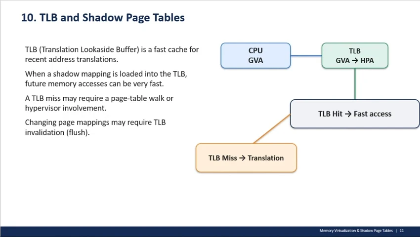

视频用一个例子把这条链串起来：程序访问 GVA `0x1234` → 影子表给出 HPA → 查 TLB 是否命中 → 命中就访问 RAM；未命中则做页表查询（可能含 hypervisor 工作），把映射塞进 TLB，下次就快了 [【跳转到 16:15】](https://www.youtube.com/watch?v=w5NOmYE1p8Y&t=975)。

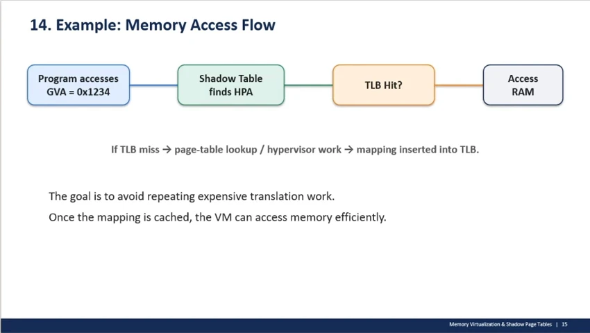

### 4.2 但"刷 TLB"把便宜又吃回去了

问题在于 4.1 的"命中"是有前提的：**映射得稳定**。而影子页表方案里，映射恰恰最不稳定——客户机一改页表、一换进程，影子表就变，TLB 就得失效或刷写。视频把它列为第三条局限：**陷入的使用 + 频繁的 TLB 刷写会降低性能** [【跳转到 14:17】](https://www.youtube.com/watch?v=w5NOmYE1p8Y&t=857)。

这就形成了一个闭环：**影子页表靠"翻译一步到位"换来 TLB 命中的高收益，又因为"同步"不断把 TLB 打空**。收益和成本都记在同一个缓存上。

## 五、三条局限合起来，就是这套模型撑不住的原因

### 5.1 优点是真的，但都建立在"映射稳定"这个假设上

视频给的优点有四条 [【跳转到 13:02】](https://www.youtube.com/watch?v=w5NOmYE1p8Y&t=782)：直接 GVA→HPA 翻译、运行期性能好、**不需要嵌套分页硬件（老系统也能用）**、内存隔离强（hypervisor 精确控制每台 VM 能访问哪些宿主物理内存）。

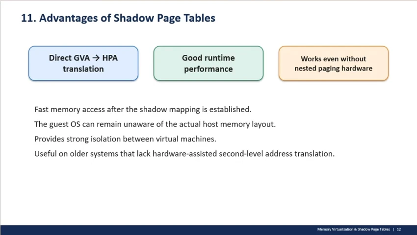

注意第三条——"不需要硬件支持"既是它 2000 年代统治市场的原因，也是它最终被替换的原因：**它把本该由硬件做的事，全压在了 hypervisor 的软件路径上。**

### 5.2 三条局限，一条比一条难绕

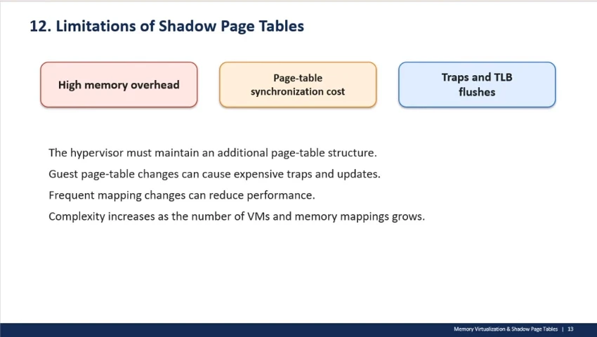

视频列的三条局限，正好对应本文的三个成本项：

| 局限 | 成本项 | 随什么增长 |
| :--- | :--- | :--- |
| 内存开销高 | hypervisor 要额外维护一套页表结构 | 客户机地址空间数量（进程数 × VM 数） |
| 页表同步代价 | 每次客户机改页表都要校验 + 重建影子表项 | 页表写次数（`fork`/`mmap`/缺页频率） |
| 陷入与 TLB 刷写 | 每次同步一次 trap，映射一变就刷 TLB | 同上，且会二次放大（刷完 TLB 又要重新走查） |

三条都是**频率型成本**：负载越重、进程越多，它们越贵，而且没有上限。视频的总结是：**影子页表能让正常执行很快，但维护它们的代价并不低** [【跳转到 14:42】](https://www.youtube.com/watch?v=w5NOmYE1p8Y&t=882)。

### 5.3 2008 年前后：成本从"频率"换成了"深度"

视频最后把影子页表和嵌套分页并排对照 [【跳转到 14:55】](https://www.youtube.com/watch?v=w5NOmYE1p8Y&t=895)：

| 维度 | 影子页表 | 嵌套分页（EPT / NPT） |
| :--- | :--- | :--- |
| 映射形态 | GVA → HPA（一步） | GVA → GPA → HPA（两段） |
| hypervisor 工作量 | 高，客户机页表一变就要管 | 较低 |
| 硬件要求 | 不需要 | 需要 |
| 运行期开销 | 更新时可能很高 | 通常更低 |
| 主要成本 | **同步** | **额外的页表走查** |

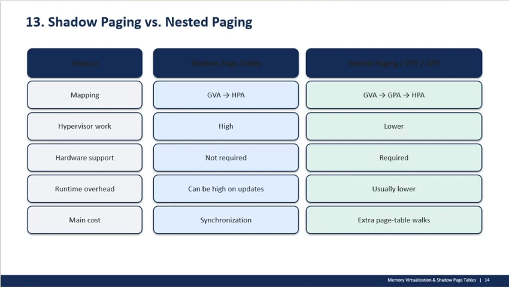

这张表的最后一行就是整件事的答案：**两种方案都要付代价，区别在于代价的形状**。

- 影子页表的代价是**频率型**的：每改一次页表付一次，负载越重越贵，且无法缓存（trap 不能被"记住"）。
- 嵌套分页的代价是**深度型**的：一次 TLB miss 要多走几级页表，但结果可以被 TLB 和分页结构缓存住，稳态下绝大多数访问根本不付这个钱。

2008 年前后，Intel EPT 与 AMD NPT 相继落地，把第二段翻译交给硬件 MMU（这段演进与 EPT violation 的触发条件见 2.1.3）。视频对此的说法很克制：**嵌套分页的主要优点是硬件承担了大部分翻译工作，hypervisor 的同步开销更小；而影子页表在硬件辅助虚拟化普及之前的老系统上尤其重要** [【跳转到 15:45】](https://www.youtube.com/watch?v=w5NOmYE1p8Y&t=945)。

换句话说：**不是影子页表"错了"，而是它把成本放在了一个不能缓存的位置上。** 一旦硬件能把第二段翻译做成"可缓存的多级走查"，频率型的同步成本就再也竞争不过深度型的走查成本。

## 小结

- **影子页表是"两张映射的合成物"**：客户机的 GVA→GPA 加上 hypervisor 的 GPA→HPA，合并成一张 GVA→HPA，把中间那步藏起来。
- **它的收益在翻译**：正常执行时一步到位，TLB 里存的就是最终映射，命中即用，且不依赖任何硬件支持。
- **它的成本在同步**：客户机每改一次页表，就要被 trap 捕获、校验、让旧影子表项失效、建新表项；同步过程本身就是主要缺点。
- **它是多对一的**：一套客户机页表上下文对应一份影子表，客户机切进程（换 CR3）就换一份影子表，因此内存开销随"进程数 × VM 数"增长。
- **TLB 是它的双刃剑**：命中时它比嵌套分页更省；但映射一变就要刷 TLB，同步又把命中的收益吃掉。
- **三条局限都是频率型成本**：内存开销、同步代价、trap 与 TLB 刷写——负载越重越贵，且无法缓存。
- **2008 年前后成本形状变了**：嵌套分页把"每次写都管"换成"miss 时多走几级页表"，而后者可被 TLB 与分页结构缓存吸收，于是影子页表退场。

## 关键术语速查

| 术语 | 一句话解释 |
| :--- | :--- |
| GVA / GPA / HPA | 客户机虚拟地址 / 客户机以为的物理地址 / 宿主真实物理地址 |
| 影子页表（SPT） | hypervisor 把 GVA→GPA 与 GPA→HPA 合并成的 GVA→HPA 页表 |
| trap（陷入） | 客户机写页表时被 hypervisor 捕获的动作，是同步成本的入口 |
| 页表同步 | 检测更新 → 校验新映射 → 失效旧影子表项 → 建立新表项 |
| 多对一 | 一套客户机页表上下文对应一份影子表，切进程就换表 |
| TLB | 存放最近地址翻译的高速缓存；影子方案下存的是 GVA→HPA |
| TLB 刷写 | 映射变化后让旧翻译失效，代价是后续访问重新走查 |
| 嵌套分页（EPT / NPT） | 硬件做的两段翻译，把成本从"同步频率"换成"走查深度" |