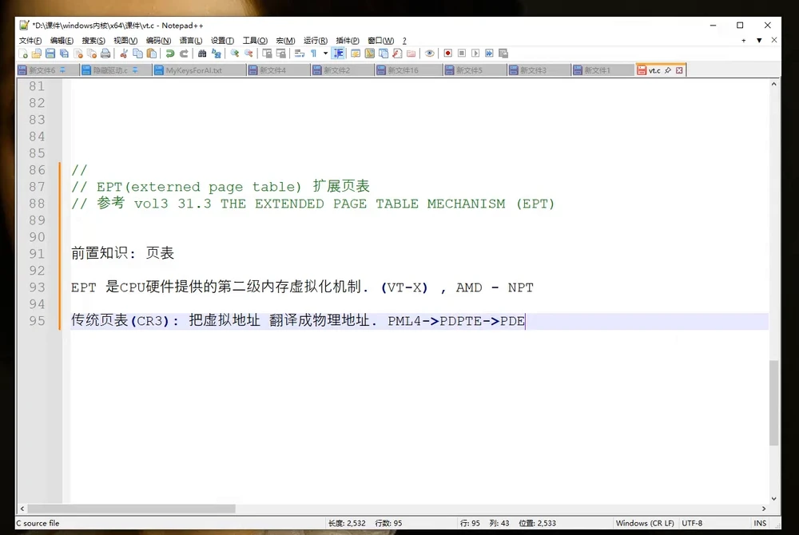
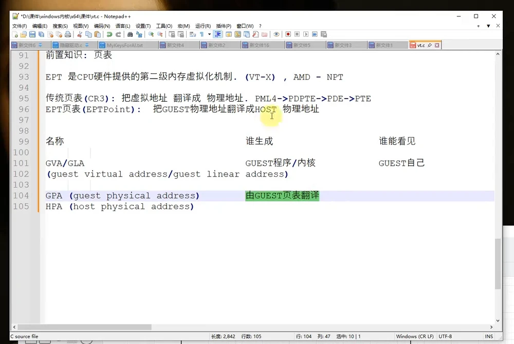
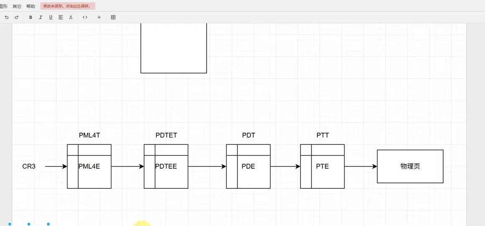
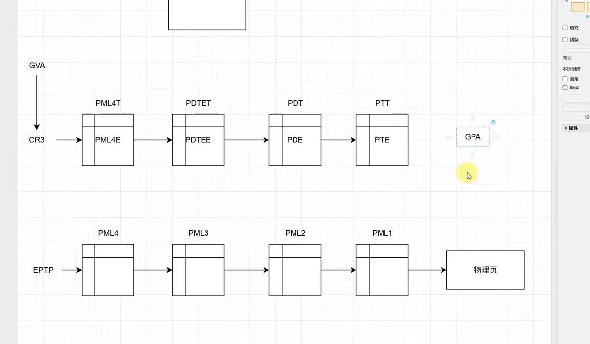
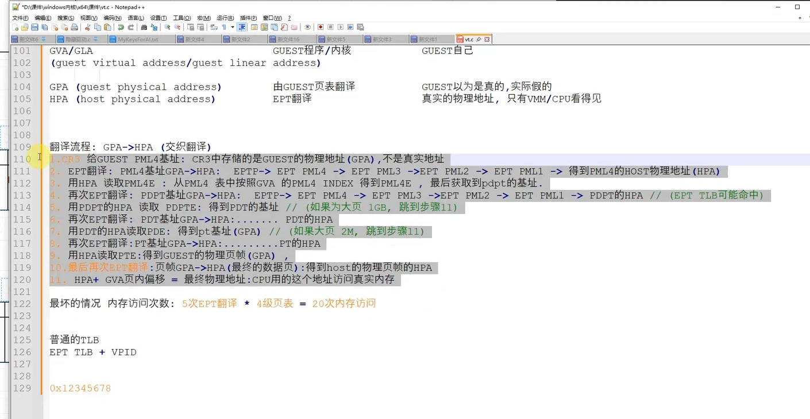
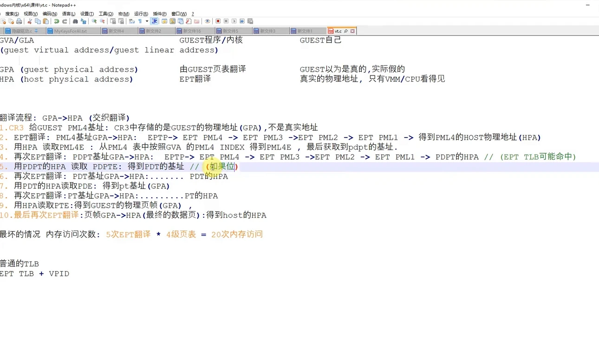
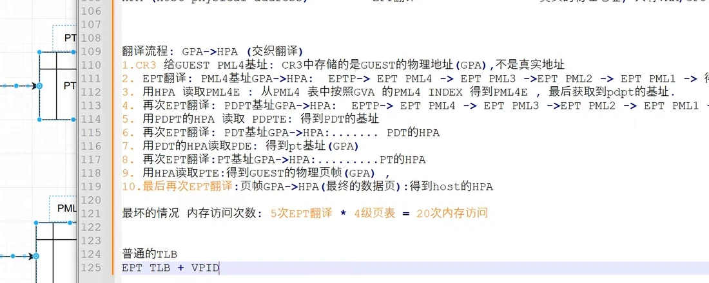
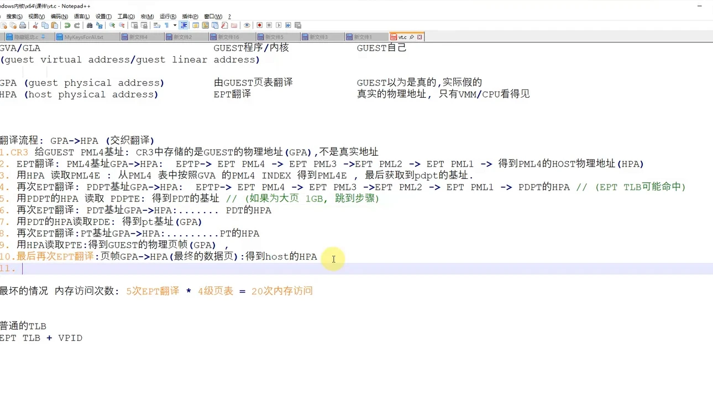

# 跟着 Intel 手册走一遍 EPT 翻译：十一步与二十次内存访问

> 视频来源：[vt-x虚拟化-认识EPT](https://www.bilibili.com/video/BV1dqtb6mEmm/)（B 站 · 加贝Byte）｜时长约 35 分钟
> 导读：这是一节"照着 Intel SDM 第三卷 31.3 章逐行走一遍"的课。讲者用一块白板画两套页表、用一个记事本写下 11 步翻译流程，最后算出"最坏情况 20 次内存访问"，再讲清楚 TLB、VPID、大页分别省掉了哪几步。本文按他的推导顺序组织，适合想弄明白"硬件二级翻译具体怎么走"的读者。字幕为机器识别，术语已按手册订正（如 EPT、EPTP、PDPTE、页帧）。

## 本讲要解决的核心问题（SCQA）

**背景**：上一小节已经看过客户机自己那套页表：CR3 指向 PML4，依次走 PDPT、PD、PT，最后拿到一个"物理地址"。在没开虚拟化的机器上，这个地址就是内存条上的真实位置。

**冲突**：开了 EPT 之后，同一个动作的含义变了。CR3 里存的不再是真实物理地址，而是客户机物理地址（GPA）；每一级页表给出的"下一级表基址"也全是 GPA。硬件读一张表之前，得先把这张表的 GPA 翻译成宿主物理地址（HPA），才谈得上读它。

**疑问**：那硬件到底是怎么一步步走的？一共要走几步、访问多少次内存？如果每次翻译真要访问二十次内存，机器还跑得动吗？

**回答（中心思想）**：**开启 EPT 后，GPA→HPA 的翻译是一条"交叉"的 11 步流水线：每读一级客户机页表之前，先走一遍 EPT 的 EPML4→EPML3→EPML2→EPML1 四级翻译，把这一级表的 GPA 变成 HPA；最坏情况是"5 次 EPT 翻译 × 4 级页表 = 20 次内存访问"。这 20 次之所以在真机上不会发生，靠的是三件事：EPT-TLB 缓存已翻译的表项（命中就省掉后面所有步骤）、VPID 给 TLB 表项打标签、大页把整级走查剪掉。**

## 一、先分清三个地址：谁生成、谁能看见

### 1.1 EPT 是"第二级"内存虚拟化

讲者开场先把定位说清楚：EPT 是 **CPU 硬件提供的第二级内存虚拟化机制**，VT-x 里叫 EPT，AMD 那边叫 NPT；参考手册是 Intel SDM 第三卷的 31.3 章《THE EXTENDED PAGE TABLE MECHANISM》[【跳转到 02:14】](https://www.bilibili.com/video/BV1dqtb6mEmm/?t=134)。



他给了一个很到位的类比：**EPT 在 VT 里的地位，相当于 C 语言里的指针**——指针没学懂，C 语言就不算学会；EPT 学不懂，VT 里太多功能都做不了 [【跳转到 00:59】](https://www.bilibili.com/video/BV1dqtb6mEmm/?t=59)。所以这节课的前置知识就是页表，页表不熟的话建议先回去复习。

### 1.2 传统页表 vs EPT 页表：都是页表，翻译的东西不同

两套页表的形状几乎一模一样，区别只在"翻译什么"：

- **传统页表（CR3 那套）**：把虚拟地址翻译成物理地址，走 `PML4 → PDPTE → PDE → PTE` [【跳转到 03:29】](https://www.bilibili.com/video/BV1dqtb6mEmm/?t=209)；
- **EPT 页表（EPTP 那套）**：把 **guest 物理地址翻译成 host 物理地址** [【跳转到 03:54】](https://www.bilibili.com/video/BV1dqtb6mEmm/?t=234)。

### 1.3 三个地址的"谁生成、谁能看见"

讲者在记事本里列了一张三列表，这张表是整节课的地基 [【跳转到 08:19】](https://www.bilibili.com/video/BV1dqtb6mEmm/?t=499)：

| 名称 | 谁生成 | 谁能看见 |
| :--- | :--- | :--- |
| GVA / GLA（guest virtual address / guest linear address） | guest 程序或 guest 内核 | guest 自己 |
| GPA（guest physical address） | 由 guest 页表翻译得来 | guest 以为是真的，实际是假的 |
| HPA（host physical address） | 由 EPT 翻译得来 | 真实的物理地址，只有 VMM 和 CPU 硬件看得见 |



这里最反直觉的一点是 **GPA 是假的**。讲者的说法很直白：guest 以为 GPA 是真的，实际上它是假的；真正送到内存条上的地址是 HPA，而 HPA 只有 VMM 和 CPU 硬件看得见 [【跳转到 09:34】](https://www.bilibili.com/video/BV1dqtb6mEmm/?t=574)。这也解释了为什么"guest 里拿到一个物理地址"这件事在虚拟化下毫无意义——它只是一个中间量。

## 二、没开 EPT 与开了 EPT：一张白板图看差别

### 2.1 没开 EPT：一套页表走到头

讲者在白板上先画了普通情况：GVA 从 CR3 进入 PML4T（页映射第 4 级表），依次经过 PDPT、PDT、PTT，最后指向一个"物理页" [【跳转到 11:44】](https://www.bilibili.com/video/BV1dqtb6mEmm/?t=704)。



这条链在裸金属上就是全部：**4 次表读取 + 1 次数据读取**。

### 2.2 开了 EPT：多出一整套页表

开启 EPT 之后，白板上多了一行：EPTP 指向的 `PML4 → PML3 → PML2 → PML1 → 物理页` [【跳转到 13:24】](https://www.bilibili.com/video/BV1dqtb6mEmm/?t=804)。讲者特意强调命名要区分开：上面那套是 **guest 的页表**（PML4T/PDPT/PDT/PTT，产出 GPA），下面那套是 **EPT 的页表**（PML4/PML3/PML2/PML1，产出 HPA）。



关键的一步认知在这里：**上面那套页表本身也是内存里的数据，它的每一级表都放在某个 GPA 上**。硬件要读 PML4T 这个表，就得先知道它在宿主内存的哪里——于是必须先用下面那套 EPT 把它的 GPA 翻成 HPA。这就是"交叉"的来源。

## 三、交叉翻译：11 步走完一次 GVA→HPA

讲者把流程写在记事本上，从第 1 步写到第 11 步 [【跳转到 15:06】](https://www.bilibili.com/video/BV1dqtb6mEmm/?t=906)。下面按他的编号整理（`EPTP → EPT PML4 → EPT PML3 → EPT PML2 → EPT PML1` 这一段走查，下文简称"一次 EPT 翻译"）：

| 步 | 做什么 | 产出 |
| ---: | :--- | :--- |
| 1 | CR3 给出 guest PML4 的基址。注意 CR3 里存的是 **GPA**，不是真实地址 [【跳转到 15:31】](https://www.bilibili.com/video/BV1dqtb6mEmm/?t=931) | PML4 的 GPA |
| 2 | 对这个 GPA 做一次 EPT 翻译（EPTP → EPT PML4 → PML3 → PML2 → PML1） | PML4 的 HPA |
| 3 | 用这个 HPA 读 PML4E：按 GVA 里的 PML4 index 取出表项，得到 PDPT 的基址 | PDPT 的 GPA |
| 4 | 再对 PDPT 基址做一次 EPT 翻译 [【跳转到 19:59】](https://www.bilibili.com/video/BV1dqtb6mEmm/?t=1199) | PDPT 的 HPA |
| 5 | 用 PDPT 的 HPA 读 PDPTE，得到 PDT 的基址 | PDT 的 GPA |
| 6 | 对 PDT 基址做一次 EPT 翻译 | PDT 的 HPA |
| 7 | 用 PDT 的 HPA 读 PDE，得到 PT 的基址 [【跳转到 24:09】](https://www.bilibili.com/video/BV1dqtb6mEmm/?t=1449) | PT 的 GPA |
| 8 | 对 PT 基址做一次 EPT 翻译 | PT 的 HPA |
| 9 | 用 PT 的 HPA 读 PTE，得到 guest 的物理页帧 [【跳转到 25:49】](https://www.bilibili.com/video/BV1dqtb6mEmm/?t=1549) | 数据页的 GPA |
| 10 | 对数据页的 GPA 做最后一次 EPT 翻译 [【跳转到 26:39】](https://www.bilibili.com/video/BV1dqtb6mEmm/?t=1599) | 数据页的 HPA |
| 11 | HPA + GVA 的页内偏移 = 最终物理地址，CPU 用这个地址访问真实内存 | 最终地址 |



把 11 步写成伪代码，"交叉"这件事会更直观（下面用 ept_walk 表示一次 EPT 四级翻译）：

```text
pml4_hpa = ept_walk(cr3)                  # 步骤 2
gpa      = read(pml4_hpa + gva.pml4_idx) # 步骤 3，得到 PDPT 的 GPA
pdpt_hpa = ept_walk(gpa)                  # 步骤 4
gpa      = read(pdpt_hpa + gva.pdpt_idx) # 步骤 5，得到 PDT 的 GPA
pd_hpa   = ept_walk(gpa)                  # 步骤 6
gpa      = read(pd_hpa + gva.pd_idx)     # 步骤 7，得到 PT 的 GPA
pt_hpa   = ept_walk(gpa)                  # 步骤 8
frame_gpa= read(pt_hpa + gva.pt_idx)      # 步骤 9，得到物理页帧的 GPA
frame_hpa= ept_walk(frame_gpa)            # 步骤 10
hpa      = frame_hpa + gva.offset         # 步骤 11，加上页内偏移
```

数一下就明白 20 次怎么来的：ept_walk 被调用了 5 次，每次内部 4 次访存。

讲者反复提醒"一定不要晕"的地方是第 2 步的产物：**得到的是上面那层 PML4 的 host 地址**，而不是 EPT 自己的 PML4 的地址。两套页表用了同样的层级名字，很容易混。

## 四、20 次内存访问是怎么算出来的

### 4.1 5 × 4 = 20

把上面的步骤按"内存访问"折算，讲者的算法很朴素 [【跳转到 27:49】](https://www.bilibili.com/video/BV1dqtb6mEmm/?t=1669)：

- 一次 EPT 翻译要走 **4 级**（EPT PML4 → PML3 → PML2 → PML1），也就是 4 次内存访问；
- 整个流程里有 **5 次** EPT 翻译：CR3 里的 PML4 基址、PDPT 基址、PDT 基址、PT 基址、数据页帧，各一次；
- 所以最坏情况是 $5 \times 4 = 20$ 次内存访问。

$$
\text{内存访问次数}_{\max} = 5 \times 4 = 20
$$



### 4.2 为什么强调"最坏情况"

讲者特意解释了这个"最坏"：如果每一次地址翻译都真的要 20 次内存访问，那 CPU 和内核都没法玩了，**会卡死** [【跳转到 28:39】](https://www.bilibili.com/video/BV1dqtb6mEmm/?t=1719)。所以真实系统必须靠缓存把这 20 次摊掉——这正是下一节要讲的三道优化。

> 与本系列另一篇的对照：那篇按 $(N+1)(M+1)-1$ 算出 24 次，差别只在"要不要把最终那次数据读取单独算进去"。20 次是"5 次 EPT 翻译 × 4 级"的粗算，24 次是把每次 EPT 翻译之后那一次客户机表读取也计入。两者描述的是同一件事，量级一致。

## 五、三道优化：TLB、VPID、大页

### 5.1 EPT-TLB：命中了就省掉后面所有步骤

第一道是缓存。讲者先回顾了内核课里的普通 TLB——它就是页表项的缓存。EPT 增加了内存访问次数，所以它同样需要缓存，这个缓存叫 **EPT-TLB**，机制和普通 TLB 一模一样 [【跳转到 29:29】](https://www.bilibili.com/video/BV1dqtb6mEmm/?t=1769)。

关键是命中位置决定省多少：如果 EPT-TLB 在第 4 步或第 7 步就命中了，那**后面的流程全部省略**，直接走内存 [【跳转到 30:44】](https://www.bilibili.com/video/BV1dqtb6mEmm/?t=1844)。也就是说，20 次是"全冷"的账；只要中间某一级表的翻译被缓存住，后面的走查就整段消失。

### 5.2 VPID：给 TLB 表项打标签

第二道是 **VPID**。讲者的说法是：它是标注 TLB 的一个标识，后边写代码的时候会写到 [【跳转到 30:19】](https://www.bilibili.com/video/BV1dqtb6mEmm/?t=1819)。为什么要标签？因为 VMM 和多个 guest 共用同一颗物理 CPU 的 TLB，如果不加区分，每次切换都得整表刷掉，缓存就白建了；带上 VPID 之后，不同上下文的翻译可以共存，切换时不必刷。



### 5.3 大页：直接跳过一整段走查

第三道是**大页**，讲者把它叫"拆分页表" [【跳转到 31:19】](https://www.bilibili.com/video/BV1dqtb6mEmm/?t=1879)。原理是：如果某一级表项本身就是个大页映射，就不用再往下走了。

- **PDPTE 是 1GB 大页**：直接跳到第 11 步 [【跳转到 31:44】](https://www.bilibili.com/video/BV1dqtb6mEmm/?t=1904)；
- **PDE 是 2MB 大页**：也直接跳到第 11 步 [【跳转到 33:49】](https://www.bilibili.com/video/BV1dqtb6mEmm/?t=2029)。

省下来的正是中间那几次 EPT 翻译——讲者算的是"至少少 10 次、甚至少 20 次"这种量级 [【跳转到 33:24】](https://www.bilibili.com/video/BV1dqtb6mEmm/?t=2004)。



### 5.4 最后一步别忘了页内偏移

第 11 步容易被忽略但很关键：拿到数据页的 HPA 之后，还要加上 GVA 的低 12 位（页内偏移）才是最终地址。讲者举了个例子：`0x212345678` 的低 12 位是页内偏移，前面的部分才是页帧 [【跳转到 32:34】](https://www.bilibili.com/video/BV1dqtb6mEmm/?t=1954)。

### 5.5 还有别的优化：内存类型

讲者最后提到，真正开发时还有别的优化，比如 **MTRR**（内存类型范围寄存器），用来标记 EPT 的内存类型 [【跳转到 34:14】](https://www.bilibili.com/video/BV1dqtb6mEmm/?t=2054)。他的提醒很实在：这些优化不做，跑在物理机上或者跑项目时会非常卡。

## 小结

- **EPT 是第二级内存虚拟化**：传统页表把虚拟地址翻成物理地址，EPT 把 guest 物理地址翻成 host 物理地址，两者形状相同、目标不同。
- **GPA 是假的**：guest 以为它真，实际只有 VMM 和 CPU 硬件看得见的 HPA 才是内存条上的地址。
- **交叉翻译 11 步**：每读一级 guest 页表之前，都要先走一遍 EPT 四级，把这一级表的 GPA 变成 HPA；最后一步是 HPA 加页内偏移。
- **最坏 20 次内存访问**：5 次 EPT 翻译 × 4 级页表。这个数字是"全冷"的账，真机上不会发生。
- **三道优化各管一段**：EPT-TLB 命中就省掉后续所有步骤；VPID 让不同上下文的 TLB 表项共存、切换不刷表；大页（1GB / 2MB）直接跳过整段走查。
- **页内偏移不可省**：HPA 是页帧地址，加上低 12 位偏移才是最终可用的地址。
- **优化不做会卡**：MTRR 这类内存类型标记，属于"不做就跑不动"的那一类。

## 关键术语速查

| 术语 | 一句话解释 |
| :--- | :--- |
| EPT | Intel 的扩展页表，负责 GPA→HPA 的第二级翻译；AMD 对应物叫 NPT |
| EPTP | 指向 EPT 根表（EPML4）的指针，放在 VMCS 里 |
| GVA / GLA | guest 虚拟地址（线性地址），由 guest 程序或内核生成 |
| GPA | guest 物理地址，由 guest 页表翻译得来，是虚构的 |
| HPA | host 物理地址，由 EPT 翻译得来，只有 VMM 与 CPU 看得见 |
| PML4T / PDPT / PDT / PTT | guest 四级页表：第 4 级表、页目录指针表、页目录、页表 |
| EPT PML4 / PML3 / PML2 / PML1 | EPT 的四级结构，走一遍就是一次 EPT 翻译 |
| 交叉翻译 | guest 页表走查的每一步都要先插一段 EPT 走查 |
| EPT-TLB | 缓存 EPT 翻译结果的 TLB，命中即跳过后续走查 |
| VPID | 给 TLB 表项打的上下文标签，避免切换时整表刷新 |
| 大页（1GB / 2MB） | 表项直接映射大范围内存，跳过后续层级的走查 |
| MTRR | 内存类型范围寄存器，用于标记 EPT 内存类型 |