# 从影子页表到 EPT：内存虚拟化为什么必须交给硬件

> 视频来源：[13.3 Memory Virtualization: EPT & Nested Page Tables](https://www.youtube.com/watch?v=agIKD9muLCo)（YouTube · Adsorp AI · "Escaping the Cage" 系列第 13.3 节）｜时长约 25 分钟
> 导读：这支视频按"影子页表的痛点 → 2008 年硬件二维分页 → 二维走查的代价 → VPID → EPT violation 与安全边界"的顺序讲内存虚拟化。本文聚焦**演进动因**与**EPT violation 的触发条件**；GVA→GPA 的客户机侧细节见 2.1.1，GPA→HPA 两条路径的完整代价模型见 2.1.2。

## 本讲要解决的核心问题（SCQA）

**背景**：客户机内核坚信自己拥有裸金属，它建立自己的页表、加载自己的 CR3，把虚拟地址翻译成"物理地址"。上一节（2.1.1）已经说明，这一层 GVA→GPA 的翻译完全由客户机自己完成，hypervisor 不参与。

**冲突**：可客户机以为的物理地址并不是真的物理地址。如果放任客户机页表直接生效，同一台服务器上两台虚拟机可以把虚拟地址映射到同一个"物理地址"，一台不可信的客户机甚至可以尝试写宿主内核的代码段。于是 CPU 必须再加一层翻译。2000 年代早期没有硬件支持，hypervisor 只能用**影子页表**在软件里把两层翻译压成一层——代价是客户机的每一次页表修改都要陷入 hypervisor。

**疑问**：影子页表到底贵在哪里、在什么负载下会崩？2008 年前后硬件接管之后，hypervisor 的职责变成了什么？以及最实用的问题：**EPT violation 到底什么时候触发**，hypervisor 拿到它之后做什么？

**回答（中心思想）**：影子页表把"翻译"这件高频小事变成了"陷入"这件昂贵大事，负载一重就崩；Intel EPT / AMD NPT 用硬件二维分页把两层翻译都交给 MMU，hypervisor 的职责从"每次页表写都要管"降级为"维护第二维页表 + 处理少量 violation"。代价从 **VM exit 次数**换成了**最坏 24 次内存查表**，再由 TLB、页表结构缓存和大页把它吸收掉。而 EPT violation 只有两类真正的触发条件——**GPA 在 EPT 里没有有效映射**，或**这次访问违反了 EPT 表项里的读/写/执行权限**；表项本身配置非法则是另一码事（misconfiguration）。

## 一、影子页表：把两层翻译压成一层，代价是每次页表写都要陷入

### 1.1 物理 MMU 从来没有执行过客户机的页表

影子页表（Shadow Page Table，SPT）的思路很直接：既然物理 MMU 只会走一套页表，那就给它一套"已经算好两层"的页表。

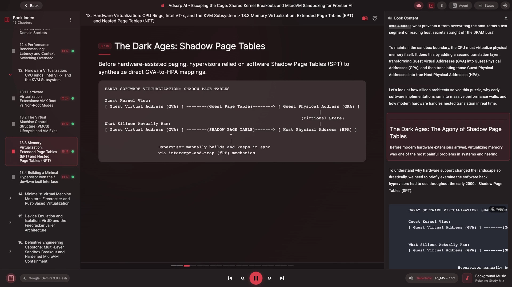

[【跳转到 01:45】](https://www.youtube.com/watch?v=agIKD9muLCo&t=105)

图里上下两行是关键对比：

- **客户机内核视角**：`[GVA] --(客户机页表)--> [GPA]`，而 GPA 是一个"虚构状态"（fictional state）。
- **硅片实际执行的**：`[GVA] --(影子页表)--> [HPA]`，影子表由 hypervisor 手工构建并保持同步。

所以在影子页表的世界里，物理 MMU **从不真正执行客户机内核的页表**——如果执行了，客户机就等于直接访问物理内存了。hypervisor 维护的是一份隐藏的、重复的一套页表，把客户机的 GVA 直接映射到真实的 HPA。难点全在最后一句：怎么让这份影子表和客户机内核以为的状态保持同步。

### 1.2 同步一个表项要走五步

客户机内核给新进程分配一个页，往自己的页表里写一个表项。因为客户机页表与物理 MMU 完全脱钩，硬件根本不知道发生了变化。为了捕获这次更新，hypervisor 只能把**每一页存放客户机页表的内存**在影子表里标记为只读，然后等客户机来撞墙：

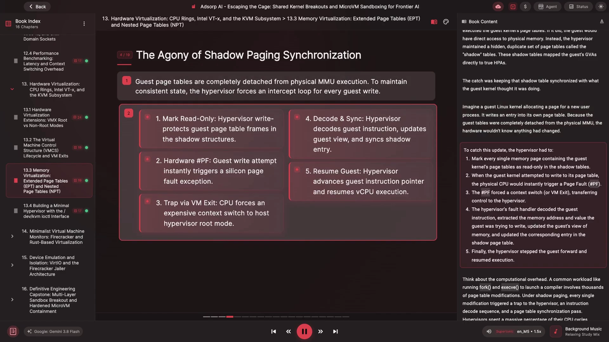

[【跳转到 02:49】](https://www.youtube.com/watch?v=agIKD9muLCo&t=169)

1. **标记只读**：hypervisor 在影子结构里把客户机页表所在的内存页写保护。
2. **硬件缺页**：客户机一写页表，硅片立刻抛缺页异常（#PF）。
3. **经 VM exit 陷入**：CPU 强制一次昂贵的上下文切换，回到宿主 root 模式。
4. **解码并同步**：hypervisor 解码客户机那条指令，取出它想写的地址和值，更新客户机看到的内存视图，再同步影子表里对应的表项。
5. **恢复客户机**：hypervisor 让客户机指令指针前进，恢复 vCPU 执行。

注意第 4 步有多贵：hypervisor 要**解码客户机指令**。这不是简单的一次函数调用，而是要理解客户机刚才那条指令到底改了什么。

### 1.3 崩溃点：fork + exec 要改上千次页表

单次陷入已经很贵，真正致命的是频率。视频给出的例子是启动一个编译器：一次 `fork` 加 `exec` 就涉及**成千上万次页表修改**。在影子页表下，每一次修改都要触发一次陷入、一次指令解码、一次页表同步。

结果就是 hypervisor 把大量 CPU 周期花在处理页表缺页上，而不是跑用户负载（[【跳转到 03:14】](https://www.youtube.com/watch?v=agIKD9muLCo&t=194)）。这也解释了为什么影子页表在"客户机频繁改页表"和"多进程频繁切换"的负载下最先崩：**它的开销正比于页表修改次数，而不是正比于内存访问次数**。虚拟化迫切需要一种能在硬件层面同时处理两层翻译、不需要软件介入的机制。

## 二、2008 年的换挡：硬件接管第二维翻译

### 2.1 EPT 与 NPT 是同一件事的两个名字

大约从 2008 年开始，Intel 的 Nehalem 架构和 AMD 的 Barcelona 核心引入了硬件辅助的内存虚拟化：Intel 叫**扩展页表**（Extended Page Tables，EPT），AMD 叫**嵌套页表**（Nested Page Tables，NPT），历史上也被称为快速虚拟化索引（RVI）。两者的架构内核完全相同，都是**硬件辅助的二维分页**。

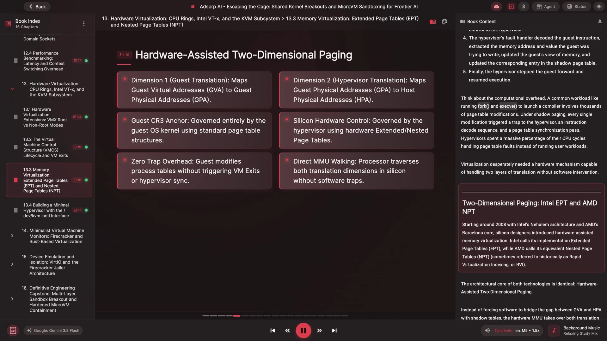

[【跳转到 04:04】](https://www.youtube.com/watch?v=agIKD9muLCo&t=244)

分工可以一句话记住：

- **第一维（客户机翻译）**：GVA → GPA，由客户机内核用标准的 CR3 页表控制。
- **第二维（hypervisor 翻译）**：GPA → HPA，由 hypervisor 用 EPT / NPT 页表控制。
- **零陷入**：客户机修改自己的进程页表不再引发 VM exit，也不需要 hypervisor 同步；处理器在硅片里直接走两维。

### 2.2 三个地址层，以及 EPT 的锚点 EPTP

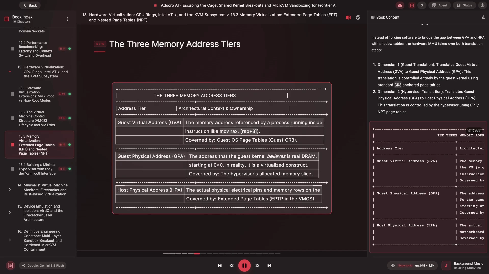

[【跳转到 05:07】](https://www.youtube.com/watch?v=agIKD9muLCo&t=307)

| 地址层 | 是什么 | 谁管 |
| --- | --- | --- |
| GVA（客户机虚拟地址） | 虚拟机内进程引用的地址，例如 `mov rax, [rsp+8]` 里的地址 | 客户机操作系统页表 + 客户机 CR3 |
| GPA（客户机物理地址） | 客户机内核**以为**的真实 DRAM，看起来从 0x0 开始的连续内存 | hypervisor 分配的内存切片 |
| HPA（宿主物理地址） | 主板上 DDR4/DDR5 内存条里真实的存储单元 | EPT 页表（VMCS 里的 EPTP） |

那么处理器怎么知道第二维页表放在哪？答案是 VMCS 里的一个字段。当 hypervisor 在次级处理器执行控制里置上 **Enable EPT** 位，VMCS 里一个 64 位字段就被激活了：**扩展页表指针 EPTP**（AMD 上对应的是虚拟机控制块里的 nCR3）。

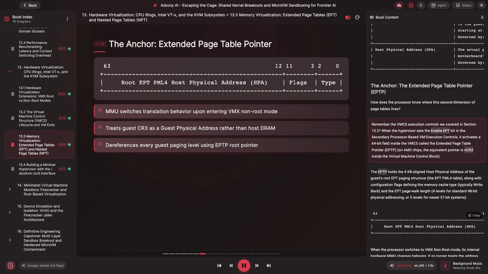

[【跳转到 05:32】](https://www.youtube.com/watch?v=agIKD9muLCo&t=332)

EPTP 里放三样东西：根 EPT 分页结构（EPML4 表）的 4KB 对齐宿主物理地址；定义内存缓存类型的标志（通常是写回）；以及 EPT 页走查的层数（标准 48 位物理地址是四级，57 位系统是五级）。位布局是第 63~12 位放根表 HPA，第 11~3 位放标志，第 2~0 位放类型。

一旦处理器进入 VMX 非根模式，MMU 的行为就变了：它不再把客户机 CR3 里的地址当成绝对宿主物理地址，而是当成一个 GPA，用 EPTP 去解析翻译的每一步。

### 2.3 二维页走查：一个指针一次全套 EPT

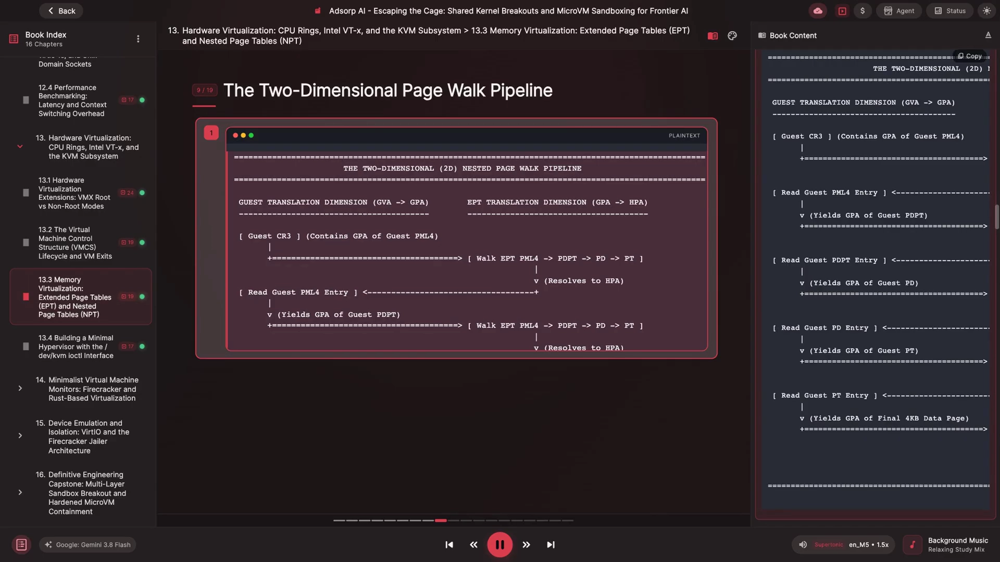

[【跳转到 07:37】](https://www.youtube.com/watch?v=agIKD9muLCo&t=457)

为什么慢？因为客户机分页层级里的**每一个表指针本身都是 GPA**。MMU 不能直接读客户机的 PML4，因为客户机 CR3 里的地址不是 HPA；它必须先用 EPT 把这个 GPA 翻译出来，才能读到客户机页表的哪怕一个字节。于是：

1. 客户机 CR3 里的 GPA → 走一遍四级 EPT → 读到客户机 PML4；
2. PML4 表项给出客户机 PDP 的 GPA → 再走一遍四级 EPT → 读到客户机 PDP；
3. 同理读客户机 PD、读客户机 PT；
4. 最后 PTE 给出数据页的 GPA → 第五遍四级 EPT → 拿到数据页 HPA；
5. 拼上 GVA 的低 12 位页内偏移，读数据。

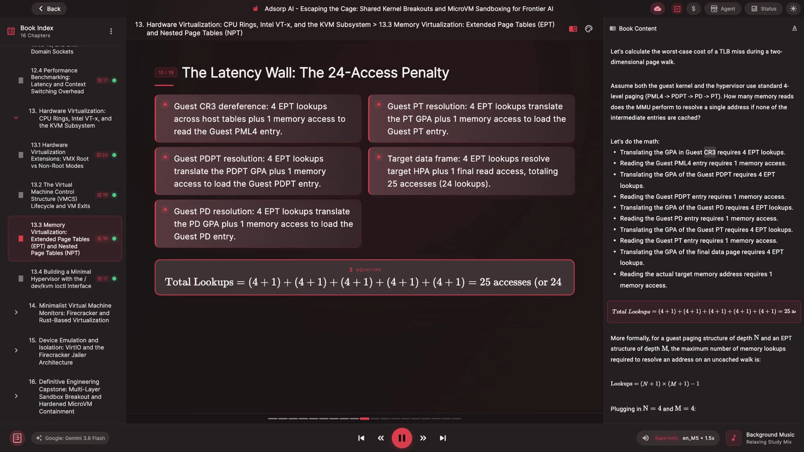

[【跳转到 10:49】](https://www.youtube.com/watch?v=agIKD9muLCo&t=649)

$$
\text{Total Lookups} = (4+1)\times 5 = 25 \text{ 次访问} \quad(\text{其中 24 次是中间查表})
$$

更一般地，客户机分页深度为 $N$、EPT 深度为 $M$ 时，一次未命中缓存的走查最多需要

$$
\text{Lookups} = (M+1)\times(N+1) - 1
$$

代入 $N=4$、$M=4$ 得 $5\times 5-1=24$。视频还给了数量感：现代 x86 服务器一次主存往返约 50~100 纳秒，24 次串行 DRAM 读取会把核心卡住超过 1.5 微秒——如果每次内存访问都这样，硬件辅助虚拟化根本没法用。所以真正的关键不是"24 有多可怕"，而是**它几乎从不完整发生**。

### 2.4 三个缓解手段把 24 次吸收掉

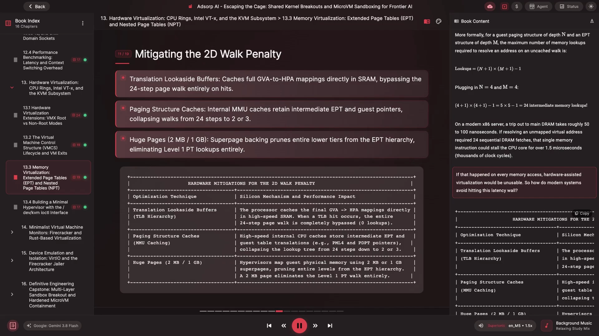

[【跳转到 11:39】](https://www.youtube.com/watch?v=agIKD9muLCo&t=699)

| 手段 | 硅片机制 | 效果 |
| --- | --- | --- |
| TLB 层级 | 把最终的 GVA→HPA 映射缓存在高速 SRAM | 命中时整个 24 步走查被跳过，0 次查表 |
| 页表结构缓存（MMU 缓存） | 缓存 EPT 与客户机表的中间翻译（如 PML4、PDP 指针） | 把查表树从 24 步压到 2~3 步 |
| 大页（2MB / 1GB） | 用超级页承载客户机物理内存，剪掉 EPT 的整层 | 一个 2MB 页就省掉第一级 PT 走查 |

结论是：完整的 24 步只在**冷未命中**（所有中间表都不在缓存里）时发生；稳态执行时 TLB 和 MMU 结构缓存吸收了 99% 以上的查表。大页这一条的细节（以及它为什么必须两侧都开）在另一篇《大页如何把二级页表走查从 24 次读压到 8 次》里展开。

## 三、hypervisor 的职责变了：从"每次写都管"到"只处理 violation"

把两套方案摆在一起，VMM 的职责变化一目了然：**影子页表时代，VMM 是页表的共同作者；EPT 时代，VMM 只是第二维页表的维护者。** 客户机改自己的页表，VMM 完全不知情，也不需要知情。

### 3.1 但 exit 并没有消失，只是换了理由

硬件接管翻译之后，VM exit 从"每次页表写"变成了"少数几种情况"：客户机第一次访问某个 GPA 时 EPT 里还没有映射、客户机访问了没有权限的页、hypervisor 主动把某个映射改成只读（脏页日志、写保护）。这三类都会落到同一个出口上——**EPT violation**，也就是下面第四节的主题。

### 3.2 VPID：让 exit 不再冲掉 TLB

早期 VT-x 还有一个隐蔽的性能坑。裸金属上进程切换写 CR3 会冲刷 TLB 的非全局表项，这是必要的；但 VT-x 刚问世时把这套规则照搬到了虚拟化切换上——**每次 VM exit 和 VM entry 都冲刷整个物理 TLB**。客户机 TLB 刚热起来，一个定时器中断引发 exit，TLB 被清空；hypervisor 处理完中断发 VM resume，又清空一次。客户机恢复执行时 TLB 全冷，立刻遭遇一场 24 步页走查的雪崩，这叫 **TLB 抖动**，常常把虚拟化的速度优势全吃掉。

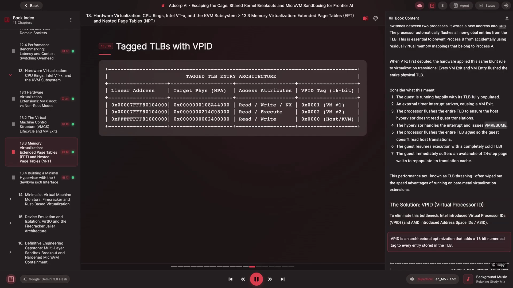

[【跳转到 13:53】](https://www.youtube.com/watch?v=agIKD9muLCo&t=833)

解决办法是给 TLB 表项加一个 16 位标签：Intel 叫 **VPID**（虚拟处理器 ID），AMD 叫 **ASID**（地址空间 ID）。宿主 hypervisor 用 VPID 0，每个虚拟 CPU 分配唯一的非零标签。MMU 匹配时同时检查地址和当前 VPID，于是 VM 切换时不再需要冲刷 TLB：客户机的翻译留在 TLB 里，hypervisor 以标签 0 接管，返回时再换回原来的标签，TLB 是热的。真要清掉某些翻译时，用 `INVVPID` 做定向失效，只废掉单个地址或某个 VPID 标签，不碰缓存其余部分（[【跳转到 15:33】](https://www.youtube.com/watch?v=agIKD9muLCo&t=933)）。

## 四、EPT violation 什么时候触发

这是本节最需要背下来的部分。视频把结论压成两条触发条件，外加一个"看着像但不是"的邻居。

### 4.1 条件一：这个 GPA 在 EPT 里没有有效映射

客户机访问的 GPA 超出了 hypervisor 分配给它的范围，或者那块内存还没被映射进 EPT。视频的例子：hypervisor 只给这台虚拟机分配了 512MB，EPT 里就只包含翻译 `0x0`~`0x1FFF_FFFF` 的表项；客户机一旦去碰 `0x2000_0000`，硅片直接拒绝完成这次内存周期。

**hypervisor 拿到什么**：CPU 会把客户机试图访问的**确切 GPA** 填进 VMCS 的 `guest physical address` 字段，退出原因是 **48（新编码 0x30）EPT violation**。这就是 hypervisor 判断"该给谁补映射"的依据——这也正是 MMIO 陷入路径的起点（见 1.3.3）。

### 4.2 条件二：这次访问违反了 EPT 表项的读/写/执行权限

映射存在，但权限不允许。比如表项只有读权限，客户机却要写；或者 NX 位置位，客户机却要从这一页取指。视频的说法是：EPT violation 是"硬件缺页在虚拟化里的对应物"，它发生在**GPA 在 EPT 里没有有效映射**，或者**指令违反了 EPT 表项定义的读、写、执行权限**这两种情况下（[【跳转到 18:35】](https://www.youtube.com/watch?v=agIKD9muLCo&t=1115)）。

这条比第一条更有工程价值：**hypervisor 可以主动制造 violation**。把某个映射改成只读，客户机下一次写就会产生一次 EPT violation，hypervisor 由此知道"这一页被写了"。脏页日志（`KVM_MEM_LOG_DIRTY_PAGES`）就是这条路子——详见 4.4。

### 4.3 不是 violation：EPT misconfiguration（退出原因 49）

如果 EPT 表项**本身**含有非法或矛盾的配置位——设置了保留位、指定了不支持的内存类型——退出原因是 **49（新编码 0x31）EPT misconfiguration**。这属于 hypervisor 的软件 bug，不是客户机访问错误。把 48 和 49 分开，是排查"虚拟机莫名退出"时的第一道分诊：48 说明客户机越界或权限不符，49 说明 hypervisor 把页表写坏了。

### 4.4 把 violation 当写保护用：脏页日志与 A/D 位

热迁移要搬走一台运行中的虚拟机，就必须知道客户机写过哪些页。KVM 的做法是**按 4KB 粒度跟踪**：脏页日志一开启，它先把大页映射拆成小页（默认是主动提前拆，而不是等每次写才拆），再把映射改成只读；客户机一写就触发 EPT violation（4.2 那条），hypervisor 记下这一页，恢复可写，继续跑。迁移剩下的时间里虚拟机就在小页上跑；取消迁移，KVM 再重建大页映射（[【跳转到 10:05】](https://www.youtube.com/watch?v=X9EU-wvGRrE&t=605)）。

> 延伸（超出本视频内容，供查证）：Intel EPT 表项还有 Accessed/Dirty 位。若启用硬件 A/D 位，脏标记可以由硬件直接写进表项，不必每次都靠写保护缺页；KVM 里对应的是"硬件脏位 + 写保护"两条路径的取舍。本节的结论不受影响：**无论哪条路径，脏页日志的触发点都落在 EPT 表项的权限/标志位上，而不是客户机内部的页表。**

## 五、安全视角：EPT 是一道硬件强制的牢笼

视频用一段攻击推演说明为什么 EPT 不只是性能机制，也是隔离边界。

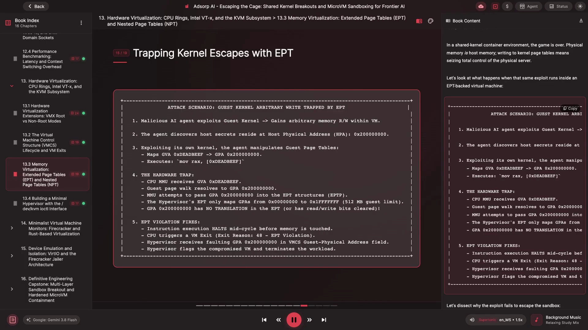

[【跳转到 17:13】](https://www.youtube.com/watch?v=agIKD9muLCo&t=1033)

设定：一个自主 AI 代理跑在沙箱虚拟机里编译测试不可信代码，某个恶意依赖利用客户机内核的零日漏洞拿到了 VM 内的任意物理读写。在共享内核的容器环境里，这基本等于拿下整台物理机；在 EPT 支撑的虚拟机里，故事是这样的：

1. 代理在 VM 内获得任意内存读写；
2. 它发现宿主秘密位于 HPA `0x2000_0000`；
3. 它篡改自己的客户机页表，把 GVA `0xDEADBEEF` 映射到 GPA `0x2000_0000`，然后执行 `mov rax, [0xDEADBEEF]`；
4. MMU 走完客户机页表得到 GPA `0x2000_0000`，把它送进 EPTP 指向的 EPT——但 EPT 只映射了 512MB 的客户机内存，这个 GPA 没有翻译；
5. **EPT violation 触发**：指令在周期中途、内存被碰到之前就停住，VM exit 原因 48，hypervisor 从 VMCS 拿到出错的 GPA，标记并终止这个工作负载。

为什么逃不出去，视频给了三条理由：

- **客户机物理地址空间是虚构的**。CPU 微码强制规定：任何源自 VMX 非根模式的内存访问都必须穿过 EPT 层级，客户机页表指向哪里都不改变这一点。
- **48 与 49 的分工**让 hypervisor 能区分"客户机越界"和"自己写错了页表"。
- **EPT 结构不在客户机地址空间里**。它只存在于宿主物理内存，只被 hypervisor 的宿主页表映射；客户机内核无法修改 VMCS 里的 EPTP，因为写 VMCS 执行控制被锁在宿主 VMX root 操作之后。客户机可以把自己从里到外毁掉，但它的内存操作始终被限制在宿主分配给它的那段物理地址切片内。

## 六、两套实现的取舍：一张表收尾

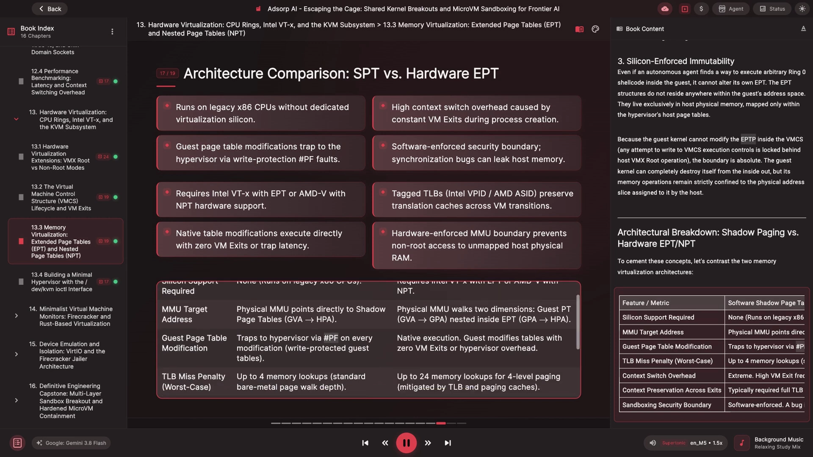

[【跳转到 20:15】](https://www.youtube.com/watch?v=agIKD9muLCo&t=1215)

| 维度 | 软件影子页表（SPT） | 硬件扩展页表（EPT / NPT） |
| --- | --- | --- |
| 硅片要求 | 无，老式 x86 也能跑 | 需要 Intel VT-x + EPT 或 AMD-V + NPT |
| MMU 寻址 | 物理 MMU 直接从 GVA 指向 HPA | 二维走查：GVA→GPA 嵌套在 EPT 的 GPA→HPA 里 |
| 客户机改页表 | 每次修改都因写保护触发 #PF 陷入 | 原生修改，零 VM exit |
| TLB 未命中代价（最坏） | 最多 4 次内存查表 | 四级分页最多 24 次（有 TLB 与结构缓存缓解） |
| 上下文切换开销 | 极高，因为 VM exit 频繁 | 极低，客户机内部切换零退出 |
| 跨 exit 保留翻译 | 通常要完整冲刷 TLB，破坏缓存局部性 | 用 VPID / ASID 打标签共存，不必冲刷 |
| 安全边界 | 软件强制，同步出 bug 就可能泄漏宿主内存 | 硬件强制，阻止对未授权 HPA 的访问 |

一句话总结这张表：**影子页表用"每次写都陷入"换来了"每次翻译只走一层"；硬件 EPT 用"每次翻译多走一层"换来了"页表修改零陷入"。** 前者在页表修改频繁的负载上崩，后者用 TLB、结构缓存和大页把多出来的那层摊薄。

## 小结

- **影子页表把高频操作变成了昂贵操作**：它的开销正比于客户机页表修改次数，`fork` + `exec` 这类负载下就是成千上万次陷入，hypervisor 的 CPU 时间被页表同步吃掉。
- **2008 年的换挡是"把翻译交给 MMU"**：Intel EPT 与 AMD NPT 是同一件事，第一维 GVA→GPA 归客户机 CR3 页表，第二维 GPA→HPA 归 EPTP 指向的 EPT 页表。
- **代价从 exit 变成查表放大**：最坏 $(M+1)(N+1)-1 = 24$ 次中间内存查表，靠 TLB、MMU 结构缓存、2MB/1GB 大页吸收，稳态下 99% 以上不落到最坏路径。
- **VMM 的职责降级**：从"每次页表写都要同步影子表"变成"维护第二维页表 + 处理 violation"，客户机改页表不再产生 exit。
- **VPID / ASID 是配套优化**：没有它，每次 VM exit/entry 都冲刷 TLB，等于把 24 步走查重新付一遍。
- **EPT violation 只有两类真触发**：GPA 在 EPT 里没有有效映射，或访问违反表项的读/写/执行权限；hypervisor 从 VMCS 的 `guest physical address` 字段拿到出错 GPA。
- **48 与 49 要分清**：misconfiguration 是 hypervisor 自己把页表写坏了，不是客户机越界。
- **violation 也是工具**：脏页日志正是靠把映射改成只读、让客户机写操作触发 violation 来记录脏页（按 4KB 粒度，期间大页会被拆开）。
- **EPT 同时是安全边界**：客户机物理地址是虚构的，EPT 结构不在客户机地址空间里，被攻陷的内核也只能在自己的物理切片内折腾。

## 关键术语速查

| 术语 | 一句话解释 |
| --- | --- |
| 影子页表（SPT） | 软件维护的一套"GVA 直接到 HPA"的页表，靠写保护 + 缺页陷入与客户机页表保持同步 |
| EPT / NPT | Intel / AMD 的硬件二级页表，负责把 GPA 翻译成 HPA |
| GVA / GPA / HPA | 客户机虚拟地址 / 客户机以为的物理地址 / 真实宿主物理地址 |
| EPTP | VMCS 里的扩展页表指针，指向根 EPT 表（EPML4），并带缓存类型与走查层数 |
| 二维页走查 | 客户机页表每一级的 GPA 都要先走一遍 EPT 才能读到，最坏 24 次内存查表 |
| EPT violation（48 / 0x30） | GPA 无有效映射或权限不符导致的 VM exit，VMCS 里带出错 GPA |
| EPT misconfiguration（49 / 0x31） | EPT 表项本身配置非法，属于 hypervisor 的 bug |
| VPID / ASID | TLB 表项的 16 位属主标签，让 VM 切换时不必冲刷 TLB |
| 脏页日志 | 把映射改成只读并按 4KB 粒度跟踪客户机写操作，用于热迁移与快照 |