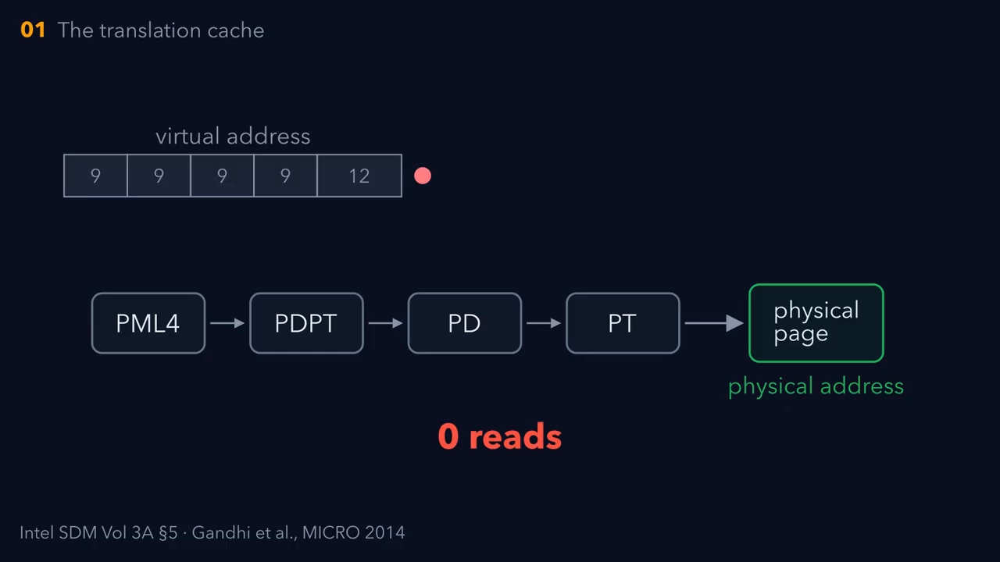
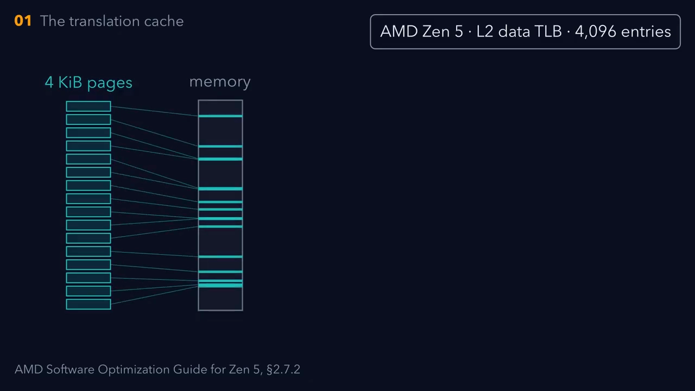
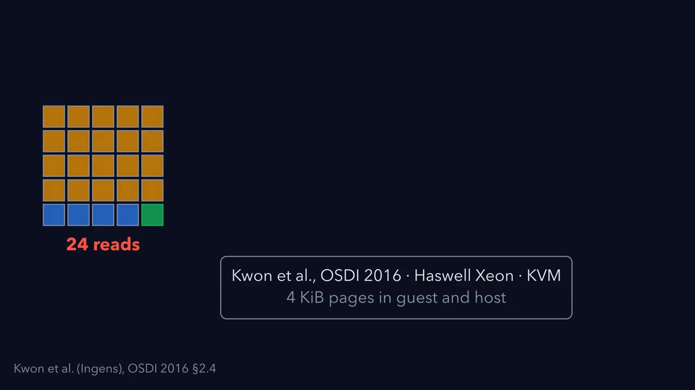
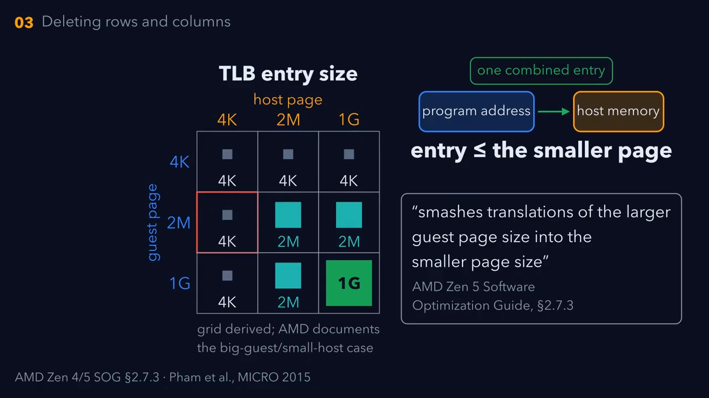
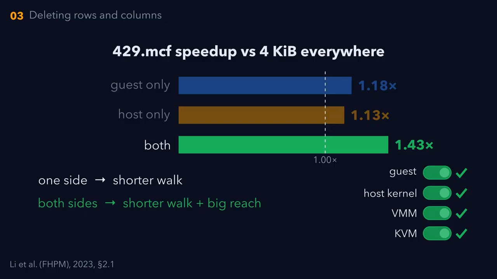
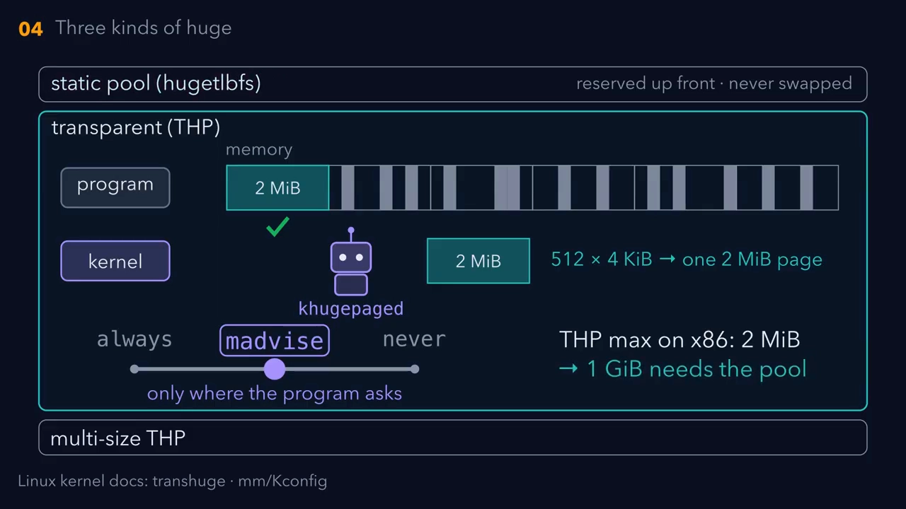
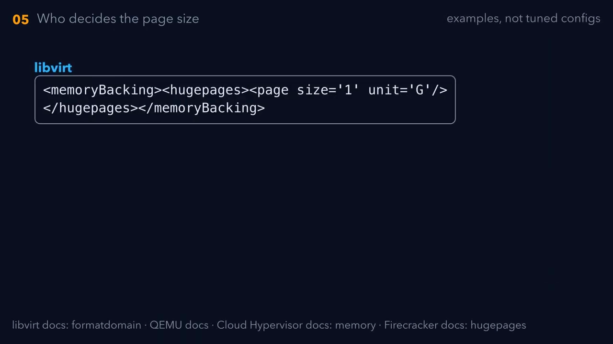
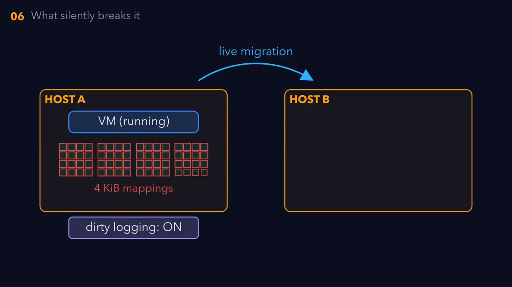
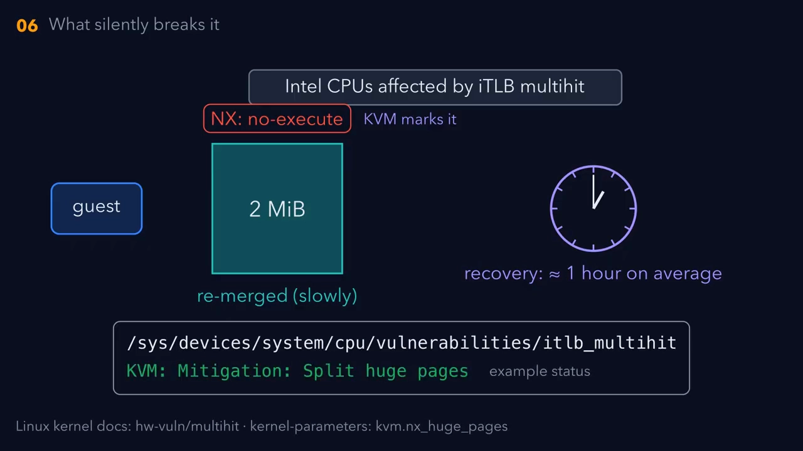
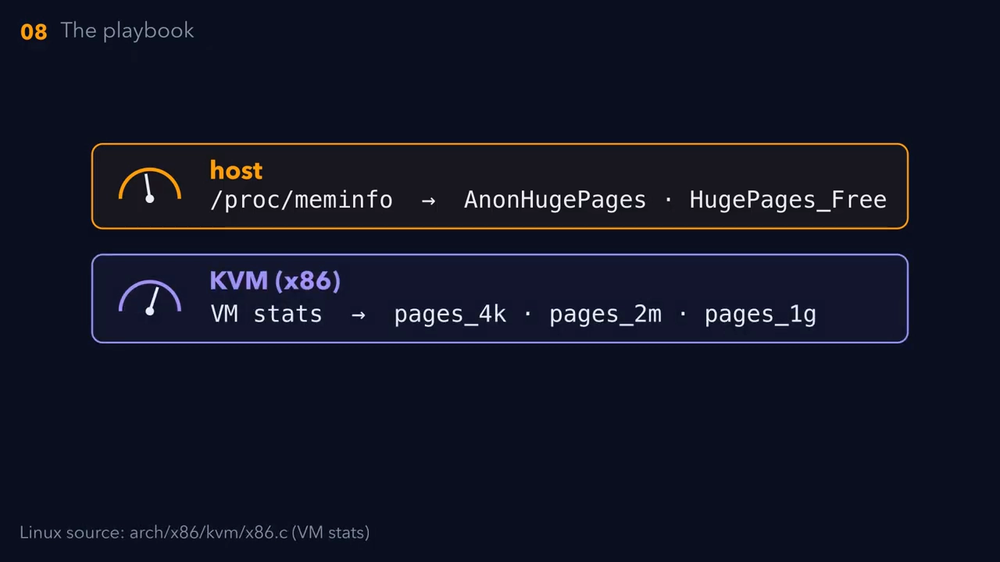

# 大页如何把二级页表走查从 24 次读压到 8 次

> 视频来源：[Hugepages in Virtualization: Up to 24 Reads per TLB Miss, and How to Delete Them](https://www.youtube.com/watch?v=X9EU-wvGRrE)（YouTube · XOR）｜时长约 15 分钟
> 导读：这支视频把"虚拟机的地址翻译要付两次钱"这件事算成了一笔账：先数清一次 TLB 未命中最多 24 次内存读是怎么来的，再一层层删掉这些读，最后找出日常运维里那些**悄悄把虚拟机退回小页**的操作。它接在 2.1.2 的代价模型与 2.1.3 的 EPT 演进之后，专门回答"大页为什么是二级页表的必需品"。

## 本讲要解决的核心问题（SCQA）

**背景**：开启 EPT/NPT 之后，一次内存访问要过两套页表。上一节算过最坏情况：客户机四级、宿主四级，一次冷 TLB 未命中最多 24 次内存读。

**冲突**：24 次读听起来像灾难，可现实中虚拟机并没有慢 6 倍。原因有两个：CPU 有缓存，而且**大页可以整层整层地把走查剪短**。但大页的收益有个苛刻前提——客户机和宿主**两侧**都得是大页，否则 TLB 里存下的表项会被"砸"回小页尺寸。

**疑问**：大页到底删掉了哪些读？为什么只有一侧开没用？Linux 上有几种大页、KVM 又是按什么规则决定 EPT 表项的大小？以及为什么很多虚拟机"配了大页却还是小页"？

**回答（中心思想）**：大页给虚拟机两份收益——**更短的走查**（少读几级页表）和**更大的 TLB 覆盖**（一条表项管更多内存），前者一侧开就有，后者必须两侧都开。而 KVM 自己从不"造"大页，它只能复制宿主已经做过的事；所以大页能不能留住，取决于宿主内核、VMM、KVM 与客户机四层是否一致，任何一层退回小页，收益就打回原形。

## 一、先看代价：一次 TLB 未命中在虚拟机里要 24 次读

### 1.1 TLB 命中是 0 次读，未命中才是全部代价

[【跳转到 01:28】](https://www.youtube.com/watch?v=X9EU-wvGRrE&t=88)

程序用的每个地址都是虚拟地址，CPU 用页表把它翻译成物理地址。x86 上这通常是一棵四层深的树：虚拟地址被切成 `9/9/9/9/12` 位，依次索引 PML4 → PDPT → PD → PT，最后落到物理页。从零翻译意味着每层读一个表项，最多四次内存读才读到真正的数据。

所以 CPU 把翻译结果缓存在 TLB（转译后备缓冲器）里：命中几乎不花钱，未命中才要走一次页表。**优化的目标从来不是"消灭页表走查"，而是"让未命中变少、让未命中变便宜"。**

### 1.2 TLB 的问题在容量

[【跳转到 01:53】](https://www.youtube.com/watch?v=X9EU-wvGRrE&t=113)

每个 TLB 表项只映射一个页。以 AMD Zen 5 为例，二级数据 TLB 有 4096 个表项：用 4KB 页只覆盖 16MB，一台 64GB 内存的虚拟机直接超过去；换成 1MB 页，同样的表项覆盖 8GB；Zen 5 还有一组 1024 个表项专门给 1GB 页，那是 1TB 的覆盖范围。这就是"**覆盖范围（reach）**"，后面会看到它比"少读几级"更难拿到。

### 1.3 虚拟机里是二维网格，不是一条链

[【跳转到 00:13】](https://www.youtube.com/watch?v=X9EU-wvGRrE&t=13)

虚拟机里有两套页表：客户机的页表把程序地址变成客户机以为的物理内存，hypervisor 的页表（Intel EPT / AMD NPT）再把它变成真正的宿主内存。转折在于——**客户机的页表本身也存在客户机内存里**，所以客户机走查跟随的每一个指针，在 CPU 能读到它之前，都要额外走一趟宿主的页表。

客户机四级加上最后的地址，每一级都需要一次四级宿主走查，加起来一次 TLB 未命中最多 24 次读，而不是 4 次。这 24 次是**最坏情况**：CPU 对两层走查的上层都保留了额外缓存，很多读会被跳过，但不是全部。

代价有多大？视频引了两个实测：

- 2014 年 Intel Sandy Bridge 服务器上，地址翻译让一个图算法基准比理想的原生小页运行慢 **28%**；在两侧都用小页的虚拟机里慢了 **113%**，超过理想时间的两倍。
- 2016 年 Intel Haswell 服务器上跑 KVM，基准 MCF 把 **47.5%** 的时间花在走页表上（客户机和宿主各占一半）；两侧都换大页后降到 **4.2%**（[【跳转到 00:13】](https://www.youtube.com/watch?v=X9EU-wvGRrE&t=13)）。

另外，更新的服务器在超大地址空间下会用五级页表：如果客户机和宿主都是五层深，同样的算法最多 **35** 次读。KVM 只在客户机确实需要时才这么做。

## 二、大页的两份收益：更短的走查 + 更大的覆盖

### 2.1 删列与删行：24 → 15 → 8

大页在页表里就是"上一层的一个表项加一个'到此为止'的标志位"。一个 2MB 页少读一层，一个 1GB 页再少读一层。放到那张网格上：

- 客户机用 2MB 页映射程序：它自己的走查少一层，**整列消失**；
- 宿主用 2MB 页承载客户机内存：每次宿主走查都少一层，**整行消失**；
- 两者都有：24 次降到 **15** 次；
- 两侧都用 1GB 页：同样的算法降到 **8** 次——不是原生水平，但已经很接近（[【跳转到 04:29】](https://www.youtube.com/watch?v=X9EU-wvGRrE&t=269)）。

这就是"删行删列"的直觉：**客户机侧的大页删列，宿主侧的大页删行。**

### 2.2 但覆盖范围由较小的那个页决定

[【跳转到 05:19】](https://www.youtube.com/watch?v=X9EU-wvGRrE&t=319)

更短的走查只是故事的一半。TLB 存的是一条**从程序地址直达宿主内存的合并翻译**，而这条表项不可能大于两个页中较小的那个。AMD 的优化指南把这点写得很直白：当客户机的大页落在宿主的小页上时，CPU 会把大表项"砸"成宿主的小尺寸——研究者把这叫**碎裂（splintering）**。Linux 内核文档把规则写成一句话：**只有当 KVM 和客户机都用大页时，TLB 才能拿到大表项。**

### 2.3 一侧开也有用，但只有两侧才拿到全部收益

[【跳转到 06:09】](https://www.youtube.com/watch?v=X9EU-wvGRrE&t=369)

同一项 2016 年的研究把收益拆开测过：对 MCF 来说，**只在客户机**用大页快 18%，**只在宿主**用快 13%，**两侧都用**快 43%。更新的数字也印证这点：2023 年一篇在 Intel Cascade Lake 服务器上跑 KVM 的预印本测出 Redis 用大页快了约 12%。

一句话记住：**一侧能缩短走查，只有两侧才能给你覆盖范围。** 这就是为什么客户机、宿主内核、VMM、KVM 四层都必须同意。

## 三、Linux 上的三种大页，以及 KVM 的选择规则

### 3.1 静态池、透明大页、多尺寸 THP

[【跳转到 07:09】](https://www.youtube.com/watch?v=X9EU-wvGRrE&t=429)

| 形态 | 怎么来 | 关键限制 |
| --- | --- | --- |
| 静态池（HugeTLB） | 提前预留，最好在启动时、内存还没碎片化之前 | 1GB 页只能走这条路；用不用都占着，不能被换出 |
| 透明大页（THP） | 程序触碰内存时内核当场给 2MB 页；给不了就退回小页，之后由 `khugepaged` 后台合并 | 受 `always` / `never` / `madvise` 控制；x86 上给虚拟机内存最多到 2MB |
| 多尺寸 THP（Linux 6.8 起，默认关闭） | 发放 64KB 这类中间尺寸 | 能减少缺页，但仍用小页表项映射，对虚拟机的宿主侧映射不算大页 |

### 3.2 KVM 只能复制宿主做过的事

对宿主来说，一台普通虚拟机的内存不过是某个普通进程（QEMU / Cloud Hypervisor / Firecracker）里的一大块内存。客户机第一次触碰某个页时，KVM 建立对应的 EPT 表项，而**它选择表项大小的依据是宿主把同一块内存映射进 VMM 进程时用了多大的页**。KVM 源码里的规则很短：

- 宿主用 1GB 页映射 → KVM 可以用 1GB 表项；
- 宿主用 2MB 页 → 2MB 表项；
- 否则 → 4KB。

还有一个额外条件：客户机物理地址和 VMM 自己的地址，在 2MB 页内的偏移必须相同——KVM 文档要求 VMM 对齐最低的 21 位。搞错了，整个区域就失去大页。**所以 KVM 从不自己造大页，它只能复制宿主已经做过的事**（[【跳转到 08:00】](https://www.youtube.com/watch?v=X9EU-wvGRrE&t=480)）。

### 3.3 默认值：多数 VMM 会要，Firecracker 不会

- **QEMU**：把客户机 RAM 对齐到 2MB，并向内核申请透明大页；
- **Cloud Hypervisor**：THP 选项默认开启；
- **Firecracker**：例外，你不告诉它，它就不申请大页。

但"透明"意味着尽力而为：宿主内存一碎片化，你就悄悄拿到小页。想要保证，就用静态池给虚拟机做后端——libvirt 里是 `memoryBacking` 下的 `hugepages` 元素，QEMU 里是打开 hugeTLB 的内存后端，Cloud Hypervisor 里是 `hugepages=on`，Firecracker 里是 `huge_pages` 设为 `2M`。

[【跳转到 09:15】](https://www.youtube.com/watch?v=X9EU-wvGRrE&t=555)

一个警告：有些 VMM 在虚拟机启动时并不预留池子，池子被用光后，客户机可能运行到一半崩掉。Cloud Hypervisor 的 `reserve` 选项能让它在启动时就干净地失败，而不是留到后面。还有别忘了客户机自己：如果它一直用小页，你又会回到碎裂的表项。

## 四、谁在悄悄把虚拟机退回小页

这是这支视频最有价值的部分：**大页失效通常没有任何报错**。

### 4.1 热迁移与脏页日志：一开迁移就拆页

[【跳转到 10:05】](https://www.youtube.com/watch?v=X9EU-wvGRrE&t=605)

要搬走一台运行中的虚拟机，KVM 必须跟踪客户机写过的每一个页，而它是**按 4KB 粒度跟踪**的。所以脏页日志一开启，KVM 就把大页映射拆成小页；默认情况下它是**主动提前拆**，而不是等每次写才拆。迁移剩下的时间里，虚拟机就在小页上跑。取消迁移，KVM 会重建大页映射；在目的机上映射是从零建立的，如果那台宿主用大页承载内存，就又是大页；后拷贝迁移结束后，透明大页会慢慢回来。

这也解释了 2.1.3 里那条"脏页日志靠写保护触发 EPT violation"的机制为什么和大页冲突：**要按 4KB 粒度记脏，就只能按 4KB 粒度映射。**

### 4.2 iTLB multihit：KVM 主动拆页来规避 CPU 缺陷

[【跳转到 11:00】](https://www.youtube.com/watch?v=X9EU-wvGRrE&t=660)

在受 ITLB multihit 缺陷影响的 Intel 处理器上，KVM 会把大页标记为不可执行（NX）。客户机一旦从大页上执行代码，KVM 就把它拆成小页，再由后台线程慢慢撤销这些拆分，默认平均一小时后才恢复一个。你的宿主是否受影响，看 `/sys/devices/system/cpu/vulnerabilities/itlb_multihit` 一个文件就知道。

### 4.3 还有几处会打碎大页

- **KSM 内存去重**：它合并的是小页，所以只要一个大页内部有可合并的内容，就会被拆开。2016 年的研究里，去重省了 9% 的内存，却让负载最多慢了 19%。
- **共享内存**：客户机 RAM 是共享内存时（vhost-user、virtio-fs 就是这种情形），共享内存的透明大页在上游默认是关闭的。
- **传统内存气球**：一次按 4KB 归还内存，会把大页打碎；free page reporting 按 2MB 块工作来避免这点。
- **机密虚拟机**：SEV-SNP 或 TDX 把私有内存放在 `guest_memfd` 里，截至最近的 Linux 内核候选版本仍然只支持小页，大页支持还只是提案。

## 五、大页的账单与行动手册

### 5.1 大页不是免费的

| 代价 | 数字 |
| --- | --- |
| 缺页延迟 | 一次大页缺页 378 微秒，小页 3.6 微秒——一次慢 105 倍，虽然按字节算更便宜（它填的是 512 倍的内存） |
| 内存浪费 | 程序只碰到每个 2MB 区域的一点点，也会拿到整个区域；Redis 删掉大部分键之后，用大页反而多占 69% 内存 |
| 腾空间的代价 | 2018 年一项在刻意碎片化的裸金属 Intel 服务器上的研究里，内核 compaction 把 MySQL 的最差读延迟推高到 4.7 秒 |
| 静态池 | 用不用都占着、不能被换出，所以不能靠它超分宿主内存；1GB 页最好在启动时预留 |
| 后拷贝迁移 | 一次缺页要等整个页到达；10Gbps 网络下 1GB 页约 1 秒 |

正是这笔账单，让那么多指南说"关掉透明大页"。视频的判断是：这个建议在变老，而且它本来是给数据库自己那台机器的建议——MongoDB 8 现在建议开启，Oracle 最新文档建议 `madvise`，Redis 仍然建议关闭并默认给自己关掉。**诚实的答案是看负载、去测量。**

### 5.2 行动手册：开完还要检查

1. **大型、延迟敏感或绑核的虚拟机**：用静态池，在启动时于正确的 NUMA 节点上预留 1GB 或 2MB 页。
2. **其它场景**：用透明大页，并让 VMM 去申请（Firecracker 里就是把 `huge_pages` 设为 `transparent`）。
3. **客户机内部也要打开**，否则表项会被碎裂回小页。
4. **检查，不要假设**：

[【跳转到 14:40】](https://www.youtube.com/watch?v=X9EU-wvGRrE&t=880)

- 宿主上 `/proc/meminfo` 的 `AnonHugePages` / `HugePages_Free` 显示有多少内存落在透明或静态大页里；
- KVM 自己会统计一台虚拟机的映射里有多少是 `pages_4k`、`pages_2m`、`pages_1g`；
- Intel CPU 上还有性能计数器显示数据加载有多少周期在等页走查。

## 小结

- **虚拟机为地址翻译付两次钱**：客户机每走一级页表，那一级的 GPA 都要再走一遍 EPT，最坏 24 次内存读（五级对五级是 35 次）。
- **大页在页表里就是"提前停住"**：2MB 页少读一层、1GB 页再少一层，网格上表现为删列（客户机侧）和删行（宿主侧）。
- **两份收益要分开看**：更短的走查一侧开就有；更大的 TLB 覆盖必须两侧都开，因为表项尺寸取两个页里较小的那个（碎裂）。
- **实测口径**：MCF 只在客户机 1.18×、只在宿主 1.13×、两侧 1.43×；MCF 走页表时间从 47.5% 降到 4.2%。
- **KVM 只能复制宿主**：EPT 表项大小取决于宿主把内存映射进 VMM 时用的页大小，外加 2MB 内偏移对齐这一条。
- **三种大页各有边界**：静态池能拿 1GB 但不能超分，THP 尽力而为且 x86 上最多 2MB，多尺寸 THP 不算虚拟机的大页。
- **失效是静默的**：脏页日志（按 4KB 跟踪）、iTLB multihit 缓解、KSM、共享内存、气球、机密虚拟机都会把大页拆掉。
- **开了要验证**：meminfo、KVM 的 `pages_4k/2m/1g` 统计、Intel 的页走查周期计数器，三者对照才知道大页是否真的留住。

## 关键术语速查

| 术语 | 一句话解释 |
| --- | --- |
| TLB | 缓存"虚拟地址到物理地址"翻译的高速缓冲，命中则跳过页表走查 |
| 覆盖范围（reach） | 一组 TLB 表项能覆盖多少内存，由表项数 × 页大小决定 |
| 二维走查 | 客户机页表每一级都要用 EPT/NPT 再翻译一次，最坏 24 次内存读 |
| 碎裂（splintering） | 客户机大页落在宿主小页上时，TLB 表项被砸回较小尺寸 |
| HugeTLB 静态池 | 启动时预留、不换出的大页池，1GB 页的唯一来源 |
| 透明大页（THP） | 内核按需给 2MB 页、`khugepaged` 后台合并，尽力而为 |
| 脏页日志 | 按 4KB 粒度跟踪客户机写操作，开启时会把大页拆成小页 |
| iTLB multihit | Intel 的一个 TLB 缺陷，KVM 的缓解方式是把大页标 NX 并拆页 |