# KSM 去重机制与 Meta 的调优实践：从 ksmd 扫描到侧信道风险

> 视频来源：[Kernel Samepage Merging (KSM) at Meta and Future Improvements to KSM](https://www.youtube.com/watch?v=lZUgUE2zkyo)（YouTube · Linux Plumbers Conference，讲者 Stefan Roesch，Meta）
> 时长约 43 分钟。导读：这是一场把 KSM 从内核机制讲到生产调优的会议报告——先拆开 `ksmd` 的三阶段扫描，再讲怎么开、怎么观测、Meta 在 Instagram 上的真实数字，最后落到两个正在合入的优化和三条边界（页大小、延迟敏感、侧信道）。本文按这条线整理，并补上虚拟机场景为什么受益的解释。

## 本讲要解决的核心问题（SCQA）

**背景**：一台宿主机上往往同时跑着许多"长得差不多"的东西——同一份镜像启动的多台虚拟机、同一个解释器加载起来的几十个工作进程。它们物理内存里的很多页内容完全一样，却各存一份。

**冲突**：内存不够用，CPU 也不够用（Meta 的老机器就是这种"双重紧张"的组合）。页去重看起来能省内存，但扫描页本身要烧 CPU，合并之后的页还多了一层写保护。

**疑问**：KSM 究竟怎么把两个不同虚拟地址的页变成同一页？应用和系统各要做什么配置？在生产负载上到底能省多少、要付多少代价？什么情况下不该开？

**回答（中心思想）**：KSM 用后台线程 `ksmd` 扫描被显式标记为"可合并"的匿名页，靠 rmap_item + 内容哈希 + 不稳定树/稳定树三级筛选，把内容相同的页合并成一个写保护的 KSM 页，写入时用写时复制（Copy-on-Write，COW）拆开；它的收益完全取决于负载的重复度与 pages_to_scan 是否调对，代价是 `ksmd` 的 CPU 和每页的元数据，而在多租户或虚拟机场景还必须正视"合并本身就是信息通道"带来的侧信道风险。

## 一、KSM 只做一件事：把内容相同的匿名页合成一页

KSM 的全名是 Kernel Samepage Merging（内核同页合并）。它的高层想法非常简单：**去重匿名页**（anonymous pages，即没有文件背书的、由 `malloc`/堆/栈产生的内存页）。这不是新特性，2009 年就进了内核，只是最近两年关注度重新上升。[【跳转到 01:00】](https://www.youtube.com/watch?v=lZUgUE2zkyo&t=60)

值得注意的是它的出身：KSM 最初就是为**虚拟机**开发的，用来在宿主上对多台 VM 的内存做去重。后来人们发现它在别的场景也有用。[【跳转到 01:25】](https://www.youtube.com/watch?v=lZUgUE2zkyo&t=85)

为什么虚拟机场景天然适合？一台 VM 的"客户机物理内存"，在宿主看来就是 VMM 进程（QEMU/Firecracker 等）通过 `mmap` 拿到的一段匿名内存。同一份镜像启动 10 台 VM，这 10 段匿名内存里必然有大量相同的页——内核代码段、共享库、只读数据、刚启动时读进来的配置。KSM 不需要理解"这是虚拟机"，它只要看到两段匿名内存里有两页内容相同，就可以把它们并成一页。这就是"内存超分"（memory overcommit）在页级别的来源。

### 1.1 合并后的页是写保护的，写入靠 COW 拆开

合并不是把两份数据揉成一份共享缓冲区，而是：**保留一个 KSM 页，把所有重复页的页表项都指向它，并把这些映射标记为写保护**。任何一方要写，就触发缺页，内核给它复制一份私有副本，其他方继续共享原来那页。这就是 COW 在这里的全部作用——它保证"合并"对进程是透明的。[【跳转到 03:25】](https://www.youtube.com/watch?v=lZUgUE2zkyo&t=205)

所以 KSM 的收益和风险是同一枚硬币：省下来的是"重复的物理页"，付出的是"每次首次写入多一次缺页 + 复制"。

## 二、一次扫描的三个阶段：rmap_item、哈希、两棵树

KSM 的执行者是内核后台线程 `ksmd`。它只扫描"被提名给 KSM"的页——讲者把这类页叫**候选页**（candidate pages），以区别于系统里其他所有不参与 KSM 的页。[【跳转到 02:10】](https://www.youtube.com/watch?v=lZUgUE2zkyo&t=130)

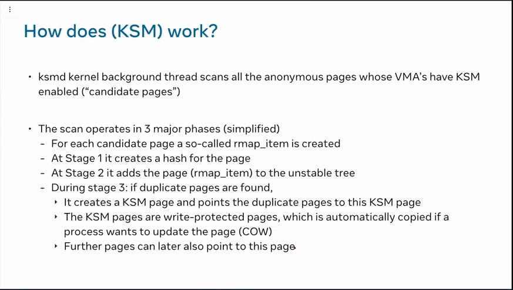

一次完整的判定被拆成三个阶段，讲者用一张图概括了数据结构的流转：

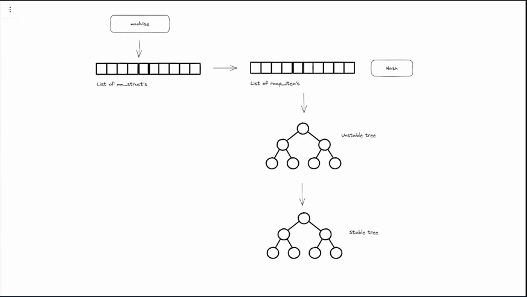

### 2.1 阶段一：为每个候选页建 rmap_item 并算哈希

对标记区域内**每一个页**，内核创建一个 rmap_item（reverse mapping item，反向映射项），它记录"这个物理页被哪些虚拟地址映射"。同时算一个内容哈希。

哈希的作用不是找相同，而是**筛掉变化太快的页**：如果一页的内容一直在变，它既不可能长期和别人相同，合并了也会立刻被写坏，不值得投入扫描成本。[【跳转到 03:00】](https://www.youtube.com/watch?v=lZUgUE2zkyo&t=180)

### 2.2 阶段二：哈希没变，才进不稳定树

下一轮扫描时，如果同一页的哈希和上一轮一样，说明它这段时间没被改过，于是把它挂进**不稳定树**（unstable tree）。不稳定树是一棵按页内容组织的搜索树，用来快速找到"内容可能相同"的候选。

如果新来的页在不稳定树里找到了一个已经存在的、内容相同的页，这一对（或多页）就被提升进**稳定树**（stable tree）。稳定树存放的是"已经确认可以共享"的页。[【跳转到 03:25】](https://www.youtube.com/watch?v=lZUgUE2zkyo&t=205)

### 2.3 阶段三：命中即合并，页表项改指向 KSM 页

确认重复后，内核创建**一个 KSM 页**，把原来两页或多页的页表项统统改成指向它，并置为写保护。之后再有新页被判定与它相同，也可以直接指过来——共享者数量没有上限地增长（受 max_page_sharing 约束）。

讲者特意说明他做了一处简化：**真实代码里第一步不是先算哈希，而是先查稳定树**，看这页是不是已经有人共享了；只是为了讲清楚才按"哈希 → 不稳定树 → 稳定树"的顺序铺开。[【跳转到 03:50】](https://www.youtube.com/watch?v=lZUgUE2zkyo&t=230)

这条"先查稳定树"的细节很关键：它意味着**已经合并过的页是廉价的**，新页只要一次树查找就能搭上便车；真正昂贵的是那些反复扫描却始终找不到同伴的页。

## 三、怎么让一段内存变成"候选页"：madvise 与 prctl

KSM 不会自动扫描全系统的匿名页，必须显式开启。历史上先后有两套接口。

### 3.1 老接口 madvise(MADV_MERGEABLE)：能开，但没有反馈

老办法是对某段内存调 `madvise`，声明"这段我想让 KSM 管"。也可以反向调用把某段关掉。问题是：**你只能猜哪段内存值得开**，因为系统不告诉你这段区域里到底合出了多少 KSM 页。[【跳转到 05:05】](https://www.youtube.com/watch?v=lZUgUE2zkyo&t=305)

而且不是所有内存区都能开。讲者列了三类排除项：带 memory tag 的、用 huge TLB（大页）的、以及被共享的 VMA——这些区域"不兼容"，开了也不生效。[【跳转到 04:40】](https://www.youtube.com/watch?v=lZUgUE2zkyo&t=280)

### 3.2 新接口 prctl(PR_SET_MEMORY_MERGE)：进程级、可继承

Linux 6.4 给进程控制接口加了一个新选项，语义从"这段内存"变成"这个进程"：一旦打开，该进程所有**兼容的** VMA 都自动开启 KSM；更关键的是，**这个设置会被 `fork` 继承**，子进程不必再设置一遍。[【跳转到 05:55】](https://www.youtube.com/watch?v=lZUgUE2zkyo&t=355)

这个"可继承"不是锦上添花，而是 Meta 采用它的直接原因。他们的服务不是单个进程，而是一个 controller 加至少 32 个 worker，且这些进程是通过 systemd 启动 cgroup 拉起来的。理想做法是：在 cgroup 的种子进程上开一次 KSM，之后 fork 出来的所有 worker 自动继承。[【跳转到 12:10】](https://www.youtube.com/watch?v=lZUgUE2zkyo&t=730)

### 3.3 systemd 的 `MemoryKSM`：应用一行代码都不用改

光有内核接口还不够，因为业务方不可能为了省内存去改一个巨大的 Django 应用。于是 systemd 也加了一个配置项 `MemoryKSM`：在 service 定义里写上，服务启动时 KSM 就自动打开。讲者强调这正是它相对 `madvise` 的优势——**不需要改应用**。[【跳转到 13:00】](https://www.youtube.com/watch?v=lZUgUE2zkyo&t=780)

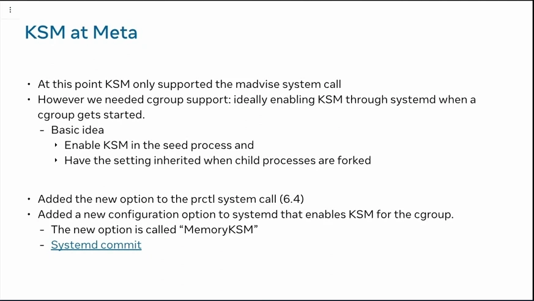

## 四、系统级旋钮与观测指标

### 4.1 `/sys/kernel/mm/ksm`：三个必须先认识的参数

系统级配置和监控都在 `/sys/kernel/mm/ksm` 下。[【跳转到 06:45】](https://www.youtube.com/watch?v=lZUgUE2zkyo&t=405)

| 文件 | 作用 | 实践要点 |
| --- | --- | --- |
| `run` | 全局开关，写入 1 即启用 KSM | 默认不开，需要显式打开 |
| pages_to_scan | `ksmd` 每批扫描多少页，决定"扫描激进度" | 默认 100，官方文档称只够 demo 用 |
| sleep_millisecs | 两批扫描之间睡多久 | 与 pages_to_scan 一起决定扫描吞吐 |

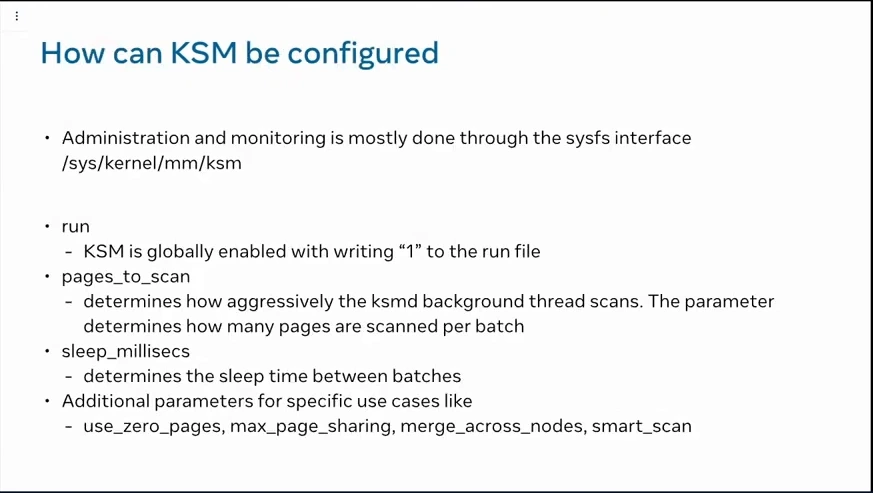

pages_to_scan 是一个**批量值**：扫一批、睡一会、再扫一批，如此循环。所以它单独看没有直观含义——真正决定"多久能把所有候选页扫一遍"的是 pages_to_scan 与 sleep_millisecs 的比值。[【跳转到 07:35】](https://www.youtube.com/watch?v=lZUgUE2zkyo&t=455)

此外还有若干针对特定场景的参数：use_zero_pages、max_page_sharing、merge_across_nodes、smart_scan。[【跳转到 07:10】](https://www.youtube.com/watch?v=lZUgUE2zkyo&t=430)

### 4.2 计数器读什么

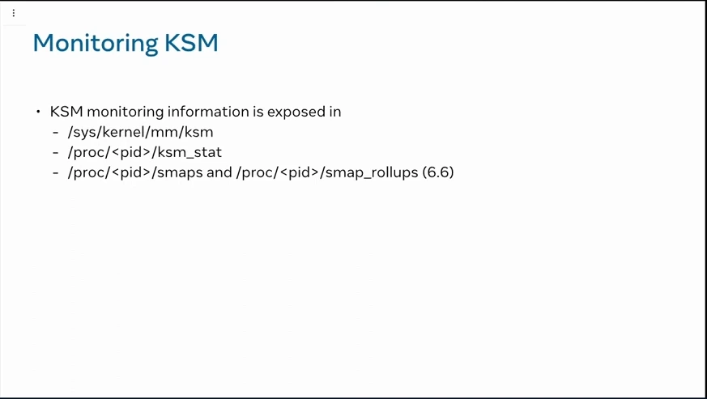

讲者逐个解释了最常用的几个计数器：

- pages_shared：当前有多少个 KSM 页（**合并后的唯一页数**）。
- pages_sharing：有多少个映射正在使用这些 KSM 页（**共享者数量**）。
- pages_unshared：内容唯一、不变化、但找不到同伴的页——它们占着扫描成本却不产生收益。
- pages_volatile：变化太快、直接被判定不适合合并的页。
- pages_skipped：新特性 smart_scan 跳过的页（见第六节）。
- pages_scanned：累计扫描页数，用来算"每轮扫描做了多少功"。
- full_scans：完整扫描了多少轮。

其中 pages_scanned 是新增的，因为在此之前**根本没法知道每轮扫描了多少页**；同样缺失的还有"一次完整扫描花了多久"——没有 tracepoint，你连起止时间都拿不到。为此讲者补了 ksm_start_scan / ksm_stop_scan 两个 tracepoint，另有 `enter`/`exit` 记录某个 VMA 开启或关闭 KSM 的时刻。[【跳转到 09:40】](https://www.youtube.com/watch?v=lZUgUE2zkyo&t=580)

### 4.3 6.6 之后：能按 VMA 看收益

Linux 6.6 给 `/proc/<pid>/smaps` 和 /proc/<pid>/smaps_rollup 加了 KSM 条目，于是可以回答"进程里哪一段虚拟内存最赚"：每个 VMA 会告诉你它名下有多少 KSM 共享页。[【跳转到 08:25】](https://www.youtube.com/watch?v=lZUgUE2zkyo&t=505)

这一步是后面"精细化调优"的前提：先看 `smaps` 找出高收益区域，再对这些区域改用 `madvise` 精确开启，最后甚至可以把进程级的 `prctl` 关掉。[【跳转到 25:55】](https://www.youtube.com/watch?v=lZUgUE2zkyo&t=1555)

## 五、Meta 的生产数据：收益有多大

### 5.1 负载形态：一个 controller 加至少 32 个同构 worker

Meta 的动机来自 Instagram：内存吃紧，而且在老机型上**同时**吃紧 CPU，这是最难处理的组合。负载形态是：一个 controller，加至少 32 个 worker 进程（数量取决于机型强弱）。所有 worker 启动时做的事完全一样——先把解释器加载进内存，再按需加载大量相同的数据结构。[【跳转到 11:20】](https://www.youtube.com/watch?v=lZUgUE2zkyo&t=680)

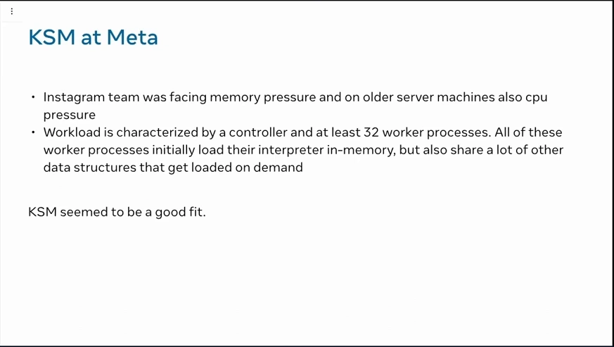

"同构进程 + 相同启动路径"正是 KSM 最理想的输入：重复页不是偶然，而是结构性的。

### 5.2 第一版实验几乎零收益：默认 pages_to_scan=100 太低

讲者第一次在 Meta 打开 KSM 时，结果"非常令人失望"——基本没有发生任何共享。排查后发现原因是默认值：pages_to_scan 默认 100，对任何真实负载都远远不够；后来他在文档里看到官方说法是"只够 demo 负载使用"。更麻烦的是当时还没有 tracepoint，定位这个问题多花了不少时间。[【跳转到 13:25】](https://www.youtube.com/watch?v=lZUgUE2zkyo&t=805)

调参经验是：生产负载上 **4000–5000** 比较合适，另一些负载 2000–3000 也够。判断标准不是拍脑袋，而是同时看两个数——**省了多少内存**和**一轮扫描花了多久**：如果一轮扫描要 20 分钟，说明 pages_to_scan 明显偏低；他们一般把一轮扫描控制在 2–3 分钟。[【跳转到 14:15】](https://www.youtube.com/watch?v=lZUgUE2zkyo&t=855)

### 5.3 典型与极端两组数字

典型作业的计数器如下：

- pages_sharing 超过 211 万，pages_shared 超过 7.3 万；
- 折算到一台 64 GB 机器上，大约省下 6 GB 内存；
- 曲线形态是：软件启动后共享量快速爬升，随后稳定在 180 万–210 万之间，具体取决于负载高低。[【跳转到 15:05】](https://www.youtube.com/watch?v=lZUgUE2zkyo&t=905)

对一个机群来说，这个数字要乘以机器数，所以"6 GB"不是一个小数目。

极端用例（把机器压到接近满载，只为观察系统行为）则达到：

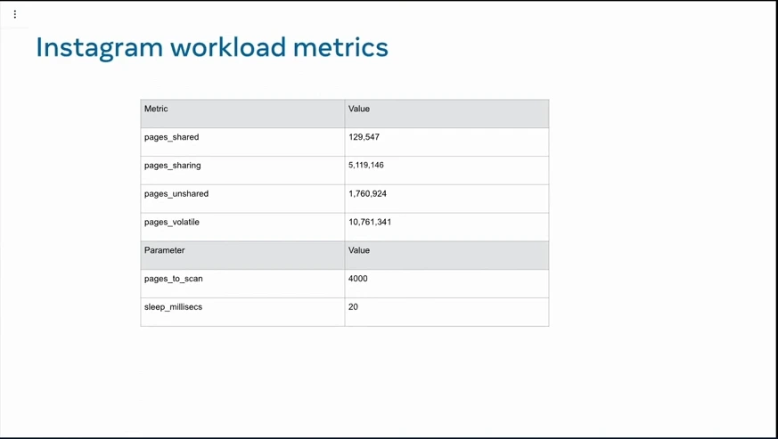

- pages_sharing 接近 500 万，pages_shared 约 12.9 万；
- 同时 pages_volatile 高达 1076 万——说明在高压下大量页变化过快，被判定为不适合合并；
- 讲者明确说这不是他们平时的运行方式，只是为了测试系统在极端负载下的行为。[【跳转到 16:20】](https://www.youtube.com/watch?v=lZUgUE2zkyo&t=980)

### 5.4 扫描量：启动期每轮 2000 万页

真正让讲者决定做优化的，是扫描量数据：启动期每轮扫描 **2000 万–2600 万页**；内存使用稳定后回落到 **800 万–1200 万页**。但即便在稳定期，这 800 万–1200 万里也有大量页是"反复扫描、但内容唯一、永远合不上"的。[【跳转到 17:10】](https://www.youtube.com/watch?v=lZUgUE2zkyo&t=1030)

这就是后面两个优化的出发点：**别在没希望的页上重复做功**，以及**别用启动期的激进度跑稳态**。

## 六、两个优化：smart scan 与 auto-tune

### 6.1 smart scan：记住失败，跳过它（6.7）

思路很直接：在 rmap_item 里多存一点历史信息。如果某页已经连续几次都没能合上，下一轮扫描就跳过它；之后再试；再失败就加大跳过计数，目前上限是 8。

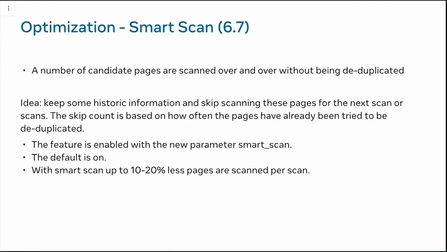

这个特性已经进入 6.7 上游，参数名 smart_scan，**默认开启**。效果是每轮需要扫描的页数减少 **10%–20%**。放在 2000 万页的量级上，这不是小数。[【跳转到 18:00】](https://www.youtube.com/watch?v=lZUgUE2zkyo&t=1080)

### 6.2 auto-tune：用"目标扫描时间 + CPU 上下限"替代手调批量值

第二个优化（当时还在设计评审阶段，名字在 auto-tune 和 advisor 之间摇摆）针对的是"启动期和稳态需要不同激进度"这个事实：启动期必须尽快扫完，否则共享迟迟建立不起来；稳态期完全可以放松。

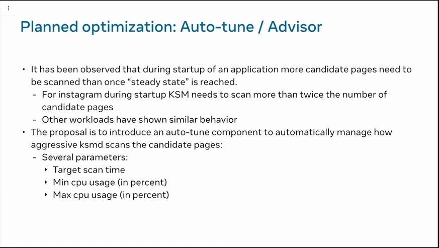

它的设计是让**内核自己**（不是用户态守护进程）根据三个参数调节 pages_to_scan：

- `target scan time`：扫完全部候选页的目标时间；
- min CPU usage / max CPU usage：允许 `ksmd` 占用的 CPU 上下限（百分比）。

内核知道上一轮用了多少 CPU、花了多长时间，于是可以反算出下一轮该把 pages_to_scan 调成多少。[【跳转到 20:05】](https://www.youtube.com/watch?v=lZUgUE2zkyo&t=1205)

### 6.3 效果：`ksmd` 的 CPU 降 20%–30%

实测结果是：启动期 pages_to_scan 冲到 4500–6000，进入稳态后自动降到 2500，有时更低，取决于当时的负载。折算下来，`ksmd` 后台线程的 CPU 消耗降低 **20%–30%**，系统吞吐还略有改善。[【跳转到 20:55】](https://www.youtube.com/watch?v=lZUgUE2zkyo&t=1255)

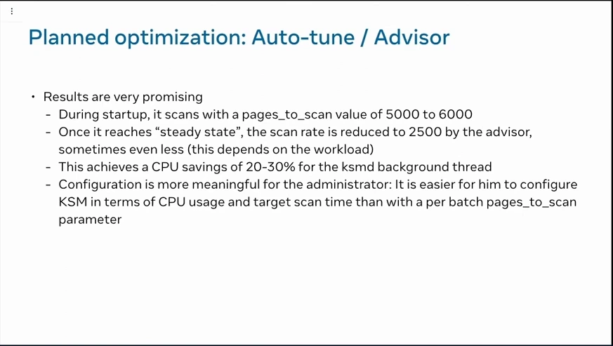

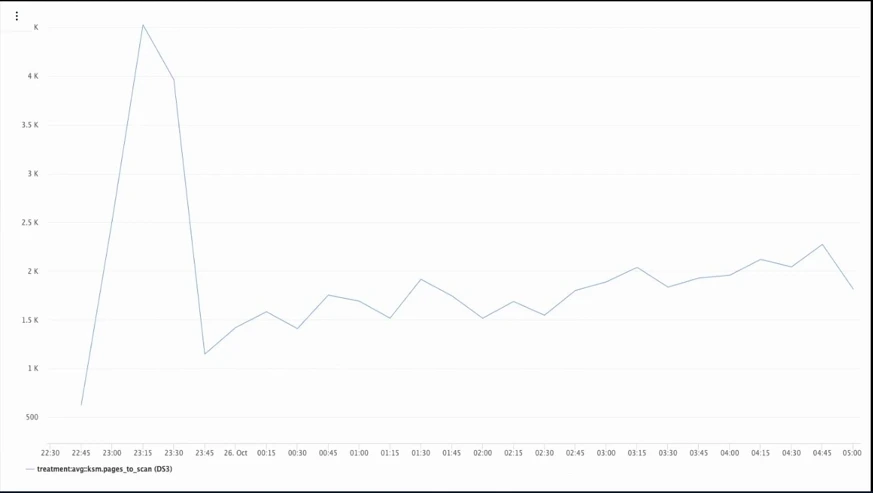

讲者还强调了一个"给管理员的好处"：pages_to_scan 是个批量值，管理员很难推理"它要跑多少轮才扫完"；而"目标扫描时间 + CPU 上下限"是人能直接理解的语义。[【跳转到 21:45】](https://www.youtube.com/watch?v=lZUgUE2zkyo&t=1305)

## 七、怎么判断一个新负载值不值得开 KSM

讲者给了一套可操作的评估流程：

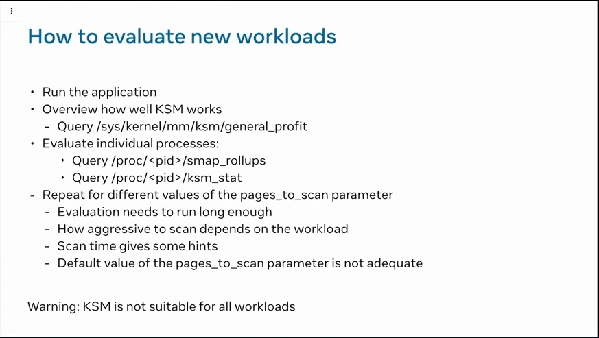

1. 用 `prctl`、systemd 的 `MemoryKSM`，或 LD_PRELOAD 注入的方式给应用开启 KSM（前两种更推荐）；
2. 看 /sys/kernel/mm/ksm/general_profit：它直接告诉你省了多少内存，且计算时**已经扣掉了 KSM 自身元数据的开销**；
3. 看 /proc/<pid>/smaps_rollup（6.6+）与 /proc/<pid>/ksm_stat，定位到具体进程；
4. **换几个不同的 pages_to_scan 重复实验**——只看一个参数点得出的收益没有意义；
5. 用扫描时间判断参数是否落在合理区间（默认值一定不合适）。

讲者最后加了一句警告：**KSM 并不适合所有负载**。[【跳转到 24:15】](https://www.youtube.com/watch?v=lZUgUE2zkyo&t=1455)

如果还想再压榨一层，就按 VMA 精细化：用 `smaps` 找出收益最高的区域，只对这些区域调 `madvise`，然后把进程级的 `prctl` 去掉。另一个通用建议是：**页越小，KSM 效果越好**，因为小页出现内容相同的概率更高。[【跳转到 26:20】](https://www.youtube.com/watch?v=lZUgUE2zkyo&t=1580)

讲者还抛出一个尚未落地的想法：能不能**不真的合并、只保留不稳定树和稳定树**，用来预测"这个负载如果开 KSM 能省多少"？这样评估新负载就不必每次都跑一遍完整实验。另有一个叫 Dragon 的用户态原型，遍历 VMA 收集页哈希存进 map 来估算共享率，缺点是慢，只适合少量进程。[【跳转到 28:50】](https://www.youtube.com/watch?v=lZUgUE2zkyo&t=1730)

## 八、边界：页大小、延迟敏感、侧信道

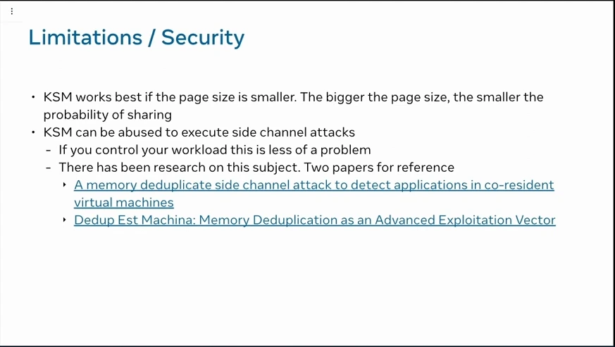

### 8.1 大页让共享概率下降

页越大，两页内容完全相同的概率越低，能合并的机会就越少。这与"用大页降低 TLB 缺失"的目标天然冲突——**大页与去重是两种相反的内存优化方向**。[【跳转到 29:40】](https://www.youtube.com/watch?v=lZUgUE2zkyo&t=1780)

### 8.2 侧信道：合并本身就是一条信息通道

这是虚拟机场景最需要警惕的一条。KSM 的合并/拆分时机可以被外部观测：攻击者反复写某一页，测量"这一页是否被合并过"，就能推断同宿主机上其他租户是否加载了某段内容。讲者引用了两篇论文——*A memory deduplicate side channel attack to detect applications in co-resident virtual machines* 与 *Dedup Est Machina: Memory Deduplication as an Advanced Exploitation Vector*。

他的判断是：**如果负载完全由你控制，这个风险小；如果你跑的是虚拟机这类多租户负载，就必须认真评估**。[【跳转到 30:05】](https://www.youtube.com/watch?v=lZUgUE2zkyo&t=1805)

### 8.3 延迟敏感负载不适合

如果负载对延迟敏感，KSM 大概率不是正确选择：合并后的页在首次写入时要走缺页 + 复制，这个抖动对延迟敏感服务是实打实的伤害。讲者在问答里补充，Meta 评估中的推理类负载就属于"延迟敏感、不适合"的一类。[【跳转到 30:30】](https://www.youtube.com/watch?v=lZUgUE2zkyo&t=1830)

### 8.4 代价的量化：CPU 与内存元数据

问答环节给出了两组很有用的数字：

- **内存开销**：主要来自 rmap_item 和稳定树，量很小；不稳定树不额外占内存，因为它与 rmap_item 的链表是叠加（overlay）的。文档里有现成公式可以估算。
- **CPU 开销**：在 Skylake 机器上以 pages_to_scan=5000 启动时，`ksmd` 能吃到 **60% CPU**；进入稳态后回落到约 **30%**（配合前面两个优化）。[【跳转到 37:10】](https://www.youtube.com/watch?v=lZUgUE2zkyo&t=2230)

这也解释了为什么"扫描激进度"必须调：默认值太低导致不干活，调得太高又会把 CPU 打满。

### 8.5 两个容易误解的点

- **KSM 是全局的，不按 cgroup 记账**。讲者明确回答：KSM 在全局层面工作，不作用于单个 cgroup；你说"共享这段内存"，实际是全局共享。[【跳转到 42:10】](https://www.youtube.com/watch?v=lZUgUE2zkyo&t=2530)
- **共享发生在可写页上，不只是只读页**。有人问能否用 DAMON 监控只读页来挑候选，讲者的回答是：至少在他们的负载里，产生共享的是**可写页**，不是只读页。[【跳转到 33:00】](https://www.youtube.com/watch?v=lZUgUE2zkyo&t=1980)

还有一个有意思的旁证：有人在开发 KVM/IOMMU 代码时，会把 KSM 的激进度调到极高，故意"把页从脚下抽走"，用来验证 TLB 失效处理是否正确、数据有没有被写坏。这从侧面说明：**KSM 的合并/拆分路径是内存管理里最容易出错的路径之一**。[【跳转到 41:20】](https://www.youtube.com/watch?v=lZUgUE2zkyo&t=2480)

## 小结

- **KSM 做的是匿名页去重**，2009 年进内核，最初就是为虚拟机场景设计的；合并后所有映射指向同一个写保护的 KSM 页，写入靠 COW 拆开。
- **扫描分三步**：每页建 rmap_item 并算哈希 → 哈希稳定后进不稳定树 → 找到同伴后进稳定树并创建 KSM 页；真实代码会先查稳定树，让已合并的页"搭便车"。
- **开启方式有两代**：madvise(MADV_MERGEABLE) 按区域、无反馈；prctl(PR_SET_MEMORY_MERGE) 按进程、可被 `fork` 继承（6.4）；systemd 的 `MemoryKSM` 让应用零改动。
- **调参的核心是 pages_to_scan**：默认 100 只够 demo，生产上 4000–5000 才有效；判断标准是"省了多少内存"加"一轮扫描多久"。
- **收益是结构性的**：Instagram 那种"一个 controller + 32 个同构 worker"的负载，典型可省约 6 GB/64 GB；极端压力下 pages_sharing 可达 500 万页。
- **两个优化**：smart_scan（6.7，跳过反复失败的页，扫描量降 10%–20%）与 auto-tune（按目标扫描时间与 CPU 上下限自动调 pages_to_scan，`ksmd` CPU 降 20%–30%）。
- **三条边界**：大页与去重方向相反；延迟敏感负载不合适；虚拟机/多租户场景要评估侧信道风险。
- **KSM 是全局机制**，不按 cgroup 隔离，也不只作用于只读页。

## 关键术语速查

| 术语 | 一句话解释 |
| --- | --- |
| KSM（Kernel Samepage Merging） | 内核同页合并，把内容相同的匿名页并成一个写保护的共享页 |
| 匿名页（anonymous page） | 没有文件背书的页，堆、栈、`mmap` 的匿名映射都属于此类；VM 的客户机内存对宿主也是匿名页 |
| `ksmd` | 执行 KSM 扫描的内核后台线程 |
| rmap_item | 反向映射项，记录一个物理页被哪些虚拟地址映射，同时承载哈希与跳过计数 |
| 不稳定树（unstable tree） | 存放"哈希稳定、尚未确认可共享"的页的搜索树 |
| 稳定树（stable tree） | 存放"已确认可共享"的页的搜索树，新页先来这里找同伴 |
| KSM 页 | 合并后产生的唯一物理页，被多个页表项以只读方式共享 |
| COW（Copy-on-Write） | 写时复制，任一方写入共享页时复制出私有副本 |
| pages_to_scan | `ksmd` 每批扫描的页数，决定扫描激进度 |
| sleep_millisecs | 两批扫描之间的休眠毫秒数 |
| pages_sharing / pages_shared | 共享者数量 / 合并后的唯一页数量 |
| general_profit | 扣除 KSM 元数据开销后的净内存收益 |
| smart_scan | 6.7 引入，记录失败历史并跳过反复无法去重的页 |
| 侧信道（side channel） | 通过观测合并/拆分时机等副作用推断他人数据，KSM 在多租户场景的固有风险 |