# nuKSM：当页去重撞上 NUMA，KSM 的"谁被保留"问题

> 视频来源：[nuKSM: NUMA-aware Memory De-duplication on Multi-socket Servers](https://www.youtube.com/watch?v=c8uFqApoa20)（YouTube · PACT 2021，讲者 Akash Panda，IISc / AMD India）
> 时长约 14 分钟。导读：这是一篇会议论文的报告，但它把 KSM 最容易被忽略的一个细节讲透了——合并两个相同的页时，**到底保留哪一份、释放哪一份**。在多路服务器上，这个看似随意的选择会让两台 VM 的性能差出 20%–46%，甚至让进程优先级失效。本文按"现象 → 机理 → 方案 → 结果"整理。

## 本讲要解决的核心问题（SCQA）

**背景**：云上的 VM 常常跑着相同或相似的负载、用着相同的 OS 镜像和库，因此内存里有大量内容相同的页。Linux 的 KSM 会把这些页合并，只保留一份，其余用写时复制共享——这是省内存的标准手段。

**冲突**：在一台两路（two-socket）服务器上，两台 VM 各跑一份**完全相同**的负载，打开 KSM 之后，其中一台的耗时比另一台高出 20%–46%；而关掉 KSM 时两者几乎一样。更糟的是，把变慢那台设成高优先级也救不回来。

**疑问**：为什么同样的负载、同样的合并，只有一方变慢？KSM 凭什么决定保留谁的页？这个决定能不能被纠正？

**回答（中心思想）**：KSM 保留的是"扫描时后遇到的那一份"，而扫描顺序由进程启动顺序决定，与访问热度、NUMA 距离、优先级都无关；在多路机器上，被释放的那一方从此要跨 socket 访问共享页，于是变慢。nuKSM 的做法是**把合并页放在访问它更频繁的那个 node 上**，用内核已有的 active/inactive 链表判断热度，同热或同冷时用轮转保证公平，并用 nice 值表达优先级。

## 一、去重的基本流程：扫描物理页 → 留一份 → 标记 COW

去重的目标很朴素：找出内容相同的页，删掉多余的副本。做法分三步——扫描物理页框；发现重复后保留其中一份，把其余映射指向它并标记为写时复制；之后任何一方写入，就给它复制一份私有副本。[【跳转到 00:42】](https://www.youtube.com/watch?v=c8uFqApoa20&t=42)

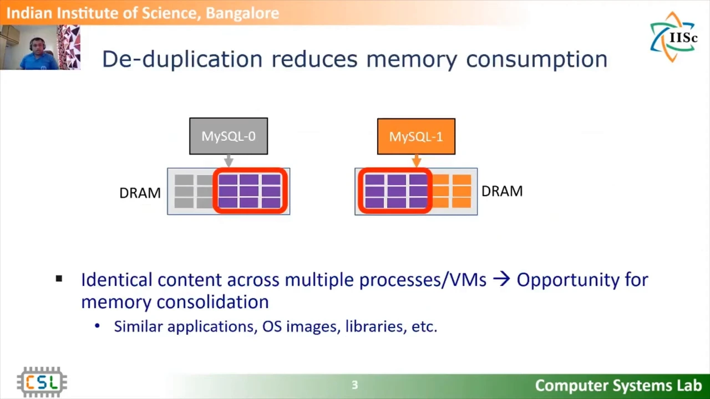

这套机制在 Linux 里叫 KSM（Kernel Samepage Merging），在 VMware 生态里叫 TPS（Transparent Page Sharing）。本项工作聚焦 Linux 的 KSM。[【跳转到 01:07】](https://www.youtube.com/watch?v=c8uFqApoa20&t=67)

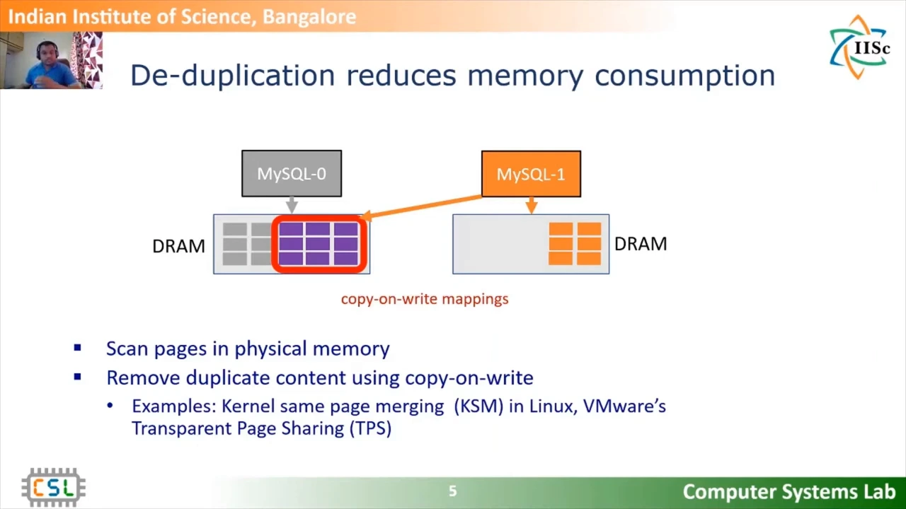

## 二、现象：同一份负载，后启动的那台慢 20%–46%

实验设置很干净：在 KVM 上开两台 VM，分别放在两个 socket 上，各跑一份**完全相同**的实例（instance 0 与 instance 1）。instance 1 紧跟在 instance 0 之后启动。

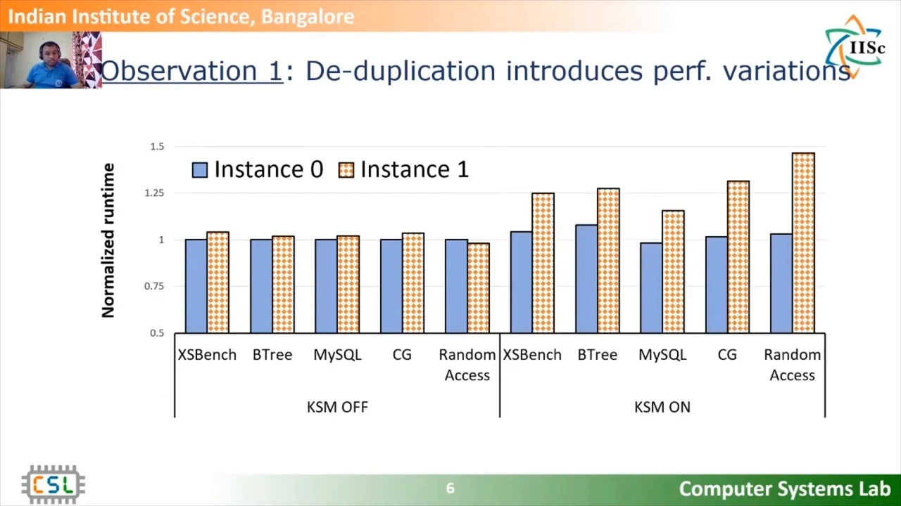

结果非常反直觉：KSM 关闭时，两者耗时大致相当；KSM 打开后，**instance 1 显著变慢**，而 instance 0 几乎不受影响。作者测得的减速幅度是 20%–46%。[【跳转到 01:32】](https://www.youtube.com/watch?v=c8uFqApoa20&t=92)

为了定位原因，他们先补了一节 NUMA 基础课。

## 三、NUMA 背景：远端内存访问可能慢 50%

大型服务器通常有多个 socket，每个 socket 上有一颗处理器和一组本地 DRAM。每颗处理器**也能**访问别的 socket 上的内存，但延迟和带宽取决于"距离"：一次远端访问可能比本地访问慢 50%。因此应用性能取决于数据被放在哪里、以及它多频繁地访问远端内存。[【跳转到 02:21】](https://www.youtube.com/watch?v=c8uFqApoa20&t=141)

验证方法很直接：统计本地访问与远端访问的比例。

- KSM 关闭时，两个实例的访问几乎全是本地的；
- KSM 打开时，instance 0 依然全本地，而 instance 1 有相当大比例的访问跑到了远端 socket 上。[【跳转到 02:46】](https://www.youtube.com/watch?v=c8uFqApoa20&t=166)

原因就找到了：**共享页被放在了 instance 0 所在的 node 上，instance 1 每次访问共享页都要跨 socket**。

## 四、机理：KSM 保留"后扫描到的那一份"

为什么总是 instance 1 倒霉？答案在于 KSM 决定"保留哪一份、释放哪一份"的规则。

在作者的实验里，instance 0 先启动、instance 1 后启动，而 KSM **保留扫描时后遇到的那一份**，释放先遇到的那一份。于是扫描顺序决定了页的物理位置，而扫描顺序又取决于进程启动顺序——最终结果是：instance 0 分配的页被保留，instance 1 分配的页被释放，所有重复页都变成"在 node 0 上、由 node 1 远端访问"。[【跳转到 03:21】](https://www.youtube.com/watch?v=c8uFqApoa20&t=201)

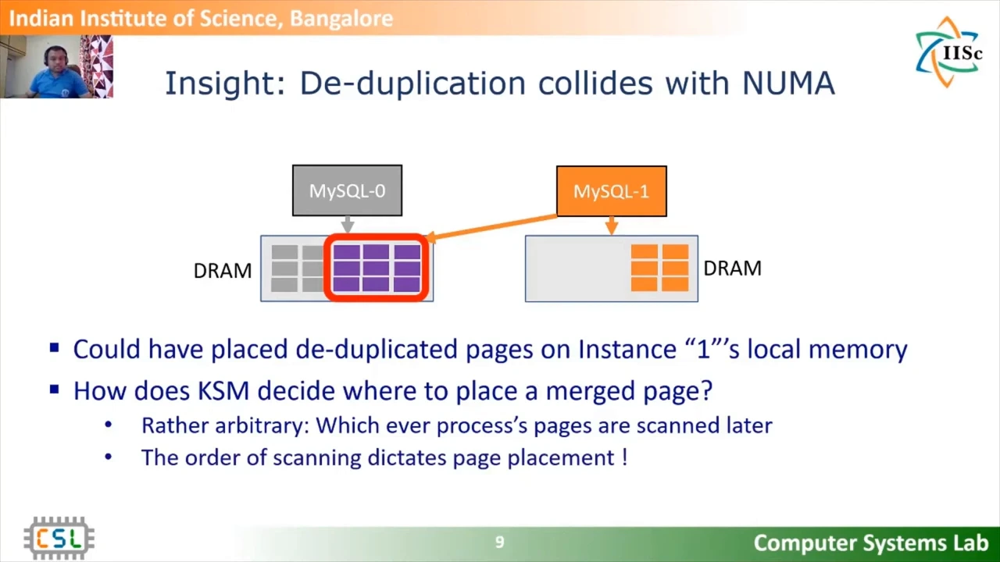

讲者用了一个很重的词：这个决策"相当随意"（quite arbitrary）。它不看访问热度，不看 NUMA 距离，也不看优先级。

### 4.1 优先级也救不了：优先级反转

自然的想法是：把 instance 1 设成高优先级不就行了？实验给出的答案是不行。

以 B-tree 为例，横轴是时间、纵轴是吞吐。KSM 消除重复内容之后，**低优先级进程的吞吐反而高于高优先级进程**——因为低优先级那个启动得稍早，它的页被保留在了本地，而高优先级那个要去远端取数据。系统里没有任何旋钮能纠正这一点。[【跳转到 04:41】](https://www.youtube.com/watch?v=c8uFqApoa20&t=281)

这就是典型的**优先级反转**（priority inversion）：低优先级的进程因为"运气好、启动早"而获得了更好的内存位置。

## 五、nuKSM 的做法：把合并页放在"更常访问它"的 node 上

作者的目标由此明确：抑制性能抖动、消除优先级反转。他们声称有两点贡献——第一次指出内存去重与 NUMA 会相互冲突，以及给出解决方案。[【跳转到 05:09】](https://www.youtube.com/watch?v=c8uFqApoa20&t=309)

核心想法一句话：**不再看谁先启动，而是看哪一份副本被访问得更频繁**，保留更频繁的那一份，释放其余的。这样远端访问的总代价最小。[【跳转到 05:23】](https://www.youtube.com/watch?v=c8uFqApoa20&t=323)

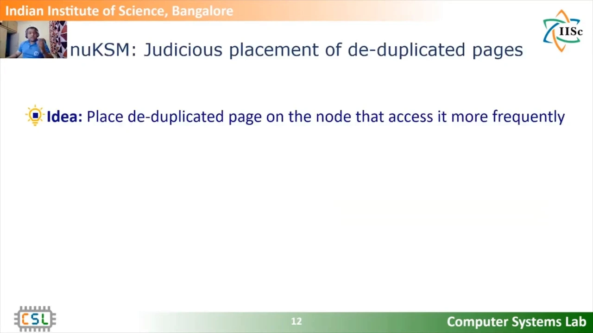

### 5.1 复用 Linux 的 active/inactive 链表判断热度

"识别哪一份更热"听起来要新增统计机制，而任何新机制都会带来开销。nuKSM 的选择是**复用内核已经维护的信息**：Linux 为了在内存压力下换页，维护了 active 链表（较常访问）与 inactive 链表（不常访问）。

规则很简单：

- 一份副本在 active、另一份在 inactive → **释放 inactive 那一份**，保留热的；
- 两份都在 active 或都在 inactive → 无法区分冷热，改用**轮转**，保证公平，不偏向任何一方。[【跳转到 06:13】](https://www.youtube.com/watch?v=c8uFqApoa20&t=373)

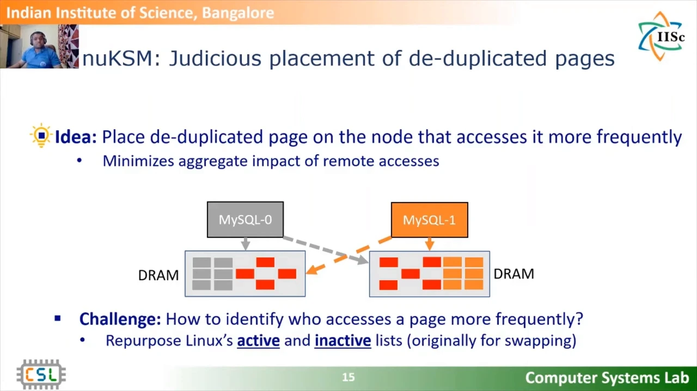

### 5.2 同热或同冷时：轮转分配，把惩罚对半分

假设四份重复内容 C0、C1、C2、C3 在两个应用里都是 active，无法区分冷热。nuKSM 会把它们**分散**到两个 node 上：比如 C0、C2 留在靠近 MySQL-0 的 node 0，C1、C3 放到靠近 MySQL-1 的 node 1。

于是 MySQL-0 访问 C1、C3 是远端，MySQL-1 访问 C0、C2 是远端——**两边的远端访问惩罚被均分**，谁也不会独占好处。[【跳转到 07:25】](https://www.youtube.com/watch?v=c8uFqApoa20&t=445)

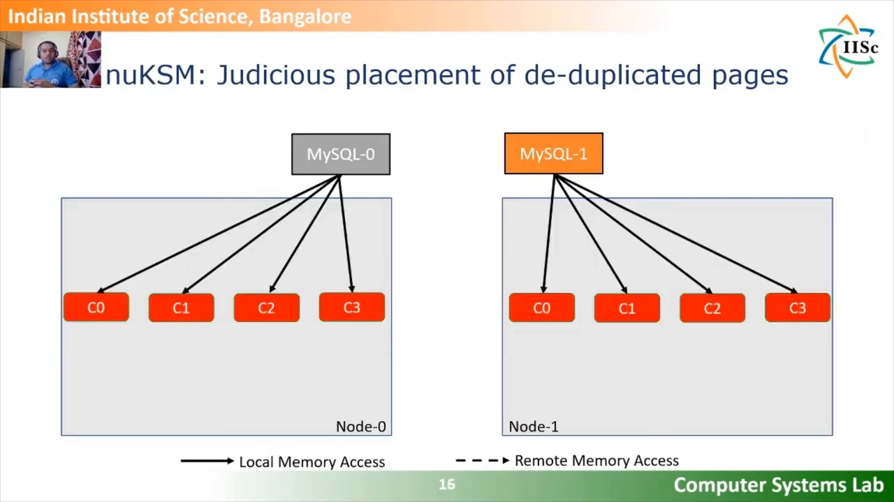

### 5.3 用 nice 值表达"谁更该享受本地内存"

nuKSM 没有发明新的优先级体系，而是**直接继承 Linux 的进程优先级（nice 值）**。对每个待去重的页，它按一个公式算出"新份额"（new share），份额越高越可能被保留。这样管理员用现有的 nice 就能表达"这台 VM 应该多拿本地内存"。[【跳转到 09:38】](https://www.youtube.com/watch?v=c8uFqApoa20&t=578)

实验覆盖五组优先级配置，从 C10:1 到 C1:10（表示两台 VM 的相对优先级比例）。随着配置从左往右移动，instance 0 的优先级下降、instance 1 的上升，两者的运行时间差随之缩小，到 C1:1 时得到公平环境。[【跳转到 10:53】](https://www.youtube.com/watch?v=c8uFqApoa20&t=653)

## 六、结果：差异收敛到 run-to-run 波动之内

实验平台是两路 Intel Skylake，每路 18 核、192 GB 内存。负载包括 NAS 并行套件里的 CG、AccessBench、MySQL，以及随机访问和 B-tree 查找两个微基准。[【跳转到 07:55】](https://www.youtube.com/watch?v=c8uFqApoa20&t=475)

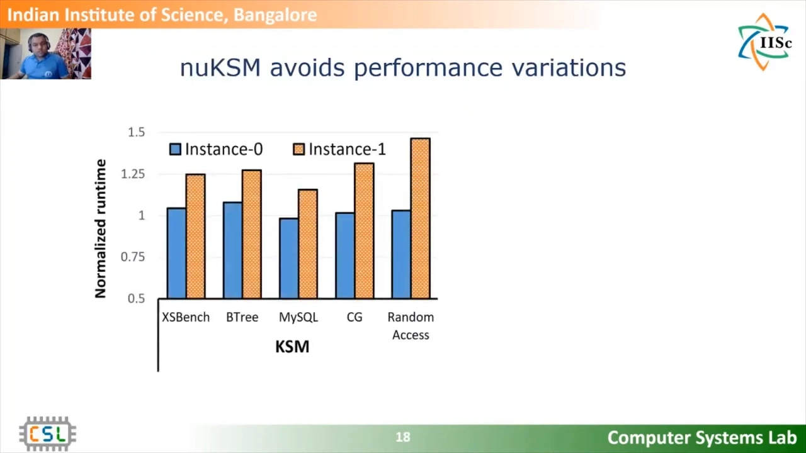

- 用 KSM 时，两个实例的耗时差异显著，说明去重引入了**性能抖动与不公平**；
- 用 nuKSM 时，差异落在正常运行波动内。[【跳转到 08:18】](https://www.youtube.com/watch?v=c8uFqApoa20&t=498)

从"本地/远端访问比例"看得更清楚：

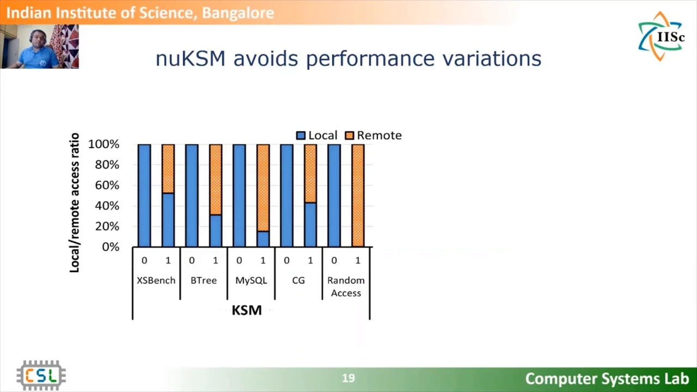

在 KSM 下，不同实例看到的远端访问量差别很大；nuKSM 下，每个负载的两个实例远端比例几乎相等。这说明 nuKSM 确实在**均摊**本地与远端访问，而不是把代价集中到某一方。[【跳转到 08:43】](https://www.youtube.com/watch?v=c8uFqApoa20&t=523)

作者还定义了一个公平性指标（越接近 1 越好），nuKSM 的公平性明显更好，而且**这些改善没有以牺牲省下的内存为代价**。[【跳转到 09:08】](https://www.youtube.com/watch?v=c8uFqApoa20&t=548)

## 七、顺带的扩展性优化：把两棵树变成"森林"

论文还处理了一个与 NUMA 无关、但在大内存机器上很要命的问题：**KSM 的搜索结构不随内存规模扩展**。

KSM 维护两棵红黑树（stable tree 与 unstable tree）来发现相同内容。每处理一个页，都要在两棵树里搜索，搜索路径上要做**整页比较**。内存越大，树越大，搜索路径上的比较次数越多，去重速度越慢。[【跳转到 11:15】](https://www.youtube.com/watch?v=c8uFqApoa20&t=675)

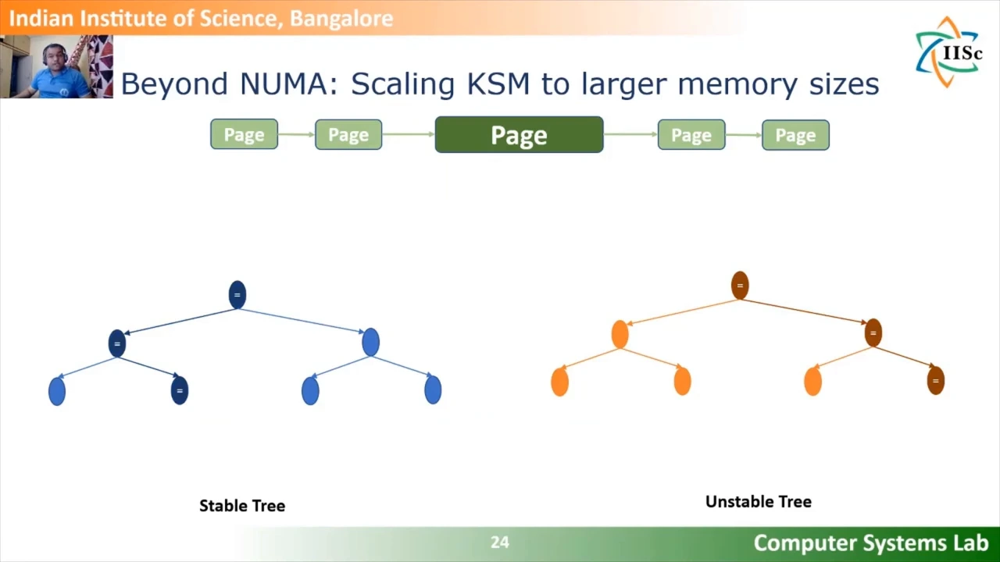

nuKSM 把这两棵集中式的树改成**去中心化的森林**（stable forest / unstable forest）：先按页内容的校验和（checksum）决定去森林里的哪棵树找——内容相同的页校验和必然相同，于是搜索空间被切开，无谓的整页比较大幅减少。树的数量还可以随内存容量增加，从而给"每次搜索的比较次数"设一个上界。[【跳转到 12:05】](https://www.youtube.com/watch?v=c8uFqApoa20&t=725)

效果用一个内存压力实验来展示：跑两个 AccessBench 实例，再加一个逐步抬高内存压力的后台作业。原版 KSM 因为去重速度跟不上，大约 15 分钟就 OOM；nuKSM 更快，能把所有负载跑完。而且在 KSM 发生 OOM 的那一刻，nuKSM 已经多去重了 6 GB 以上的内存。[【跳转到 13:05】](https://www.youtube.com/watch?v=c8uFqApoa20&t=785)

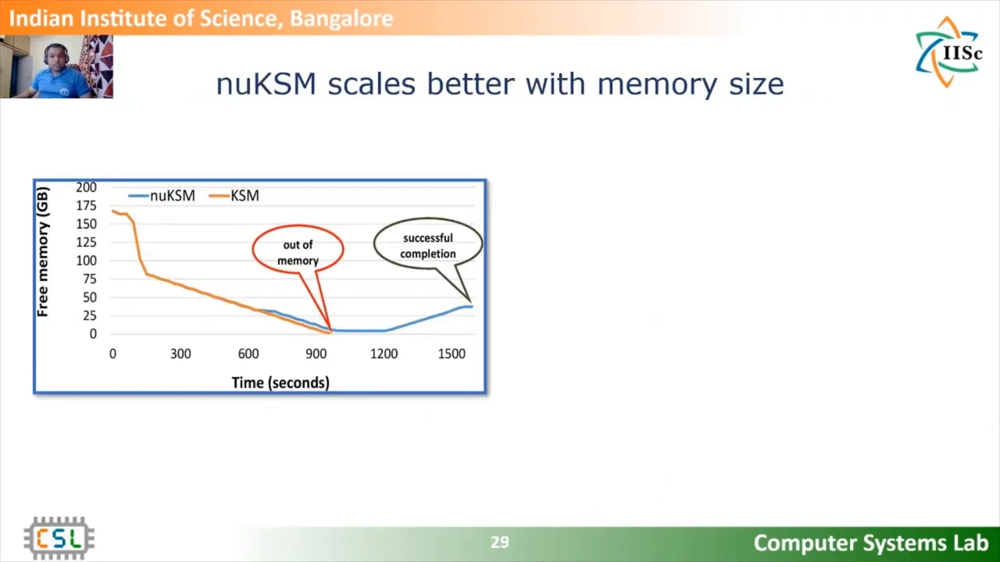

## 八、结论与边界

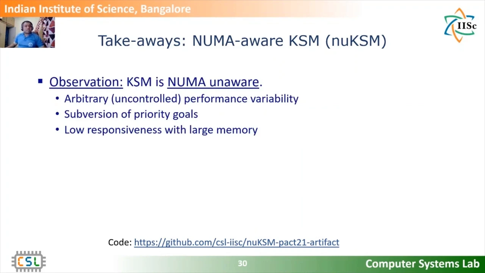

作者把结论归纳为三条观察加一个方案：

1. **KSM 对 NUMA 无感知**，同一应用的不同实例出现任意、不可控的性能差异；
2. **优先级目标被颠覆**，高优先级进程可能因为页被放到远端而更慢；
3. **大内存下响应性差**，树变大导致去重速度跟不上内存增长。

nuKSM 给出的是 NUMA 感知的去重：确定性的性能、实例间的公平性、与优先级目标一致，并且提升了大内存下的响应性。[【跳转到 13:30】](https://www.youtube.com/watch?v=c8uFqApoa20&t=810)

需要说明的边界：

- 这套机制解决的是"**合并页放在哪**"的问题，不改变 KSM 的收益模型——省下的内存不变，改变的是谁承担远端访问的代价；
- 它依赖内核现有的 active/inactive 链表，因此热度判断的精度受制于页回收子系统的行为；
- 论文的完整细节（超过两个 VM 或进程时如何扩展）需参考原文，代码以 artifact 形式发布。[【跳转到 13:55】](https://www.youtube.com/watch?v=c8uFqApoa20&t=835)

对做虚拟化的人来说，这篇工作最有价值的提醒是：**页去重不是"合并完就结束"，合并页的物理位置本身就是一个性能参数**。在单机、单 socket、同构负载的场景里它可能完全无害；一旦跨 socket、跨 NUMA node，或者多租户共享一台大机器，就必须考虑"保留哪一份"带来的分配不公。

## 小结

- **KSM 的收益来自"留一份、其余共享"**：扫描物理页、保留一份、其余映射标记 COW，写入时复制私有副本。
- **KSM 的决策是随意的**：它保留"后扫描到的那一份"，而扫描顺序由进程启动顺序决定，与访问热度、NUMA 距离、优先级无关。
- **后果是跨 socket 的远端访问**：在两路机器上，被释放页的一方每次访问共享页都要走远端，实测慢 20%–46%，且高优先级也救不回来（优先级反转）。
- **nuKSM 的核心是放置策略**：把合并页放在访问更频繁的 node 上；用 active/inactive 链表判断热度；同热同冷时轮转均摊；用 nice 值表达优先级。
- **效果**：实例间耗时差异收敛到 run-to-run 波动内，远端访问比例被均摊，公平性指标改善，而省下的内存不变。
- **额外优化**：把 stable/unstable 两棵树改为按校验和分片的森林，给搜索比较次数设上界，大内存下不再因去重跟不上而 OOM。
- **对虚拟化的启示**：合并页的物理位置是性能参数；跨 NUMA 场景下，去重策略必须和调度、放置一起考虑。

## 关键术语速查

| 术语 | 一句话解释 |
| --- | --- |
| KSM | Linux 的内核同页合并，把内容相同的匿名页并成一份共享页 |
| TPS | VMware 的透明页共享，与 KSM 思路相同 |
| COW（Copy-on-Write） | 写时复制，任一方写共享页时复制出私有副本 |
| NUMA | 非统一内存访问，多 socket 机器上访问远端内存更慢 |
| node / socket | NUMA 节点 / CPU 插槽；本地内存与远端内存的区分依据 |
| active / inactive 链表 | 内核为换页维护的两条 LRU 链表，nuKSM 借用它判断页的热度 |
| 优先级反转 | 低优先级任务因资源位置更好而跑赢高优先级任务 |
| stable / unstable tree | KSM 用来发现相同内容的两棵红黑树 |
| forest（森林） | nuKSM 把两棵大树按内容校验和拆成多棵小树，限制搜索比较次数 |
| checksum | 页内容的校验和，内容相同则校验和相同，用于分片索引 |
| run-to-run variation | 同一配置多次运行之间的正常波动，是判断"差异是否显著"的基准 |
| OOM | Out Of Memory，内存耗尽；去重速度跟不上分配速度时会触发 |