# 大页把 TLB 覆盖范围放大 512 倍：mmap 的三种来源与首次触碰的账

> 视频来源：[Huge Pages and the TLB, Explained: Same Code, 4x Faster](https://www.youtube.com/watch?v=qgBiEbXk3fc)（YouTube · Kernel Kafe）｜时长约 8 分钟
> 导读：这是一集从零讲「大页为什么快」的入门片，用一台跑着虚拟机的 Arm 机器做实测：同一段随机游走，只把页变大，每步从 30.2 纳秒降到 6.9 纳秒。本文顺着它的实验把两笔账算清——TLB 覆盖范围的账，和首次触碰（缺页）的账；再落到 VMM 最关心的三种 mmap 来源：THP、`MAP_HUGETLB`、以及预留的静态池。

## 本讲要解决的核心问题（SCQA）

**背景**：VMM 给客户机内存的方式是 `mmap` 一块内存，再登记成内存槽（见 1.2.3）。这块内存用 4 KiB 页还是 2 MiB 页，`mmap` 时就已经决定了。

**冲突**：4 KiB 页时，TLB 只覆盖 8 MB 左右；一台声明几十 GB 的虚拟机，随便一次访问都落在 TLB 之外。可换大页并不是「改个开关」这么简单：大页是全有或全无的，会浪费内存、会带来紧凑停顿，而且预留的大页在没预留时会直接 `mmap` 失败。

**疑问**：大页到底快在哪里、快多少？`mmap` 时有哪几种拿到大页的方式，各自的代价是什么？首次触碰这笔账又该怎么算？

**回答（中心思想）**：大页同时做两件事——把 TLB 的覆盖范围放大 512 倍，并把页表遍历砍掉一层；而它换来的代价写在另外两处：内存按 2 MiB 粒度浪费，以及缺页变贵（单次清零 2 MiB）。所以选择哪一种 mmap 来源，本质是在「确定性」「灵活性」「启动时间」三者之间选两个。

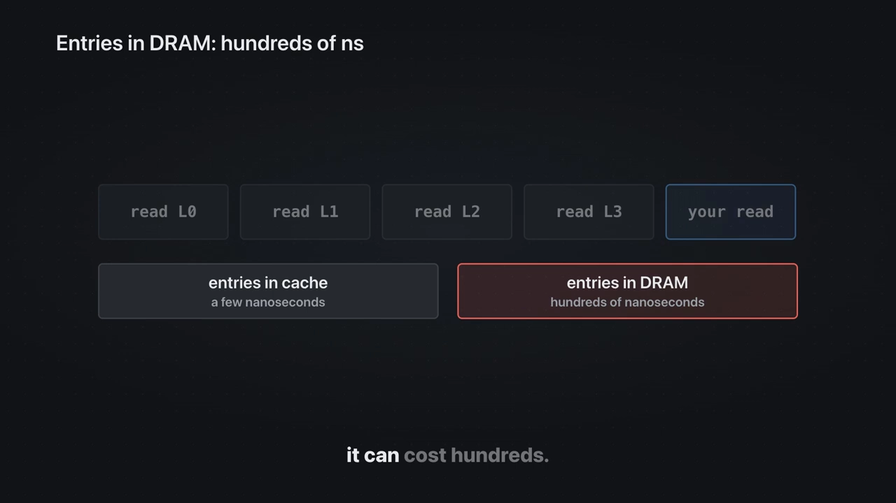

## 一、一次地址翻译要读四次内存

程序用的每个地址都是虚拟地址，CPU 碰内存之前必须先用页表把它翻成物理地址。在这颗 Arm 芯片上，以及 Intel 和 AMD 上，页表都是四层：地址被切成 9 比特 × 4 加 12 比特，每层用 9 个比特选一个表项，最后 12 个比特是 4 KiB 页内的偏移（[【跳转到 00:50】](https://www.youtube.com/watch?v=qgBiEbXk3fc&t=50)）。

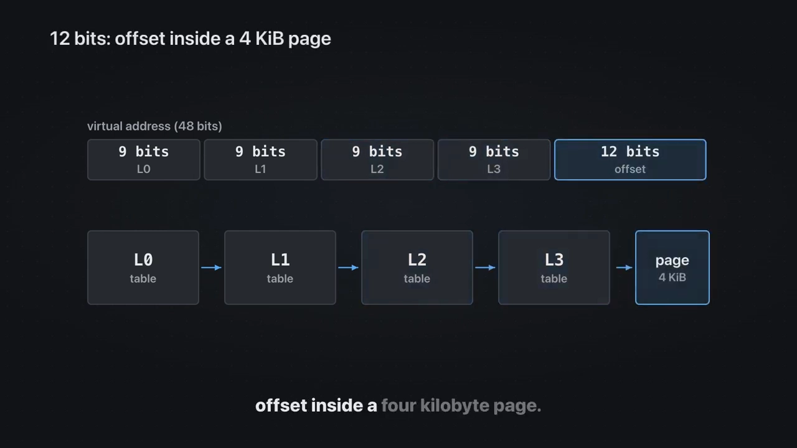

顺着这条链走下去就叫页表遍历（page walk）：硬件先读第一层表项，它指向下一张表，再下一张，再下一张。也就是说，**在你真正要的那次读取之前，先有四次内存读取**。如果这些表项躺在缓存里，一次遍历只要几纳秒；如果落在 DRAM 里，代价可以是几百纳秒（[【跳转到 01:15】](https://www.youtube.com/watch?v=qgBiEbXk3fc&t=75)）。

而在虚拟机里——比如跑这些演示的那台虚拟机——遍历的每一步本身还要被宿主再翻译一次，所以一次未命中最多可能需要 24 次内存读取。

## 二、TLB 的覆盖范围 = 表项数 × 页大小

没人会让每次 load/store 都去走页表。每个 CPU 核心都维护一份最近翻译结果的小缓存，叫 TLB（translation lookaside buffer，地址翻译旁路缓冲）：命中时翻译基本免费，未命中时硬件才去走页表。

TLB 只能装几千个表项，**表项数乘以页大小就是它的覆盖范围（reach）**：一次能罩住多少内存。用 4 KiB 页时，两千个表项只覆盖 8 MB（[【跳转到 02:05】](https://www.youtube.com/watch?v=qgBiEbXk3fc&t=125)）。

这个覆盖范围是能测出来的。视频用一段在内存里随机走两千万步的循环，每一步都落在不同的页上，然后把访问区域逐步放大：

| 访问区域 | 4 KiB 页 | 2 MiB 页 |
| --- | --- | --- |
| 4 MiB | 8.6 ns | 5.4 ns |
| 8 MiB | 7.9 ns | 6.7 ns |
| 16 MiB | 30.2 ns | 6.9 ns |
| 32 MiB | 34.8 ns | 7.1 ns |

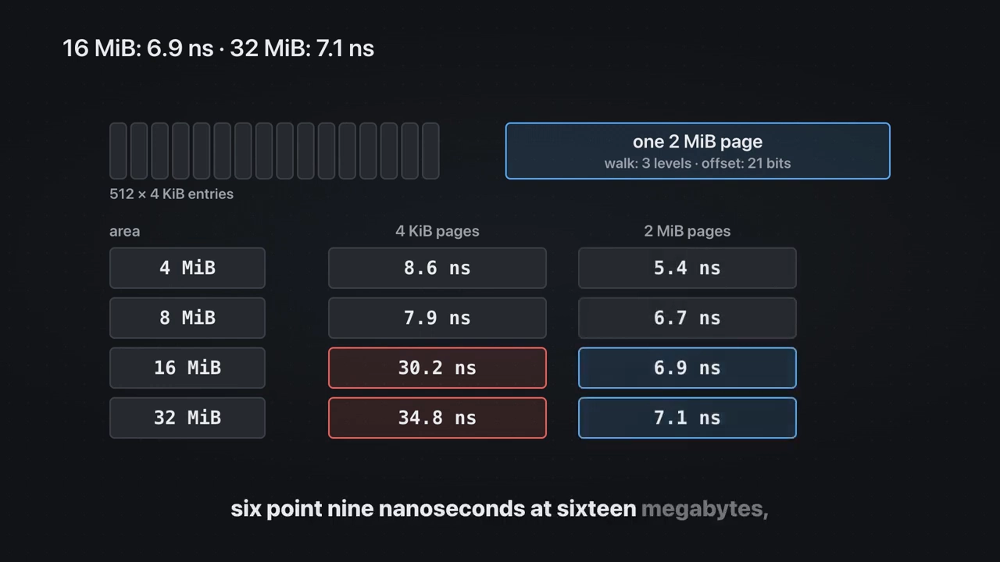

注意 16 MiB 那一格的跳变：**数据本身很小**，每页只碰一条缓存行，16 MiB 的页其实只有 256 KB 数据，轻松装进缓存。我们付的钱是翻译。

## 三、大页做两件事：512 倍覆盖，少一层遍历

大页是 2 MiB 而不是 4 KiB：一个表项就覆盖了原来 512 个小页；遍历也变短了，它提前一层停下，最后 21 个比特直接当偏移（[【跳转到 02:55】](https://www.youtube.com/watch?v=qgBiEbXk3fc&t=175)）。

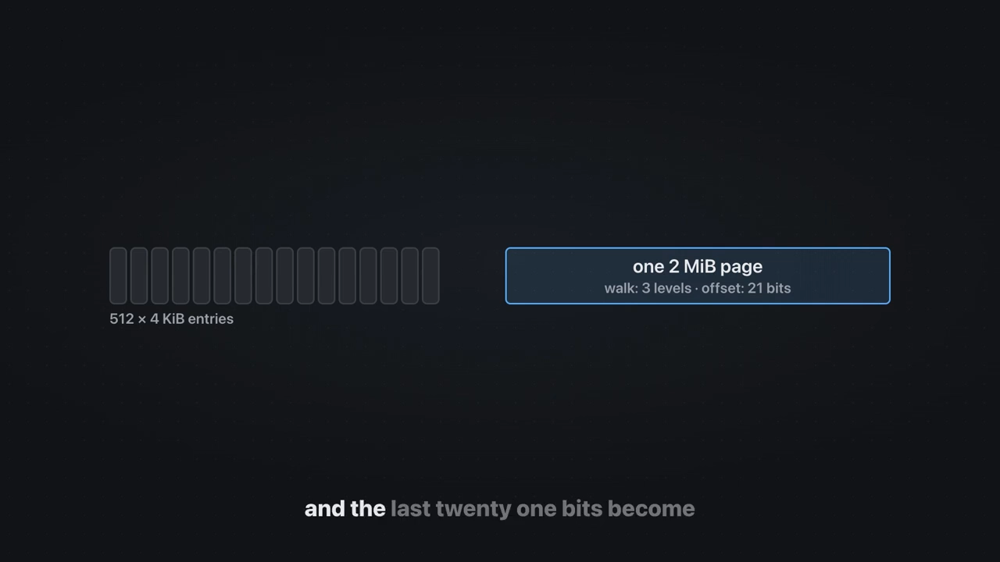

于是同样的 TLB 现在能覆盖 512 倍远。但大页不是魔法：继续放大到 64 MiB，大页慢到 12.4 纳秒；256 MiB 时是 36.6 纳秒，而小页是 42.9 纳秒。这时数据本身已经装不进缓存，每一步都在等 DRAM。**大页能消掉翻译开销，但没法让内存本身变快。**

## 四、第二笔账：首次触碰的缺页

内存是惰性映射的，所以每一页的第一次触碰都是一次缺页（page fault）——内核要在这一刻才真正分配物理页、填好页表。对大页来说，这一次缺页要清零整整 2 MiB。

视频给的实测（[【跳转到 03:45】](https://www.youtube.com/watch?v=qgBiEbXk3fc&t=225)）：

| 触碰 256 MiB | 缺页次数 | 总耗时 |
| --- | --- | --- |
| 4 KiB 页 | 65538 次 | 76 毫秒 |
| 2 MiB 页 | 130 次 | 10 毫秒 |

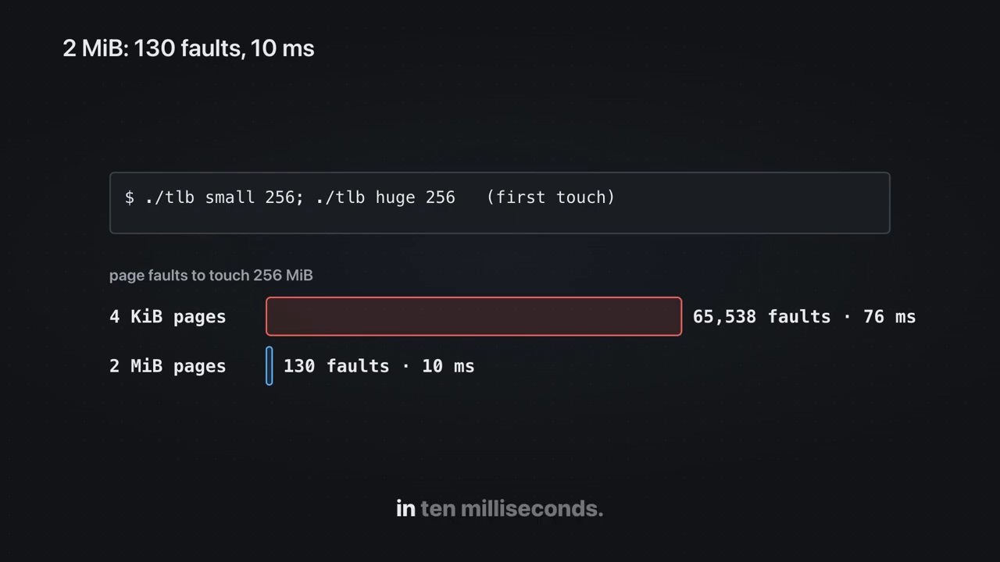

这张表对 VMM 的意义很直接：**如果启动路径要把整块客户机内存都碰一遍，大页把这段路缩短了近 8 倍**（130 次内核介入 vs 65538 次）。反过来，如果只碰了少量页，惰性映射就让这笔钱暂时不用付——这也是「按需分配」在启动时间上的价值所在。

## 五、mmap 的三种来源：THP、MAP_HUGETLB、预留池

那这个程序是怎么拿到大页的？它主动要的。Linux 上有三种要法。

### 5.1 透明大页：内核自己发，程序用 madvise 挑区域

THP（transparent huge pages）不需要预留：只要一块区域足够大、足够对齐，内核就自己发 2 MiB 页。这个开关有三种模式：`always`、`madvise`、`never`，路径是 `/sys/kernel/mm/transparent_hugepage/enabled`（[【跳转到 04:10】](https://www.youtube.com/watch?v=qgBiEbXk3fc&t=250)）。

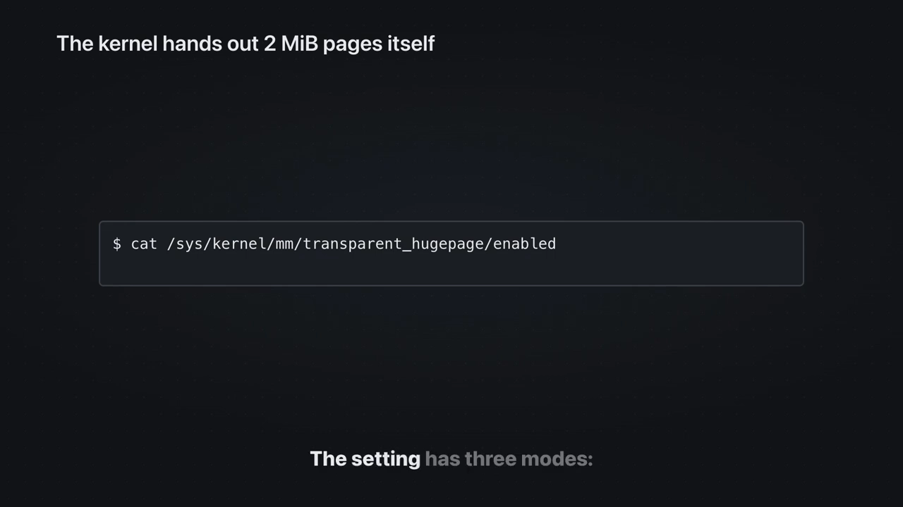

- `always`：内核见到合适区域就给大页；
- `madvise`：程序用 `madvise` 调用对某一块区域单独开启，视频里的演示就是这么做的；
- 另外有个内核线程 khugepaged，会在之后把零散的小页合并成大页。

要确认有没有生效，去进程的 `smaps` 文件里看 `anon huge pages`。

### 5.2 MAP_HUGETLB：要预留池，没预留就直接失败

还有更老、更严格的一种：提前预留的大页。程序用 `mmap` 加 `MAP_HUGETLB` 标志去要（[【跳转到 05:00】](https://www.youtube.com/watch?v=qgBiEbXk3fc&t=300)）：

```c
mmap(0, 64 MiB, ..., MAP_PRIVATE | MAP_ANONYMOUS | MAP_HUGETLB, -1, 0);
```

注意这里的 `MAP_ANONYMOUS`：它没有文件后备，但**必须从预留池里取页**。所以在这台机器上第一次尝试就失败：`Cannot allocate memory`，因为一个都没预留。

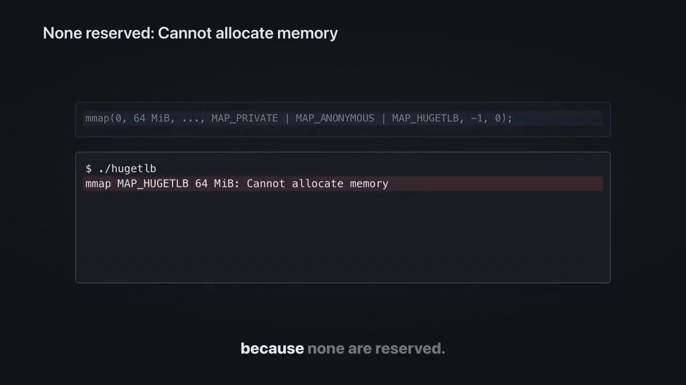

预留 32 个 2 MiB 页之后，同一个调用就成功了，内核交出 64 MiB，而池子的空闲数显示为 0：

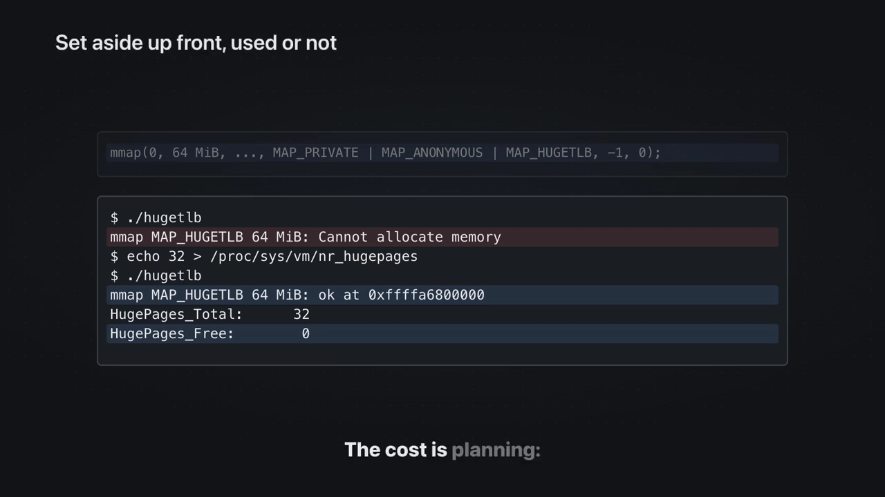

这正是 VMM 喜欢它的原因：**预留页永不换出、也永不被拆分**，所以 EPT 表项不会在运行中被悄悄拆小。代价是要提前规划——这块内存你用不用都一直占着。

### 5.3 尺寸不止一种

在这台 Arm 机器上，预留池提供四种尺寸：64 KiB、2 MiB、32 MiB、1 GiB。较新的内核还能自动发出中间尺寸，从 16 KiB 到 1 MiB（[【跳转到 05:50】](https://www.youtube.com/watch?v=qgBiEbXk3fc&t=350)）。

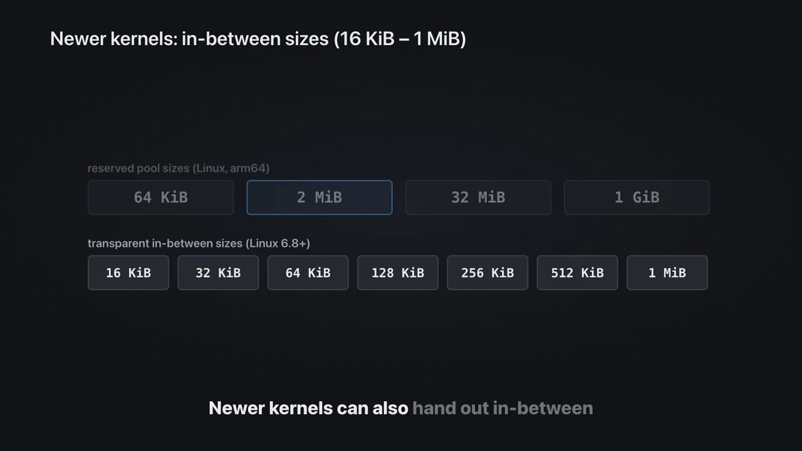

顺带一个对照：这台 M4 上的 macOS 默认用 16 KiB 页，所以它的每个 TLB 表项天然就比典型 Linux 机器覆盖得远四倍。

## 六、大页的代价：全有或全无

为什么不是所有内存都用大页？因为**大页是全有或全无**。视频给了一个极端例子（[【跳转到 04:35】](https://www.youtube.com/watch?v=qgBiEbXk3fc&t=275)）：程序映射 1 GiB，但每 2 MiB 只写一个字节，总共 512 字节。

- 用小页：只用了 3 MB 内存；
- 用大页：整整 1 GiB，因为每碰一次就拉进 2 MiB。

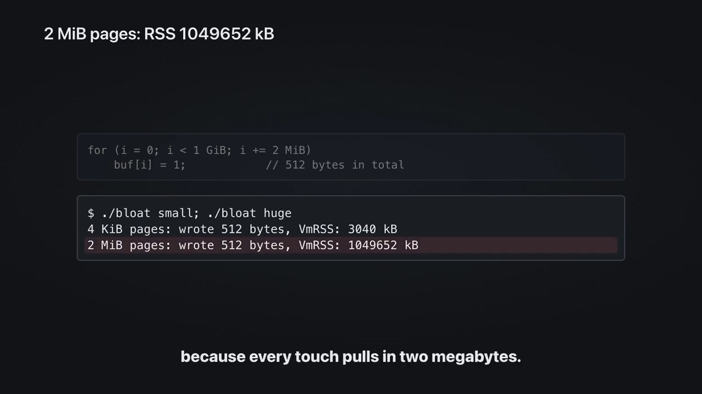

而且要找空闲的 2 MiB 连续块，可能逼内核去做内存紧凑（compaction），带来停顿。这就是为什么 Redis 启动时会警告：透明大页会造成延迟和内存占用问题。

还有一笔更隐蔽的成本：**翻译缓存必须保持正确**（[【跳转到 06:15】](https://www.youtube.com/watch?v=qgBiEbXk3fc&t=375)）。内核切换到另一个进程时，翻译结果不一样；与其把整个 TLB 刷掉，不如给每个表项打上地址空间 ID（ASID），让多个进程的表项共存。而当内存被解除映射时，所有可能还持有旧翻译的核心都必须丢掉它，这叫 TLB shootdown：Intel 和 AMD 上内核靠中断其他核心来做，Arm 可以在硬件层广播失效。

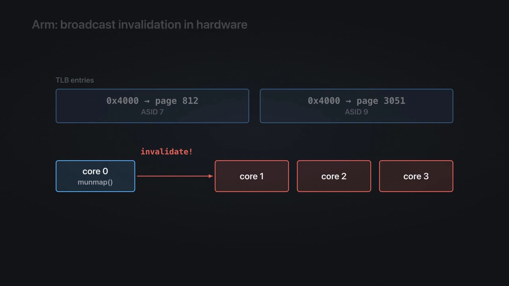

对 VMM 来说这条尤其相关：**热插拔内存、销毁虚拟机、迁移**都要 unmap，而 unmap 在繁忙的多核机器上不便宜。

## 七、什么时候该用：工作集远大于 TLB 覆盖范围时

视频的判据很干脆（[【跳转到 07:05】](https://www.youtube.com/watch?v=qgBiEbXk3fc&t=425)）：

- **划算**：工作集远大于 TLB 覆盖范围，并且访问四处散开——数据库、大堆、虚拟机、大型内存索引；
- **有害**：内存用得稀疏、生命周期很短，或者停顿比吞吐更重要。

大程序往往替你打开了这个开关：

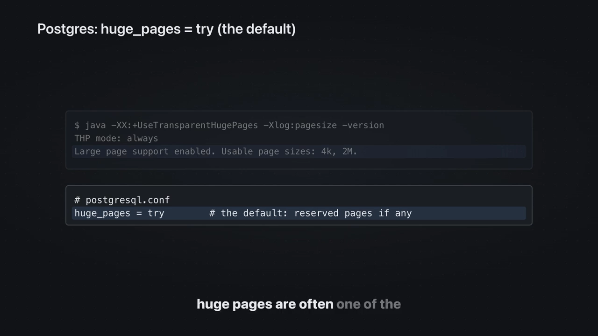

- JVM 有 `-XX:+UseTransparentHugePages`，日志会显示探测到的可用页大小（这里是 4k 与 2M）；
- Postgres 默认把 huge_pages 设为 try，为共享缓冲区尝试预留大页，没有预留就退回普通页。

照例，要测：把程序开着大页、关着大页各跑一遍，看数字。

## 小结

- 一次页表遍历最多四次内存读取，在虚拟机里最多 24 次；TLB 缓存翻译结果，但覆盖范围只有「表项数 × 页大小」。
- 4 KiB 页时 TLB 只覆盖 8 MB 上下，16 MiB 的随机访问就从 8 纳秒跳到 30.2 纳秒；换成 2 MiB 页后同样区域只要 6.9 纳秒。
- 大页做两件事：覆盖范围放大 512 倍，遍历少一层。但它不能让 DRAM 变快。
- 首次触碰的账：触碰 256 MiB，小页 65538 次缺页、76 毫秒；大页 130 次、10 毫秒。
- mmap 拿大页有三种来源：THP（`always`/`madvise`/`never`，khugepaged 兜底）、`MAP_HUGETLB`（必须从预留池取，没预留就 `ENOMEM`）、预留池（永不换出、永不拆分，代价是提前规划）。
- 大页是全有或全无：稀疏访问会把 3 MB 放大成 1 GB；找连续块还可能触发紧凑停顿。
- 判断标准：工作集远大于 TLB 覆盖范围且访问分散时用大页，稀疏或短命的内存别用。

## 关键术语速查

| 术语 | 一句话解释 |
| --- | --- |
| 页表遍历（page walk） | CPU 逐层读页表把虚拟地址翻成物理地址，四层就是四次读取 |
| TLB | 缓存最近翻译结果的小表，命中免费、未命中走页表 |
| TLB reach | 表项数乘以页大小，TLB 一次能覆盖的内存范围 |
| THP | 透明大页，内核按需发 2 MiB 页，模式为 always / madvise / never |
| khugepaged | 后台把零散小页合并成大页的内核线程 |
| `MAP_HUGETLB` | mmap 标志，要求从预留大页池取页，池空则 `ENOMEM` |
| `nr_hugepages` | `/proc/sys/vm/nr_hugepages`，控制预留多少个默认尺寸的大页 |
| 缺页（page fault） | 首次触碰某页时内核才分配物理页并填页表 |
| 惰性映射 | `mmap` 只划地址范围，物理页等首次触碰才分配 |
| ASID | 地址空间 ID，让不同进程的 TLB 表项共存，避免整表刷新 |
| TLB shootdown | 解除映射时通知所有核心丢弃旧翻译，多核上开销不小 |
| compaction | 内核搬移内存以凑出连续大块，可能带来停顿 |