# 大页要三层都同意才生效：VMM 的 mmap、KVM 的 EPT 表项与客户机页表

> 视频来源：[Hugepages in Virtualization: Up to 24 Reads per TLB Miss, and How to Delete Them](https://www.youtube.com/watch?v=X9EU-wvGRrE)（YouTube · XOR）｜时长约 15 分钟
> 导读：这支视频把「虚拟机里的大页」当成一条链子来拆：客户机页表、宿主内核、VMM 的 mmap、KVM 的 EPT 表项，任何一环掉回 4 KiB，整条链就白做。本文只讲 VMM 侧的内存供给——mmap 拿到的到底是什么、KVM 凭什么决定 EPT 表项多大、以及大页在启动与运行期各收多少费。气球驱动与 KSM 的细节留给 2.2.2 与 2.2.3，这里只在它们「顺手拆掉大页」时提一句。

## 本讲要解决的核心问题（SCQA）

**背景**：我们知道客户机内存就是 VMM 进程里 `mmap` 出来的一块普通内存，再用 `KVM_SET_USER_MEMORY_REGION` 登记给 KVM（见 1.2.3）。客户机访问 GPA 时，硬件用 EPT 把它翻成宿主物理地址。

**冲突**：EPT 表项和普通页表项一样有大小之分——4 KiB、2 MiB、1 GiB。选大了，一次翻译覆盖的内存多得多；但 KVM 并不自己决定这件事：它建立 EPT 表项时，只看宿主把同一块内存映射进 VMM 进程时用的是什么尺寸。也就是说，**大页不是 KVM 给的，是 VMM 的 mmap 事先做好的**。

**疑问**：VMM 要怎样 mmap，才能让 KVM 建出大页 EPT 表项？拿到大页之后，又要在哪里付账？

**回答（中心思想）**：大页生效的条件是「三层一致」——客户机页表用大页、VMM 用大页 mmap 这块内存、KVM 才能照抄出大页 EPT 表项；此外 GPA 与 VMM 的用户态地址必须在 2 MiB 内同偏移。而这份收益不是免费的：大页缺页一次要 378 微秒，脏页日志、CPU 缺陷规避、KSM、共享内存、气球都会悄悄把它拆回 4 KiB。

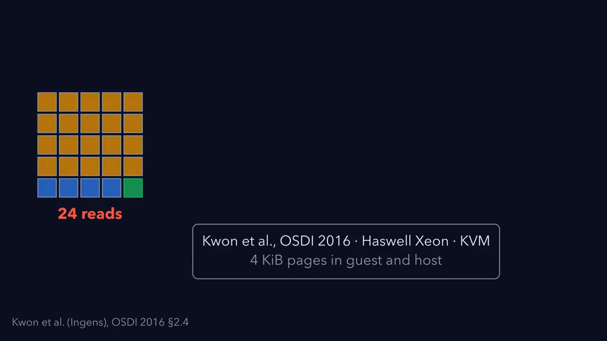

## 一、先算账：虚拟机为地址翻译付两次钱

### 1.1 一次翻译本来只要四次读取

程序用的每个地址都是虚拟地址。CPU 用页表把它翻成物理地址：x86 上通常是四层树，从头翻译就是每层读一个表项，**最多四次内存读取**，才轮到程序真正要的那次读（[【跳转到 01:04】](https://www.youtube.com/watch?v=X9EU-wvGRrE&t=64)）。

所以 CPU 把翻译好的结果缓存在 TLB（translation lookaside buffer，地址翻译旁路缓冲）里：命中几乎不花钱，未命中才走一次页表遍历。

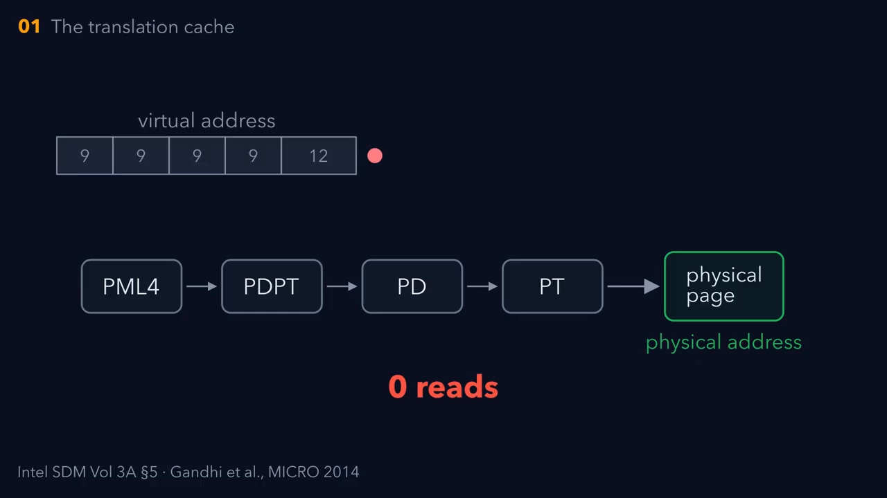

### 1.2 虚拟机里有两套页表，读取次数是乘出来的

虚拟机里有两层翻译：客户机页表把程序地址翻成「客户机以为的物理地址」，然后 hypervisor 的页表——Intel 上叫 EPT，AMD 上叫 NPT——再把它翻成真正的宿主内存（[【跳转到 02:29】](https://www.youtube.com/watch?v=X9EU-wvGRrE&t=149)）。

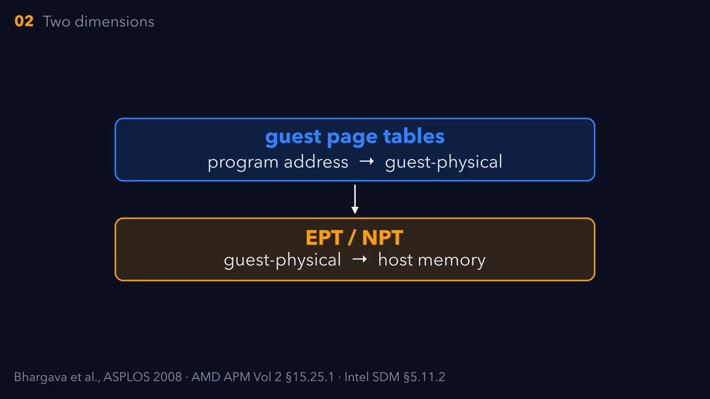

关键在于：**客户机的页表本身也放在客户机内存里**。所以客户机遍历时跟随的每一个指针，CPU 在读它之前都得先走一遍宿主的页表。设客户机页表 g 层、宿主页表 h 层，一次未命中的读取次数是

$$
N = (g+1)(h+1) - 1
$$

g = h = 4 时 N = 24：客户机四层加上最后一个地址，每一个都要一次四层的宿主遍历（[【跳转到 02:54】](https://www.youtube.com/watch?v=X9EU-wvGRrE&t=174)）。更新的服务器为了巨大地址空间可以用五层页表，两边都五层就是 35 次。

### 1.3 这不是理论数字

- 2014 年一项在 Intel Sandy Bridge 服务器上的研究：地址翻译让一个图算法基准在原生小页下比理想情况慢 28%；在虚拟机里两边都用小页时，慢了 113%，是理想时间的两倍多（[【跳转到 03:44】](https://www.youtube.com/watch?v=X9EU-wvGRrE&t=224)）。
- 2016 年一项在跑 KVM 的 Intel Haswell 服务器上的研究：基准 mcf 在客户机和宿主都用小页时，把 47.5% 的时间花在走页表上；两边都换成大页后只剩 4.2%（[【跳转到 00:14】](https://www.youtube.com/watch?v=X9EU-wvGRrE&t=14)）。

## 二、大页做两件事：缩短遍历，放大 TLB 覆盖

### 2.1 覆盖范围 = 表项数 × 页大小

TLB 的容量很小。以 AMD Zen 5 的二级数据 TLB 为例，它有 4096 个表项：配 4 KiB 页只覆盖 16 MB，一台 64 GB 内存的虚拟机一步就跨过去了；换成 2 MiB 页，同样的表项覆盖 8 GB。Zen 5 还额外有一组 1024 个表项专门给 1 GiB 页，那是 1 TB（[【跳转到 01:29】](https://www.youtube.com/watch?v=X9EU-wvGRrE&t=89)）。

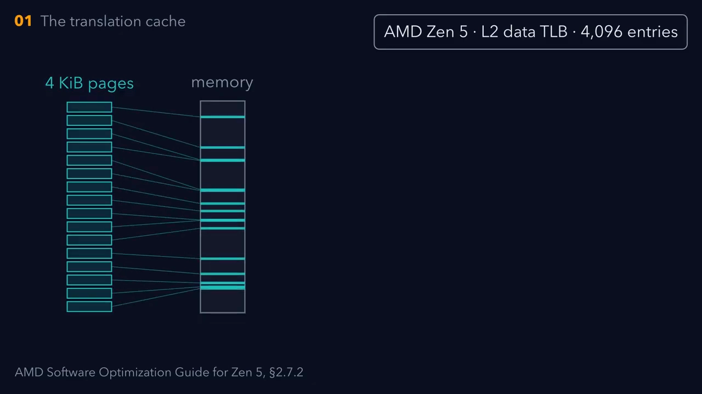

### 2.2 遍历也变短了

2 MiB 页就是上一层的一个表项，里面有一个位说「到这里停」，于是少读一层；1 GiB 页停得更高一层（[【跳转到 02:19】](https://www.youtube.com/watch?v=X9EU-wvGRrE&t=139)）。把层数代进上面的公式，就能算出视频里那张「删行删列」的表：

| 客户机页大小 | 宿主页大小 | 一次未命中的读取次数 |
| --- | --- | --- |
| 4 KiB | 4 KiB | 24 |
| 2 MiB | 4 KiB | 19 |
| 4 KiB | 2 MiB | 19 |
| 2 MiB | 2 MiB | 15 |
| 1 GiB | 1 GiB | 8 |

### 2.3 但 TLB 表项不能大于两边较小的那个页

这是本讲最容易被忽略的一条。TLB 存的是一条**合并后**的翻译，从程序地址直接到宿主内存，而这条表项不可能大于两个页里更小的那个。AMD 的优化指南说得很直白：当客户机的大页落在宿主的小页上时，CPU 会把表项砸回宿主的小尺寸，研究者把这叫 splintering（碎片化）（[【跳转到 04:54】](https://www.youtube.com/watch?v=X9EU-wvGRrE&t=294)）。

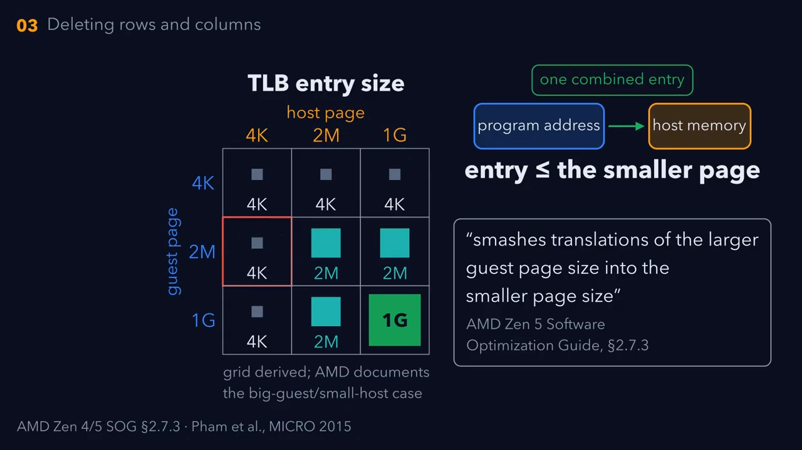

Linux 内核文档把规则写成一句话：**只有 KVM 和客户机都在用大页，TLB 才能拿到大表项**。所以一边做有一边的收益，两边都做才有覆盖范围。同一项 2016 年的研究测过 mcf：

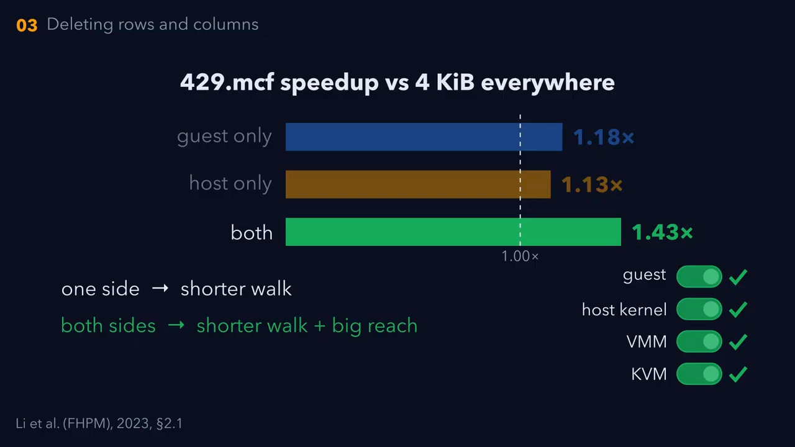

| 大页用在哪一侧 | 相对「处处 4 KiB」的加速 |
| --- | --- |
| 只有客户机 | 1.18 倍 |
| 只有宿主 | 1.13 倍 |
| 两边都用 | 1.43 倍 |

## 三、VMM 的 mmap 决定了 KVM 能建多大的 EPT 表项

### 3.1 对宿主来说，客户机 RAM 就是 VMM 进程里的一块内存

视频用一张图把这件事讲清楚了（[【跳转到 07:24】](https://www.youtube.com/watch?v=X9EU-wvGRrE&t=444)）：宿主眼里没有「虚拟机内存」这种特殊东西，它就是 VMM 进程（QEMU、Cloud Hypervisor、Firecracker）里的一大块内存，由宿主页表来映射。

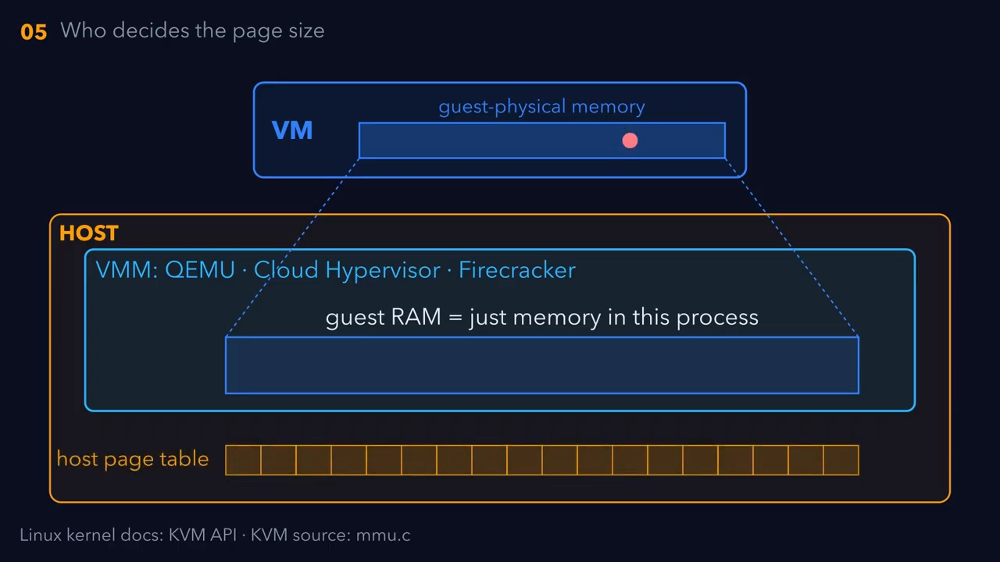

当客户机第一次碰某一页时，KVM 才建立对应的 EPT 表项。**它选择表项大小的依据，是宿主把同一块内存映射进 VMM 进程时用的尺寸**。KVM 源码里的规则很短：

1. 宿主用 1 GiB 页映射这块内存 → KVM 可以用 1 GiB 表项；
2. 宿主用 2 MiB → KVM 用 2 MiB；
3. 否则 → 4 KiB。

还有一个附加条件：**客户机物理地址和 VMM 自己的用户态地址，必须在同一个 2 MiB 页内处于相同的偏移**。KVM 文档要求监视器对齐最低的 21 个比特；搞错了，整块区域就失去大页（[【跳转到 08:00】](https://www.youtube.com/watch?v=X9EU-wvGRrE&t=480)）。

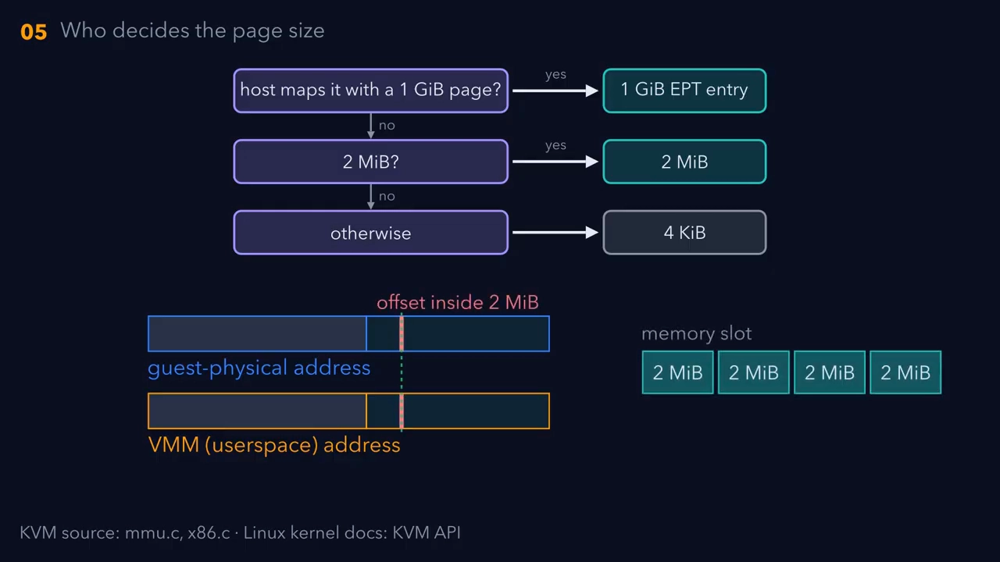

这句话值得单独记下来：**KVM 从不自己把内存变大，它只能复制宿主已经做过的事**。所以「给虚拟机开大页」这件事，落在 VMM 的 `mmap` 参数上，而不是某个 KVM ioctl 上。

## 四、mmap 的三种来源：静态池、透明大页、多尺寸 THP

Linux 上「大页」有三种形态，行为差别很大，VMM 在 `mmap` 时选哪一种，直接决定了后面能不能拿到大页 EPT 表项。

### 4.1 静态池（hugetlbfs）：提前预留，永不换出

第一种是静态池，叫 hugetlbfs：你提前预留大页，最好在开机时、内存还没碎片化之前。这是拿到 1 GiB 页的唯一途径。池子里的页永不换出，而且**不管虚拟机用不用，它们都一直占着**（[【跳转到 06:09】](https://www.youtube.com/watch?v=X9EU-wvGRrE&t=369)）。

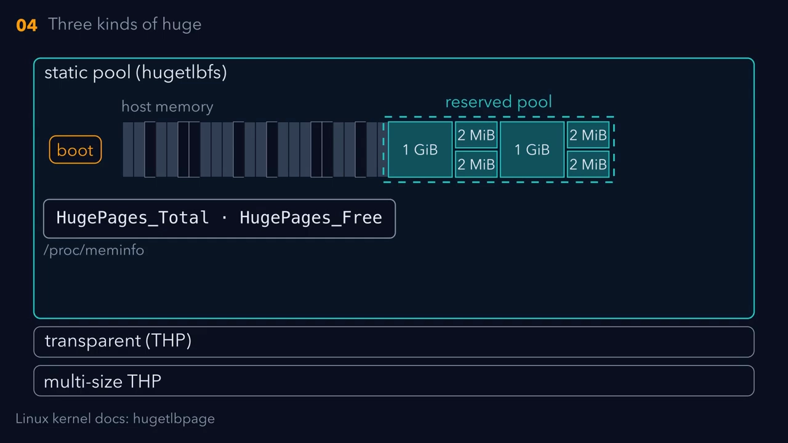

### 4.2 透明大页（THP）：不预留，尽力而为

第二种是透明大页（THP，transparent huge pages）：不预留，程序一碰内存，内核就当场试着给它一个 2 MiB 页；给不了就退回小页，之后一个后台线程 khugepaged 可以把零散小页合成大页。它由一个设置控制：`always`、`never`，或者 `madvise`——只在程序主动要求的区域用（[【跳转到 06:34】](https://www.youtube.com/watch?v=X9EU-wvGRrE&t=394)）。

在 x86 上，**对虚拟机内存来说 THP 最高只到 2 MiB**，1 GiB 页仍然要靠静态池。

### 4.3 多尺寸 THP：能减少缺页，但对 EPT 不算大页

第三种更新：多尺寸 THP（mTHP），从 Linux 6.8 起有，默认关闭。它发出中间尺寸，比如 64 KiB，能减少缺页次数。但这些页仍然用小页表项映射，**所以对虚拟机在宿主侧的映射来说，它们不算大页**（[【跳转到 06:59】](https://www.youtube.com/watch?v=X9EU-wvGRrE&t=419)）。

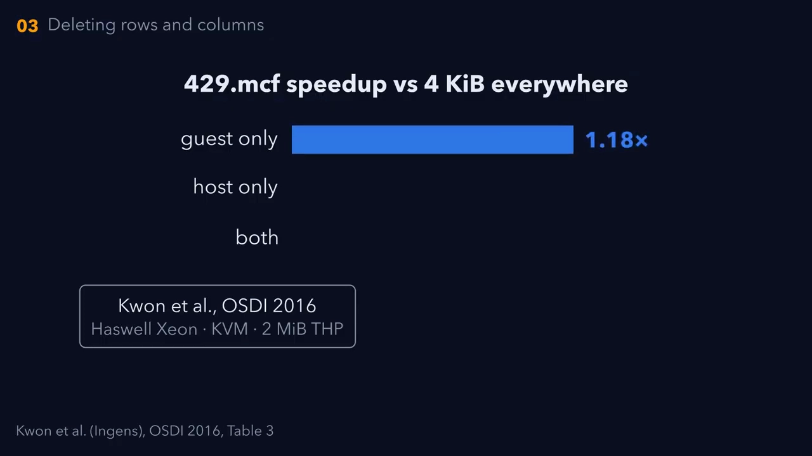

## 五、默认配置：多数 VMM 已经在申请，Firecracker 是例外

在典型的 Linux 宿主上，默认就能拿到不少大页（[【跳转到 08:25】](https://www.youtube.com/watch?v=X9EU-wvGRrE&t=505)）：

- **QEMU** 把客户机 RAM 对齐到 2 MiB，并向内核申请透明大页；
- **Cloud Hypervisor** 也会申请，它的 THP 选项默认打开；
- **Firecracker** 是例外：你不告诉它，它就不申请大页。

但「透明」意味着尽力而为：如果宿主内存碎片化了，你会悄悄拿到小页。要确定性，就用静态池承载虚拟机。视频给的对照配置是：

| VMM | 打开大页的写法 |
| --- | --- |
| libvirt | `<memoryBacking><hugepages><page size='1' unit='G'/></hugepages></memoryBacking>` |
| QEMU | 打开 hugetlb 的内存后端 |
| Cloud Hypervisor | 打开 hugepages、指定页大小 1G，并加 reserve 选项 |
| Firecracker | `huge_pages` 设为 `2M` |

这里有个容易踩的坑：**有些监视器在虚拟机启动时并不预留池子**。如果池子后来被用干，客户机可能在运行中途崩掉——Cloud Hypervisor 的 `reserve=on` 就是让它在启动时干净地失败，而不是跑到一半收到 SIGBUS（[【跳转到 09:15】](https://www.youtube.com/watch?v=X9EU-wvGRrE&t=555)）。

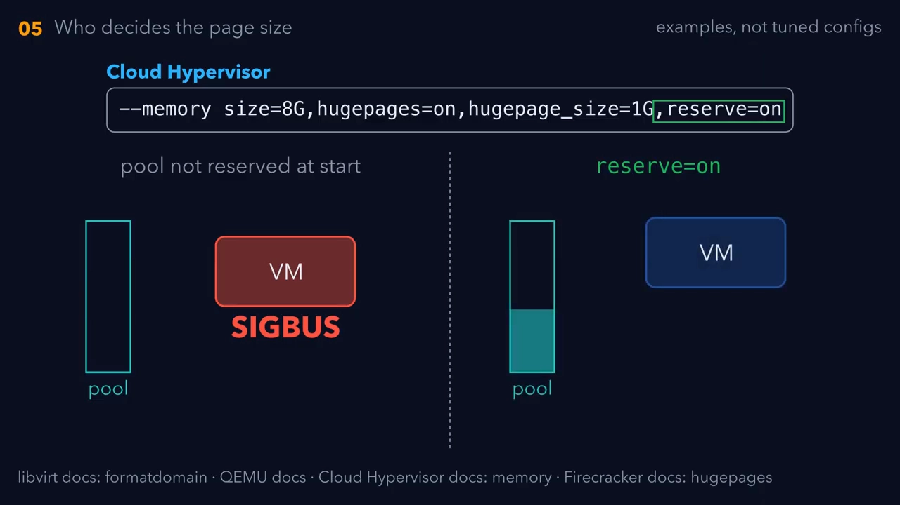

最后别忘了客户机自己：如果客户机内核一直用小页，你又会回到 splintered 表项。

## 六、什么会悄悄把大页拆回 4 KiB

视频把这类现象叫「quiet failures」——没有一条报错，性能却掉回去了（[【跳转到 09:40】](https://www.youtube.com/watch?v=X9EU-wvGRrE&t=580)）。

| 触发者 | 为什么会拆页 |
| --- | --- |
| 脏页日志（热迁移） | KVM 按 4 KiB 粒度追踪写过的页，日志一开就主动把大页映射拆成小页；迁移期间一直跑在小页上 |
| iTLB multihit 规避 | 受影响 Intel CPU 上，KVM 把大页标记为不可执行，客户机一旦从大页执行代码就拆成小页，后台线程约一小时才恢复一个 |
| KSM 去重 | KSM 合并的是小页，任何内部存在可合并内容的大页都会被拆开 |
| 共享内存（vhost-user、virtiofs） | 共享内存的透明大页在上游默认关闭 |
| 经典气球驱动 | 一次按 4 KiB 归还内存，会把大页打碎；free page reporting 按 2 MiB 块工作就是为了避开 |
| 机密虚拟机（SEV-SNP、TDX） | 私有内存放在 guest_memfd 里，到 Linux 7.4 候选版本为止仍只支持小页 |

其中脏页日志这一条和本系列 2.4「脏页追踪」直接接得上：**为了记录 4 KiB 粒度的脏页，KVM 必须先放弃大页**，这是迁移精度与大页收益之间的一次硬交换。

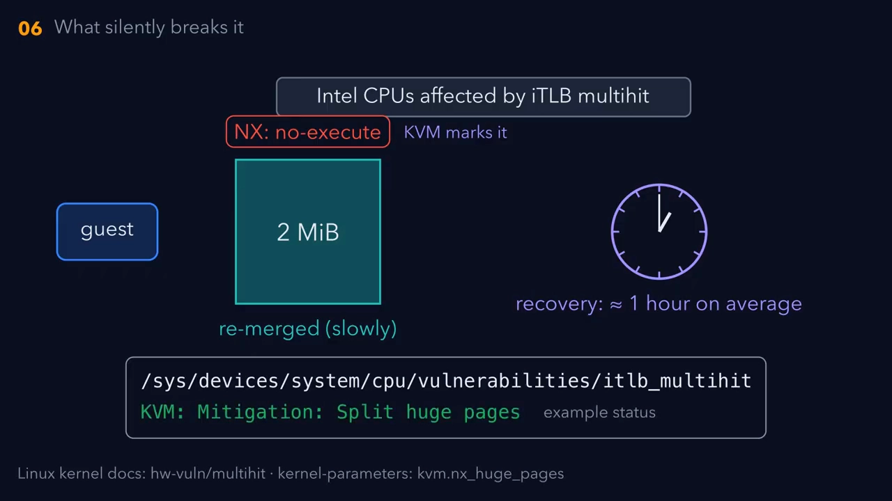

## 七、代价：大页在启动与运行期各收一次费

### 7.1 启动期：每个大页缺页都要先清零

大页不是免费的：每一个页在用之前都要清零。2016 年那项研究里，**一次大页缺页要 378 微秒，而小页只要 3.6 微秒**——单次长了 105 倍，虽然按字节算更便宜，因为它一次填满 512 倍的内存（[【跳转到 11:50】](https://www.youtube.com/watch?v=X9EU-wvGRrE&t=710)）。

这解释了两件在 MicroVM 语境里很重要的事：

- 内存是**惰性映射**的，`mmap` 只划地址范围，物理页要等首次触碰才分配。所以大页把「首次触碰」的单价抬高了一百多倍，冷启动时把整块内存都碰一遍会明显变慢；
- 反过来，如果启动路径上只碰了少量页，惰性映射就让大页的这笔钱暂时不用付。**「启动慢一点、运行期不再缺页」这个取舍，本质上是在决定什么时候把这块账结掉。**

### 7.2 运行期：内存浪费与紧凑停顿

- **浪费**：一个程序在每个 2 MiB 区域里只碰一点点，仍然会拿到整个区域。Redis 在自己的虚拟机里删掉大部分键之后，用大页时内存占用多了 69%（[【跳转到 12:15】](https://www.youtube.com/watch?v=X9EU-wvGRrE&t=735)）。
- **停顿**：2018 年一项研究在内存被刻意弄碎的裸金属 Intel 服务器上发现，内核为了腾出大块内存而搬移内存的紧凑（compaction）工作，把 MySQL 的最差读延迟推高到 4.7 秒。
- **不可超分**：静态池不管用不用都占着，而且不能换出，所以你不能用它来超分宿主内存。
- **迁移**：post-copy 迁移时一次缺页必须等它那一整页到达，按 QEMU 文档，10 Gbps 下用 1 GiB 页大约要 1 秒。

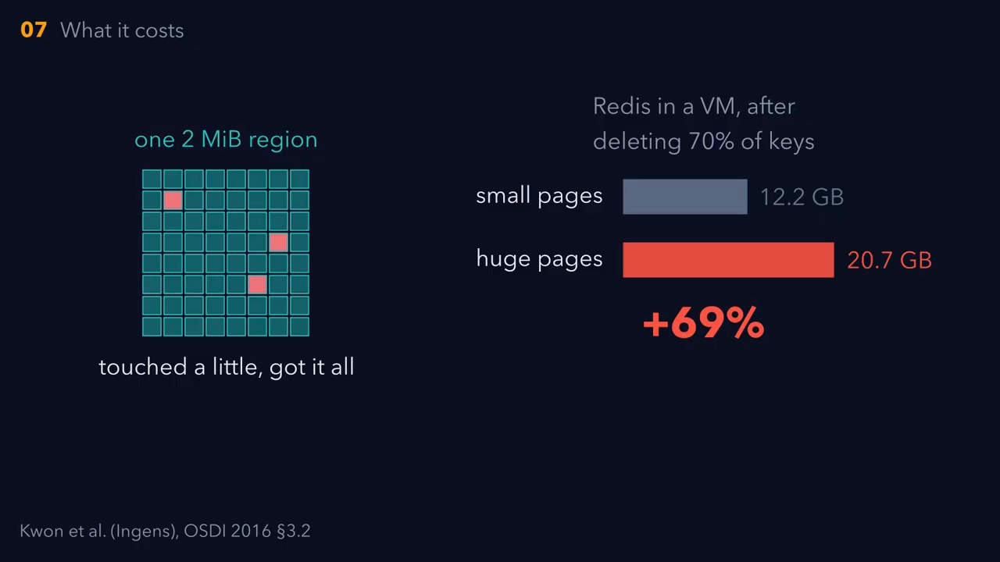

### 7.3 所以「关掉透明大页」这条建议在过时

视频专门辟了一个谣（[【跳转到 13:30】](https://www.youtube.com/watch?v=X9EU-wvGRrE&t=810)）：MongoDB 8.0 现在说建议开启，Oracle 最新的文档说用 `madvise`，Redis 仍然说关闭并默认给自己关掉。诚实的答案是看负载、去测量。

## 八、行动手册：先分层确认，再谈调优

视频给出的落地顺序是（[【跳转到 13:55】](https://www.youtube.com/watch?v=X9EU-wvGRrE&t=835)）：

1. **大型、延迟敏感或被绑核的虚拟机**：用静态池，1 GiB 或 2 MiB 页，开机时预留，放在正确的 NUMA 节点上；
2. **其余情况**：用透明大页，并让 VMM 主动去申请（Firecracker 里就是把 `huge_pages` 设为 `Transparent`），接受尽力而为；
3. **无论哪种**：客户机里也要打开大页，否则表项会被 splinter。

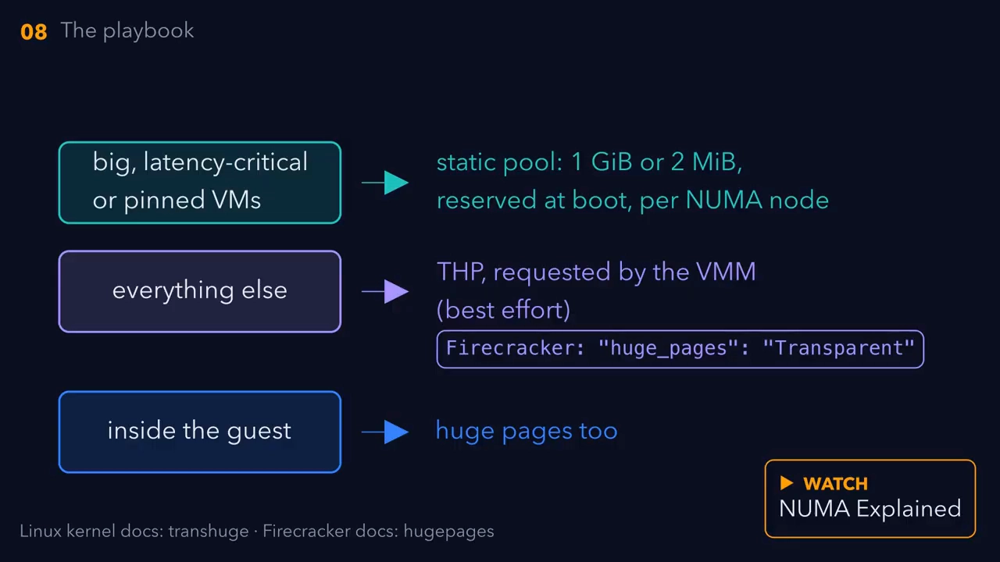

然后**检查，不要假设**（[【跳转到 14:20】](https://www.youtube.com/watch?v=X9EU-wvGRrE&t=860)）：

- 宿主上，`/proc/meminfo` 显示有多少内存落在透明大页或静态大页里；
- KVM 自己会统计一台虚拟机的映射里有多少是 4 KiB、2 MiB、1 GiB——这是唯一能确认「EPT 真的用了大页」的地方；
- Intel CPU 上还有一个性能计数器，能显示数据加载有多少周期在等页表遍历。

## 小结

- 虚拟机为地址翻译付两次钱：一次未命中最多 24 次读取，公式是 $N=(g+1)(h+1)-1$。
- 大页同时缩短遍历和放大 TLB 覆盖，但 TLB 表项不能大于客户机页与宿主页里更小的那个，所以只有一边用大页收益有限。
- **KVM 只照抄宿主映射的尺寸**：VMM 用 1 GiB 页 mmap，EPT 才可能是 1 GiB；此外 GPA 与 VMM 地址要在 2 MiB 内同偏移。
- mmap 有三种大页来源：hugetlbfs 静态池（可拿 1 GiB、永不换出、不可超分）、THP（尽力而为、x86 上最高 2 MiB）、多尺寸 THP（减少缺页但不算大页）。
- 多数 VMM 默认申请 THP，Firecracker 例外；要确定性就用静态池，并用 `reserve=on` 之类选项把「池子不够」提前到启动时失败。
- 脏页日志、iTLB multihit 规避、KSM、共享内存、气球驱动、guest_memfd 都会悄无声息地把大页拆回 4 KiB。
- 大页的账：一次大页缺页 378 微秒（启动期），稀疏访问内存多占 69%（运行期），紧凑可能带来秒级停顿。
- 最后一条：检查，不要假设——`/proc/meminfo` 看池子，KVM 的统计看 EPT 表项尺寸。

## 关键术语速查

| 术语 | 一句话解释 |
| --- | --- |
| TLB | CPU 缓存地址翻译结果的小表，命中几乎免费，未命中要走页表 |
| TLB reach | 表项数乘以页大小，即 TLB 一次能覆盖多少内存 |
| EPT / NPT | Intel / AMD 的二级页表，把客户机物理地址翻成宿主物理地址 |
| splintering | 客户机大页落在宿主小页上时，TLB 表项被砸回小尺寸 |
| hugetlbfs（静态池） | 开机时预留、永不换出、永不拆分的大页池，1 GiB 页的唯一来源 |
| THP | 透明大页，内核尽力在缺页时给 2 MiB 页，可被 `madvise` 按区域开启 |
| khugepaged | 后台把零散小页合并成大页的内核线程 |
| mTHP | 多尺寸 THP，Linux 6.8 起支持 64 KiB 之类中间尺寸，但仍用小页表项映射 |
| 脏页日志 | 迁移前按 4 KiB 粒度记录客户机写过的页，会把大页映射拆开 |
| guest_memfd | 用文件描述符而非用户态地址描述客户机内存，机密虚拟机用，目前只支持小页 |