# 内存气球是协作式回收：virtio-balloon 的三代改造与 virtio-mem 的粒度取舍

> 视频来源：[Virtio-(balloon|pmem|mem): Managing Guest Memory](https://www.youtube.com/watch?v=Fq47WCCm-HM)（YouTube · KVM Forum 2020，David Hildenbrand & Michael S. Tsirkin，Red Hat）｜时长约 29 分钟
> 简要导读：这是一场面向虚拟化开发者的官方演讲，讲的是"宿主想动客户机的内存，但客户机才有权决定哪些页没用"这个根本矛盾，以及 virtio 家族为此做出的三代机制。本文聚焦气球驱动与按需分配（overcommit），virtio-pmem 只作为对照出现。字幕为自动生成，演讲者姓名、`virtio` 等术语已按幻灯片订正。

## 本讲要解决的核心问题（SCQA）

**背景**：一台宿主机上跑着若干虚拟机，每台 VM 都以为自己独占一块物理内存。宿主机想把内存用得更满，也就是超分（overcommit）：承诺出去的内存总量超过真实物理内存。

**冲突**：宿主机看得见 VM 的内存页，却看不见页里装了什么。哪些页是客户机早就空着的、哪些页是页缓存里随时可以丢的，宿主一律不知道。贸然动手就会丢数据，不动手就只能去换页（swap）。

**疑问**：既然宿主不能替客户机做决定，那有没有一种"商量"的机制，让客户机主动把不用的内存交出来？

**回答（中心思想）**：有，而且这条路走了三代——第一代是**内存气球**（virtio-balloon），靠客户机里的驱动分配内存再交还宿主；第二代是气球的两次改造（free page hinting 与 free page reporting），把"该充多少"的决定权从宿主交给客户机，并让客户机主动上报空闲页；第三代是 **virtio-mem**，用块粒度做热插拔。但三代都没绕开同一个前提：**回收必须是协作式的，宿主只能请求，不能强制**。

## 一、宿主管理客户机内存，想要的是四件事

演讲开头先列出动机，这四件事正好解释了后面每个机制为什么长成那样（[【跳转到 00:38】](https://www.youtube.com/watch?v=Fq47WCCm-HM&t=38)）。

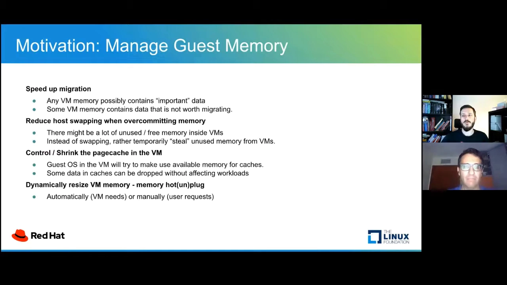

1. **加速迁移**。从宿主视角看，VM 的每一页内存都"可能"装着重要数据，所以默认都要搬走。但现实是 VM 里往往有大片根本不值得搬的内存，比如纯粹的空闲内存。难点在于宿主无法分辨，因此"需要某种与客户机的握手"。
2. **超分时避免宿主换页**。宿主内存不够时，与其去 swap，不如临时从 VM 那里"偷"一点没在用的内存——实践中很多 VM 确实闲置着大量空闲内存。
3. **控制或收缩 VM 里的页缓存**。现代操作系统的天性是把所有可用内存都拿去做缓存，Linux 里就是页缓存慢慢吃掉几乎全部主存。其中一部分缓存丢了不影响任何负载，但宿主既分不清哪些能丢，也没有真正可用的接口去丢。
4. **动态调整内存大小**，即内存热插拔/热拔出，可以自动触发（VM 快没内存了）也可以由用户手动发起。这件事同样需要客户机操作系统的配合。

这四件事的共同点是：**决定权在客户机手里**。这也正是整场演讲的暗线。演讲者随后用一张对照表把每个目标映射到具体机制（[05:32](https://www.youtube.com/watch?v=Fq47WCCm-HM&t=332)）：

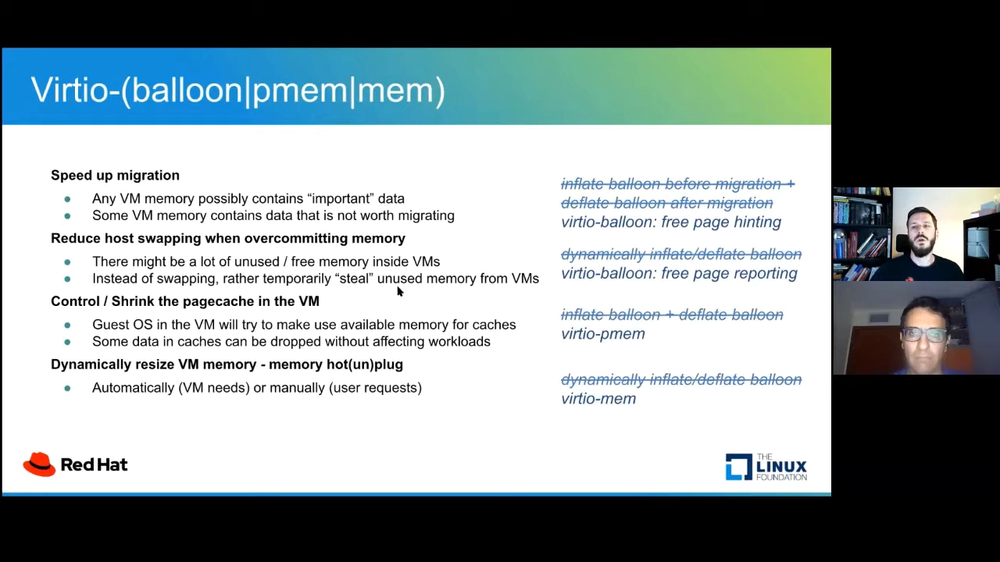

## 二、气球的模型：把物理内存从 VM 挪回宿主

传统做法就是内存气球。它的定义可以用一句话概括：**在虚拟机和它的 hypervisor 之间重新安置物理内存**（[【跳转到 03:18】](https://www.youtube.com/watch?v=Fq47WCCm-HM&t=198)）。

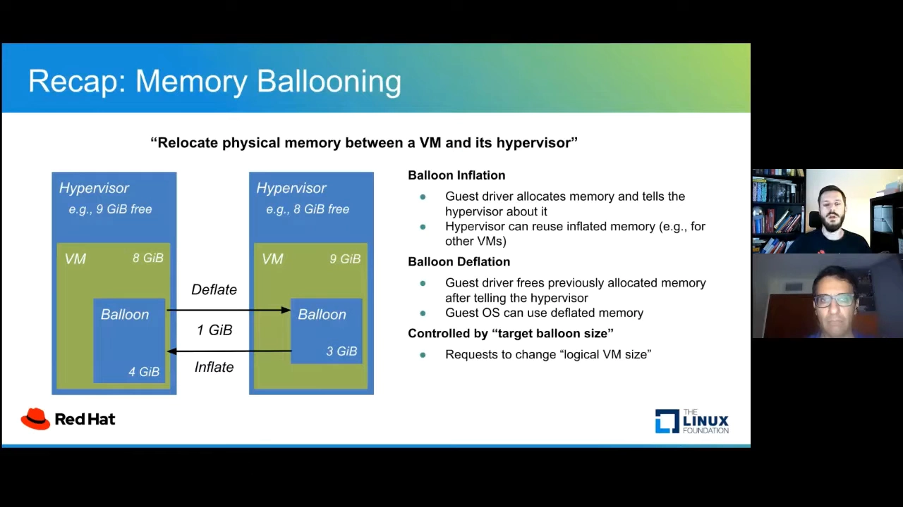

- **充气（inflate）**：客户机里的驱动向客户机操作系统申请内存，申请到之后告诉宿主"这些页归你了"。这些页从此对客户机不可用，宿主可以拿去给别的 VM 用。
- **放气（deflate）**：驱动把之前申请的内存释放掉，客户机重新拿到这些页。
- **控制量**：气球的大小由 `target balloon size` 决定，它是宿主发给 VM 的一个请求，用来改变"逻辑上的 VM 大小"。

用一句话记账：

$$
\text{VM 逻辑内存} = \text{气球里的内存} + \text{客户机可用的内存}
$$

幻灯片上的例子就是 8 GiB 的 VM 充气 4 GiB 之后，宿主多出 4 GiB、VM 只剩 4 GiB 可用；放气之后又回到 8 GiB。

注意这里的关键实现细节：**驱动本身几乎不做什么**。它只是 `alloc` 内存、和宿主协调、需要放气时 `free` 掉之前申请的内存。演讲者在总结部分还专门强调："写一个气球驱动其实很简单，无非是申请内存和释放内存"（[【跳转到 26:10】](https://www.youtube.com/watch?v=Fq47WCCm-HM&t=1570)）。简单正是它能在各种操作系统上活了几十年的原因，也是它能力的上限所在。

### 为什么说气球是"协作式"的

宿主没有权限直接改客户机的页表，也没有权限替客户机决定哪一页可以丢。宿主唯一能做的是通过 virtio 设备发一个"请把气球改到多大"的请求，剩下的由客户机里的驱动执行。客户机不配合（比如没装驱动、驱动被禁用、或者干脆是不支持的操作系统），宿主就一点内存也拿不回来。

这解释了两件事：一是气球能拿到的是**客户机愿意交出的空闲内存**，而不是任意内存；二是气球的回收**有延迟且不可预测**，因为它要等客户机走完自己的内存回收流程。

## 三、宿主控制下的气球：迁移例子与"充多少"的两难

演讲用迁移做了个具体例子（[【跳转到 06:06】](https://www.youtube.com/watch?v=Fq47WCCm-HM&t=366)）：一台 8 GiB 的 VM 要迁移，先在源端把气球充到 4 GiB，于是只需要搬 4 GiB；迁移完成后在目的端把气球放气，VM 又回到 8 GiB。

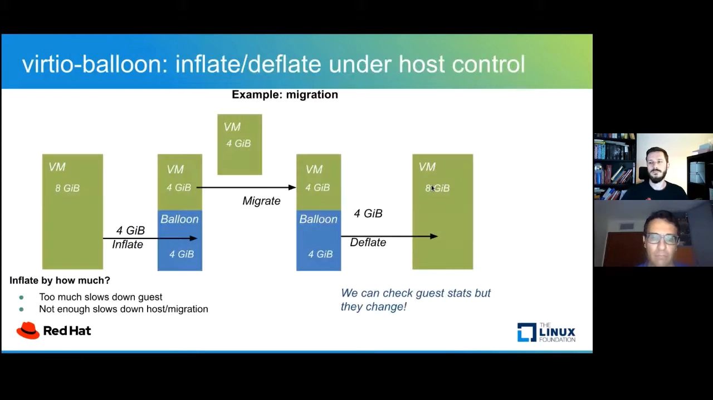

问题马上来了：**气球该充多大？**（[【跳转到 06:31】](https://www.youtube.com/watch?v=Fq47WCCm-HM&t=391)）

- 充太多：客户机可用内存不够，会变慢，甚至出问题；
- 充太少：迁移要搬的数据多，迁移变慢。

宿主能看客户机的统计数据，但"这些数字一直在变"。这是一个典型的控制回路难题：被控对象的状态由别人掌握，采样还滞后。

## 四、把决定权交给客户机：四条设计想法

解决办法是让客户机对气球有更多控制权。演讲者把最终方案拆成四条想法（[【跳转到 07:36】](https://www.youtube.com/watch?v=Fq47WCCm-HM&t=456)）：

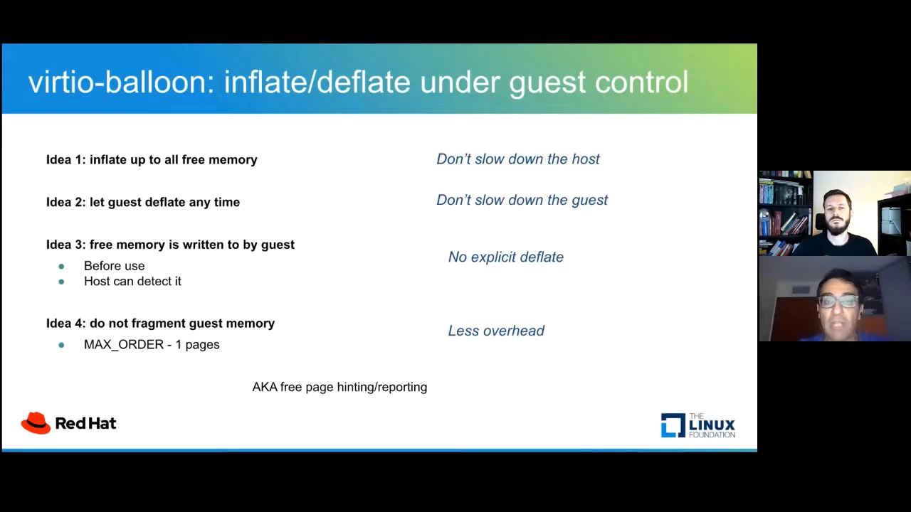

| 想法 | 内容 | 解决什么 |
| --- | --- | --- |
| 想法 1 | 直接充到把全部空闲内存都吃掉 | 不让宿主慢下来（一次拿够） |
| 想法 2 | 允许客户机在任何时候放气 | 不让客户机慢下来 |
| 想法 3 | 客户机使用空闲页前一定先写它，宿主能检测到这次写 | 省掉显式的 deflate 操作 |
| 想法 4 | 不去报告散落各处的 4 KiB 小块空闲页，只用客户机内存管理仍能追踪到的最大块（MAX_ORDER − 1 页） | 减少开销、避免把客户机内存打碎 |

想法 3 值得多说一句：一页内存被客户机重新使用，第一件事一定是往里写数据；只要宿主把这些页设成写保护，这次写就会触发缺页，宿主立刻知道"这页又被用上了"。于是"放气"这个动作可以由缺页异常隐式完成，不需要客户机额外发通知。

想法 4 则利用了客户机的内存规整（compaction）能力：现代客户机可以把碎片慢慢整理成几 MiB 级别的大块空闲页，只上报这种大块，宿主处理起来便宜得多。

这四条想法组合起来，就是两个新特性：**free page hinting** 和 **free page reporting**。

## 五、free page hinting：为迁移而生

free page hinting 是较老的一个特性，由 Intel 在几年前贡献，设计目标非常明确——**加速迁移**（[【跳转到 08:26】](https://www.youtube.com/watch?v=Fq47WCCm-HM&t=506)）。

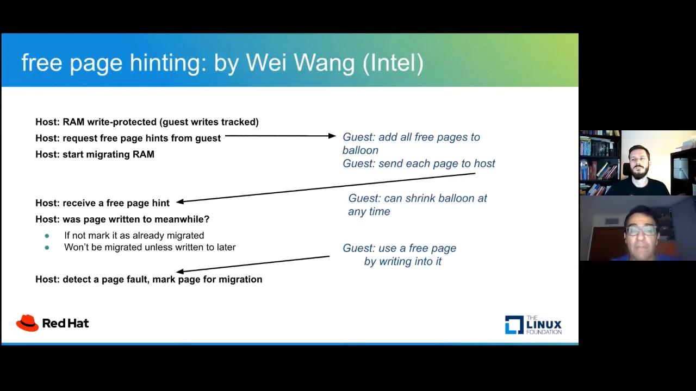

流程是这样的：

1. 宿主先把 RAM 全部写保护（这本来就是预拷贝迁移要做的事），并开始迁移；
2. 宿主向客户机发请求，开始 free page hinting；
3. 客户机把所有空闲页加进气球，并逐页告知宿主；
4. 宿主收到一页提示后检查：这页在此期间被写过吗？没写过就标记为"已迁移"，以后不用再搬；写过就照常迁移；
5. 客户机随时可以缩小气球（不需要等宿主处理完），客户机不会因此卡住；
6. 客户机真要使用某个空闲页时，直接往里写，触发缺页，宿主把这页重新标记为待迁移。

优点和缺点都很清楚（[【跳转到 09:16】](https://www.youtube.com/watch?v=Fq47WCCm-HM&t=556)）：

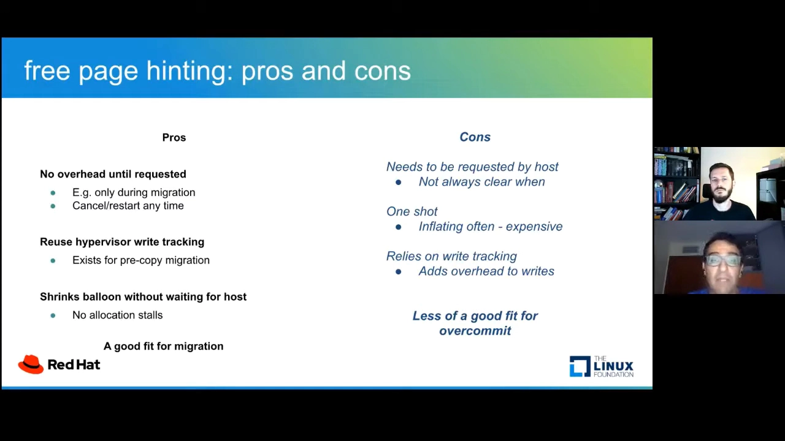

- **优点**：不请求就没有开销（比如只在迁移期间开启，随时可以取消或重启）；复用预拷贝迁移本来就有的写保护追踪；缩小气球不必等宿主，因此没有分配停顿。
- **缺点**：必须由宿主发起，而宿主很难判断"什么时候该发起"；一次性（one shot），频繁充气很贵；依赖写保护追踪，而写保护会给所有写操作加开销。

结论：**它是迁移的好工具，但不是 overcommit 的好工具**。

## 六、free page reporting：为 overcommit 而生

free page reporting 是更新的特性，同样来自 Intel，目的就是解决 hinting 的那些缺点（[【跳转到 10:06】](https://www.youtube.com/watch?v=Fq47WCCm-HM&t=606)）。

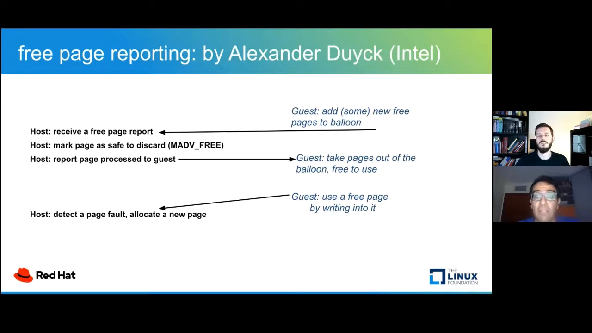

方向反了过来——**由客户机发起**：

1. 客户机发现新产生的空闲页积累到一定数量，就取其中一部分（默认约 1/16）加进气球；
2. 客户机把这些页标记为空闲，然后向宿主报告"这页处理过了"；
3. 宿主收到报告后，把这一页标记为可以安全丢弃（幻灯片上写的是 `MADV_FREE`），再回告客户机"处理完了"；
4. 客户机收到回告后，才把这些页从气球里拿出来重新可用；
5. 页被重新使用时，先写它，触发缺页，宿主在宿主侧重新分配一页。

注意第 3 步：**宿主侧的回收动作是"标记为可丢弃"**，不是立刻搬走内容。真正把这页物理内存拿回来，是宿主在内存压力下丢弃这些页时发生的。这也是"协作"的另一半：客户机承诺这些页里没有需要保留的数据，宿主才敢丢。

优缺点（[【跳转到 10:56】](https://www.youtube.com/watch?v=Fq47WCCm-HM&t=656)）：

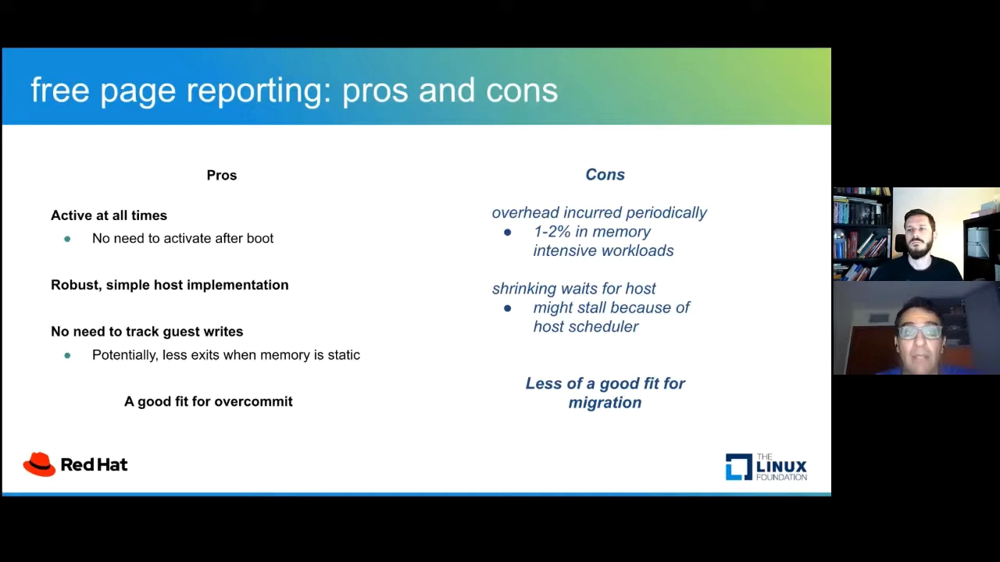

- **优点**：开机后一直生效，不需要在压力来临时再激活；宿主实现简单健壮；不需要追踪客户机的写操作（内存静止时甚至能减少 exit）。
- **缺点**：周期性开销，对内存密集型负载约 1%–2%；收缩必须等宿主处理，而宿主可能被调度器卡住。

结论：**它是 overcommit 的好工具，但不是迁移的好工具**。

把两个特性放在一起看，就能理解"按需分配"在实现上到底依赖什么：宿主承诺了超过物理内存的容量，真正让它不炸的是客户机不断上报的空闲页。**密度不是白拿的，是用"客户机愿意配合 + 1%–2% 的常驻开销 + 收缩延迟"换来的。**

## 七、气球还没解决的问题

在转向 virtio-mem 之前，演讲者列了一串气球的遗留问题（[【跳转到 12:11】](https://www.youtube.com/watch?v=Fq47WCCm-HM&t=731)）：

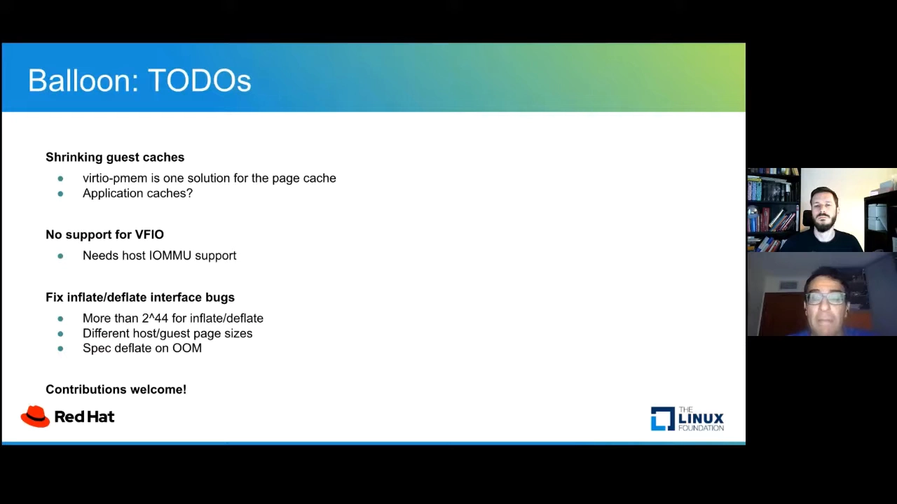

- **收缩客户机缓存**：free page 方案没法像普通充气那样收缩客户机缓存。页缓存还能靠 virtio-pmem 绕过，应用自己的缓存就没办法了。
- **不支持 VFIO 设备直通**：要做这件事需要宿主侧 IOMMU 支持，不是改几行驱动就能完成的。
- **inflate/deflate 接口的历史 bug**：VM 内存大小受限于 2^44、默认假设宿主页大小永远是 4 KiB（实际不一定）、OOM 时的行为在 Linux 里有实现但规范没写清楚。

这些遗留问题说明：气球能拿到的只是"客户机愿意交出的空闲内存"，一旦内存被缓存占住，气球就无能为力。

## 八、virtio-mem：用块粒度做热插拔

第三代机制 virtio-mem 换了个思路：不去"借"客户机已经分配的内存，而是在客户机物理地址空间里划出一块**可伸缩的设备内存区域**，按块插拔（[【跳转到 19:55】](https://www.youtube.com/watch?v=Fq47WCCm-HM&t=1195)）。

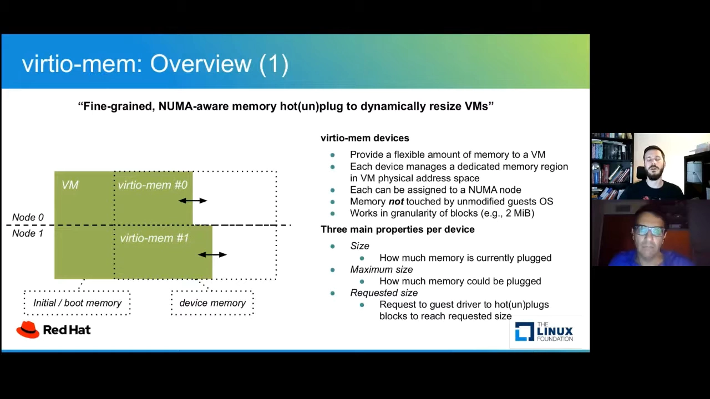

它的定位是"细粒度、NUMA 感知的内存热插拔"，用来动态调整 VM 大小。几个要点：

- 每个 virtio-mem 设备管理客户机物理地址空间里的一段专属区域，可以绑定到某个 NUMA 节点；
- **未被修改过的客户机操作系统发现不了这些设备**——这反而是设计目标，因为宿主因此始终知道客户机被允许碰哪些内存，将来也能识别试图多用内存的恶意客户机；
- 内部以块为单位工作，例如 2 MiB 一块，也可以更大；
- 每个设备有三个属性：`size`（当前插入了多少内存）、`maximum size`（最多能插入多少）、`requested size`（宿主请求客户机驱动把块插拔到多少）（[【跳转到 20:20】](https://www.youtube.com/watch?v=Fq47WCCm-HM&t=1220)）。

使用顺序也不复杂：先像 DIMM/NVDIMM 那样给 VM 准备好内存设备，再创建 memory backend（大小即 maximum size），然后创建 virtio-mem 设备并绑定 NUMA 节点、接上 backend。默认启动时客户机不会通过这个设备多占内存，只有宿主通过 QMP/HMP 请求之后才开始占用。

代价也很明确（[【跳转到 23:40】](https://www.youtube.com/watch?v=Fq47WCCm-HM&t=1420)）：

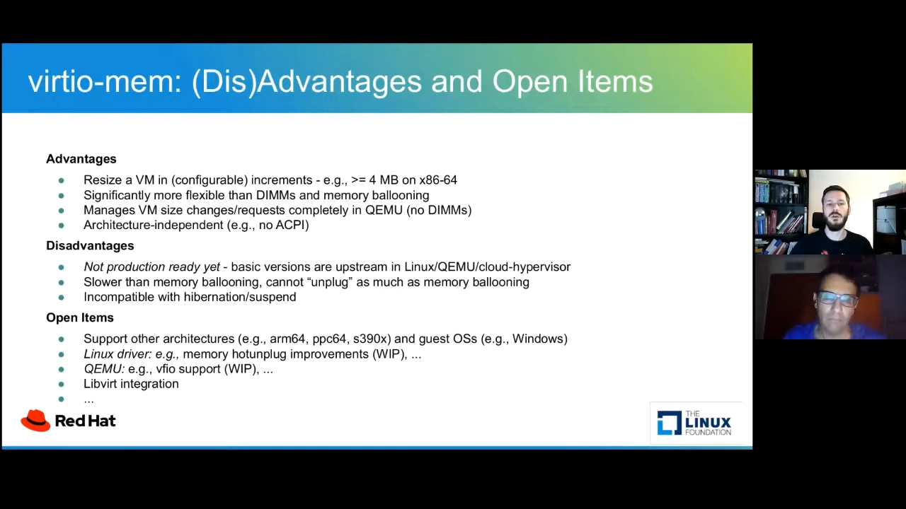

- **粒度**：x86-64 上 Linux 客户机可以按 4 MiB 粒度调整（气球通常是 4 KiB 粒度），比 DIMM 灵活得多，也支持 NUMA（气球不支持 NUMA）；
- **更慢**：比内存气球慢；
- **能拔的内存更少**：气球作用于整个 VM 的内存，virtio-mem 只作用于受限的物理内存区域；
- **与休眠/挂起不兼容**；
- **尚未生产就绪**：Linux、QEMU、Cloud Hypervisor 里有基础版本，但还有待修的问题。

## 九、结论：气球仍是底座

演讲最后的总结把三条线并排放在一起（[【跳转到 25:45】](https://www.youtube.com/watch?v=Fq47WCCm-HM&t=1545)）：

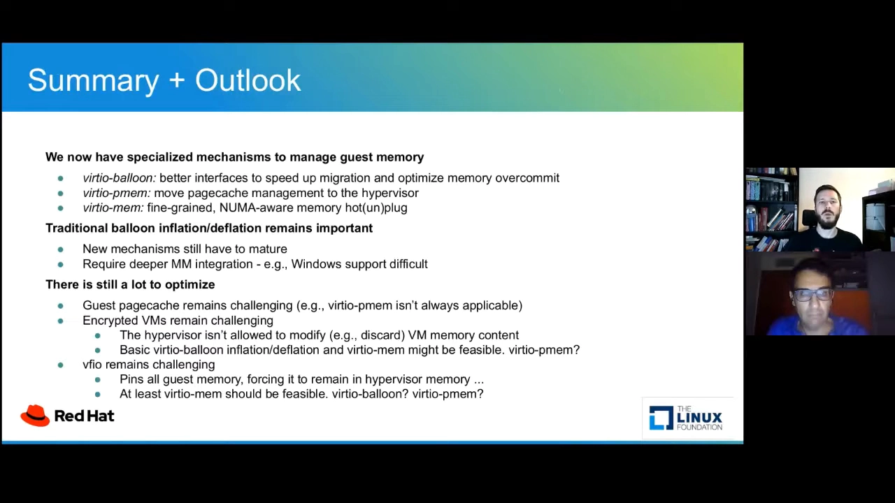

- **virtio-balloon**：更好的接口，用来加速迁移、优化宿主的 overcommit；
- **virtio-pmem**：把页缓存的管理搬到宿主侧（本小节不展开，属于内存共享/页缓存那条线）；
- **virtio-mem**：细粒度、NUMA 感知的热插拔。

但演讲者强调，**传统的气球充气/放气依然重要**：新机制还不够成熟，而且越往下做，对客户机内存管理的侵入就越深——写个气球驱动只要申请和释放内存，要让 Windows 支持后面这些特性就难得多，闭源操作系统的核心内存管理更是没法影响。

最后是几个尚未解决的边界（[【跳转到 27:25】](https://www.youtube.com/watch?v=Fq47WCCm-HM&t=1645)）：

- **客户机页缓存**依然棘手，virtio-pmem 也不是所有场景都适用，KSM 也不总是可用；一旦这些手段都失效，就回到"客户机把主存全喂给页缓存"的老问题上。
- **加密虚拟机**更难：宿主不被允许修改客户机内存内容，而多数回收机制的本质是"丢弃内存"，这在加密场景下做不到，只能靠客户机配合。气球充放气和 virtio-mem 应该可行，virtio-pmem 存疑。
- **VFIO 直通**会把客户机内存全部钉在宿主内存里，virtio-pmem 这类机制因此失去意义。

## 小结

- 宿主看得见页、看不见内容，所以**回收客户机内存必须与客户机握手**，气球是这套握手的原始形态。
- 气球 = 客户机驱动 `alloc` 一批页交给宿主；`target balloon size` 是宿主的请求；充气/放气分别改变宿主与客户机的可用内存。
- 宿主控制充气量会遇到两难：充多了客户机慢，充少了迁移慢，而客户机的统计数字一直在变。
- **free page hinting** 把空闲页逐页告知宿主，适合迁移（不请求零开销、复用写保护追踪），不适合 overcommit（依赖写保护、一次性、宿主难判断时机）。
- **free page reporting** 由客户机主动上报，宿主把页标记为可丢弃（`MADV_FREE`），适合 overcommit（常开、实现简单、不追踪写），代价是 1%–2% 的周期性开销和"收缩要等宿主"。
- **virtio-mem** 用块（2 MiB/4 MiB 粒度）热插拔，支持 NUMA、粒度细，但更慢、能拔的内存更少、与休眠不兼容、尚未生产就绪。
- 按需分配的密度来自"客户机愿意交出的空闲内存"，不是宿主凭空变出来的；加密 VM 与 VFIO 直通是这套机制的硬边界。

## 关键术语速查

| 术语 | 一句话解释 |
| --- | --- |
| overcommit（超分） | 承诺给 VM 的内存总量超过宿主真实物理内存，靠回收空闲内存兜底 |
| balloon（气球） | 客户机里的一段"占位"内存，充气即把页交还宿主，放气即收回 |
| target balloon size | 宿主发给客户机的请求，指定气球应该多大 |
| inflate / deflate | 充气（把页交给宿主）/ 放气（把页还给客户机） |
| free page hinting | 宿主发起、客户机逐页上报空闲页的旧机制，为迁移设计 |
| free page reporting | 客户机主动上报空闲页的新机制，为 overcommit 设计 |
| `MADV_FREE` | 宿主侧把页标记为"可安全丢弃"，真正回收发生在内存压力下 |
| MAX_ORDER − 1 | 客户机内存管理能追踪到的最大连续页块，用来避免碎片化 |
| virtio-mem | 以块为单位热插拔客户机内存的设备，支持 NUMA、粒度 4 MiB |
| VFIO | 设备直通机制，会把客户机内存钉在宿主内存里，与回收机制冲突 |