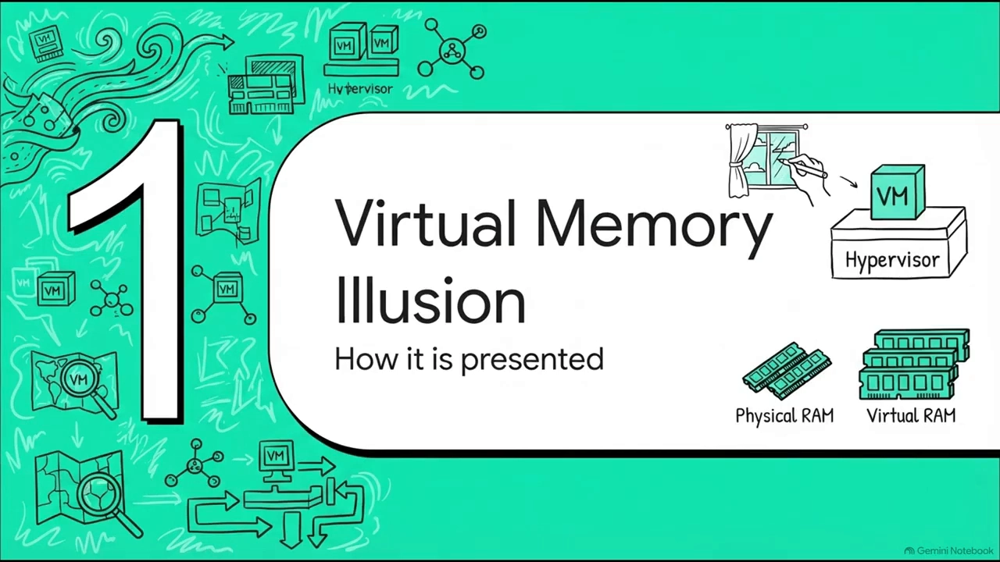
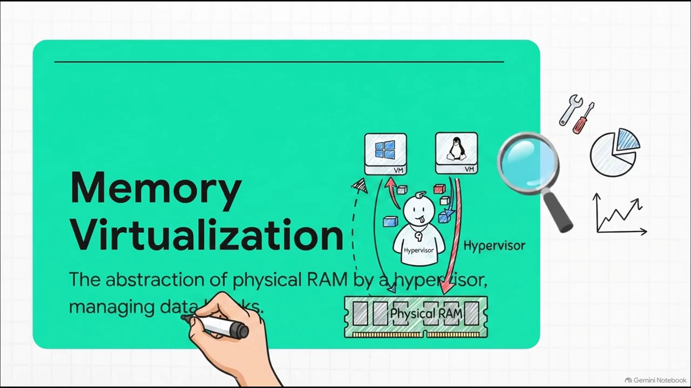
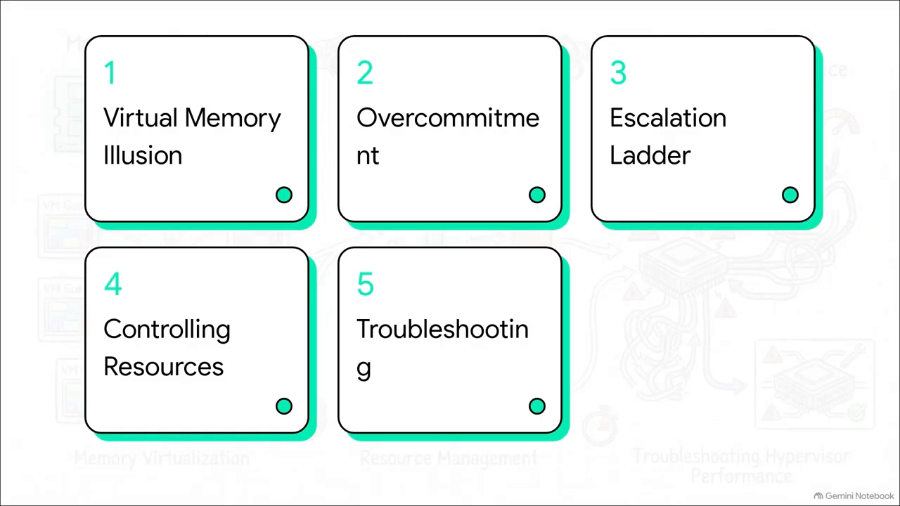
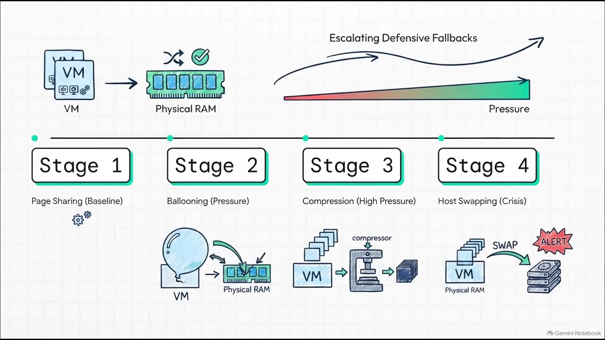
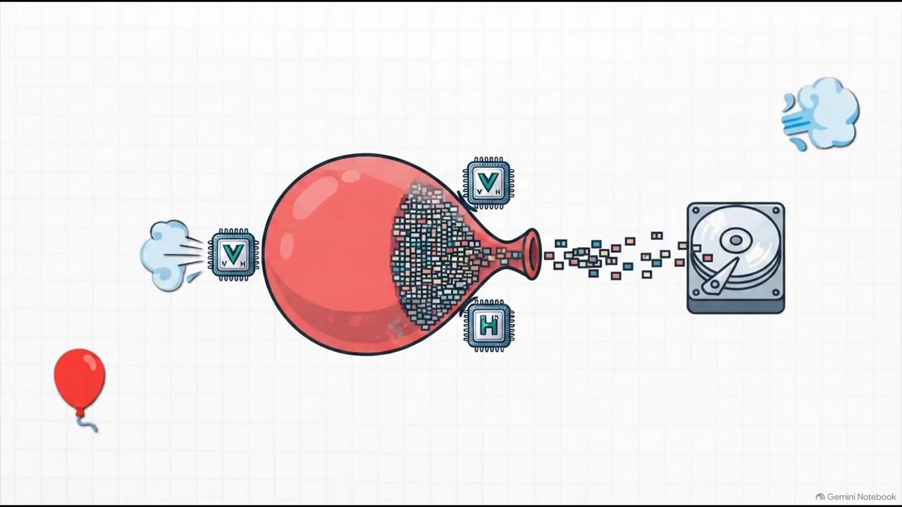
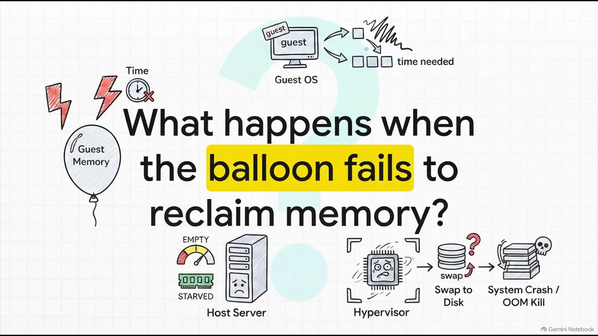
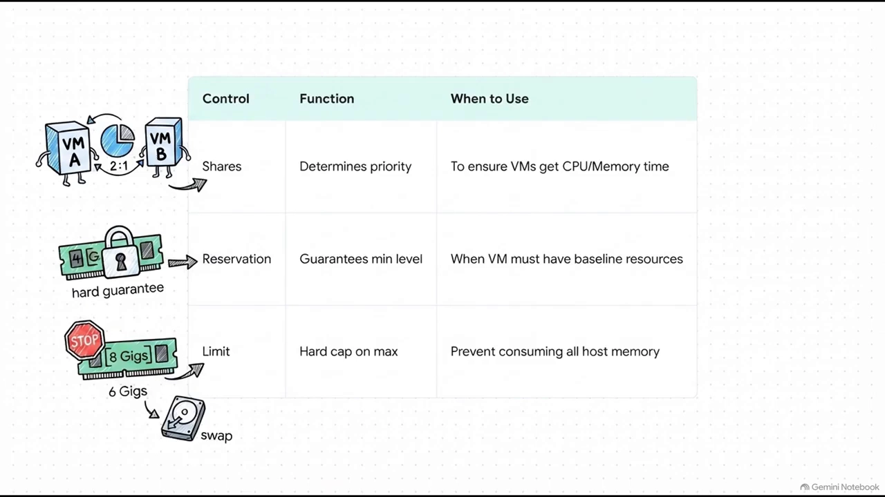
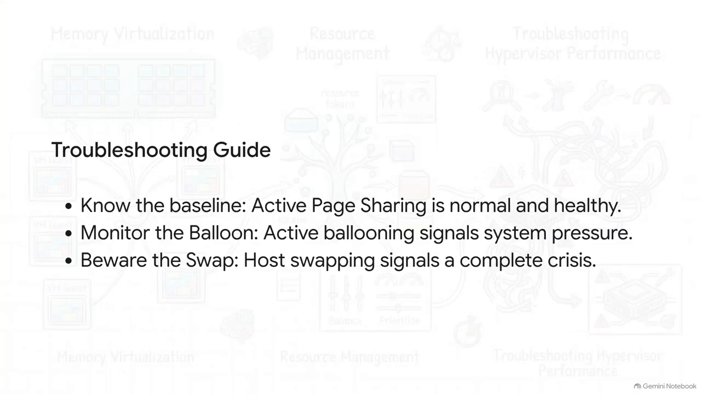

# 内存超分的四级阶梯：气球、压缩与换宿主，谁在替你兜底

> 视频来源：[Memory Virtualization: Overcommitment, Ballooning & Swapping](https://www.youtube.com/watch?v=gGkaqWQpJ7E)（YouTube · Cybertrace Foundation）｜时长约 11 分钟
> 简要导读：这支视频用图解把"内存超分之后会发生什么"讲成一条阶梯：页共享、气球、压缩、宿主换页。本文只取与气球和按需分配相关的部分，页共享（KSM）的机制留给 2.2.3 那一节。视频是 AI 旁白的科普短片，术语已按上下文订正。

## 本讲要解决的核心问题（SCQA）

**背景**：虚拟化的初衷就是物理服务器长期闲置，所以宿主机上普遍会把内存"超分"——分配给 VM 的内存总量大于真实物理内存。

**冲突**：CPU 超分只是排队变慢，内存超分却是硬碰硬的空间争抢。一旦所有 VM 同时要内存，宿主没有"等一等"这个选项，只能把物理硬盘当内存用。

**疑问**：那宿主是怎么在崩溃之前一层层把内存挤出来的？每一层的代价是什么？

**回答（中心思想）**：宿主有一套**四级防御阶梯**——页共享（常态）、气球（有压力）、内存压缩（高压）、宿主换页（危机）。其中气球是唯一"请客户机自己挑出没用的页"的一层，因此它既是最聪明的，也是最慢、最依赖客户机配合的一层。

## 一、内存是唯一"没有弹性"的资源

演讲开头就把内存和 CPU、网络带宽区分开（[【跳转到 00:00】](https://www.youtube.com/watch?v=gGkaqWQpJ7E&t=0)）：虚拟化 CPU 和网络带宽时，玩的其实是**时间与路由**，可以灵活调度；而内存是**硬性的物理空间约束**，有就是有，没有就是没有。

所以先要理解"内存虚拟化的幻觉"是怎么造出来的（[【跳转到 01:49】](https://www.youtube.com/watch?v=gGkaqWQpJ7E&t=109)）：

1. VM 里的应用照常用它以为的虚拟内存；
2. 客户机操作系统把地址翻译成它以为的"自己的物理内存"；
3. hypervisor 用映射表记录这个"占位地址"在宿主真实内存里的位置。

关键在于第 3 步：**翻译层完全由 hypervisor 掌握**，所以它可以在客户机毫不知情的情况下做很多事。比如你给一台 VM 分配 16 GB（[【跳转到 01:30】](https://www.youtube.com/watch?v=gGkaqWQpJ7E&t=90)），这 16 GB 并不是硬预留的，它更像一条**高水位线**，宿主在背后不停地抬高、降低实际占用的物理内存。

## 二、CPU 超分是时间共享，内存超分是空间共享

有了这层幻觉，才能理解超分为何危险（[【跳转到 02:42】](https://www.youtube.com/watch?v=gGkaqWQpJ7E&t=162)）：

- **CPU 超分**：资源是**时间共享**的。太多 VM 同时抢 CPU，结果只是变慢、排队，风险低得多。
- **内存超分**：资源是**空间共享**的。你分配出去的内存超过物理内存，而所有 VM 又同时要这块空间，宿主没法让它们"等一等"，只能被迫拿物理硬盘当 RAM 用，结果是巨大的磁盘 I/O 延迟。

一句话：**内存超分需要非常精细的手感**。

## 三、四级阶梯：压力每升一级，手段就更粗暴一分

当页共享这种常态手段不够用、争抢开始飙升时，hypervisor 会沿着一条时间线往上爬，每一级都是为了防止整台宿主崩溃（[【跳转到 04:36】](https://www.youtube.com/watch?v=gGkaqWQpJ7E&t=276)）：

| 级别 | 手段 | 触发条件 | 代价 |
| --- | --- | --- | --- |
| 第 1 级 | 页共享（KSM 等） | 一直开启 | 扫描与合并的 CPU 开销（详见 2.2.3） |
| 第 2 级 | 气球（ballooning） | 物理内存开始吃紧 | 需要客户机配合，充气要花时间 |
| 第 3 级 | 内存压缩 | 气球也腾不出足够空间 | CPU 压缩/解压开销，但仍在内存里 |
| 第 4 级 | 宿主换页（host swapping） | 压缩也救不回来 | 磁盘 I/O 延迟，性能崩塌 |

这张图值得记住的地方是：**气球处在"还有救"和"快没救"之间**。它上面还有一层压缩可以拖延时间，下面就是不可逆的性能灾难。

## 四、气球为什么聪明：让客户机自己挑出没用的页

气球驱动的工作方式是这一层最巧妙的部分（[【跳转到 05:01】](https://www.youtube.com/watch?v=gGkaqWQpJ7E&t=301)）：

1. 安装 VM tools 时，hypervisor 在客户机里装一个几乎完全休眠的小驱动；
2. 宿主物理内存吃紧时，给这个驱动发一个"充气"信号；
3. 对客户机操作系统来说，这看起来就像**突然冒出一个极其贪吃的应用**在抢内存；
4. 客户机按自己被编程的方式反应：找出自己最老、最冷、最近最少使用（LRU）的页，把它们刷到自己的虚拟磁盘分页文件里；
5. 客户机因此腾出了内存，气球驱动把这些页收上来，宿主就能安全地拿回这块物理 RAM，交给其他急需的 VM。

**它高效的根本原因是：客户机操作系统自己知道哪块内存没用。** 它最了解自己的数据，宿主永远猜不到。

但这也正是它的软肋（[【跳转到 05:51】](https://www.youtube.com/watch?v=gGkaqWQpJ7E&t=351)）：**充气是需要时间的**。如果内存峰值是瞬间到来的，或者气球已经吹到最大、宿主还在挨饿，这一层就顶不住了。

### 气球顶不住之后

- **第 3 级，内存压缩**（[【跳转到 06:35】](https://www.youtube.com/watch?v=gGkaqWQpJ7E&t=395)）：目标只是控制损失。写物理磁盘比 RAM 慢太多，所以在把内存倒到磁盘之前，宿主先把内存页压缩，放进一块仍然位于物理 RAM 里的压缩缓存。现代处理器压缩/解压很快，这层的作用就是**把写磁盘的昂贵代价再往后拖一会儿**。
- **第 4 级，宿主换页**（[【跳转到 07:11】](https://www.youtube.com/watch?v=gGkaqWQpJ7E&t=431)）：最后的最后手段，是彻底的危机状态。此时 hypervisor **完全绕过客户机操作系统**，直接强行拿走虚拟内存页，写进宿主的物理磁盘 swap 空间。再快的 SSD 也远慢于 RAM，VM 的性能不是下降，而是"死掉"。

这张图把问题问得很直白：**气球回收失败之后呢？** 答案是宿主饥饿、换页、OOM Kill，最后是系统崩溃。

## 五、按需分配能塞多少台 VM，取决于这三根旋钮

既然超分这么危险，怎么防止它变成危机？视频给的是资源分配里的三个参数（[【跳转到 07:58】](https://www.youtube.com/watch?v=gGkaqWQpJ7E&t=478)）——不要只丢一个"多少 GB"给 VM 就完事：

- **Shares（份额）**：只在内存不够分的时候起作用。A 有 2000 份、B 有 1000 份，紧张时 A 拿到两倍于 B 的可用内存。它决定**优先级**，不保证任何绝对数量。
- **Reservation（预留）**：硬保证。设了 4 GB，宿主就永远为这台 VM 锁住 4 GB；如果宿主连 4 GB 都拿不出来，这台 VM 甚至**开不了机**。它决定**下限**。
- **Limit（上限）**：硬天花板。即使给 VM 分配了 8 GB，上限设成 6 GB 它就永远用不到 6 GB 以上。要非常小心地设，设错了会**在宿主明明有大量空闲内存时，逼着 VM 自己去换页**。它决定**上限**。

这三个旋钮直接决定了"一台宿主机上能塞多少台 VM"：reservation 之和是不能超的硬账，shares 决定超分之后谁先挨饿，limit 则防止某台 VM 把宿主吃干。

## 六、看指标：气球在动，就是压力来了

最后是排障视角（[【跳转到 09:30】](https://www.youtube.com/watch?v=gGkaqWQpJ7E&t=570)）：

- 页共享 / KSM 数值高：**完全正常**，说明宿主在高效地去重省空间；
- 气球驱动在反复充气放气：**要注意**。它说明宿主正处于真实的内存压力下，此刻虽然被缓解了，但这是一个明确的警告——该加物理内存，或者把部分 VM 迁到别的宿主；
- 宿主换页大于零：**已经失败了**。说明环境规格没算对，处于全面性能危机，得马上干预（关掉非关键 VM、调整 reservation）。

## 小结

- 内存是硬性空间约束，CPU 超分只是排队变慢，内存超分没有"等一等"这个选项。
- 宿主靠四级阶梯兜底：页共享（常态）→ 气球（压力）→ 压缩（高压）→ 宿主换页（危机）。
- 气球之所以高效，是因为它让**客户机自己挑出最冷、最没用的页**；代价是必须客户机配合，而且充气需要时间。
- 气球顶不住时，压缩只是把写磁盘的代价往后拖；真正落到宿主换页，VM 性能就崩了。
- 一台宿主能塞多少 VM，由 reservation（硬下限）、shares（争抢优先级）、limit（硬上限）三个旋钮共同决定。
- 监控上：页共享高是好事，气球在动是压力预警，宿主换页大于零是危机。

## 关键术语速查

| 术语 | 一句话解释 |
| --- | --- |
| overcommit（超分） | 分配给 VM 的内存总量超过宿主物理内存，靠回收兜底 |
| 高水位线（high water mark） | 给 VM 的"分配量"只是上限，不是硬预留的物理内存 |
| ballooning（气球） | 在客户机里放一个驱动，让它主动占住并交还内存给宿主 |
| LRU | 最近最少使用，客户机据此挑出最冷的页换出 |
| 内存压缩 | 把页压缩后仍留在 RAM 里，用来推迟写磁盘 |
| host swapping | 宿主绕过客户机，直接把 VM 内存页写到磁盘 swap |
| shares | 内存紧张时的分配权重，决定优先级 |
| reservation | 硬预留，宿主必须能拿出这块内存，否则 VM 开不了机 |
| limit | 硬上限，即使宿主有空闲内存也不允许超过 |