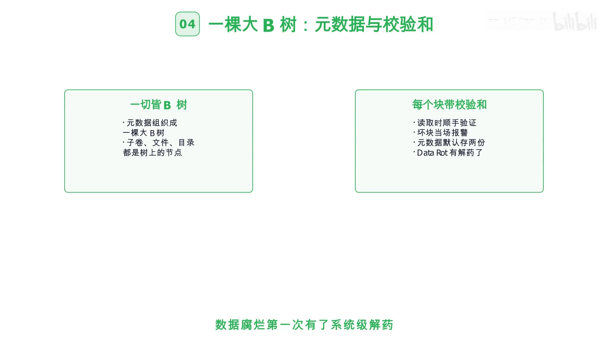
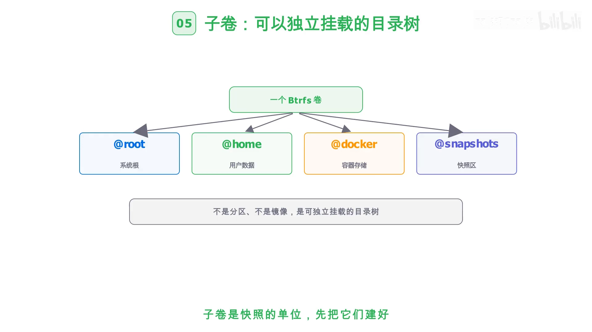
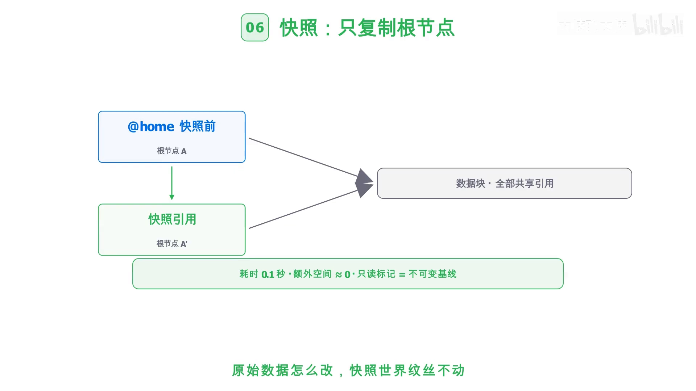
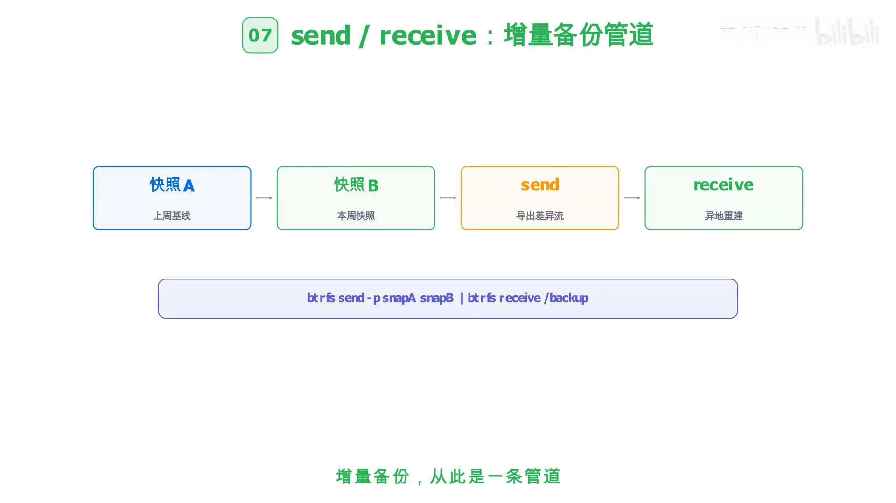
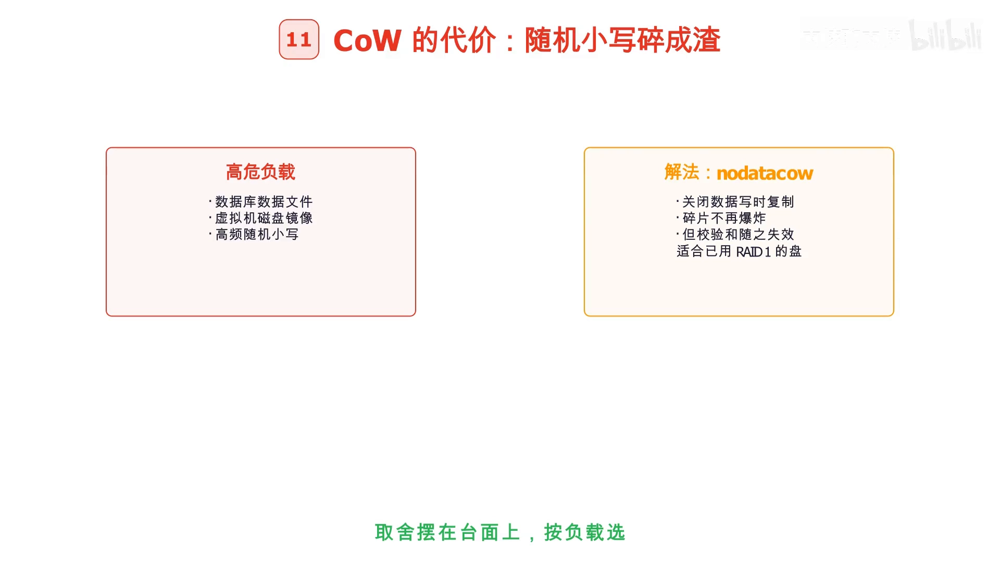
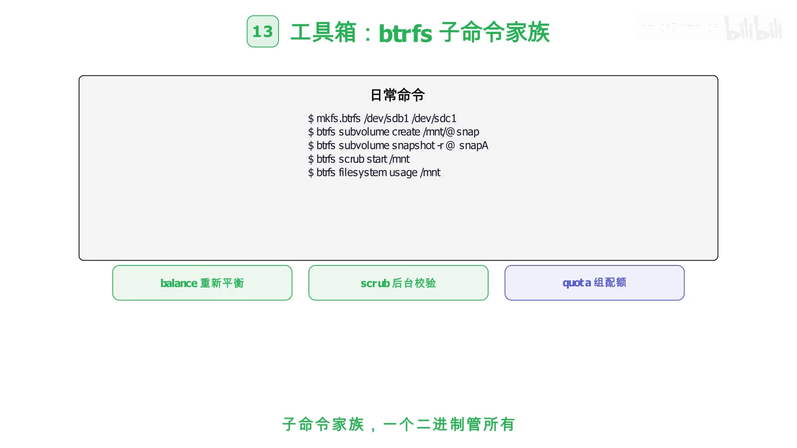
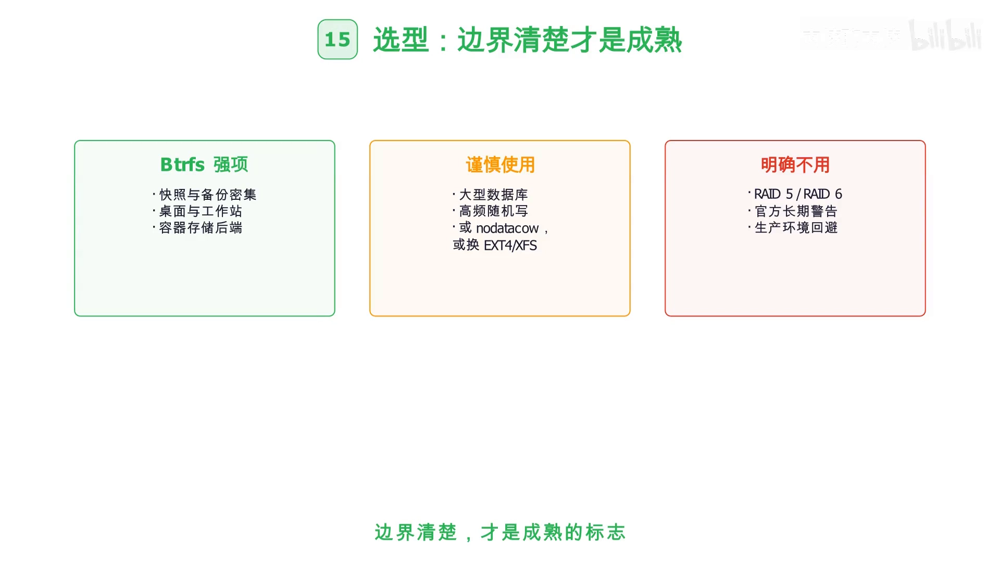

# Btrfs 快照为什么只要 0.1 秒：文件系统里的写时复制

> 视频来源：[Btrfs快照为什么只要 0.1 秒？写时复制与数据自愈完整拆解！](https://www.bilibili.com/video/BV1mDHk69EuL/)（B 站 · UP 主「内核聊内核」）｜时长约 5 分钟
> 导读：这支视频用 100G 磁盘 0.1 秒出快照这个反直觉现象切入，把写时复制在**文件系统**这一层的样子讲透：共享什么、什么时候才复制、代价落在哪里。它是"延迟复制 + 共享优先"这条通用原理在块设备上的直接投影。

## 本讲要解决的核心问题（SCQA）

**背景**：快照是备份的常用手段，直觉上"给 100G 的磁盘做个快照"应该要复制 100G 的数据。

**冲突**：但在 Btrfs 上右键点下创建快照，0.1 秒就完成了，而且几乎不占空间。这既不是压缩，也不是去重——那些都需要读完数据才能算出结果。

**疑问**：既然没有复制数据，那快照到底存了什么？它凭什么还能在被回滚时"还原"出完整的数据？

**回答（中心思想）**：因为 Btrfs 的核心思想是 **Copy-on-Write：从不原地改写**。要改一个块，就把新内容写到新位置，再更新指针，旧数据原封不动。快照因此只需要**复制 B 树的根节点**，数据块全部共享引用——**共享优先，写时才复制**。这也是"0.1 秒、几乎不占空间"的全部来源。

## 一、0.1 秒快照的秘密：不是压缩，也不是去重

视频开篇就把这个反直觉现象摆了出来：右键点下创建快照，0.1 秒完成 100G 的磁盘快照，几乎不占空间。[【跳转到 00:00】](https://www.bilibili.com/video/BV1mDHk69EuL/?t=0)

它先排除了两种常见误解：

- **不是压缩**：压缩要读一遍数据再写一遍，100G 不可能 0.1 秒完成。
- **不是去重**：去重要扫描并比对块内容，同样需要遍历数据。

真正的原因是第四种可能：**它根本没复制数据**。

Btrfs 的名字来自 B-tree File System，2007 年由 Oracle 立项，2009 年合入内核 2.6.29。今天它是 openSUSE 与 SUSE 企业版的默认文件系统，Fedora 也长期默认。它的野心写在名字上：把**校验、快照、压缩、多设备**全部做进文件系统本体。[【跳转到 00:25】](https://www.bilibili.com/video/BV1mDHk69EuL/?t=25)

## 二、CoW 的核心思想：从不原地改写

整个 Btrfs 的设计地基只有一句话：**Copy-on-Write，写时复制，从不原地改写**。

具体做法是：要改一个块，就把新内容写到**新位置**，再更新指针，旧数据原封不动。视频用一行等式概括：

> 改一个块 = 新内容写到新位置 + 更新指针，旧数据原封不动

把它和传统的原地改写并排看，差别一目了然：[【跳转到 00:50】](https://www.bilibili.com/video/BV1mDHk69EuL/?t=50)

| 维度 | 原地改写（传统） | 写时复制（Btrfs） |
| :--- | :--- | :--- |
| 写入位置 | 直接覆盖旧块 | 新块写到新位置 |
| 旧数据 | 即刻消失 | 完整保留 |
| 掉电风险 | 可能写了一半，处于中间态 | 指针原子切换，要么旧要么新 |
| 快照成本 | 必须复制全部数据 | 只需保留旧指针 |

这张表也解释了视频里那句"快照、校验、一致性，共用这一个地基"：一旦确立了"旧数据永不原地覆盖"，那么**保留旧版本**（快照）、**验证块内容**（校验和）、**保证崩溃后不出现半写状态**（一致性）就都成了同一件事的自然推论。

## 三、共享优先：快照只复制根节点

要理解快照为什么这么便宜，得先知道 Btrfs 把元数据组织成什么样：**一棵大 B 树**。子卷、文件、目录，全都是这棵树上的节点。[【跳转到 01:15】](https://www.bilibili.com/video/BV1mDHk69EuL/?t=75)

在这棵树上：

- 每个块都带**校验和**，读数据时顺手验证，坏块当场报警；
- 元数据默认存**两份**，所以"数据腐烂"（data rot）第一次有了系统级的解药。

快照的作用对象是**子卷**（subvolume）。子卷不是分区，也不是镜像文件，而是一个可以独立挂载的目录树；一个 Btrfs 卷里可以建任意多个子卷，各自配额、各自快照、各自挂载参数。[【跳转到 01:40】](https://www.bilibili.com/video/BV1mDHk69EuL/?t=100)

而**快照就是子卷的写时复制副本**：它只复制 B 树的**根节点**，数据块全部共享引用。于是：

- 耗时 0.1 秒——因为只复制了一个根节点；
- 额外空间约等于 0——因为数据块一个都没动；
- 打上只读标记后，它就是一个**不可变的备份基线**，原始数据再怎么改，快照里的世界纹丝不动。

这就是"共享优先"的含义：**默认全部共享，只在必须分离时才付出复制的代价**。快照不是"数据的副本"，而是"指向同一批数据块的另一个根"。

## 四、写时才复制：一次写入在 B 树上的完整路径

快照之后，如果原始子卷继续被写入，会发生什么？这正是 CoW 发挥作用的地方，也是快照能保持不变的机制保证。

视频在结尾用一句话把整条链路串了起来：**写请求落成新块 → 元数据 B 树更新 → 旧块被快照引用保留 → 校验和随块记账**。[【跳转到 04:35】](https://www.bilibili.com/video/BV1mDHk69EuL/?t=275)

拆开看是四步：

1. **写请求落成新块**：新数据写到磁盘上空闲的位置，绝不覆盖旧块。
2. **元数据 B 树更新**：从叶子到根，路径上的节点都要改成指向新块；由于"从不原地改写"，这些节点本身也是**新分配的**，最后切换的是根指针。
3. **旧块被快照引用保留**：旧块之所以没被回收，是因为快照的根节点仍然指向它——它还有引用者。
4. **校验和随块记账**：新块写入时同步生成校验和，这也是后面 scrub 能发现坏块的前提。

注意第 2 步的连锁效应：改一个数据块，会让**整条从叶子到根的路径**上的元数据节点都被重写一遍。这既是 CoW 保证一致性的方式（根指针一次原子切换就完成"提交"），也正是它代价的来源。

## 五、只读标记：让快照成为不可变基线

CoW 的通用原理里有一个关键动作：**把共享的东西标记为不可写**。在进程内存里，这个标记是页表上的只读权限位；在 Btrfs 里，它是快照上的**只读标记**。

这个标记带来两个直接好处：

- **语义上的不可变**：快照一旦创建，原始子卷怎么改都不会影响它，因此它可以充当"某个时刻的完整世界"。
- **工程上的撤销键**：大版本升级前打一个只读快照，升级出问题，一条命令就能回滚到升级前。视频称之为"系统级的撤销键"。[【跳转到 04:10】](https://www.bilibili.com/video/BV1mDHk69EuL/?t=250)

而在"共享 + 只读"之上，还长出了两个能力：

- **send / receive 增量备份管道**：把两个快照之间的**差异**导出成一条流，在另一块盘或另一台机器上重建。因为快照之间共享了绝大部分块，差异自然很小，于是"每周打快照、send 出差异、异地落地"变成一条管道。[【跳转到 02:05】](https://www.bilibili.com/video/BV1mDHk69EuL/?t=125)
- **scrub 数据自愈**：后台逐块读取、校验和比对，发现校验不符的坏块，如果 RAID1 有副本，就自动用好副本修复回来。视频的说法是"硬盘会腐烂，Btrfs 给了它免疫系统"。[【跳转到 02:30】](https://www.bilibili.com/video/BV1mDHk69EuL/?t=150)

## 六、CoW 的代价：随机小写被放大成碎片

CoW 不是免费的。视频专门用一节讲"CoW 的代价"，标题很直白：**随机小写碎成渣**。[【跳转到 02:55】](https://www.bilibili.com/video/BV1mDHk69EuL/?t=175)

原因就是前面第 4 步提到的连锁效应：一次小的随机写，在 CoW 下要分配新块、重写整条元数据路径。当写入是**高频、随机、小块**时，这种放大效应会让磁盘上的数据变得极其零散。

视频点名了三类高危负载：

- 数据库数据文件；
- **虚拟机磁盘镜像**；
- 高频随机小写。

解法是挂载选项 `nodatacow`：关闭数据写时复制，碎片不再爆炸；但**校验和也随之失效**，所以它更适合已经用 RAID1 的盘。视频的总结是"取舍摆在台面上，按负载选"。

这里有一个值得记住的判断：**CoW 的收益来自"共享"和"推迟"，代价来自"每次写都要换新位置"**。当负载的写入模式是"写一次、读多次"（快照、备份、桌面文件），收益远大于代价；当负载是"同一小块反复改"（数据库页、虚拟机磁盘），代价就会盖过收益。

## 七、空间之谜：为什么 df 的数字对不上

CoW 还带来一个使用者常踩的坑：`df` 和 `btrfs filesystem df` 的数字经常对不上。[【跳转到 03:20】](https://www.bilibili.com/video/BV1mDHk69EuL/?t=200)

两个原因都直接来自写时复制：

1. **旧块仍被快照引用**：删除文件只是让当前子卷不再指向那些块，但快照还指着它们，所以空间并没有真正释放。
2. **空闲空间本身也被碎片化**：CoW 不断分配新块、释放旧块，空闲空间被切得很碎，能分配出的大块变少。

所以看真相要用 `btrfs filesystem usage`。视频的判断很直接："看不懂这两个数字的差异，就不算真正会用 Btrfs。"

日常命令可以归成一组：[【跳转到 03:45】](https://www.bilibili.com/video/BV1mDHk69EuL/?t=225)

| 命令 | 作用 |
| :--- | :--- |
| `mkfs.btrfs` | 建卷 |
| `btrfs subvolume create / snapshot` | 建子卷 / 打快照 |
| `btrfs scrub start` | 后台校验 |
| `btrfs balance` | 重新平衡分配，整理碎片化的空闲空间 |
| `btrfs filesystem usage` | 看真实空间占用 |

## 八、边界：什么时候该关掉 CoW

视频最后给出了选型边界，态度是"边界清楚才是成熟的标志"：[【跳转到 04:35】](https://www.bilibili.com/video/BV1mDHk69EuL/?t=275)

| 场景 | 建议 |
| :--- | :--- |
| 快照与备份密集、桌面与工作站、容器存储后端 | Btrfs 强项，放心用 |
| 大型数据库、高频随机写 | 谨慎使用：要么 `nodatacow`，要么换 EXT4/XFS |
| RAID 5 / RAID 6 | 明确不用：官方长期警告，生产环境回避 |

## 小结

- 0.1 秒完成 100G 快照，原因既不是压缩也不是去重，而是**根本没复制数据**。
- Btrfs 的地基是 **Copy-on-Write：从不原地改写**——新内容写新位置、更新指针、旧数据原封不动；快照、校验、崩溃一致性共用这一个地基。
- 快照 = 子卷的写时复制副本，**只复制 B 树的根节点**，数据块全部共享引用，因此耗时极短、几乎不占空间。
- 写入时旧块被保留，是因为**快照的根仍引用它**；这也是"删除文件后空间没释放"的原因。
- 只读标记让快照成为**不可变基线**，由此长出 send/receive 增量备份与 scrub 数据自愈。
- 代价是**随机小写被放大成碎片**，高危负载包括数据库、虚拟机磁盘镜像；解法 `nodatacow` 会牺牲校验和。
- 判断标准：写一次读多次的负载受益于 CoW，同一小块反复改的负载受害于 CoW。

## 关键术语速查

| 术语 | 一句话解释 |
| :--- | :--- |
| 写时复制（CoW） | 不原地改写；改一个块就把新内容写到新位置再更新指针，旧数据保留 |
| 快照 | 子卷在某一时刻的只读副本；只复制 B 树根节点，数据块与原子卷共享 |
| 子卷（subvolume） | Btrfs 里可独立挂载的目录树，是快照与配额的作用单位 |
| B 树 | Btrfs 组织全部元数据的树结构；改一个块会重写从叶子到根的整条路径 |
| 校验和 | 每个块附带的完整性校验值，读取时顺手验证，是 scrub 与数据自愈的前提 |
| scrub | 后台逐块读取并比对校验和，发现坏块时用副本自动修复 |
| nodatacow | 关闭数据写时复制的挂载选项，能抑制碎片，但校验和随之失效 |
| 数据腐烂（data rot） | 磁盘上长期存放的数据因介质问题静默损坏；校验和 + 多副本是其解药 |