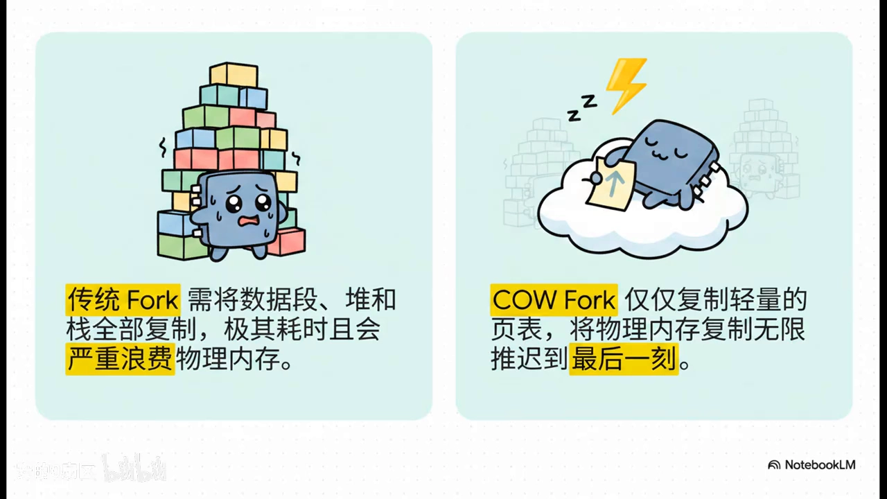
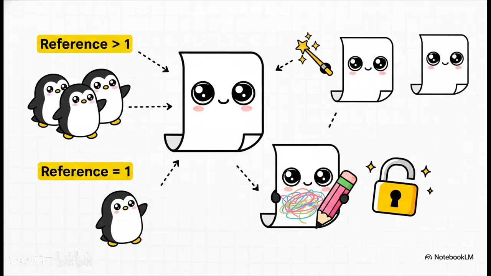
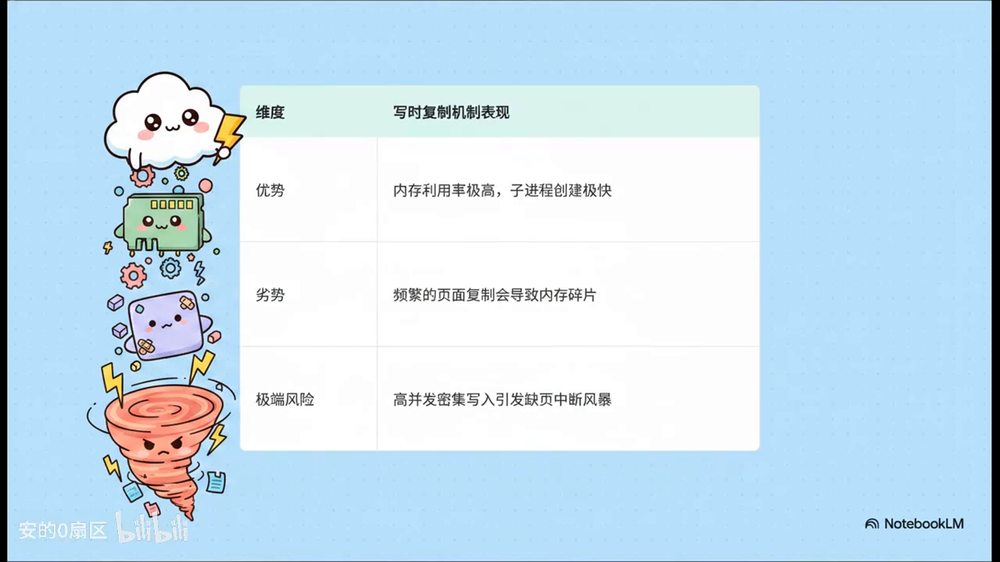
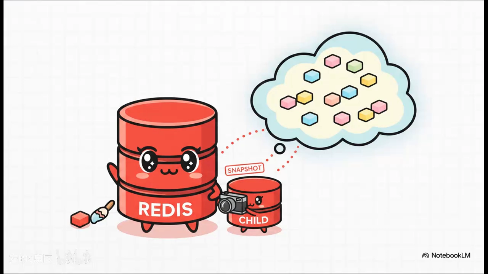

# Linux 写时复制机制：延迟复制与共享优先

> 视频来源：[硬核底层技术解析：Linux写时复制机制](https://www.bilibili.com/video/BV1AvRJBYEWe/)（B 站 · UP 主「安的0扇区」）｜时长约 9 分钟
> 导读：这支视频用一条"传统 fork 的痛点 → CoW 概念 → 缺页中断 → 引用计数 → 双刃剑 → Redis 落地"的主线，把写时复制讲成一套可复用的系统设计思路。本文按这条主线展开，并在末尾把同一机制延伸到文件复制与文件系统快照。

## 本讲要解决的核心问题（SCQA）

**背景**：在 Linux 上创建一个新进程，最经典的做法是 `fork()`——父进程调用一次，内核就变出一个几乎一模一样的子进程。

**冲突**：如果"一模一样"意味着把父进程的整份虚拟内存（数据段、堆、栈）逐字节复制一遍，那么创建进程就成了一件又慢又费内存的事；更尴尬的是，子进程创建后往往紧接着调用 `exec` 加载新程序，刚才辛苦复制的那一大堆数据瞬间作废，完全是无用功。

**疑问**：既然大部分复制都是白做的，内核能不能先不复制，等真的需要时再复制？

**回答（中心思想）**：能。写时复制（Copy-on-Write，CoW）把"复制"这个动作从**创建时**推迟到**第一次写时**：创建时父子进程共享同一批物理页，只把页权限改成只读；谁先写，谁就触发缺页异常，由内核为它单独复制一份并放开写权限。于是"读共享、写分离"，**不写就不花内存、不花时间**。

## 一、传统 fork 的痛点：复制一切，却常常立刻作废

写过 C 语言或做过 Linux 开发的人对 `fork` 都不陌生。在传统的内存管理机制里，操作系统是个"勤奋但极其死板"的角色：一旦你通过 `fork` 创建一个子进程，它就把父进程虚拟内存里的东西——**数据段、堆、栈**——全部一字不落地复制一份给子进程。[【跳转到 00:59】](https://www.bilibili.com/video/BV1AvRJBYEWe/?t=59)

这带来两个直接后果：

- **慢**：要复制的内存有多大，`fork` 就要花多久，进程创建速度被内存体积绑死。
- **费内存**：复制出来的每一页都立刻占用真实物理内存，父子进程各一份。

更让人吐血的是第三种浪费：如果子进程刚一创建就调用 `exec` 去加载一个全新的程序，那么刚才累死累活复制的那一大堆数据瞬间全部作废——新程序会用全新的地址空间覆盖掉它们。[【跳转到 01:24】](https://www.bilibili.com/video/BV1AvRJBYEWe/?t=84)

换句话说，传统 `fork` 的复制在"fork 之后马上 exec"这种最常见的用法里，是 100% 的无效劳动。

## 二、CoW 的核心：把复制推迟到第一次写

写时复制（Copy-On-Write，简称 CoW，视频里也提到它有时被叫作"隐式共享"）的底层逻辑非常直接：**把实质性的物理复制操作，死死地拖延到进程第一次试图修改数据的那一瞬间**。[【跳转到 01:59】](https://www.bilibili.com/video/BV1AvRJBYEWe/?t=119)

它的判据只有一条：

> 如果在整个执行生命周期里，进程只是**读**这些内存，从来没想过**改写**，那这份数据就永远不会被真正复制。

由此得到 CoW 的语义与收益：

| 维度 | 传统复制 | 写时复制 |
| :--- | :--- | :--- |
| 创建时的动作 | 复制全部物理页 | 只复制轻量页表，并标记只读 |
| 物理内存占用 | 立刻翻倍 | 共享，不额外占用 |
| 创建耗时 | 与内存体积成正比 | 极短 |
| 数据视图 | 各自独立 | 读的时候完全一致 |
| 何时才复制 | 创建时 | 第一次写时 |

视频把这种收益概括为"通过起步阶段的资源共享，系统不仅大幅缩减了内存消耗，还省掉了庞大的复制开销，性能提升简直是指数级的概念"。[【跳转到 02:24】](https://www.bilibili.com/video/BV1AvRJBYEWe/?t=144)

## 三、三步机制：标记只读 → 写触发缺页 → 复制并放开写

概念听起来很爽，但真正让这套魔法运转起来的，是内核、CPU 硬件与页表三者的配合。视频把它形容成"一出配合极其默契的舞台剧"，并拆成四拍：[【跳转到 02:48】](https://www.bilibili.com/video/BV1AvRJBYEWe/?t=168)

1. **标记只读**：`fork` 发生的那一刻，内核把父进程所有的内存页权限统统改成**只读**。此时父子进程共享同一批物理页，各自只读，相安无事。
2. **尝试写入**：某个进程按捺不住，试图修改某个内存页，这就与"只读"权限冲突了。
3. **缺页异常**：CPU 硬件立刻察觉到这次越权写入，触发一个**缺页异常**（page fault）中断，把控制权交给内核。
4. **复制与恢复**：内核拦截这次写入，为发起写的进程复制一份新的物理页，把内容拷过去，再把新页标记为**可写**，然后让刚才被拦下的写操作重新执行、真正落下去。

视频用了一个很好记的比喻：老师发现有学生想在大家共享的珍贵教材上乱写乱画，立刻喊停（触发中断），自己跑去复印机把那一页单独复印一份交给这个学生（复制），说"呐，这是你的专属复印件"，权限放开，你可以随便涂画了。[【跳转到 03:13】](https://www.bilibili.com/video/BV1AvRJBYEWe/?t=193)

这里的关键洞察是：**"只读"不是目的，而是一个陷阱机关**。内核故意把本来可写的页设成只读，就是为了让下一次写操作必然踩中缺页异常，从而获得一次"内核介入的机会"。有了这次介入，内核才能判断"这一页到底还需不需要复制"。

## 四、引用计数：不是每次写都要复制

如果每次写都无条件复制，那 CoW 只是把复制推迟了，并没有减少复制次数。真正的优化藏在**引用计数**里。[【跳转到 03:47】](https://www.bilibili.com/video/BV1AvRJBYEWe/?t=227)

当写操作触发内核拦截时，内核先查这一页物理内存的引用次数：

- **引用数大于 1**：说明还有其他进程正盯着这页数据，谁都不能原地改，只能乖乖创建副本。
- **引用数等于 1**：说明其他进程要么已经退出，要么已经有了自己的副本，当前进程是这页内存唯一的主人。此时内核跳过"分配新页面"的繁琐步骤，直接把原页面标记为可写，**原地修改**。[【跳转到 04:12】](https://www.bilibili.com/video/BV1AvRJBYEWe/?t=252)

这一步省掉的是"分配 + 拷贝 + 换页表"的整条开销。它解释了一个常见现象：父子进程共享的内存在子进程退出后，父进程再写同一页几乎不花代价——因为那时候引用计数已经回到 1。

## 五、双刃剑：缺页风暴与页表复制的阻塞

架构设计里从来没有完美的银弹，写时复制也不例外。视频把它的优势与代价列成了一张表：[【跳转到 04:47】](https://www.bilibili.com/video/BV1AvRJBYEWe/?t=287)

| 维度 | 写时复制机制的表现 |
| :--- | :--- |
| 优势 | 内存利用率极高，子进程创建极快，父子进程数据视图完全一致 |
| 劣势 | 频繁的页面复制会导致内存碎片化 |
| 极端风险 | 高并发密集写入会引发缺页中断风暴 |

**风险一：缺页中断风暴。** 如果业务场景是 `fork` 之后父子进程立刻开始疯狂地高并发写入，那么每一页的第一次写都会触发一次缺页异常。每一次中断都要上下文切换、陷入内核态去处理，这种沉重的额外开销叠起来，足以把系统性能瞬间拖垮。[【跳转到 05:12】](https://www.bilibili.com/video/BV1AvRJBYEWe/?t=312)

**风险二：复制页表本身也要花时间。** 这是一个很容易被忽略的细节——CoW 确实不复制物理内存，但内核依然需要把父进程的**页表**实打实地复制给子进程。如果进程的内存占用极大、页表极其庞大，那么仅仅复制这份页表就会消耗非常可观的时间，而在这个瞬间，调用 `fork` 的线程是完全卡死、完全阻塞的。[【跳转到 06:41】](https://www.bilibili.com/video/BV1AvRJBYEWe/?t=401)

## 六、落地场景：Redis 的 RDB 快照为什么靠 fork

要理解 CoW 的实战价值，最好的例子是国民级缓存中间件 Redis。视频甚至说："没有 CoW 技术，就没有今天这么神勇的 Redis。"[【跳转到 05:46】](https://www.bilibili.com/video/BV1AvRJBYEWe/?t=346)

问题的规模是这样的：Redis 的所有核心数据都在内存里，动辄几十上百个 G。当它需要做 **RDB 快照持久化**或**主从节点同步**时，总不能把这几十 G 内存瞬间硬拷一份——那既慢又可能把内存打爆。

Redis 的做法正是 `fork` 一个子进程：

1. 主进程调用 `fork`，在这一瞬间借助 CoW，主进程和负责保存数据的子进程**完美共享**了那巨大的内存字典；
2. 之后只有当主进程需要处理新的输入请求、修改了某些数据页时，它才会**零星地**复制那些被改动的页；
3. 子进程看到的是 `fork` 那一刻的稳定快照，繁重的后台持久化操作因此**不会阻塞**主进程那条金贵无比的单线程主干。[【跳转到 06:11】](https://www.bilibili.com/video/BV1AvRJBYEWe/?t=371)

这也正是"避免在 Redis 里用大 key"这条老经验的底层原因：大 key 会让内存占用和页表规模膨胀，`fork` 时复制页表的耗时变长，主线程被阻塞的时间也就变长。[【跳转到 07:06】](https://www.bilibili.com/video/BV1AvRJBYEWe/?t=426)

## 七、同一套机制的其他形态：文件复制、文件系统快照与克隆

CoW 并不只活在进程内存里。视频指出，它在操作系统的日常操作中随处可见：[【跳转到 07:25】](https://www.bilibili.com/video/BV1AvRJBYEWe/?t=445)

- **复制大文件瞬间完成**：在电脑上复制一个好几 G 的视频文件，有时候唰的一下就完成了。这不是见鬼，而是现代操作系统在底层再次用到了类似 CoW 的机制——它只是悄悄建了个新文件句柄，然后映射到**相同的数据页**上而已。
- **文件系统的秒级快照与秒级克隆**：各种高级文件系统能做到秒级快照、秒级克隆，本质上都是同一个套路——起步阶段只复制极轻量的**元数据**，真正的数据块分配雷打不动地推迟到文件被修改的那一刻。[【跳转到 07:50】](https://www.bilibili.com/video/BV1AvRJBYEWe/?t=470)

把这三条线并排看，就能看出 CoW 的通用骨架，它与"复制的是什么"无关：

| 场景 | 共享的对象 | 只读标记 | 写时复制的粒度 |
| :--- | :--- | :--- | :--- |
| `fork` 进程 | 物理内存页 | 页表权限位 | 一页内存 |
| 文件复制 | 文件数据页 | 文件句柄语义 | 一页数据 |
| 文件系统快照 | 元数据树节点与数据块 | 快照只读标记 | 一个块 |

**共性**：都是"先共享、写时才复制"，都靠"把共享对象标记为不可写"来制造一次拦截点，都在拦截点才真正分配新空间。**差异**只在于拦截信号由谁发出——进程内存靠 CPU 的缺页异常，文件与文件系统靠文件系统自身的写路径判断。

## 八、把"高效的懒惰"当成设计原则

视频最后把话题从内核拉到了工程方法论上：写时复制完美诠释了什么叫"**高效的懒惰**"，它不只是一段冰冷的核心代码，而是一种顶级的系统设计思维。[【跳转到 08:08】](https://www.bilibili.com/video/BV1AvRJBYEWe/?t=488)

它给出的思考题是：在你的业务代码和架构设计里，有哪些看着很重、很消耗资源的分配或计算逻辑，其实可以被推迟、甚至直接省略，非要等到绝对不可避免的最后一毫秒再执行？[【跳转到 08:33】](https://www.bilibili.com/video/BV1AvRJBYEWe/?t=513)

判断"能不能推迟"的标准，其实就是 CoW 成立的两条前提：

1. **大概率不会被用到**——如果每次创建后都要立刻全量改写，推迟就没有意义，反而多付了缺页的开销。
2. **能低成本地检测到"第一次真正需要"**——CoW 靠只读权限位制造拦截点；没有这种廉价的拦截机制，推迟就变成了"不知道什么时候该做"。

## 小结

- 写时复制把"复制"从**创建时**推迟到**第一次写时**，因此不写就不花内存、不花时间。
- 机制可以压成三步：**共享并标记只读 → 写触发保护异常 → 内核复制副本、放开写权限、让写操作重放**。
- **引用计数**是第二层优化：只有引用数大于 1 时才真的复制，等于 1 时直接原地改。
- 代价有两处：高并发密集写入会引发**缺页中断风暴**；`fork` 时**复制页表**本身也会阻塞调用线程。
- Redis 的 RDB 快照是标准用法：`fork` 出子进程共享内存字典，后台持久化不阻塞主线程；大 key 会放大页表复制的阻塞时间。
- 同一套机制在**文件复制**与**文件系统快照/克隆**里复用：先共享元数据，数据块推迟到被修改时再分配。
- 作为一种设计原则，CoW 成立的前提是"大概率用不到"加上"能低成本检测到第一次真正需要"。

## 关键术语速查

| 术语 | 一句话解释 |
| :--- | :--- |
| 写时复制（CoW） | 创建时先共享，等到某方第一次写入时才真正复制一份，从而"不写就不花内存" |
| `fork` | 创建当前进程的副本；传统实现会复制全部内存，CoW 实现只复制页表并共享物理页 |
| `exec` | 用新程序替换当前进程的地址空间；`fork` 后紧跟 `exec` 时，传统复制的内存全部作废 |
| 缺页异常（page fault） | CPU 发现访问不合法（如向只读页写入）时陷入内核，由内核决定如何补救 |
| 只读标记 | 内核故意把共享页设为不可写，用来把下一次写操作变成一次可控的拦截点 |
| 引用计数 | 记录一页物理内存被多少个使用者引用；大于 1 才需要复制，等于 1 可原地修改 |
| 缺页中断风暴 | 大量页在同一时间被首次写入，导致密集的缺页异常与上下文切换，拖垮性能 |
| RDB 快照 | Redis 把内存数据落盘的一种持久化方式，通过 `fork` 子进程 + CoW 实现不阻塞主线程 |
| 高效的懒惰 | 把昂贵的操作推迟到不可避免的最后一刻，用"大概率不发生"换取平均成本的下降 |