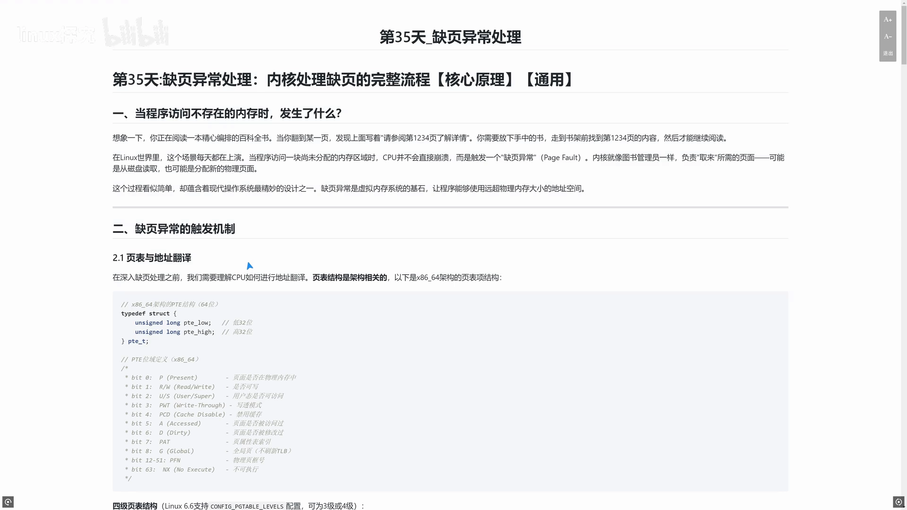
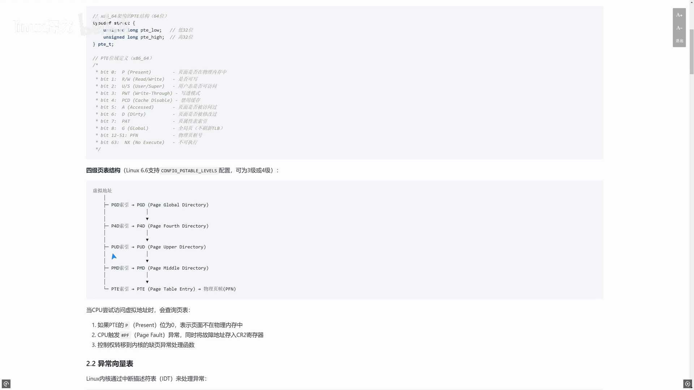
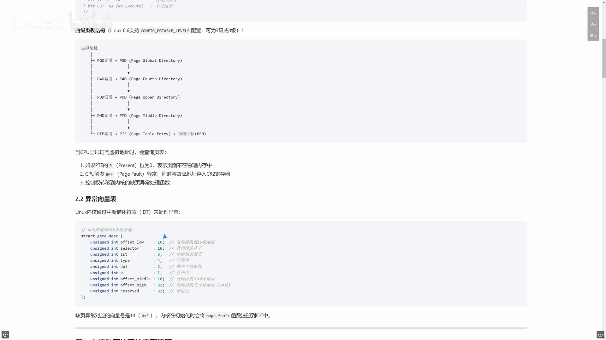
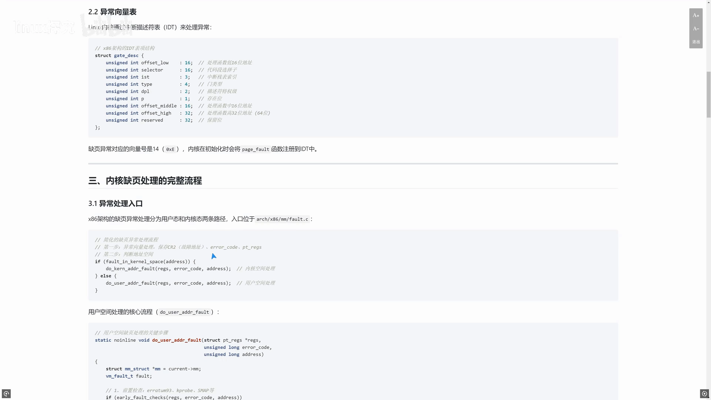
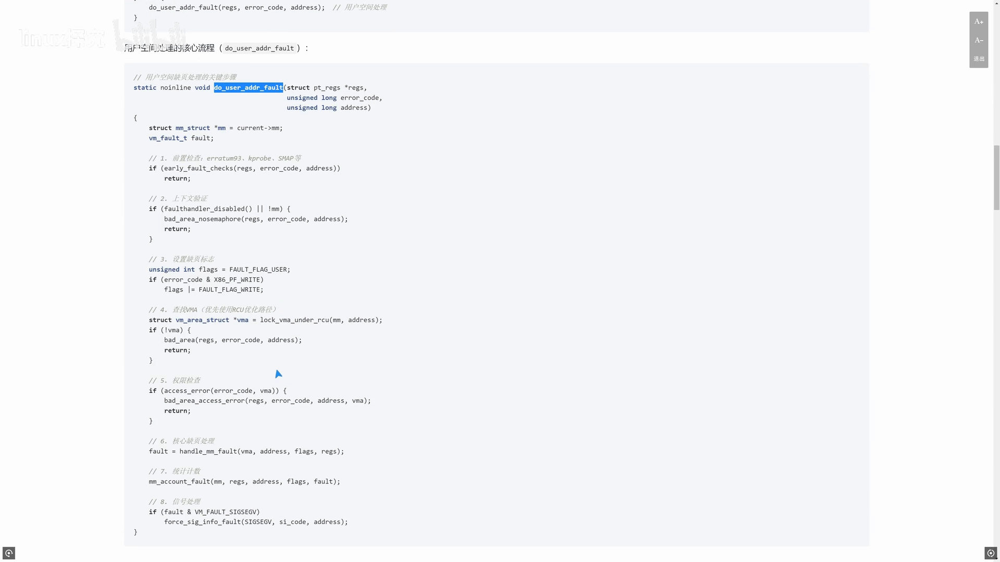
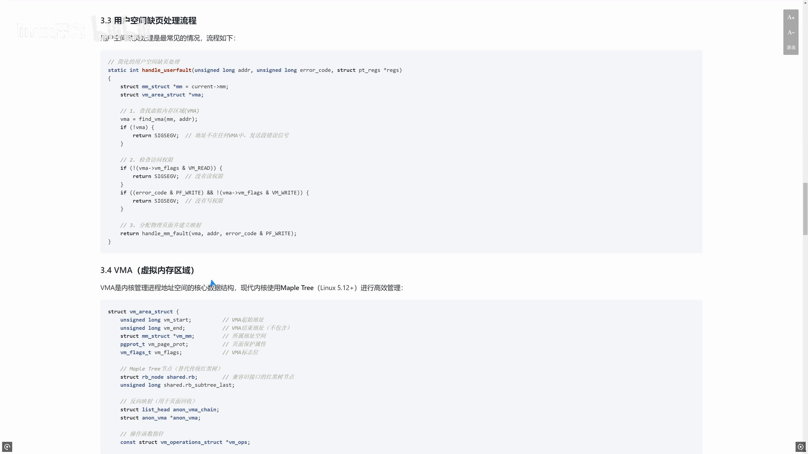
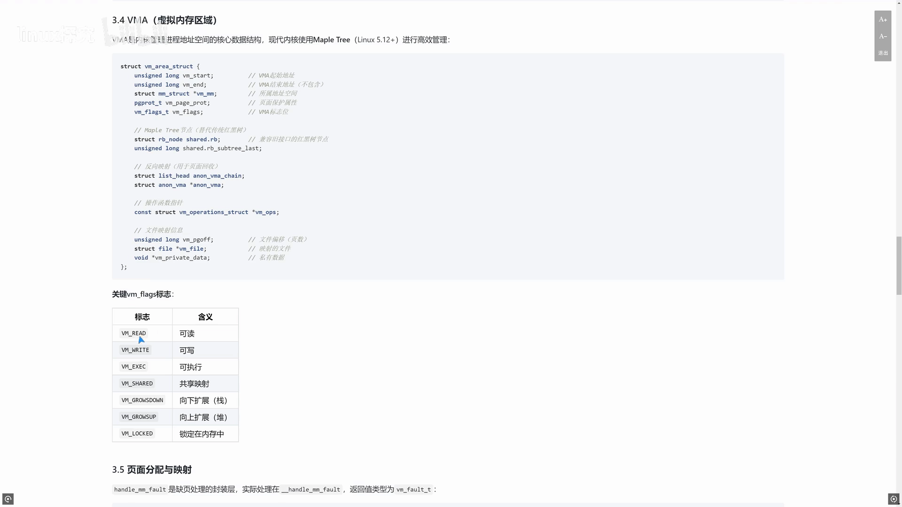
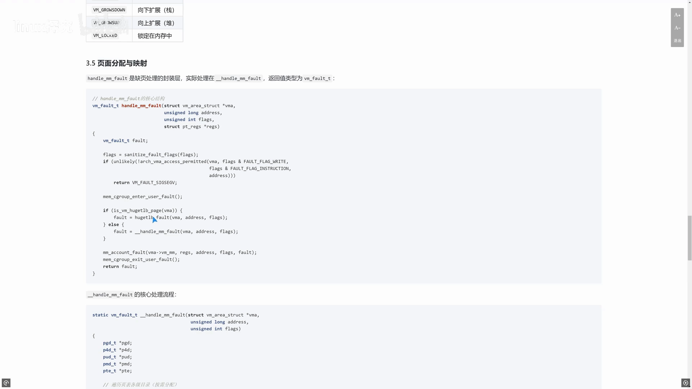
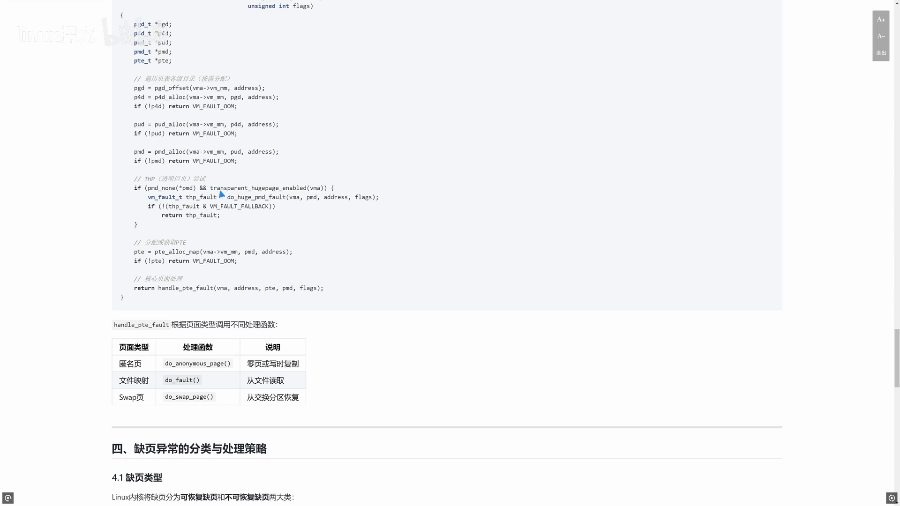
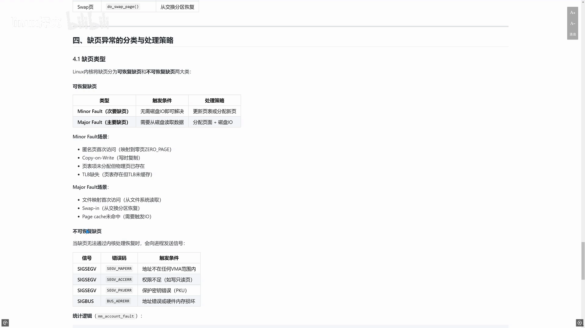

# PTE 权限位与错误码：一次缺页如何被内核分派到正确的处理函数

> 视频来源：[第35天:缺页异常处理：内核处理缺页的完整流程](https://www.bilibili.com/video/BV1KiEi6FEgH/)（Bilibili · linux探究）｜时长约 14 分钟
> 导读：这支视频用「幻灯片 + 对话」的方式把缺页异常从触发到分派走了一遍：PTE 里有哪些位、错误码怎么读、`handle_mm_fault` 怎么按页的类型把活派给不同的 `do_*` 函数。本文只取**权限位与分派**这一层；写时复制真正动手拷贝的那一步（`do_wp_page` 的复制时机与引用计数）放在姊妹篇《do_wp_page 何时才真正复制》里讲，同节的 2.3.1 讲 CoW 的通用原理，2.3.3 讲它在 fork 与 VM 快照上的两种用法。

## 本讲要解决的核心问题（SCQA）

**背景**：程序里的指针是一个虚拟地址，CPU 每次访存都要先查页表，把虚拟地址翻译成物理地址。页表项（PTE，page table entry）里除了物理页号，还存着「这一页在不在内存里」「能不能写」「能不能给用户态访问」这些权限位。

**冲突**：只要权限位和当前这次访问对不上，CPU 就没法完成这次翻译，只能把控制权交给内核——这就是缺页异常。可「对不上」有好几种对法：页根本不在内存里、页在但被标成只读、页被换到 swap 去了、地址压根没被映射过。内核必须**先分清是哪一种，才知道该调哪个函数去补**。

**疑问**：PTE 里到底哪些位在起作用？CPU 触发异常时给内核留了什么线索？内核凭什么把一次缺页分派到 `do_anonymous_page`、`do_fault`、`do_swap_page` 或者写保护的 `do_wp_page` 上？

**回答（中心思想）**：分派靠两条线索——**PTE 的权限位**说明「这一页现在是什么状态」，**错误码（error code）**说明「这次访问想干什么」。内核先按错误码判断是不是写操作（置 `FAULT_FLAG_WRITE`），再按地址找到 VMA 做一次权限复核，最后在 `handle_pte_fault` 里按「PTE 是否 present、是否 write、是否属于匿名页/文件页/swap 页」把这活派给对应的 `do_*` 函数。**清掉写位但保留 present，正是 CoW 造出「可读可执行、不可写」页的手法**，它让下一次写必然掉进 `do_wp_page`。



## 一、缺页异常不是「内存不够」，而是「这一次翻译没成功」

### 1.1 PTE 是 64 位，地址只占中间一段

视频先把页表项拆开看（[【跳转到 01:15】](https://www.bilibili.com/video/BV1KiEi6FEgH/?t=75)）：在 x86-64 上，一个页表项是一个 64 位的数，可以分成高 32 位和低 32 位两部分。低 32 位里塞的是各种标志位，高 32 位里主要是物理页号。

初学者容易误会「页表项 = 物理地址」。其实它更像一张**带批注的便条**：主体是「这一页在物理内存的哪个位置」，批注是「这一页现在能不能写、给不给用户态用、有没有被改脏」。

### 1.2 六个必须记住的位

视频逐条念了这张位定义表（[【跳转到 01:40】](https://www.bilibili.com/video/BV1KiEi6FEgH/?t=100)），下面按「它回答什么问题」重排一遍：

| 位 | 名字 | 回答的问题 | 对缺页的意义 |
| --- | --- | --- | --- |
| bit 0 | P（Present） | 这一页现在在物理内存里吗 | 为 0 就是「不在」，硬件直接报缺页 |
| bit 1 | R/W（Read/Write） | 这一页可写吗 | 为 0 而进程要写，就是写保护缺页 |
| bit 2 | U/S（User/Supervisor） | 用户态能访问吗 | 为 0 时用户态访问会被拒 |
| bit 5 | A（Accessed） | 这一页被访问过吗 | 供内核做页面回收的参考 |
| bit 6 | D（Dirty） | 这一页被改写过吗 | 回写磁盘、判断能否直接丢弃时要用 |
| bit 63 | NX（No Execute） | 这一页可执行吗 | 不可执行页上的取指会被拦下 |

表里还有 PWT、PCD、PAT、G 这些和缓存、TLB 有关的位，以及 bit 12–51 的 PFN（物理页帧号）。对本文要讲的 CoW 来说，真正起决定作用的是**前三个位**：P、R/W、U/S。

> 补充一句：Linux 还会借用 PTE 里硬件不用的几个位给内核自己记账（所谓软件位），脏页追踪那一套就靠它，本系列 2.4 会专门讲。

### 1.3 「清掉写位、保留 present」为什么能造出只读页

这是本文最该带走的一句话。

如果把 P 位清 0，这一页在硬件眼里就「不存在」，任何访问都会缺页——但这骗不过内核，因为内核知道页其实还在。

CoW 要的是另一种效果：**页明明在（P = 1），读没问题，可一旦要写就必须先来找内核**。做法就是把 R/W 位清 0：

- 读：P = 1 且不涉及写，硬件照常翻译，不产生异常，父子进程共享同一份物理页，一个字节都不复制；
- 写：P = 1 但 R/W = 0，硬件判定「权限不足」，产生缺页异常，并把错误码的「写」位置 1；
- 内核收到这个异常，看到「页在、但是写不进去」，就知道这不是缺页，而是**写保护**，于是走 CoW 分支。

所以「共享 + 只读标记 + 缺页」这三步里，第二步在硬件层面就是**改一个 bit**。改 bit 比复制 4 KiB 便宜五个数量级，这就是 CoW 省下来的东西。



## 二、从 #PF 到 page_fault：一次异常怎么进内核

### 2.1 硬件只做三件事

视频把 CPU 侧的动作用三句话说完（[【跳转到 02:30】](https://www.bilibili.com/video/BV1KiEi6FEgH/?t=150)）：

1. 查页表查到 PTE，发现 P 位是 0（或者权限不满足）；
2. 触发 `#PF` 异常，把引起异常的**线性地址**放进 CR2 寄存器；
3. 控制权转到内核的缺页异常处理函数。

注意第 2 步：**CR2 是硬件留给内核的唯一定位线索**。内核后面所有「这个地址属于哪个进程的哪一段」的判断，都从这个寄存器里的地址出发。

### 2.2 向量号 14 与 IDT

异常靠中断描述符表（IDT）分派。视频的解释是（[【跳转到 02:55】](https://www.bilibili.com/video/BV1KiEi6FEgH/?t=175)）：IDT 的每一个表项对应一个异常向量，表项里记录着处理函数的入口地址；缺页异常的向量号是 **14**，十六进制写作 `0xE`。内核初始化时把 `page_fault` 的地址写进 IDT 的第 14 项，此后 CPU 一产生缺页就自动跳到 `page_fault`。



### 2.3 第一刀：内核空间还是用户空间

`page_fault` 进来后先保存现场（CR2、错误码、通用寄存器），然后做的第一件事是**判断地址属于哪个地址空间**（[【跳转到 04:10】](https://www.bilibili.com/video/BV1KiEi6FEgH/?t=250)）：

```c
if (fault_in_kernel_space(address)) {
    do_kern_addr_fault(regs, error_code, address);   // 内核空间处理
} else {
    do_user_addr_fault(regs, error_code, address);   // 用户空间处理
}
```

这一刀很关键：内核空间的缺页往往意味着内核自己的 bug（比如访问了没映射的 `vmalloc` 区域），处理方式和用户态完全不同；而**用户态缺页是常态**，是虚拟内存赖以为生的机制。



## 三、错误码：分派的第一手证据

### 3.1 四位各管一件事

错误码（`error_code`）是硬件压在栈上的一个 32 位数，视频只讲了低四位，但这四位已经够用了（[【跳转到 05:50】](https://www.bilibili.com/video/BV1KiEi6FEgH/?t=350)）：

| 位 | 标志 | 为 1 表示 | 为 0 表示 |
| --- | --- | --- | --- |
| 0 | PF_PRESENT | 页表项存在，但权限不允许这次访问 | 页根本不在物理内存里 |
| 1 | PF_WRITE | 这次是写操作触发的 | 这次是读（或取指）触发的 |
| 2 | PF_USER | 发生在用户态 | 发生在内核态 |
| 3 | PF_RSVD | PTE 的保留位被置位，很可能页表已损坏 | 正常 |

第 0 位是本文的枢纽。它把「缺页」劈成两类完全不同的事：

- **第 0 位 = 0**：页不在内存里。要么是第一次访问（还没分配），要么是被换出到 swap 了。内核要去**造一页**或**取一页**。
- **第 0 位 = 1**：页在内存里，只是这次访问越权。CoW 的写保护就落在这一格——页在、但不可写。

第 1 位则告诉内核「这次访问想干什么」。它后面会变成内核里的一个标志位 `FAULT_FLAG_WRITE`，一路往下传，直到 `do_wp_page` 用它来判断「这次到底是不是写」。


### 3.2 为什么内核不能只信错误码

错误码是硬件的一面之词，内核还要拿它和 VMA 对一遍账。因为**页表的权限位可以被内核临时改小**（CoW 就是这么干的），所以「PTE 说不可写」不等于「这段内存本来就不许写」。

判据在 VMA 里：`vm_flags` 上的 `VM_WRITE` 才是「这段内存本来就允许写」的权威记录。PTE 上的只读只是**当下的临时状态**。两者不一致时，内核要区分两种可能：

- VMA 也不许写 → 这是真的越权，发 `SIGSEGV`；
- VMA 允许写、只是 PTE 被临时标成只读 → 这是 CoW 的标记，去复制。

这就是下一节要走的流程。

## 四、用户态缺页的三步走

### 4.1 前置检查与上下文验证

`do_user_addr_fault` 一进来并不急着干活，视频列了它的检查清单（[【跳转到 04:35】](https://www.bilibili.com/video/BV1KiEi6FEgH/?t=275)）：

1. **前置检查**：`erratum 93`、`kprobe`、SMAP 等。这些是「这台机器/这个上下文有特殊情况，缺页处理要绕道」的开关，任一项命中就直接返回。
2. **上下文验证**：缺页处理是否被禁用（`faulthandler_disabled()`）、当前进程有没有有效的 `mm`。内核线程没有用户地址空间，不该在这里缺页。
3. **设置缺页标志**：把错误码翻译成内核自己的 `flags`，其中最重要的就是 `FAULT_FLAG_WRITE`。

```c
unsigned int flags = FAULT_FLAG_USER;
if (error_code & X86_PF_WRITE)
    flags |= FAULT_FLAG_WRITE;
```

`FAULT_FLAG_WRITE` 就是「这次是写」的通行证。它从 `do_user_addr_fault` 一路传到 `handle_mm_fault`、`handle_pte_fault`，最后在 `do_wp_page` 里决定「要不要真复制」。**CoW 的整个判断链，起点就是错误码的第 1 位。**

### 4.2 找 VMA：地址必须落在一段已知的映射里

接下来用 `find_vma` 按地址找 VMA（虚拟内存区域，virtual memory area）。VMA 是内核对「进程地址空间里的一段连续区间」的描述，记录了这段区间的起止地址、权限、背后映射的是文件还是匿名内存等。

找不到 VMA 意味着这个地址**从来没被映射过**（典型的野指针），内核无法修复，直接给进程发段错误信号。



### 4.3 权限复核：两次检查，缺一不可

找到 VMA 之后还要再查一遍权限（[【跳转到 07:05】](https://www.bilibili.com/video/BV1KiEi6FEgH/?t=425)）：

- VMA 连读权限都没有（没有 `VM_READ`）→ 段错误；
- 这次是写（`error_code & PF_WRITE`）但 VMA 没有 `VM_WRITE` → 段错误。

只有两次检查都过了，才允许进入真正的处理函数 `handle_mm_fault`。这段逻辑在视频的简化版里长这样：

```c
vma = find_vma(mm, addr);
if (!vma)                                   return SIGSEGV;  // 地址不在任何 VMA 内
if (!(vma->vm_flags & VM_READ))             return SIGSEGV;  // 没有读权限
if ((error_code & PF_WRITE) && !(vma->vm_flags & VM_WRITE))
                                            return SIGSEGV;  // 没有写权限
return handle_mm_fault(vma, addr, error_code & PF_WRITE);
```

**这一步是 CoW 能成立的关键**：VMA 说「可写」，PTE 说「不可写」，内核据此判定「PTE 的只读是内核自己贴的标签」，于是放心地去复制。



### 4.4 VMA 里到底记了什么

视频顺手展开了 `vm_area_struct`（[【跳转到 07:55】](https://www.bilibili.com/video/BV1KiEi6FEgH/?t=475)）：起止地址 `vm_start`/`vm_end`、所属地址空间 `vm_mm`、页保护属性 `vm_page_prot`、标志位 `vm_flags`、文件映射信息（`vm_pgoff`、`vm_file`）等等。

其中 `vm_flags` 是权限复核的依据，常见的几个：

| 标志 | 含义 |
| --- | --- |
| VM_READ | 可读 |
| VM_WRITE | 可写 |
| VM_EXEC | 可执行 |
| VM_SHARED | 共享映射（写要落到文件，不能私有一份） |
| VM_GROWSDOWN / VM_GROWSUP | 向下扩展（栈）/ 向上扩展（堆） |
| VM_LOCKED | 锁定在内存中，不许换出 |

视频还提到一个工程细节：从 Linux 5.12 开始，内核用 **Maple Tree** 来组织 VMA，取代了原来的红黑树，在查找和更新上都有比较明显的性能提升。缺页处理是极热路径，VMA 查找快一点，整条链就快一点。



## 五、handle_mm_fault：从「合法访问」到「真的给一页」

### 5.1 入口函数只做三件事

`handle_mm_fault` 是缺页处理的封装层（[【跳转到 08:20】](https://www.bilibili.com/video/BV1KiEi6FEgH/?t=500)）：

1. **清理参数**：`sanitize_fault_flags()` 把不合法的标志位去掉；
2. **再查一次合法性**：`arch_vma_access_permitted()` 按架构要求复核这次访问，不合法就返回 `VM_FAULT_SIGSEGV`；
3. **分流大页与普通页**：VMA 是 hugetlb 大页就走 `hugetlb_fault()`，否则走 `__handle_mm_fault()`。

进出之间还夹着 `mem_cgroup_enter_user_fault()` / `mem_cgroup_exit_user_fault()`，以及处理完的 `mm_account_fault()` 统计。



### 5.2 逐级下查：先补页表，再补页

`__handle_mm_fault` 从顶级页目录开始一级一级往下查（[【跳转到 09:10】](https://www.bilibili.com/video/BV1KiEi6FEgH/?t=550)）：

```c
pgd = pgd_offset(mm, address);
p4d = p4d_alloc(mm, pgd, address);
pud = pud_alloc(mm, p4d, address);
pmd = pmd_alloc(mm, pud, address);
```

哪一级的页表页还没分配，就在这一级分配一个；分配失败就返回 `VM_FAULT_OOM`。

**这里有个容易被忽略的层次**：缺页不一定是「缺数据页」，也可能只是「缺页表本身」。第一次访问一大片新地址时，往往先要造中间层的页表页，最后才轮到数据页。视频把这一层讲得很清楚。

### 5.3 大页的机会：PMD 为空时先试一把

查到 PMD 这一级时，如果 PMD 是空的、并且透明大页（THP）开着，内核会先尝试直接分配一个 2 MiB 的大页（[【跳转到 09:35】](https://www.bilibili.com/video/BV1KiEi6FEgH/?t=575)）：

```c
if (pmd_none(*pmd) && transparent_hugepage_enabled(vma)) {
    vm_fault_t thp_fault = do_huge_pmd_fault(vma, pmd, address, flags);
    if (!(thp_fault & VM_FAULT_FALLBACK))
        return thp_fault;
}
```

成功就直接返回，失败（或者本来就不该用大页）就退回去走普通页路径，用 `pte_alloc_map()` 拿到 PTE。这个「先试大页、失败回退」的模式，和 CoW 里「先试复用、失败复制」是同一个设计口味。

### 5.4 handle_pte_fault：真正的四岔路口

拿到 PTE 之后，`handle_pte_fault` 按「这一页是什么」分派（[【跳转到 10:00】](https://www.bilibili.com/video/BV1KiEi6FEgH/?t=600)）：

| 页面类型 | 处理函数 | 做什么 |
| --- | --- | --- |
| 匿名页 | do_anonymous_page() | 零页或写时复制 |
| 文件映射 | do_fault() | 从文件读取 |
| Swap 页 | do_swap_page() | 从交换分区恢复 |

这张表是本文的落点。它说明**缺页处理不是一个大函数，而是一个分派器**：先判断「页在不在」，再判断「页是谁的」，最后才决定「怎么补」。

而 CoW 的写保护缺页，恰好落在「页在、但不可写」这一格上——它不属于上表任何一行，因为上表处理的是「页不存在」的情况。写保护要走另一条分支：`do_wp_page`。它的判断条件是「PTE 存在 + 这次是写 + PTE 不可写」，具体怎么复制、什么时候可以偷懒不复制，见姊妹篇。



## 六、缺页的分类：能修的与修不了的

### 6.1 两大类

视频把缺页分成两大类（[【跳转到 10:50】](https://www.bilibili.com/video/BV1KiEi6FEgH/?t=650)）：

- **可恢复缺页**：内核自己能搞定。页没分配就分配，页在磁盘上就读进来。
- **不可恢复缺页**：内核修不了。地址根本没映射、权限确实不够。这时只能给进程发信号。

不可恢复的那一类，视频给了对照表：地址不在任何 VMA 内 → `SIGSEGV` + `SEGV_MAPERR`；权限不足（比如写只读页）→ `SIGSEGV` + `SEGV_ACCERR`；保护密钥错误（PKU）→ `SIGSEGV` + `SEGV_PKUERR`；地址错误或硬件内存损坏 → `SIGBUS` + `BUS_ADRERR`。

**注意 `SEGV_ACCERR` 这一格**：真的写只读页会得到它，但 CoW 的写保护缺页**不会**走到这里——因为 VMA 允许写，内核在前面就把它拦下来去做复制了。同一个「PTE 不可写」，两种结局，差别只在 VMA 怎么说。

### 6.2 minor 与 major：差在要不要碰磁盘

可恢复缺页内部再分两级（[【跳转到 11:15】](https://www.bilibili.com/video/BV1KiEi6FEgH/?t=675)）：

| 类型 | 触发条件 | 处理策略 |
| --- | --- | --- |
| Minor Fault（次要缺页） | 无需磁盘 IO 即可解决 | 更新页表或分配新页 |
| Major Fault（主要缺页） | 需要从磁盘读取数据 | 分配页面 + 磁盘 IO |

Minor fault 的典型场景：匿名页第一次访问（映射到零页）、**Copy-on-Write**、页表项没分配但物理页已存在、TLB 缺失。Major fault 的典型场景：文件映射第一次访问、swap in、page cache 未命中。

**CoW 属于 minor fault**，这一点在性能上很重要：它只做内存内的复制，不碰磁盘，所以开销是微秒级；而 major fault 要等 IO，是毫秒级，差三个数量级。



### 6.3 怎么亲眼看到它

视频给了两条观察路径（[【跳转到 12:05】](https://www.bilibili.com/video/BV1KiEi6FEgH/?t=725)）：

```bash
perf stat -e page-faults,major-faults,minor-faults ./your_program
```

想看到每次缺页的地址，就用 bpftrace 挂到 `do_user_addr_fault` 上打印。

视频还给了个可动手的实验（[【跳转到 13:20】](https://www.bilibili.com/video/BV1KiEi6FEgH/?t=800)）：用 `malloc` 分配一大块内存再逐个访问，就会触发大量缺页；改变访问步长或内存块大小，缺页次数会跟着变——**这正好证明了「分配」不等于「拿到物理页」，物理页是在第一次访问时才给的**。

## 七、内存真的不够时：回收与 OOM

缺页要分配页，可物理内存是有限的。视频在互动环节回答了这个问题（[【跳转到 12:55】](https://www.bilibili.com/video/BV1KiEi6FEgH/?t=775)）：

1. 先尝试**回收**：把不常用的页面写到磁盘上，腾出物理内存；
2. 回收之后还是不够，就启用 **OOM killer**，按一定规则挑一个进程杀掉，释放它占用的内存。

这条兜底路径解释了为什么「缺页处理」和「页面回收」在内核里是缠在一起的：缺页是最主要的分配入口，分配失败时必须有人来腾地方。

## 小结

- **PTE 是一张带批注的便条**：主体是物理页号，批注是 P、R/W、U/S、A、D、NX 这些权限位。缺页异常的本质是「这次翻译被权限位挡住了」。
- **清写位、留 present，就造出了「可读可执行但不可写」的页**。这是 CoW 的全部硬件手法：改一个 bit，让下一次写必然掉进内核。
- **错误码是分派的第一手证据**：第 0 位区分「页不在」与「页在但越权」，第 1 位区分写与读（变成 `FAULT_FLAG_WRITE`），第 2 位区分用户态与内核态，第 3 位提示页表损坏。
- **分派是三级漏斗**：`page_fault` 先分内核/用户空间 → `do_user_addr_fault` 查 VMA 并复核权限 → `handle_mm_fault` 逐级补页表 → `handle_pte_fault` 按匿名页/文件页/swap 页派给 `do_anonymous_page`、`do_fault`、`do_swap_page`。
- **写保护缺页走另一条分支**：PTE 存在但不可写、VMA 却允许写，这时才轮到 `do_wp_page`；它复制不复制，取决于这一页还有没有别人共享。
- **CoW 属于 minor fault**：纯内存操作，微秒级；major fault 要等磁盘，毫秒级。用 `perf stat -e page-faults,major-faults,minor-faults` 就能看到两者的数量差。

## 关键术语速查

| 术语 | 一句话解释 |
| --- | --- |
| PTE（页表项） | 页表里的一格，记录一个虚拟页对应的物理页号与权限位 |
| P 位（Present） | 这一页当前在不在物理内存里；为 0 时硬件直接报缺页 |
| R/W 位 | 这一页可不可写；CoW 就是把它清 0 造成只读假象 |
| U/S 位 | 这一页允不允许用户态访问 |
| A 位 / D 位 | 这一页被访问过 / 被改写过，供回收与回写参考 |
| #PF 与 CR2 | 缺页异常（向量号 14）与硬件留下的故障地址寄存器 |
| error_code | 硬件压栈的错误码，低四位分别表示页存在、写操作、用户态、保留位 |
| FAULT_FLAG_WRITE | 内核把错误码的「写」位翻译成的标志，一路传到 do_wp_page |
| VMA | 虚拟内存区域，记录一段地址区间的起止、权限与背后映射的对象 |
| handle_pte_fault | 拿到 PTE 后的分派器，按匿名页 / 文件页 / swap 页选处理函数 |
| Minor / Major Fault | 不需要磁盘 IO / 需要磁盘 IO 的缺页 |
| THP | 透明大页，PMD 为空时内核会先尝试一次分配 2 MiB |