# do_wp_page 何时才真正复制：写保护缺页与独占页免复制

> 视频来源：[33 缺页异常机制](https://www.bilibili.com/video/BV1SP411V7Gc/)（Bilibili · 宅学部落，Linux 内存子系统系列第 33 讲）｜时长约 18 分钟
> 导读：这一讲是源码走读，用的是 ARMv7 平台上的 Linux 5.10 内核（`arch/arm/mm/fault.c` 与 `mm/memory.c`）。它从 `data abort` 一路跟到 `wp_page_copy`，把「新页怎么来、PTE 怎么改、写保护怎么解除」逐行看完。本文按「复制还是复用」这条主线重组了它的内容；PTE 权限位与错误码怎么把请求分派过来，见姊妹篇《PTE 权限位与错误码》。

## 本讲要解决的核心问题（SCQA）

**背景**：`fork` 创建子进程时，内核只复制页表，不给子进程分配新的物理页，同时把父进程和子进程的页表项都设成只读。父子进程于是共享同一份物理页——读没问题，谁写谁触发缺页。

**冲突**：写保护缺页进来之后，内核面前有两条路。一条是老老实实复制：申请新页、拷贝内容、改页表。另一条是**根本不复制**：如果这一页此刻已经没有任何别人在共享，那「不可写」这个标记就是多余的，直接把它改回可写就行。选错任何一条都要付代价：该复制的没复制，会写坏别人的数据；不该复制的复制了，白白浪费一次 4 KiB 拷贝。

**疑问**：内核凭什么判断「还有没有别人共享这一页」？判断完之后，复制这条路具体做了哪几步？改权限又是改在哪里？

**回答（中心思想）**：判据是 `struct page` 上的**两个计数器**——`page_count`（有多少人持有这一页）和 `page_mapcount`（有多少个页表项指向这一页）。`do_wp_page` 先看 `page_count` 是否等于 1：等于 1 说明这一页已经独占，**直接把 PTE 改回可写、不复制**；大于 1 才走 `wp_page_copy`——从伙伴系统要一页新的、把旧内容拷过去、把 PTE 指向新页并置上写位、刷新 TLB，最后把旧页的引用计数减一。**「复制」不是写时复制的必答题，而是「还有别人共享」时才付的账。**

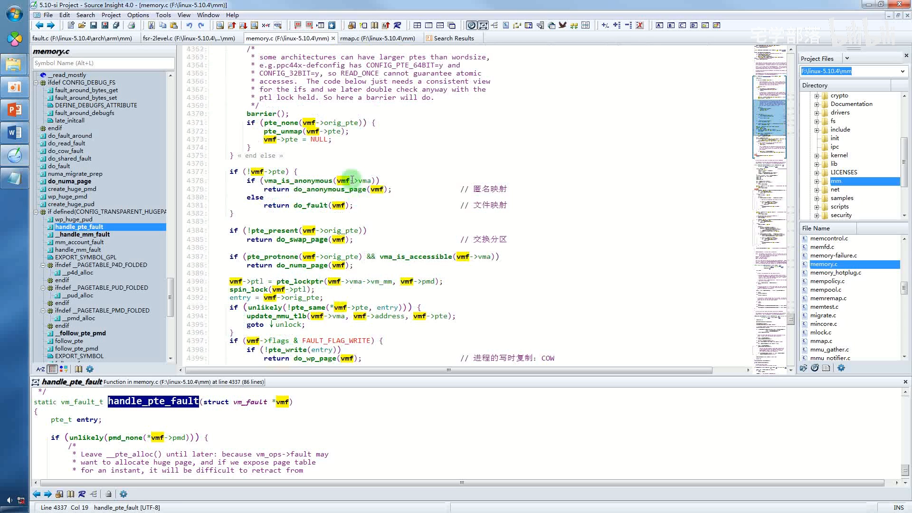

## 一、先看清楚：写保护是谁贴上去的

### 1.1 fork 只复制页表，不复制物理页

视频开篇回顾了上一讲（[【跳转到 00:00】](https://www.bilibili.com/video/BV1SP411V7Gc/?t=0)）：用户进程的页表是在创建进程时，复制内核的页表、再复制父进程的页表构建出来的。这个复制过程有两个要点：

1. **只复制了页表**，还没有给新进程创建新的物理页；
2. 复制页表的同时**设置了写保护**，把页表对应的物理页设成只读权限。

于是父子进程的 PTE 指向同一个物理页，两个 PTE 的写位都是 0。此时谁去写这个页，谁就触发写异常（[【跳转到 00:25】](https://www.bilibili.com/video/BV1SP411V7Gc/?t=25)）。

### 1.2 触发缺页的三种情形

视频把「什么时候会缺页」归成三类（[【跳转到 01:15】](https://www.bilibili.com/video/BV1SP411V7Gc/?t=75)）：

| 情形 | 例子 | 内核要做什么 |
| --- | --- | --- |
| 读写权限不够 | 映射时页是只读的，却去写它 | 复制一页（CoW）或报错 |
| 虚拟地址没有对应的物理页帧 | 第一次访问刚 `malloc` 的内存 | 分配一页 |
| 文件页不在 page cache 里 | 读写的文件页还没缓存，或已换到磁盘 | 从磁盘读进来 |

CoW 属于第一类。注意它和「第一次访问」的区别：**页是存在的，只是不许写**。这个区别在错误码里就是第 0 位——为 1 表示「页表项存在但权限不允许」，为 0 表示「页根本不在」。内核正是靠这一位把 CoW 和「缺页要分配」分开的。

## 二、从 data abort 到 do_page_fault

### 2.1 ARMv7 的入口

视频这一讲用的是 ARM 平台，所以入口和 x86 不一样（[【跳转到 03:55】](https://www.bilibili.com/video/BV1SP411V7Gc/?t=235)）：CPU 先到中断向量表，命中 **data abort** 中断，在 data abort 的处理代码里一跳一跳，最终跳到 `do_page_fault`。

缺页异常的回调是在内核启动时注册的（[【跳转到 02:41】](https://www.bilibili.com/video/BV1SP411V7Gc/?t=161)）：`arch/arm/mm/fault.c` 里用 `arch_initcall` 之类的机制，把处理函数登记进一张数组，数组里存着各种中断回调函数以及它们对应的信号值。发生中断时按类型取出对应的回调调用即可。

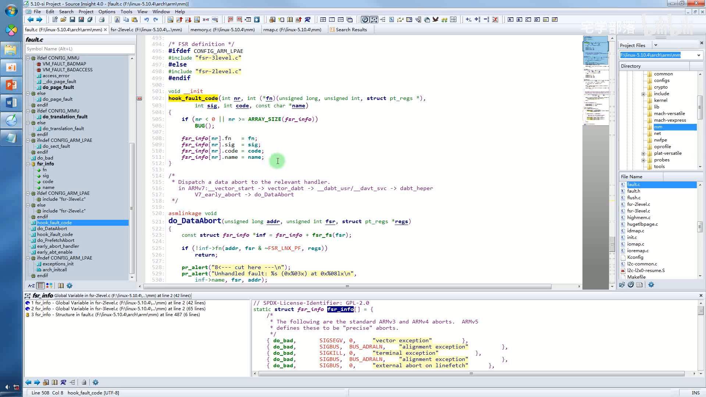

### 2.2 第一刀：地址在用户空间还是内核空间

`do_page_fault` 进来后先取当前进程的 `mm`（管理虚拟地址空间的结构），然后按出错地址切一刀（[【跳转到 04:45】](https://www.bilibili.com/video/BV1SP411V7Gc/?t=285)）：

- 地址小于 `TASK_SIZE` → 属于**用户空间**，走用户态缺页处理；
- 否则属于内核空间，走另一条分支。

视频顺带解释了 `TASK_SIZE` 的来历：它是内核空间的起始地址减去 16 MiB，这 16 MiB 是 module 区域，内核空间边界减掉 module 区域剩下的就是用户空间。

代码里还能看到 `FAULT_FLAG_WRITE` 的来源（[【跳转到 03:45】](https://www.bilibili.com/video/BV1SP411V7Gc/?t=225)）：

```c
unsigned int flags = FAULT_FLAG_DEFAULT;
if (user_mode(regs))
    flags |= FAULT_FLAG_USER;
if ((fsr & FSR_WRITE) && !(fsr & FSR_CM))
    flags |= FAULT_FLAG_WRITE;
```

ARM 上「这次是不是写」来自 FSR（Fault Status Register）里的写标志位。**平台不同、寄存器不同，但结论一样：必须把「这次是写」这件事变成一个标志带下去。**

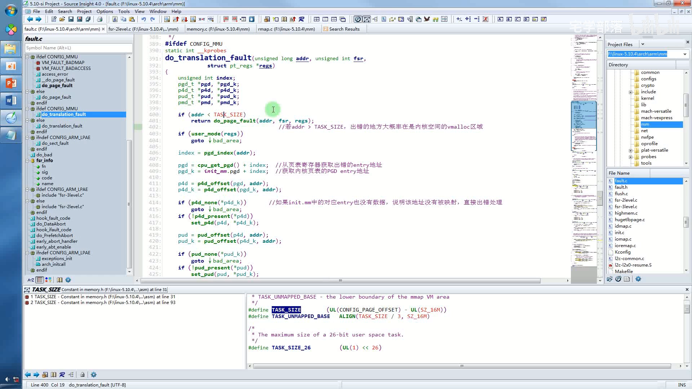

## 三、找到 VMA，把缺页信息装进 vm_fault

### 3.1 三样东西：mm、address、vma

视频把 `do_page_fault` 的准备动作拆成三步（[【跳转到 07:15】](https://www.bilibili.com/video/BV1SP411V7Gc/?t=435)）：

1. 拿到当前的 `mm`——它管理这个进程的整个虚拟地址空间；
2. 拿到出错地址 `address`；
3. 用地址在 `mm` 里找到对应的 VMA，也就是「发生异常的这个区域」。

前两步是「我是谁、错在哪」，第三步是「这段地址本来该有什么权限」。有了 VMA，内核才能判断 PTE 上的只读是「真的不许写」还是「CoW 贴的标签」。

### 3.2 vm_fault：把散落的参数打包

接着内核把这些信息装进一个结构体 `vm_fault`（[【跳转到 08:20】](https://www.bilibili.com/video/BV1SP411V7Gc/?t=500)），再把它一路往下传：

```c
struct vm_fault vmf = {
    .vma     = vma,                        // 发生缺页的 VMA
    .address = address & PAGE_MASK,        // 对齐到页的出错地址
    .flags   = flags,                      // 含 FAULT_FLAG_WRITE
    .pgoff   = linear_page_index(vma, address),
    .gfp_mask = __get_fault_gfp_mask(vma),
};
```

为什么要打包？因为从 `__handle_mm_fault` 到 `handle_pte_fault` 再到 `do_wp_page`、`wp_page_copy`，每一层都要用到「哪个 VMA、哪个地址、是不是写」这三件事。**参数打包成结构体，是内核热路径上常见的写法**，避免一路加参数。

### 3.3 建页表：ARM 上 pmd、pud 都指向同一张表

`__handle_mm_fault` 接着逐级建页表（[【跳转到 08:45】](https://www.bilibili.com/video/BV1SP411V7Gc/?t=525)）：`pgd_offset` → `p4d_alloc` → `pud_alloc` → `pmd_alloc`，哪一级缺就补哪一级。

视频在这里点了一个平台差异：ARM 用的是二级映射，所以对 Linux 的多级抽象来说，`pmd`、`pud` 都指向同一张页表，和 `pgd` 里的页表项一样，最终都指向二级页表 PTE。**Linux 用同一套多级页表代码适配不同位宽的架构，靠的就是这种「上层目录折叠」**。

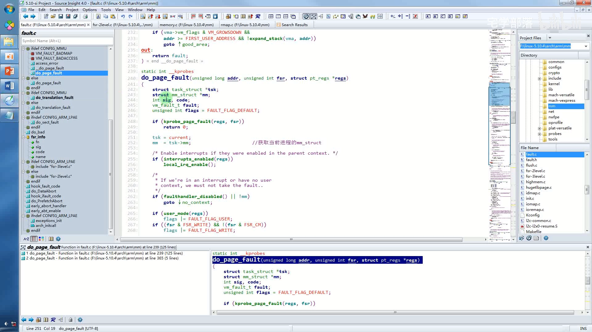

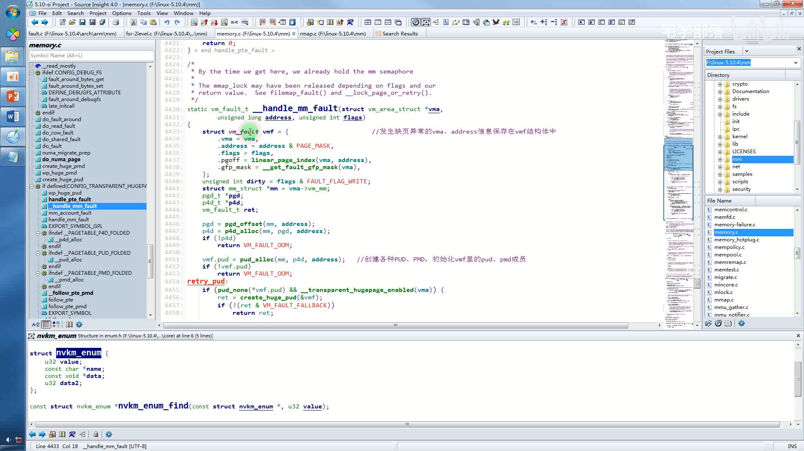

## 四、handle_pte_fault：四条岔路，CoW 走第四条

拿到 PTE 之后进入 `handle_pte_fault`。视频强调这是一个**多路径函数**：它按映射类型做不同判断，处理完直接 `return`，后面的分支不再执行（[【跳转到 10:00】](https://www.bilibili.com/video/BV1SP411V7Gc/?t=600)）。

四条岔路按判断顺序排：

| 判断 | 走哪个函数 | 场景 |
| --- | --- | --- |
| PTE 为空 + 匿名映射 | do_anonymous_page() | 第一次访问匿名页（映射到零页） |
| PTE 为空 + 文件映射 | do_fault() | 第一次访问文件页 |
| PTE 存在但 P 位为 0 | do_swap_page() | 页被换出到 swap |
| PTE 存在、这次是写、但 PTE 不可写 | do_wp_page() | 写时复制（CoW） |

第四条对应的正是本文的场景：子进程刚 `fork` 出来，页表项在、但写位被清掉了。代码长这样：

```c
if (vmf->flags & FAULT_FLAG_WRITE) {
    if (!pte_write(entry))
        return do_wp_page(vmf);      // 进程的写时复制：COW
    entry = pte_mkdirty(entry);
}
```

**两行判断，把 CoW 从「缺页」里挑了出来**：先看这次是不是写（`FAULT_FLAG_WRITE`），再看 PTE 是不是真的不可写（`!pte_write(entry)`）。两个条件同时成立，才交给 `do_wp_page`。

如果 PTE 已经是可写的，说明只是一次「脏位没置上」之类的保护性缺页，内核把脏位置 1 就完事，连函数调用都省了。

## 五、do_wp_page：先问「还需不需要复制」

### 5.1 函数开头先排掉两种特殊情况

`do_wp_page` 一进来并不直接复制（[【跳转到 10:25】](https://www.bilibili.com/video/BV1SP411V7Gc/?t=625)）：

```c
static vm_fault_t do_wp_page(struct vm_fault *vmf)
{
    struct vm_area_struct *vma = vmf->vma;

    if (userfaultfd_pte_wp(vma, *vmf->pte)) {        // 用户态在接管这一页的缺页
        pte_unmap_unlock(vmf->pte, vmf->ptl);
        return handle_userfault(vmf, VM_UFFD_WP);
    }

    vmf->page = vm_normal_page(vma, vmf->address, vmf->orig_pte);  // 取共享页
    if (!vmf->page) {                                // 物理页还没分配
        if ((vma->vm_flags & (VM_WRITE|VM_SHARED)) == (VM_WRITE|VM_SHARED))
            return wp_pfn_shared(vmf);               // 共享可写映射：直接改权限
        pte_unmap_unlock(vmf->pte, vmf->ptl);
        return wp_page_copy(vmf);                    // 否则复制
    }
    ...
}
```

这里有两个「不复制」的例外：

- **userfaultfd**：用户态程序自己接管了这一页的缺页处理，内核把请求转给它，自己不复制；
- **共享可写映射**：`VM_WRITE|VM_SHARED` 同时成立时，写本来就应该落到同一份物理页上，只需要把页表项改成可写（`wp_pfn_shared`），不需要私有一份。

**「共享映射不复制」这条很重要**：CoW 的前提是「私有可写」（`MAP_PRIVATE`）。共享映射的语义是「大家看同一份」，复制反而错了。

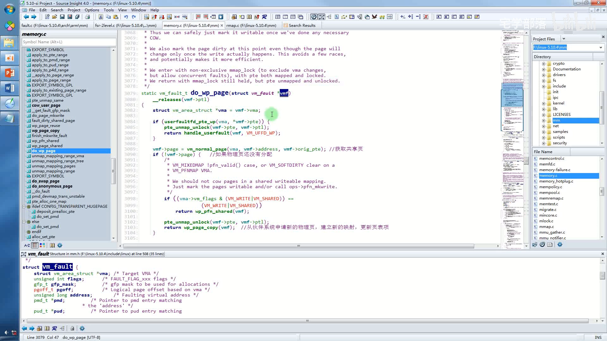

### 5.2 匿名页：两个计数器决定复制还是复用

接下来是本文的核心判断。视频把这段代码逐行念了一遍（[【跳转到 15:26】](https://www.bilibili.com/video/BV1SP411V7Gc/?t=926)），对应到源码是这样：

```c
if (PageAnon(vmf->page)) {
    struct page *page = vmf->page;

    /* PageKsm() doesn't necessarily raise the page refcount */
    if (PageKsm(page) || page_count(page) != 1)
        goto copy;                    // KSM 页、或还有别人持有 → 复制

    if (!trylock_page(page))
        goto copy;                    // 抢不到页锁 → 复制

    if (PageKsm(page) || page_mapcount(page) != 1 || page_count(page) != 1) {
        unlock_page(page);
        goto copy;                    // 复查：映射数或引用数不为 1 → 复制
    }
    ...
    /* 走到这里说明这一页真的独占：直接把 PTE 改成可写，不复制 */
}
```

读懂这段，要先把两个计数器分清楚：

| 计数器 | 数的是什么 | 变大变小发生在 |
| --- | --- | --- |
| page_count（引用计数） | 有**多少个引用**持有这一页 | 分配、`get_page`、映射、页缓存、IO 在途 |
| page_mapcount（映射计数） | 有**多少个页表项**指向这一页 | 建立/拆除用户态映射时加减 |

两者的关系是：**映射一定会增加引用，但引用增加不一定意味着多了一个映射**。比如一页正被回写、被内核临时持有、被 KSM 合并过，引用计数都会比映射计数大。

所以判断「还有没有别人共享」要**两个都看**：

- `page_count != 1`：还有别的引用，可能是别的进程的 PTE，也可能是内核自己在用；
- `page_mapcount != 1`：明确还有别的页表项指着它。

任何一个不为 1，就不能就地改权限——否则别人会看到你写进去的数据。这就是 `goto copy` 的含义。

**KSM 是特例**：`PageKsm(page)` 单独判一次，注释写得很直白——`PageKsm() doesn't necessarily raise the page refcount`。KSM（Kernel Samepage Merging）会把内容相同的页合并成一份，合并之后引用计数**不一定会涨**。如果只看 `page_count == 1` 就判定「独占」，就会把一份被多个进程共享的合并页当成私有的改掉，直接写坏别人的数据。**这是「计数不可靠时必须另设判据」的典型例子。**

### 5.3 计数错一格会怎样

代码里为什么要 `trylock` 之后再**复查一遍** `page_mapcount` 和 `page_count`？因为这两个数是会变的：在你拿锁之前，别的 CPU 可能刚好拆掉了一个映射。

把两个方向的错误各推一遍，就知道为什么内核这么小心：

- **计数偏小（以为独占，其实还有别人）**：走复用路径，就地置写位，写入的数据会出现在另一个进程的地址空间里——这是**数据损坏**，而且极难复现。
- **计数偏大（以为共享，其实独占）**：多复制一次 4 KiB，代价是性能和内存，但**结果是对的**。

所以内核的取舍很清楚：**宁可多复制，不可错复用**。这也是为什么 `PageKsm` 要单独判、`trylock` 之后要复查——所有不确定的情况一律 `goto copy`。

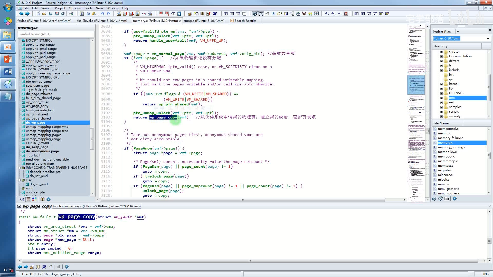

## 六、wp_page_copy：复制这条路要走五步

确认要复制之后，进入 `wp_page_copy`。视频按代码顺序念了它的动作（[【跳转到 11:15】](https://www.bilibili.com/video/BV1SP411V7Gc/?t=675)），整理成五步：

### 6.1 第一步：从伙伴系统要一页新的

```c
new_page = alloc_page_vma(GFP_HIGHUSER_MOVABLE, vma, vmf->address);
```

`alloc_page` 从伙伴系统分配一个物理页，拿到的是这一页对应的 `struct page` 指针。分配失败就 `goto oom`。

### 6.2 第二步：把旧页的内容拷过来

```c
if (!cow_user_page(new_page, old_page, vmf)) {
    put_page(new_page);
    if (old_page) put_page(old_page);
    return 0;
}
```

`cow_user_page` 完成真正的数据拷贝（还要处理 cache 一致性）。视频特别说明了失败分支的注释含义：**如果拷贝失败是因为别的线程已经处理过这次缺页，那也没关系**——如果确实没处理，用户态会再触发一次缺页，第二次会重新走一遍。内核不必在这里纠结。

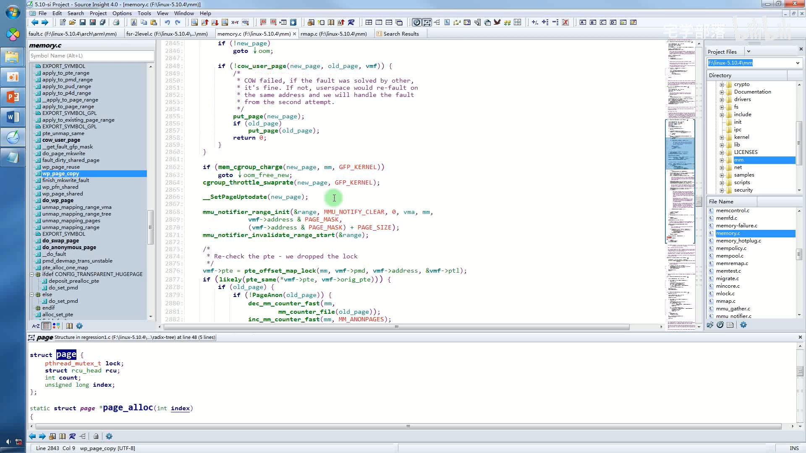

### 6.3 第三步：重建 PTE，把写位打开

这是「解除写保护」真正发生的地方（[【跳转到 12:30】](https://www.bilibili.com/video/BV1SP411V7Gc/?t=750)）：

```c
flush_cache_page(vma, vmf->address, pte_pfn(vmf->orig_pte));
entry = mk_pte(new_page, vma->vm_page_prot);   // 用新页造 PTE
entry = pte_sw_mkyoung(entry);
entry = maybe_mkwrite(pte_mkdirty(entry), vma); // 置脏位、按 VMA 决定是否可写
ptep_clear_flush_notify(vma, vmf->address, vmf->pte);
page_add_new_anon_rmap(new_page, vma, vmf->address, false);
lru_cache_add_inactive_or_unevictable(new_page, vma);
set_pte_at_notify(mm, vmf->address, vmf->pte, entry);  // 写进页表
update_mmu_cache(vma, vmf->address, vmf->pte);         // 更新 TLB
```

几个要点：

- `mk_pte(new_page, vma->vm_page_prot)`：PTE 里的物理页号换成了**新页**；
- `pte_mkdirty` + `maybe_mkwrite`：**脏位和写位一起置上**。视频在这里的解释是「把权限修改为可读写」——因为现在这一页已经是私有的了，没必要再拦；
- `ptep_clear_flush_notify`：先把旧 PTE 清掉并刷 TLB，再写新 PTE。中间这个顺序不能反，否则会出现「PTE 已经指向新页、TLB 里还是旧页」的窗口；
- `page_add_new_anon_rmap`：把新页登记为匿名页的反向映射；
- `set_pte_at_notify` / `update_mmu_cache`：写页表、刷 TLB。视频说「这个 TLB 缓存也去更新一下」，就是这一步。

**「改权限」改的是 PTE 里的一个 bit**，和第一节「fork 时清掉写位」是同一个 bit。整个 CoW 循环，硬件层面就是这一个 bit 的来回翻转。

### 6.4 第四步：把旧页的映射数减掉

```c
if (old_page) {
    page_remove_rmap(old_page, vma, false);   // 旧页少了一个映射
    ...
}
```

源码注释解释了为什么这一步要放在 `set_pte_at_notify` **之后**：只有 PTE 已经切到新页，才能安全地把旧页的映射计数减掉。否则别的进程可能看到「映射数已经减少、但 PTE 还指着旧页」，进而误判旧页已独占，就地写入。

**这就是「计数与页表必须按顺序更新」的原因**——顺序错了，别人就会基于错误的计数做决定。

### 6.5 第五步：释放旧页的一个引用

`put_page(old_page)` 把旧页的引用计数减一。如果减到 0，这一页就被回收；否则它继续留在父进程的地址空间里。

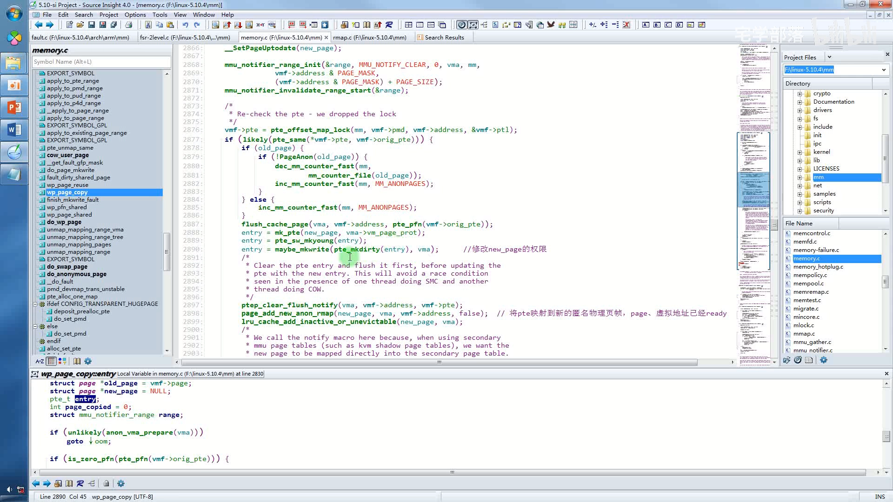

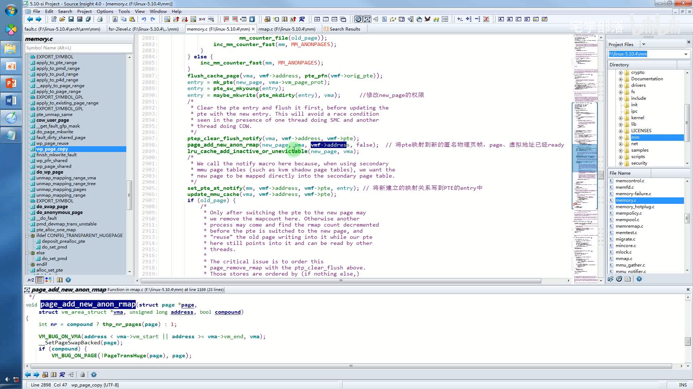

## 七、谁先写都一样：两种时序

视频最后用两种执行顺序验证了这套机制（[【跳转到 14:36】](https://www.bilibili.com/video/BV1SP411V7Gc/?t=876)）。`fork` 之后父子进程谁先跑是不确定的，代码里靠 `fork` 的返回值分支。

### 7.1 子进程先写

1. 子进程写共享页 → 触发写保护缺页；
2. `do_wp_page` 看到 `page_count` 大于 1（父进程还映射着）→ 复制；
3. 子进程拿到新页，PTE 指向新页并置写位，可以正常读写了；
4. 此时**父进程的页只剩一个映射**（`page_mapcount == 1`）；
5. 父进程之后再去写这一页，仍会触发一次写保护缺页，但 `do_wp_page` 发现这一页已经独占，**直接把写位改回去，不复制**。

第 5 步就是「独占页免复制」优化。视频的原话是：「如果只有一个进程在映射它，那么这个写的保护权限它会自动解除掉。」——**父进程这一次缺页是白跑的，除了改一个 bit 什么都没做。**

### 7.2 父进程先写

1. 父进程写共享页 → 触发缺页；
2. 此时有两个进程都映射着这一页 → 复制；
3. 父进程的 PTE 改指向新页并置写位；
4. 子进程继续用原来的物理页，它的 PTE 仍是只读，等它第一次写时再走一遍同样的流程。

### 7.3 结论：机制不依赖执行顺序

视频的总结是：「无论是谁先运行都没关系，最后只要是哪一个先运行、发生了缺页异常，它就会自动去申请一个物理页，然后把这个写保护的权限解除掉。」（[【跳转到 17:06】](https://www.bilibili.com/video/BV1SP411V7Gc/?t=1026)）

**这是 CoW 最优雅的地方**：它不需要在 `fork` 时决定谁拥有哪一页，也不需要记录「这一页归谁」。所有权是在**第一次写**的那一刻，由引用计数当场决定的。

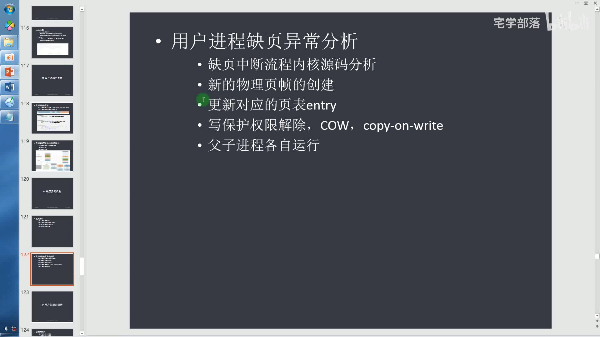

## 小结

- **写保护就是清掉 PTE 的写位**。`fork` 复制页表时把父子双方的写位都清 0，父子共享同一份物理页，谁写谁缺页。
- **`FAULT_FLAG_WRITE` 是整条链的开关**。它来自硬件错误码（x86）或 FSR（ARM），一路传到 `handle_pte_fault`，在那里和 `!pte_write(entry)` 一起把请求分给 `do_wp_page`。
- **`handle_pte_fault` 是分派器**：匿名页走 `do_anonymous_page`、文件页走 `do_fault`、swap 页走 `do_swap_page`、写保护走 `do_wp_page`。
- **复制不是必答题**。`do_wp_page` 先看 `page_count` 与 `page_mapcount`：都等于 1 说明这一页已独占，直接置写位复用；否则才 `wp_page_copy`。
- **两个计数器分工不同**：`page_count` 数引用，`page_mapcount` 数页表项。映射必然增加引用，但引用增加不一定意味着多了一个映射。
- **KSM 页要单独判**：合并后引用计数不一定增加，只看 `page_count == 1` 会误判独占、写坏别人的数据。
- **复制走五步**：`alloc_page` 要新页 → `cow_user_page` 拷内容 → 重建 PTE（`mk_pte` + `pte_mkdirty` + `maybe_mkwrite`）→ `set_pte_at_notify` 写页表并刷 TLB → `page_remove_rmap` 与 `put_page` 结算旧页。
- **顺序不能乱**：必须先把 PTE 切到新页，才能减旧页的映射计数；否则别人会基于错误计数误判独占。
- **所有权在第一次写时当场决定**，所以父子进程谁先跑都不影响正确性。

## 关键术语速查

| 术语 | 一句话解释 |
| --- | --- |
| 写保护缺页 | PTE 存在但写位为 0，进程却要写，于是触发缺页 |
| do_page_fault | 缺页总入口，按地址属于用户空间还是内核空间分流 |
| handle_pte_fault | 拿到 PTE 后的分派器，按页的类型选处理函数 |
| do_wp_page | 写保护缺页的处理函数，先判断能否复用，再决定是否复制 |
| wp_page_copy | 真正复制的函数：要新页、拷内容、重建 PTE、刷 TLB、结算旧页 |
| page_count | 引用计数，有多少个引用持有这一页 |
| page_mapcount | 映射计数，有多少个页表项指向这一页 |
| PageAnon / PageKsm | 这一页是匿名页 / 被 KSM 合并过的页 |
| cow_user_page | 把旧页内容拷到新页，并处理 cache 一致性 |
| pte_mkwrite / pte_mkdirty | 把 PTE 的写位置 1 / 脏位置 1 |
| TLB | 页表项的硬件缓存，改完 PTE 必须刷掉对应项 |
| 伙伴系统 | 内核的物理页分配器，`alloc_page` 从这里要页 |