# fork 为什么几十毫秒就能复制 8 GB 内存：写时复制把复制推迟到第一次写

> 视频来源：[How fork() and Copy-on-Write Actually Work](https://www.youtube.com/watch?v=kQ8SP1JmAhg)（YouTube · State & Flow）｜时长约 12 分钟
> 导读：这支视频用一组数字和一套动画把 fork 的写时复制（CoW）讲成一条时间线：真复制 8 GB 要 160 毫秒，而 fork 只花几十毫秒。本文按视频顺序讲清「共享 + 只读 + 缺页」三步怎么落地、一次写要付多少代价，最后落在本小节的主题上——**fork 只是页级 CoW 的一种用法，它的复制域是"两个进程"，随进程退出而消失**，把同样三张牌换成"一个进程 + 一份持久副本"，就是后面那篇 VM 后台快照。（同节 2.3.1 讲 CoW 通用原理、2.3.2 讲页表项权限位与缺页处理的内核实现，本文不重复展开，只把 CoW 当作已建立的机制来用。）

## 本讲要解决的核心问题（SCQA）

**背景**：在 Linux 上 fork 一个进程，语义上得到的是"父进程地址空间的完整副本"：子进程能读每一个字节，也能写每一个字节，两边互不影响。这是一条硬承诺。

**冲突**：如果真按语义去复制，代价高得离谱。一个占 8 GB 内存的进程，要逐字节走一遍 DDR 内存，按 50 GB/s 的带宽算就是约 160 毫秒——这是内存总线给物理世界设的上限。可实测的 fork 比这快好几倍，而且在"fork 完立刻 exec"这种最常见的情形里，几乎一个字节都没被复制过。

**疑问**：内核既没有违背 fork 的语义，又绕开了这次复制，它到底做了什么？复制被推迟到了什么时候、由谁触发、每次要付多少代价？这套机制在什么条件下才成立？

**回答（中心思想）**：fork 只复制页表、不复制数据页，把所有私有可写页在父子两侧都临时标成只读，然后**让硬件去抓第一次写**——谁写谁触发缺页，内核在缺页处理里只复制那一页。于是 fork 的复杂度从"与总内存成正比"降到"与实际写过的页数成正比"。这套机制的成立条件是"有一个共享域 + 一个能拦截写的权限位 + 一条缺页处理路径"，fork 只是它最古老的一种用法。

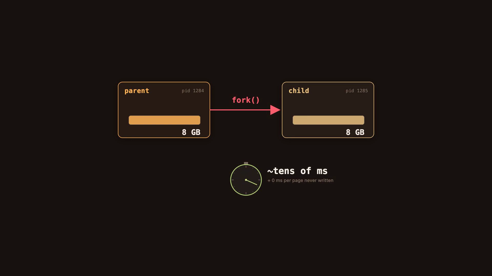

## 一、先算一笔账：真复制 8 GB 要 160 毫秒

### 1.1 地址空间就是"一长串页"

视频开场先把"进程"还原成内存里的样子（[【跳转到 01:17】](https://www.youtube.com/watch?v=kQ8SP1JmAhg&t=77)）：一个进程的地址空间就是一长串**页**（page）——代码、堆、栈、内存映射文件，全都住在页里。多数系统上一页是 4 KB，所以一个 8 GB 的进程有

$$
\frac{8\ \text{GiB}}{4\ \text{KiB}} = 2\times 10^{6}\ \text{页}
$$

一个"老实"的 fork 会走完父进程的整个地址空间，在子进程侧分配 200 万个新页，每页拷 4 KB 进去。代价与父进程大小成线性关系。

### 1.2 更糟的是：这些数据马上就会被扔掉

视频紧接着补了一刀（[【跳转到 01:34】](https://www.youtube.com/watch?v=kQ8SP1JmAhg&t=94)）：fork 返回之后，绝大多数子进程会立刻调用 exec，把一份全新的程序装进内存——刚复制出来的数据全部被 unmap、被丢弃。"我们花了 160 毫秒复制 8 GB 内存，然后马上把它扔掉。"

这不是边角情形，而是 Unix 上的标准写法（[【跳转到 02:14】](https://www.youtube.com/watch?v=kQ8SP1JmAhg&t=134)）：

- shell 每执行一条命令都这么干；
- 老式 CGI 脚本为每个 HTTP 请求 fork 一个进程；
- `popen()`、`system()` 内部都是 fork + exec。

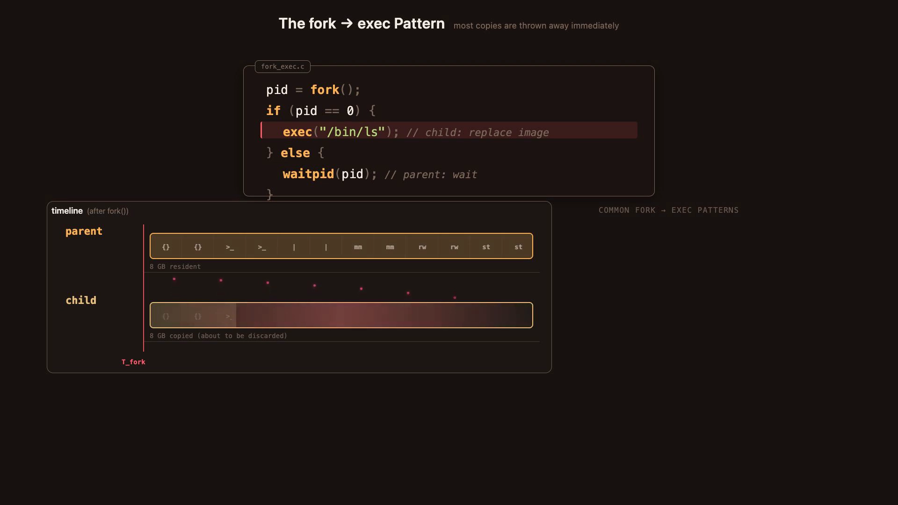

所以问题不是"能不能更快地复制"，而是"**这次复制根本不该发生**"。内核需要的是一种"懒"：在程序证明自己真要留下这份数据之前，一页都不复制。

## 二、CoW 的三步：共享、标只读、让硬件抓写

### 2.1 第一步：只复制页表，不碰 RAM

fork 被调用时，内核**不复制父进程任何一页内存**（[【跳转到 03:22】](https://www.youtube.com/watch?v=kQ8SP1JmAhg&t=202)）。它做的是：把子进程的地址空间指向与父进程完全相同的物理页。两个进程现在读的是同一块 RAM，子进程看到的内存与父进程一模一样，因为它们看的就是同一份字节。

这里要区分两种"表"：**页表**（page table）是内核维护的"虚拟地址 → 物理页帧"的映射；**数据页**才是真正装内容的 4 KB 帧。fork 复制的是前者（[【跳转到 04:35】](https://www.youtube.com/watch?v=kQ8SP1JmAhg&t=275)）。而页表比它索引的数据小得多：8 GB 进程按 4 KB 页算，页表总量约 16 MB，比数据小两三个数量级。所以"复制页表"这件事本身很快。

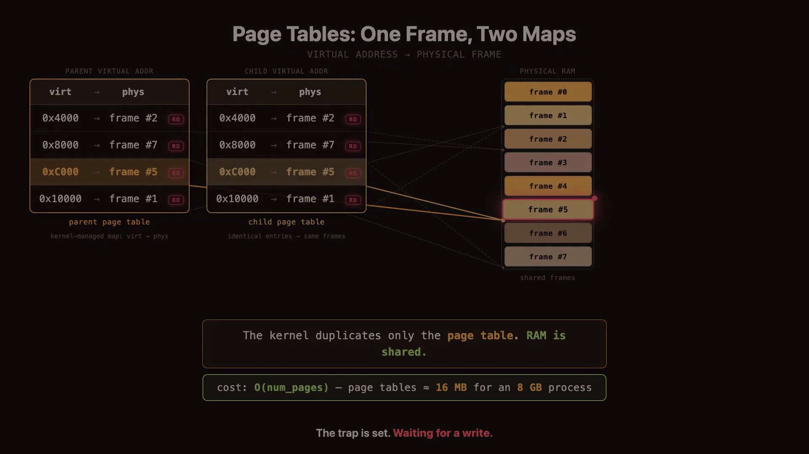

### 2.2 第二步：把私有可写页标成只读

只共享是不够的：如果父子都能自由写同一页，写操作就会互相串味，隔离性立刻破功。所以复制页表的同时，内核会**走一遍每个表项，把可写位清掉**（[【跳转到 05:00】](https://www.youtube.com/watch?v=kQ8SP1JmAhg&t=300)）。

注意范围：被标只读的是**私有可写页**——堆、栈、匿名内存。只读的代码页本来就不用改，可以安心共享。

从这一刻起，硬件已经布好了陷阱：父子任何一方尝试写，都会被 MMU 当场拦下。但陷阱不会自己触发，要等有人真的去写（[【跳转到 05:25】](https://www.youtube.com/watch?v=kQ8SP1JmAhg&t=325)）。

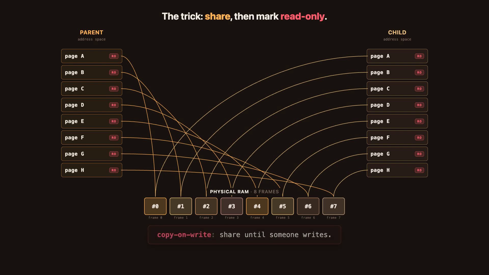

### 2.3 第三步：第一次写触发缺页，内核只复制那一页

视频用一行代码把触发点演出来（[【跳转到 05:38】](https://www.youtube.com/watch?v=kQ8SP1JmAhg&t=338)）：

```c
*p = 42;   /* 子进程眼里最普通的一条 store 指令 */
```

这条指令在子进程看来毫无异常。CPU 把写请求交给 **MMU**（memory management unit，内存管理单元，负责把虚拟地址翻译成物理地址的那块硬件），MMU 走子进程的页表，找到这个地址对应的表项，发现**可写位是清的**——页被标成只读，于是拒绝这次写，抛出**缺页异常**（page fault，一种同步 CPU 异常，会立刻把控制权交给内核）。

这次陷入只花几百纳秒，写请求根本没到达 RAM。指令没有完成，等内核处理完再重试（[【跳转到 06:19】](https://www.youtube.com/watch?v=kQ8SP1JmAhg&t=379)）。视频给了一个很好记的分工：**MMU 是门口保安，内核是经理**。

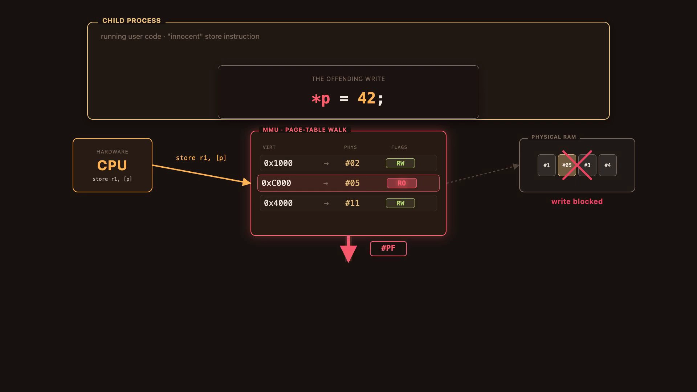

## 三、缺页处理器的五步：一次写要付多少

### 3.1 五步流水

内核的缺页处理器（历史上叫 `do_page_fault`，现代内核里是 `exc_page_fault`）认识 CoW，它按五步走（[【跳转到 06:52】](https://www.youtube.com/watch?v=kQ8SP1JmAhg&t=412)）：

1. **确认**：查这一页的元数据，确认它真的是 CoW 页——只读位是故意设的，不是真正的权限违规；
2. **分配**：从空闲链表里拿一个全新的物理帧，就一帧，4 KB；
3. **复制**：把原帧内容拷进新帧。这是整条链路上唯一一次真正的复制；
4. **改表**：把**写进程**的页表项改成指向新帧，并把可写位重新打开；
5. **返回**：从异常返回，CPU 重试那条写指令，这次成功。

另一个没写的进程，页表项一动不动，还指着原来那一帧——它眼里什么都没发生。**只有一页被复制，而且只在必须复制的时候**（[【跳转到 07:47】](https://www.youtube.com/watch?v=kQ8SP1JmAhg&t=467)）。

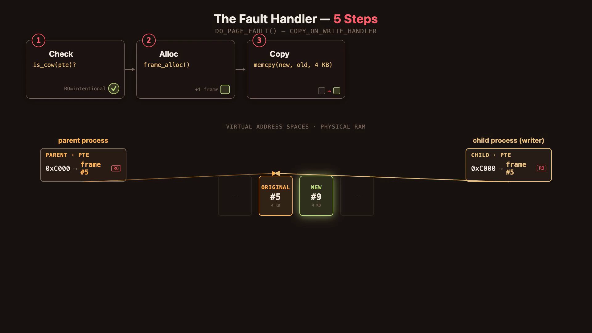

### 3.2 成本模型：从 O(总内存) 降到 O(实际写过的页)

视频给了一组可以直接拿去做容量估算的数字（[【跳转到 09:02】](https://www.youtube.com/watch?v=kQ8SP1JmAhg&t=542)）：

| 做法 | 代价 | 8 GB 进程的实际耗时 |
| --- | --- | --- |
| 老实复制（eager copy） | 拷 8 GB，带宽 50 GB/s | 约 160 ms |
| CoW fork（Linux） | 拷 16 MB 页表 + 每写一页约 1 μs | 几十毫秒 |
| CoW fork 后立刻 exec | 只付页表拷贝 | 每页成本为 0 |

几个推论：

- 子进程什么都不写（fork + exec 的典型情形），**每页成本恰好是 0**，你只为页表拷贝买单；
- 子进程在退出前写了 1% 的内存，就是 20000 次页拷贝、约 20 ms，而不是 160 ms；
- fork 的渐进复杂度从"与总内存成正比"变成了"与实际被修改的页数成正比"。

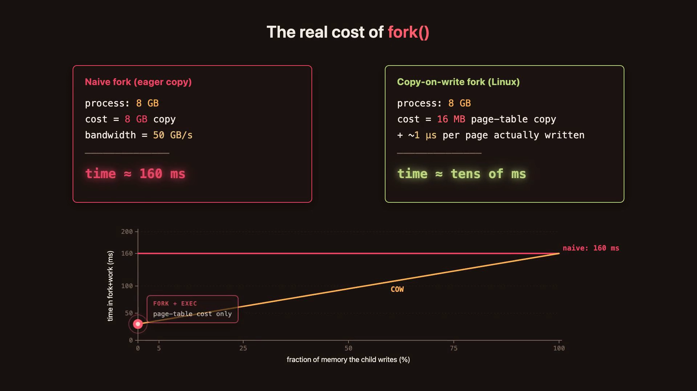

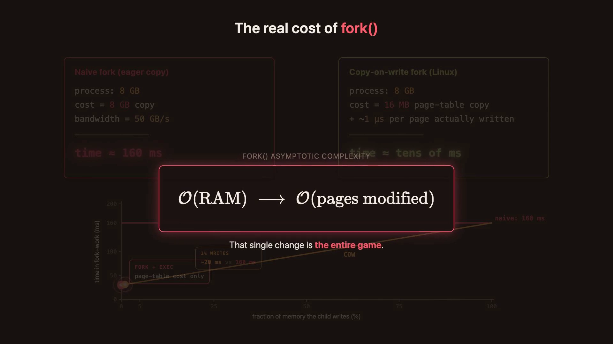

视频把这套机制的骨架画成一条流水线（[【跳转到 11:47】](https://www.youtube.com/watch?v=kQ8SP1JmAhg&t=707)）：`fork()` → 共享页、标 RO → 尝试写 → 缺页 → 内核 CoW 处理 → 新帧 → 恢复执行。它把这句话总结成一句口号：**在被迫之前共享，只为写付钱**（"Share until written. Pay only for the writes."）。

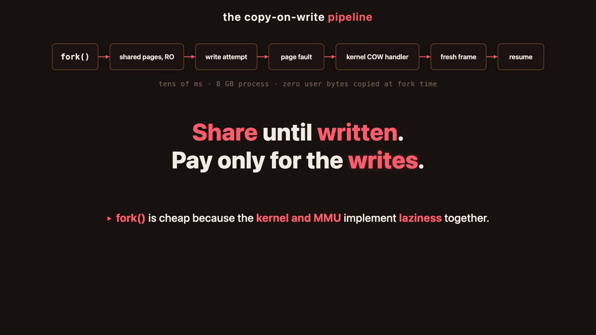

## 四、fork 的 CoW 域是进程级的：它随进程退出而消失

### 4.1 "域"里只有父子两个进程

把上面的机制抽象一下，CoW 需要一个**共享域**：一组参与者共同引用同一批物理页，靠引用计数记住"这一页还有几个人在用"。fork 的域非常小，就是父进程和子进程（多次 fork 会形成一棵树，但每个域的成员仍然是进程）。

这个域有三个天然边界：

- **成员是进程**：参与共享的是 task/地址空间，不是文件、不是设备；
- **生命周期跟着进程走**：子进程退出、父进程退出，引用计数归零，那一页就回到空闲链表，域随之消失，没有任何持久化痕迹；
- **复制目标是新匿名页**：CoW 触发时分配的是内存里的新帧，不落盘、不产生文件。

这三点决定了 fork 的 CoW 只解决"进程间共享"，不解决"跨时间保存"。想让内存内容活过进程，必须另找载体——这正是第五节要接上的部分。

### 4.2 fork+exec 是这套机制的极限用法

视频专门强调：fork+exec 时，子进程至少会写一个页——栈（exec 要把参数放在栈上），所以至少栈那一页会 CoW 一次；其余页一概不复制，exec 一来直接整块替换（[【跳转到 03:04】](https://www.youtube.com/watch?v=kQ8SP1JmAhg&t=184)）。这就是"eager copy 是错误默认值"的量化版本：最省的做法不是"复制得很快"，而是"根本不复制"。

### 4.3 补充：CoW 域不存在的情形（vfork / CLONE_VM）

> 以下为本文补充的背景知识，视频未涉及，用于标出 fork 用法的边界。

fork 的 CoW 域之所以存在，是因为内核**故意**让父子"看起来各自独立"。如果把这条语义拿掉，CoW 也就不需要了：

- **vfork**：子进程直接借用父进程的地址空间，父进程被挂起直到子进程 exec 或退出。没有共享域，也没有 CoW——因为不存在"两份视图"。
- **clone 的 CLONE_VM 标志**：创建的是共享同一地址空间的执行流，也就是线程。线程之间没有 CoW，一个线程改内存另一个立刻看得见。

换句话说，CoW 是"独立地址空间"这条承诺的**实现代价**：承诺越硬，越需要 CoW 来把代价推迟。理解这一点，才能理解下一节 VM 快照为什么长得像 fork 又不是 fork。

## 五、同一个形状在别处：从 Redis BGSAVE 到 VM 内存快照

### 5.1 视频列出的五个同构

视频后半段把"共享直到被迫"这个形状列成一张图（[【跳转到 10:17】](https://www.youtube.com/watch?v=kQ8SP1JmAhg&t=617)）：

- **Btrfs / ZFS 快照**：几毫秒给一个几 TB 的文件系统拍快照。快照只是一棵新的元数据树，指向同一批数据块；新写入先复制块再改。
- **容器镜像分层**：只读层 + 一层薄薄的可写层。容器第一次写基础层里的文件时，文件被 copy-up 到可写层；在那之前，跑同一个镜像的所有容器共享同一批字节。
- **glibc malloc**：大块分配先懒懒地指向一个只读的零页，真正写的时候才分配物理帧。
- **APFS clonefile**：任意大小的文件在微秒级"复制"完成，共享数据块，第一次写触发按块复制。
- **Redis BGSAVE**：fork 自己去做后台保存，父进程继续服务，子进程读到的是一份**冻结的时间点视图**。

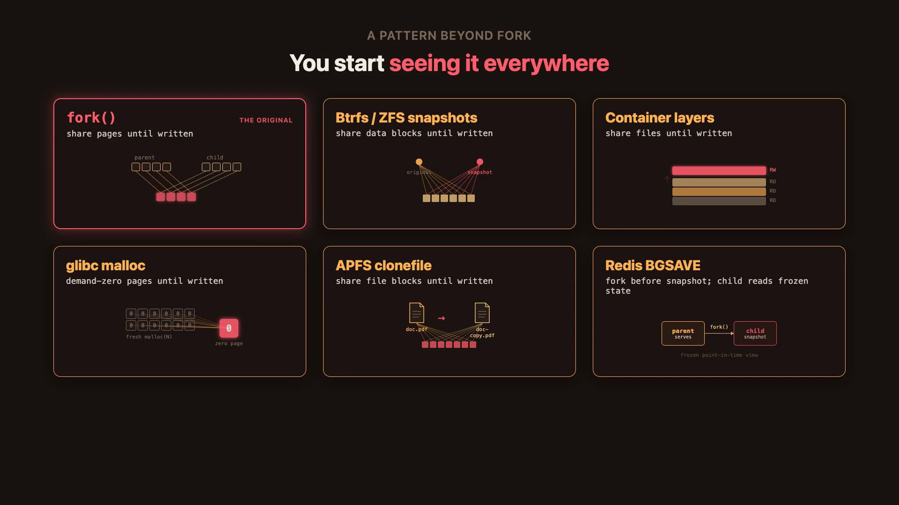

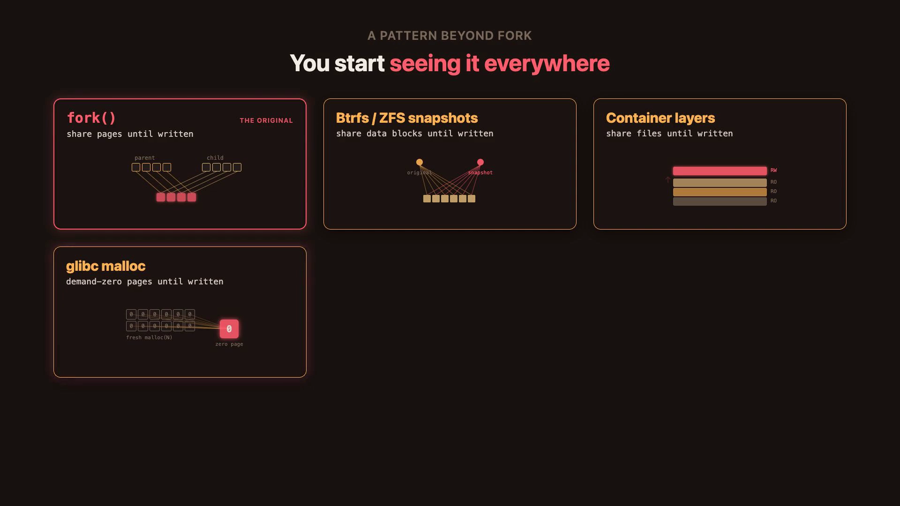

### 5.2 把"两个进程"换成"一个进程 + 一份持久副本"

上面五个例子里，**Redis BGSAVE 离 VM 快照最近**：它已经不只是"两个进程共享"，而是"一个进程继续跑 + 一份副本被慢慢读出去"。VM 内存快照就是把这个形状推到极限：

- fork 的复制目标是**新匿名页**，快照的复制目标是**落盘的数据**；
- fork 的域成员是**两个进程**，快照的域成员是**一个 VMM 进程 + 一份正在写出的持久化副本**；
- fork 由**内核缺页路径自动驱动**，快照还需要 VMM **主动布防**：先把客户机内存整段置为只读，再自己接住缺页、把页写出去。

为什么快照不能直接 `fork()` 了事？因为客户机内存是 VMM 通过 `mmap` 拿到的一段宿主内存，vCPU 是 VMM 里的线程，它们和"读内存的备份线程"共享同一个地址空间——`fork()` 复制出的是另一个地址空间，vCPU 不会跟着过去。所以快照必须换一种做法：**在同一个地址空间里给内存加写保护**，让写的人自己撞上来。

这条路径的具体实现（QEMU 的 `background-snapshot`、`userfaultfd` 的写保护模式、脏页优先级队列）见同目录的另一篇：[后台快照把虚拟机停机从 20 秒压到 1 秒](后台快照把虚拟机停机从20秒压到1秒——写时复制在VM内存上的用法.md)。

## 小结

- 老实复制 8 GB 要 160 毫秒（50 GB/s 带宽决定），而 fork 只要几十毫秒：它复制的是 16 MB 页表，不是 8 GB 数据。
- CoW 三步：共享物理页 → 把私有可写页在两侧标成只读 → 第一次写被 MMU 拦下、内核只复制那一页。
- 缺页处理器五步：确认是 CoW 页、分配一帧、拷 4 KB、改页表并恢复可写、返回重试。同一次写，另一个进程的页表项完全不动。
- 成本从 O(总内存) 降到 O(实际写过的页数)；fork+exec 时每页成本为 0，只有栈页会 CoW 一次。
- **fork 的 CoW 域是进程级的**：成员是父子进程，复制目标是新匿名页，域随进程退出而消失，不留任何持久化痕迹。
- vfork 与 clone 的 CLONE_VM 标志是反例：它们取消了"独立地址空间"的承诺，因此也不需要 CoW。
- 同一个"共享直到被迫"的形状出现在文件系统快照、容器分层、malloc 零页、APFS clonefile 和 Redis BGSAVE 里；VM 内存快照是它的下一步——把"两个进程"换成"一个进程 + 一份持久副本"。

## 关键术语速查

| 术语 | 一句话解释 |
| --- | --- |
| 页（page） | 内存管理的最小单位，多数系统 4 KB；地址翻译只针对页，不针对字节 |
| 页表（page table） | 内核维护的"虚拟地址 → 物理页帧"映射表，每个进程一张 |
| 页帧（page frame） | 物理内存里实际装 4 KB 数据的那一格 |
| MMU | 内存管理单元，硬件里负责翻译地址、检查权限的部件；权限不符就抛缺页 |
| 缺页异常（page fault） | 一种同步 CPU 异常：地址没映射或权限不符时陷入内核，处理完可重试原指令 |
| 写时复制（CoW） | 先共享、把页标只读，等谁写再给谁复制一份的延迟复制策略 |
| CoW 域 | 共同引用同一批物理页的那组参与者；fork 的域是两个进程，快照的域是一个进程加一份持久副本 |
| fork+exec | Unix 启动新程序的标准组合；因为 exec 会整块替换地址空间，提前复制是纯浪费 |
| vfork | 子进程借用父进程地址空间、父进程挂起的 fork 变体，没有 CoW |
| clone 的 CLONE_VM 标志 | 共享同一地址空间创建执行流，即线程；线程之间没有 CoW |
| BGSAVE | Redis 的后台落盘：fork 出子进程读一份冻结的内存视图，父进程继续服务 |