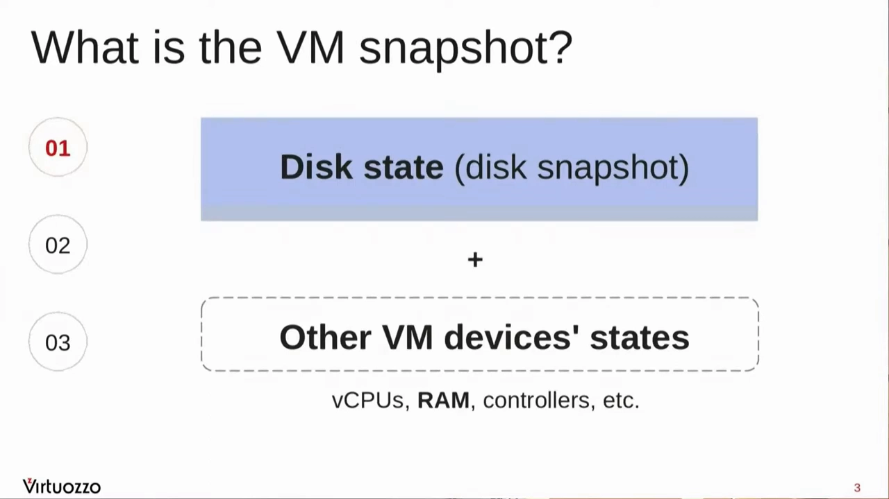
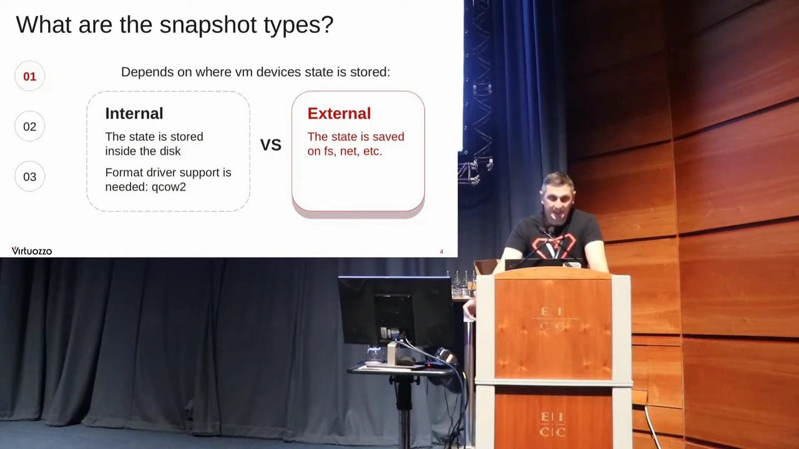
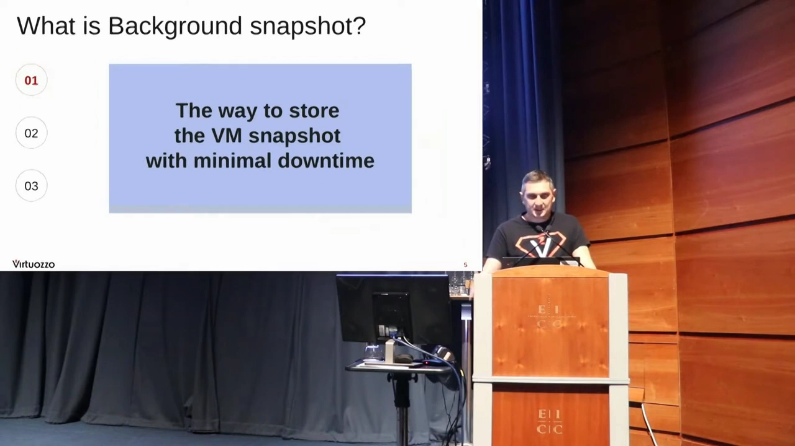
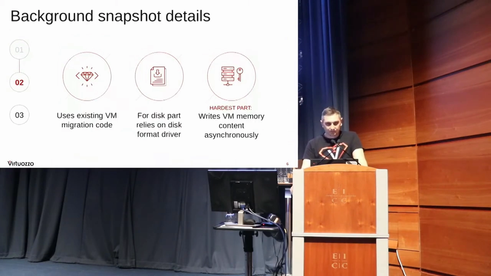
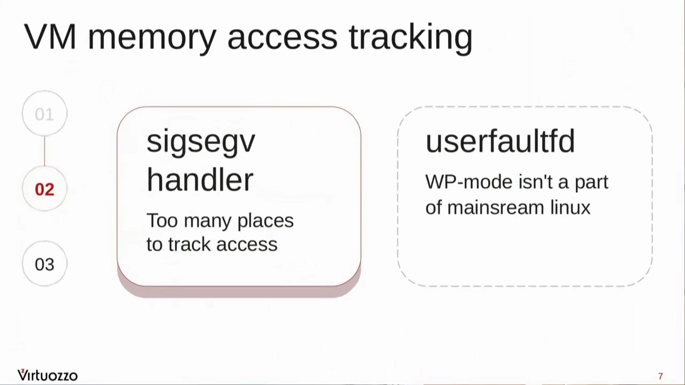
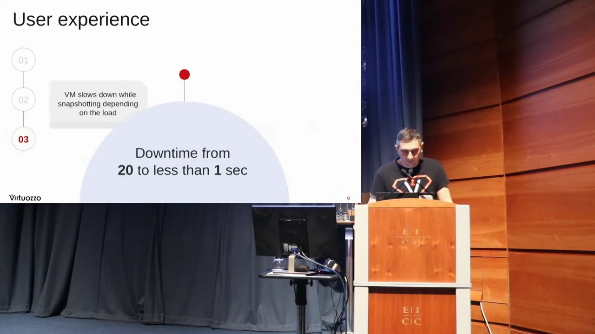
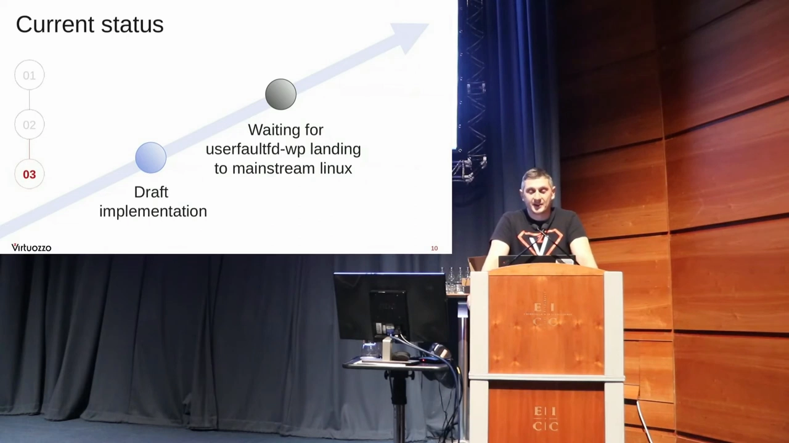

# 后台快照把虚拟机停机从 20 秒压到 1 秒：写时复制在 VM 内存上的用法

> 视频来源：[Background Snapshots — Denis Plotnikov](https://www.youtube.com/watch?v=fKj4j8lw8pU)（YouTube · KVM Forum 2018，Virtuozzo）｜时长约 12 分钟
> 导读：这是一场 12 分钟的工程复盘，讲 QEMU 的 `background-snapshot`：一位客户每天要给生产虚拟机拍快照，每次停机两分钟，于是作者想办法把"写内存"这件事挪到后台。本文按讲者的顺序讲清 VM 快照由什么组成、为什么内存是唯一的硬骨头、怎么用写保护加 `userfaultfd` 在客户机继续运行的同时把内存搬出去，最后回到本小节的主题——**它和 fork 复用的是同一套页级写时复制，只是"复制域"和"谁来布防"变了**。快照文件的格式与跨机传输归 S07，本文只讲内存侧。

## 本讲要解决的核心问题（SCQA）

**背景**：给一台虚拟机拍快照，要保存两样东西——磁盘状态，以及 vCPU、RAM、各种控制器等设备状态。磁盘快照用 CoW 做，只拷一张"客户机偏移 → 宿主偏移"的映射表，很快；设备状态靠现成的迁移流（migration stream）序列化，也早就解决了。

**冲突**：真正的瓶颈是内存。一台 VM 的状态里，内存动辄几百 MB 到几 GB，而其余所有设备状态加起来才 10 MB 左右。传统做法要把 VM 停下来，把内存整段写到目的地，写多久就停多久。讲者开场讲的客户案例是：每天一次快照，每次两分钟停机，而这是一台生产机器。

**疑问**：能不能只停"必须冻结的那一瞬间"，让客户机继续跑，同时把内存慢慢写出去？如果客户机在写内存的同时还在改内存，写出去的到底是哪个版本？

**回答（中心思想）**：可以。做法是**把客户机内存整段置为只读**，然后分块往外写；客户机一旦写某页就撞上缺页，VMM 先把那一页的旧内容写出去（或先复制一份），再放行这次写。这样"停机"只覆盖冻结状态的那一小段时间，内存写出被挪到后台。代价是快照期间客户机会变慢——**停机时间换成了运行期开销**。这正是 fork 那套页级 CoW 的第二种用法：域从"两个进程"变成"一个 VMM 进程 + 一份正在落盘的副本"。



## 一、VM 快照的两块拼图，只有一块是硬骨头

### 1.1 磁盘快照：拷一张映射表就够了

讲者先给了一个"已经解决"的对照（[【跳转到 02:29】](https://www.youtube.com/watch?v=fKj4j8lw8pU&t=149)）：如果只谈 CoW 磁盘快照，它基本是免费的——你要做的只是复制一张把客户机偏移映射到宿主偏移的表，这张表并不大，拷完就可以认为快照完成了。**注意这里 CoW 的含义**：数据块一页都没动，动的是"谁指向谁"的元数据。

### 1.2 设备状态：迁移流已经写好

设备状态（vCPU 寄存器、控制器、virtio 队列等）也不是问题（[【跳转到 02:54】](https://www.youtube.com/watch?v=fKj4j8lw8pU&t=174)）：迁移（migration）本来就要把整台 VM 的设备状态序列化成一条迁移流写到别处，快照直接复用这条路径。

### 1.3 内存：几百 MB 到几 GB，占绝对大头

于是作者去量了一下时间都花在哪（[【跳转到 03:44】](https://www.youtube.com/watch?v=fKj4j8lw8pU&t=224)）：**VM 状态里最大的部分是内存**——通常几百 MB，甚至几 GB；而其余 VM 状态总共只有 10 MB 左右。也就是说，传统快照的停机时间几乎全部由"写内存"决定，设备状态那 10 MB 可以忽略。

结论很直接：想让快照快，唯一有意义的方向是**把内存的写出挪到后台**，让 VM 表面上继续工作，同时把内存一点点存到别处（[【跳转到 04:09】](https://www.youtube.com/watch?v=fKj4j8lw8pU&t=249)）。

## 二、先分清两种快照：内部快照与外部快照

动手之前，讲者先撞上一个岔路口（[【跳转到 04:39】](https://www.youtube.com/watch?v=fKj4j8lw8pU&t=279)）：按"设备状态存在哪里"分，快照有两类。

- **外部快照（external）**：状态存到磁盘镜像之外的地方——文件系统、网络等。做法简单，你只要给它一个目的地（[【跳转到 04:49】](https://www.youtube.com/watch?v=fKj4j8lw8pU&t=289)）。
- **内部快照（internal）**：状态存进磁盘镜像内部，需要格式驱动支持，比如 qcow2。

内部快照的麻烦在于**异步写**：既然你要往镜像里异步写内存，就必须先知道要占多大空间、先把空间预分配好；而"预分配"要求你提前算清一切，这就用不上 QEMU 迁移实现所依赖的**流式语义**（stream semantics，边产生边写、不需要预先知道总量）。

讲者的选择很干脆：不碰内部快照，只做外部快照。



## 三、后台快照的定义：只停"抓状态"那一瞬间

讲者给的定义很短（[【跳转到 05:38】](https://www.youtube.com/watch?v=fKj4j8lw8pU&t=338)）：**后台快照是一种以最小停机时间保存虚拟机的办法**。

"最小"是什么意思？他解释得很具体（[【跳转到 05:48】](https://www.youtube.com/watch?v=fKj4j8lw8pU&t=348)）：我们确实要停 VM，但只停到"把所有该冻结、该保持不变的状态抓到手"为止；抓完之后，真正把它们写出去这件事是**异步**做的。

这里有个容易被忽略的语义点：**快照代表的是"停机那一瞬间"的状态**。抓完状态之后客户机继续跑、继续改内存，改出来的新内容不属于这份快照。后面所有的机制设计，都是为了守住这条语义。



### 3.1 三块积木

实现上它复用了三样现成的东西（[【跳转到 06:12】](https://www.youtube.com/watch?v=fKj4j8lw8pU&t=372)）：

1. **现成的 VM 迁移代码**：用来保存 VM 状态，只需要做少量修改；
2. **现成的磁盘快照实现**：尤其是 qcow2 那套；
3. **异步写内存**——讲者明确标注这是"最难的部分"（HARDEST PART）。



## 四、最难的部分：客户机还在跑，怎么把内存写出去

### 4.1 布防：整段内存置为只读，然后分块写

思路只有一句话（[【跳转到 06:44】](https://www.youtube.com/watch?v=fKj4j8lw8pU&t=404)）：**把内存"封"起来，然后一块一块地往通道里写**。封的办法就是**禁止写**——把客户机内存对应的那一段宿主内存置为只读。

于是问题变成：谁来接住这些写？讲者列了两条路，并且现场否掉了第一条。

### 4.2 为什么 SIGSEGV 处理器不行

第一条路是**段错误处理器**（SIGSEGV handler）：内存被保护后，任何写都会触发段错误，进程在信号处理器里接住它，就能知道"有人要写这一页"（[【跳转到 06:49】](https://www.youtube.com/watch?v=fKj4j8lw8pU&t=409)）。

这条路在 QEMU 里走不通，原因很具体：QEMU 有时候会把**内存共享给别的进程**用。如果写来自另一个进程，信号是发给那个进程的，你在自己进程里装的 SIGSEGV 处理器根本拦不到——"它会破坏你的内存，你没法处理"（[【跳转到 07:14】](https://www.youtube.com/watch?v=fKj4j8lw8pU&t=434)）。

这条否掉的路径很值得记住：**基于信号的写拦截只在"写者就是你自己"时成立**，一旦共享域里出现别的进程，就必须换机制。

### 4.3 userfaultfd：迁移早就在用，只缺"写保护模式"

第二条路是 **`userfaultfd`**（[【跳转到 07:39】](https://www.youtube.com/watch?v=fKj4j8lw8pU&t=459)）。它是一个让用户态程序接管缺页处理的机制：进程向内核注册一段内存区域，之后这段内存的缺页事件不再由内核自己处理，而是通过一个文件描述符交给用户态线程，用户态处理完再告诉内核"可以继续了"。

讲者提到两个关键事实：

- 迁移**已经在用** `userfaultfd` 了——post-copy 迁移（先恢复 CPU 状态、内存页按需从源端拉取）就是靠它；
- 但当时的 `userfaultfd` **还没有写保护（write-protect）模式的追踪能力**，而这正是后台快照需要的：不只是"页不在"，而是"页在、但你不能写"。

> 补充（视频之外的事实，供对照）：这个能力后来以 `userfaultfd` 的写保护模式落地，对应的 ioctl 是 `UFFDIO_WRITEPROTECT`——用户态可以对一段已注册的内存批量置写保护或解除写保护，写者触发 `UFFD_EVENT_WP` 事件交给用户态处理。QEMU 的 `background-snapshot` 能力最终就建立在这条路径上。讲者当年说的"有人在拼命推进、我们完全押注它"，指的就是这件事。



## 五、实际操作：五条命令

讲者把用法拆成了五步（[【跳转到 08:27】](https://www.youtube.com/watch?v=fKj4j8lw8pU&t=507)），全部在 QEMU monitor 里完成：

```
# 1. 打开后台快照能力
(qemu) migrate_set_capability background-snapshot on

# 2. 暂停 VM（只是短暂冻结，不是整个写出期间都停）
(qemu) stop

# 3. 先做磁盘快照
(qemu) snapshot_blkdev <disk_name> <path>

# 4. 启动迁移线程：它先收集除内存以外的所有状态并写到目的地
(qemu) migrate <type:destination>

# 5. 等它写完（此时 vCPU 已经恢复运行）
```

关键在第 4、5 步之间（[【跳转到 08:52】](https://www.youtube.com/watch?v=fKj4j8lw8pU&t=532)）：迁移线程把**除内存以外**的状态收集完、写到目的地之后，就开始写内存；而**这时候 vCPU 已经在跑了**——它们不再处于暂停状态。停机窗口就是"抓状态"那一段，内存写出完全在窗口之外。


## 六、代价：停机从 20 秒到 1 秒，换来运行期变慢

### 6.1 用户体感

讲者给的数字是（[【跳转到 09:10】](https://www.youtube.com/watch?v=fKj4j8lw8pU&t=550)）：**停机时间从 20 秒降到 1 秒以内**（幻灯片上写的是 "Downtime from 20 to less than 1 sec"）。他同时强调这个测试场景不算真实——只给了 2 GB RAM，真实客户的内存要大得多。

但他在同一页上写下了代价（[【跳转到 09:20】](https://www.youtube.com/watch?v=fKj4j8lw8pU&t=560)）：**快照期间 VM 会变慢，变慢的程度取决于负载**。



### 6.2 变慢的机制：被写到的页插队

为什么会慢？讲者解释得很细（[【跳转到 09:45】](https://www.youtube.com/watch?v=fKj4j8lw8pU&t=585)）：

1. vCPU 撞上一个"本该被写出去"的页，它停下来；
2. 这一页被塞进一个**优先级队列**，排在所有顺序写出的内存页之前；
3. 后台线程先把它写到目的地，然后释放 vCPU。

也就是说，客户机不是被整体暂停，而是**在每一次"写一个还没被存走的页"时被短暂卡住**。讲者的评价是：那一刻确实会冻一下，但比"连续停机很长时间"要好（[【跳转到 10:10】](https://www.youtube.com/watch?v=fKj4j8lw8pU&t=610)）。

这段话其实点出了这类设计的通用取舍：**总工作量不变，只是把"一次性长停机"摊成"多次短停顿"**。摊得越细，客户机越不容易被外部观察到中断，但每一次写未保存页都要付一次陷入和一次拷贝的代价。

## 七、和 fork 对照：同一套页级 CoW，两种用法

### 7.1 相同的地方：三步一模一样

把这篇和 fork 那篇并排看，机制骨架是同一套：

1. **共享**：fork 让父子指向同一批物理页；快照让"正在跑的客户机内存"和"正在写出的快照内容"指向同一批页；
2. **标只读**：fork 清掉父子两侧 PTE 的可写位；快照把整段客户机内存置为写保护；
3. **缺页驱动复制**：fork 由内核缺页路径自动复制那一页；快照由 VMM（借助 `userfaultfd`）接住写，把旧内容写出去或复制一份，再放行。

### 7.2 不同的地方：域、目标、驱动者、生命周期

| 维度 | fork 的用法 | VM 内存快照的用法 |
| --- | --- | --- |
| CoW 域的成员 | 父进程 + 子进程（都是进程） | 一个 VMM 进程 + 一份正在落盘的持久化副本 |
| 复制目标 | 新的匿名页（内存里） | 新匿名页，或直接写进快照文件 |
| 谁布防 | 内核在 `fork()` 里自动做 | VMM 主动做：写保护 + 脏页追踪 |
| 谁接缺页 | 内核缺页处理器 | 用户态的 `userfaultfd` 处理线程（VMM） |
| 生命周期 | 随进程退出而消失，无持久化痕迹 | 快照文件长期存在，可跨重启恢复 |
| 失败/代价形态 | 一次写多一次缺页，几乎无感 | 快照期间客户机持续变慢，写未保存页时短暂停顿 |
| 语义目标 | "子进程看到父进程某一刻的完整副本" | "快照代表停机那一瞬间的完整内存" |

一句话概括差异：**fork 的 CoW 域是"两个进程"，快照的 CoW 域是"一个进程 + 一份持久化副本"**；fork 由内核缺页路径自动驱动，快照还需要 VMM 主动布防（写保护 + 脏页追踪）。

### 7.3 边界：往后归谁

- 快照**文件格式**（qcow2 里怎么组织、增量怎么表示）与**跨机传输**（迁移、跨节点恢复的时延构成）归 S07；
- 脏页位图与写保护两种追踪方式的取舍，是下一节 2.4 的主题；
- 本文只回答"内存侧的 CoW 机制怎么被复用"。

## 八、当时的进度：一个等内核的草稿实现

讲者最后交代了状态（[【跳转到 10:35】](https://www.youtube.com/watch?v=fKj4j8lw8pU&t=635)）：他们已经有一个**草稿实现**，大部分功能就绪，正等 `userfaultfd` 的写保护模式进主线。提问环节有人问写保护的补丁推进到哪一步了，他答得也实在：没有跟得很紧，不确定具体进度，但相信有人在推进，他们也很想拿到那些补丁（[【跳转到 10:54】](https://www.youtube.com/watch?v=fKj4j8lw8pU&t=654)）。

这段"卡在内核特性上"的状态，恰好说明了这条路径的分层：**VMM 侧的逻辑可以写完，但"能不能高效地拦截写"这件事由内核提供的能力决定**。这也是为什么同一个功能在不同年份的实现会差很多——不是 VMM 变聪明了，是内核把缺页拦截这套接口补齐了。



## 小结

- VM 快照 = 磁盘状态 + 设备状态（vCPU、RAM、控制器等）。磁盘快照靠 CoW 映射表、设备状态靠迁移流，两者都已解决；**内存是唯一的大头**（几百 MB 到几 GB，而其余状态约 10 MB）。
- 内部快照把状态存进镜像，异步写需要预分配空间、用不上流式语义；所以后台快照选择外部快照。
- 后台快照的定义：只停到"抓完需要冻结的状态"，写出异步进行。快照语义仍是**停机那一瞬间**。
- 实现靠三块积木：复用迁移代码、复用磁盘格式驱动的快照、异步写内存（最难）。
- 异步写内存的关键是**写保护 + 分块写出**。SIGSEGV 处理器不行，因为 QEMU 会与别的进程共享内存，别人的写你拦不到；改用 `userfaultfd`，但当时它缺写保护模式（后来由 `UFFDIO_WRITEPROTECT` 补上）。
- 停机从 20 秒降到 1 秒以内，代价是快照期间 VM 变慢：写未保存页的 vCPU 会被短暂卡住，该页插队优先写出。
- 与 fork 对照：三步（共享、标只读、缺页驱动复制）相同；**域、复制目标、布防者、生命周期**不同——fork 是"两个进程"，快照是"一个进程 + 一份持久副本"。

## 关键术语速查

| 术语 | 一句话解释 |
| --- | --- |
| VM 快照 | 把一台虚拟机的磁盘状态与设备状态（含 RAM）冻结成可恢复的一份副本 |
| 外部快照 / 内部快照 | 状态存到镜像之外（文件系统、网络）；状态存进镜像内部（需 qcow2 等格式驱动） |
| 迁移流（migration stream） | 迁移时序列化 VM 状态的字节流，快照复用它保存设备状态 |
| 停机时间（downtime） | 从暂停 VM 到它重新可运行之间的时间；后台快照把它压到"抓状态"那一段 |
| 写保护（write-protect） | 把内存置为只读，使任何写都触发缺页，从而被 VMM 感知 |
| `userfaultfd` | 让用户态程序接管缺页处理的机制，通过文件描述符把缺页事件交给用户态线程 |
| `UFFDIO_WRITEPROTECT` | `userfaultfd` 的写保护模式 ioctl：批量置写保护/解除，写者触发 WP 事件 |
| post-copy 迁移 | 先恢复 CPU 状态、内存页按需从源端拉取的迁移策略，`userfaultfd` 的早期用户 |
| 优先级队列 | 后台快照里让"被 vCPU 写到的页"插队优先写出的队列 |
| 脏页追踪 | 记录"哪些页在快照期间被改过"，是写保护与位图两种追踪方式的共同目标 |