# 脏页靠写保护才记得住：KVM 从脏页位图到脏页环

> 视频来源：[\[2020\] KVM Dirty Ring - A New Approach to Logging by Peter Xu](https://www.youtube.com/watch?v=YsQJ-Vll3sg)（YouTube · KVM Forum 2020 · 讲者 Peter Xu，Red Hat）｜时长约 26 分钟
> 本文只讲这支演讲的"记账"部分：脏页是怎么被记下来的——写保护如何把一次普通的内存写变成内核能看见的事件，位图如何记录它，以及位图为什么被换成 per-vCPU 的脏页环。至于"记下来之后怎么用"（增量快照体积、迁移收敛与限流策略），属于 2.4.2、2.4.3 的内容，本文不展开。

## 本讲要解决的核心问题（SCQA）

**背景**：热迁移（live migration）要在虚拟机不停机的前提下把它的内存搬到另一台机器。第一轮迭代必须把所有客户机内存页搬过去，因为目标节点上还什么都没有；从第二轮开始，只需要搬"第一轮之后又被写过"的那些页。

**冲突**：客户机里的一次内存写，只是一条普通的 `mov` 指令，宿主内核不会天然收到任何通知。既然收不到通知，内核凭什么知道"这一页后来被改过"？

**疑问**：KVM 到底怎么把"这一页脏了"这件事记下来？记成什么数据结构？这份结构的代价在哪里？

**回答（中心思想）**：脏页追踪由两个动作组成——先用**写保护**把"写"变成一次可被拦截的异常（trap），再用**位图或环形队列**把被拦截的页号记下来。位图是"一位一页"的全局账本，最省空间但随内存线性变大；脏页环（dirty ring）把账本换成 per-vCPU 的定长环形队列，并把"收集脏页"和"重新写保护"拆成两个可以分别调用的动作。

---

## 一、脏页追踪要先把"写"变成可观测事件

### 1.1 迁移的迭代模型决定了脏页必须被记录

一次热迁移包含好几轮迭代。第一轮（R1）很特殊：目标节点上什么都没有，所以要把客户机的所有内存页都搬过去。从第二轮（R2、R3……）开始，只需要搬运脏页，因为剩下的页在目标端已经是最新的了。最后一轮（Rn）会在虚拟机暂停的状态下完成收尾。

问题在于：迁移是"热"的，第一轮搬运时客户机还在并发运行，它会继续写内存，于是又产生新的脏页。这些页必须在下一轮迭代开始前被同步到目标节点，否则目标节点上的副本就过期了。

[【跳转到 00:55】](https://www.youtube.com/watch?v=YsQJ-Vll3sg&t=55)

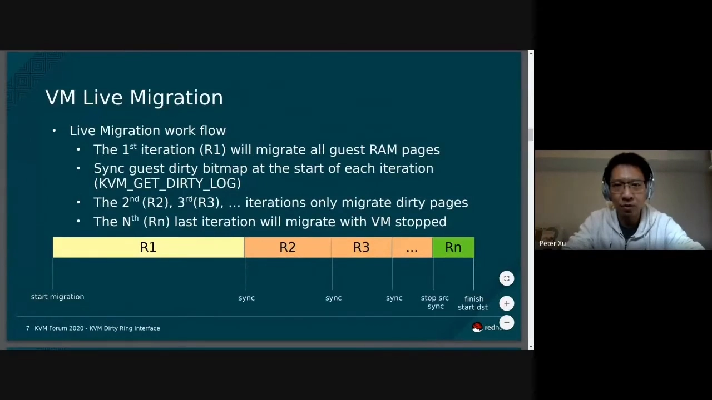

所以"脏页"这个概念不是抽象的美德，而是一笔具体的账：**在上一轮同步之后，哪些页被写过**。这笔账要在客户机毫无察觉的情况下记下来。

### 1.2 写保护：把"写"从静默操作变成一次陷入

客户机写内存时不会主动通知任何人，所以内核必须提前动手：把客户机内存页在二级页表（EPT/NPT）里的**写权限清掉**，只留读权限。这样客户机第一次尝试写这一页时，硬件就会拦下来，产生一次 EPT violation，控制流回到 KVM。KVM 这时做三件事：

1. 把这一页的页号记进"脏页账本"（位图或脏页环）；
2. 把这一页的写权限恢复，让客户机继续写；
3. 返回客户机，重新执行刚才那条被拦下的写指令。

这就是**写保护（write-protect）式脏页追踪**的全部精髓：它不是去"观察"写，而是先把写变成"不允许"，等它撞上来再放行。代价也很直白——每一次"第一次写某页"都要付一次陷入（trap）的开销，而每一次重新开始记录，都要把所有页重新写保护一遍。

讲者在开场就把这个代价点明了：如果我用写保护来追踪客户机的写操作，那就意味着要把所有客户机页重新写保护一遍，这个过程可能很久。

[【跳转到 03:00】](https://www.youtube.com/watch?v=YsQJ-Vll3sg&t=180)

### 1.3 记账和重新上锁是两件事，但老接口把它们绑在一起

理解了上面的机制，就能看懂老接口的问题所在。`KVM_GET_DIRTY_LOG` 这个 ioctl 名义上是"取脏页日志"，实际上它同时做了两件事：

- **第一步**：把内核里的脏页位图拷贝到用户态；
- **第二步**：重置页保护——把刚刚收集过的那批页重新写保护起来，好让下一轮继续记录。

这两步的代价都和客户机内存大小成正比，而且第二步还要在持有 `mmu_lock` 的情况下扫完整张位图。

[【跳转到 02:35】](https://www.youtube.com/watch?v=YsQJ-Vll3sg&t=155)

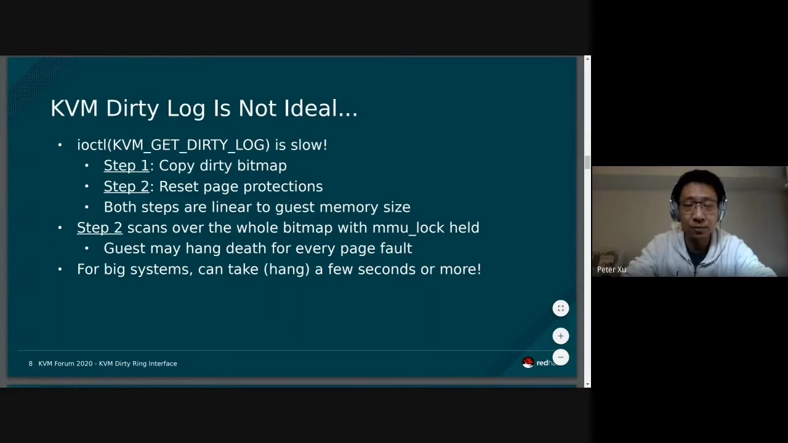

`mmu_lock` 是 KVM 里保护地址空间映射的锁，地位类似普通 Linux 进程里的 `mm` 信号量：任何一次普通的缺页处理都可能要拿它。如果 `KVM_GET_DIRTY_LOG` 的线程长时间持锁，其他 vCPU 线程就只能干等。讲者给出的实测结果是：在一些内存很大的系统上，这一步能花上几秒甚至更久，vCPU 会卡住、无法响应用户交互。

[【跳转到 03:25】](https://www.youtube.com/watch?v=YsQJ-Vll3sg&t=205)

---

## 二、位图：一位一页的账本，最省也最贵

### 2.1 位图的格式：一个 bit 对应一个客户机页

老接口的账本是一张**脏页位图**：每个 bit 对应客户机的一个小页（x86 上小页是 4 KiB），bit 为 1 表示这一页在上一轮同步之后被写过。`KVM_GET_DIRTY_LOG` 的工作就是把这张位图从内核拷到用户态——注意是**拷贝**，不是共享，用户态拿到的是一份快照。

位图是按内存槽（memory slot）组织的：KVM 把客户机内存登记成若干个 slot，位图覆盖 slot 里的页，`KVM_CLEAR_DIRTY_LOG` 的 range 参数也是在 slot 内部按页算的。所以"位图多大"这个问题要落到 slot 上算。

### 2.2 算一笔账：1 TiB 内存要 32 MiB 位图

既然一位一页，位图大小就可以直接算出来：

$$
\text{位图字节数} = \frac{\text{客户机内存}}{4\ \text{KiB}} \times \frac{1\ \text{字节}}{8\ \text{bit}}
$$

代入 1 TiB：

$$
\frac{1\ \text{TiB}}{4\ \text{KiB}} = 2^{28}\ \text{页},\qquad \frac{2^{28}}{8} = 2^{25}\ \text{字节} = 32\ \text{MiB}
$$

也就是说，一台 1 TiB 内存的虚拟机，光脏页位图就要 32 MiB。这个数字本身不大，问题在于它是**线性**的：内存翻倍，位图翻倍，而每次同步都要把整张位图拷一遍。讲者的原话是"位图大小与客户机内存大小成线性关系，内存很大时这次拷贝就要花些时间"。

[【跳转到 02:10】](https://www.youtube.com/watch?v=YsQJ-Vll3sg&t=130)

### 2.3 位图既是优点，也是问题本身

讲者用一页幻灯片专门讲"脏页位图的好与坏"。

它的好在于：从很多角度看它都是理想结构。首先它非常高效——用单个 bit 表示客户机的一个小页，如果要覆盖整个客户机内存，这大概是存储这份数据最省的方式；其次它很容易用原子操作来序列化，因为我们本质上就是在摆弄这些 bit。

它的坏在于：VM 越来越大，脏页位图也越来越大。收集位图一定越来越慢，因为我们总是要按整个 VM 来收集；而且有时还需要在源端和目标端之间同步位图，比如 post-copy 要丢弃位图，post-copy 恢复时又要同步这类信息。结论是：**脏页位图这个结构很难扩展**。

[【跳转到 08:25】](https://www.youtube.com/watch?v=YsQJ-Vll3sg&t=505)

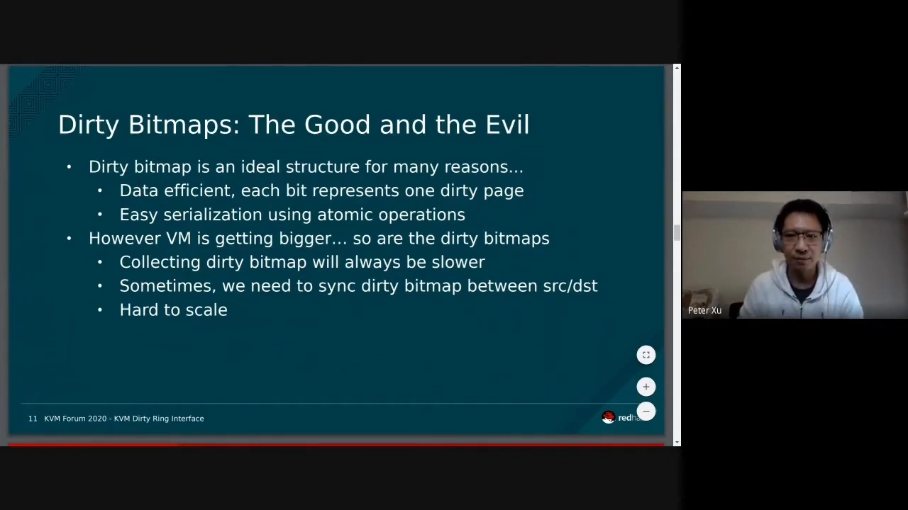

---

## 三、两次"变体"：把两步拆开，把第一轮的写保护省掉

在换掉位图之前，社区先给老接口打了两个补丁。

### 3.1 变体一：`KVM_CAP_MANUAL_DIRTY_LOG_PROTECT2` 把两步拆成两个 ioctl

这个新能力要解决两件事，首先是**把两步拆开**：

- `KVM_GET_DIRTY_LOG` 只收集脏页位图，**页仍然保持可写**；
- 新引入的 `KVM_CLEAR_DIRTY_LOG` 负责重置页保护。

更好的是，因为这是一个新接口，可以让它多带一个范围（range）参数：不必为整个 slot 重置页保护，而是可以按很细的粒度只重置 slot 里的一部分客户机页。

[【跳转到 05:05】](https://www.youtube.com/watch?v=YsQJ-Vll3sg&t=305)

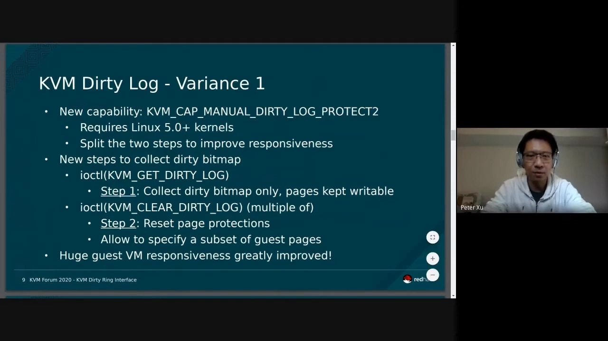

拆开的意义在于**把一次长持锁变成多次短持锁**。原来第二步要持着 `mmu_lock` 扫完整张位图，现在用户态可以把"重新写保护"切成若干段、分多次调用，每次只处理一段页范围，vCPU 线程等锁的时间就从"几秒"变成"一小段"。讲者说，这个新能力极大改善了 VM 的响应性，在较新的内核里已经被大量使用。

顺便说清一个容易混淆的点：所谓"原子性"在这里指的是**收集动作本身是一次快照**——`KVM_GET_DIRTY_LOG` 返回的那一刻，位图描述的是一段确定的时间窗口；而"重新写保护"被推迟到 `KVM_CLEAR_DIRTY_LOG` 去做，所以这两件事不再被强行绑在一起，中间那段时间页是可写的。这也正是为什么必须把两步拆成两个接口：拆开之后，"什么时候重新上锁"变成了用户态可以决定的策略。

### 3.2 变体二：`KVM_DIRTY_LOG_INITIALLY_SET` 让第一轮不必写保护

拆开两步之后，还有一个慢的地方：**开启脏页日志这个动作本身**。开启的方式是把 `KVM_MEM_LOG_DIRTY_PAGES` 这个标志打到 memory slot 上，而这一步需要对所有客户机 RAM 做一次初始的页保护重置——本来所有 RAM 都是可写的，一旦开始脏页日志，就得把所有页都写保护起来。

[【跳转到 06:20】](https://www.youtube.com/watch?v=YsQJ-Vll3sg&t=380)

解法很巧：新增一个位 `KVM_DIRTY_LOG_INITIALLY_SET`。如果它被设置，KVM 就把整张脏页位图初始化为全 1，也就是**假设所有页一开始就是脏的**。这对用户态没有影响，因为对迁移来说，第一轮本来就会把整张位图都置 1；但对 KVM 来说这就关键了——位图全是 1，就意味着开启这个特性时不需要写保护，第一轮迭代可以直接跳过页保护。

[【跳转到 06:45】](https://www.youtube.com/watch?v=YsQJ-Vll3sg&t=405)

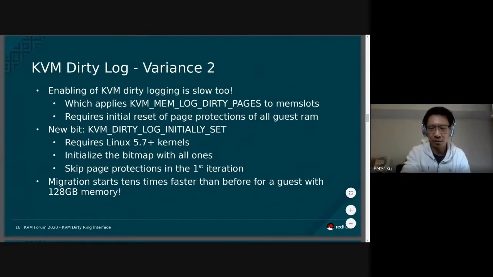

讲者给出的实测数据是：对一台 128 GB 内存的客户机，迁移启动比之前快了 10 倍。

这里藏着一个值得体会的推理：**写保护是"为了知道哪些页脏"才付出的代价；如果一开始就认定所有页都脏，这笔代价就可以不付**。位图全 1 时，"脏"这个信息没有信息量，但它恰好匹配第一轮"全量搬运"的语义，于是省掉了整整一轮全量写保护。

---

## 四、脏页环：把全局位图换成 per-vCPU 的环形队列

### 4.1 设计上的四个决定

位图难以扩展，于是有了 KVM dirty ring。这份工作最早可以追溯到 2017 年，后来 Paolo 接手，再后来是讲者本人；它最初是为 COLO（KVM 的高可用基础设施）设计的。设计有四个关键决定：

1. **用 per-vCPU 的环存脏页 PFN**。PFN 是 page frame number，也就是页框号，简单说就是页索引。位图没有了，取而代之的是每个 vCPU 一个环，每个环里是若干 PFN 条目。
2. **数据结构不再是全局的**。环的大小可以配置，和客户机内存大小完全不成线性关系，可以很小，比如只有 4K 项，或者 64K 项。
3. **收集和页保护从一开始就分开**。第一步和第二步可以分别做。
4. **用户态和内核共享同一份数据**。用 `mmap` 把同一页同时映射到内核和用户态，取信息时没有额外拷贝，用户态只要读一段内存地址就能拿到；而且用的是线程本地（thread-local）缓冲，对多线程友好。

[【跳转到 10:55】](https://www.youtube.com/watch?v=YsQJ-Vll3sg&t=655)

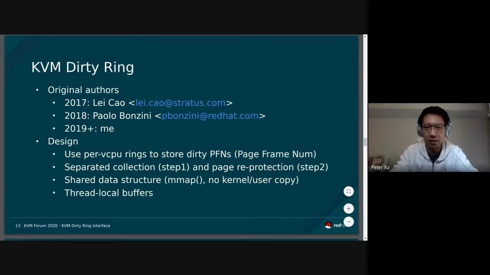

第 3、4 条值得多看一眼：位图时代，"取账本"必须通过 ioctl 把数据从内核搬出来，所以有拷贝开销；脏页环把账本放在一块双方共享的内存里，用户态"取账本"退化成"读内存"。这也是讲者后来总结时说的——同步变得更便宜，因为它可以在后台读一些内存，而不是做很重的 ioctl。

### 4.2 环长什么样：vCPU 与环一一绑定

每个 vCPU 都绑定一个 dirty ring；每个环里有若干个 PFN 条目，条目数量可以在启动虚拟机时配置。每个条目用两个额外的 bit 记录状态，因为每个页索引既可能是一条"脏页地址"，也可能是一条"待重置"的记录。

[【跳转到 12:26】](https://www.youtube.com/watch?v=YsQJ-Vll3sg&t=746)

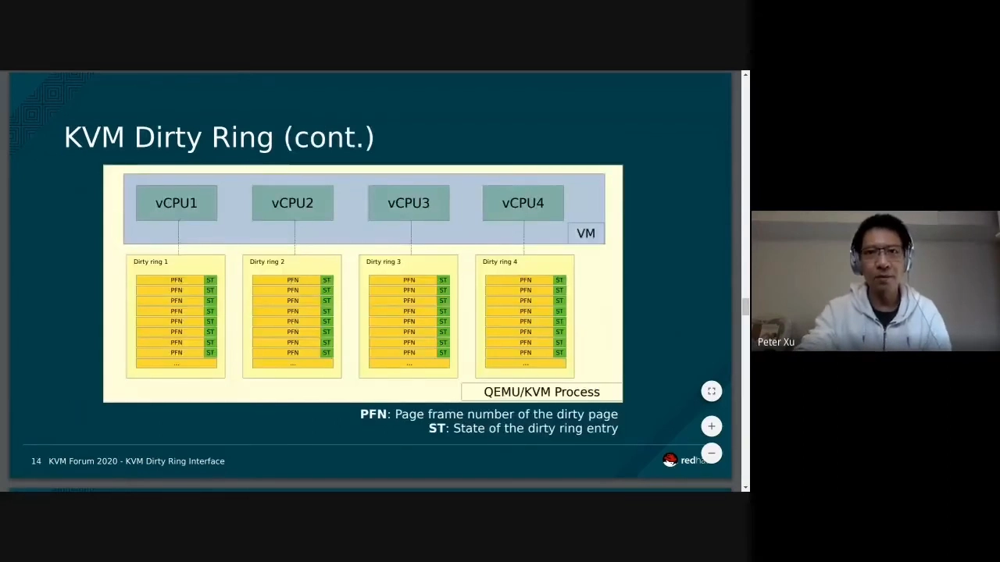

### 4.3 三态状态机：EMPTY、DIRTY、COLLECTED

每个条目的生命周期只有三个状态，讲者说"它其实很简单"：

- **EMPTY**：条目空闲可用，是初始状态。
- **DIRTY**：KVM 插入了一条脏页记录。当某个 vCPU 试图写一页而被 trap 住时，KVM 就往这个 vCPU 的 dirty ring 里插一条新条目，标记为 DIRTY 并写上页索引。之后用户态就能看到这个新变脏的页。
- **COLLECTED**：用户态收集完这个脏 PFN，把状态位设成 COLLECTED，等于告诉内核"这个地址我用完了，你可以回收"。

最后一步又回到内核：内核再读一次这个 PFN，就知道它已经被使用和消费，于是把该 PFN 指向的页重新保护起来，清空条目，回到 EMPTY。

[【跳转到 13:16】](https://www.youtube.com/watch?v=YsQJ-Vll3sg&t=796)

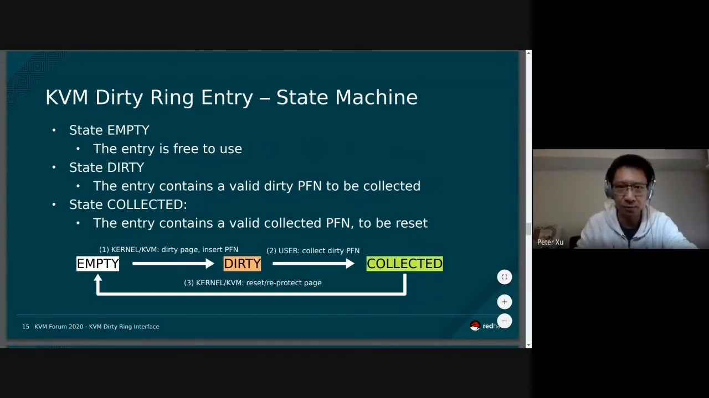

注意这个状态机里"重新写保护"发生在**内核回收条目时**，而不是在"用户态取账本时"。这就是 4.1 里说的"收集与页保护分离"落到代码上的样子：用户态什么时候取账本，和内核什么时候重新上锁，是两件可以各自安排的事。
---

## 五、环会满：这是位图永远不会有的事件

### 5.1 位图不会满，环会

dirty ring 是一个全新的结构，它也带来了一些位图不可能有的东西，最典型的就是"满"（full）事件。原因很直白：位图是为整个客户机内存设计的，它一定装得下所有页，所以永远不会满；而环的大小是固定的——只要 vCPU 持续把页写脏，而用户态收集得不够快，环就会满。

[【跳转到 15:08】](https://www.youtube.com/watch?v=YsQJ-Vll3sg&t=908)

### 5.2 环满时的处理：打断写指令，退出到用户态

环满时，KVM 的做法是打断当前的写指令，让这个 vCPU 不要继续跑，而是做一次 VM exit——实际上是退出到用户态，退出原因是新引入的 `KVM_EXIT_DIRTY_RING_FULL`。用户态由此知道：这个 vCPU 的环满了，它最近写内存写得有点多。

接下来用户态的动作是：

1. reap 这个 dirty ring，至少释放出一些槽位；
2. 发一个新的 ioctl `KVM_RESET_DIRTY_RINGS`，让内核回收这些脏页槽位；
3. 用 `KVM_RUN` 让 vCPU 继续跑，vCPU 会重试刚才被打断的那条指令。

[【跳转到 15:30】](https://www.youtube.com/watch?v=YsQJ-Vll3sg&t=930)

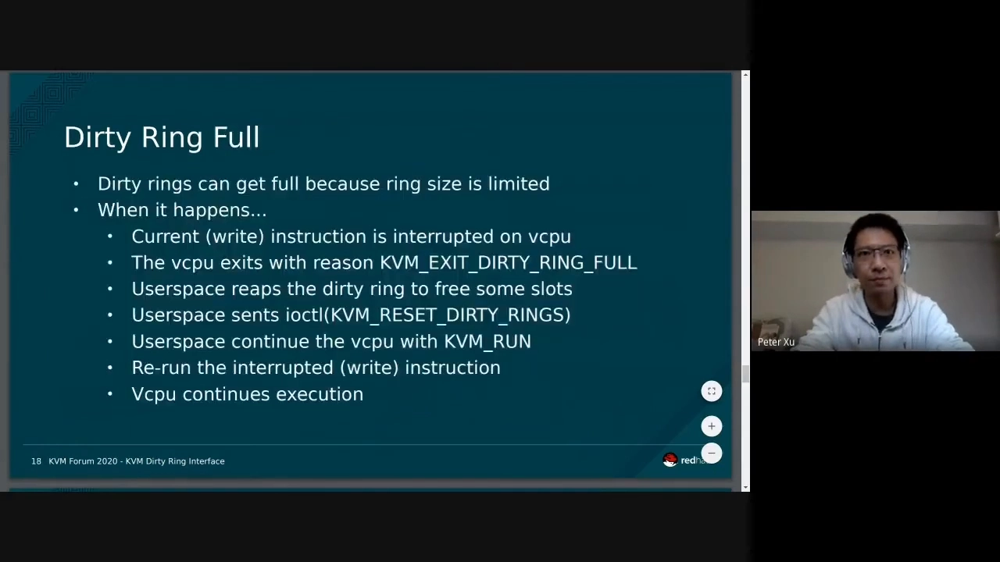

这里能看出一个重要的语义差别：**位图时代，脏页追踪永远是异步的，内核没办法让 vCPU 停下来；脏页环可以**。这一点本来是"容量有限"带来的副作用，却意外变成了一个能力——它让 vCPU 第一次可以被"因为脏页太多"而暂停。讲者把这个副作用留到后面专门讲（见第七节）。

### 5.3 两种接口的逐项对照

演讲里有一页把两个接口的差异列成了表，这张表基本就是本节的小结：

| 对比项 | Dirty Logging（位图） | Dirty Ring（脏页环） |
| --- | --- | --- |
| 数据结构 | 位图（Bitmap） | 环/数组（Ring / Array） |
| 数据元素 | 一个 bit | 一个页框号（PFN） |
| 是否全局结构 | 是 | 否（线程本地） |
| 是否需要拷贝 | 是 | 否（mmap 共享） |
| 收集方式 | `KVM_GET_DIRTY_LOG` | 直接读环里的内存 |
| 页重置方式 | `KVM_CLEAR_DIRTY_LOG` | `KVM_RESET_DIRTY_RINGS` |
| 收集粒度 | 按 slot | 按 vCPU、按 PFN |

[【跳转到 14:59】](https://www.youtube.com/watch?v=YsQJ-Vll3sg&t=899)

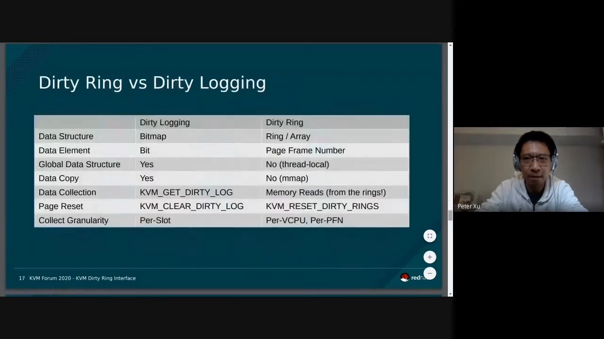

这张表里最值得记住的是最后两行。**收集粒度从"按 slot"变成"按 vCPU、按 PFN"**，意味着用户态可以精确知道"是哪个 vCPU 弄脏了哪一页"，而不只是"这个 slot 里有一批页脏了"。粒度变细，能做的事就变多。

---

## 六、粒度变细之后：一个意外的副作用

讲者把这一节叫作"副作用（Side Effect）"。

因为 dirty ring 可以阻塞 vCPU，它天然提供了一种对源端限流的手段。于是 auto-converge（迁移过程中为了收敛而限制源端速度的机制）可以做得更细：

- **限流对象更细**：从全局限流变成 per-vCPU 限流（因为环是 per-vCPU 的）；
- **判断时机更密**：以前只在 dirty sync 时判断，而 dirty sync 非常少，只在每轮迭代开始时发生一次；现在几乎每次 RAM 写都可能触发 ring full，所以"哪个 vCPU 把内存弄得很脏"这件事可以被非常灵敏地评估。

[【跳转到 18:00】](https://www.youtube.com/watch?v=YsQJ-Vll3sg&t=1080)

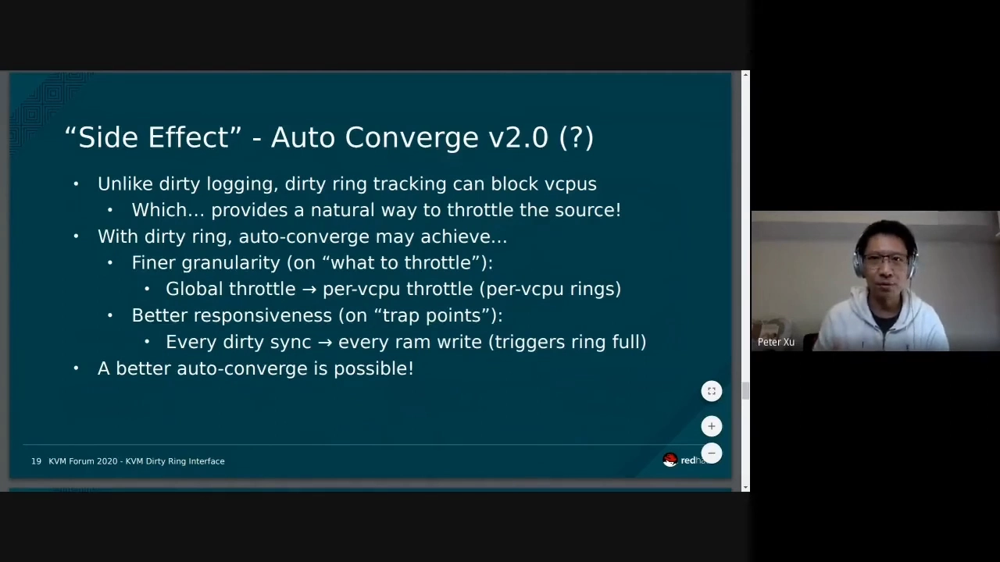

为什么"更细"很重要？讲者举了一个很具体的例子：假设有两个线程，一个是 worker 线程，一个是 GUI 线程，用户正在用 GUI。如果 worker 线程脏页写得太多太快，全局限流就会把整个 VM 一起限速，GUI 也跟着卡；而我们真正想要的是让 worker 线程变慢，同时让 GUI 继续跑，用户还能有响应。有了 per-vCPU 的环，才有可能识别出"是哪个 vCPU 脏得太快"。

[【跳转到 18:25】](https://www.youtube.com/watch?v=YsQJ-Vll3sg&t=1105)

---

## 七、这条路的尽头：把位图整个去掉

演讲的最后一部分是未来工作，其中最大胆的一条是：**能不能把 QEMU 里所有脏页位图都去掉**。

讲者先划了范围：不止 KVM 层有脏页位图，QEMU 的其他好几层也有，包括 ramblock 层、迁移层。要动它们，就得确保 TCG、VGA 等使用者不受影响，但他相信迁移才是主要的那一个。

[【跳转到 23:00】](https://www.youtube.com/watch?v=YsQJ-Vll3sg&t=1380)

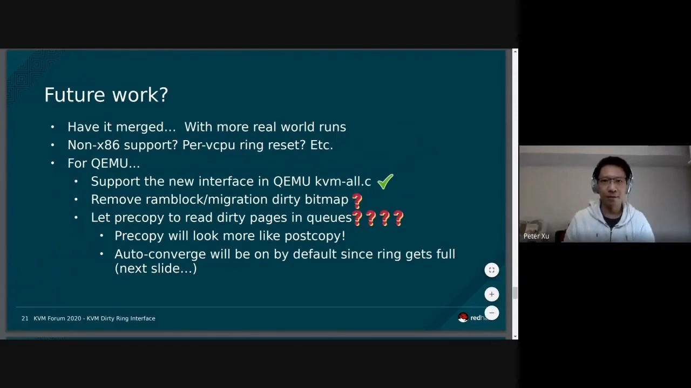

排在更前面的几件事更朴素：等它合入内核，然后用 dirty ring 做更多真实场景的运行，看看还缺什么、哪里可以做得更好；此外还有能否支持非 x86 架构（当时只支持 x86），以及能否做 per-vCPU 的 ring reset（当时它某种程度上还是全局的）。讲者也重申，dirty ring 的主要场景目前仍应是 COLO，但他相信还能找到一些以前没想到的用法——它确实降低了脏页追踪数据结构的内存占用，同步也更便宜，因为它可以在后台读一些内存，而不是做很重的 ioctl。

如果位图全部去掉、改用队列（理想情况下是 per-vCPU 的队列）来缓存脏页，会得到一个很有意思的推论：**auto-converge 会默认开启**，因为环会满——位图不会满，但环会满。也就是说，"限流"从一个可选的调优手段，变成了这套机制的必然后果。

[【跳转到 24:15】](https://www.youtube.com/watch?v=YsQJ-Vll3sg&t=1455)

讲者把这幅图景叫作"想象中的 pre-copy 世界"：迁移线程维护一个 `CURRENT` 指针指向当前要搬的页，每个 vCPU 有自己的队列往里推脏页；队列空就搬 `CURRENT` 指向的页并推进指针，队列非空就挑一个队列搬它的第一页，必要时按轮转顺序去 kick 被环满阻塞的 vCPU。vCPU 线程则收集脏页环：页号大于 `CURRENT` 的直接丢掉（那一页还没搬，反正会搬最新的），小于等于 `CURRENT` 的塞进队列；如果某个 vCPU 的队列里积压超过 N 页，就停住这个 vCPU，等迁移线程来 kick。

[【跳转到 25:30】](https://www.youtube.com/watch?v=YsQJ-Vll3sg&t=1530)

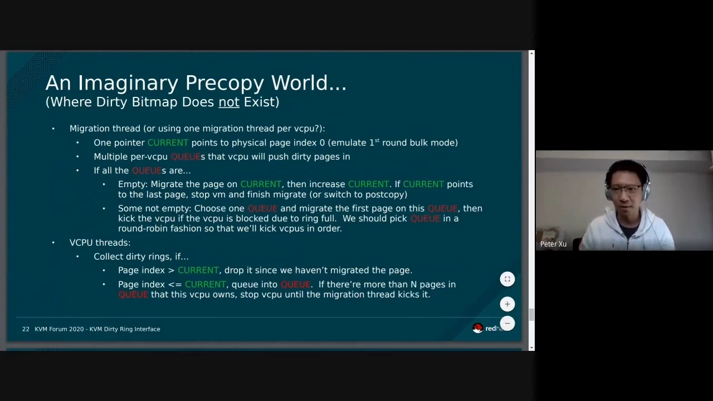

讲者自己给这幅图景打了问号，也说这是"想象中的世界"。但它的价值在于把取舍讲清楚了：这条路线的核心是**用一套聪明的逻辑去操纵 dirty ring、控制 vCPU 怎么跑**，在限制源端脏页速率的同时保住宿主与客户机的响应性。

---

## 小结

- 脏页追踪分两步：**写保护**把"写"变成可拦截的事件，**账本**（位图或环）把被拦截的页号记下来。没有写保护，客户机的写对宿主是静默的。
- 位图是"一位一页"的全局账本：1 TiB 内存对应 32 MiB 位图，空间最省、易原子序列化，但大小随内存线性增长，且每次同步都要整张拷贝。
- 老接口 `KVM_GET_DIRTY_LOG` 把"拷贝位图"和"重置页保护"绑在一起，第二步要持 `mmu_lock` 扫全表，大内存机器上能让 vCPU 卡住几秒。
- 变体一把两步拆成 `KVM_GET_DIRTY_LOG` 与 `KVM_CLEAR_DIRTY_LOG`（后者可指定页范围），把一次长持锁变成多次短持锁。
- 变体二用 `KVM_DIRTY_LOG_INITIALLY_SET` 把位图初始化为全 1，跳过第一轮的全量写保护，128 GB 客户机的迁移启动快了 10 倍。
- 脏页环把账本换成 per-vCPU 的定长环形队列：元素是 PFN 而非 bit，用 `mmap` 与内核共享、无拷贝，收集与页保护从一开始就分离。
- 环会满，位图不会：环满时 vCPU 以 `KVM_EXIT_DIRTY_RING_FULL` 退出，用户态 reap 后发 `KVM_RESET_DIRTY_RINGS` 再继续，这条"能停 vCPU"的能力顺带让 auto-converge 有了 per-vCPU 的粒度。

## 关键术语速查

| 术语 | 一句话解释 |
| --- | --- |
| 脏页（dirty page） | 上一轮同步之后被客户机写过的内存页，是下一轮只需要重传的那部分。 |
| 写保护（write-protect） | 清掉页表里的写权限，让客户机的写触发一次陷入，从而被宿主看见。 |
| 脏页位图（dirty bitmap） | 一位一页的全局账本，`KVM_GET_DIRTY_LOG` 把它从内核拷到用户态。 |
| memory slot | KVM 里登记的一段客户机内存，位图与 `KVM_CLEAR_DIRTY_LOG` 的范围都按 slot 计算。 |
| `KVM_CLEAR_DIRTY_LOG` | 变体一引入的 ioctl，专门负责把指定范围的页重新写保护。 |
| `KVM_DIRTY_LOG_INITIALLY_SET` | 变体二引入的位，让位图初始化为全 1，从而跳过第一轮的全量写保护。 |
| PFN | page frame number，页框号，也就是页索引；脏页环用 PFN 而不是 bit 记录脏页。 |
| 脏页环（dirty ring） | per-vCPU 的定长环形队列，条目在 EMPTY、DIRTY、COLLECTED 三态间流转。 |
| `KVM_EXIT_DIRTY_RING_FULL` | 环满时 vCPU 退出到用户态的退出原因。 |
| `mmu_lock` | KVM 保护地址空间映射的锁，缺页处理也要拿它，长持锁会拖住所有 vCPU。 |
