# 只备份变更块：脏位图、基线文件与备份链

> 视频来源：[Incremental backups: Good things come in small packages!](https://www.youtube.com/watch?v=a2BNswm_yf8)（YouTube · KVM Forum 2015 · Jon Snow，Red Hat）｜时长约 28 分钟
> 导读：这是一场 2015 年 KVM Forum 的设计演讲，讲 QEMU 怎么用「块层脏位图 + qcow2 backing file」实现增量备份。它是「只持久化变更页」这套思路在磁盘侧的完整实现——基线、变更集、链、落盘方式、恢复时如何叠加，一样不少。本文按这条主线重排，末尾把它映射回内存快照。

## 本讲要解决的核心问题（SCQA）

**背景**：给一台虚拟机做备份，第一天的全量备份是 128 GiB。

**冲突**：接下来一周每天都备份，可每天的备份还是 128 GiB——不管盘上到底改了几个 GB。存储被同一份数据反复占满，备份窗口也被反复拉长。

**疑问**：能不能只备份「改过的块」？如果只备份改过的块，恢复时又怎么拼回一块完整的磁盘？

**回答（中心思想）**：需要两样东西配成一对——一份**永不被改写的基线**（全量备份文件），和一份**从基线时刻开始记录的变更集**（脏位图指出的脏块）。增量文件通过 backing file 引用基线，所以它自己很小，却仍然是一个完整的时间点视图；恢复时按链逐层叠加，链越长越慢，所以要定期做新的同步点来截断。

## 一、全量备份贵在「重复复制没变的数据」

演讲开场把问题摆得很直白：周一 128 GiB，之后每天还是 128 GiB，「不管盘上多少数据变了」。这种做法存储效率极差、又笨又慢，但它有一个真实的优点——**简单、方便，想回到某一天直接拿那天的文件就行**。

[【跳转到 02:39】](https://www.youtube.com/watch?v=a2BNswm_yf8&t=159)

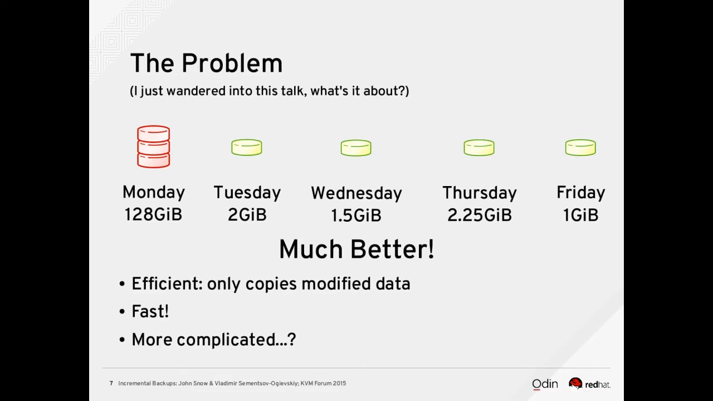

目标于是变成：第一天仍然做全量，之后**只把变化的数据复制出来**。周一的 128 GiB 之后，周二 2 GiB、周三 1.5 GiB、周四 2.25 GiB、周五 1 GiB——「效率高、速度快」，代价是「更复杂？」。整场演讲其实就是在回答这个问号。

## 二、变更集从哪来：块层脏位图

### 2.1 不发明新轮子，复用已有的脏位图

2011 年 Jagane Sundar 的 LiveBackup 已经试过这条路：独立的命令行工具、全新的网络协议、独立线程、用临时快照保证原子性、用**内存中的脏块位图**记录变更——最终没有合入。

[【跳转到 03:31】](https://www.youtube.com/watch?v=a2BNswm_yf8&t=211)

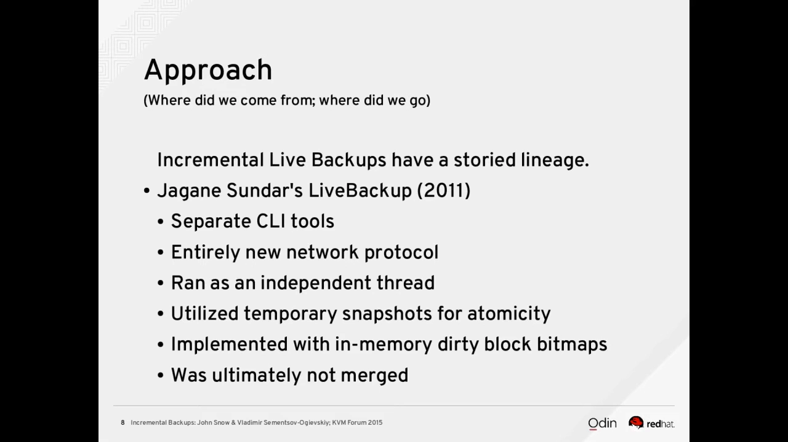

2014 年 Fam Zheng 的版本换了思路：**不新增任何外部工具和协议**，直接复用 QEMU 里已经存在的块层脏位图（`BdrvDirtyBitmap`）。这个结构本来就在为 `drive-mirror` 和在线块迁移记录脏扇区，有可配置的粒度，而且一个驱动器上可以挂任意多个。

[【跳转到 09:03】](https://www.youtube.com/watch?v=a2BNswm_yf8&t=543)

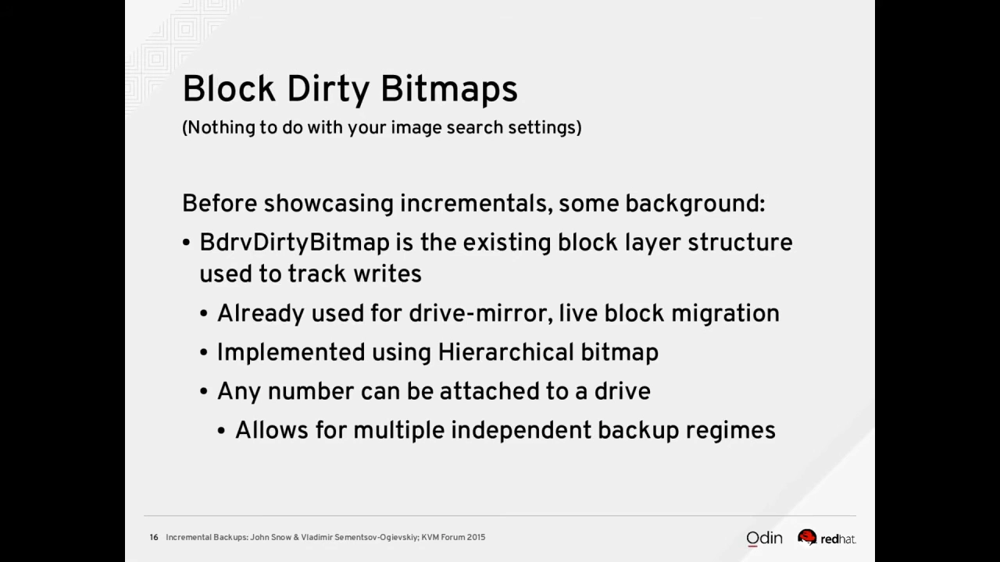

对外只加两个参数：`drive-backup` 命令上多一个 `sync=incremental` 模式，加一个 `bitmap=<name>` 指明用哪张位图。

[【跳转到 05:20】](https://www.youtube.com/watch?v=a2BNswm_yf8&t=320)

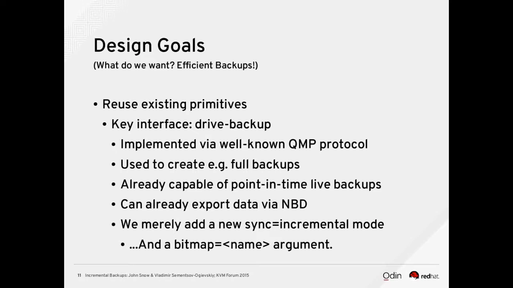

### 2.2 粒度决定「变更集」有多粗

位图不是按字节记的，而是按**扇区**记的，粒度以字节为单位指定，默认约 64 KiB——大致对齐 qcow2 的 cluster 大小。演讲给了一个很直观的换算：粒度 64 KiB 相当于 128 个扇区，**盘上任何一个字节被写，都会导致这 128 个扇区被算作脏**。

[【跳转到 11:01】](https://www.youtube.com/watch?v=a2BNswm_yf8&t=661)

粒度是一个三层的取舍：粒度越小，增量备份越小，但位图本身越占内存；粒度越大，位图省内存，但备份会变大。演讲给了两个具体数字：1 TiB 的盘、粒度 32 KiB，位图占 4 MiB；粒度 128 KiB，位图占 1 MiB。

[【跳转到 10:06】](https://www.youtube.com/watch?v=a2BNswm_yf8&t=606)

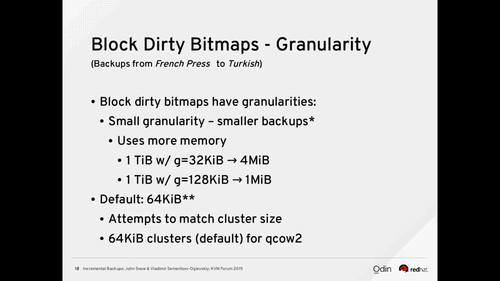

这里还有一层容易踩的坑：位图粒度、备份引擎的 cluster、文件格式自己的 cluster 是**三个独立的粒度**，调不好就会出现「设了更小的粒度却看不到空间节省」的情况。

## 三、一次「同步点」= 新位图 + 全量备份，而且必须原子

### 3.1 为什么必须原子

如果全量备份与新建位图不在同一瞬间完成，两者之间就会留下一个缝隙：这期间发生的写可能既不在全量里，也不在位图里，恢复时就是丢数据。反过来，先建位图、过一会儿再做全量，同一批写又会被算两次——不丢数据，但白占空间。

所以「建立同步点」被做成一个 **QMP transaction**：在同一个事务里 `block-dirty-bitmap-add` 新建位图，同时 `drive-backup` 以 `sync=full` 做全量。事务成功后，全量备份代表「这一刻的完整数据」，位图从「这一刻之后」开始记录新写入。

[【跳转到 16:07】](https://www.youtube.com/watch?v=a2BNswm_yf8&t=967)

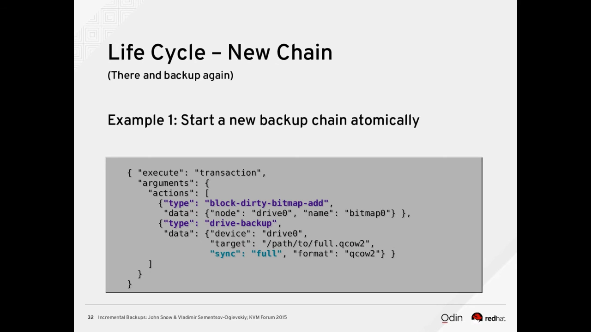

演讲里反复强调「同步点（sync point）」这个词，正是因为它同时定义了两件事：**基线到哪一刻为止**，以及**变更集从哪一刻开始**。

### 3.2 生命周期：一条不断延伸的链

把上面的动作串起来，就是增量备份的生命周期：

1. 新建位图并挂到驱动器上；
2. 建立同步点（全量备份 + 位图清零/新建）；
3. 之后按需做任意多次增量；
4. 需要时再建一个新的同步点，开始一条新链。

[【跳转到 15:45】](https://www.youtube.com/watch?v=a2BNswm_yf8&t=945)

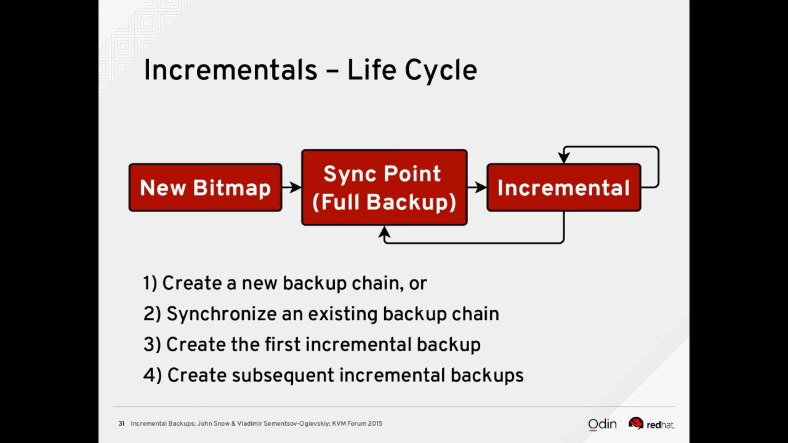

事务还能做多盘一致：一次事务里对多个驱动器同时发 `drive-backup`，这样多块盘拿到的是同一个时间点的备份，而不是各自为政。

[【跳转到 14:48】](https://www.youtube.com/watch?v=a2BNswm_yf8&t=888)

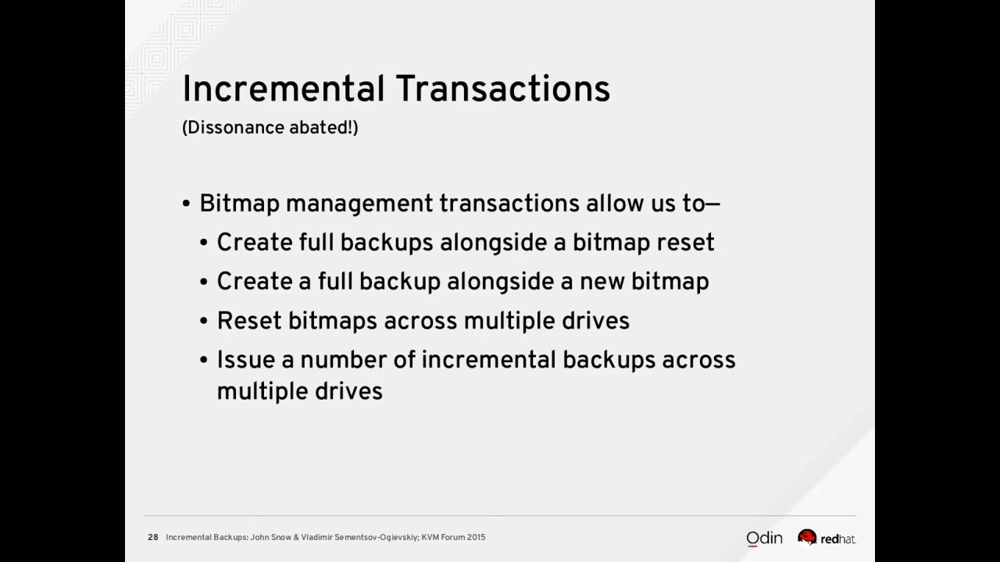

## 四、落盘方式：写新文件，而不是原地覆盖

### 4.1 增量文件通过 backing file 引用基线

第一次增量备份分两步：

```bash
# 1. 建一个空的新 qcow2 文件，把基线文件设为它的 backing file
qemu-img create -f qcow2 inc.0.qcow2 -b full.qcow2 -F qcow2
```

```json
{ "execute": "drive-backup",
  "arguments": {
    "device": "drive0",
    "bitmap": "bitmap0",
    "target": "inc.0.qcow2",
    "format": "qcow2",
    "sync": "incremental",
    "mode": "existing"
  }
}
```

[【跳转到 17:18】](https://www.youtube.com/watch?v=a2BNswm_yf8&t=1038)

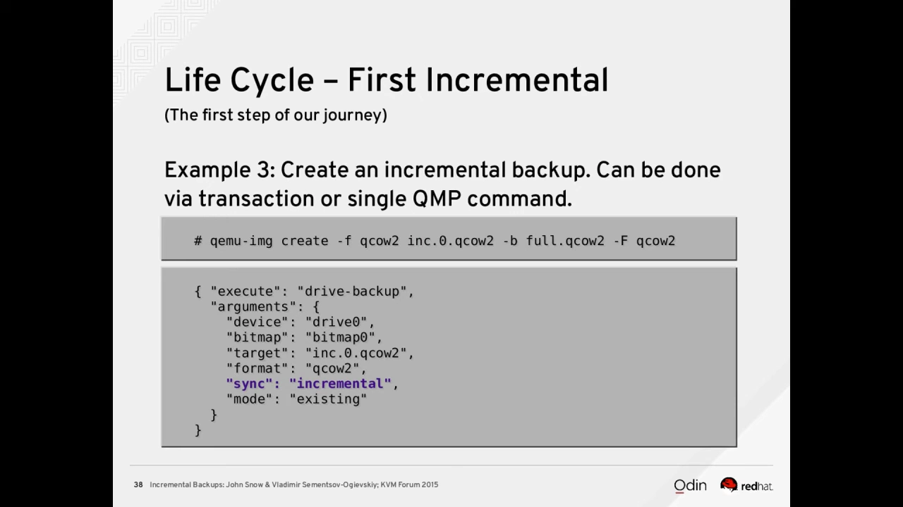

命令执行完，位图被清空，新的增量文件比全量小得多；**但因为 backing file 的存在，你直接指向这个增量文件，得到的就是一个完整的时间点视图**。

[【跳转到 18:33】](https://www.youtube.com/watch?v=a2BNswm_yf8&t=1113)

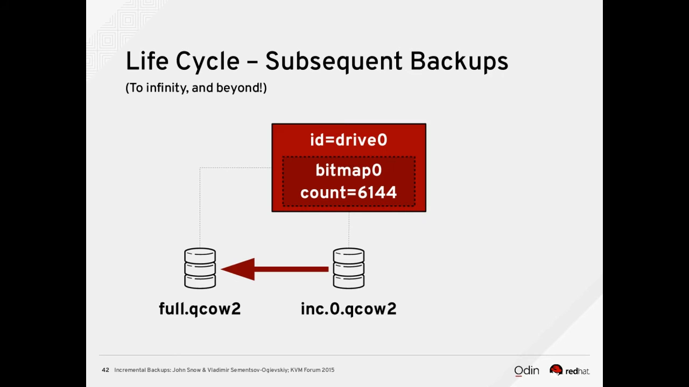

### 4.2 为什么是「写新文件」而不是「原地覆盖」

这是增量快照设计里最关键的一个选择。演讲用一整页回答「为什么不直接用快照」：

- 不需要解析磁盘上格式相关的快照；
- 可以用任何格式；
- 增量备份是**惰性**的：它不增长、不是活的、没有挂进任何东西，所以删掉它不需要任何 IO；
- 可以复用现有的备份框架与 NBD 导出。

[【跳转到 07:43】](https://www.youtube.com/watch?v=a2BNswm_yf8&t=463)

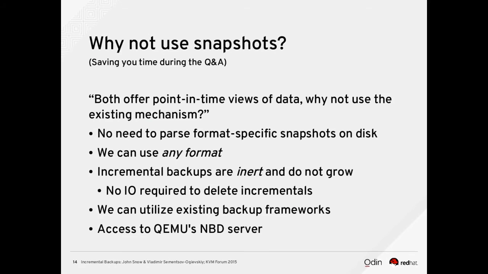

如果改成「原地覆盖基线」，那么基线就不再是基线的——它被改过，之前所有引用它的增量全部失效。**基线不可变，是整条链能成立的前提。**

## 五、恢复与运维：读时叠加，链越长越慢

### 5.1 恢复就是把链读穿

恢复某个时间点，不需要把增量合并成一个新文件，而是直接打开那一层的增量文件：读一个块时先看增量层有没有，没有就回落到 backing file。这就是「读时叠加」。

由此可以推出一条工程结论（演讲没有直接给数字，但机制决定了它）：**链越长，读一个块最坏要穿透的层数越多**。全量 + 一层增量，最坏穿透两层；全量 + $n$ 层增量，最坏穿透 $n+1$ 层。每多一层，就多一次元数据查找和一次可能的读放大。所以演讲里「可以一直做下去，直到硬盘满」是一种能力描述，不是运维建议——实际系统要定期建新的同步点来截断链条。

### 5.2 位图本身也要跟着走

链要能延续，位图就不能丢。演讲花了不少篇幅讲两件事：

- **迁移**：位图被切成 1 KiB 的小块逐块传输（刚好塞进一个以太网帧）；如果所有位图加起来不到 1 MiB，就跳过在线阶段直接整块拷。规模上，64 GiB 磁盘的位图只有 128 KiB。
- **持久化**：位图要能跨关机与重启存活，方案是存进 qcow2 的一个扩展里，把它当成一个通用容器（类似快照的存法），一个文件里可以放多张位图。

[【跳转到 18:46】](https://www.youtube.com/watch?v=a2BNswm_yf8&t=1126)

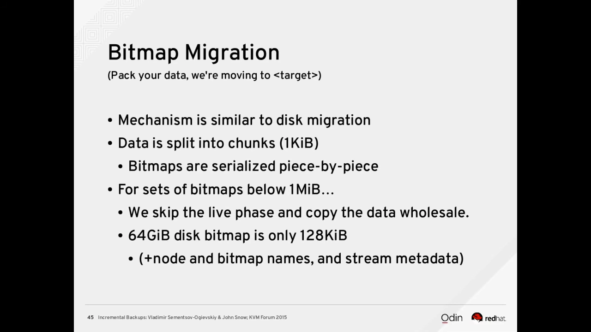

这一点对内存快照同样成立：**变更集本身也是一份需要保存的状态**，不是免费的。

### 5.3 先看「变更集有多大」，再决定要不要备份

`query-block` 能直接读出位图当前的 `count`——也就是被标记为脏的扇区数。按 64 KiB 粒度（128 个扇区）折算成簇，就能估出这次要复制多少数据，于是**在真正发起备份之前，就能判断这次增量会有多大**。下图里 `bitmap0` 的 `count=296704`，`full.qcow2` 是它的基线。

[【跳转到 18:01】](https://www.youtube.com/watch?v=a2BNswm_yf8&t=1081)

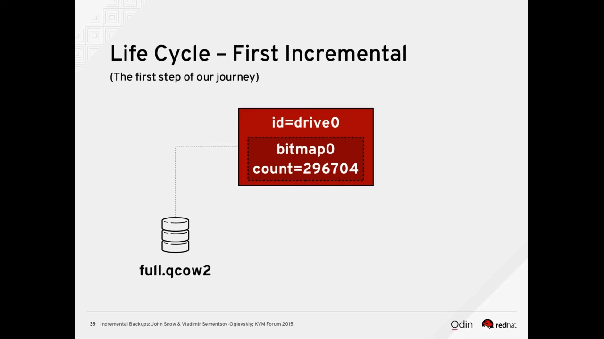

### 5.4 失败不必回到全量

一个容易被忽略的设计目标：如果某次增量备份失败（磁盘满、协议出错），你失去的只是「那个时间点的备份」，但可以立刻从当前时刻重新开始一次增量，**不需要退回重做全量**。因为位图和基线都还在，你可以直接从当前时刻继续往下记，链并没有断。

## 六、映射回内存侧：同一套「基线 + 变更集」

把磁盘侧的这套结构逐项对应到内存快照，会发现它们是同一个模式：

| 角色 | 磁盘备份（本讲） | 内存快照（[另一篇](增量快照只写脏页Firecracker的内存文件与懒加载恢复.md)） |
| --- | --- | --- |
| 基线 | `full.qcow2` 全量备份文件 | 全量内存文件 |
| 变更集 | 块层脏位图指出的脏块 | KVM 记录的脏页集 |
| 增量层 | `inc.N.qcow2`，backing file 指向基线 | diff snapshot，叠在全量快照之上 |
| 叠加方式 | 读块时逐层回落 | 缺页时按需从基线/增量取页 |
| 代价 | 链越长读越慢；位图占内存 | 链越长恢复越慢；缺页一次一页 |

差异只在粒度与触发方式：磁盘侧按扇区/簇记录，内存侧按页（通常 4 KiB）记录；磁盘侧的「同步点」由事务保证，内存侧的「快照点」由先暂停 vCPU 再取位图保证。

## 小结

- 全量备份的问题不是「慢」，而是「重复复制没变的数据」：128 GiB 的盘每天再复制一遍 128 GiB。
- 变更集来自块层脏位图：复用为镜像与迁移写的 `BdrvDirtyBitmap`，只加 `sync=incremental` 与 `bitmap=<name>` 两个参数。
- 粒度是体积与内存的取舍：默认 64 KiB，对齐 qcow2 cluster；粒度、备份引擎 cluster、文件格式 cluster 三层要对齐。
- 基线与变更集必须严丝合缝：用 QMP transaction 把「新建位图」和「全量备份」做成一个原子动作，这个时刻就是同步点。
- 增量写新文件而不是原地覆盖：新文件用 backing file 引用基线，自己只装变更块，却仍是完整的时间点视图；基线不可变是整条链的前提。
- 恢复是读时叠加：逐层回落，链越长穿透越深，所以要定期建新同步点截断链条。
- 变更集本身也要能迁移、能持久化（64 GiB 盘的位图约 128 KiB），否则链会断。
- 内存快照是同一个模式：全量内存文件当基线，KVM 脏页集当变更集，diff snapshot 当增量层。

## 关键术语速查

| 术语 | 一句话解释 |
| --- | --- |
| 全量备份（full backup） | 把整块盘的数据完整复制一份，不依赖任何已有文件。 |
| 增量备份（incremental backup） | 只复制自上次同步点以来被写过的块，其余块靠引用基线获得。 |
| 脏位图（dirty bitmap） | 块层的一张位图，按粒度标记哪些区域被写过，是变更集的来源。 |
| 粒度（granularity） | 位图记录写操作的最小单位，默认约 64 KiB；越小备份越小、位图越占内存。 |
| 同步点（sync point） | 一次「全量备份 + 位图清零/新建」的原子动作，定义基线与变更集的分界。 |
| backing file | qcow2 的引用机制，让增量文件把未变更的块指回基线文件。 |
| 读时叠加 | 恢复时不合并文件，读块时逐层回落，直到在某一层找到数据。 |
| 惰性文件（inert） | 增量备份文件不增长、不挂钩任何东西，删除它不需要 IO。 |
| 备份链（backup chain） | 一份全量基线加若干层增量；链越长，读一个块穿透的层数越多。 |
| QMP transaction | QEMU 的原子命令组，用来保证多盘、多位图动作落在同一瞬间。 |