# 增量快照只写脏页：Firecracker 的内存文件与懒加载恢复

> 视频来源：[How AI Agent Sandboxes Actually Work: Firecracker MicroVMs, Snapshots & 125 ms Boots](https://www.youtube.com/watch?v=HhW1lnN6xc0)（YouTube · XOR）｜时长约 24 分钟
> 导读：这支视频用十二章讲清 AI 沙箱的五个零件（强隔离、快照、懒加载、唯一性、预热池）。本文只取第 6、7 章——「冻结一台机器」与「让机器在内存到货之前先跑起来」——回答一个问题：**为什么增量快照的体积能比全量小得多，代价又落在哪里**。字幕为自动生成，文中已订正术语（如 `userfaultfd`、`REAP`）。

## 本讲要解决的核心问题（SCQA）

**背景**：Firecracker 把一台 MicroVM 从 `start` 命令带到客户机第一个进程，只要约 125 毫秒；平台再用一个「预热池」把这点时间也藏起来。

**冲突**：但真正的冷启动大头不在内核，而在语言运行时、库导入和缓存预热——这些工作每次一模一样。于是最划算的做法是「做一次，然后把整台机器冻住」。可一旦要冻住整台机器，直觉做法就是把所有内存字节都写进文件；而一台沙箱可能有几个 GB 内存，程序实际只会碰其中很小一部分。

**疑问**：既然每次只有少数页变过，为什么还要把整块内存重写一遍？「只持久化变更页」到底凭什么成立，省下的体积又从哪来？

**回答（中心思想）**：因为一次快照被拆成**内存文件**和**状态文件**两部分，而体积几乎全压在内存文件上；只要手里已经有一份全量内存文件作基线，再让 KVM 记下「自上次快照以来被写过的页」，第二次快照就只需写出这批脏页。省下来的正是「没变过的页 × 页大小」；代价则转移到恢复侧——基线页和变更页要在读的时候才拼回去。

## 一、快照省下的不是启动时间，而是「已经做过一次的工作」

### 1.1 冷启动里最贵的一段，每次都在重复

视频把一次冷启动拆成四段：`boot`（引导内核）、`start Python`（拉起语言运行时）、`import libraries`（导入库）、`warm caches`（预热缓存）。内核引导只是第一小段，后面三段才是大头，而它们**每一次都完全相同**。

[【跳转到 11:44】](https://www.youtube.com/watch?v=HhW1lnN6xc0&t=704)

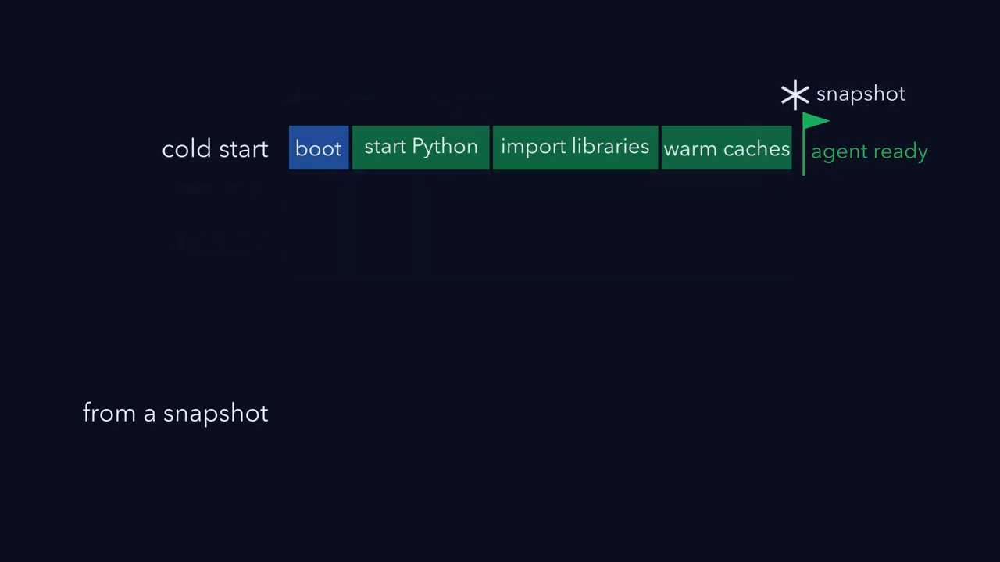

所以策略很自然：把这段重复劳动做一次，在「agent ready」的那一刻把机器冻住，之后每个新沙箱都从这里出发——**不是启动，而是唤醒**。

### 1.2 冻结的动作只有两步：暂停、拍快照

Firecracker 的控制面把这件事暴露成两个动作：先 `pause`，再 `snapshot`。顺序很重要——机器先停住，快照才是「同一个瞬间」的机器，而不是一边跑一边被拍下的模糊影像。

[【跳转到 12:09】](https://www.youtube.com/watch?v=HhW1lnN6xc0&t=729)

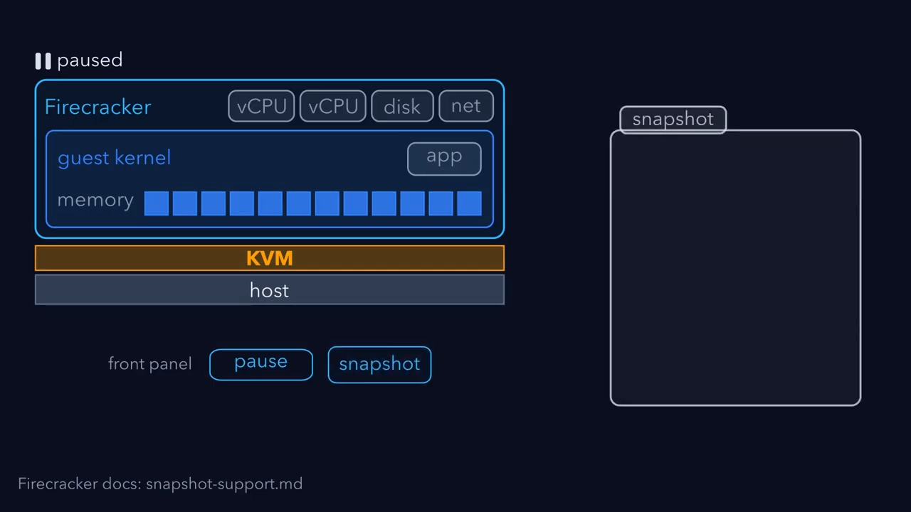

这一点直接决定了后文脏页集的语义：**先冻结，再取脏页位图**，位图描述的才是「截止到这一瞬间，哪些页被写过」。

### 1.3 一次快照写出两个文件，体积几乎全在内存那一份

快照落盘时被拆成两份：

- **内存文件**：客户机内存的每一个字节；
- **状态文件**：每颗 vCPU 的寄存器状态，加上每个设备的状态；
- **磁盘**：不在快照里，由你自己单独保存。

[【跳转到 13:15】](https://www.youtube.com/watch?v=HhW1lnN6xc0&t=795)

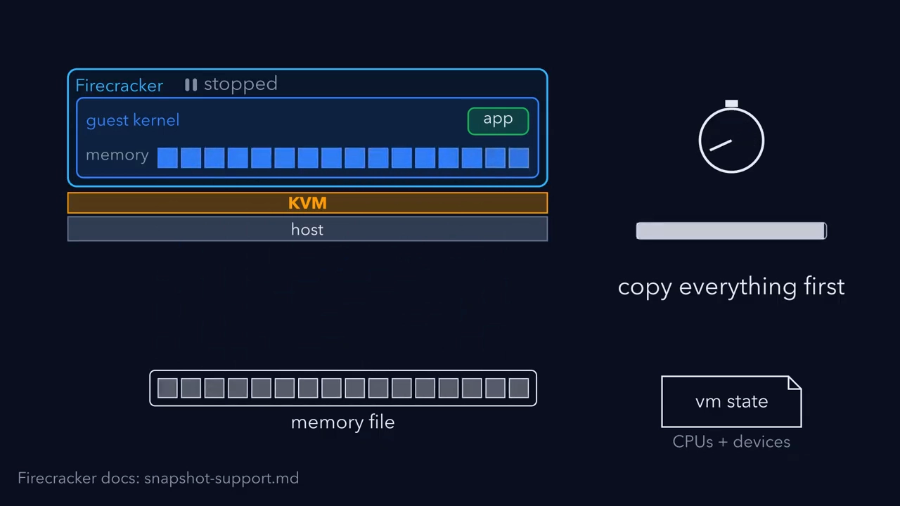

状态文件只跟 vCPU 数量、设备数量有关，与内存容量无关；内存文件则随内存容量线性增长。一台沙箱动辄几个 GB 内存，而设备就那么几个——**所以「快照太大」这个问题，本质上就是「内存文件太大」**。想缩小快照，只能从内存这一侧下手。

## 二、只写变更页：把「全量」换成「基线 + 变更集」

### 2.1 全量快照：每个页都要落盘

全量快照的做法最直白：客户机内存有多少页，就往文件里写多少页。视频用一排方格表示客户机内存，全量快照的方格是「全灰」——每一格都被复制出去了。

[【跳转到 12:16】](https://www.youtube.com/watch?v=HhW1lnN6xc0&t=736)

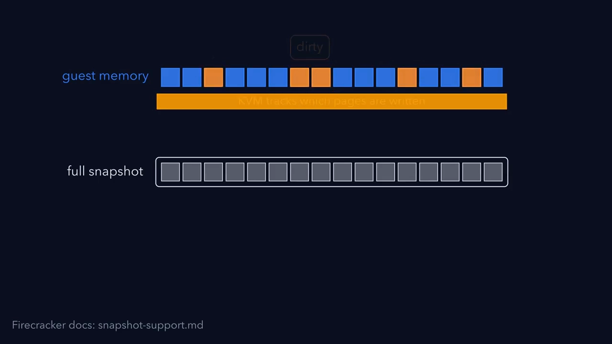

### 2.2 变更集的来源：KVM 记得哪些页被写过

同一个画面里还有另一种颜色：橙色的格子代表「自上次快照以来被客户机写过的页」，下方标注 KVM 正在追踪这些写操作。这正是 2.4.1「脏页位图与写保护」讲的那套追踪机制——写保护或位图记下每一次写，最终得到一份**脏页集**。

关键点在于：脏页集是**相对某个基线**才有意义的。它回答的不是「内存里有什么」，而是「相对上一次快照，内存里哪里变了」。

### 2.3 增量快照 = 一份全量基线 + 之后每次只写脏页

视频给出的定义只有一句话：**KVM 能追踪客户机自上次以来写过哪些页，所以 diff snapshot 只保存这些脏页，叠在一份全量快照之上**。在 Firecracker 里，这个能力当时还是 developer preview。

[【跳转到 12:16】](https://www.youtube.com/watch?v=HhW1lnN6xc0&t=736)

这句话里藏着两个前提，缺一不可：

1. **必须有一份基线**：第一次快照只能是全量的，因为此前没有任何「已知状态」可以引用；
2. **必须有一份变更集**：从基线那一刻起，所有写操作都要被记录下来，否则恢复时那些改动就丢了。

于是快照不再是「一份文件」，而变成一条**链**：全量基线在最底下，之后每次增量只往上叠一层脏页。这也解释了为什么增量快照天然要回答「链有多长」的问题——第 3.5 节会回到这一点。

### 2.4 体积差多少：一笔可以算的账

设客户机内存大小为 $M$，状态文件大小为 $S_{\text{state}}$，页大小为 $p$，两次快照之间被写过的页数为 $d$，那么：

$$
S_{\text{full}} = M + S_{\text{state}}
$$

$$
S_{\text{diff}} = d \cdot p + S_{\text{state}}
$$

两者之比近似为：

$$
\frac{S_{\text{diff}}}{S_{\text{full}}} \approx \frac{d \cdot p}{M}
$$

也就是说，**增量快照的体积占比，就是「脏页覆盖的内存比例」**。一台刚热好、随后只处理一个请求的沙箱，改动的页相对于整个内存只是零头，$d \cdot p \ll M$，体积自然掉一个数量级；反过来，如果机器把内存几乎写了一遍，$d \cdot p \to M$，增量就退化回全量，这时还不如直接做全量快照。

视频里有一个侧面的量级佐证：E2B 把「暂停」的成本估成**每 GB 内存约 4 秒**，「恢复」约 1 秒——成本是按内存容量计的，说明内存文件确实是这条路径上的主要质量。

[【跳转到 19:39】](https://www.youtube.com/watch?v=HhW1lnN6xc0&t=1179)

## 三、恢复：不是把内存拷回来，而是把页「拼」回来

增量快照把成本从「写」挪到了「读」。如果恢复时要把基线页和所有变更页合并成一个完整的内存镜像再启动，那省下的落盘体积就白省了。Firecracker 的做法是不合并。

### 3.1 私有映射 + 首次触碰缺页

恢复时，Firecracker 不把内存文件拷进 RAM，而是把文件**私有地映射**进新机器，然后立刻开跑。客户机第一次碰到某一页时，宿主内核才把那一页从文件里读进来——这是一次缺页。

[【跳转到 13:36】](https://www.youtube.com/watch?v=HhW1lnN6xc0&t=816)

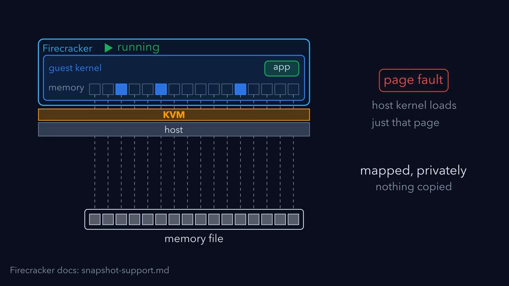

「私有映射」是这里的关键词：文件本身永远不被修改。客户机写某一页时，拿到的是这一页的私有副本。于是「基线页」和「变更页」在恢复时并不需要预先合并成一个大文件，而是**在读路径上按需叠加**。

### 3.2 写时复制：同一份快照可以喂给很多台机器

私有映射带来一个漂亮的副作用：把同一份内存文件恢复成多台机器，它们可以共享所有「只读过的页」，每台只为「自己改过的页」保留副本——这就是写时复制。

[【跳转到 14:12】](https://www.youtube.com/watch?v=HhW1lnN6xc0&t=852)

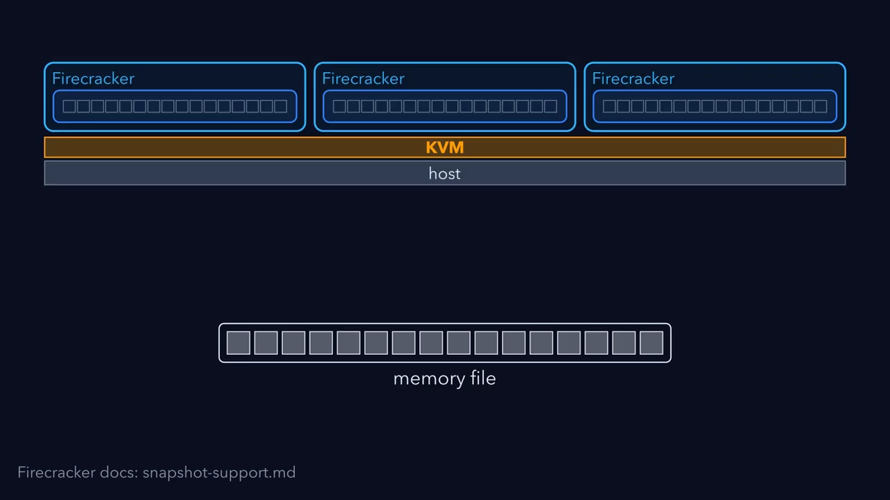

这一点对「快照 + 增量」的链式结构尤其重要：链上的每一层都可以被多个恢复实例共享，只有真正被写过的那一页才产生新的副本。

### 3.3 userfaultfd：把缺页交给一个独立程序

如果内存文件不在本地磁盘，而在网络或对象存储上，还可以换一种更可控的方式：Linux 的 `userfaultfd` 允许把缺页处理交给一个独立程序。客户机碰到缺失的页时，这个程序收到消息，去任何地方把页取回来——本地磁盘、网络、对象存储都行。

[【跳转到 14:24】](https://www.youtube.com/watch?v=HhW1lnN6xc0&t=864)

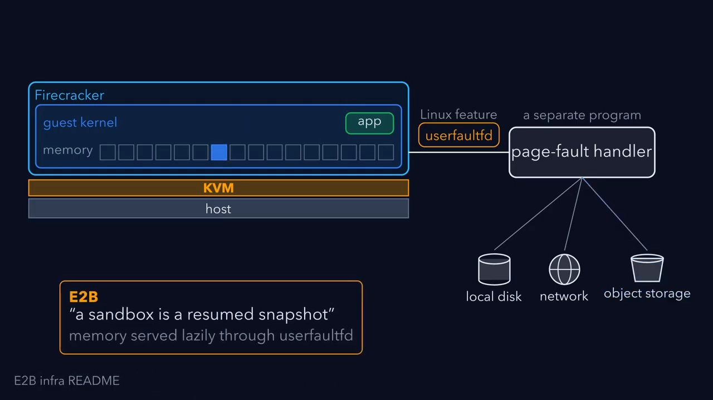

E2B 的文档就是这么描述自己的沙箱的：**沙箱就是一个被恢复的快照，内存通过 userfaultfd 懒加载**。

### 3.4 懒加载的代价：一页一次等待

按需加载不是免费的。页是一页一页到的，每次缺页都是一次小等待。2021 年的 REAP 研究发现，从快照直接跑起来的函数，平均比「内存已经全部加载好」时慢 **95%**；它的解法是记录每个函数固定会用到哪些页，一次性预取，把冷启动延迟平均压到原来的约 1/3.7。

[【跳转到 14:49】](https://www.youtube.com/watch?v=HhW1lnN6xc0&t=889)

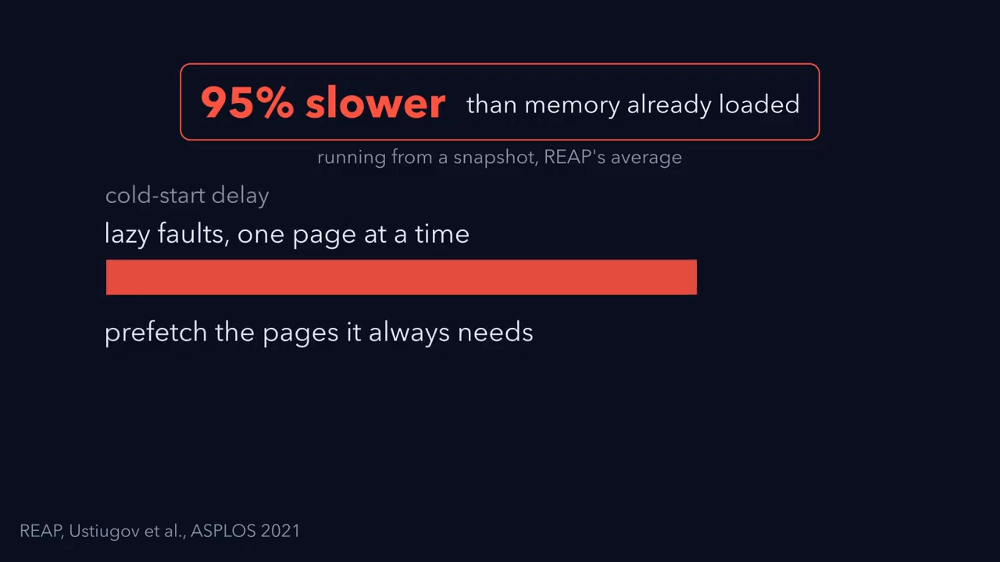

还有一条可靠性代价：如果负责处理缺页的那个程序崩了，机器就会卡在下一次缺页上，永远等不到那一页。

### 3.5 链越长，恢复越慢（由机制推出的结论）

视频没有直接给「快照链长度」的数字，但从上面的机制可以推出一条必然结论：**恢复一台机器时要穿透的层数，等于它引用的基线层数**。

- 一层全量：缺页时只需读一个文件；
- 全量 + 一层增量：缺页时先查增量层有没有这一页，没有才回落到基线；
- 全量 + $n$ 层增量：最坏情况下要穿透 $n+1$ 层才能找到一页。

每多一层，就多一次元数据查找、多一次可能的读放大。所以「增量」不能无限叠加，工程上必须定期做一次新的全量基线来截断链条——这与磁盘侧 backing file 链的取舍是同一个道理（见同目录另一篇《只备份变更块：脏位图、基线文件与备份链》）。

## 四、这条路的三条硬边界

增量快照不是免费的午餐，视频明确列了几条规则。

### 4.1 只能在同类硬件与同类软件上恢复

快照保存的是「机器状态」，不是「可移植的镜像」。恢复端必须与快照端在硬件和软件上匹配。

[【跳转到 12:37】](https://www.youtube.com/watch?v=HhW1lnN6xc0&t=757)

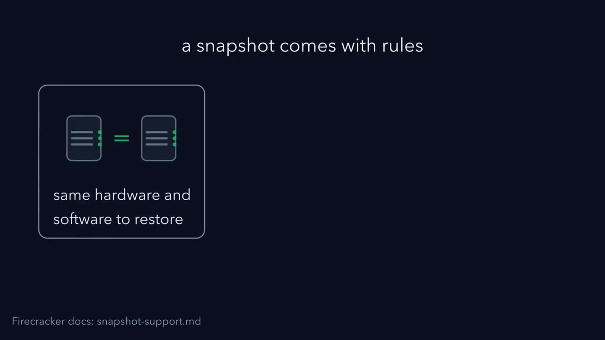

### 4.2 快照文件里有机密，必须当秘密保护

内存文件里是「当时内存里的一切」，包括密钥。Firecracker 的文档因此要求把快照文件当机密数据对待。这也是为什么生产系统会对快照加密并缓存（例如 Lambda 的 SnapStart）。

### 4.3 恢复出来的机器「记得」快照那一刻

同一个快照恢复出的所有克隆，都记得同一个瞬间——包括随机数生成器的状态。所以 AWS 给函数提供了两个钩子：快照前丢掉秘密、关闭连接；恢复后重新生成 ID 和密钥、重新连接。

[【跳转到 17:19】](https://www.youtube.com/watch?v=HhW1lnN6xc0&t=1039)

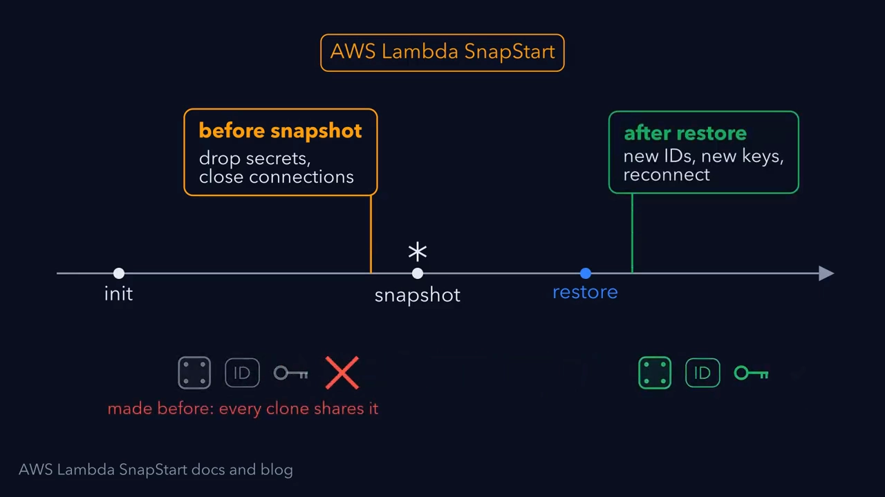

## 五、这套机制在生产里长什么样

把「冻结 + 懒加载恢复」放到生产规模，就是 AWS Lambda 的 SnapStart：函数发布时跑一次初始化，然后对内存和磁盘拍一张 Firecracker 快照，加密缓存；之后每个新副本都从这张快照恢复，并按需分块取回内存。2022 年的发布演示里，一个 Java Spring Boot 函数从 6 秒以上降到 200 毫秒以内。

[【跳转到 18:09】](https://www.youtube.com/watch?v=HhW1lnN6xc0&t=1089)

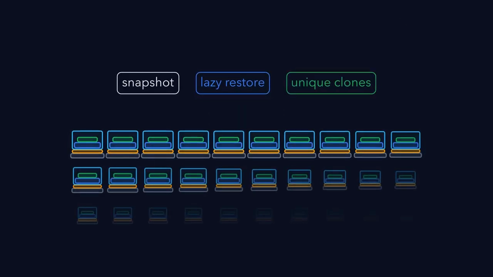

对本文的题目来说，这段生产证据的意义是：**「只写变更页」不是实验室技巧，它支撑的是「快照一次、恢复无数次」这种把落盘成本摊薄到近乎为零的用法**。第一次全量贵一点没关系，后面每一次增量都只写脏页，恢复时再按需拼回来。

## 六、和 5.x 快照小节的衔接

本节只回答「体积」这一个问题，其余留给相邻小节：

| 问题 | 在哪一节回答 |
| --- | --- |
| 快照由哪几部分组成（vCPU / 设备 / 内存） | 5.1 快照的组成 |
| 冻结、序列化、落盘的先后顺序 | 5.2 快照与恢复路径 |
| 脏页怎么被记录下来（位图、写保护） | 2.4.1 脏页位图与写保护 |
| 追踪脏页要付多少性能代价、何时退回全量 | 2.4.3 脏页追踪的开销与精度取舍 |

本节的结论可以压成一句话：**快照的体积问题就是内存文件的体积问题；内存文件的体积问题，靠「一份基线 + 一份变更集」解决。**

## 小结

- 一次快照写出两个文件：内存文件（随内存容量线性增长）+ 状态文件（只跟 vCPU 与设备数量有关），磁盘另存；所以体积几乎全在内存那一份。
- 全量快照把每一页都写出去；增量快照只写「自上次以来被写过的页」，叠在一份全量基线之上。
- 增量成立的两个前提：一份基线，一份从基线时刻开始记录的变更集；缺一个都不成立。
- 体积比约等于「脏页覆盖的内存比例」$d \cdot p / M$：改动越局部，省得越多；写满内存时增量退化成全量。
- 恢复不合并文件，而是私有映射 + 首次触碰缺页，把「基线页 + 变更页」在读路径上叠加；写时复制让同一份快照可以喂给多台机器。
- 代价在恢复侧：一页一次缺页（REAP 测得平均慢 95%），链越长穿透层数越多，所以需要定期做新的全量基线来截断链条。
- 边界：只能同硬件同软件恢复；快照文件含密钥要当机密保护；克隆共享同一瞬间的状态，唯一性要在恢复后重建。

## 关键术语速查

| 术语 | 一句话解释 |
| --- | --- |
| 全量快照（full snapshot） | 把客户机内存的每一页和全部设备状态都写出去，不依赖任何已有文件。 |
| 增量快照（diff snapshot） | 只写「自上次快照以来被写过的页」，其余页靠引用基线获得。 |
| 内存文件（memory file） | 快照中保存客户机内存全部字节的那个文件，体积随内存容量线性增长。 |
| 状态文件（state file） | 保存每颗 vCPU 与每个设备状态的文件，体积与内存容量无关。 |
| 脏页集（dirty page set） | 相对某个基线，被写过的页的集合；它是增量快照唯一需要持久化的内存内容。 |
| 私有映射（private mapping） | 把快照文件映射进新机器但标记为写时复制，文件本身永不被修改。 |
| 缺页（page fault） | 客户机触碰一个尚未加载的页时触发的陷入，宿主内核借此按需加载该页。 |
| userfaultfd | Linux 机制，允许把缺页处理交给一个独立程序，由它从任意位置取页。 |
| 写时复制（CoW） | 多台机器共享只读页，谁写谁才复制一份私有副本。 |
| 快照链（snapshot chain） | 一份全量基线加若干层增量；恢复时逐层查找，链越长越慢。 |