# KVM 脏页追踪的代价：位图拷贝比脏页本身更贵

> 视频来源：[KVM Dirty Page Tracking - Peter Xu, Red Hat](https://www.youtube.com/watch?v=5FZPIJim_Us)（YouTube · KVM Forum 2021）｜时长约 25 分钟
> 导读：这是 KVM 脏页追踪维护者 Peter Xu 的一次系统复盘。本文只取其中"代价与取舍"这条线：抓脏页的两种手段（写保护 / PML 硬件位）、报告脏页的两种接口（位图 / 脏页环）各自花掉多少时间，以及脏页率逼近 100% 时增量方案为什么会失效。

## 本讲要解决的核心问题（SCQA）

**背景**：虚拟机迁移、快照、检查点（checkpoint）都要回答同一个问题——"这台机器的内存里，哪些页在上一个时间点之后被写过？" KVM 为此提供脏页追踪（dirty page tracking）。

**冲突**：这件事听起来只是"记一个 bit"，但 Peter Xu 实测：迁移一台 3 TB 的虚拟机时，仅仅是把脏页位图同步一遍就花掉约 200 ms，而此时真正被写脏的页可能只有几万个。也就是说，**追踪本身的成本可以超过被追踪的数据量**。

**疑问**：脏页追踪的开销到底花在哪里？位图、脏页环、写保护、PML 这几种实现各自的代价是什么？什么情况下应该承认增量方案已经失效，退回停机全量快照？

**回答（中心思想）**：脏页追踪的成本由三部分构成——**陷入（trap）成本、位图/环的搬运成本、以及脏页率决定的收敛能力**。前两者与内存规模成正比，与脏页数量无关；第三者决定增量方案是否还成立。当每轮脏页量接近全量内存时，增量追踪只剩开销没有收益，此时应退回停机全量快照或后拷贝（post-copy）。

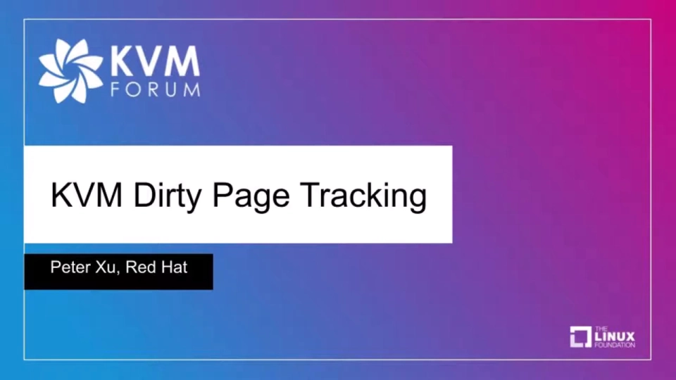

## 一、先分清两条时间线：同步追踪与异步追踪

脏页追踪不是一种机制，而是两类，区别在于**客户机（guest）在追踪期间能不能继续跑**。[【跳转到 00:06】](https://www.youtube.com/watch?v=5FZPIJim_Us&t=6)

- **同步追踪（synchronous）**：追踪期间客户机必须被阻塞。典型场景是影子页表追踪和"活快照"（VM live snapshot）。
- **异步追踪（asynchronous）**：不停机，先让客户机继续写，事后再通过 KVM 的接口把"哪些页脏了"报上来。迁移（migration）用的就是这一类。

这个区分直接决定了代价放在哪里：同步追踪把成本压进**停机时间**，异步追踪把成本压进**每轮的位图同步与页拷贝**。

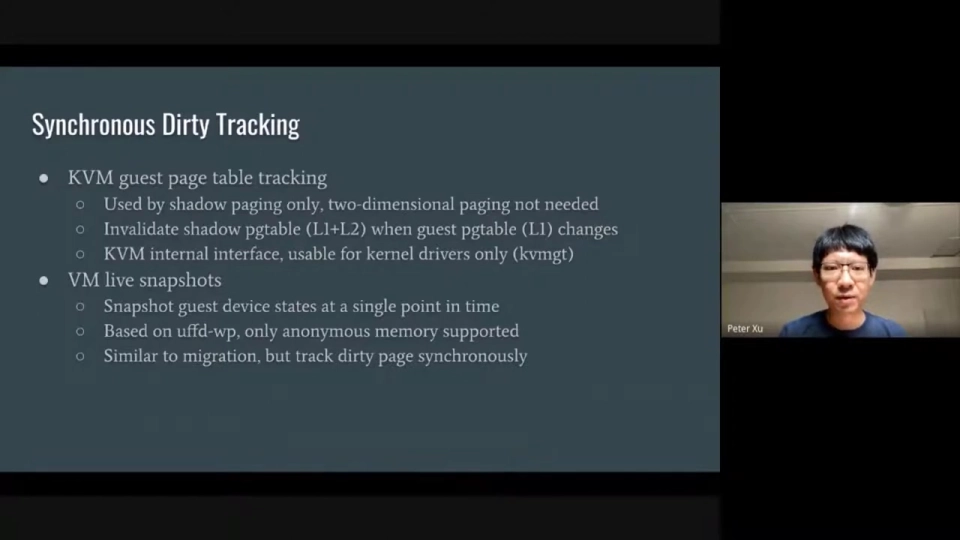

讲者特意强调同步追踪容易被忽视，因为它不如迁移常见，但它在语义上和迁移有一个关键差别：**快照采样的是进程开始那一刻的内存状态，而迁移保存的是迁移结束那一刻的状态**。看起来像，实际上采样点相反。[【跳转到 03:01】](https://www.youtube.com/watch?v=5FZPIJim_Us&t=181)

> 术语：**活快照**指不关机就给整台虚拟机拍一张"内存 + 设备状态"的照片。它目前基于 `userfaultfd` 的写保护（uffd-wp）实现，因此只支持匿名内存。

## 二、抓脏页的两条路：写保护与 PML，代价来源完全不同

异步追踪分两步：先"抓住"写操作（trapping），再"报告"脏页（reporting）。抓的部分有两条实现路径。[【跳转到 03:51】](https://www.youtube.com/watch?v=5FZPIJim_Us&t=231)

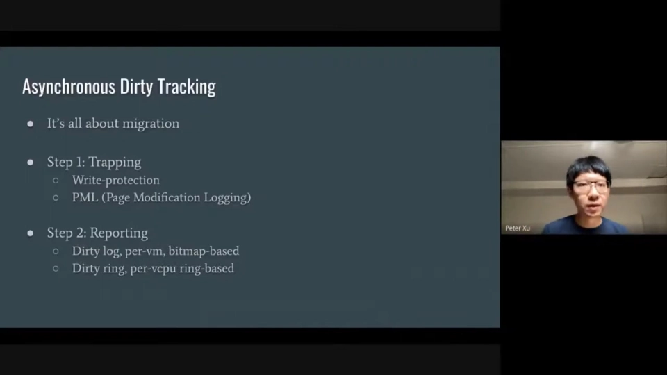

| 手段 | 怎么抓 | 开销来源 | 精度 |
| --- | --- | --- | --- |
| 写保护（write-protection） | 把页表项改成只读，客户机一写就触发缺页，KVM 在缺页处理里记脏并恢复可写 | 每次首次写都产生一次 VM exit / 缺页陷入，还要改页表 | 4 KiB 页粒度 |
| PML（Page Modification Logging） | 硬件在 CPU 里维护一个脏页日志缓冲区，写发生时由硬件记录页地址，缓冲区满了才通知 | 硬件缓冲区的容量（满了才陷入），几乎不打断 vCPU | 4 KiB 页粒度，由硬件填 |

讲者的原话是：PML 只适用于异步追踪（比如迁移），因为**它根本不需要打断客户机的 vCPU 执行，效率很高**。这就是为什么"写保护 + 缺页回填"在高脏页率下会迅速变贵——每一次首次写都是一次陷入，而 PML 把这份成本摊给了硬件。

这里还有一个容易被忽略的精度细节：**大页（huge page）在脏页日志下会被写保护**，一个 1 GB 的大页被写保护后，客户机第一次写就要把它拆开处理。讲者提到 Huawei 的 lazy write-protect 优化"只对首轮（initial pass）有效，且需要开启 clear-log"，而它本该成为脏页日志的默认行为。[【跳转到 05:31】](https://www.youtube.com/watch?v=5FZPIJim_Us&t=331) 换句话说，**页粒度越粗，写保护带来的拆页成本越高**，这也是"精度"与"开销"在这里第一次正面冲突。

## 三、报脏页的两种接口：每 VM 的位图与每 vCPU 的环

报告侧在 KVM 里目前有两个接口。[【跳转到 04:16】](https://www.youtube.com/watch?v=5FZPIJim_Us&t=256)

- **dirty log（脏页位图）**：一个"每 VM 一份"的位图，一位对应一个 4 KiB 页。老的 `KVM_GET_DIRTY_LOG` 加上新的 clear-log 接口都属这一类。它是**全局共享**的数据结构，所以多个 vCPU 同时置位需要原子操作或锁。
- **dirty ring（脏页环）**：新加入 Linux 的方案，**每个 vCPU 一个环**，vCPU 只管往自己的环里塞页号，天然免锁；环满了才需要通知用户态。

讲者在这里点出一个尚未定论的取舍：脏页环也可以配一个 clear 接口，好处是**重新写保护（re-protect）更高效**，代价是**更多的 TLB flush**。[【跳转到 04:41】](https://www.youtube.com/watch?v=5FZPIJim_Us&t=281) 这句话值得展开：位图方案里，"清除脏位"和"重新写保护"是同一批页，可以批量做；环方案里，用户态处理完一页就想立刻把它重新写保护，于是每次重保护都可能要刷 TLB。**批量换吞吐，逐页换延迟**——这就是精度与开销的第二次冲突。

还有一个与精度直接相关的细节：clear-log 是"拷贝走位图的同时把位清零"，所以**读走之后发生的写只会出现在下一轮**。这意味着脏页集合永远有一小段"未上报窗口"，它的长度等于"上一次同步到真正停机"之间的时间。同步越频繁，窗口越短、精度越高，但每轮要搬的位图次数也越多——这又是同一个取舍的两端。

## 四、位图的隐性成本：随内存规模线性增长，与脏页数量无关

这是全场最有说服力的一段。位图的大小只由内存容量决定：

$$
S_{\text{bitmap}} = \frac{M}{4\,\text{KiB}} \times \frac{1}{8}\ \text{字节}
$$

代入两个真实数字，和幻灯片完全对得上：

- 3 TB 内存 → 约 100 MB 位图；
- 8 TB 内存 → 256 MB 位图。

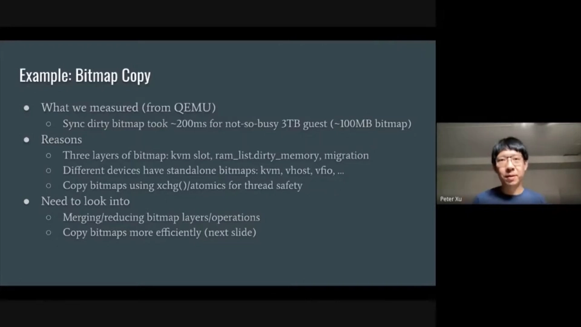

讲者实测的结论是：**同步这块位图花了约 200 ms**，而 `KVM_GET_DIRTY_LOG` 本身"非常快，就是一次带清位的位图拷贝"，所以时间并不是花在 KVM 里，而是花在**QEMU 内部把位图搬来搬去**。[【跳转到 17:20】](https://www.youtube.com/watch?v=5FZPIJim_Us&t=1040)

原因是 QEMU 里位图有三层：

1. KVM slot 位图（每个内存槽一份）；
2. RAM list 的 `dirty_memory` 位图；
3. 迁移（migration）位图。

此外不同设备还有各自的独立位图：KVM（作为 accelerator）、vhost、VFIO……[【跳转到 18:00】](https://www.youtube.com/watch?v=5FZPIJim_Us&t=1080) 每轮迁移都要把这些层合并、拷贝一遍。**层数越多，位图搬运的常数因子越大**，而这份成本与"这一轮到底脏了几个页"完全无关。

这就是位图方案的结构性问题：它的开销是 $O(\text{内存大小})$，而收益是 $O(\text{脏页数})$。内存越大、脏页越少，性价比越差。

## 五、原子操作让拷贝更贵：xchg 比 memcpy 慢 3 到 8 倍

既然位图搬运是瓶颈，那能不能优化拷贝本身？讲者追到了原子操作上：位图的读写为了线程安全大量使用 `xchg()`/原子操作，而**原子操作要锁内存总线**，并不便宜。[【跳转到 19:16】](https://www.youtube.com/watch?v=5FZPIJim_Us&t=1156)

他做了两组微基准（i7-8665U）：

- 数据全在 L1 里（对单个值反复 compare-exchange）：比纯内存拷贝**慢 8 倍**——这部分是纯粹的总线锁开销；
- 数据全部 L3 miss（交换一张远大于 L3 的位图）：**慢 3 倍**。

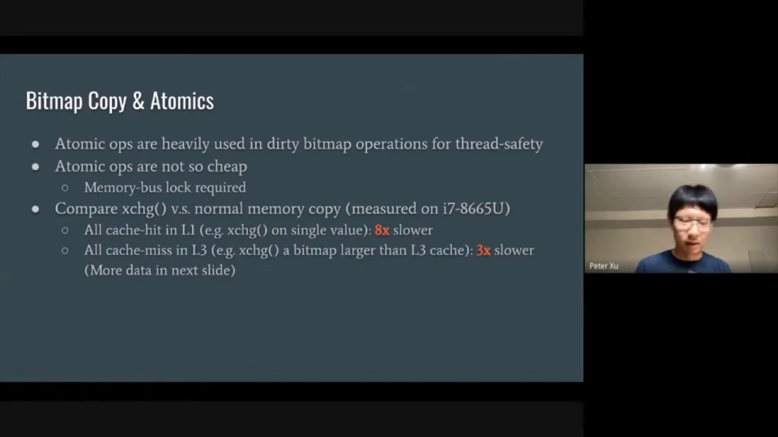

换一台 Xeon E5-2630 v4 复测，结论一致：拷贝 8 TB 内存对应的 256 MB 位图，`xchg()` 用 525 ms，普通 `memcpy` 用 148 ms，**3.5 倍**。[【跳转到 20:56】](https://www.youtube.com/watch?v=5FZPIJim_Us&t=1256)

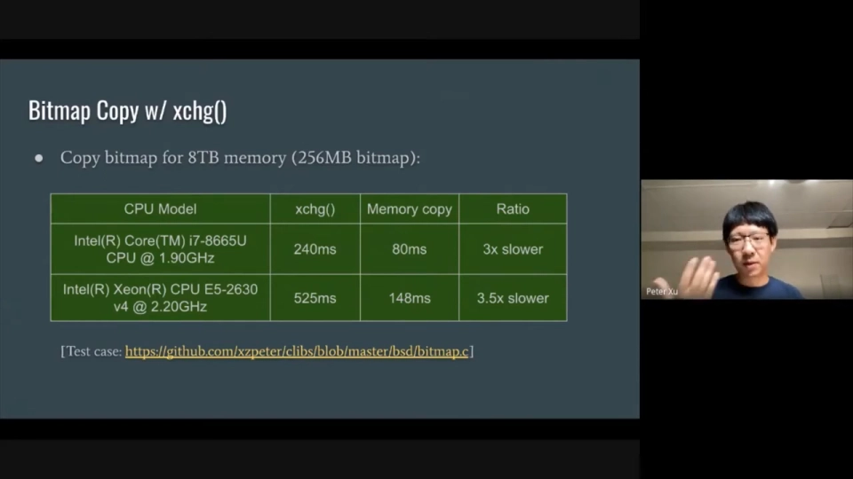

讲者随后把 KVM 侧和 QEMU 侧分开看，这一段是很好的"该优化哪里"的判断示范：

- **KVM 侧没有大问题**：clear-log 路径本来就是"拷贝到用户位图 + 清位"，没有 compare-exchange；重保护时虽然用了 exchange，但开销被页表操作掩盖了。[【跳转到 21:46】](https://www.youtube.com/watch?v=5FZPIJim_Us&t=1306)
- **QEMU 侧需要返工**：因为位图层数多、搬运操作多，应该改成"置脏时用读锁 + 原子置位，收集/拷贝时用写锁 + `memcpy`"，靠读写锁本身的屏障保证顺序，从而把原子操作从大块拷贝里拿掉。[【跳转到 23:26】](https://www.youtube.com/watch?v=5FZPIJim_Us&t=1406)

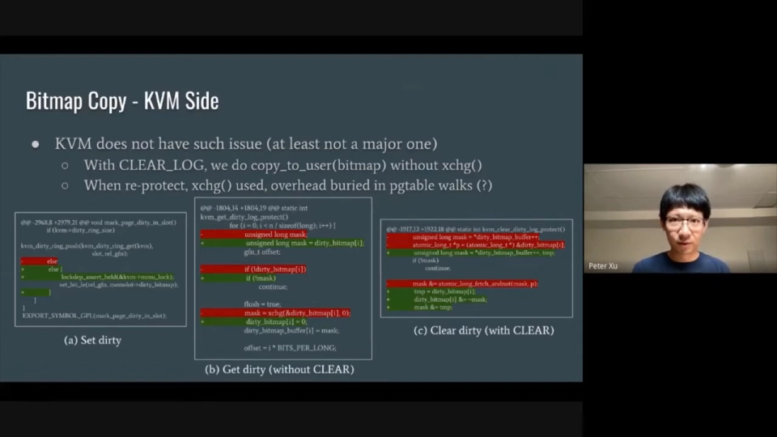

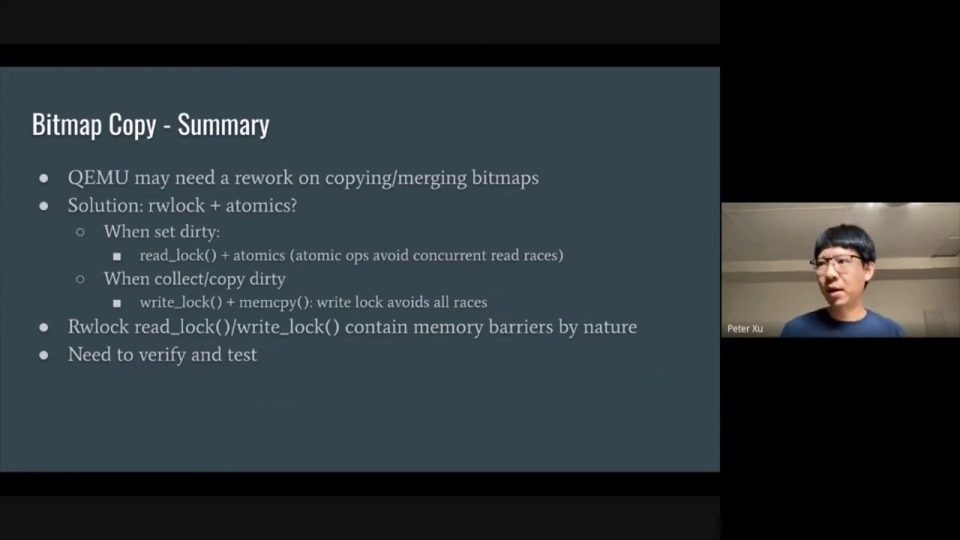

## 六、脏页率接近 100% 时，增量追踪只剩开销

前面五节讨论的都是"常数因子"，但真正决定方案是否成立的，是**脏页率**。讲者把"巨型虚拟机"（100+ vCPU、TB 级内存）单独拎出来，因为它们的迁移有三个绕不过去的挑战。[【跳转到 08:51】](https://www.youtube.com/watch?v=5FZPIJim_Us&t=531)

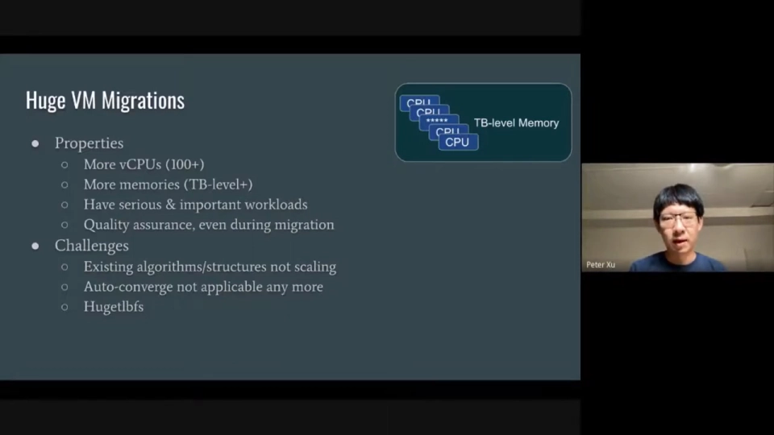

1. **算法不扩展**：小机器上跑得很好的算法，在大机器上不一定成立（位图层数、扫描成本都是例子）。
2. **收敛（convergence）失效**：vCPU 越多、内存越大，越难收敛；而且用户不希望迁移期间业务被限流，所以 auto-converge 这类"给 vCPU 降速"的手段在某些场景下不能用。
3. **大页 TLB 成为事实标准**：大页让缺页处理变慢，迁移的停机时间被放大。

把这三条翻译成一句判断规则：**预拷贝（pre-copy）能收敛的前提是"每轮脏页量 < 网络可搬运量"。一旦客户机的写带宽逼近甚至超过网络带宽，每一轮都在制造新的脏页，轮数趋于无穷**。此时位图再快也没用——因为你永远追不上。

讲者给出的出路是**后拷贝（post-copy）**：不再试图追平，而是先把机器切到目的端跑起来，缺页时再向源端要页。[【跳转到 11:20】](https://www.youtube.com/watch?v=5FZPIJim_Us&t=680) 这本质上就是"承认增量失效，退回另一种全量策略"。

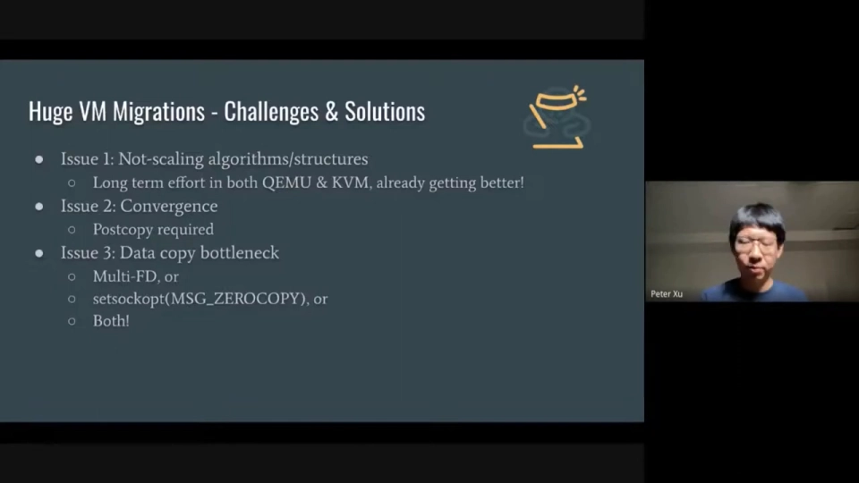

后拷贝也不是免费的，它把成本换成了两种停机：

- **缺页停机**：目的端访问一个还没搬过来的页就要等，大页让这个等待更久。讲者提到"大页双映射（double-map）"的想法——允许 2 MB/1 GB 大页先按 4 KiB 小块映射，缺页处理完再合并回大页，但这个特性**还没有进上游**。[【跳转到 12:56】](https://www.youtube.com/watch?v=5FZPIJim_Us&t=776)
- **切换停机**：从预拷贝切到后拷贝的那一瞬间，目的端并不知道哪些页是最新的（同一页可能被迁过多次，源端又写脏了）。Google 贡献的 `userfaultfd` minor 模式可以让目的端提前跑在"已经到货但可能过期"的页上，缺页时再问源端要不要补发；代价是**不支持匿名内存**，只支持共享内存与大页。[【跳转到 14:16】](https://www.youtube.com/watch?v=5FZPIJim_Us&t=856)

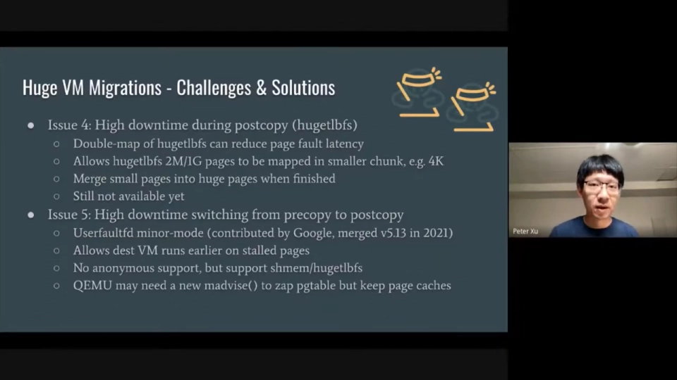

## 七、把代价折成一张决策表

把讲者的实测与论证收拢，可以得到一张"什么时候该放弃增量"的判断表。表中左列是可直接观测的量，右列是建议动作（**这张表是本文依据讲者的数据整理的推论，不是讲者原话**）。

| 观测到的现象 | 说明什么 | 建议动作 |
| --- | --- | --- |
| 位图同步耗时占每轮迁移时间的可观比例（如 3 TB 机器 200 ms） | 开销是 $O(\text{内存})$，与脏页数无关 | 减少位图层数；改用脏页环；或降低同步频率 |
| 每轮脏页数远小于总页数（如 8 GB 机器 230 万页里只有几千页脏） | 位图扫描严重浪费 | 换紧凑列表/环，按脏页数付费 |
| 每轮脏页数接近总页数，轮数不收敛 | 增量方案已无收益 | 退回停机全量快照，或改用 post-copy |
| 大页占比高，且脏页日志导致拆页 | 写保护的精度代价被放大 | 首轮用 lazy write-protect；或接受拆页成本 |
| 迁移期间业务不能被限流 | auto-converge 不可用 | 直接选 post-copy 路线 |

一句话总结这张表：**先看"每轮脏页数 / 总页数"这个比值**。比值很小，优化位图与环的搬运效率；比值接近 1，任何增量手段都只是在给全量快照加开销，应该直接停机做全量。

## 小结

- 脏页追踪分同步与异步两类：同步把成本放进停机时间，异步把成本放进每轮的位图同步与页拷贝。
- 抓脏页的两条路代价不同：写保护靠"每次首写一次陷入"换精度，PML 靠硬件缓冲区把陷入摊薄。
- 报脏页的两条接口各有取舍：位图是每 VM 一份、批量高效但需要原子操作；脏页环是每 vCPU 一份、免锁但重保护会带来更多 TLB flush。
- 位图的开销是 $O(\text{内存大小})$：3 TB → 100 MB 位图、同步约 200 ms；8 TB → 256 MB 位图。这与脏页数量无关，是结构性问题。
- 原子操作让位图拷贝再贵 3~8 倍（`xchg` vs `memcpy`），QEMU 的多层位图放大了这个常数。
- 脏页率接近 100% 时增量追踪不收敛，应退回停机全量快照或 post-copy；后拷贝的代价是缺页停机与切换停机。
- 判断口径：看"每轮脏页数 / 总页数"，而不是看绝对脏页数。

## 关键术语速查

| 术语 | 一句话解释 |
| --- | --- |
| 脏页（dirty page） | 自上次记录以来被写过的内存页，4 KiB 一页对应位图里的一位 |
| 写保护（write-protection） | 把页表项改成只读，客户机一写就陷入，KVM 借机记脏 |
| PML（Page Modification Logging） | Intel 的硬件脏页日志，写发生时由硬件记录页地址，缓冲区满才通知 |
| dirty log | 每 VM 一份的脏页位图，通过 `KVM_GET_DIRTY_LOG` / clear-log 读取 |
| dirty ring | 每 vCPU 一个环的脏页报告接口，免锁，环满则强制 VM exit |
| 预拷贝 / 后拷贝 | 迁移的两种策略：先搬内存再切换；或先切换再按缺页搬内存 |
| auto-converge | 迁移收敛不了时给 vCPU 降速的手段，会伤害客户机性能 |
| 大页双映射 | 让 2 MB/1 GB 大页先按 4 KiB 映射以加快缺页处理，尚未进上游 |