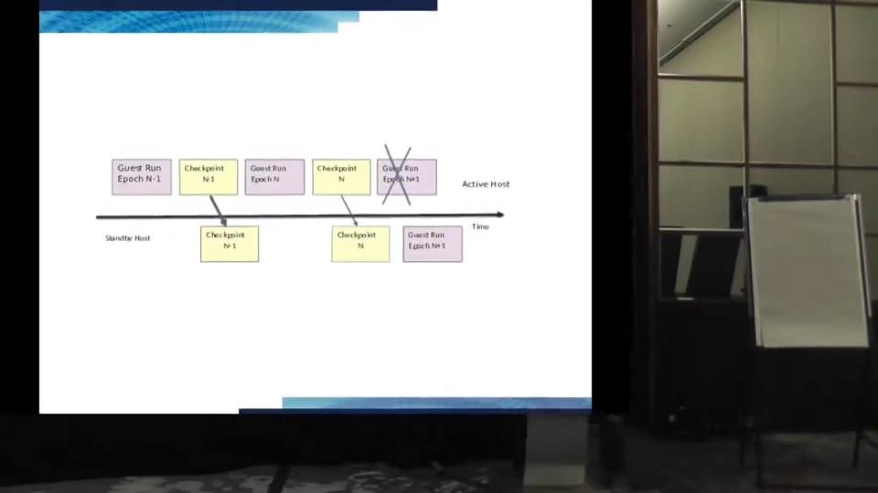
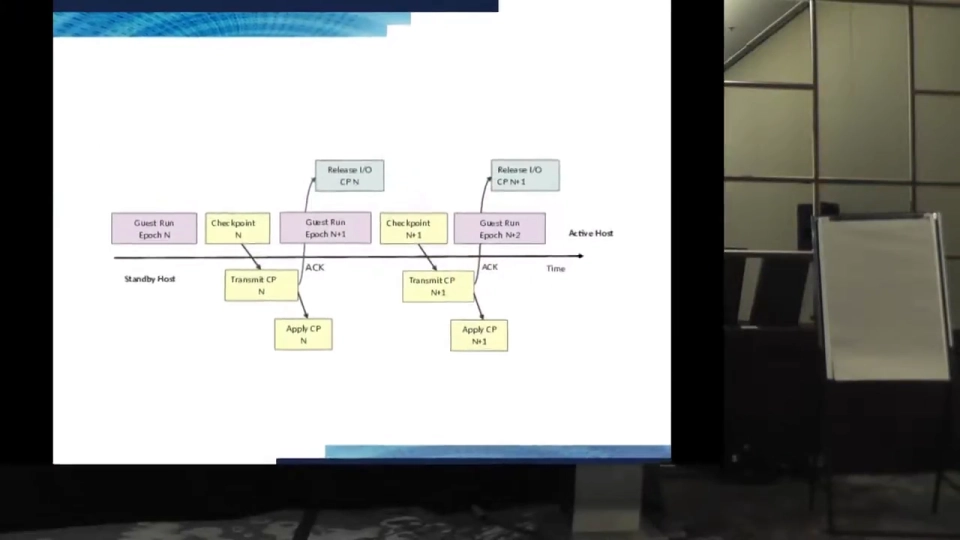
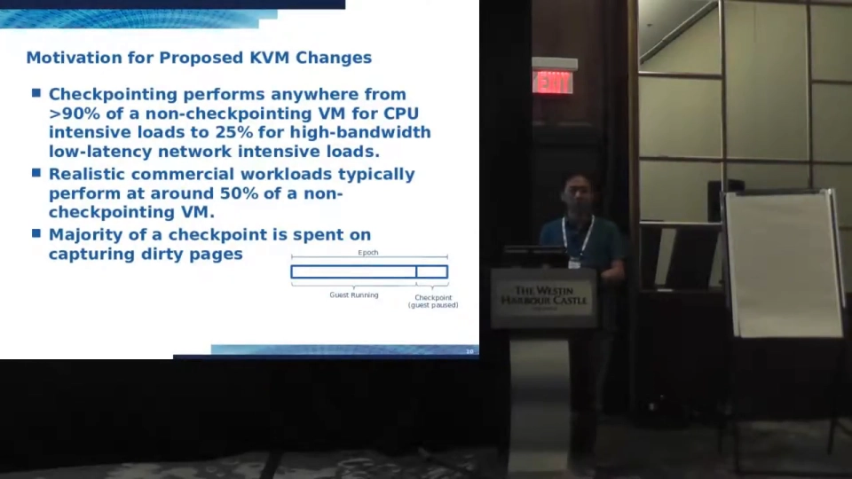
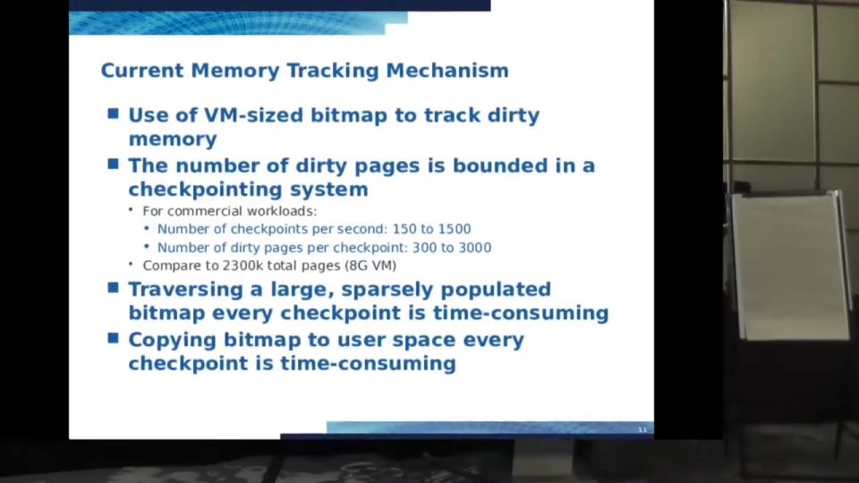
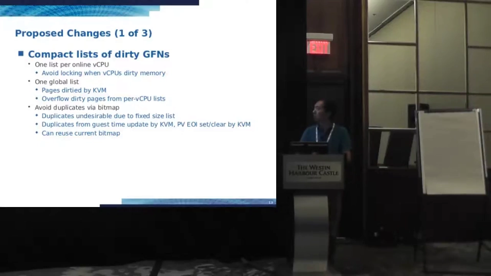
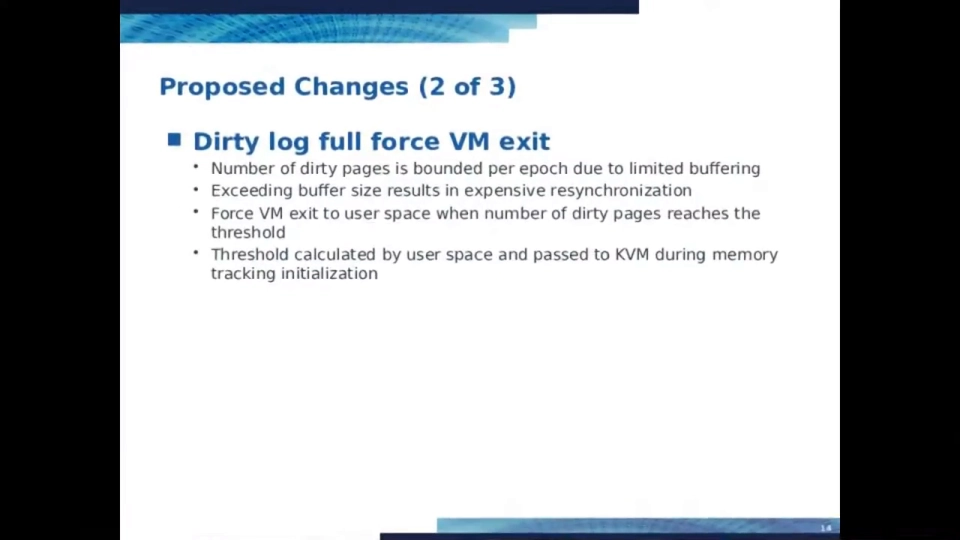
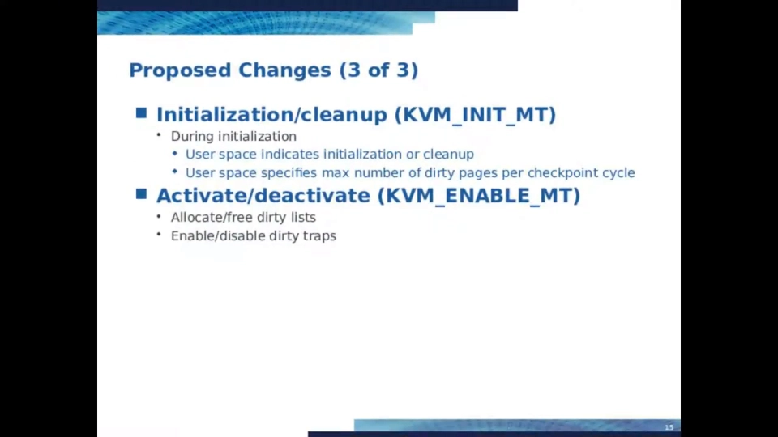
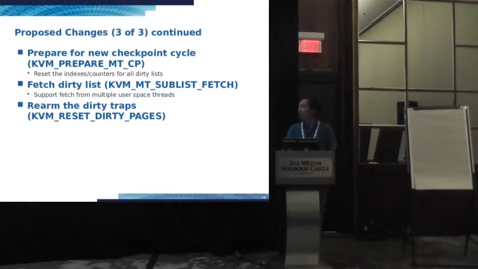
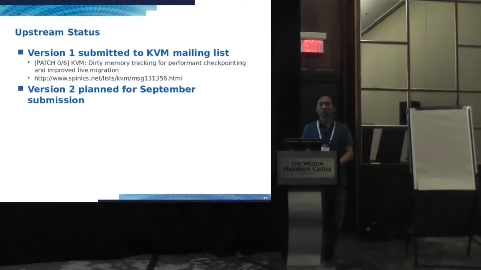

# 高频检查点下的位图失效：用紧凑脏页列表换掉全量扫描

> 视频来源：[Dirty Memory Tracking for Performant Checkpointing Solutions - Lei Cao](https://www.youtube.com/watch?v=-VRSQ-AYUOY)（YouTube · KVM Forum 2016）｜时长约 25 分钟
> 导读：这是 Stratus Technologies 的 Lei Cao 提出的一组 KVM 脏页追踪改造。它把一个常被忽略的事实摆到台面上：**位图的开销由内存大小决定，而不是由脏页数量决定**。当检查点每秒做上百次、每次只有几千个脏页时，扫一张几 MB 的位图就成了主要成本。本文只讲这条"代价与精度"的线。

## 本讲要解决的核心问题（SCQA）

**背景**：检查点（checkpointing）是软件容错的老办法——把一台虚拟机周期性暂停，把 CPU、设备、内存状态打包发到备机，主机挂了就从最近一个检查点接着跑。

**冲突**：这条路线的性能损失大得惊人。讲者给出的实测是：CPU 密集型负载还能跑到不停机版本的 90% 以上，而高带宽、低延迟的网络密集型负载**只剩不到 25%**，商业负载大约 50%。而造成损失的主要原因，是"取脏页"这一步。

**疑问**：为什么"取脏页"这么贵？位图这种数据结构在什么场景下会失效？换成别的结构要付出什么代价？

**回答（中心思想）**：位图的成本是 $O(\text{内存大小})$，紧凑列表的成本是 $O(\text{脏页数量})$。**当脏页数量被检查点频率天然限制住时，应该按脏页数付费；当脏页可能铺满整个内存时（比如迁移），位图才是对的**。选型的依据不是"哪种结构更先进"，而是"每轮脏页数占总页数的比例"。

## 一、检查点把成本压在"暂停"这一段上

传统检查点的流程很朴素：客户机跑一段时间（一个 epoch），然后暂停，抓状态，把状态从主机送到备机，收到确认后释放 I/O，继续跑。[【跳转到 02:18】](https://www.youtube.com/watch?v=-VRSQ-AYUOY&t=138)

这套机制的性能上限由**暂停时间**决定：暂停越久，客户机真正干活的时间越少。而暂停时间里占大头的是什么？讲者的答案是取脏页——从 KVM 拿到脏页、处理它们、再传给备机。**"检查点耗时"与"脏页采集耗时"直接相关**。[【跳转到 03:36】](https://www.youtube.com/watch?v=-VRSQ-AYUOY&t=216)

这里有个容易混淆的点：**检查点的"脏页"和迁移的"脏页"不是同一个量级**。迁移是"尽量少停"，所以脏页会一轮轮累积；检查点是"频繁地停"，每轮之间客户机只跑了很短的时间，脏页数被时间窗口天然限制住了。这个差别，正是后面所有取舍的根源。

## 二、位图的成本与内存成正比，与脏页数无关

KVM 当时（2016 年）只有一种脏页追踪机制：**一张与虚拟机内存等大的位图**，一位对应一个 4 KiB 页。[【跳转到 06:35】](https://www.youtube.com/watch?v=-VRSQ-AYUOY&t=395)

它在迁移场景下工作得很好，但检查点场景下有两个致命问题：

1. **要遍历整张位图**才能找到那几千个脏页；
2. **每次检查点都要把整张位图从内核拷到用户态**。

讲者给出的数字非常直观（8 GB 虚拟机，约 230 万页）：

| 指标 | 数量级 |
| --- | --- |
| 每秒检查点次数 | 150 ~ 1500 |
| 每次检查点的脏页数 | 300 ~ 3000 |
| 虚拟机总页数 | 约 230 万 |

也就是说，**为了找 300 个脏页，要扫 230 万位**，而且这件事每秒要做上千次。写成式子就是：

$$
T_{\text{scan}} \propto \frac{M}{4\,\text{KiB}}, \qquad T_{\text{useful}} \propto N_{\text{dirty}}
$$

当 $N_{\text{dirty}} \ll M/4\,\text{KiB}$ 时，$T_{\text{scan}}$ 完全主导。这正是"精度"问题的另一面：位图给出的精度是**页粒度**（足够细），但它的**读取成本是块粒度**（整块内存），两者不匹配。

## 三、换结构：每 vCPU 一个列表 + 一个全局列表

既然成本来自"扫整张位图"，那就换成"只列出脏页"。提案的数据结构是紧凑脏页列表（compact list of dirty GFNs），设计上有三层考虑。[【跳转到 09:19】](https://www.youtube.com/watch?v=-VRSQ-AYUOY&t=559)

- **每个在线 vCPU 一个列表**：vCPU 往自己的列表里追加，不用抢锁。这一点和后来进入主线的 dirty ring 是同一个思路。
- **一个全局列表**：收集 KVM 自己置脏的页，同时接住各个 per-vCPU 列表溢出过来的页。
- **用位图去重**：列表是定长的，重复项会浪费空间。讲者说重复非常多，主要来自 KVM 在客户机内存更新时的置脏，以及半虚拟化（PV）的 EOI set/clear，所以复用现有的位图来查重。

注意第三条的微妙之处：**提案并没有彻底抛弃位图，而是把位图降级成"去重索引"**。位图仍然存在，但不再需要被扫描和拷贝——它只回答"这个页是不是已经在列表里了"这一个 O(1) 问题。这是很典型的"用对的数据结构做对的事"。

## 四、列表的代价：定长、重复、溢出时必须强制退出

天下没有免费的精度。列表换掉了扫描成本，但引入了三个新问题，而且每一个都要用"精度换可控性"来解。[【跳转到 10:51】](https://www.youtube.com/watch?v=-VRSQ-AYUOY&t=651)

1. **定长**：列表占的是主机上的固定缓冲，不能无限增长。
2. **重复**：位图天然去重，列表不会，所以要额外的位图查重。
3. **溢出**：列表满了怎么办？

第三条是全场最关键的取舍。讲者的选择是：**列表一满就强制 VM exit，把控制权交回用户态，让用户态立刻做一次检查点**。[【跳转到 10:56】](https://www.youtube.com/watch?v=-VRSQ-AYUOY&t=656)

理由讲得很清楚：**一旦脏页超出缓冲区，主备两侧的状态就会分叉（diverge），而重新同步的代价极高**。所以宁可牺牲"检查点周期严格均匀"这个精度，也不能让缓冲区溢出。阈值由用户态计算，在初始化时传给 KVM。

这条规则值得单独记住，因为它是所有"有界环形缓冲区"方案的通用模式：**缓冲区满 = 一次不可协商的同步点**。dirty ring 后来的设计也是同一套逻辑。

## 五、五个 ioctl 与一个循环

提案的接口设计刻意保守：不改动任何现有 KVM 功能，只新增 ioctl，并且能与现有脏页日志共存。目标是可移植——当时已经移植到多个版本的 CentOS、Ubuntu、SUSE。[【跳转到 08:02】](https://www.youtube.com/watch?v=-VRSQ-AYUOY&t=482)

生命周期接口两个：

- `KVM_INIT_MT`：初始化/清理。用户态在这里给出"每次检查点最多多少脏页"，也就是强制退出的阈值。
- `KVM_ENABLE_MT`：激活/停用检查点模式。KVM 在这里分配或释放脏页列表，并打开或关闭脏页陷阱（dirty traps）。

每个检查点周期用三个：

- `KVM_PREPARE_MT_CP`：重置所有列表的索引与计数器，准备新一轮。
- `KVM_MT_SUBLIST_FETCH`：取脏页列表，**支持多个用户态线程并发取**，以便并行处理。
- `KVM_RESET_DIRTY_PAGES`：把上一轮取走的那些页重新布防（re-arm），让它们再次可被追踪。

于是用户态的循环就是：进入检查点模式 → 每轮"准备 / 取 / 重布防" → 退出检查点模式并清理。讲者称之为"不复杂的一段控制流"。[【跳转到 14:07】](https://www.youtube.com/watch?v=-VRSQ-AYUOY&t=847)

## 六、它也能用于迁移，但只在脏页有界时有用

提案明确表示不破坏活迁移，而且可以被迁移复用：如果用户态支持检查点模式，就能让"写密集"负载的迁移变得**可预测**——因为每轮都被强制暂停一次，脏页量被压住，迁移一定能收敛。[【跳转到 15:33】](https://www.youtube.com/watch?v=-VRSQ-AYUOY&t=933)

这和 QEMU 现有的 auto-converge 形成对比：auto-converge 靠给 vCPU 降速来强行收敛，对某些负载无效；检查点模式靠"周期性暂停"来强行收敛，代价是确定的停机。

但 Q&A 里有人提出了反例，讲者的回答把边界划得很清楚：**如果负载是遍历内存式的（memory-walk），它会在很短时间内产生大量脏页，列表方案就不比位图好**。讲者的回应是：列表方案适合**高频检查点**；在活迁移里"整块内存都可能变脏"，列表当然没用。[【跳转到 21:23】](https://www.youtube.com/watch?v=-VRSQ-AYUOY&t=1283)

他还给了支撑数据：检查点每 100 ms 一次时，客户机在那段时间里根本产生不了多少脏页，实测每次只有 300 到 3000 页。[【跳转到 23:28】](https://www.youtube.com/watch?v=-VRSQ-AYUOY&t=1408)

## 七、社区的分歧：要新 API，还是只改返回值

Q&A 部分的价值不亚于正文。一位与会者（从上下文看是 Peter Xu）提出了一个更保守的替代方案，这段对话把"接口复杂度也是成本"讲透了。[【跳转到 16:48】](https://www.youtube.com/watch?v=-VRSQ-AYUOY&t=1008)

他的观点是：

- 用不同数据结构表示稀疏脏页集合，这个优化很直接，值得做；
- 但为此引入一整套新状态机和新 API 不值得。本质上它只是 `KVM_GET_DIRTY_LOG` 的一个自然扩展。
- 更简单的做法：`KVM_GET_DIRTY_LOG` 加一个"脏页超过 N 个就退出"的开关（类似硬件 PML 的阈值），再让内核**自己决定返回位图还是列表**——如果列表装得下就返回列表，装不下就返回位图，多一个返回字段即可。

讲者对"prepare 与 reset 为什么要分成两个 ioctl"的回答也很坦诚：**逻辑上它们可以合并，只是最初就这么实现了**。[【跳转到 20:58】](https://www.youtube.com/watch?v=-VRSQ-AYUOY&t=1258)

这段讨论给初学者的启示是：**性能优化的收益要减去接口复杂度的成本**。一个"更复杂但更快"的 API，如果让每个使用者都更容易写错，整体上可能是负收益。

## 八、把取舍折成判断规则

把两场讨论（本讲的检查点视角与迁移视角）合起来，可以得到一条清晰的选型规则（**下表是本文依据讲者数据整理的推论**）：

| 场景特征 | 位图 | 紧凑列表 / 脏页环 |
| --- | --- | --- |
| 每轮脏页数远小于总页数（高频检查点） | 扫全表，成本与内存成正比，浪费 | 成本与脏页数成正比，占优 |
| 每轮脏页数接近总页数（活迁移、内存遍历负载） | 反正都要报全量，位图更合适 | 列表装不下，频繁溢出强制退出，反而更差 |
| 需要严格可预测的停机 | 周期由脏页率决定，不可控 | 缓冲区满即强制检查点，停机可控 |
| 内存规模很大（TB 级） | 位图本身就有上百 MB，搬运昂贵 | 按脏页付费，规模无关 |

一句话：**先量"每轮脏页数 / 总页数"，再决定按内存付费还是按脏页付费**。这也是"何时该退回全量快照"的答案——当这个比值接近 1 时，增量追踪只是在给全量快照加一层开销，不如直接停机做全量。

## 小结

- 检查点的性能损失主要来自"取脏页"这一段，而暂停时间与脏页采集时间直接相关。
- 位图的成本是 $O(\text{内存大小})$：8 GB 虚拟机 230 万页，每次检查点却只有 300~3000 个脏页，扫全表是纯浪费。
- 紧凑列表把成本换成 $O(\text{脏页数量})$：每 vCPU 一个列表免锁，全局列表汇总与接溢出，位图降级为去重索引。
- 列表的代价是定长与重复：列表满时必须强制 VM exit 触发检查点，因为主备分叉后的重新同步代价更高。
- 接口设计保守：不改现有 KVM 功能，新增 5 个 ioctl，用户态循环为"准备 / 取 / 重布防"。
- 边界很清楚：高频检查点用列表；活迁移与内存遍历负载仍应用位图。
- 社区分歧提醒：接口复杂度也是成本，能让内核自己选返回格式，往往比新增状态机更好。

## 关键术语速查

| 术语 | 一句话解释 |
| --- | --- |
| 检查点（checkpoint） | 周期性暂停虚拟机、抓取完整状态并送到备机，用于软件容错 |
| epoch | 两次检查点之间客户机自由运行的那段时间 |
| 脏页位图（dirty bitmap） | 一位对应一个 4 KiB 页的位图，大小与虚拟机内存成正比 |
| 脏页列表（dirty list） | 只记录脏页页号的紧凑数组，大小与脏页数成正比 |
| GFN | Guest Frame Number，客户机物理页号 |
| 强制 VM exit | 缓冲区满时把控制权交回用户态，触发一次检查点 |
| COLO / Remus | 开源检查点与容错方案，讲者用来对比现状 |
| auto-converge | QEMU 迁移收敛手段，通过给 vCPU 降速减少脏页产生 |