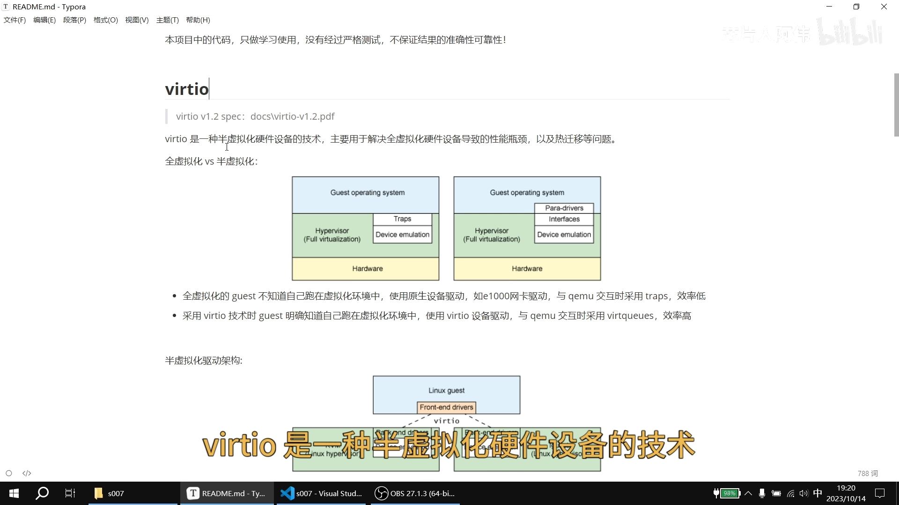
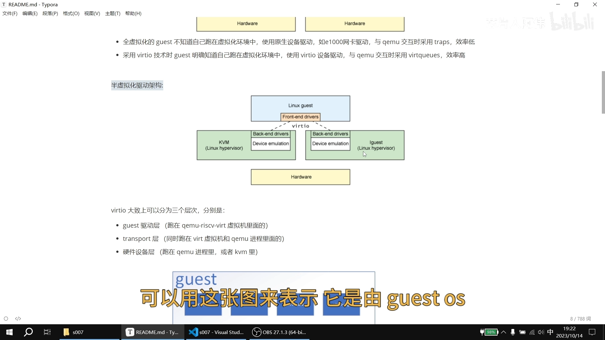
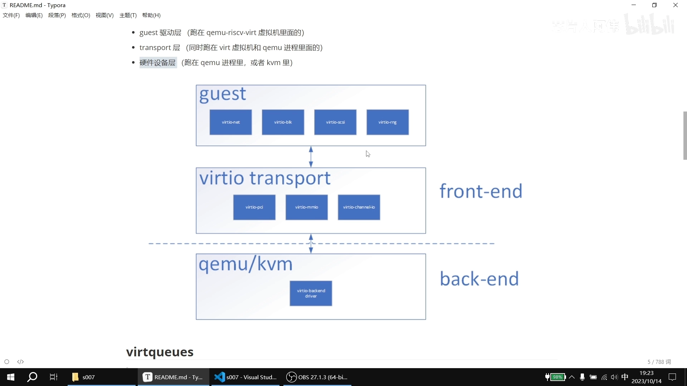
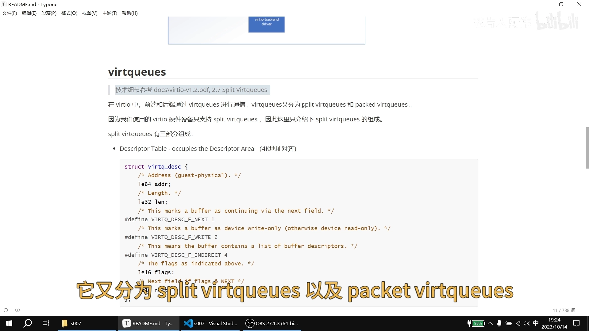
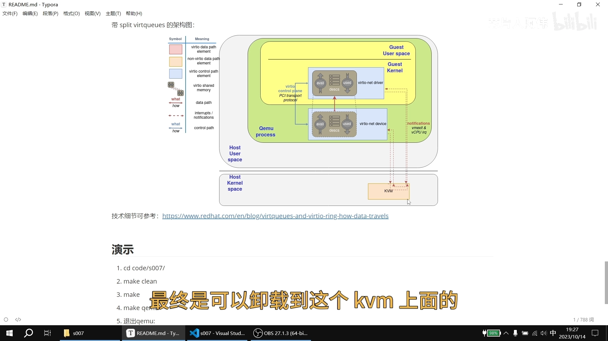

# virtio 的前后端分离：guest 里的前端驱动与 QEMU/KVM 里的后端设备

> 视频来源：[show me the code s007. virtio 基础知识](https://www.bilibili.com/video/BV1Qy4y1A7YA/)（Bilibili · 芯片人阿伟）｜时长约 9 分钟
> 本文覆盖这支视频的架构部分：全虚拟化为什么慢、virtio 为什么要在 guest 里多装一层驱动、前后端各自跑在哪里、三层结构怎么切。视频后半段关于 virtqueue 三个环的细节属于下一节的内容，本文只讲到"共享内存"这一层。

## 本讲要解决的核心问题（SCQA）

**背景**：在全虚拟化（full virtualization）下，客户机操作系统并不知道自己跑在虚拟机里，它照常加载原生设备驱动——比如 Intel e1000 网卡驱动，然后按真实硬件的方式去读写设备的寄存器和缓冲区。

**冲突**：这些访问落在虚拟机上时并不真的碰到硬件，而是被 hypervisor 拦下来，交给 QEMU 去"扮演"那块设备。视频里把这个动作称为 trap（陷入）：一次网络发包、一次磁盘读写，都要走一遍"陷入 → 模拟 → 返回"，效率很低。

**疑问**：既然慢在"客户机不知情、每次都要陷入模拟"，那能不能让客户机**配合一下**，主动按虚拟化的方式发请求，从而把这条昂贵路径省掉？

**回答（中心思想）**：virtio 的做法是把设备驱动拆成两半——**客户机里的前端驱动（front-end driver）知道自己运行在虚拟机中**，不再假装操作真硬件，而是把请求写进一块前后端共享的内存；**宿主侧的后端（back-end，跑在 QEMU 进程里或由 KVM 加速）真正执行 I/O**。省掉的正是"每次寄存器访问都要陷入、由 QEMU 逐字节模拟"这条路径，代价是客户机必须安装 virtio 驱动、并且知道自己是虚拟机。

## 一、全虚拟化的代价：客户机不知情，每次 I/O 都要 trap

视频先给出全虚拟化与半虚拟化的对照图。左半边是全虚拟化：客户机操作系统（Guest operating system）之下是 hypervisor，中间那条通道写的是 `Traps` 与 `Device emulation`；右半边换成 virtio 之后，客户机里多出一个 `Para-drivers` 层，中间通道变成 `Interfaces`，设备模拟仍然在 hypervisor 一侧。

视频对这两条路径的总结只有两句，但正是本节的主线 [【跳转到 00:35】](https://www.bilibili.com/video/BV1Qy4y1A7YA/?t=35)：

- **全虚拟化的 guest 不知道自己跑在虚拟化环境中**，使用原生设备驱动（如 e1000 网卡驱动），与 QEMU 交互时采用 traps，效率低；
- **采用 virtio 时 guest 明确知道自己跑在虚拟化环境中**，使用 virtio 设备驱动，与 QEMU 交互时采用 virtqueue，效率高。

为什么 trap 慢？视频的解释很直接 [【跳转到 01:00】](https://www.bilibili.com/video/BV1Qy4y1A7YA/?t=60)：这个 trap 完全是 QEMU 用来模拟的一个操作，是**全模拟**的，所以执行效率很低。注意这里的因果关系——慢的不是"陷入"这一个动作本身，而是陷入之后 QEMU 必须用软件把一块真实设备的寄存器语义逐条复现出来：写哪个寄存器表示"开始发送"、读哪个寄存器表示"发送完成"，全靠模拟器一条条解释。

## 二、半虚拟化的前提：客户机承认自己在虚拟机里

virtio 的第一步不是改硬件，而是改**客户机的认知**：它明确告诉客户机"你在虚拟机里"，于是客户机可以装一个专门为此写的驱动。

视频的说法是：采用 virtio 技术时，guest 操作系统明确知道自己跑在虚拟化环境中，它使用的是 virtio 设备驱动，**这里多了一层设备驱动**，与 QEMU 交互使用的是 virtqueue，效率更高 [【跳转到 01:25】](https://www.bilibili.com/video/BV1Qy4y1A7YA/?t=85)。

"多了一层驱动"这句话值得展开，因为它解释了半虚拟化的全部取舍：

- 全虚拟化时，客户机用的是**未经修改的原生驱动**，好处是操作系统不用改、装上就能跑，坏处是它只会用"真硬件"的方式说话，hypervisor 只能被动模拟；
- 半虚拟化时，客户机装的是**为虚拟环境专门写的驱动**，坏处是必须改客户机（装驱动），好处是它可以直接用"虚拟机之间约定的方式"说话，不必再经过硬件语义的翻译。

换句话说，半虚拟化把一部分复杂度从 hypervisor 挪到了客户机的驱动里，换来的是运行时的开销下降。这也解释了为什么半虚拟化设备总是要求客户机装驱动——这不是实现上的偷懒，而是这个方案成立的前提。

## 三、前后端分离：前端在客户机，后端在 VMM

拆开来看，virtio 设备驱动由两部分组成 [【跳转到 01:50】](https://www.bilibili.com/video/BV1Qy4y1A7YA/?t=110)：

- **前端（front-end）**：跑在 guest OS 内部的 virtio 设备驱动；
- **后端（back-end）**：跑在宿主侧的后端设备驱动，由 KVM 或者 QEMU 提供。

这张图里有一个细节容易被忽略：图上有**两个**后端方框，左边标 `KVM (Linux hypervisor)`，右边标 `QEMU (Linux hypervisor)`，两者都画着 `Back-end drivers` 与 `Device emulation`。它对应视频接下来讲的两条后端出路 [【跳转到 02:15】](https://www.bilibili.com/video/BV1Qy4y1A7YA/?t=135)：

1. **纯模拟路线**：后端就是 QEMU 内部虚拟出来的一块设备，所有请求都由 QEMU 的软件逻辑处理；
2. **加速路线**：如果是 KVM，可以通过透传或者直连这样的技术，直接把前端驱动的数据卸载到硬件内部，实现数据的透传。

对 3.1.2 这一节来说，重要的不是这两条路线各自的实现（那属于设备直通与 vhost 的内容），而是**它们共享同一个前端**：客户机里的 virtio 驱动只认"前端—后端"这个抽象，后端究竟由 QEMU 模拟、还是由 KVM 卸载到真硬件，对客户机是透明的。这正是"前后端分离"带来的可替换性。

## 四、三个层次：驱动层、transport、硬件设备层

把前后端再横着切一刀，视频把 virtio 大致分为三个层次 [【跳转到 02:40】](https://www.bilibili.com/video/BV1Qy4y1A7YA/?t=160)：

| 层次 | 跑在哪里 | 职责 |
| --- | --- | --- |
| guest 驱动层 | guest 操作系统内部 | 把上层的块、网卡请求翻译成 virtio 请求 |
| transport 层 | 同时出现在 guest 与 QEMU 进程里 | 规定前后端怎么"见面"：PCIe、MMIO、channel I/O |
| 硬件设备层 | QEMU 进程里，或者 KVM 里 | 真正执行 I/O，或卸载到物理硬件 |

这张图把"前端 / 后端"这条**纵向**的切分，和"驱动 / transport / 设备"这条**横向**的切分叠在了一起，虚线以上是 front-end，虚线以下是 back-end。视频对每一层的定位是 [【跳转到 02:45】](https://www.bilibili.com/video/BV1Qy4y1A7YA/?t=165)：

- **guest 驱动层**跑在 guest 操作系统内部，图中画的是 `virtio-net`、`virtio-blk`、`virtio-scsi`、`virtio-rng` 四个具体设备驱动；
- **transport 层**是"协议的方式"，可以支持 PCIe、MMIO 以及 channel I/O 等各种通信方式，图中对应 `virtio-pci`、`virtio-mmio`、`virtio-channel-io`；
- **硬件设备层**跑在 QEMU 进程里或者 KVM 里，图中对应 `virtio-backend driver`。

为什么要把 transport 单独抽一层？因为它解决的是"设备怎么被发现、寄存器窗口在哪里"这类**寻址问题**，而不是"设备能干什么"这类**语义问题**。同一套 virtio-blk 语义，可以挂在 PCIe 总线上，也可以挂在 ARM 平台常见的内存映射（MMIO）方式上——客户机驱动层的代码几乎不用变。视频里也点明了后端的两种归宿：真正的设备驱动到了后端，可能是一个由 QEMU 虚拟出来的网卡，也可能是通过 KVM 技术加速、卸载到真正的硬件网卡上 [【跳转到 02:59】](https://www.bilibili.com/video/BV1Qy4y1A7YA/?t=179)。

## 五、前后端之间传什么：virtqueue 是一块共享内存

前后端分离之后，紧接着的问题是：这两个分别跑在客户机和宿主里的驱动，靠什么交换请求？

视频的回答是 virtqueue [【跳转到 03:24】](https://www.bilibili.com/video/BV1Qy4y1A7YA/?t=204)。virtqueue 本身又分为 **split virtqueues** 与 **packed virtqueues** 两种组织方式，视频使用的 virtio 硬件设备只支持 split virtqueues，所以只介绍这一种。它的三个组成部分是 [【跳转到 03:49】](https://www.bilibili.com/video/BV1Qy4y1A7YA/?t=229)：

- **Descriptor Table（描述符表）**：表示要收发的数据在哪里、有多长；
- **available ring（可用环形队列）**：前端通知后端"我有数据要发 / 要读"；
- **used ring（已用环形队列）**：后端通知前端"数据发完了 / 收到了"。

这张图值得从**架构**角度读一遍，而不是从数据结构角度：中间那张 `Descriptor Table` 是被上下两个方框（Guest 的 virtio driver 与 QEMU 的 virtio device）**共同指向**的，两侧的 available ring 与 used ring 则各由一方写入。也就是说，前后端并没有通过某种"系统调用"或"消息队列"来传数据，而是**共享同一块内存**，各自往自己那一半写，另一方去读。

三个部分各自负责什么，视频讲得很清楚 [【跳转到 04:14】](https://www.bilibili.com/video/BV1Qy4y1A7YA/?t=254)：

- 描述符表主要用来表示你要收发的数据的内存地址以及长度。比如我要往外发一个数据，就要告诉硬件设备"这个数据放在什么位置、有多长"，这是通过描述符表来表示的；
- available ring 用来做**前端通知后端**：我有数据要发送，或者我有数据要读取，都是通过 available ring 这个环形队列去通知后端的；
- used ring 则是**后端用来通知前端**的：数据已经发送完了，或者我接收到数据了，都要通知前端 [【跳转到 04:39】](https://www.bilibili.com/video/BV1Qy4y1A7YA/?t=279)。

还有一个容易混淆的点，视频专门澄清了：环里放的**不是数据本身，而是索引号**。这里的 ID 指的是描述符表的索引号，描述符表是一个数组，所以放的就是数组的索引号；available ring 里存放的也是一个索引号，即描述符表的索引号 [【跳转到 05:04】](https://www.bilibili.com/video/BV1Qy4y1A7YA/?t=304)。通过这样的机制，就可以实现前端和后端的高效通信 [【跳转到 05:29】](https://www.bilibili.com/video/BV1Qy4y1A7YA/?t=329)。

> 三个环的字段布局、idx 如何推进、kick 与中断如何抑制，是 3.2 节 virtqueue 的内容，这里只需要记住架构结论：**共享内存 + 索引 + 两个方向的通知**，取代了"每次访问都陷入去模拟寄存器"。

## 六、套娃式的整体架构：guest 内核驱动、QEMU 进程、KVM 三层落位

把前面几节拼起来，视频给出了一张完整的架构图，并把它称为"套娃" [【跳转到 05:54】](https://www.bilibili.com/video/BV1Qy4y1A7YA/?t=354)。

逐层读这张图 [【跳转到 05:59】](https://www.bilibili.com/video/BV1Qy4y1A7YA/?t=359)：

1. **最外层是物理机的操作系统**，它分为内核态（Host Kernel space）和用户态（Host User space）；
2. **用户态里创建一个 QEMU 进程**，进程内部模拟出 virtio 设备（图中 `virtio-net device`）；
3. **QEMU 进程之上跑一个虚拟的操作系统**，虚拟操作系统本身又分为内核态（Guest Kernel）和用户态（Guest User space），内核态里有 virtio 相关的驱动（图中 `virtio-net driver`）；
4. 图中两侧的 `avail` / `used` / `descs` 三块小图，就是上一节说的 virtqueue，在 guest 驱动一侧和 QEMU 设备一侧各有一份视图，指向同一块 `virtio shared memory`；
5. 图右侧的红色虚线标着 `notifications vmext & vCPU irq`，指向 Host Kernel space 里的 `KVM`——这就是通知路径：前端要通知后端时通过 VM exit 出去，后端要通知前端时通过注入 vCPU 中断回来。

视频对"最终落到哪里"给了两种情形 [【跳转到 06:24】](https://www.bilibili.com/video/BV1Qy4y1A7YA/?t=384)：如果支持 KVM，那么驱动的相关操作最终可以卸载到 KVM 上面，最终卸载到硬件上；如果不支持 KVM，那最终是通过 QEMU 内部虚拟的 virtio 设备来处理所有消息。更多细节视频指向了一篇专门讲 virtqueue 与 virtio ring 的文章 [【跳转到 06:49】](https://www.bilibili.com/video/BV1Qy4y1A7YA/?t=409)。

这张图也顺带回答了本节标题里的问题——**"前后端分离"分离的到底是什么**：

- 分离的是**职责**：前端只负责把请求描述清楚（写描述符、挂到 available ring、kick 一下），后端只负责真正执行（读描述符、做 I/O、填 used ring、发中断）；
- 不分离的是**内存**：两者必须能看见同一块缓冲区，否则"共享内存"就不成立；
- 分离之后，**后端可以换人**：QEMU 模拟、KVM 加速、乃至后续的独立后端进程，对前端都是同一个接口。

## 七、代码里对应哪些文件

视频的后半段是代码导览，虽然本章只是简单的技术介绍、没有特别多的代码，但它给出了 virtio 实现的最小文件划分 [【跳转到 07:14】](https://www.bilibili.com/video/BV1Qy4y1A7YA/?t=434)：

- `virtio.h`：定义 virtio 相关的一些状态以及它的 feature，还有用到的变量和宏 [【跳转到 07:25】](https://www.bilibili.com/video/BV1Qy4y1A7YA/?t=445)；
- `virtio-ring.h` 与 `virtio-ring.c`：virtqueue 相关的实现放在这两个文件里，头文件主要定义用到的数据结构以及 virtq 的数据结构、封装一些 API，`.c` 里则是具体的实现 [【跳转到 07:50】](https://www.bilibili.com/video/BV1Qy4y1A7YA/?t=470)。

这个划分本身就是"前后端分离"在代码结构上的投影：`virtio.h` 是**协议层**（双方都认的 feature 与状态），`virtio-ring` 是**数据面**（共享内存里的队列操作）。视频作者也坦言这里不再过多介绍，不清楚的同学可以私信探讨 [【跳转到 08:15】](https://www.bilibili.com/video/BV1Qy4y1A7YA/?t=495)。

## 八、演示部分留下的边界

最后的演示只是编译 [【跳转到 08:24】](https://www.bilibili.com/video/BV1Qy4y1A7YA/?t=504)。作者说明：因为还没有涉及到具体的 virtio 技术，演示的也是之前的一个打印，但是编译本身是没有问题的，这说明相关的 virtio 实现也都是通过了 [【跳转到 08:44】](https://www.bilibili.com/video/BV1Qy4y1A7YA/?t=524)。这一期就是简单介绍了 virtio 相关的技术 [【跳转到 08:57】](https://www.bilibili.com/video/BV1Qy4y1A7YA/?t=537)。

所以本文的定位也应该跟着收敛：这支视频给的是**架构层的骨架**——为什么拆、拆成哪几块、每块跑在哪里、靠什么通信；至于队列的位域、通知的抑制策略、后端如何进一步下沉到内核或独立进程，都不在这支视频的射程内。

## 小结

- 全虚拟化设备的慢，慢在客户机不知情：它用原生驱动按真硬件的方式访问，每次都要 trap 到 QEMU 做全模拟。
- 半虚拟化的第一步是让客户机承认自己在虚拟机里，从而可以装一个"会说虚拟化语言"的驱动；代价是必须改客户机，收益是运行时开销下降。
- 前后端分离把驱动拆成 guest 内的前端与宿主侧的后端（KVM 或 QEMU），前端只描述请求，后端真正执行 I/O。
- 后端可以换人：QEMU 纯模拟或 KVM 加速卸载到真硬件，对前端是透明的——这正是分离带来的可替换性。
- 三层结构（guest 驱动层、transport 层、硬件设备层）把"设备能干什么"和"设备怎么被发现"解耦，同一套设备语义可以挂 PCIe、MMIO 或 channel I/O。
- 前后端之间靠 virtqueue 通信：一块共享内存里放描述符表与两个方向的环，环里放的是描述符索引而不是数据本身。
- 省掉的是"每次 I/O 都陷入—模拟—返回"这条路径，保留的是一次通知（VM exit）与一次中断注入。

## 关键术语速查

| 术语 | 一句话解释 |
| --- | --- |
| 全虚拟化设备 | 客户机不知情、用原生驱动访问，hypervisor 必须完整模拟真硬件语义 |
| trap（陷入） | 客户机访问设备寄存器时被 hypervisor 拦下、转交模拟器处理的动作 |
| 半虚拟化设备 | 客户机知情并安装专用驱动，按前后端约定的方式发请求 |
| 前端驱动 front-end | 跑在 guest 内核里的 virtio 驱动，负责把请求写进共享内存并通知后端 |
| 后端 back-end | 跑在宿主侧（QEMU 进程或 KVM）的实现，负责真正执行 I/O 并回通知 |
| virtqueue | 前后端共享的请求队列，由描述符表、available ring、used ring 组成 |
| transport 层 | 规定前后端如何相遇的传输方式，如 virtio-pci、virtio-mmio、virtio-channel-io |
| 描述符 descriptor | 描述一块缓冲区地址、长度与属性的表项，环里存的是它的索引 |