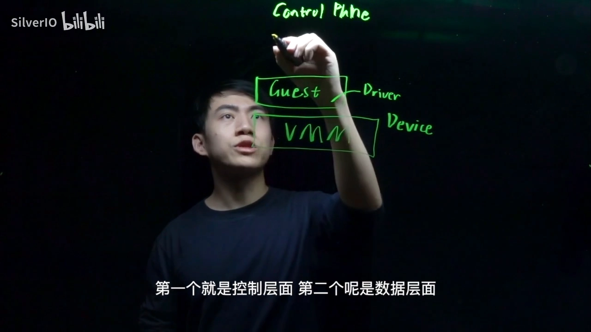
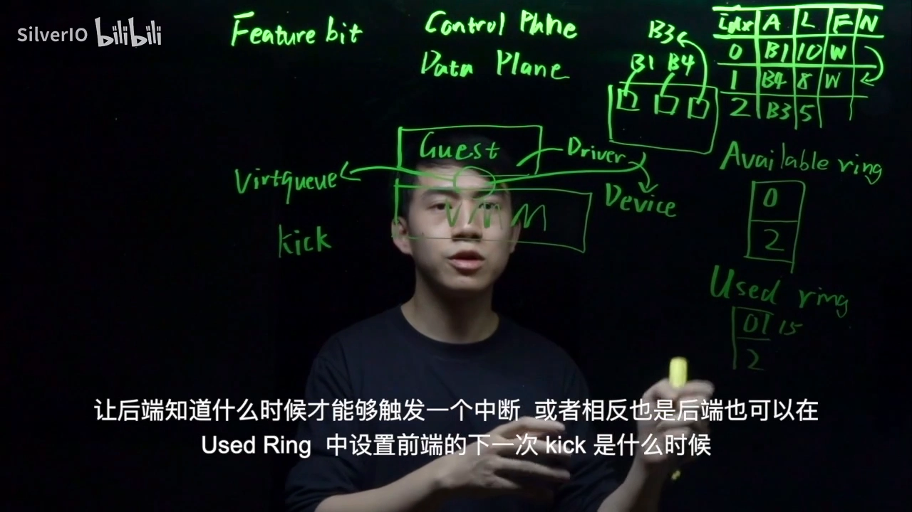

# virtio 的前后端契约：控制面谈 feature bits，数据面共享 virtqueue

> 视频来源：[【Cloud Explained ∙ 第十期】I/O 设备虚拟化 - Virtio](https://www.bilibili.com/video/BV1Sd4y1i7HV/)（Bilibili · SilverIO）｜时长约 11 分钟
> 本文覆盖这支视频的架构主线：半虚拟化设备为什么要把驱动拆成前后端、前后端要谈两份"合同"（控制面与数据面）、以及一次请求怎么把多个 I/O 合并成一次陷入。队列三环的字段细节与中断抑制策略属于 3.2 节，这里只在架构层点到为止。

## 本讲要解决的核心问题（SCQA）

**背景**：全虚拟化设备给使用带来很大便利——客户机不用改、装上就能跑。但它的代价是频繁触发 VM exit，陷入到 VMM 里处理，给 I/O 设备的性能带来很大开销。

**冲突**：CPU 虚拟化早就遇到过同样的问题，当时的解法是引入半虚拟化来缓解 hypervisor 介入指令执行的开销；I/O 设备这条路径上，客户机同样可以"配合一下"。

**疑问**：如果客户机愿意配合，那么"配合"具体要约定什么？前端和后端各自负责什么、靠什么交换数据、又省掉了哪一段开销？

**回答（中心思想）**：virtio 把前后端的交流切成**两个层面**——**控制面**先谈好"对方能干什么"（feature bits 取交集），**数据面**再用一块共享内存（virtqueue）搬运数据。因为请求是先攒在共享内存里、由一次通知统一提交，所以省掉的是"每个 I/O 请求都陷入一次、由模拟器逐条复现设备语义"这条路径。

## 一、为什么要在 I/O 上重走一遍 CPU 半虚拟化的路

视频开场把两件事并置：之前介绍虚拟 I/O 设备时讲过全虚拟化设备，它带来很大便利，但由于频繁触发 VM exit、陷入到 VMM 中处理，也给 I/O 设备的性能带来很大开销 [【跳转到 00:05】](https://www.bilibili.com/video/BV1Sd4y1i7HV/?t=5)。而在讲 CPU 虚拟化时，已经引入过半虚拟化技术，来缓解 hypervisor 介入 CPU 指令执行过程所带来的开销 [【跳转到 00:30】](https://www.bilibili.com/video/BV1Sd4y1i7HV/?t=30)。

这两句话其实给出了本节的方法论：**半虚拟化不是设备专有的技巧，而是一种通用的"让客户机知情并配合"的思路**。CPU 侧用它减少陷入，I/O 侧同样可以。

## 二、virtio 的价值不是"唯一实现"，而是"统一标准"

一个容易被误解的点，视频专门澄清了：讲 virtio 并不是因为它是唯一一个半虚拟化 I/O 的实现方案。实际上，一些本身就是基于半虚拟化技术的 hypervisor，比如 Xen，已经有自己的一套半虚拟化 I/O 实现方案；另外一些 hypervisor 也有自己的一套半虚拟化实现方案 [【跳转到 00:55】](https://www.bilibili.com/video/BV1Sd4y1i7HV/?t=55)。

那 virtio 的意义在哪里？在于它试图在不同的 hypervisor 之间**统一为一个半虚拟化 I/O 的标准**。视频给了一个很朴素的反证 [【跳转到 01:20】](https://www.bilibili.com/video/BV1Sd4y1i7HV/?t=80)：如果每个 hypervisor 都提供一套自己的半虚拟化 I/O 协议，那么虚拟机里面可能就需要安装各种各样不同的半虚拟化驱动来适配不同的 hypervisor，用起来很麻烦，也很难维护。

这一点直接决定了"前后端分离"这个设计的价值：**前端是标准化的，后端是可替换的**。客户机里装一份 virtio 驱动，就能在 KVM、Xen 等不同 hypervisor 上工作，因为大家遵守同一份前后端契约。

## 三、前后端分离：前端在 guest，后端在 VMM

virtio 定义了一套非常典型的前后端架构 [【跳转到 01:45】](https://www.bilibili.com/video/BV1Sd4y1i7HV/?t=105)：

- **前端**：安装在 guest 里面的 virtio 驱动；
- **后端**：在 VMM 侧实现的虚拟设备 [【跳转到 01:54】](https://www.bilibili.com/video/BV1Sd4y1i7HV/?t=114)。

前后端分离的关键在于**职责边界**：

| 角色 | 位置 | 负责什么 | 不负责什么 |
| --- | --- | --- | --- |
| 前端驱动 | 客户机内核 | 把上层请求翻译成 virtio 请求，写进共享内存，通知后端 | 不碰真实硬件，不做真正的 I/O |
| 后端设备 | VMM（QEMU 进程、内核或独立进程） | 读共享内存里的请求，真正执行 I/O，回填结果并通知前端 | 不需要理解客户机上层的文件系统、协议栈语义 |

前端"知道自己运行在虚拟机里"这一点，正是它敢把请求写成 virtio 格式、而不是假装操作真硬件寄存器的原因。也正因为如此，前端不再需要让每一次寄存器访问都陷入——它只需要在共享内存里写好请求，再"敲一下门"。

## 四、控制面：先谈好"对方能干什么"

前后端之间的交流被分成两个层面：第一个是控制层面，第二个是数据层面 [【跳转到 02:07】](https://www.bilibili.com/video/BV1Sd4y1i7HV/?t=127)。

控制层面很好理解：前后端双方在干活之前需要在某些方面达成一致，其中非常重要的一项一致就是"对方能够干什么"，也称为 **feature bits** [【跳转到 02:28】](https://www.bilibili.com/video/BV1Sd4y1i7HV/?t=148)。

为什么需要先谈这个？因为软件是不断迭代更新的，前端和后端的版本有可能不一致，而新版本中可能会引入新的特性 [【跳转到 02:51】](https://www.bilibili.com/video/BV1Sd4y1i7HV/?t=171)。视频举了一个具体例子：前端可能支持设备热插拔，但后端并不支持，这时前端就不能简单地认为这台虚拟机支持热插拔 [【跳转到 02:58】](https://www.bilibili.com/video/BV1Sd4y1i7HV/?t=178)。

协商的方式是**取交集** [【跳转到 03:23】](https://www.bilibili.com/video/BV1Sd4y1i7HV/?t=203)：

1. 后端首先会把自己的特性集合发给前端；
2. 前端拿它跟自己的特性做对比；
3. 最后返回两者的交集。

这样双方就能在"应该支持哪些特性"上达成一致，确保都是自己实际支持的。用集合的语言写出来就是：

$$
F_{\text{生效}} = F_{\text{前端}} \cap F_{\text{后端}}
$$

这个式子解释了半虚拟化设备的一个常见现象：**同一个 virtio 设备，在不同版本的内核或不同版本的 QEMU 上，能力可能不一样**。不是驱动写错了，而是交集变小了。除了特性协商，控制层面可能还会对数据层面做一些配置 [【跳转到 03:23】](https://www.bilibili.com/video/BV1Sd4y1i7HV/?t=203)；总的来说，控制层面要做的事情，就是让数据层面之后能安心干活 [【跳转到 03:48】](https://www.bilibili.com/video/BV1Sd4y1i7HV/?t=228)。

## 五、数据面：virtqueue 就是一块共享内存

数据层面顾名思义，就是为虚拟机的 I/O 数据传输服务的。在 virtio 中，数据层面定义了一个 **virtqueue**，供前端和后端进行数据上的通信 [【跳转到 04:13】](https://www.bilibili.com/video/BV1Sd4y1i7HV/?t=253)。

它的本质非常朴素：**一块虚拟机和宿主机之间的共享内存**。这块内存里有一个个内存缓冲区，我们称为 buffer；virtqueue 要做的，就是把这些缓冲区管理起来 [【跳转到 04:38】](https://www.bilibili.com/video/BV1Sd4y1i7HV/?t=278)。

管理方式分三步 [【跳转到 04:46】](https://www.bilibili.com/video/BV1Sd4y1i7HV/?t=286)：

1. **给每个 buffer 分配一个描述符**，描述它的地址、长度以及其他一些特性；
2. **维护一张全局的表**来记录这些描述符 [【跳转到 05:03】](https://www.bilibili.com/video/BV1Sd4y1i7HV/?t=303)；
3. 这张表里每一项包含描述符所描述的特性，比如序列号、地址、长度，以及一些其他特性，我们称为 **flag** [【跳转到 05:08】](https://www.bilibili.com/video/BV1Sd4y1i7HV/?t=308)。

有时候多个 buffer 会连在一起形成一个链表，那么描述符里就会有指向下一个相连 buffer 的指针 [【跳转到 05:39】](https://www.bilibili.com/video/BV1Sd4y1i7HV/?t=339)。这就是"一次请求可以跨多块不连续内存"的实现方式——链表把分散的 buffer 串成一个逻辑请求。

## 六、走一遍完整流程：一次读请求是怎么被前后端共同完成的

视频用一组具体的编号把流程走了一遍，这套编号很值得跟着算一遍。

**第一步：前端写描述符表。** 假设前端下发了一个 I/O 请求，这个请求申请了两个 buffer，比如 B1 和 B4，那么它就会往描述符表里写入这两个 buffer 对应的描述符 [【跳转到 05:49】](https://www.bilibili.com/video/BV1Sd4y1i7HV/?t=349)：

| 索引 | 地址 | 长度 | 可写 | 指向下一个 |
| --- | --- | --- | --- | --- |
| 0 | B1 | 10 | 是 | B4（索引 1） |
| 1 | B4 | 8 | 是 | 无 |
| 2 | B3 | 5 | 否 | 无 |

B1 放在第 0 项，地址是 B1，长度假设是 10，特性假设是**可写**的——因为这就代表可能是一个读请求，后端可以往这个缓冲区里写入数据；B4 长度假设是 8，也是可写的，并且 B1 这一项需要指向 B4 [【跳转到 06:10】](https://www.bilibili.com/video/BV1Sd4y1i7HV/?t=370)。

接着前端可能还会下发另外一个 I/O 请求，假设是 B3，它跟前两个不是连在一起的，序号是 2，地址是 B3，长度是 5，并且是**不可写**的 [【跳转到 06:51】](https://www.bilibili.com/video/BV1Sd4y1i7HV/?t=411)。于是这三个请求就放到队列里了 [【跳转到 07:23】](https://www.bilibili.com/video/BV1Sd4y1i7HV/?t=443)。

**第二步：前端把"要处理的请求"挂到 available ring。** 仅写描述符表还不够，还有另外一个队列，我们称之为 **available ring**，它主要用来表示描述符表里有哪些请求是需要被处理的 [【跳转到 07:33】](https://www.bilibili.com/video/BV1Sd4y1i7HV/?t=453)。

这里有个精巧之处：B1 和 B4 都是需要被处理的，但只需要把 B1 在描述符表里的序号 0 放进去；B4 就不需要放了，因为后端通过 B1 这个描述符就能找到它所连接的 B4 [【跳转到 08:02】](https://www.bilibili.com/video/BV1Sd4y1i7HV/?t=482)。接着另一个请求 B3 的序号 2 也需要放进去 [【跳转到 08:14】](https://www.bilibili.com/video/BV1Sd4y1i7HV/?t=494)。

**第三步：kick。** 这些需要处理的请求都准备好之后，前端就会通过 virtqueue 提供的 **kick** 接口来告知后端设备：这些请求需要处理 [【跳转到 08:29】](https://www.bilibili.com/video/BV1Sd4y1i7HV/?t=509)。注意这一步的措辞——kick 是"告知有一批请求"，而不是"告知某一个请求"。当然，这个 kick 也会涉及一些 VM exit [【跳转到 08:39】](https://www.bilibili.com/video/BV1Sd4y1i7HV/?t=519)。

**第四步：后端处理并写 used ring。** 后端处理完之后，会把处理好的请求放到另外一个队列，也就是 **used ring**。它的格式其实和 available ring 差不多，也是把相应描述符在描述符表里的序号写进去，比如 0 以及 2 [【跳转到 08:52】](https://www.bilibili.com/video/BV1Sd4y1i7HV/?t=532)。

但除此之外，如果后端往 buffer 里写入了数据，它同样会带上在这个 buffer 里已经写入数据的长度 [【跳转到 09:16】](https://www.bilibili.com/video/BV1Sd4y1i7HV/?t=556)。比如这是一个读请求，后端从设备中读到数据就会写入 buffer；在 B1 和 B4 下，它一共写入的长度为 15 [【跳转到 09:30】](https://www.bilibili.com/video/BV1Sd4y1i7HV/?t=570)。

**第五步：中断回来。** 后端把处理完的请求放入队列之后，就会以正常中断的形式注入给虚拟机，告知其内部 I/O 完成、数据已经就绪 [【跳转到 09:44】](https://www.bilibili.com/video/BV1Sd4y1i7HV/?t=584)。

把五步压成一句话：**前端把请求攒在共享内存里，kick 一次；后端一次性处理，used ring 回填，中断一次。** 前后端之间真正"跨越虚拟化边界"的动作只有两次，而不是每个字节一次。

## 七、省掉的到底是什么：一次 VM exit 换一批请求

视频在这里给出了本节最核心的结论 [【跳转到 09:44】](https://www.bilibili.com/video/BV1Sd4y1i7HV/?t=584)：从整个流程来看，virtio 有利于减少 VM exit 的次数——这些 I/O 请求 B1、B4、B3 都结合在一起，统一形成一个 VM exit，然后后端一起来处理；相比全虚拟化设备每个 I/O 请求都可能触发一次 VM exit，virtio 的 I/O 请求处理方式显然更高效 [【跳转到 10:09】](https://www.bilibili.com/video/BV1Sd4y1i7HV/?t=609)。

把这句话写成式子是：

$$
T_{\text{全虚拟化}} = N \cdot (t_{\text{exit}} + t_{\text{模拟}}), \qquad
T_{\text{virtio}} = M \cdot (t_{\text{exit}} + t_{\text{后端}}), \quad M \ll N
$$

其中 $N$ 是 I/O 请求数，$M$ 是通知次数。省掉的不只是"陷入"这个动作本身，更是**每陷入一次就要由模拟器把设备语义复现一遍**的那部分工作——后端现在读的是结构化的描述符，而不是一条条寄存器写操作。

这也解释了为什么"共享内存 + 通知"是这个设计的核心：共享内存让数据搬运不需要跨越虚拟化边界，通知则把"跨越边界"的次数从"每请求一次"压到"每批一次"。

## 八、通知本身也是可调的接口

视频最后还提到一个容易被忽略的架构点：virtio 也支持前端在 available ring 里设置后端什么时候才能触发一个中断；反过来，后端也可以在 used ring 中设置前端的下一次 kick 是什么时候 [【跳转到 10:34】](https://www.bilibili.com/video/BV1Sd4y1i7HV/?t=634)。

这短短一句话说明：**通知不是硬编码的，而是协议的一部分**。前后端各自可以在自己那一半环里留下"下次什么时候再打扰我"的提示，从而在延迟与开销之间做取舍。具体的抑制策略（kick 与 interrupt suppression 的取舍）属于 3.2 节，这里只需要记住：连"通知"这件事，virtio 都把它纳入了前后端契约，而不是留给某一方自由发挥。

## 九、这套框架的边界与收益

视频的收尾总结可以拆成三层 [【跳转到 10:59】](https://www.bilibili.com/video/BV1Sd4y1i7HV/?t=659)：

- **性能层**：能够利用半虚拟化的特点，在数据传输层面极大地提高 I/O 性能；
- **兼容层**：能够保持前后端的良好兼容（这正是控制面 feature bits 取交集的意义）；
- **接口层**：暴露给虚拟机内部的还是非常熟悉的 PCI 类型设备。

第三点尤其重要：客户机看到的仍然是一块"PCI 设备"，它不需要知道自己面对的是 virtio 还是别的什么。也就是说，**半虚拟化的"知情"发生在驱动层，而不是发生在整个客户机里**——上层的块层、协议栈完全不用改。视频的评价是，virtio 很好地定义了一套半虚拟化的框架，可以说是为虚拟化的发展提供了非常大的便利 [【跳转到 10:59】](https://www.bilibili.com/video/BV1Sd4y1i7HV/?t=659)。

## 小结

- 半虚拟化在 I/O 上复用了 CPU 虚拟化的思路：让客户机知情并配合，以减少 hypervisor 介入的次数。
- virtio 的独特价值不是"第一个半虚拟化 I/O"，而是把不同 hypervisor 的半虚拟化 I/O 统一成一套标准，让前端可复用、后端可替换。
- 前后端分离的边界很清楚：前端在 guest 里描述请求，后端在 VMM 里真正执行 I/O。
- 前后端要谈两份合同：控制面用 feature bits 取交集，决定"能干什么"；数据面用 virtqueue 共享内存，决定"怎么干"。
- 取交集意味着能力会随版本组合变化，这是半虚拟化设备"同一设备、能力不同"的根源。
- 数据面是一块共享内存加一张描述符表：多个 buffer 可以链表化，环里放的是描述符索引而不是数据。
- 一次请求的流程是"写描述符 → 挂 available ring → kick → 后端处理 → 写 used ring → 中断"，跨越边界的动作只有两次。
- 省掉的是"每个 I/O 请求都陷入一次、由模拟器逐条复现设备语义"这条路径；通知频率本身也由环里的提示字段调节。

## 关键术语速查

| 术语 | 一句话解释 |
| --- | --- |
| VM exit | 客户机执行敏感操作时被硬件切回 hypervisor 的动作，是 I/O 模拟的主要开销来源 |
| 前端驱动 front-end | 客户机内核里的 virtio 驱动，知道自己在虚拟机中，负责把请求写进共享内存 |
| 后端 back-end | VMM 侧实现的虚拟设备，读取共享内存里的请求并真正执行 I/O |
| 控制面 control plane | 干活前的协商与配置，核心是 feature bits 取交集 |
| feature bits | 前后端各自支持的特性位图，最终生效的是两者的交集 |
| 数据面 data plane | 真正搬运数据的路径，virtio 用 virtqueue 实现 |
| virtqueue | 前后端共享内存里的请求队列，由描述符表与两个方向的环组成 |
| 描述符 descriptor | 记录一块 buffer 的地址、长度、可写标志与链表指针的表项 |
| available ring | 前端写入"哪些描述符待处理"的环，只放链表头的索引 |
| used ring | 后端写入"哪些请求已完成、写了多长"的环 |
| kick | 前端通知后端"有活来了"的动作，通常会触发一次 VM exit |