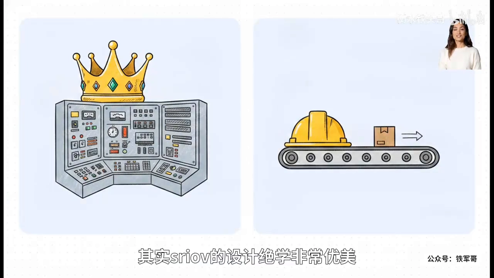
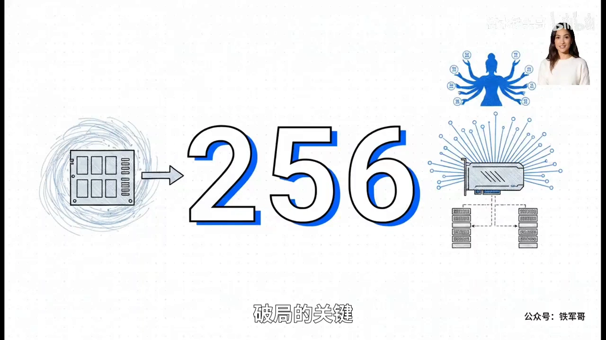
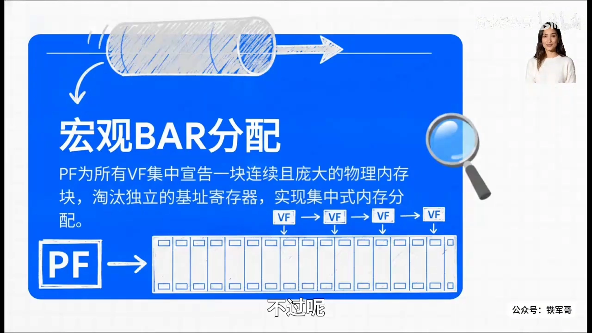
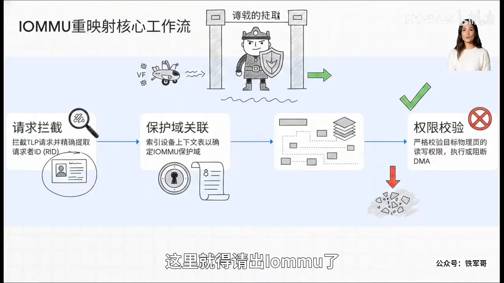
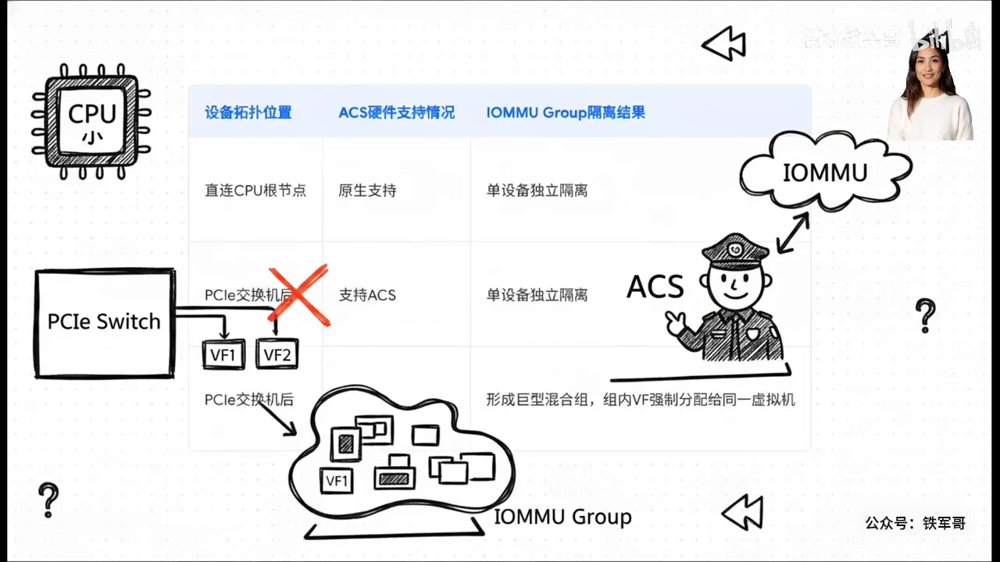
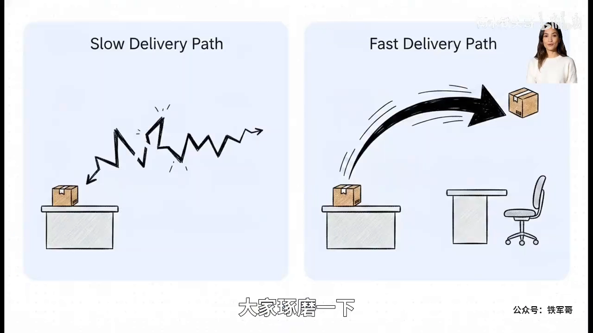
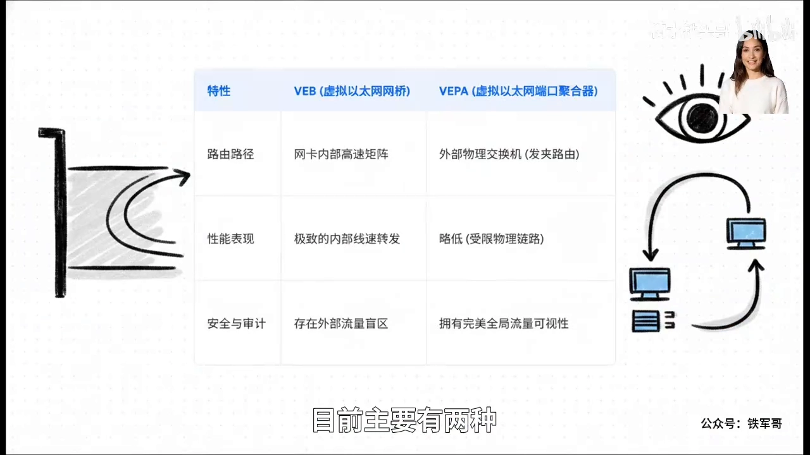
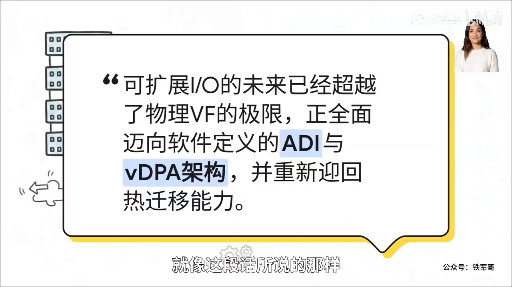

# SR-IOV 把一张网卡切成 256 份：设备直通为什么必须靠 IOMMU 与 ACS

> 视频来源：[PCIe直通与SR-IOV底层硬核解密](https://www.bilibili.com/video/BV1mGho6JEJN/)（Bilibili · 衡水铁头哥）｜时长约 11 分钟
> 这是一支从硬件侧讲设备直通的短片：先讲软件数据面为什么撑不住高包速率，再讲 SR-IOV 怎么把一张网卡切成几百个 VF，最后落到 IOMMU、ACS、IOMMU group 与 VFIO 三层抽象。本文只取与"设备直通"相关的部分，virtio 的队列细节与全模拟设备的开销不在本文范围。

## 本讲要解决的核心问题（SCQA）

**背景**：一台物理服务器上跑几十上百个虚拟机，CPU 和内存都够用，但网络和存储的 I/O 常常先成为瓶颈。

**冲突**：在传统的软件虚拟化数据面上，每一个数据包的收发都要经过 hypervisor：触发 VM exit、陷入内核、在软件虚拟交换机里查表转发，还要抢锁。包一多，CPU 周期全被这些"过路费"吃掉，延迟也变得不可控。

**疑问**：能不能让虚拟机绕过 hypervisor，直接和物理网卡对话？如果让虚拟机直接指挥硬件，虚拟机里的驱动（甚至是恶意代码）岂不是能对宿主机的任意内存发起 DMA 写？

**回答（中心思想）**：设备直通把 I/O 路径上的 hypervisor 几乎完全删掉，让客户机用自己的原生驱动直接操作物理设备。这条路能成立，靠的是三块拼图：**SR-IOV 在硬件层把管理面与数据面拆开**（PF 管配置、VF 只搬数据），**IOMMU 在硬件层给每个设备的 DMA 加上地址翻译和权限校验**，**ACS 与由此划出的 IOMMU group 保证同一组设备不会互相串门**。软件层的 VFIO 框架则把这三件事包装成 container / group / device 三层抽象，交给用户态的 VMM 使用。

## 一、性能痛点：软件数据面为什么撑不住

视频开篇描述的典型场景是：现代数据中心的 CPU 核心数很夸张、内存也用不完，但一旦开始部署密集的虚拟网络和存储 I/O，吞吐量立刻塌下来。[【跳转到 00:00】](https://www.bilibili.com/video/BV1mGho6JEJN/?t=0)

原因就在软件 hypervisor 这条路径上。在传统的半虚拟化架构里，即使 CPU 性能再强，面对 10 Gbps 甚至更高并发的网络流量，每一次数据包收发都会触发：

- 繁重的上下文切换；
- 大量 VM exit（虚拟机退出到 hypervisor）；
- 激烈的锁竞争。

软件虚拟交换机在疯狂吞噬 CPU 周期的同时，也让网络延迟变得完全不可控。[【跳转到 00:34】](https://www.bilibili.com/video/BV1mGho6JEJN/?t=34)

视频里用的类比很形象：修了一条顶级的八车道高速公路，结果收费站还是人工抬杆，那必然全堵死。靠软件优化解决不了，只能请硬件来救场。

整支视频的路线图是六段：性能痛点与 SR-IOV 破局、ARI 与内存分配、IOMMU 与 ACS、VFIO 与零拷贝、硬件直接中断、流量路由与未来架构。[【跳转到 01:21】](https://www.bilibili.com/video/BV1mGho6JEJN/?t=81)

## 二、SR-IOV：把管理权限和数据转发彻底解耦

单根 I/O 虚拟化（SR-IOV，Single Root I/O Virtualization）的设计思路，是把一张物理网卡切成两个角色。[【跳转到 01:51】](https://www.bilibili.com/video/BV1mGho6JEJN/?t=111)

- **PF（Physical Function，物理功能）**：网卡的绝对控制中心。它拥有完整的 PCI 配置空间，掌握全局的开启、关闭和网络策略。
- **VF（Virtual Function，虚拟功能）**：极其轻量级的切片。它被剥掉了所有管理权限，只懂埋头搬运数据。

这种设计从硬件底层就把配置寄存器从 VF 上剥离了，于是 VF 在虚拟机里可以做到纯粹的数据平面操作，而且彼此互不干扰。[【跳转到 02:29】](https://www.bilibili.com/video/BV1mGho6JEJN/?t=149)

对设备直通来说，这一点很关键：**虚拟机拿到的是一个 VF，而不是整张网卡**。管理动作（改 MAC、配 VLAN、开关端口）仍然集中在宿主机侧的 PF 上，虚拟机只负责收发。

## 三、ARI 与宏观 BAR 分配：怎么变出几百个 VF

有了 PF/VF 的划分，下一个现实问题是：云数据中心动辄几百上千个虚拟机，一块物理网卡怎么变出这么多 VF？

### 3.1 ARI 把"设备号"字段合并掉

传统 PCIe 规范里，一个设备最多只能包含 8 个功能（function）。为了实现几百个 VF 的扩展，PCI-SIG 引入了一项叫 **ARI（Alternative Routing-ID Interpretation，替代路由 ID 解释）** 的技术：它把路由 ID 里的设备号字段去掉并合并，把上限直接拉满。

这样，单个总线号下的设备最高就能支持 **256 个功能实例**。[【跳转到 03:10】](https://www.bilibili.com/video/BV1mGho6JEJN/?t=190)

### 3.2 宏观 BAR 分配：一块大地址空间按步长切

光有通道还不够，还得给这几百个 VF 分配 MMIO 地址空间。如果每个 VF 都独立申请一套基址寄存器（BAR），系统的地址总线资源很快就被榨干。

SR-IOV 的做法是**宏观 BAR 分配**：由 PF 出面，一次性向系统申请一块极大且连续的物理地址映射块，每个 VF 只要按固定的步长偏移，就能算出自己那份空间的起点。[【跳转到 03:48】](https://www.bilibili.com/video/BV1mGho6JEJN/?t=228)

这样既保住了隔离性（每个 VF 的寄存器仍然在自己那一段里），又把寻址效率拉满：宿主只需要管一块大映射，不需要为每个 VF 单独做地址分配。

## 四、IOMMU：DMA 请求要过四道关

硬件隔离就绪之后，最要命的问题来了：既然绕过了 hypervisor、让虚拟机直接跟硬件沟通，那万一这个虚拟机里的驱动有 bug，或者干脆是恶意的，往宿主机内存里乱写数据怎么办？

这就是 IOMMU（Input/Output Memory Management Unit，I/O 内存管理单元）要解决的事。它像矗立在内存大门口的门卫：当虚拟机共事的 VF 发起 DMA（Direct Memory Access，直接内存访问）时，IOMMU 会拦下请求，按四步处理。[【跳转到 04:30】](https://www.bilibili.com/video/BV1mGho6JEJN/?t=270)

1. **请求拦截**：截下这个 TLP（Transaction Layer Packet，PCIe 事务层包）请求，并精确提取**请求者 ID（RID，Requester ID）**——也就是"是谁在发请求"，通常由总线号、设备号、功能号拼成。
2. **保护域关联**：用 RID 去索引设备上下文表，确定这个设备属于哪个 IOMMU 保护域（protection domain）。
3. **页表漫游**：在这个保护域的页表里，把请求中的客户机物理地址（GPA）翻译成真实的宿主机物理地址（HPA）。
4. **权限校验**：严格校验目标物理页的读写权限，决定放行还是直接阻断这次 DMA。

没有这一层，一个恶意或有 bug 的设备可以对整机物理内存发起任意 DMA 写，系统分分钟崩溃；有了这一层，设备只能在自己那个保护域的地址空间里活动。[【跳转到 05:16】](https://www.bilibili.com/video/BV1mGho6JEJN/?t=316)

## 五、ACS 与 IOMMU group：为什么只能"整组直通"

IOMMU 能管住"设备 → 内存"的访问，但管不住"设备 → 设备"的访问。这就是 PCIe 的点对点（peer-to-peer）传输漏洞：如果两个 VF 挂在同一个不支持 **ACS（Access Control Services，访问控制服务）** 的 PCIe 交换机下，它们之间的流量可以完全不经过上行链路，也就绕过了 IOMMU 的检查，直接互相访问对方的内存。[【跳转到 05:32】](https://www.bilibili.com/video/BV1mGho6JEJN/?t=332)

ACS 的作用就是强制所有流量必须上行、接受 IOMMU 的检查。[【跳转到 05:57】](https://www.bilibili.com/video/BV1mGho6JEJN/?t=357)

上图把三种情况列在一起：

| 设备拓扑位置 | ACS 硬件支持情况 | IOMMU group 隔离结果 |
| --- | --- | --- |
| 直连 CPU 根节点 | 原生支持 | 单设备独立隔离 |
| PCIe 交换机后（支持 ACS） | 支持 ACS | 单设备独立隔离 |
| PCIe 交换机后（不支持 ACS） | 不支持 | 形成巨型混合组，组内 VF 强制分配给同一台虚拟机 |

最后一行就是"整组直通"的由来：只要 PCIe 拓扑里有一环不支持 ACS，内核为了保命，会把底下所有设备打包成一个巨大的 IOMMU group。结果是这些 VF 根本没法灵活分配给不同的虚拟机——要么整组给一台虚拟机，要么一台都不给。

## 六、VFIO：把硬件隔离包装成三层抽象

硬件隔离就绪之后，软件层需要一套框架来接管这一切。Linux 的 **VFIO**（Versatile I/O）框架抽象出三层概念。[【跳转到 06:30】](https://www.bilibili.com/video/BV1mGho6JEJN/?t=390)

- **container（容器）**：负责圈地，管理整个保护域的页表映射。一个 container 对应 IOMMU 的一套地址空间。
- **group（组）**：绝对不可破坏的原子单位，对应底层的 IOMMU group。组里的设备**要么全给，要么都不给**，绝不能拆分。[【跳转到 06:47】](https://www.bilibili.com/video/BV1mGho6JEJN/?t=407)
- **device（设备）**：具体的那个设备，也就是最终暴露给虚拟机的 VF。

正是靠着这种从属关系（device ⊂ group ⊂ container），用户态程序才能在保证隔离的前提下安全地掌控物理硬件：VMM 先建 container、把客户机的物理地址区间登记成这个 container 的 IOMMU 页表，再把 group 挂进去，最后才逐个打开 group 里的 device。

## 七、数据面零拷贝：MMIO 直接映射进客户机

VFIO 最激动人心的一点是：它利用 CPU 的 EPT（Extended Page Table，扩展页表）把底层网卡芯片的物理 MMIO 空间直接映射给虚拟机。[【跳转到 07:24】](https://www.bilibili.com/video/BV1mGho6JEJN/?t=444)

这意味着，当虚拟机里的网卡驱动以为自己只是在读写内存时，它的指令已经直接通过芯片流水线砸到了底层的硅片上。在数据平面上，hypervisor 直接隐形了——这就是实现 10 Gpps 甚至 40 Gpps 吞吐的零拷贝奥义。[【跳转到 07:49】](https://www.bilibili.com/video/BV1mGho6JEJN/?t=469)

对比一下就很清楚：

| 环节 | 全模拟 / 半虚拟化 | 设备直通（VFIO） |
| --- | --- | --- |
| 客户机访问 PCI 配置空间 | 陷入 VMM 模拟 | 仍然陷入 VMM 模拟（配置空间不能直通） |
| 客户机访问 BAR（寄存器） | 陷入 VMM 模拟 | EPT 直映射，几乎无陷入 |
| 设备 DMA 访问客户机内存 | 设备 DMA 到宿主，再拷贝 | IOMMU 重映射，直接 DMA 到客户机内存 |
| 设备中断投递 | 宿主先收中断，再注入客户机 | 中断直通（posted interrupt） |

## 八、中断直通：把中断直接投到 vCPU

数据不用拷贝了，但如果每来一个网络包都触发一次传统中断，照样会引发成千上万次 VM exit。[【跳转到 08:02】](https://www.bilibili.com/video/BV1mGho6JEJN/?t=482)

Intel 的 **posted interrupt（发布式中断）** 与 AMD 的 **AVIC（Advanced Virtual Interrupt Controller）** 彻底改变了这套玩法：硬件变成专属快递员，完全绕过 hypervisor，把中断直接投递到你那个虚拟 CPU 的"办公桌"上，实现真正的零 VM exit，全靠原子级的状态更新。[【跳转到 08:41】](https://www.bilibili.com/video/BV1mGho6JEJN/?t=521)

对网络吞吐来说，这一步往往比数据面直通更关键：数据面已经零拷贝了，如果中断还要绕一圈，包速率照样上不去。

## 九、VF 之间的流量怎么走：VEB 与 VEPA

当同一台服务器内部的这些 VF 互相通信时，流量走哪条路？目前主要有两种典型的内部转发架构。[【跳转到 08:59】](https://www.bilibili.com/video/BV1mGho6JEJN/?t=539)

| 特性 | VEB（虚拟以太网网桥） | VEPA（虚拟以太网端口聚合器） |
| --- | --- | --- |
| 路由路径 | 网卡内部高速矩阵 | 外部物理交换机（发夹路由） |
| 性能表现 | 极致的内部线速转发 | 略低（受限于物理链路） |
| 安全与审计 | 存在外部流量盲区 | 拥有全局流量可视性 |

VEB 模式下，流量连网线都不出，直接在网卡硅片内部的高速矩阵里完成交换，速度极快；代价是它成了外部防火墙和入侵检测的盲区，里面干什么你根本看不见。为了解决这种安全可视性问题，才有了 VEPA：它采用发夹路由（hairpin）机制，硬生生把虚拟机之间的流量推到外部物理交换机上绕一圈再回来，牺牲一点性能，换来企业级架构急需的全局流量监管能力。[【跳转到 09:14】](https://www.bilibili.com/video/BV1mGho6JEJN/?t=554)

## 十、代价与演进：VF 有上限，热迁移会丢

SR-IOV 的性能几乎无敌，但它也有软肋。[【跳转到 10:00】](https://www.bilibili.com/video/BV1mGho6JEJN/?t=600)

- **VF 数量有硬件上限**：物理 VF 是硅片上的切片，切不出无限份。
- **虚拟机彻底丧失热迁移能力**：虚拟机直接用真实设备的驱动，一旦迁移到另一台宿主机，如果网卡型号不同，状态就没法重建。
- **攻击面扩大**：设备被直通出去，等于把设备的全部能力暴露给了客户机。

所以面向云原生，业界正在走向软件定义的方向，尝试用灵活接口取代死板的硬件切片，把失去的热迁移能力拿回来。[【跳转到 10:25】](https://www.bilibili.com/video/BV1mGho6JEJN/?t=625)

这条演进线的代表就是 vDPA（virtio Data Path Acceleration）：数据面仍然直通硬件，控制面留在软件里，于是虚拟机看到的是 virtio 设备而不是真实设备，热迁移问题就绕开了。

## 小结

- **直通的价值在数据面**：把 hypervisor 从 I/O 路径上删掉，客户机用原生驱动直接操作设备，换来接近裸机的吞吐和延迟。
- **SR-IOV 是直通的常见落地方式**：PF 管配置、VF 只搬数据，ARI 把单设备功能上限拉到 256，宏观 BAR 分配让几百个 VF 共享一块地址空间。
- **IOMMU 是直通的安全前提**：没有它，设备的 DMA 可以写任意物理内存；有了它，每次 DMA 都要过"提取 RID → 关联保护域 → 页表漫游 → 权限校验"四道关。
- **ACS 决定 IOMMU group 的粒度**：拓扑里只要有一环不支持 ACS，底下设备就被打包成一个巨型组，只能整组直通。
- **VFIO 把硬件隔离包装成软件抽象**：device ⊂ group ⊂ container，group 是不可拆分的原子单位，container 对应一套 IOMMU 页表。
- **中断也要直通**：数据零拷贝之后，中断投递路径（posted interrupt / AVIC）才是下一个瓶颈。
- **代价是确定性的**：VF 数量受硬件限制、设备被独占、热迁移能力丢失、攻击面扩大。

## 关键术语速查

| 术语 | 一句话解释 |
| --- | --- |
| SR-IOV | 单根 I/O 虚拟化，把一张物理设备在硬件层切成 PF 与多个 VF |
| PF | 物理功能，拥有完整 PCI 配置空间，负责全局管理 |
| VF | 虚拟功能，轻量切片，只有数据面能力，可直通给虚拟机 |
| ARI | 替代路由 ID 解释，把路由 ID 的设备号字段合并，使单总线号下功能数上限达到 256 |
| BAR | 基址寄存器，设备暴露给系统的 MMIO 地址窗口 |
| IOMMU | I/O 内存管理单元，为设备 DMA 做地址翻译与权限校验 |
| RID | 请求者 ID，标识 DMA 请求来自哪个 PCIe 设备（总线号 + 设备号 + 功能号） |
| ACS | 访问控制服务，强制设备间流量上行接受 IOMMU 检查，堵住点对点漏洞 |
| IOMMU group | IOMMU 隔离的最小单位，组内设备不可拆分，必须整组分配 |
| VFIO | Linux 的用户态 I/O 框架，用 container / group / device 三层抽象把设备安全交给用户态 |
| EPT | 扩展页表，硬件二级页表，直通时用来把设备 MMIO 直接映射进客户机地址空间 |
| posted interrupt | Intel 的中断直通机制，绕过 hypervisor 把中断直接投递给 vCPU |
| AVIC | AMD 的高级虚拟中断控制器，作用与 posted interrupt 类似 |
| VEB / VEPA | VF 间流量的两种转发架构：网卡内部交换 / 推到外部交换机绕行 |
| vDPA | virtio 数据面加速，数据面直通硬件、控制面留在软件，兼顾性能与热迁移 |