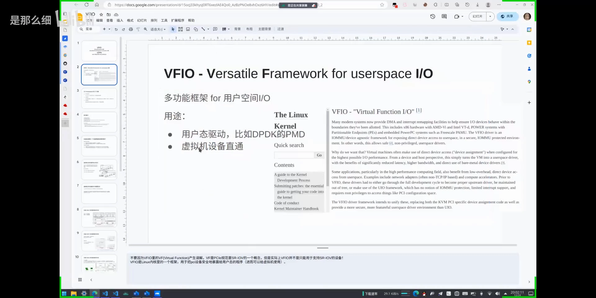
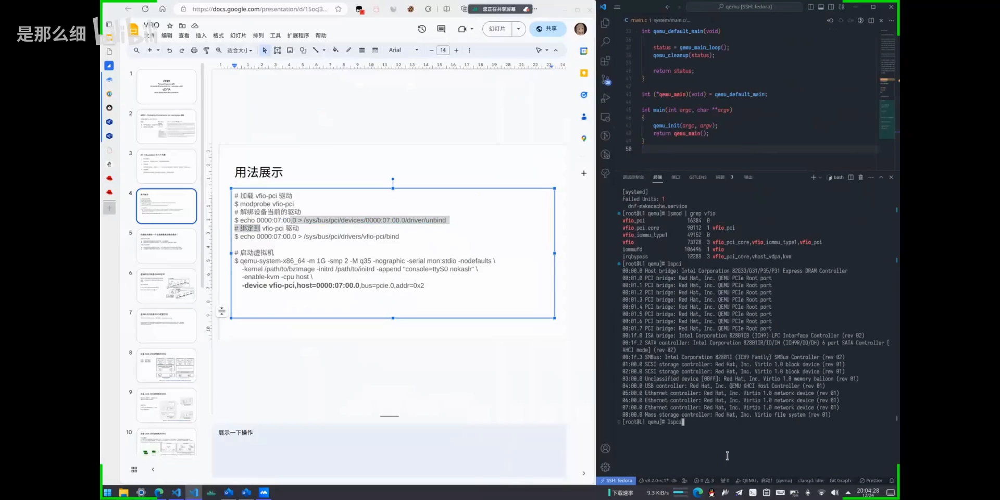
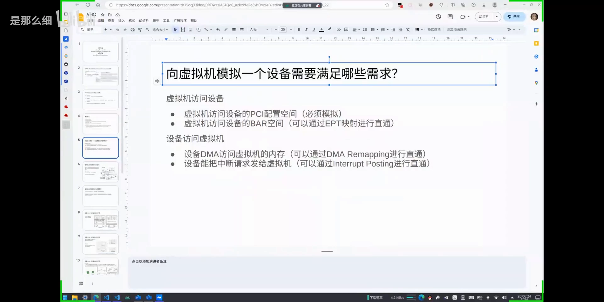
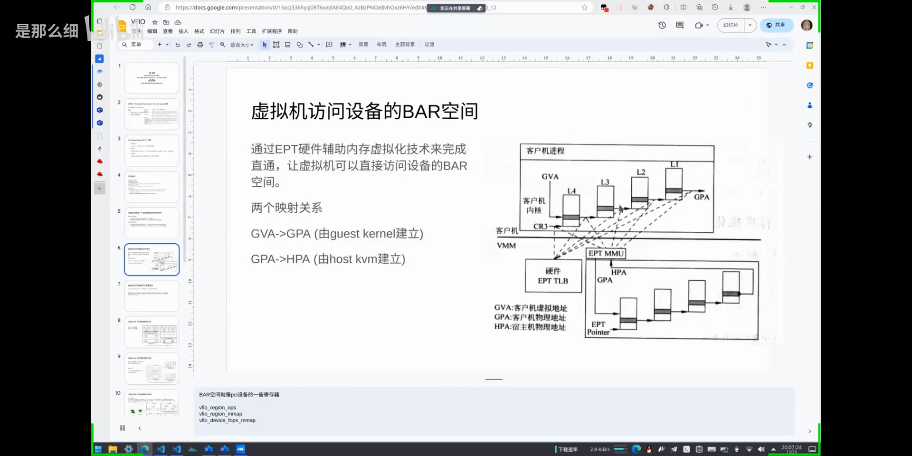
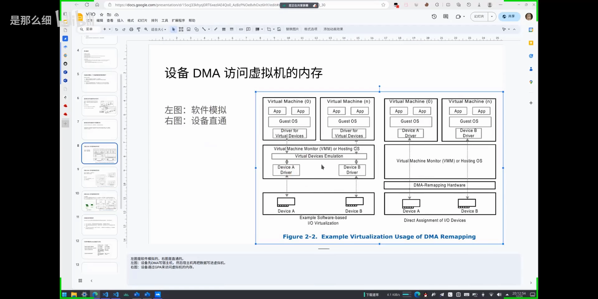
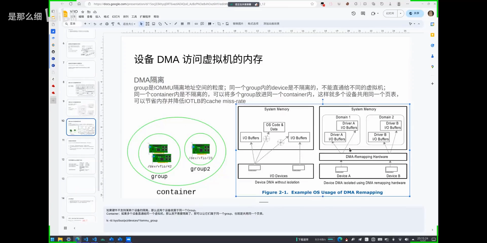
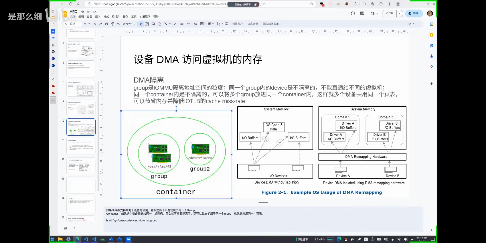
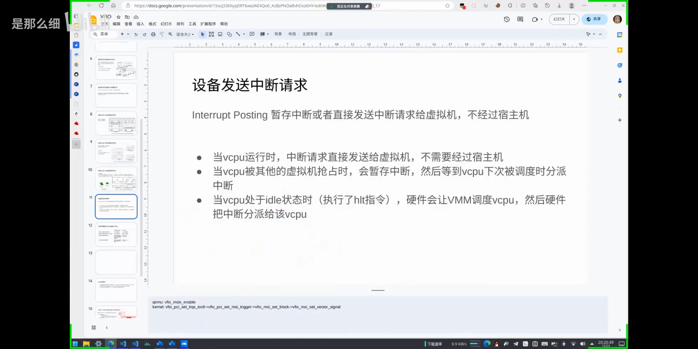
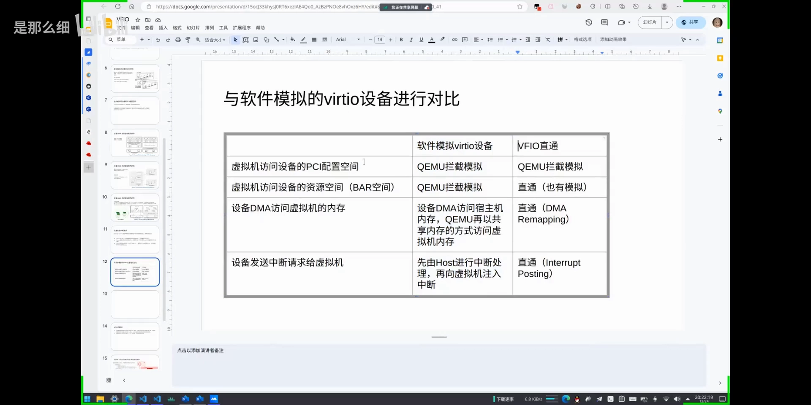
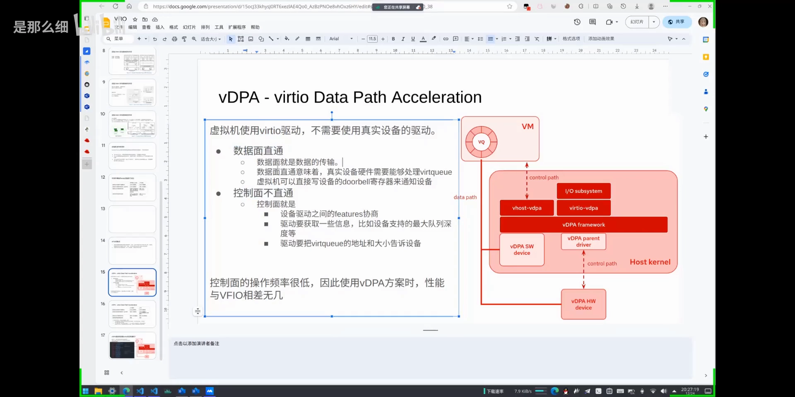

# VFIO 实战：把一块物理网卡交给虚拟机的四条通路

> 视频来源：[第十期 王佳琳的分享-VFIO](https://www.bilibili.com/video/BV1TT4y1s7pF/)（Bilibili · Linux内核分享小组）｜时长约 50 分钟
> 这是一次内核学习小组的内部分享：先讲 VFIO 是什么、现场演示把一块网卡直通给虚拟机，再逐条拆开"直通要满足的四个条件"，最后用 vDPA 对比收尾。中间夹了大量问答，本文保留了其中能澄清机制的部分。virtio 前后端与队列细节不在本文范围。

## 本讲要解决的核心问题（SCQA）

**背景**：给虚拟机做 I/O，最直接的办法是让 VMM 完全模拟一个设备。这条路能用，但每次访问都要陷入 VMM，性能差。后来有了半虚拟化（virtio），仍然要经过软件栈，开销还在。

**冲突**：如果让虚拟机直接使用真实的物理网卡呢？性能能接近裸机。但设备是物理上插在宿主机上的，一旦让虚拟机直接指挥它，虚拟机里的驱动就能对整台机器的内存发起 DMA 读写——隔离瞬间崩塌。

**疑问**：要让"设备直通"既快又安全，到底需要打通哪几条通路？VFIO 这个内核框架在其中到底做了什么？代价又是什么？

**回答（中心思想）**：设备直通要同时打通**四条通路**——客户机访问设备的 BAR 空间（靠 EPT 直映射）、客户机访问设备的 PCI 配置空间（必须由 VMM 模拟）、设备 DMA 访问客户机内存（靠 IOMMU 重映射）、设备把中断投给客户机（靠 interrupt posting）。VFIO 做的事情，是把后两条通路需要的内核能力（IOMMU 页表、中断注入）包装成 `container / group / device` 三层抽象，安全地开放给用户态的 VMM。代价也很明确：设备被独占、热迁移基本做不了、攻击面扩大。

## 一、VFIO 是什么：把 PCI 设备安全地暴露给用户态

讲者开门见山：VFIO 是 Linux 内核里的一个框架，作用是把 PCI 设备**安全地暴露给用户态程序**，用户态程序再把它交给虚拟机使用。[【跳转到 00:08】](https://www.bilibili.com/video/BV1TT4y1s7pF/?t=8)



### 1.1 名字里的 "VF" 容易误导

VFIO 常被展开成 "Virtual Function I/O"，但这个缩写其实不太准确：virtual function 是 PCI-SIG 规范里 SR-IOV 的一个概念。实际上**即使硬件不支持 SR-IOV，也照样可以用 vfio-pci 驱动**。更合适的解释是"一个多用途的用户态 I/O 框架"。[【跳转到 00:38】](https://www.bilibili.com/video/BV1TT4y1s7pF/?t=38)

### 1.2 两个用途

VFIO 有两个用途：一是做用户态驱动，比如 DPDK 的 poll mode driver（轮询模式驱动）；二是用来做虚拟机的设备直通。本次分享讲的是第二个。[【跳转到 01:08】](https://www.bilibili.com/video/BV1TT4y1s7pF/?t=68)

### 1.3 它在 I/O 虚拟化谱系里的位置

讲者把 I/O 虚拟化的方案排了一条线：最早的**完全虚拟化**由 hypervisor 完整模拟现有硬件，性能比较差；后来出现**半虚拟化**，仍然软件模拟，但定义了一套对虚拟化友好的新接口（virtio），性能好一些但仍有开销；再往后就是**设备直通**，让虚拟机和真实物理 I/O 设备直接互相访问，性能接近裸机。VFIO 是一种设备直通方案，后面要讲的 vDPA 也是一种。[【跳转到 02:08】](https://www.bilibili.com/video/BV1TT4y1s7pF/?t=128)

## 二、跑一遍：绑定 vfio-pci 再启动 QEMU

讲者现场演示了完整流程，只有三步。[【跳转到 01:58】](https://www.bilibili.com/video/BV1TT4y1s7pF/?t=118)



```bash
# 1. 加载 vfio-pci 驱动
$ modprobe vfio-pci

# 2. 把设备从它原来的驱动上解绑
$ echo 0000:07:00.0 > /sys/bus/pci/devices/0000:07:00.0/driver/unbind

# 3. 把设备绑定到 vfio-pci 驱动
$ echo 0000:07:00.0 > /sys/bus/pci/drivers/vfio-pci/bind

# 4. 启动虚拟机，用 vfio-pci 把这个设备透传进去
$ qemu-system-x86_64 -m 1G -smp 2 -M q35 -nographic -serial mon:stdio -nodefaults \
    -kernel /path/to/bzImage -initrd /path/to/initrd -append "console=ttyS0 nokaslr" \
    -enable-kvm -cpu host \
    -device vfio-pci,host=0000:07:00.0,bus=pcie.0,addr=0x2
```

绑定完成之后，`lspci -k` 就能看到这块网卡挂在 `vfio-pci` 驱动上；虚拟机启动起来后，里面会出现一块网卡，`ping` 一下 IP 是通的。[【跳转到 02:35】](https://www.bilibili.com/video/BV1TT4y1s7pF/?t=155)

这里有一个容易被忽略的前提：**宿主机必须先把这块设备从它原来的驱动上解绑**。因为直通意味着独占——宿主机自己不能再驱动它。问答环节有人问"能不能让物理机识别不到这块网卡、但虚拟机识别得到"，讲者的回答是不能，宿主机必须把网卡绑定到 vfio-pci 上；不过绑定之后宿主机可以不从这块网卡走流量，只让虚拟机走。[【跳转到 09:51】](https://www.bilibili.com/video/BV1TT4y1s7pF/?t=591)

## 三、直通要满足的四条通路

讲者把"向虚拟机模拟一个设备需要满足哪些需求"拆成两大类四条。[【跳转到 05:51】](https://www.bilibili.com/video/BV1TT4y1s7pF/?t=351)



**客户机访问设备**

1. 访问设备的 **PCI 配置空间**——必须模拟；
2. 访问设备的 **BAR 空间**（设备寄存器）——可以通过 EPT 映射直通。

**设备访问客户机**

3. 设备 **DMA 访问客户机内存**——可以通过 DMA remapping 直通；
4. 设备把**中断请求发给客户机**——可以通过 interrupt posting 直通。

后面四章就按这四条展开。这个拆法很值得记住：它把"直通"这件听起来很玄的事，变成了"四条通路里哪几条能直通、哪几条必须模拟"的具体问题。

## 四、通路一：BAR 空间用 EPT 直映射

BAR 空间就是 PCI 设备暴露出来的那些寄存器。要让客户机的内核直接访问到硬件寄存器，需要两级映射都建好。[【跳转到 06:21】](https://www.bilibili.com/video/BV1TT4y1s7pF/?t=381)



- **GVA → GPA**（客户机虚拟地址 → 客户机物理地址）：由**客户机内核**自己建立的页表，就是客户机里那个进程的页表。
- **GPA → HPA**（客户机物理地址 → 宿主机物理地址）：由**宿主 KVM** 建立的 EPT 映射。

两级映射都建好之后，客户机通过 GVA 访问时，地址会先经过客户机页表落到 GPA，再经过 EPT 落到 HPA，最终直接打到硬件寄存器上。[【跳转到 07:21】](https://www.bilibili.com/video/BV1TT4y1s7pF/?t=441)

问答里有人追问"这个映射是虚拟机主导建立的还是物理机主导建立的"，讲者明确回答是**物理机（宿主机）主导**——不能让虚拟机随便指一个地址、宿主机就给它映射。[【跳转到 09:21】](https://www.bilibili.com/video/BV1TT4y1s7pF/?t=561)

## 五、通路二：PCI 配置空间必须模拟

配置空间不能像 BAR 那样直通。原因很具体：如果让虚拟机直接写真实物理设备的配置空间，比如写 BAR 的基地址，虚拟机写入的地址是 GPA（客户机物理地址），但设备只认 HPA。而 GPA→HPA 的映射在配置阶段还没建立起来，所以即使虚拟机"配置成功"了，它仍然访问不到这块配置空间。[【跳转到 08:21】](https://www.bilibili.com/video/BV1TT4y1s7pF/?t=501)

所以配置空间必须由 VMM 拦截并模拟：VMM 读到客户机写的 GPA，把它翻译成真正的 HPA 再写进设备，同时把设备的真实配置"伪装"成客户机期望的样子。

## 六、通路三：DMA 用 IOMMU 重映射

接下来是设备访问客户机的方向。讲者用两张图对比了软件模拟与设备直通。[【跳转到 10:51】](https://www.bilibili.com/video/BV1TT4y1s7pF/?t=651)



- **软件模拟（左图）**：物理设备先 DMA 访问**宿主机内存**，然后发中断给宿主机；宿主机完成数据处理后，再把数据传给虚拟机。数据要多搬一趟。
- **设备直通（右图）**：设备通过 DMA remapping 硬件直接访问**客户机内存**，不需要经过宿主机。[【跳转到 11:51】](https://www.bilibili.com/video/BV1TT4y1s7pF/?t=711)

这块 DMA remapping 硬件就是 **IOMMU**。有了它，设备的 DMA 请求可以直接使用 GPA 地址，由 IOMMU 在硬件层翻译成 HPA。[【跳转到 12:21】](https://www.bilibili.com/video/BV1TT4y1s7pF/?t=741)

具体过程是：DMA 请求到达 IOMMU 时，先用发起请求的 PCI 设备的 **BDF 号**（总线号-设备号-功能号）去查表，找到一张列表，这个列表里存的就是 GPA → HPA 的映射关系，然后请求就被翻译到宿主机物理内存的对应位置，数据直接落到客户机内存里。[【跳转到 12:51】](https://www.bilibili.com/video/BV1TT4y1s7pF/?t=771)

### 6.1 DMA 隔离：不只是翻译，还要限制范围

IOMMU 的第二个作用是**隔离**。讲者用一张图说明：没有做 DMA 隔离时，一个设备可以访问不同区域的内存——假设旁边是另一台虚拟机，这台虚拟机就能通过让设备发 DMA 请求，读到别的虚拟机的内存。[【跳转到 13:51】](https://www.bilibili.com/video/BV1TT4y1s7pF/?t=831)


有了 DMA remapping，每个设备只能访问分配给它的那段内存，隔离就成立了。

## 七、VFIO 的三层抽象：container、group、device

讲到这里，讲者引出 VFIO 的三个核心概念。[【跳转到 14:51】](https://www.bilibili.com/video/BV1TT4y1s7pF/?t=891)



### 7.1 group：IOMMU 隔离地址空间的最小粒度

**group 是 IOMMU 隔离地址空间的最小粒度**。同一个 group 内的设备是**不隔离**的，所以它们只能给同一个虚拟机，不能分别直通给两台虚拟机，否则就有安全问题。[【跳转到 15:21】](https://www.bilibili.com/video/BV1TT4y1s7pF/?t=921)

group 是**内核启动时**就划分好的，你没法把一个设备从一个 group 里拿出来放到另一个 group 里去。划分依据是硬件拓扑：比如同一个 PCI 桥下面的设备就不支持隔离，会被划进同一个 group；PCI 设备（不是 PCIe）本身也不支持隔离。[【跳转到 16:09】](https://www.bilibili.com/video/BV1TT4y1s7pF/?t=969)

在系统里可以直接看到这个划分：

```bash
$ ls -ld /sys/bus/pci/devices/*/iommu_group
```

每个设备目录下的 `iommu_group` 都指向它所属的 group。讲者的幻灯片上，`/dev/vfio/42` 和 `/dev/vfio/23` 就是两个 group 对应的字符设备。

问答里有人问 group 是谁设置的、是不是要开安全启动，讲者澄清：跟安全启动关系不大，是**内核**在启动时根据 PCIe 的 ACS（Access Control Services）能力自动划分的。[【跳转到 18:25】](https://www.bilibili.com/video/BV1TT4y1s7pF/?t=1105)

### 7.2 container：让多个 group 共用一张页表

**container** 是更上一层：把两个 group 放进同一个 container，这两个 group 里的设备就互相不隔离了。这样做的目的是——假如你要把两个 group 的设备都给**同一台**虚拟机，最好把它们放进同一个 container。[【跳转到 17:03】](https://www.bilibili.com/video/BV1TT4y1s7pF/?t=1023)

好处是它们可以**共用同一张 IOMMU 页表**：一方面节省内存开销，另一方面降低 IOTLB 的 cache miss 率和刷新（flush）的概率。[【跳转到 17:33】](https://www.bilibili.com/video/BV1TT4y1s7pF/?t=1053)



于是三层结构就清楚了：

| 层级 | 对应什么 | 粒度约束 |
| --- | --- | --- |
| container | 一套 IOMMU 地址空间（一张页表） | 可以装多个 group |
| group | 一个 IOMMU 隔离域 | 不可拆分，组内设备必须给同一台虚拟机 |
| device | 单个 PCI 设备 | 从属于某个 group |

## 八、通路四：中断直通 Interrupt Posting

最后一条通路是中断。设备发中断请求也可以直通，不用经过宿主机。[【跳转到 19:46】](https://www.bilibili.com/video/BV1TT4y1s7pF/?t=1186)



- **vCPU 正在运行时**：中断请求直接发给虚拟机，不需要经过宿主机，性能更好。
- **vCPU 被其他虚拟机抢占时**：硬件会把中断信息暂时存到内存里，等到 vCPU 下次被调度时再把这个中断发出去。
- **vCPU 处于 idle 状态（执行了 `hlt` 指令）时**：硬件会让 VMM 去调度这个 vCPU，然后硬件把中断分派给该 vCPU。

这解释了为什么直通设备的中断延迟能做到接近裸机：中断从设备到 vCPU 的路径上，hypervisor 只在 vCPU 没在跑的时候才介入。

## 九、和软件模拟比一比：省在哪

四条通路讲完，讲者给了一张对比表。[【跳转到 21:16】](https://www.bilibili.com/video/BV1TT4y1s7pF/?t=1276)



| 环节 | 软件模拟 virtio 设备 | VFIO 直通 |
| --- | --- | --- |
| 客户机访问 PCI 配置空间 | QEMU 拦截模拟 | QEMU 拦截模拟 |
| 客户机访问 BAR 空间 | QEMU 拦截模拟 | 直通（也有部分需要模拟） |
| 设备 DMA 访问客户机内存 | 设备 DMA 到宿主内存，QEMU 再以共享内存方式访问 | 直通（DMA Remapping） |
| 设备发送中断给客户机 | 先由 Host 处理中断，再向客户机注入 | 直通（Interrupt Posting） |

可以看到，**配置空间这一条两种方案都要模拟**，这是直通也省不掉的；真正拉开差距的是后三条——BAR 访问、DMA、中断全部绕开了 VMM。[【跳转到 21:46】](https://www.bilibili.com/video/BV1TT4y1s7pF/?t=1306)

## 十、代价：热迁移与攻击面

讲者很坦率地列了 VFIO 的两个缺点。[【跳转到 22:16】](https://www.bilibili.com/video/BV1TT4y1s7pF/?t=1336)

### 10.1 热迁移基本做不了

因为是设备直通，虚拟机要使用**真实物理设备的那款驱动**。假如虚拟机正在运行、要从一台宿主机迁到另一台，如果两台宿主机的网卡型号不同，那就没办法热迁移。[【跳转到 22:46】](https://www.bilibili.com/video/BV1TT4y1s7pF/?t=1366)

问答环节有人追问："就算两台机器的设备相同，现在也迁不了吧？"讲者的回答是：如果直通，这两个设备还需要支持硬件标记，以及设备状态的保存与恢复——这得是**特定设备**才行，通用设备一般还迁不了，VFIO 这一侧目前也做不了太多，主要靠硬件那一侧。[【跳转到 23:46】](https://www.bilibili.com/video/BV1TT4y1s7pF/?t=1426)

### 10.2 攻击面扩大，而且没法真正缓解

第二个缺点是设备直接直通会扩大攻击面，可能造成安全问题。有人问能不能用"把空间模拟出来、不做直通"来缓解，讲者说那样需要适配特定设备；再追问"要直通的情况下有办法缓解吗"，回答是**缓解不了**：

> 直通就是需要把物理主机上那个设备的信息暴露到用户态，不暴露就没法直通到虚拟机。既然暴露了，这个安全性是不可逆的。[【跳转到 24:46】](https://www.bilibili.com/video/BV1TT4y1s7pF/?t=1486)

## 十一、折中方案 vDPA：数据面直通，控制面不直通

讲完 VFIO 的代价，讲者介绍了 **vDPA（virtio Data Path Acceleration）**，它的定位是一个折中方案。[【跳转到 25:16】](https://www.bilibili.com/video/BV1TT4y1s7pF/?t=1516)



核心思路是：**虚拟机使用 virtio 驱动，不需要使用真实设备的驱动**，但对真实设备有要求——设备要在数据面上实现 virtio 的标准，才能直通。[【跳转到 25:46】](https://www.bilibili.com/video/BV1TT4y1s7pF/?t=1546)

### 11.1 数据面直通

数据面就是数据的传输，比如 DMA，可以直接进行。具体要求是：

- 虚拟机里为 virtio 驱动创建了 virtqueue，设备要能直接处理这个 virtqueue——包括它的布局、以及里面各个字段的含义。[【跳转到 26:46】](https://www.bilibili.com/video/BV1TT4y1s7pF/?t=1606)
- 虚拟机要能直接写设备的通知寄存器（notify 地址），直接写进去通知设备干活。[【跳转到 27:16】](https://www.bilibili.com/video/BV1TT4y1s7pF/?t=1636)

### 11.2 控制面不直通

控制面指的是设备和驱动之间的特性协商，以及驱动获取设备信息——比如设备支持的 virtqueue 最大队列深度、把 virtqueue 的地址和大小告诉设备。这些操作可以不直通。[【跳转到 27:46】](https://www.bilibili.com/video/BV1TT4y1s7pF/?t=1666)

驱动读写设备寄存器时会被宿主机拦截，拦截之后 VMM 把 virtio 控制面的操作转换成对真实硬件设备的一次操作。[【跳转到 28:16】](https://www.bilibili.com/video/BV1TT4y1s7pF/?t=1696)

因为要经过宿主机，这会带来一些开销，但这个开销**频率很低**，所以并不大，性能与 VFIO 相差无几。[【跳转到 28:46】](https://www.bilibili.com/video/BV1TT4y1s7pF/?t=1726)

### 11.3 换来的好处：热迁移问题消失了

vDPA 最大的好处是：虚拟机用 virtio 驱动就可以了，不需要真实设备的驱动。于是"不同型号网卡导致无法热迁移"这个问题就被绕开了。[【跳转到 29:16】](https://www.bilibili.com/video/BV1TT4y1s7pF/?t=1756)

### 11.4 与 VFIO 的关键区别

讲者把两个方案的差别归结到一点上：

| 维度 | VFIO | vDPA |
| --- | --- | --- |
| 客户机看到的设备 | 真实设备（配置空间被复制并修改后给客户机） | virtio 设备（QEMU 完全模拟） |
| 客户机需要的驱动 | 真实设备的驱动 | virtio 驱动 |
| 控制面 | 拦截模拟，转成对真实设备的操作 | 拦截模拟，转成对真实设备的操作 |
| 数据面 | 直通 | 直通 |
| 热迁移 | 基本不可行 | 可行 |

VFIO 是把真实设备的空间复制一份、做点修改再给虚拟机，所以虚拟机看到的仍然是真实设备；vDPA 则是 QEMU 完全模拟一个 virtio 设备的配置空间，不管真实设备是哪个型号，虚拟机看到的都是 virtio 设备。[【跳转到 30:16】](https://www.bilibili.com/video/BV1TT4y1s7pF/?t=1816)

## 十二、vDPA 的落地细节：不是所有设备都行

问答部分澄清了 vDPA 的现实约束，这部分信息量很大。

### 12.1 通用网卡很难耦合进来

有人指出：vDPA 下面这个 device 并不是所有网络设备都行。设备要耦合到 virtio 这套框架里，需要实现一批钩子函数，有些函数下边硬件本身就不支持。所以并不是所有设备都能走 vDPA，现在更偏向于 DPU 这类设备。[【跳转到 32:03】](https://www.bilibili.com/video/BV1TT4y1s7pF/?t=1923)

原因是设备要能操作 virtqueue、能解析 virtqueue 的格式。如果通用网卡不能解析，就得在 vDPA driver 里由软件去解析，工作量很大。[【跳转到 32:41】](https://www.bilibili.com/video/BV1TT4y1s7pF/?t=1961)

### 12.2 QEMU 侧的 doorbell 直映射

讨论的高潮是一个细节：虚拟机写 notify 地址（doorbell）时，能不能不经过 QEMU？

答案是能。QEMU 在这一侧做了一次映射，创建了一个 memory region，把 BAR 空间直接映射到客户机，这样虚拟机写 notify 地址时就直接写到了硬件，省掉了控制面的一次陷入。[【跳转到 39:45】](https://www.bilibili.com/video/BV1TT4y1s7pF/?t=2385)

讲者现场翻了 QEMU 代码确认这一点，并补充了一个限制：这个 notify 地址必须满足"一对一"的约束，也就是说要求硬件设计和 virtio 规范尽量匹配一致，才能这么硬映射。[【跳转到 43:14】](https://www.bilibili.com/video/BV1TT4y1s7pF/?t=2594)

### 12.3 各家硬件参差不齐

讲者最后提到，vDPA 这块有的硬件支持、有的硬件不支持，各家参差不齐；他们自己在做 vDPA，但某些直通特性因为硬件缺陷还没做，性能上也有问题。[【跳转到 44:00】](https://www.bilibili.com/video/BV1TT4y1s7pF/?t=2640)

### 12.4 一个调试用的模拟设备

有人问幻灯片里那个"软件设备"是干什么的。讲者的解释是：那是给调试用的。如果你下边没有实际硬件，框架里提供一个模拟 device（sim device），它自己有一个 driver，相当于在内核里用内核模块模拟了一个设备。这样可以把通路先打通——至少到内核这一层已经通了，剩下的就是再往实际的物理硬件去对接。[【跳转到 46:30】](https://www.bilibili.com/video/BV1TT4y1s7pF/?t=2790)

## 十三、一个容易被混淆的问题：QEMU 和 KVM 谁算虚拟机

分享最后有人问：QEMU 跑在宿主机的用户空间里，那 QEMU 本身是个虚拟机吗？

讲者的回答是：QEMU 不是虚拟机，它是用来创建虚拟机的管理程序，通过 KVM 的接口来创建虚拟机。更准确地说，**QEMU 和 KVM 合起来才算一台虚拟机**——QEMU 主要模拟 device（还有总线这些），KVM 主要偏内存（虚拟内存）、虚拟中断和虚拟 CPU，负责跟物理 CPU 建立联系。所以完整的一台虚拟机应该算上 QEMU、KVM 还有硬件的支持（物理 CPU 的虚拟化能力）。[【跳转到 48:42】](https://www.bilibili.com/video/BV1TT4y1s7pF/?t=2922)

## 小结

- **直通不是"什么都直通"**：四条通路里，PCI 配置空间永远要模拟，BAR 空间、DMA、中断三条可以直通。
- **BAR 直通靠两级映射**：GVA→GPA 由客户机内核建，GPA→HPA 由宿主 KVM 的 EPT 建，且映射由宿主机主导。
- **DMA 直通靠 IOMMU**：用 BDF 号查表把 GPA 翻成 HPA，同时把每个设备限制在自己的内存区间内，这就是 DMA 隔离。
- **VFIO 的三层抽象对应硬件事实**：group 是 IOMMU 隔离的最小粒度、启动时按 ACS 定死、不可拆分；container 让多个 group 共用一张页表以省内存、降 IOTLB miss。
- **中断直通靠 interrupt posting**：vCPU 在跑时直接投递，被抢占时暂存内存，idle 时由硬件触发 VMM 调度。
- **代价是结构性的**：真实设备驱动绑死了硬件型号，热迁移基本不可行；设备信息暴露给用户态，攻击面扩大且不可逆。
- **vDPA 用"数据面直通 + 控制面模拟"换回热迁移**：客户机只看到 virtio 设备，代价是硬件必须能自己解析 virtqueue，通用网卡很难做到。

## 关键术语速查

| 术语 | 一句话解释 |
| --- | --- |
| VFIO | Linux 内核的用户态 I/O 框架，把 PCI 设备安全暴露给用户态，用于用户态驱动与虚拟机直通 |
| vfio-pci | VFIO 的 PCI 总线驱动，设备绑定到它之后才能被直通 |
| BAR 空间 | PCI 设备暴露的寄存器地址窗口，直通时靠 EPT 直接映射给客户机 |
| PCI 配置空间 | 设备的身份与配置寄存器，直通时仍必须由 VMM 拦截模拟 |
| GVA / GPA / HPA | 客户机虚拟地址 / 客户机物理地址 / 宿主机物理地址 |
| EPT | 扩展页表，硬件二级页表，负责 GPA→HPA |
| IOMMU | I/O 内存管理单元，为设备 DMA 做地址翻译与权限校验 |
| DMA remapping | IOMMU 提供的重映射能力，让设备用 GPA 直接访问客户机内存 |
| BDF | 总线号-设备号-功能号，IOMMU 用它识别 DMA 请求的发起者 |
| IOMMU group | IOMMU 隔离的最小粒度，内核启动时按 ACS 能力划分，组内设备不可拆分 |
| container | VFIO 的地址空间容器，可容纳多个 group 并让它们共用一张 IOMMU 页表 |
| IOTLB | IOMMU 的地址翻译缓存，共用页表能降低它的 miss 率与刷新频率 |
| interrupt posting | 中断直通机制，把设备中断直接投递给 vCPU，避免 VM exit |
| ACS | 访问控制服务，决定 PCIe 拓扑能否被切成独立的 IOMMU group |
| vDPA | virtio 数据面加速，数据面直通硬件、控制面由软件模拟，兼顾性能与热迁移 |