# virtio 的分层：设备语义、传输层与通知机制各管一段

> 视频来源：[VirtIO 1.0: A Standard Emerges](https://www.youtube.com/watch?v=W7Dxbq7IeIQ)（YouTube · linux.conf.au 2014，讲者 Rusty Russell，IBM Linux Technology Center）｜时长约 43 分钟
> 简要导读：这是 virtio 的主要作者在 1.0 规范落地时做的一次复盘，讲清了一件事——virtio 为什么要把"设备是什么"和"设备怎么被发现、怎么被通知"拆开。本文按"分层"这条线重排了整场演讲：先讲三层怎么切，再把 1.0 的每一条改动归到它所属的层，最后说明这条边界为什么是 vhost 之类后端卸载的前提。视频里关于 virtqueue 三环字段的细节属于下一节，本文只讲到"所有设备共用同一套环"这一层。

## 本讲要解决的核心问题（SCQA）

**背景**：在虚拟机里，设备是"演"出来的。客户机（guest）里的驱动去读写设备寄存器，这个动作会触发一次 VM exit——客户机暂停、宿主（host）里的模拟器跑一段、再把控制权还回来。而客户机访问自己的内存却几乎不要钱。

**冲突**：既然"碰寄存器"贵、"碰内存"便宜，那所有半虚拟化方案都会往同一个方向走：把请求写进内存，让设备自己去取。可一旦大家都这么做，就出现了第二个问题——**每个 hypervisor 都自己发明一套**：块设备一套机制、网卡一套机制、控制台一套机制，还要求全世界所有操作系统都来适配它这一家。

**疑问**：能不能有一套规范，让同一份客户机驱动既能跑在 QEMU 上、也能跑在 VirtualBox、bhyve、Xen 上？更进一步：能不能让"网卡该做什么"这件事，和"网卡在总线上长什么样、怎么被打断"这件事，彼此独立地演进？

**回答（中心思想）**：virtio 1.0 给出的答案是**三层解耦**——最上面是**设备类型层**（virtio-net / virtio-blk / virtio-scsi 各自的操作语义），中间是**通用机制层**（virtqueue 环、feature bits 特性位、config space 配置空间），最下面是**传输层**（PCI、MMIO、CCW 等总线）。同一套设备语义可以架在任何一种传输层上，因为中间那层把"数据怎么搬、能力怎么谈、状态怎么报"统一掉了。规范原文对目标的表述是 [【跳转到 02:42】](https://www.youtube.com/watch?v=W7Dxbq7IeIQ&t=162)：

> The purpose of virtio and this specification is that virtual environments and guests should have a straightforward, efficient, standard and extensible mechanism for virtual devices, rather than boutique per-environment or per-OS mechanisms.

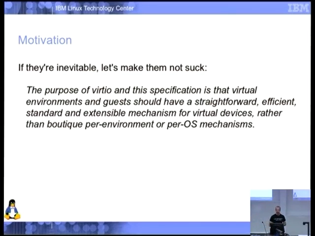

后面四个词——straightforward（直白）、efficient（高效）、standard（标准）、extensible（可扩展）——其实就是四条分层原则。下面逐条展开。

## 一、为什么"寄存器贵、内存便宜"会逼出分层

先把物理设备和虚拟设备的代价差异摆清楚，这是全篇的前提 [【跳转到 01:02】](https://www.youtube.com/watch?v=W7Dxbq7IeIQ&t=62)。

在真实硬件上，你写一个寄存器，硬件立刻干活，你几乎不为这次写付额外代价；反过来，如果设备要从内存里搬数据，它得先配置 DMA，这中间有延迟。到了虚拟机里，这个代价结构**整个反过来**了：

- 你写设备寄存器，落到宿主上往往是"陷入 → 模拟 → 返回"，一次 VM exit 就是一次全客户机的停顿，非常贵；
- 你读写自己的内存，宿主可以直接访问，几乎不额外收费。

讲者的结论很直白：不同的代价结构，最终把所有人推向同一条路——**不要直接模拟硬件，做点特别的事**，也就是半虚拟化（paravirtualization）。virtio 就是那个"特别的事"。而只要走"共享内存 + 通知"这条路，就必然要回答三个彼此独立的问题：请求长什么样（设备语义）、请求放在哪块共享内存里（通用机制）、对方怎么知道你放了（通知机制）。三个问题各自有各自的演进节奏，这就是分层的由来。

## 二、第一层：所有设备类型共用同一套 virtqueue

讲者把"standard"这个词拆成了两层含义，第一层是**设备之间**的统一 [【跳转到 05:12】](https://www.youtube.com/watch?v=W7Dxbq7IeIQ&t=312)。

以前的方案有个通病：块设备用一套机制，网卡用另一套，控制台又是第三套。virtio 的做法是反过来——**所有 virtio 设备共用同一个环形缓冲区加描述符的机制**，这个机制叫 virtqueue（虚拟队列）。规范里的原话是：

> The mechanism for bulk data transport on virtio devices is pretentiously called a virtqueue. Each device can have zero or more virtqueues: for example, the simplest network device has one for transmit and one for receive.

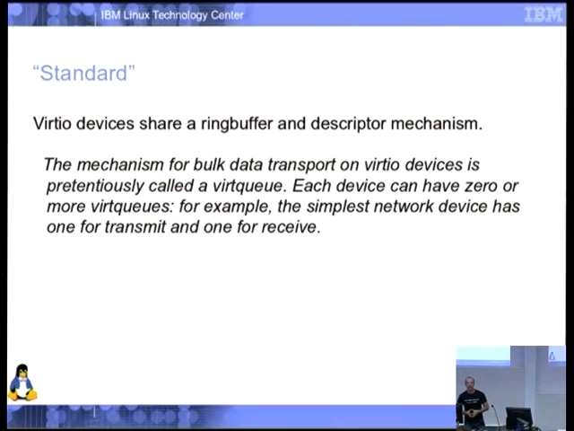

这句话里有两个容易被跳过的信息，恰恰是分层的证据：

1. **"零个或多个"**：队列数量是设备类型自己的事。最简单的网卡两个队列（收、发），块设备可以按 CPU 核数开多个队列，控制台可能只需要一个。队列数量属于设备语义层。
2. **"共用同一个机制"**：不管上面是网卡还是显卡，环的排布方式、描述符的写法完全一样。这一层属于通用机制层，写一次就够了。

讲者顺带解释了一个术语上的不严谨：它叫 queue（队列），但严格说不是队列，因为**设备可以乱序完成**。块设备就是典型——必须允许乱序服务请求，否则等于给自己强加一个巨大的性能问题；网卡和控制台则基本按序。这个"乱序"的自由度也是设备语义层给的，环本身不关心顺序。

## 三、第二层：同一套设备，跑在不同的传输层上

"standard"的第二层含义是**传输之间**的统一，也是本文的重点。讲者用一张图把三层叠在一起 [【跳转到 06:27】](https://www.youtube.com/watch?v=W7Dxbq7IeIQ&t=387)：

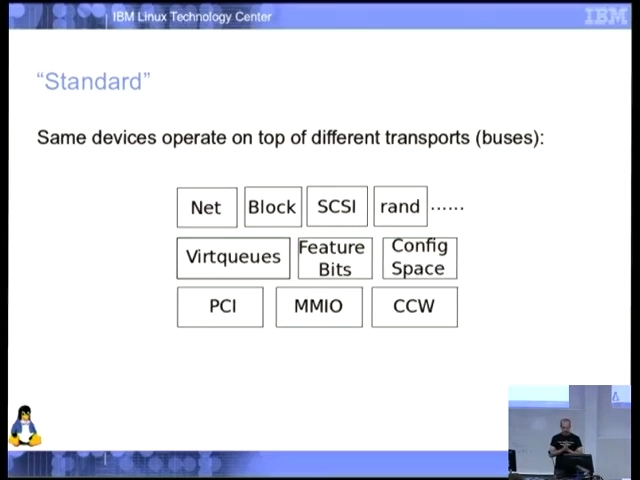

这张图值得逐格读：

- **最上层是设备类型**：Net、Block、SCSI、rand（随机数发生器）……它们各自定义"我这个设备支持哪些操作、请求结构长什么样"。
- **中间一层是三样通用设施**：virtqueue（数据怎么搬）、feature bits（能力怎么谈）、config space（设备参数放哪）。这三样对任何设备类型都长一个样。
- **最下层是传输层**：PCI、MMIO、CCW。传输层只负责三件事——**设备发现**（客户机怎么知道有这么个设备）、**特性协商的通道**（feature bits 的读写落在哪）、**通知通道**（kick 与中断怎么送达）。它不碰数据字节。

规范里为什么要有三种传输层？讲者在"straightforward"那一段解释了动机 [【跳转到 03:32】](https://www.youtube.com/watch?v=W7Dxbq7IeIQ&t=212)：

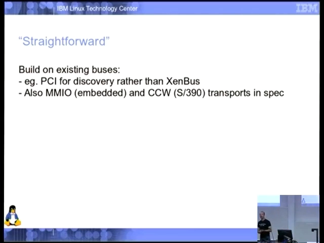

- **PCI**：人人机器里都有 PCI，而 PCI 规范已经把"怎么发现设备、怎么区分设备"这些难题解决得很厚实了。virtio 直接借用，不必自造一个"精品 hypervisor 总线"。
- **MMIO**：给嵌入式用的。它严格来说不算总线，就是**一页寄存器**；客户机靠设备树（device tree）或者内核命令行知道自己有哪些设备。
- **CCW**：给 S/390 用的。S/390 传统上不支持 PCI，CCW 通道才是它习惯的方式。

这三种传输层不是一开始就齐的，是**十年里陆续长出来的**，这条时间线本身就是"分层让传输层可以后补"的证据 [【跳转到 08:07】](https://www.youtube.com/watch?v=W7Dxbq7IeIQ&t=487)：

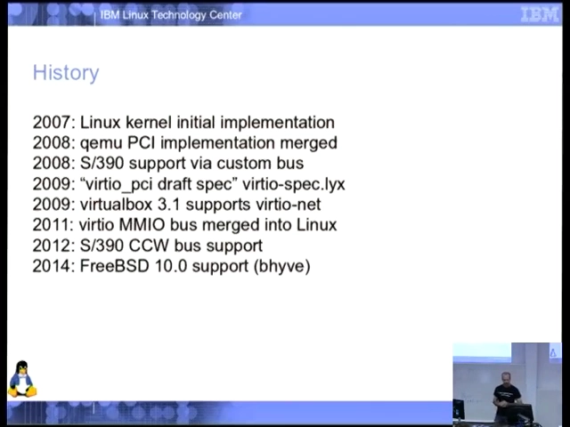

按讲者的叙述，这条线大致是：2007 年内核里先有一个实验性的 lguest 总线（就是"一串描述符"，明确标了 experimental，没人敢上生产）；2008 年 QEMU 的 PCI 实现合入主树；同年 S/390 的人照着 lguest 那套改了个自家版本；2009 年决定"PCI 才是主战场"，于是写了第一份独立于 QEMU 和 Linux 实现的规范草案；2011 年 MMIO 合入内核；2012 年 S/390 的人意识到当年抄的那套实现实在糟糕，重新做了真正像 S/390 的 CCW 总线。

这里最值得记住的一点是：**加一种传输层，不需要动设备类型，也不需要动驱动里的设备逻辑**。2011 年加 MMIO、2012 年加 CCW，virtio-net 还是那个 virtio-net。反过来，VirtualBox 3.1 在 2009 年就能支持 virtio-net，靠的也只是读规范、自己实现一遍——它是第一个完全独立于 QEMU/Linux 的实现。讲者还提到一个更意外的例子：2012 年 Galaxy Nexus 手机用 virtio 的 virtqueue 和 RPMsg 跟机器上其他芯片通信，等于把"客户机—宿主"这套共享内存模型搬到了"AP—其他处理器"的场景里。

## 四、第三层：通知机制是通用设施，不是设备语义

第三层解耦最容易被忽略，因为它在图上是"藏"在中间的。讲者在"efficient"那一段把通知单独拎了出来 [【跳转到 03:57】](https://www.youtube.com/watch?v=W7Dxbq7IeIQ&t=237)：

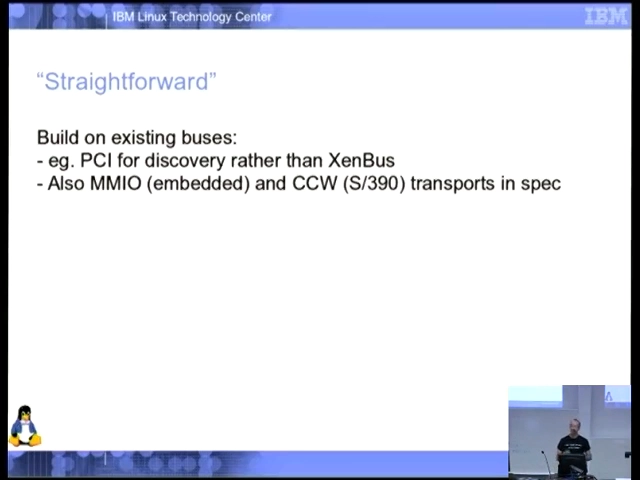

"高效"在 virtio 里落实为两件事，方向相反但机制对称：

- **批处理（batching）**：不应该为了干一件事去戳一百个寄存器，操作要能攒起来一批一批地做；
- **双向抑制**：驱动可以对设备说"这段时间别来打扰我"（中断抑制，interrupt suppression）；设备也可以对驱动说"别来戳我的寄存器、别逼我 exit，我正忙着呢"（通知抑制，notification suppression）。

关键在于：这两条**不属于任何具体设备**。网卡需要它，块设备也需要它，控制台也需要它。所以它被放在通用机制层，由传输层负责把"通知"这个动作落地成具体的一次寄存器写或一次中断线拉高。至于抑制的粒度怎么定、kick 和 interrupt 具体怎么配合，那是 3.2.3 的内容，这里只需记住它的**位置**：通知是通用设施，不是设备语义。

## 五、把 1.0 的每条改动归位：一次分层体检

演讲的主体是一份"1.0 改了什么"的清单。如果按层来看这份清单，会发现它其实是一次分层体检——每条改动都能干净地归到某一层。这张表是本文的核心：

| 1.0 的改动 | 归属层 | 为什么在这一层 |
| :--- | :--- | :--- |
| 队列大小改为可协商；desc/avail/used 三段改用各自独立地址 | 通用机制层（经传输层暴露） | 环的排布是所有设备共用的，但"能不能改大小"必须由每种传输层提供协商通道 |
| 新增 `VIRTIO_F_VERSION_1`（第 32 位） | 通用机制层（feature bits） | 它标记"我按 1.0 规范实现"，与具体设备无关，且是唯一不可选的特定位 |
| 新增 `FEATURES_OK` 状态位 | 通用机制层（status byte） | 它解决的是"特性协商什么时候算谈完"，与设备语义无关 |
| config space 增加原子性计数器 | 通用机制层（config space），由各传输层实现 | 配置区是所有设备都有的，但"怎么安全读"要靠传输层提供计数器 |
| PCI 寄存器改用 capability list 定位 | 传输层（PCI） | 纯 PCI 布局问题，MMIO 传输层不需要 |
| 全规范统一小端序 | 协议层（legacy 与 modern 的分界） | 它约束描述符与环的字节序，属于"线上格式"，不属于某台设备 |
| 删除 `VIRTIO_F_ANY_LAYOUT`、`VIRTIO_F_NET_GSO` 等特性位 | 设备类型层（net） | 这些是网卡自己的历史包袱 |
| virtio-blk 删掉 SCSI 透传、barrier、IO 优先级，flush 变强制 | 设备类型层（blk） | 块设备自己的操作集，复杂需求交给 virtio-scsi |
| virtio-balloon 计划整体移出规范 | 设备类型层（balloon） | 气球设备自己的配置项与特性位设计失败 |

下面挑几条最能说明"分层"的展开。

### 5.1 特性位（feature bits）：能力协商放在通用层

设备类型会不断长出新能力，怎么让新驱动和老设备、老驱动和新设备都能对上话？virtio 的答案是**一组特性位**：设备说"我支持这些"，驱动说"我懂这个子集" [【跳转到 07:17】](https://www.youtube.com/watch?v=W7Dxbq7IeIQ&t=437)。这样前后兼容都不需要发大版本——讲者对比说，真实硬件往往只能"发个 2.0，所有人重写驱动"，而软件应该能做得更好一点。

1.0 里加的那一位很特殊 [【跳转到 18:07】](https://www.youtube.com/watch?v=W7Dxbq7IeIQ&t=1087)：

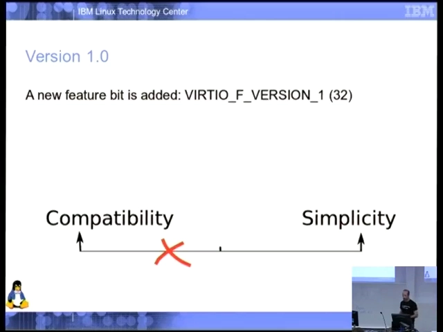

`VIRTIO_F_VERSION_1` 是**唯一不可选**的特性位：任何声称符合规范的驱动都必须接受它。讲者自己承认这"挺难看"，但它是 legacy 与 modern 的分水岭——只要这一位被接受，双方就可以放心假设对方读过规范、按新规矩来。代价是图里那条横轴：兼容性与简洁性之间永远在拉扯，而这一位是明确往兼容性一侧偏的。

特性位也不是万能药。讲者点出了两类"特性位其实是 bug 记录"的例子：`VIRTIO_F_ANY_LAYOUT` 存在的原因是 QEMU 当年照抄了一个极简实现，那个实现**假定第一个描述符一定覆盖网络头**，还加了个 assert；唯一干净的修法是加一个特性位声明"我真的能处理任意布局"。到了 1.0，这类位被直接删掉——"这次你真的会读规范"。同理，"队列空了要通知我"（notify on empty）那个位，本质上是在修一个 bug，bug 修好后这个位就没人用了。

### 5.2 状态字节与 `FEATURES_OK`：协商的"进度条"放在通用层

每个 virtio 设备都有一个由驱动更新的状态字节（status byte）。规范的原话是把它想象成控制台上的一盏红绿灯，用来指示设备当前处在哪一步 [【跳转到 25:37】](https://www.youtube.com/watch?v=W7Dxbq7IeIQ&t=1537)：

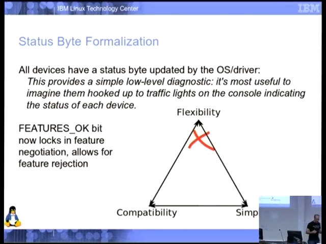

1.0 在这里加了一位 `FEATURES_OK`，动机很实际：特性位现在超过 32 个了，"驱动到底谈完没有"没法从位数判断。驱动设上这一位，就等于宣布"我接受的就是这些，锁定了，不再改"。它还顺带提供了一个**优雅拒绝**的通道：驱动设上 `FEATURES_OK` 再读回来，如果设备把它清掉了，就说明设备不接受这组特性，驱动于是可以不去驱动这台设备，而不是硬着头皮跑出一堆诡异故障。

### 5.3 配置空间（config space）：设备参数放在通用层，但由传输层保证可读

每个设备可以有一块可选的配置区，放的是**这台设备特有的参数**——网卡放 MAC 地址，块设备放容量 [【跳转到 26:52】](https://www.youtube.com/watch?v=W7Dxbq7IeIQ&t=1612)：

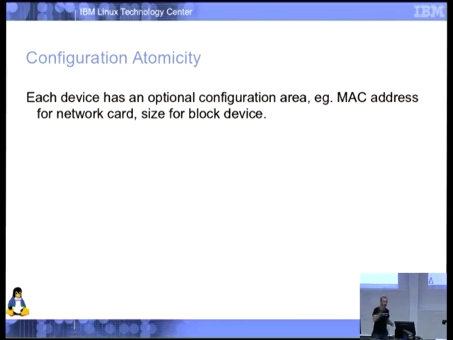

这块区域有个麻烦：它是**可以变**的（有些场景下客户机自己也会往里写），那多字段怎么安全读？过去的答案是"祈祷它不变"或者"读两遍看看一样不一样"，讲者直言这两种都不够健壮。1.0 的解法是让**每种传输层都提供一个原子性计数器**：读计数器 → 读字段 → 再读计数器，两次计数不一致就说明中途被改过，配上正确的内存屏障就是安全的。注意这个修法的形状——**问题出在通用层，落地靠传输层**，这正是分层之后"谁负责什么"的典型样子。

### 5.4 传输层：PCI 布局为什么要用 capability list

PCI 传输层的改动最能说明"传输层只关心自己的事" [【跳转到 33:57】](https://www.youtube.com/watch?v=W7Dxbq7IeIQ&t=2037)：

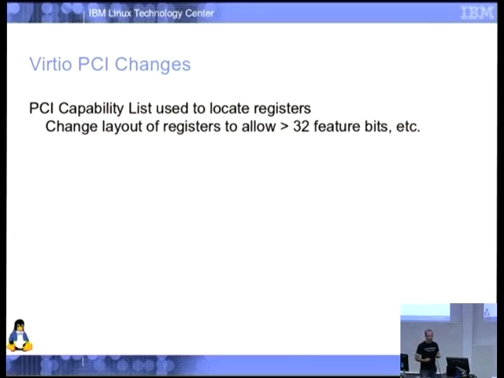

早期所有东西都挤在 BAR 0（PCI 设备的一块基址寄存器区域）里：先是通用寄存器，后面接设备特有寄存器。后来有人加 MSI（消息信号中断），只好"打开 MSI 就在末尾插字段、把设备特有寄存器往后挪，关掉再挪回来"。讲者的评价是：这已经很丑了，那再加第三个功能怎么办？难道要写一个状态机，把"打开某位时它在 A 位置、否则在 B 位置"乘以功能数量？

1.0 的选择是**改用 PCI capability list 把寄存器位置指出来**，从此可以放在任何地方，也不用再写那套搬来搬去的状态机。兼容性也保住了：BAR 0 里的老布局仍然在，老驱动访问那里时，设备就知道"来的是个 legacy 驱动"。另外规范还收录了一个讲者本人很讨厌、但已经是业界惯例的"后门"：按 PCI 规范，现代设备即使 IO BAR 不可访问也应该能被访问，于是大家都提供了一种特殊方式去戳寄存器，virtio 也跟进了。

### 5.5 字节序：这条改动落在"线上格式"，不在任何设备

最后一个改动讲者称为"最糟糕的一个"：字节序 [【跳转到 34:47】](https://www.youtube.com/watch?v=W7Dxbq7IeIQ&t=2087)。

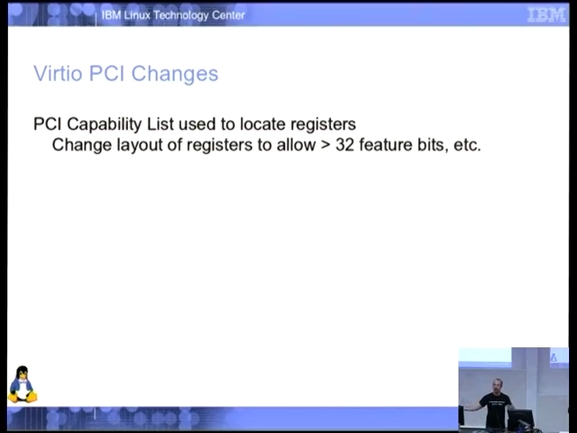

virtio 最初被定义为"guest 端序"（guest-endian），理由是"驱动作者不用操心字节序，宿主当然知道你在什么端序上"。讲者的自我批评是：**simple 不等于 straightforward**——"简单"是没有多余的东西，"直白"才是符合直觉。结果是 FAQ 满天飞，气球驱动还真的搞错了，最后只能规定"一律小端，不管什么惯例"。

代价按平台分摊：x86 和 ARM 小端完全无感；PowerPC 大端需要对非 legacy 设备做条件字节交换（多一两个分支，预测得很好，实际不算糟）；ARM 大端也要交换；S/390 则是纯粹吃亏——它天然是大端，为了不阻塞标准硬生生接受了小端。这条改动之所以归在"协议层"而不是任何设备层，是因为它约束的是**描述符和环在内存里的字节序**，跟"这是网卡还是块设备"毫无关系。

### 5.6 设备类型层：删掉的东西比加上的更能说明问题

反过来看设备类型层，1.0 主要在做减法。virtio-net 删掉了 `VIRTIO_F_NET_GSO` [【跳转到 28:32】](https://www.youtube.com/watch?v=W7Dxbq7IeIQ&t=1712)：

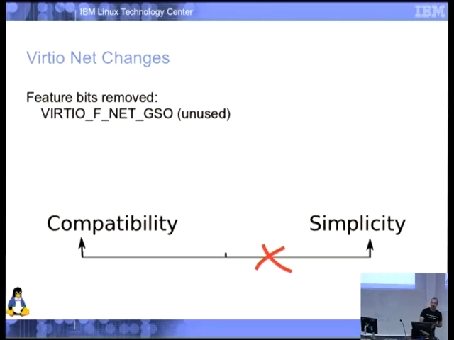

讲者复盘了这条特性位的失败：GSO（通用分段卸载，让网卡替你把大包切成小包）其实分好几种——TCP over IPv4 的 TSO4、TCP over IPv6 的 TSO6、UDP 的 UFO，还有 TCP 里 ECN 位是否被正确处理。所以"我支持 GSO"这一句话根本不成立，至少得拆成四个位。拆完之后，从来没人用过，于是整体删掉。

virtio-blk 的减法更彻底：删掉"通过块设备透传任意 SCSI 命令"（当初的真实需求只是弹出 CD，现在有 virtio-scsi 专门干这个）、删掉 barrier 位（改成强制的 flush 命令）、删掉 IO 优先级字段（从来没人用）。删完之后 virtio-blk 回到"非常非常简单的块设备"，想要复杂语义就去用 virtio-scsi。virtio-balloon 则更惨：配置区用了小端以外的约定、统计字段因为要支持多个而必须打包导致对齐全乱、还有一个"拔页之前先告诉我"的可选特性位（为了支持一个理论上的 hypervisor，结果没人需要）——1.0 之后的提案是把整个气球设备移出规范，换一个更简单的东西。

这一串减法说明设备类型层的定位：**它只放这台设备真正需要的东西**。凡是能推到通用层的（环、特性协商、配置区读写安全）都推上去，凡是能用另一台设备表达的（SCSI 语义）就交给另一台设备。

## 六、这条边界为什么重要：前后端职责的分界

讲者在讲"standard"时补了一句容易被忽略的话 [【跳转到 06:52】](https://www.youtube.com/watch?v=W7Dxbq7IeIQ&t=412)：这套结构**在两侧是对称的**。写驱动的人看到的是"PCI 总线实现 + virtqueue 实现 + 网卡/块设备"；写 hypervisor 的人看到的也是同样三层，"PCI 总线实现 + virtqueue 实现 + 网卡/块设备"，只是方向相反。

这句话是整篇演讲里对工程实践最有价值的一句，因为它定义了**前后端的职责边界**：

- **前端（客户机里的驱动）只认两样东西**：virtqueue 和 feature bits。它不知道后端是 QEMU 里的一段软件、是内核里的 vhost 模块、还是另一个独立进程里的 vhost-user 服务。
- **后端（VMM 或独立进程）负责把请求落地成真实 I/O**：把描述符里的客户机物理地址翻译成宿主的真实地址，再组装成真实的磁盘读写或网络报文。它同样只认 virtqueue 和 feature bits，不关心客户机是 Linux 还是 Windows。
- **传输层是双方共同遵守的"插座标准"**：只要前后端对同一种传输层达成一致（比如都用 modern PCI），中间那层就能接上。

正因为边界画在这里，后端才可以被搬走而不惊动客户机——把它搬进内核（vhost）、搬进独立进程（vhost-user）、甚至搬进硬件，客户机里的 virtio 驱动一行都不用改。这是 3.3 节要展开的内容，但**前提就是这一节讲的分层**：如果设备语义和传输方式绞在一起，后端根本没法单独搬家。

## 七、分层的代价：兼容性与简洁性的长期拉扯

分层不是免费的。讲者用一张"三角形"贯穿全场：兼容性（compatibility）、简洁性（simplicity），后来又加上第三条边——灵活性（flexibility）[【跳转到 23:07】](https://www.youtube.com/watch?v=W7Dxbq7IeIQ&t=1387)：

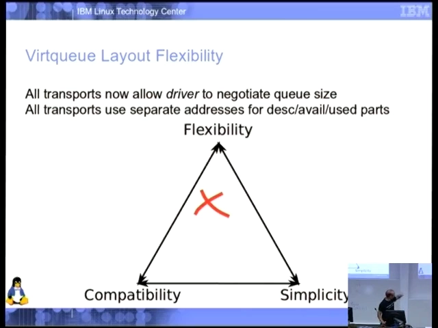

以队列大小为例：早期规范里队列大小是 2 的幂，整个环的尺寸（含 4096 字节对齐填充）可以从它推导出来。这很简洁，但很快撞墙——某些设备想要超大队列（最多 32768 个描述符），算下来要几十个连续页，客户机跑久了根本拿不到这么大的连续内存，设备直接驱动不起来。1.0 的修法有两条：**所有传输层都允许驱动协商队列大小**（设备可以给个上限提示，驱动也可以说"我只要两个描述符，因为我是 OpenBIOS，够启动就行"），以及**描述符表、可用环、已用环三段改用各自独立的地址**，不再要求连续。

注意这两条修法的位置：它们改的是**通用机制层**，但"协商通道"必须由**传输层**提供。这就是分层带来的真实成本——一个概念上的改动，要落到每一种传输层上各实现一遍。讲者的态度是务实的：这一改简洁性一点没涨，换来的是灵活性，值不值要看十年后还有没有人愿意实现这份规范。

同一张三角形还解释了为什么 1.0 要删掉那么多东西。讲者的判断是：十年后有人翻到 virtio 1.0 规范，如果里面全是 legacy 的破烂，他的反应会是"我才不要实现这些破烂，我自己搞一套"。所以对只关心 1.0 的人要给简洁，对今天真的在用的人要给兼容——这两件事永远冲突，规范只能一次次在三角形里选一个点。

## 小结

- **三层结构**：设备类型层（Net/Block/SCSI 各自的操作语义）→ 通用机制层（virtqueue、feature bits、config space）→ 传输层（PCI、MMIO、CCW）。传输层只负责设备发现、特性协商通道和通知通道，不碰数据字节。
- **解耦的收益是可替换性**：加一种传输层（2011 年的 MMIO、2012 年的 CCW）不需要改设备类型；换一个 hypervisor 实现（2009 年的 VirtualBox、2014 年的 bhyve）不需要改客户机驱动。
- **通知是通用设施**：批处理、中断抑制、通知抑制对所有设备都成立，所以它们待在中间层，由传输层落地成具体的寄存器写或中断。
- **1.0 的每条改动都能归位**：队列大小协商、`VIRTIO_F_VERSION_1`、`FEATURES_OK`、配置区原子性计数器属于通用层；PCI capability list 与字节序属于传输/协议层；GSO、blk 的 SCSI 透传与 barrier、balloon 属于设备类型层。
- **前后端边界画在 virtqueue 与 feature bits 上**：这条边界是后端能被搬进内核（vhost）或独立进程（vhost-user）的前提。
- **分层的代价是兼容性与简洁性的长期拉扯**：一个通用层的改动要在每种传输层上各实现一遍；而为了不让十年后的实现者被 legacy 劝退，1.0 做了大量减法。

## 关键术语速查

| 术语 | 一句话解释 |
| :--- | :--- |
| virtio | 一套半虚拟化设备规范：客户机装"知情"的驱动，用共享内存加通知跟宿主交换 I/O 请求，而不是逐次陷入模拟寄存器 |
| 传输层（transport） | 设备发现、特性协商通道与通知通道的落地方式，规范里有 PCI、MMIO、CCW 三种 |
| virtqueue | 前后端共享的环形缓冲区加描述符机制，所有 virtio 设备共用同一套；一个设备可以有零个或多个 |
| feature bits | 能力协商用的位图：设备报"我支持这些"，驱动回"我懂这个子集" |
| `VIRTIO_F_VERSION_1` | 第 32 位特性位，标记"按 1.0 规范实现"，是唯一不可选的一位，也是 legacy 与 modern 的分界 |
| status byte / `FEATURES_OK` | 每个设备都有的状态字节，1.0 新增 `FEATURES_OK` 位用于锁定特性协商结果并允许干净拒绝 |
| config space | 设备特有参数的存放区（网卡 MAC、块设备容量），1.0 给每种传输层加了原子性计数器 |
| legacy / modern | 1.0 之前与之后的两种设备形态；modern 设备必须处理任意描述符布局、必须做字节序交换 |
| 前端 / 后端 | 前端是客户机里的 virtio 驱动，只认 virtqueue 与 feature bits；后端在 VMM 或独立进程里，负责落地真实 I/O |