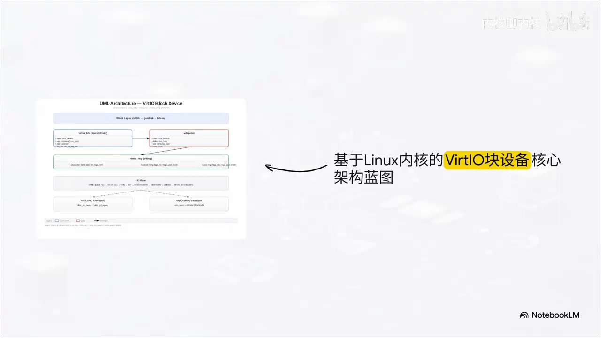
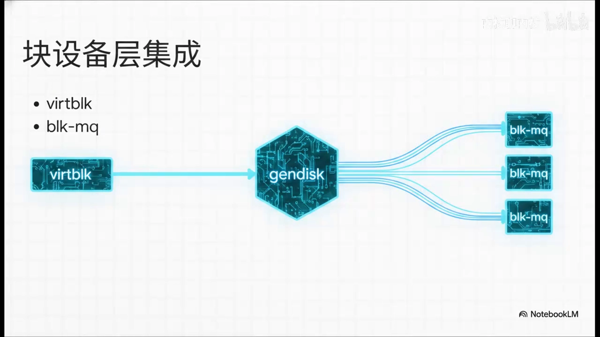
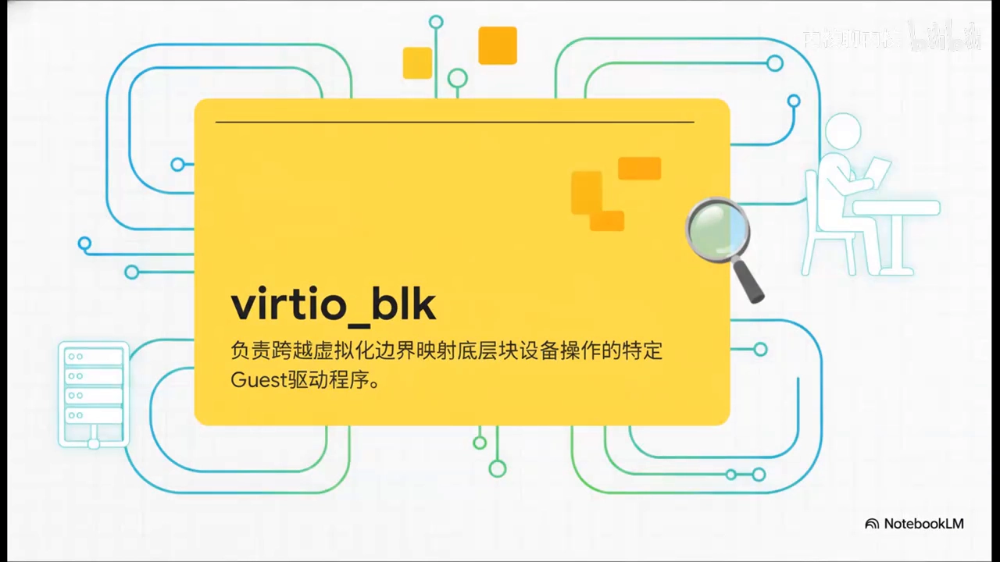
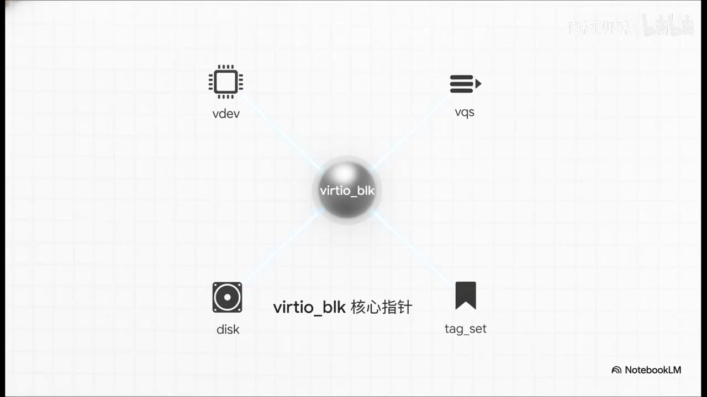
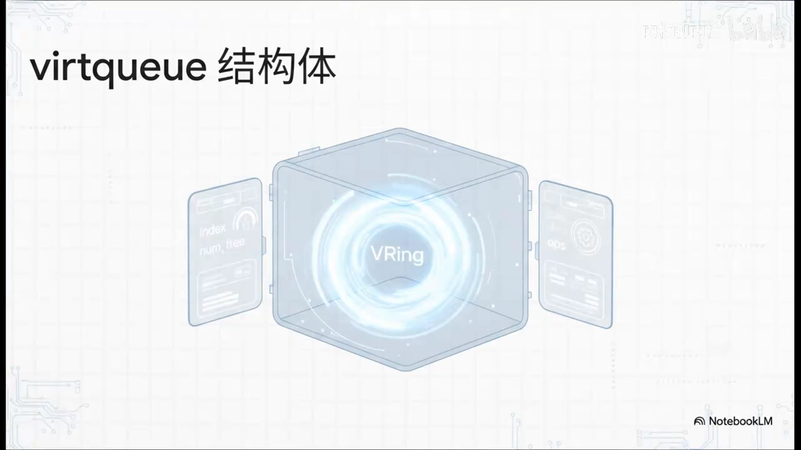
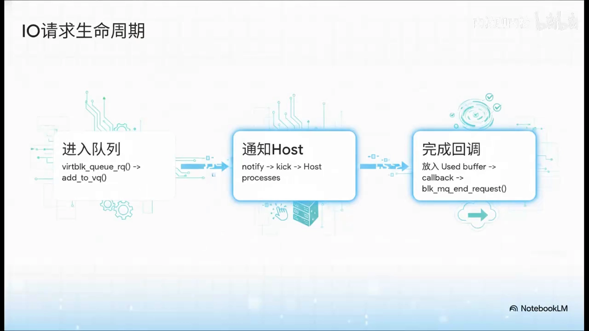
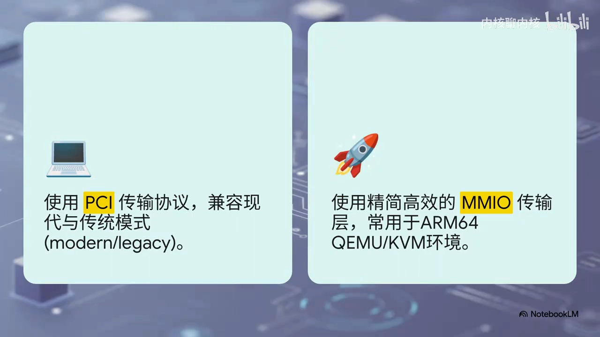

# virtio 的四层栈：块设备驱动只认 vring，PCI 还是 MMIO 由平台决定

> 视频来源：[Linux内核解析-如何实现VirtIO子系统](https://www.bilibili.com/video/BV16t3c6AEx8/)（Bilibili · 内核聊内核）｜时长约 6 分 34 秒
> 简要导读：这支短视频用一张"Linux 内核 virtio 块设备架构图"自上而下走了一遍：块设备层 → virtio_blk 驱动 → virtqueue → vring → 传输层。它讲的正是 virtio 分层在**内核代码里长什么样**——同一份 virtio_blk 驱动，在 x86 上落成 PCI 设备，在 arm64 的 QEMU/KVM 上落成 MMIO 设备。视频对 vring 只讲到"三段式"这一层，字段级细节留给下一节。

## 本讲要解决的核心问题（SCQA）

**背景**：一台虚拟机要读写磁盘。客户机里的文件系统往下走，最终会走到块设备层，然后交给某个"磁盘驱动"。

**冲突**：虚拟机里的磁盘不是真磁盘，它是宿主"演"出来的。如果客户机驱动按真硬件的方式去操作寄存器，每次操作都要陷入宿主模拟一遍，慢得没法用。所以 virtio 让客户机装一个"知情"的驱动，用共享内存加通知来发请求。

**疑问**：这个"知情"的驱动在内核里到底长什么样？它上面接什么、下面接什么？为什么同一份驱动在 x86 和 arm64 上都能跑，而两边的"设备"长得完全不一样？

**回答（中心思想）**：Linux 内核里的 virtio 是一条**四层栈**——最上面是块设备层（gendisk 与 blk-mq 多队列机制），往下是设备类型驱动（virtio_blk），再往下是通用机制（virtqueue 与它内部的 vring），最下面是传输层（PCI 或 MMIO）。**设备类型驱动只认 vring，不认总线**；总线由平台决定，由传输层实现替换。这条边界就是 virtio 能跨架构、跨 hypervisor 复用的原因。

## 一、架构总览：一张图里的四个层次

视频开头放出的是一张标注为 Linux 6.18 内核的 virtio 块设备架构图 [【跳转到 00:00】](https://www.bilibili.com/video/BV16t3c6AEx8/?t=0)，讲者称它"非常清晰地展示了从驱动队列一直到底层传输层的整个全貌" [【跳转到 00:36】](https://www.bilibili.com/video/BV16t3c6AEx8/?t=36)：

这张图最值得注意的地方在**最底下那一行**：`VirtIO PCI Transport` 和 `VirtIO MMIO Transport` 是**并排**画着的。也就是说，同一套上面的结构，可以接在两种不同的传输实现上。图上还标了 `Legacy/Modern` 两条分支——PCI 传输层自己又分传统与现代两种形态。

## 二、顶层：块设备层不关心底下是不是 virtio

从技术栈最顶端开始，也就是大家最熟悉的存储部分 [【跳转到 01:34】](https://www.bilibili.com/video/BV16t3c6AEx8/?t=94)：

这里的关键是**"无缝映射"**：virtio_blk 被映射到一个通用的磁盘结构 `gendisk` 上，然后直接插进 `blk-mq`（多队列块 IO）机制。这意味着对上层文件系统和块层来说，一块 virtio 磁盘和一块真实 NVMe 磁盘没有区别——它们都走同一套多队列调度。讲者的说法是：有了 blk-mq，哪怕虚拟机面临海量并发读写，吞吐量也能稳住。

对分层来说，这一层的含义是：**virtio 的虚拟化细节在这里被彻底隐藏了**。块层不知道、也不需要知道底下是 virtio。

## 三、第二层：virtio_blk 是一个"专职的跨界驱动"

把视角切进客户机操作系统内部，virtio_blk 是什么 [【跳转到 02:08】](https://www.bilibili.com/video/BV16t3c6AEx8/?t=128)？

讲者给的定义是：它是一个**专职的 guest 驱动**，专门负责跨越虚拟化的边界，把底层的块设备操作映射过去。为了好理解，他把整个虚拟化环境比作一家餐厅：virtio_blk 是坐在餐桌前点菜的顾客，手里拿着菜单，精确决定要向 host（后厨）点哪些菜。

更有意思的是它的内部结构——绝对的极简主义 [【跳转到 02:38】](https://www.bilibili.com/video/BV16t3c6AEx8/?t=158)：

`virtio_blk` 只追踪四个核心指针：

- `vdev`：指向父设备（也就是那个通用的 virtio 设备对象）；
- `vqs`：管理虚拟队列数组；
- `disk`：刚才提到的通用磁盘表示；
- `tag_set`：处理硬件标签（用于多队列的请求标记）。

"一点点多余的代码都没有"——这句话本身就是分层的证据：**设备类型驱动里不该出现总线的影子**。virtio_blk 不需要知道自己是 PCI 设备还是 MMIO 设备，因为那件事已经被 `vdev` 背后的传输层封装掉了。

## 四、第三层：virtqueue 是"引擎室"，vring 是它的心脏

顾客点完菜了，这些订单请求存在哪里 [【跳转到 03:15】](https://www.bilibili.com/video/BV16t3c6AEx8/?t=195)？

`virtqueue` 负责维护整个队列的状态——比如当前的索引 `index`、剩余容量 `num_free`，同时封装了各种操作钩子 `ops`。但讲者强调：**它里面最核心、最重要的组件是 `vring`**。

为什么用"引擎室"和"心脏"这种词？因为这一层是**所有 virtio 设备共用**的。网卡用它、块设备用它、控制台也用它——设备类型层只需要决定"我往环里放什么请求"，不需要重新发明一套传输结构。

vring 本身是三段式设计 [【跳转到 04:13】](https://www.bilibili.com/video/BV16t3c6AEx8/?t=253)：

- **描述符表**：装载实际负载的地址（`addr`）与长度（`len`）等核心信息；
- **可用环**：guest 用它把新订单发给 host；
- **已用环**：host 做完菜了，用它把数据送回给 guest。

讲者的餐厅比喻在这里最贴切：如果顾客是 virtio_blk、后厨是宿主机，那么 vring 就是连接餐桌和后厨的那条**不停旋转的餐盘传送带**。有了这块共享的环形空间，顾客点菜、厨师上菜，双方互不阻塞。

这三段的字段级排布、索引怎么回绕、方向位怎么定，是下一节（3.2.2）的内容。这里只需要记住一件事：**它是通用机制层，不属于任何设备类型**。

## 五、动态视角：一次 IO 请求的四步旅程

静态结构摆完了，视频按下播放键，走一遍完整生命周期 [【跳转到 04:46】](https://www.bilibili.com/video/BV16t3c6AEx8/?t=286)：

1. **进入队列**：请求通过 `virtblk_queue_rq` 进来，被加到虚拟队列里（`add_to_vq`）；
2. **通知 Host**：guest 通过通知机制——也就是常说的 **kick**——"踢一脚" host，说"嘿，来活了"；
3. **host 处理**：host 取走请求，真正执行 I/O；
4. **完成回调**：host 把结果扔进已用环区，guest 侧触发回调，调用 `blk_mq_end_request` 结束这次请求。

这四步里，第 2 步和第 4 步正是**通知机制**的位置。注意它出现在哪：它夹在"进队列"和"完成回调"之间，是**通用机制层**的动作，不是块设备特有的。网卡发包也是同样的"进队列 → kick → 完成回调"，只是回调函数换了名字。

## 六、最底层：PCI 还是 MMIO，由平台决定

最后沉到最底层 [【跳转到 05:26】](https://www.bilibili.com/video/BV16t3c6AEx8/?t=326)：

讲者给出的对照很干脆：

- **x86 环境**：走标准的 **PCI** 传输，现代模式（modern）与传统模式（legacy）都能很好地兼容；
- **arm64 的 QEMU/KVM 环境**：往往采用 **MMIO** 传输层，因为内存映射的方式更精简、更轻量。

这就是整支视频的落点：**上面四层一模一样，只有最底下这一层换了**。换掉传输层不需要改 virtio_blk，不需要改 vring，也不需要改块设备层——因为传输层只负责"设备怎么被发现、特性怎么协商、通知怎么送达"，它不碰数据字节。

讲者把这层称为"virtqueue 最坚实的基石" [【跳转到 05:57】](https://www.bilibili.com/video/BV16t3c6AEx8/?t=357)，并在结尾留了一个问题：如果面对的是高速碎片化的复杂网络数据包，virtio 又会怎么用这套 vring 原理去处理？答案在 virtio-net 里——同一套环，换成"收""发"两个队列，请求结构换成网络报文。

## 小结

- **四层栈**：块设备层（gendisk、blk-mq）→ 设备类型驱动（virtio_blk）→ 通用机制（virtqueue / vring）→ 传输层（PCI 或 MMIO）。
- **越往上越"通用"，越往下越"平台相关"**：块设备层完全不知道底下是 virtio；virtio_blk 只知道 vring，不知道总线；只有传输层才认识 PCI 或 MMIO。
- **virtio_blk 的极简结构是分层的证据**：它只持有 `vdev`、`vqs`、`disk`、`tag_set` 四个指针，总线细节被 `vdev` 封装掉了。
- **vring 是共用件**：三段式（描述符表、可用环、已用环）对所有 virtio 设备一致，设备类型只决定往里放什么。
- **一次 IO 的四步**：进队列 → kick → host 处理 → 完成回调；通知机制属于通用层，不属于块设备。
- **换传输层不惊动上层**：x86 用 PCI（modern/legacy），arm64 的 QEMU/KVM 常用 MMIO，同一份驱动照跑。

## 关键术语速查

| 术语 | 一句话解释 |
| :--- | :--- |
| virtio_blk | 客户机里的 virtio 块设备驱动，负责把块层请求翻译成 virtqueue 里的请求 |
| gendisk / blk-mq | 内核通用磁盘对象与多队列块 IO 机制；virtio 磁盘和真实磁盘共用这一层 |
| virtqueue | virtio 的通用队列对象，维护 index、num_free 与操作钩子 ops，内部持有 vring |
| vring | 前后端共享的环形内存结构，分描述符表、可用环、已用环三段 |
| kick | 客户机通知宿主"队列里有新请求"的动作，本质是一次寄存器写 |
| 传输层（PCI / MMIO） | 负责设备发现、特性协商与通知通道的落地方式，不碰数据字节 |
| legacy / modern | PCI 传输层的两种形态，1.0 之前的传统模式与之后的现代模式 |