# virtio-net 到 TAP：一个数据包从客户机到网线的五跳

> 视频来源：[Your VM's Network Card Is a File: TUN/TAP, virtio & vhost-net Explained](https://www.youtube.com/watch?v=s1ymCQsZFo0)（YouTube · XOR）｜时长约 6 分钟
> 导读：这支视频用一条动画时间轴把「virtio → vhost-net → TAP → bridge → wire」五段串起来，正好是本小节要讲的那条通路。本文只写「virtio-net 前后端 ↔ 宿主 TAP」这一段，vhost/vhost-user 的内核实现留给 3.3.3，virtqueue 三环的通用机制留给 3.2。

## 本讲要解决的核心问题（SCQA）

**背景**：在客户机里，`eth0` 是一块普通的网卡，驱动按标准流程把以太网帧交给它，然后期待帧从"网线"上出去。

**冲突**：这台机器其实没有网线。宿主上的那根"网线"是一个文件——`/dev/net/tun`。一个帧要从客户机内核走到物理网卡，中间隔着两个内核、一圈共享内存、一个内核线程、一个文件描述符和一座虚拟交换机。

**疑问**：这一个帧到底经过了哪些环节？每一环由谁负责、代价是什么？

**回答（中心思想）**：virtio-net 负责"帧怎么从客户机交出来"（共享内存环 + 一次 doorbell 写），后端负责"帧怎么进入宿主网络栈"（写进 TAP 文件描述符），TAP 负责"把文件读写翻译成一块网卡上的收发"，网桥负责"把这块网卡接到真实网线上"。整条通路的性能上限，就由"客户机与宿主之间要穿越几次边界"决定。

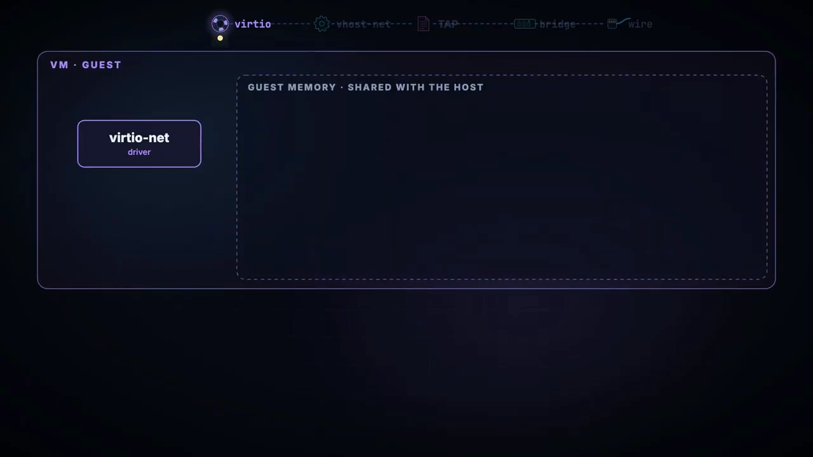

上图是视频的导航条：顶部五个节点就是本文要走的五跳，当前高亮在 `virtio`，画面里是客户机侧的 `virtio-net` 驱动和一块"与宿主共享的客户机内存"。

## 一、第一跳：virtio-net 把帧放进共享内存

### 1.1 为什么不用 e1000：碰一次寄存器就是一次 VM exit

客户机内核先给数据包套上以太网帧头（目的 MAC 填路由器的 MAC），然后交给网卡驱动。此时 hypervisor 有两条路可选。

第一条是**全模拟**：假装自己是一块 Intel e1000，把它的每一个寄存器都实现一遍。好处是客户机里的原装驱动直接就能用，坏处是**驱动每碰一次寄存器，CPU 就要从 VM 里陷出（VM exit）一次**，由 hypervisor 扮演这块卡 [【跳转到 00:25】](https://www.youtube.com/watch?v=s1ymCQsZFo0&t=25)。

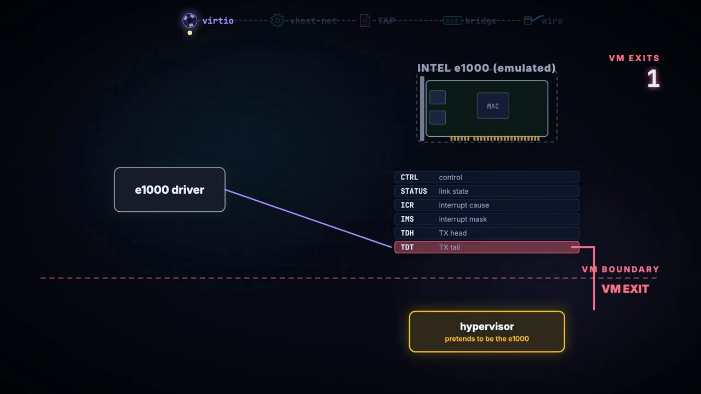

上图把代价画得很直白：`e1000` 驱动写 `TDT`（TX tail，告诉网卡"这批描述符可以发了"）这一个动作，就跨过 VM 边界触发一次 VM exit，右侧计数器显示 `VM EXITS 1`。而**网卡是被碰得很频繁的设备**——收发包路径上这种写操作一秒钟可能有成千上万次。

### 1.2 virtio 的思路：客户机知道自己是虚拟机，就不用假装

于是 KVM 客户机通常改用 **virtio**：一套专门为虚拟机设计的设备。客户机**知道**自己是虚拟的，所以没人需要伪装成真实硬件——这也是为什么在 hypervisor 同时提供 `e1000` 和 `virtio` 时，只要客户机有 virtio 驱动，就应该选 virtio [【跳转到 00:50】](https://www.youtube.com/watch?v=s1ymCQsZFo0&t=50)。

virtio 不通过寄存器通信，而是通过一圈**共享内存环**，叫 **virtqueue（虚拟队列）**。共享内存的意思是：这块内存在客户机里是普通内存，在宿主侧被 VMM 映射成自己能读写的地址，双方看到的是同一份字节，**不需要拷贝**。


### 1.3 一次请求的三个动作：写描述符、发布、kick

发包时，驱动做三件事 [【跳转到 01:15】](https://www.youtube.com/watch?v=s1ymCQsZFo0&t=75)：

1. 把帧的**地址和长度**写进一个 **descriptor（描述符）**；
2. 把这个描述符发布到环上（available ring，告诉后端"这个缓冲里有活"）；
3. **ring the doorbell（敲门铃）**：往一个特殊地址写一次。

第三步的那次写会陷入（trap），CPU 从 VM 退出，进入 KVM——也就是宿主 Linux 内核里的 hypervisor。**整条发包路径上，只有这一次是真正的 VM exit。**

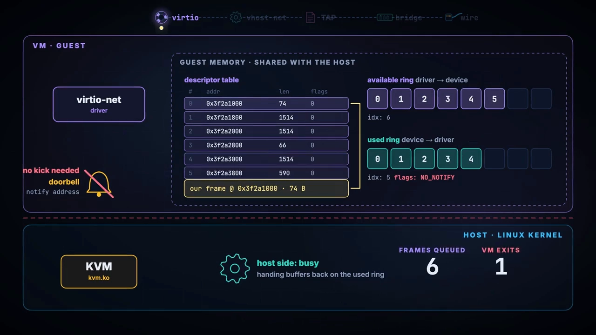

上图是这条通路的账本：左边 `descriptor table` 里 0 号描述符指向 `0x3f2a1000`、长度 74 字节，就是"我们的帧"；右上是 `available ring`（driver → device），右下是 `used ring`（device → driver），其中 flags 字段是 NO_NOTIFY，表示后端处理完这批缓冲后**不要**再发通知回来；左下角的 `no kick needed` 表示客户机此时也可以选择不敲门铃。右侧统计显示：**6 个帧排进队列，只花了 1 次 VM exit**。

### 1.4 攒批：一次 exit 覆盖一批包

关键优化在最后一句：**当对端还在忙的时候，客户机可以干脆不敲门铃**。于是多个帧可以攒在环里，等下一次敲门铃时一次性交给后端——一次 exit 覆盖一整批包 [【跳转到 01:40】](https://www.youtube.com/watch?v=s1ymCQsZFo0&t=100)。这就是 virtio 相对全模拟设备在吞吐上的根本优势：**把"每包一次陷入"摊薄成"每批一次陷入"**。

（doorbell 与中断抑制的通用机制属于 3.2.3，这里只需要记住"kick 是唯一一次 exit"。）

## 二、第二跳：后端把帧从环里取出来

### 2.1 用户态后端：QEMU 读环、写文件

门铃响了，谁来应答？**最早是 QEMU**——那个扮演虚拟机硬件的普通用户态进程。QEMU 读环，在客户机内存里找到那个帧，然后把它**写进 `/dev/net/tun` 这个文件** [【跳转到 01:40】](https://www.youtube.com/watch?v=s1ymCQsZFo0&t=100)。

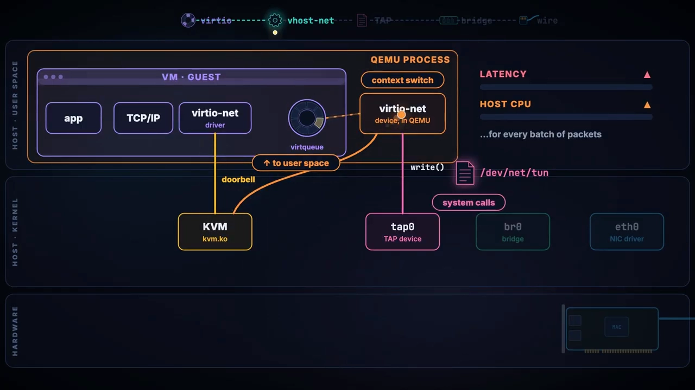

上图把这条路径的代价标了出来：门铃把控制流从内核态的 KVM 抬到用户态的 QEMU（`to user space`），QEMU 里的 virtio-net 设备模型读环、取出帧，再用 `write()` 系统调用写进 `/dev/net/tun`。右侧两根柱状条是代价表：**每处理一批包，就要付一次 context switch 和一次系统调用的延迟与宿主 CPU**。它能工作，但这些来回很贵。

### 2.2 内核态后端：vhost-net 把数据面搬进内核

2010 年，Linux 把这条数据通路搬进了内核，叫 **vhost-net**。QEMU 仍然负责**建立**它：告诉 vhost 客户机内存在哪、要盯哪几个环、用哪个 tap，然后**退到一边**。此后门铃不再离开内核：KVM 发一个事件唤醒 vhost 工作线程，线程直接从客户机内存读环，把帧交给 tap 设备，**QEMU 自己的代码再也不会碰任何一个包** [【跳转到 02:05】](https://www.youtube.com/watch?v=s1ymCQsZFo0&t=125)。

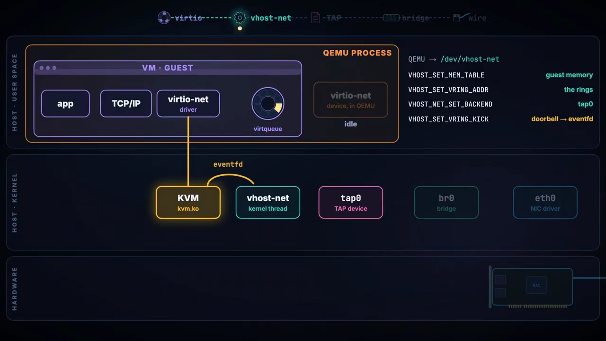

上图右侧列出了 QEMU 建立 vhost-net 时下发的几个配置项：`VHOST_SET_MEM_TABLE`（客户机内存在哪）、`VHOST_SET_VRING_ADDR`（环在哪）、`VHOST_NET_SET_BACKEND`（后端是哪个 tap）、`VHOST_SET_VRING_KICK`（doorbell 绑到哪个 eventfd）。建立完成后，QEMU 里的 virtio-net 设备模型变成 `idle`，真正的搬运由内核线程 `vhost-net` 完成。如果你在 `top` 里见过名为 `vhost-<数字>` 的线程在忙，它干的就是这件事。

> **边界**：vhost 与 vhost-user 的进程模型、ioctl 细节属于 3.3.3，本文只把"后端在哪一层"当作通路的一环来标注。对 3.3.2 而言，**无论后端是 QEMU 用户态还是 vhost-net 内核态，它的出口都是同一个：一个 TAP 文件描述符**。

## 三、第三跳：TAP 是"网线位置上放的一个文件"

### 3.1 TAP 到底是什么

视频给的定义很简洁：**TAP 是一块网卡，只不过本该插网线的那个位置，放的是一个文件** [【跳转到 02:30】](https://www.youtube.com/watch?v=s1ymCQsZFo0&t=150)。

打开 `/dev/net/tun`，向内核申请一个 tap，宿主上就会出现一块新的网络接口，和 `eth0` 并列：

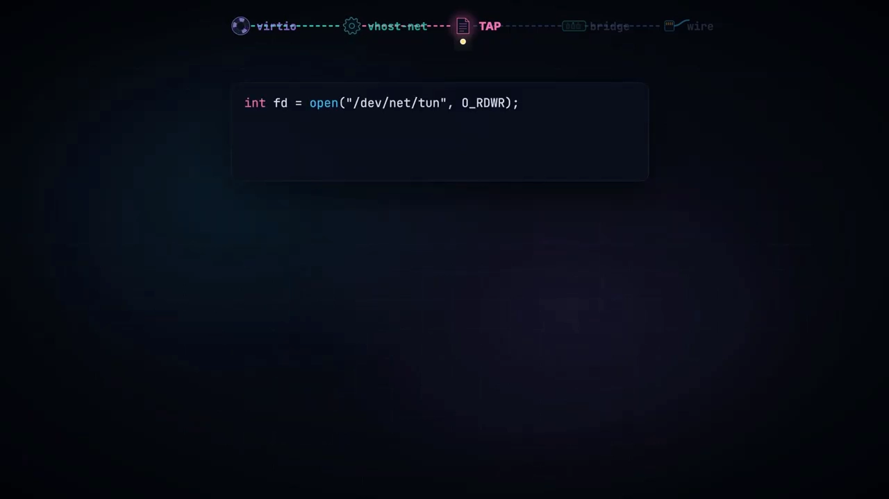

```c
int fd = open("/dev/net/tun", O_RDWR);
```

拿到这个 `fd` 之后，语义就变成了"读写文件 = 收发帧"：

- **往文件里写一个帧** → 宿主内核看到这个帧**从 tap0 上收进来了**，就像它刚从网线上到达一样；
- **从 tap0 发出一个帧** → 这个帧**从文件里冒出来**，被持有 `fd` 的进程读走 [【跳转到 02:55】](https://www.youtube.com/watch?v=s1ymCQsZFo0&t=175)。

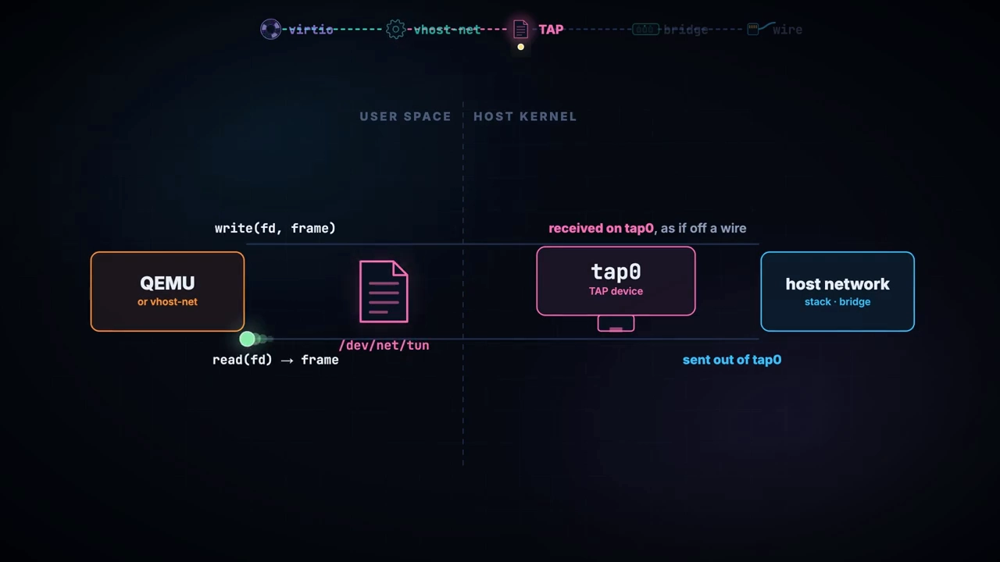

上图是这条语义的对照表：左侧用户态（QEMU 或 vhost-net）执行 `write(fd, frame)`，右侧宿主内核里 `tap0` 就"收到"了这个帧；反过来，`tap0` 上发出的帧会以 `read(fd) → frame` 的形式出现在用户态。中间那条粉色竖线就是 `/dev/net/tun` 这个字符设备。

命名上各家 VMM 有自己的约定，例如 Proxmox 按虚拟机编号命名：`tap100i0` 就是 100 号虚拟机的第一块网卡。

### 3.2 TAP 与 TUN 的区别

**TAP 承载完整的以太网帧，带 MAC 地址**——这正是虚拟机需要的，因为虚拟机在网络上就是"另一台有自己 MAC 的机器"。它的兄弟 **TUN 承载的是裸 IP 包**，很多 VPN 用的就是它：`tun0`、`tailscale0` 都是 TUN 设备 [【跳转到 03:20】](https://www.youtube.com/watch?v=s1ymCQsZFo0&t=200)。

一句话记法：**TAP 是二层（以太网），TUN 是三层（IP）**。虚拟机网卡要二层语义，所以选 TAP。

## 四、第四跳：网桥把 TAP 当成一个端口

帧到了 `tap0`，还差最后一跳：**网桥（bridge）**——内核里内置的虚拟交换机。把 `tap0` 和真实网卡都插到这座桥上，帧才有出口 [【跳转到 03:20】](https://www.youtube.com/watch?v=s1ymCQsZFo0&t=200)。

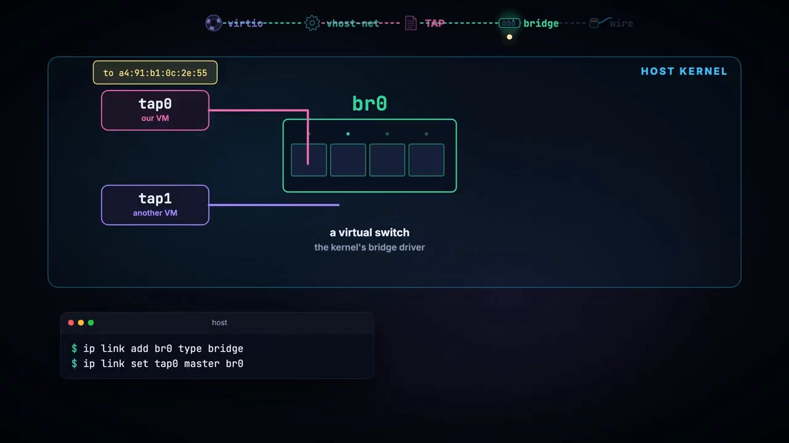

上图里 `tap0`（我们的 VM）和 `tap1`（另一台 VM）都接进了 `br0`，桥内部有多个端口。左下角的终端给出了建立这座桥的两条命令：

```bash
ip link add br0 type bridge
ip link set tap0 master br0
```

网桥的行为和硬件交换机一样：**学习哪个 MAC 地址在哪个端口后面，然后只把帧转发到该去的那个端口**。我们的帧是发给路由器的，而桥已经在 `eth0` 后面见过那个 MAC，于是帧从物理网卡出去、上网线、进入网络 [【跳转到 03:45】](https://www.youtube.com/watch?v=s1ymCQsZFo0&t=225)。

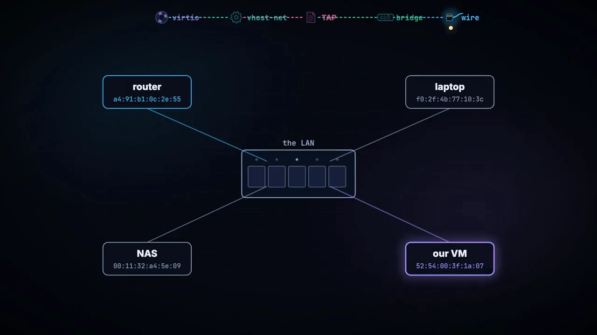

上图是结果：从局域网看，我们的 VM（`52:54:00:3f:1a:07`）和路由器、笔记本、NAS 是**平级的四台机器**，各有自己的 MAC。虚拟机并没有"特殊身份"，它只是被一座桥接进了同一个广播域。

### 4.1 另一种出口：不桥接，让宿主路由 + NAT

很多部署会跳过物理端口，改为**让宿主做路由和 NAT**：TAP 接口拿到一个宿主侧地址，虚拟机通过宿主转发出去。Docker 的 `docker0` 是同一套思路，只是把 TAP 换成了 **veth pair**（一对互相连通的虚拟网卡，一端在宿主、一端在容器网络命名空间里）[【跳转到 04:10】](https://www.youtube.com/watch?v=s1ymCQsZFo0&t=250)。

对 3.3.2 来说，这两种出口的差别只在于"帧到了 `tap0` 之后被谁接管"：桥接是被二层交换机接管，NAT 是被宿主三层协议栈接管。**前面的五跳完全一样。**

## 五、反向路径：从 TAP 到 used ring 再到中断

回包走的还是同一批组件，只是方向相反 [【跳转到 04:10】](https://www.youtube.com/watch?v=s1ymCQsZFo0&t=250)：

1. 物理网卡收到帧 → 交给网桥 → 网桥按目的 MAC 找到 `tap0` 这个端口；
2. 帧从 `tap0` **进入文件**（对持有 `fd` 的后端来说就是"可读"）；
3. 后端（如 vhost-net）把帧**拷进客户机接收环里预先挂好的缓冲**；
4. KVM **注入一个中断**；
5. 客户机的 virtio-net 驱动取走它，**就像一块真网卡刚刚收到包一样**。

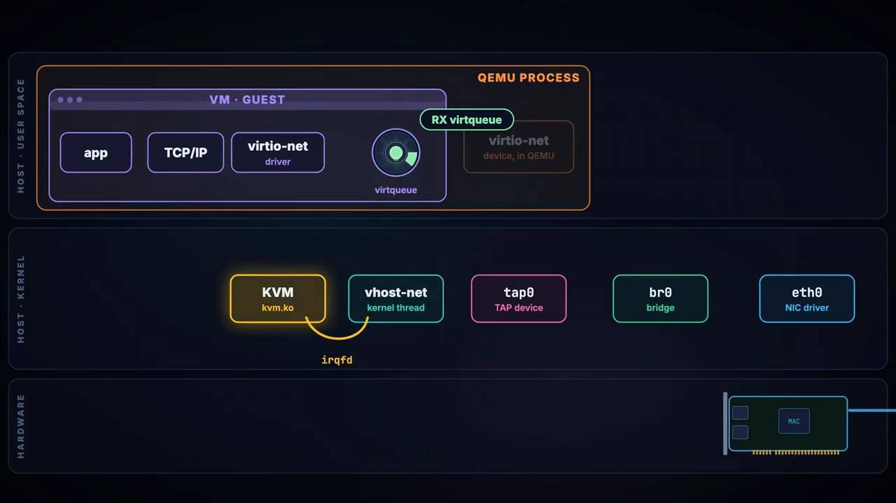

上图标注了反向路径的两个关键点：环上高亮的是 **RX virtqueue**（接收队列，与发包用的 TX 队列是两个独立的环），宿主侧 KVM 与 vhost-net 之间用 **`irqfd`** 连接——vhost-net 往里写一下，KVM 就替它向客户机注入中断，全程不需要回到用户态。

**为什么接收缓冲要提前挂好？** 因为宿主不能凭空往客户机内存里写——它必须写在客户机驱动事先登记过的、位于 RX 环上的缓冲里。这也是 virtio 的基本分工：**缓冲的所有权由客户机授予，宿主只在被授予的范围内读写**。

## 六、把整条链路在宿主机上验证出来

视频给了一个很实用的验证方法：在 Proxmox 上执行 `qm showcmd`，它会打印出这台虚拟机**真正的 QEMU 命令行**。在命令行里找 `-netdev` 这一段，你会看到类似这样的东西 [【跳转到 04:42】](https://www.youtube.com/watch?v=s1ymCQsZFo0&t=282)：

- 一个叫 `tap100` 的 tap；
- `vhost=on`，说明后端是内核里的 vhost-net；
- 它喂给一个 `virtio-net` 设备；
- 另有一小段脚本把 `tap100` 插进 `vmbr0`。

**"整支视频就浓缩在这两行里"**：`-netdev tap,...,vhost=on` 是客户机到文件的这一段，`ip link set tap100 master vmbr0` 是文件到网线的那一段。在任意 Linux 上，你可以用 `ip tuntap add dev tap0 mode tap` 手工造一个 tap、用 `ip link set tap0 master br0` 接桥，再用 `tcpdump -i tap0` 观察虚拟机进出的每一个帧——这条通路是可以逐跳观测的。

## 七、这条通路的边界：更快与更安全的替代

把通路画清楚之后，"还能怎么优化"就变成了"还能砍掉哪一跳" [【跳转到 05:07】](https://www.youtube.com/watch?v=s1ymCQsZFo0&t=307)：

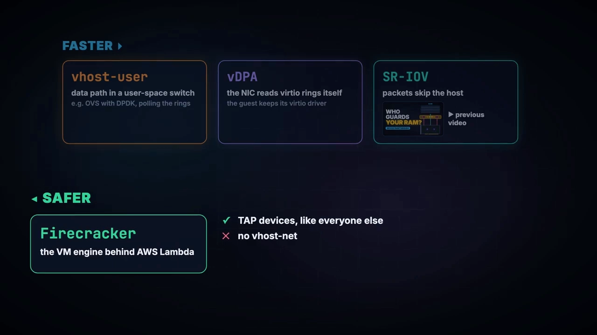

| 方向 | 做法 | 砍掉了哪一跳 |
| --- | --- | --- |
| 更快 | vhost-user：数据面搬进用户态交换机（如 OVS + DPDK），轮询环 | 砍掉宿主内核协议栈 |
| 更快 | vDPA：网卡自己读 virtio 环，客户机仍保留 virtio 驱动 | 砍掉软件后端 |
| 更快 | SR-IOV：包直接跳过宿主 | 砍掉 TAP 与网桥 |
| 更安全 | Firecracker：同样用 TAP，但**不用** vhost-net，网卡设备跑在沙箱化的用户态进程里 | 牺牲性能换宿主攻击面 |

最后一行值得记住：**TAP 这个抽象几乎人人都用**（连 AWS Lambda 背后的 Firecracker 也用），差别在于"谁来读写这个文件、跑在哪一层"。这也解释了为什么 TAP 是理解虚拟机网络的关键接口——它是客户机世界与宿主网络栈之间**唯一的那道门**。

## 小结

- 客户机发出的一个帧，要经过 **virtio-net 前端 → 后端 → `/dev/net/tun` 的 TAP → 网桥 → 物理网卡** 五跳，反向路径对称。
- 全模拟网卡（如 e1000）的代价是**每次寄存器访问都 VM exit**；virtio 用共享内存环把这件事压缩成**每批包一次 doorbell 写**。
- 后端有两种位置：QEMU 用户态（每批一次 context switch + 系统调用）和 vhost-net 内核态（doorbell 不出内核）。**两者的出口都是同一个 TAP 文件描述符**。
- TAP 的语义是"写进去 = 收到，读出来 = 发出"；**TAP 是二层以太网，TUN 是三层 IP**。
- 帧到 `tap0` 之后有两种出口：**桥接**（二层交换到物理网卡）或**宿主路由 + NAT**（Docker 的 `docker0` 用 veth pair 走同一套逻辑）。
- 反向路径依赖客户机**预先挂好的 RX 缓冲**，宿主把帧拷进去后用 `irqfd` 让 KVM 注入中断。
- 这条通路的性能上限由"穿越几次边界"决定，因此所有优化（vhost-user、vDPA、SR-IOV）都是在砍跳数。

## 关键术语速查

| 术语 | 一句话解释 |
| --- | --- |
| virtio-net | 面向虚拟机的半虚拟化网卡，前后端通过共享内存环而非寄存器通信 |
| virtqueue | 前后端共享内存中的环，存放描述符、available ring 与 used ring |
| descriptor | 一条"缓冲地址 + 长度 + 标志"的记录，指向客户机内存里的一个帧 |
| doorbell（kick） | 客户机写一个特殊地址通知后端"有活"，是发包路径上唯一一次 VM exit |
| used ring | 后端处理完缓冲后回写的位置，配合中断/抑制标志通知客户机 |
| VM exit | CPU 从客户机陷入 hypervisor 的动作，是虚拟化最主要的固定开销 |
| TAP | 二层虚拟网卡，用户态通过读写 `/dev/net/tun` 的文件描述符收发以太网帧 |
| TUN | 三层虚拟网卡，承载裸 IP 包，常见于 VPN |
| vhost-net | 把 virtio-net 数据面搬进宿主内核的后端，doorbell 不离开内核 |
| veth pair | 一对互通的虚拟网卡，容器网络用它替代 TAP |
| 网桥（bridge） | 内核内置的虚拟交换机，按 MAC 学习并转发 |
| irqfd | 内核里把"事件"直接接到"注入客户机中断"上的机制 |