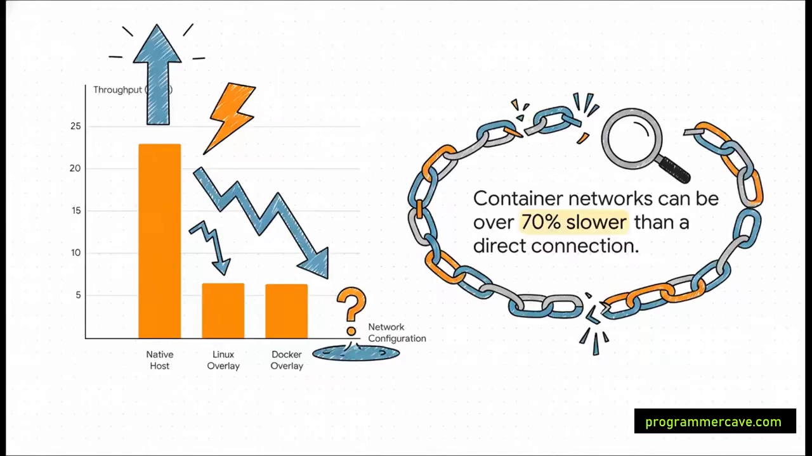
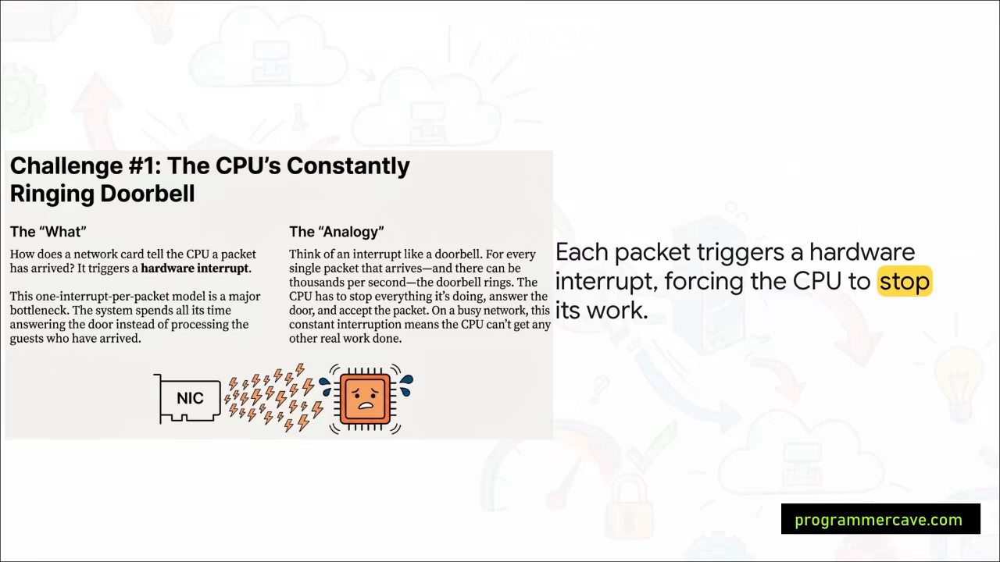
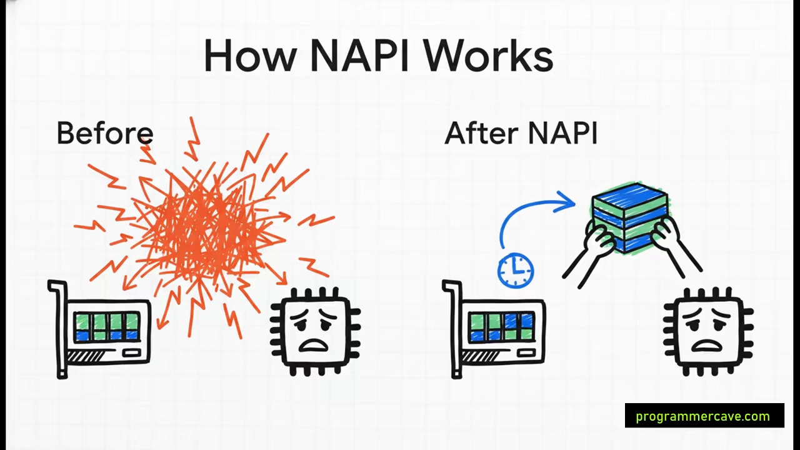
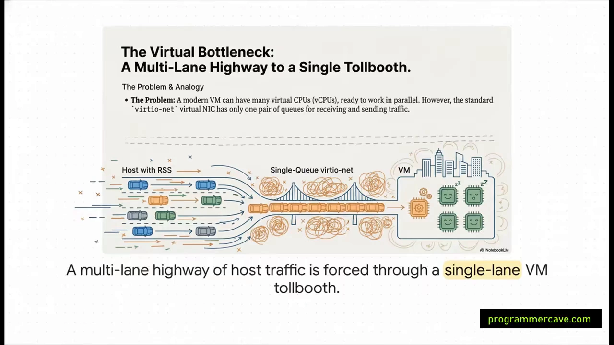
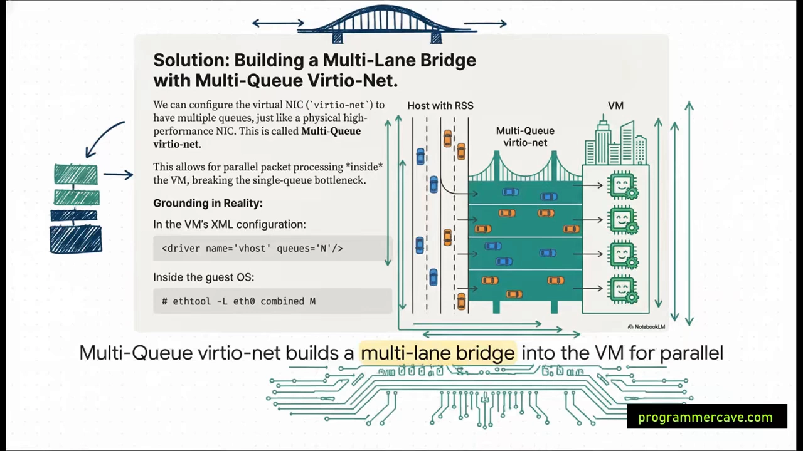
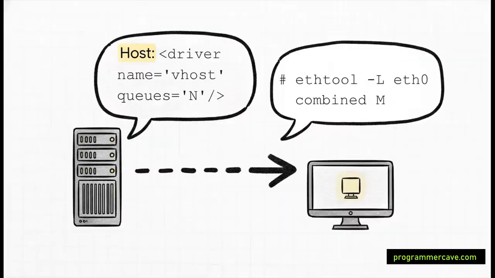
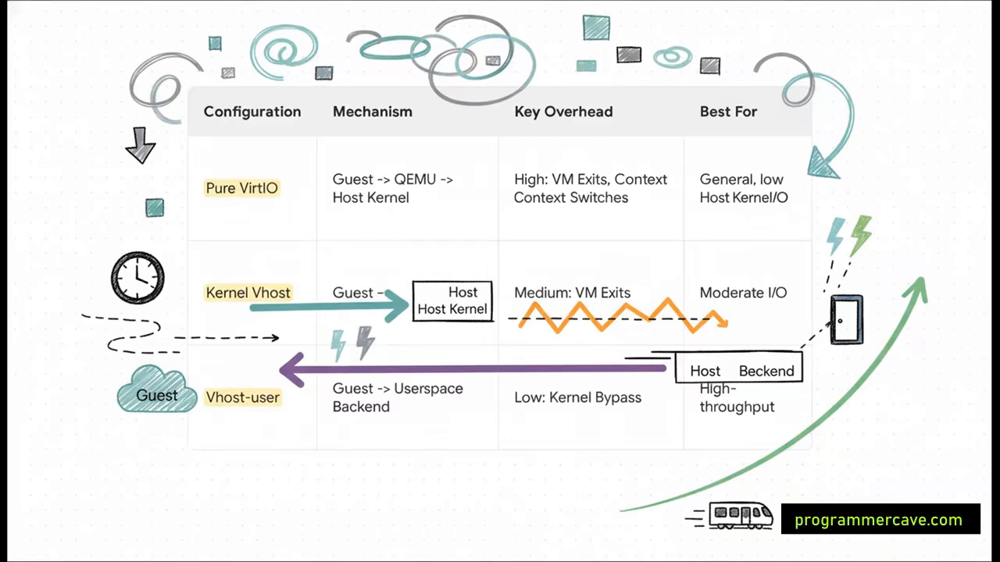
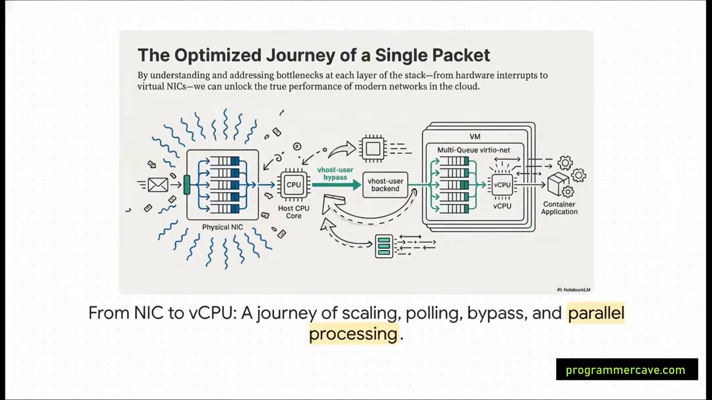

# virtio-net 多队列：单队列瓶颈与队列到 vCPU 的并行

> 视频来源：[VirtIO Multiqueue Explained: How to Fix Network Bottlenecks in KVM & Linux](https://www.youtube.com/watch?v=fki7FqPVAyM)（YouTube · programmerCave）｜时长约 9 分钟
> 导读：这支视频从"物理网卡 40–100 Gbps、虚拟机里却慢得离谱"这个悖论出发，逐层拆掉三个瓶颈：中断、单队列、内核路径。本文按 3.3.2 的边界只展开前两个中与 virtio-net 队列相关的部分，重点回答"为什么单队列 virtio-net 会把多核虚拟机压成单核"，以及"多队列怎么配、队列怎么落到 vCPU 上"；后端位置（vhost / vhost-user）只作为对照，实现细节见 3.3.3。

## 本讲要解决的核心问题（SCQA）

**背景**：宿主机的物理网卡有 40 甚至 100 Gbps，宿主内核也在用多核并行地收发；虚拟机里跑着 8 个 vCPU 的应用。

**冲突**：一旦把应用放进虚拟机或容器，吞吐可能掉到原来的三成不到——视频给出的对照是**原生宿主 23 Gbps，加一层标准容器 overlay 网络后掉到 6.4 Gbps，跌幅超过 70%**，而硬件一点没变 [【跳转到 01:10】](https://www.youtube.com/watch?v=fki7FqPVAyM&t=70)。

**疑问**：速度是在哪一段丢掉的？

**回答（中心思想）**：丢在"包从网卡到应用"这条链路上三个**串行化**的地方：① 每包一次硬件中断（CPU 忙于切换上下文）；② **virtio-net 默认只有一对队列**，8 条车道被并成 1 个收费亭；③ 包必须穿过宿主内核协议栈。前两个直接决定 virtio-net 的队列模型，是本小节的核心；第三个是后端位置问题（3.3.3）。



上图就是那个悖论的量化版本：原生宿主约 23 Gbps，换成 overlay 网络后只剩 6–7 Gbps。视频的结论写在右侧——**容器网络可能比直连慢 70% 以上**。

## 一、第一层瓶颈：每包一次中断，把 CPU 变成门童

先看宿主侧。传统网卡的工作方式是：**每到一个包，就触发一次硬件中断**。在繁忙的网络上，这是每秒成千上万次的"敲门" [【跳转到 01:48】](https://www.youtube.com/watch?v=fki7FqPVAyM&t=108)。



上图把代价拆成两栏：左边是"是什么"（网卡通过硬件中断告诉 CPU 有包到了），右边是类比（门铃每响一次，CPU 就得停下手上的工作、保存现场、去开门、再回来）。**这个"一次中断一个包"的模型是主要的瓶颈**：CPU 花在切换上下文上的时间远多于真正处理数据的时间，最终体现为**延迟更高、吞吐更低** [【跳转到 02:20】](https://www.youtube.com/watch?v=fki7FqPVAyM&t=140)。

### 1.1 解法：把"被打断"换成"主动轮询"（NAPI）

解法是把模型从**中断**翻转成**轮询**。视频的类比很形象：不要那个每有人进门就跳起来的门童，而要一个**前台**——她隔一会儿去候客室看一眼，然后**一次性把等着的人全处理完** [【跳转到 02:50】](https://www.youtube.com/watch?v=fki7FqPVAyM&t=170)。

这就是 Linux 内核的 **NAPI**（New API）机制：

1. 重流量时，系统告诉网卡"安静一点"，**关掉硬件中断**；
2. 内核直接去拉网卡的内存缓冲，把里面排队的包**整批取走**；
3. 这批活由**软中断（softIRQ）**完成——一种优先级更低、更高效的方式 [【跳转到 03:13】](https://www.youtube.com/watch?v=fki7FqPVAyM&t=193)。



上图左边是 NAPI 之前的中断风暴，右边是 NAPI 之后：定时轮询、成批取走。结论是**一次 poll 可以替代几百次硬件中断**，CPU 开销随之大幅下降 [【跳转到 03:38】](https://www.youtube.com/watch?v=fki7FqPVAyM&t=218)。

> 注意 NAPI 解决的是**宿主物理网卡**侧的收包方式。对虚拟机来说，这只是"上游变快了"，客户机与宿主之间那道 virtio 边界还没动。

## 二、第二层瓶颈：单队列 virtio-net 把多核压成单核

NAPI 之后，新瓶颈立刻出现：**所有活还是被塞进一个 CPU 核** [【跳转到 03:51】](https://www.youtube.com/watch?v=fki7FqPVAyM&t=231)。

这个问题在虚拟化世界里尤其严重：

- 宿主侧可能做得很好——RSS 把流量摊到所有核上，像一条**多车道高速路**；
- 但流量到了**一台标准虚拟机**，它的虚拟网卡**往往只有一对队列**（收一对、发一对）。



上图是这支视频最重要的一张图：左边是宿主的多车道（RSS 分流），中间被挤进 `Single-Queue virtio-net` 这一个收费亭，右边是闲着打瞌睡的 4 个 vCPU。也就是说，**瓶颈不在宿主、不在物理网卡，而在虚拟机自己的网卡队列上**。

### 2.1 为什么单队列会锁死扩展性

视频把这条结论说得很直接 [【跳转到 04:29】](https://www.youtube.com/watch?v=fki7FqPVAyM&t=269)：

> 你可以给客户机 VM 一堆 vCPU，但如果它们都得排队用**同一个网络队列**，性能永远不会扩展。**VM 自己成了瓶颈**，无论宿主多快、优化得多好。

从 3.3.2 的通路视角看，原因很清楚：一个 virtqueue 就是一圈共享内存环，环上的操作天然需要**串行化**（谁先谁后、索引怎么推进）。单队列意味着：

- 所有发包的 vCPU 争同一把锁、同一个 available ring；
- 后端（QEMU 或 vhost-net）也只有**一个**消费者，只能在一个线程里取包；
- 于是无论客户机有多少核，**收发包这条路径的并发度恒等于 1**。

## 三、解法：多队列 virtio-net（multi-queue）

既然是多车道高速路，就配一座**多车道的桥**：把虚拟网卡配置成拥有**多个队列**，就像高性能物理网卡那样。这就是 **multi-queue virtio**，它让虚拟机内部实现**真正的并行包处理** [【跳转到 04:47】](https://www.youtube.com/watch?v=fki7FqPVAyM&t=287)。



上图把改造后的结构画了出来：宿主侧 RSS 把包按流分散到不同硬件队列，虚拟机侧 `Multi-Queue virtio-net` 有**多组队列**，每组队列对应一个 vCPU，包被直接送到"该处理它的那个核"上。

### 3.1 配置只需两步

视频给的操作路径非常具体 [【跳转到 05:08】](https://www.youtube.com/watch?v=fki7FqPVAyM&t=308)：

**第一步，在宿主的虚拟机配置里声明队列数**（以 libvirt 的 XML 为例）：

```xml
<driver name='vhost' queues='N'/>
```

**经验法则：把 N 设成与虚拟机的 vCPU 数一致。**

**第二步，进客户机，让网卡真正用上这些队列**：

```bash
# ethtool -L eth0 combined M
```



上图把两端的关系画成两句话：宿主说"我给你 N 个队列"，客户机说"我用 M 个队列"。**两边都做，多车道才算接通**——只改宿主不改客户机，队列建好了但驱动不会去用；只改客户机不改宿主，硬件上没有那么多队列可用。

### 3.2 队列与 vCPU 的绑定关系

视频反复强调"把包交给**正确的 vCPU**" [【跳转到 06:39】](https://www.youtube.com/watch?v=fki7FqPVAyM&t=399)。这句话背后是 virtio-net 多队列的实际工作方式：

| 层次 | 谁来做分流 | 依据 |
| --- | --- | --- |
| 物理网卡 | RSS（Receive Side Scaling） | 按流的哈希值分到不同硬件队列 |
| 宿主 virtio 后端 | 每个队列一个后端线程/上下文 | 队列索引 |
| 客户机 virtio-net | 每个队列绑定一个 vCPU 的中断与 NAPI 实例 | 队列索引 |
| 客户机协议栈 | 按队列对应的 CPU 处理 | 队列 → vCPU 亲和 |

所以"队列数 = vCPU 数"这条经验法则的含义是：**让每条车道都有一个专属的收费员**，避免多个队列的中断挤到同一个核上（那样等于又回到了单核处理）。反过来，队列数超过 vCPU 数也没有意义，只会多出无谓的上下文切换。

> **为什么这属于 3.3.2 而不是 3.3.3**：多队列改变的是 **virtio-net 设备自身的队列模型**——环有几圈、谁来消费、中断投给谁。至于"消费者跑在宿主内核还是用户态交换机里"，那是后端位置问题，见下一节与 3.3.3。

## 四、第三层：后端放在哪（对照，不展开）

解决了中断和队列之后，还剩最后一处开销：**包要穿过宿主的内核协议栈**。视频用一张表把三种配置的演进列了出来 [【跳转到 05:51】](https://www.youtube.com/watch?v=fki7FqPVAyM&t=351)：



| 配置 | 路径 | 主要开销 | 适用 |
| --- | --- | --- | --- |
| Pure virtio | 客户机 → QEMU 用户态 → 宿主内核 | 高：大量 VM exit 与上下文切换 | 通用、宿主 I/O 不重 |
| Kernel vhost | 客户机 → 宿主内核（vhost-net） | 中：仍有 VM exit | 中等 I/O |
| vhost-user | 客户机 → 用户态后端（如 DPDK） | 低：绕过内核 | 高吞吐 |

视频的结论是 vhost-user 是"高吞吐工作负载的黄金标准"，因为它几乎消除了上下文切换 [【跳转到 06:16】](https://www.youtube.com/watch?v=fki7FqPVAyM&t=376)。

**这三行对 3.3.2 的意义只有一句**：无论后端在哪一层，**队列模型是一样的**——多队列在三种配置下都能用，只是"谁来消费这些队列"不同。三种后端的进程模型与 ioctl 细节归 3.3.3。

## 五、合起来：一个包在优化后的完整旅程

把三层优化叠起来，一个包从网线到应用的路径变成这样 [【跳转到 06:39】](https://www.youtube.com/watch?v=fki7FqPVAyM&t=399)：

1. **物理网卡**：RSS 按流把包散到不同硬件队列；
2. **宿主内核**：NAPI 用轮询成批取包，而不是每包一次中断；
3. **后端**：vhost-user 把包直接投递到虚拟机内存，绕过宿主内核；
4. **客户机**：多队列 virtio-net 把包交给**对应的那个 vCPU** 处理。



上图把四步连成一条链，底部那句话是总结：**从网卡到 vCPU，是一次"分流（scaling）、轮询（polling）、绕过（bypass）、并行（parallel processing）"的组合**。每一步都在消除上一层的串行点。

## 六、顺带：用这条通路做一次真实排查

视频最后用一个很常见的故障演示"懂了通路才能排查"：**连接突然被重置** [【跳转到 07:34】](https://www.youtube.com/watch?v=fki7FqPVAyM&t=454)。

- 罪魁祸首通常是 **TCP RST 包**。它不是礼貌的告别，而是"退回发件人"——通常发生在你访问了一个没开的端口，或者对端已经忘了这条连接的时候。
- 但如果这个 RST **看起来不是你要通信的那台服务器发来的**呢？线索在 IP 头的 **TTL（Time To Live）**：每经过一个路由器，TTL 减一。
- 假设服务器正常包的 TTL 是 46，而这个 RST 的 TTL 是 85——**这就是铁证**：这个 RST 不是服务器发的，是路径上**离你更近的某台设备**（比如防火墙）伪造的 [【跳转到 08:24】](https://www.youtube.com/watch?v=fki7FqPVAyM&t=504)。

这段排查之所以成立，前提正是本文讲的那条通路：**包在虚拟化层被转发时不会被改写 TTL**，所以 TTL 的差值能反推出"伪造者离你有多远"。

## 小结

- 虚拟机的网络慢，通常不是硬件慢，而是**链路上存在串行点**：中断、单队列、内核路径。
- 每包一次硬件中断会让 CPU 忙于切换上下文；NAPI 用"关中断 + 轮询 + 成批处理"把几百次中断压成一次 poll。
- **virtio-net 默认只有一对队列**，这是虚拟机侧最硬的瓶颈：环上的操作必须串行，并发度恒为 1，vCPU 再多也只能排队。
- **多队列 virtio** 让虚拟网卡拥有多组队列，实现真正的并行处理；配置要**两端都做**：宿主 `queues='N'`，客户机 `ethtool -L eth0 combined M`。
- **队列数对齐 vCPU 数**是经验法则，目的是让每个队列的中断落到不同的核上，避免又挤回单核。
- 后端位置（pure virtio / kernel vhost / vhost-user）决定"包要不要穿宿主内核"，但**不改变队列模型**；这部分属于 3.3.3。
- 排查价值：理解通路之后，TTL 这类头部字段就能用来判断"这个 RST 是谁伪造的"。

## 关键术语速查

| 术语 | 一句话解释 |
| --- | --- |
| 硬件中断 | 网卡通知 CPU "有包到了"的信号，每包一次会拖垮 CPU |
| 上下文切换 | CPU 停下当前工作、保存现场去处理别的事，再恢复回来 |
| NAPI | Linux 的收包机制：重流量时关中断，改为轮询并成批处理 |
| softIRQ（软中断） | 优先级更低、开销更小的延迟处理机制，NAPI 的活在这里干 |
| RSS | Receive Side Scaling，物理网卡按流哈希把包分到多个硬件队列 |
| 单队列瓶颈 | virtio-net 默认只有一对队列，环操作串行，多 vCPU 也只能排队 |
| multi-queue virtio | 让虚拟网卡拥有多组队列，队列可绑定到不同 vCPU 并行处理 |
| `queues='N'` | libvirt 里声明虚拟网卡队列数的配置项，经验上等于 vCPU 数 |
| `ethtool -L` | 客户机内设置网卡队列数的命令，需与宿主配置匹配 |
| vhost-user | 把 virtio 数据面搬进用户态交换机（如 DPDK）的后端形态 |
| TTL | IP 头里的生存时间，每过一个路由器减一，可用来推断包的来源距离 |