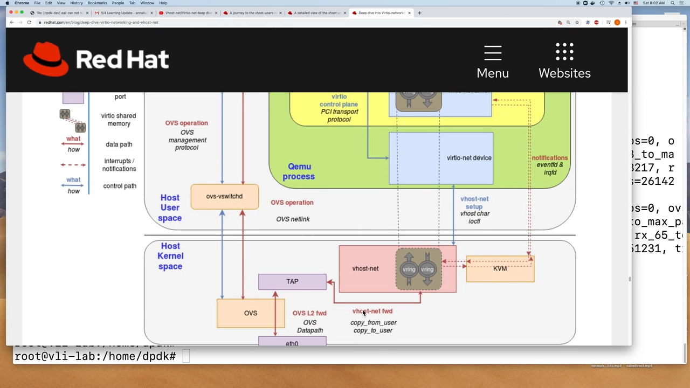
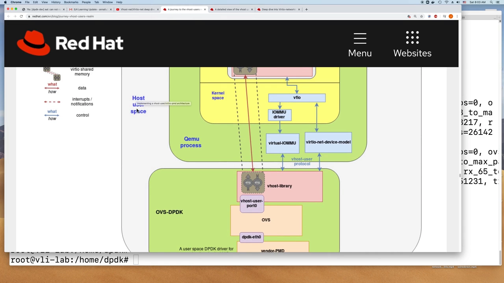
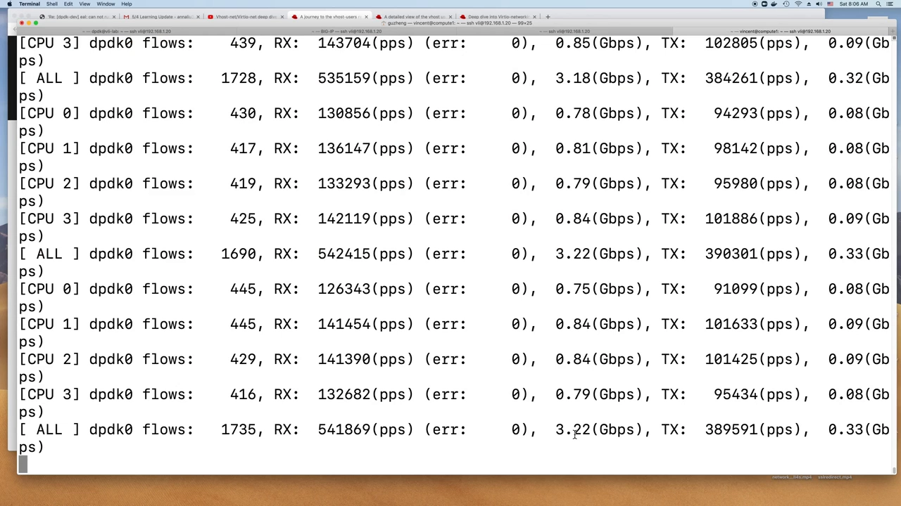
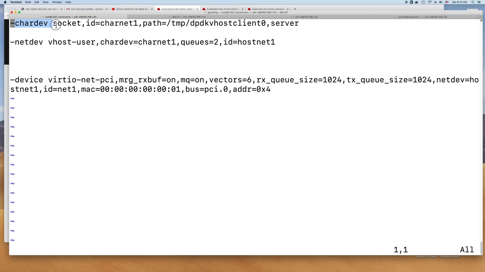
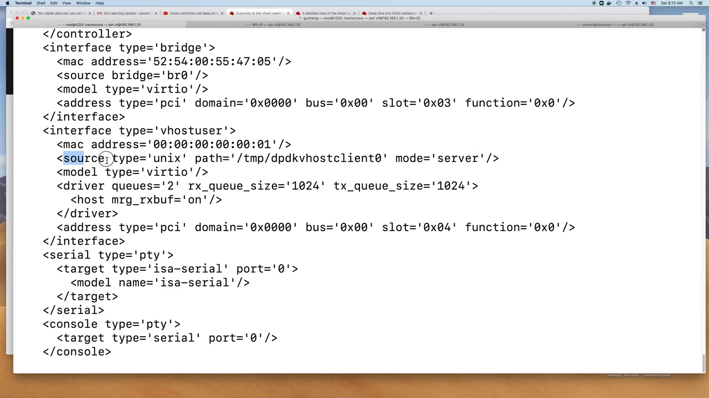

# vhost-net 与 vhost-user 的吞吐对照：OVS-DPDK 卸载实战

> 视频来源：[vhost-user/virtio-pmd architecture deep dive - 1](https://www.youtube.com/watch?v=EbHCbM8p2H4)（YouTube · loongfire）｜时长约 13 分钟
> 导读：这是一支「同一个负载、两种后端位置」的对照实验：先用 vhost-net 跑出接近 1 Gbps，再把后端换成 OVS-DPDK 的 vhost-user，同一个压测跑到 3.2 Gbps，然后逐行拆开 QEMU 参数与 libvirt XML，说明 vhost-user 到底是怎么接起来的。篇幅短、动手性强，适合作为本节的概念验证。

## 本讲要解决的核心问题（SCQA）

**背景**：virtio-net 让客户机用一套半虚拟化网卡驱动发收报文，后端落在宿主的 TAP 设备上；如果把后端交给内核里的 vhost-net，就能省掉 QEMU 用户态的往返。

**冲突**：vhost-net 虽然把后端搬进了内核，但报文仍然要在内核与用户态之间来回：内核里的 vhost-net 把报文交给 TAP，TAP 再交给用户态的 OVS 虚拟交换机，OVS 处理完再送出去。上一支视频里，演讲者测出这条路径的瓶颈正是「从用户态拷进来、再拷出去」这两次拷贝，吞吐只有接近 1 Gbps。

**疑问**：如果把虚拟交换机也搬到用户态，让 vhost 的后端直接对接 DPDK，这两次拷贝还有必要吗？吞吐能提升多少？配置上又要改什么？

**回答（中心思想）**：把后端从内核里的 vhost-net 换成用户态的 vhost-user（对接 OVS-DPDK），整条报文路径就从「内核 → TAP → 用户态 OVS」变成「用户态 OVS 直接读写共享内存里的 virtqueue」，同一个压测从接近 1 Gbps 提升到 3.2 Gbps，约三倍。代价是配置复杂度：QEMU 侧要显式定义一个 server 模式的 Unix socket chardev、一个 vhost-user netdev、以及带多队列的 virtio-net-pci 设备，三者靠 id 串起来。

## 一、先定位瓶颈：两次拷贝

上一支视频里，讲者用 BIG-IP 做演示：把 BIG-IP 跑在客户机里，然后向它的虚拟服务器打流做压测。在 vhost-net 加 virtio-net 的架构下，拿到的吞吐接近 1 Gbps。[【跳转到 00:25】](https://www.youtube.com/watch?v=EbHCbM8p2H4&t=25)

而瓶颈的位置很明确：**数据要从用户态拷进来、再拷出去，就是这两次拷贝**。[【跳转到 00:00】](https://www.youtube.com/watch?v=EbHCbM8p2H4&t=0)

这句话值得展开一下。vhost-net 把 virtqueue 的处理放进了内核，但内核里的 vhost-net 并不能直接把报文交给 OVS——因为 OVS 是用户态进程。于是路径变成：内核 vhost-net → TAP 设备 → 用户态 OVS → 内核网络栈 → 物理网卡。TAP 是内核里的一个虚拟网口，报文从内核缓冲区搬到用户态 OVS 的缓冲区，这一步就是一次拷贝；反方向再来一次。

## 二、vhost-net 的形态：后端在内核，交换机在用户态

讲者用一张 Red Hat 的架构图说明了 vhost-net 的位置。这张图信息量很大，值得逐个模块看：



从图里能读出三件事：

1. **virtio-net 设备的配置面仍在 QEMU 里**（`virtio-net-device`），但数据面被 `vhost-net setup`（走 vhost char ioctl）交给了内核里的 `vhost-net` 模块。
2. **通知不走用户态**：图右侧明确标了 `notifications eventfd & irqfd`。也就是说，客户机 kick 时，内核直接用 eventfd 触发 vhost-net 的回调；后端要注入中断时，用 irqfd 让 KVM 直接把中断投进客户机。这两条通道合起来，省掉的就是「唤醒 QEMU 线程再回来」的那一段。
3. **报文仍要出内核**：`vhost-net` 把报文交给 `TAP`，TAP 再交给用户态的 `OVS`（走 OVS netlink）。所以内核态后端省掉的是「virtqueue 处理」的用户态往返，**没有**省掉「报文交给用户态交换机」的那次拷贝。

讲者的原话是：vhost-net 驱动跑在宿主内核态，也就是 hypervisor 的内核空间里。[【跳转到 01:01】](https://www.youtube.com/watch?v=EbHCbM8p2H4&t=61)

## 三、vhost-user 的形态：后端也搬到用户态

接下来看 OVS-DPDK 的架构，它用的是 vhost-user 驱动，跑在宿主用户态，也就是 hypervisor 的用户空间里。[【跳转到 01:26】](https://www.youtube.com/watch?v=EbHCbM8p2H4&t=86)



对比上一张图，差别一目了然：

- **QEMU 进程跑在宿主用户空间，OVS-DPDK 也跑在宿主用户空间**；
- **报文处理不再放在宿主内核空间里做**；
- 两者之间不再是 TAP 加 netlink，而是 **vhost-user 协议**：QEMU 里的 `virtio-net-device-model` 与 OVS-DPDK 里的 `vhost-library` 通过 socket 协商，下面接 `vhost-user-port0`，再往下是 `dpdk-eth0` 和厂商 PMD 驱动。

讲者的总结是：我们把全部报文处理都搬到了宿主用户空间，于是 QEMU 进程（也就是客户机实例，BIG-IP 跑在里面）里，客户机用户空间跑的是一个用户态的 DPDK 驱动——**客户机侧和宿主侧的报文处理全都搬到了用户空间**。[【跳转到 02:16】](https://www.youtube.com/watch?v=EbHCbM8p2H4&t=136)

这里有一个容易混淆的点需要点明：客户机侧的「用户态 DPDK 驱动」指的是 virtio-net PMD（poll mode driver），它让客户机里的应用绕过内核网络栈直接收发 virtqueue。讲者在演示里用的 `xn` 驱动就是 F5 移植的 DPDK，也就是 virtio-net PMD 驱动。[【跳转到 04:07】](https://www.youtube.com/watch?v=EbHCbM8p2H4&t=247)

## 四、实测：从 1 Gbps 到 3.2 Gbps

同一个 BIG-IP 负载，只把后端从 vhost-net 换成 OVS-DPDK 的 vhost-user，重新打流：

- 吞吐立刻提升，**超过 3 Gbps**；[【跳转到 04:51】](https://www.youtube.com/watch?v=EbHCbM8p2H4&t=291)
- 讲者强调这几乎是 **vhost-net 架构的三倍**，并在 BIG-IP 上看到 3.1 Gbps 这个数字。[【跳转到 05:01】](https://www.youtube.com/watch?v=EbHCbM8p2H4&t=301)

DPDK 的 telemetry 输出更精确：4 个 CPU 上 `dpdk0` 的接收速率合计 3.22 Gbps，每核约 0.8 Gbps。



这个数字的意义不在于「3.2 Gbps 有多快」——它受限于演示环境的网卡与 CPU——而在于**同一个负载、同一台机器，只改后端位置，吞吐差三倍**。这正好印证了上一节的判断：省掉的两次拷贝是真实存在的成本。

## 五、配置怎么改：三段参数串起来

讲者接着打开 hypervisor 上的 QEMU 命令行，把 vhost-user 相关的那一段拎出来逐行解释。这是全片最实用的部分。

### 5.1 第一段：server 模式的 Unix socket chardev

```
-chardev socket,id=charnet1,path=/tmp/dpdkvhostclient0,server
```

- `chardev` 的类型是 `socket`，id 是 `charnet1`；
- `path` 指向 socket 文件，**QEMU 会在这个路径下创建 Unix socket 文件**；
- `mode` 是 `server`，意思是 **QEMU 进程当 master**，也就是 vhost-user 的 master，而 OVS-DPDK 当 client。[【跳转到 09:16】](https://www.youtube.com/watch?v=EbHCbM8p2H4&t=556)

这一点初学者最容易搞反：vhost-user 里「谁连谁」是由 `server` 这个关键字决定的，而且**当 server 的是 QEMU**，不是后端。

### 5.2 第二段：vhost-user 类型的 netdev

```
-netdev vhost-user,chardev=charnet1,queues=2,id=hostnet1
```

`netdev` 的类型是 `vhost-user`，它作为后端设备；`chardev=charnet1` 与上面的 id 对应上，两者由此绑定；`queues=2` 说明启用了两个队列。[【跳转到 09:41】](https://www.youtube.com/watch?v=EbHCbM8p2H4&t=581)

### 5.3 第三段：带多队列的 virtio-net-pci

```
-device virtio-net-pci,mrg_rxbuf=on,mq=on,vectors=6,
        rx_queue_size=1024,tx_queue_size=1024,
        netdev=hostnet1,id=net1,mac=00:00:00:00:00:01,bus=pci.0,addr=0x4
```

这一段是 virtio-pci 的 virtio-net-pci 设备，特性里打开了 `mq=on`（多队列），并分别定义了 rx 队列大小与 tx 队列大小，最后挂到 PCI 总线上。[【跳转到 10:06】](https://www.youtube.com/watch?v=EbHCbM8p2H4&t=606)



三段参数靠两个 id 串起来：`charnet1` 把 chardev 和 netdev 绑在一起，`hostnet1` 把 netdev 和 PCI 设备绑在一起。**只要有一个 id 对不上，设备就起不来。**

### 5.4 libvirt 的等价写法

讲者还展示了同一套配置在 libvirt XML 里的样子——libvirt 的 XML 只是把 QEMU 参数翻译过去而已。[【跳转到 11:06】](https://www.youtube.com/watch?v=EbHCbM8p2H4&t=666)



对应关系很清楚：

- `<interface type='vhostuser'>` 对应 `-netdev vhost-user`；
- `<source type='unix' path='/tmp/dpdkvhostclient0' mode='server'/>` 对应 `-chardev socket,...,server`；
- driver 元素里的 queues、rx_queue_size、tx_queue_size 三个属性，分别对应 queues=2 与两个 queue_size。

讲者特别指出：XML 里的 `source type` 是 `unix`，`path` 是同一个 socket 文件路径，`mode` 是 `server`，队列大小也和 QEMU 参数一致，这样两边就对上了。[【跳转到 11:41】](https://www.youtube.com/watch?v=EbHCbM8p2H4&t=701)

## 六、结论与适用边界

讲者最后的建议很直接：**任何想要高吞吐、高性能的用户，都应该用 OVS-DPDK 的 vhost-user 架构，而不是 OVS 加 vhost-net 的架构**。[【跳转到 12:56】](https://www.youtube.com/watch?v=EbHCbM8p2H4&t=776)

但这个结论有明确的适用边界，需要补两句：

- **它比较的是「交换机也在用户态」的两个方案**。vhost-user 的收益来自「后端和交换机在同一个用户态进程里，共享内存直接读写」，如果你本来就用内核 OVS 加 TAP，那么 vhost-net 才是配套方案。
- **它没有覆盖隔离性与可维护性**。把后端搬进用户态进程，意味着这个进程崩了会连带影响所有挂在它上面的虚拟机；而 vhost-net 跑在内核里，故障面被内核边界隔开。这两点在这支 13 分钟的演示里没有展开，需要配合本节其他材料一起看。

## 小结

- **瓶颈是两次拷贝**：vhost-net 虽然把 virtqueue 处理搬进了内核，但报文还要经 TAP 进用户态 OVS，这一次进出就是成本。
- **vhost-net 省的是「唤醒 QEMU 线程」**：靠 `eventfd` 让客户机 kick 直接触发内核回调、靠 `irqfd` 让内核直接注入中断。
- **vhost-user 省的是「报文出内核」**：后端和交换机都在用户态，直接读写共享内存里的 virtqueue。
- **实测差距约三倍**：同一个 BIG-IP 负载，vhost-net 接近 1 Gbps，OVS-DPDK 的 vhost-user 达到 3.2 Gbps。
- **配置靠 id 串联**：`chardev socket`（server 模式，QEMU 当 master）→ `netdev vhost-user` → `virtio-net-pci`（`mq=on` 加队列大小），libvirt XML 是同一套东西的另一种写法。
- **结论有边界**：这条建议针对「交换机在用户态」的场景；隔离性与故障面需要另外权衡。

## 关键术语速查

| 术语 | 一句话解释 |
| --- | --- |
| vhost-net | 内核里的 virtio-net 后端，省掉 virtqueue 处理的用户态往返 |
| vhost-user | 用户态独立进程里的 virtio 后端，通过 Unix socket 与 QEMU 协商 |
| TAP | 内核里的虚拟网口，用户态程序通过它收发以太网帧 |
| eventfd | 轻量通知 fd，客户机 kick 时用它直接触发内核里的 vhost 回调 |
| irqfd | 让 KVM 直接把中断注入客户机的 fd，省掉用户态中转 |
| chardev | QEMU 的字符设备抽象，vhost-user 用它承载 Unix socket |
| server 模式 | vhost-user 里由 QEMU 创建并监听 socket，后端作为 client 连上来 |
| virtio-net PMD | 客户机侧的轮询模式 virtio 驱动，绕过内核网络栈直接收发 virtqueue |
| DPDK telemetry | DPDK 的运行时统计输出，可看每核与合计的收发速率 |