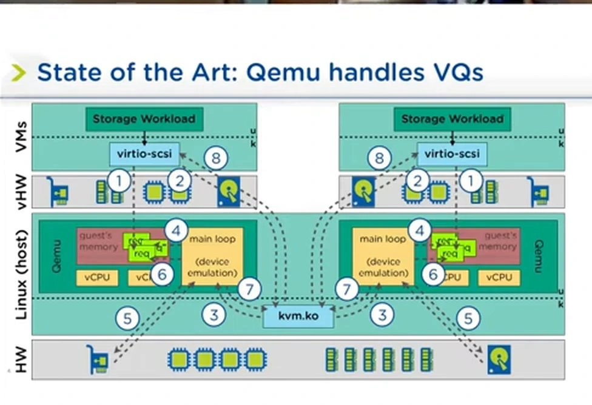
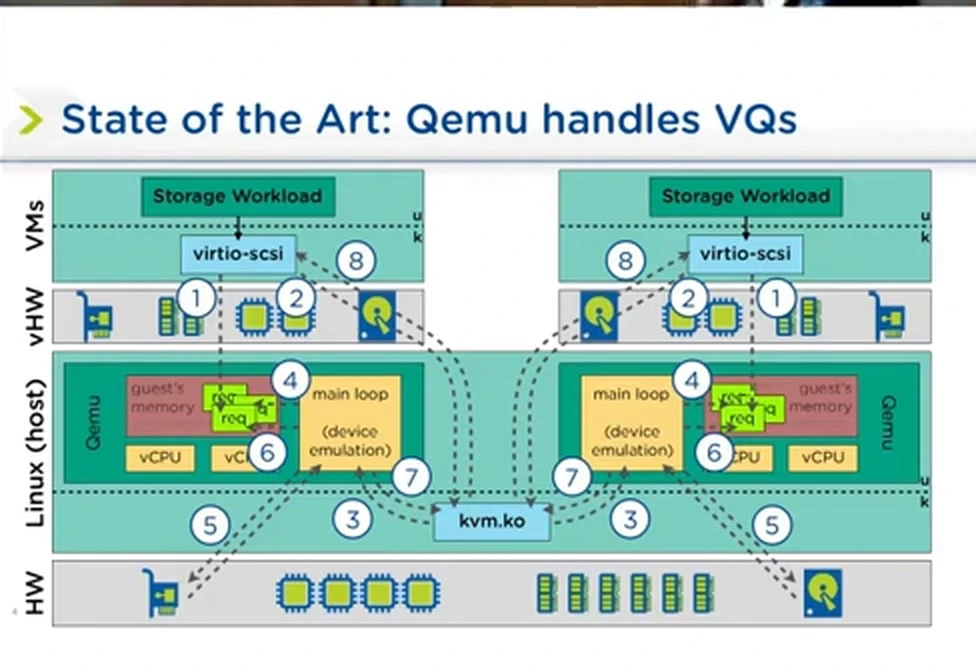
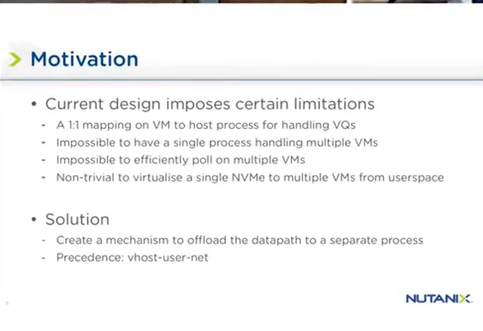
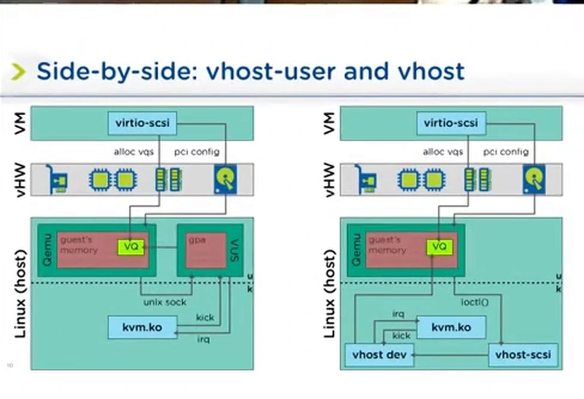
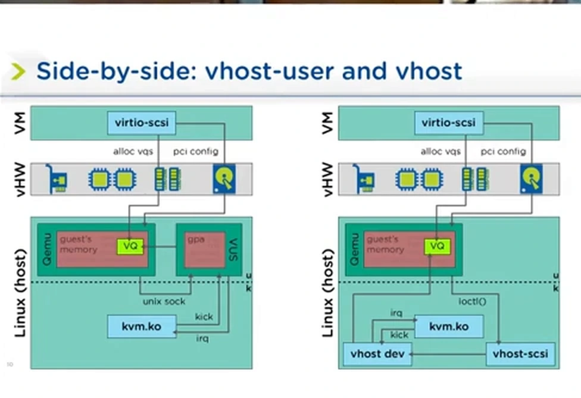
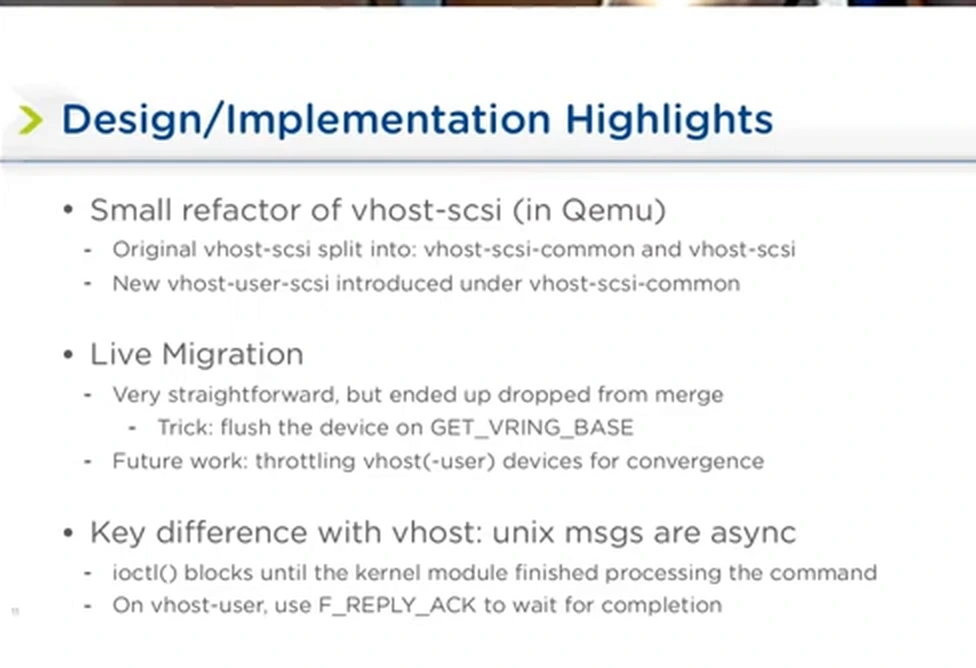
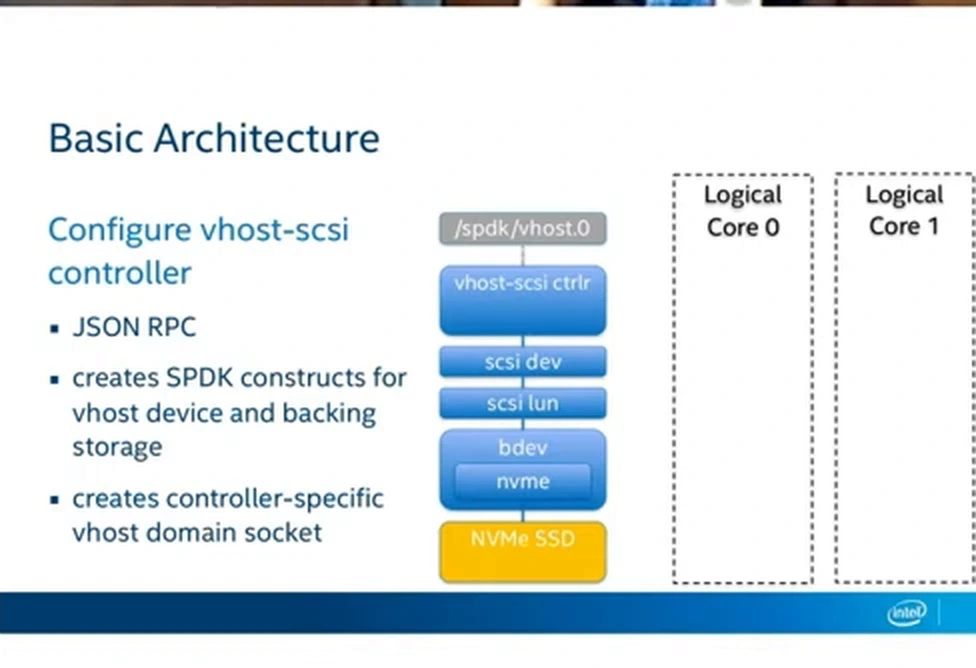
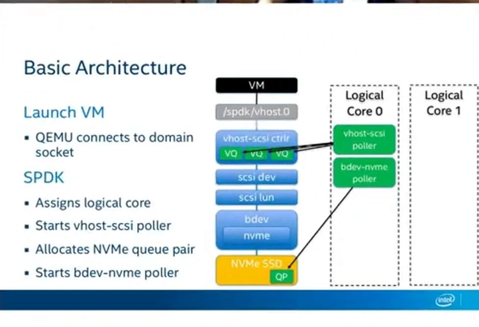
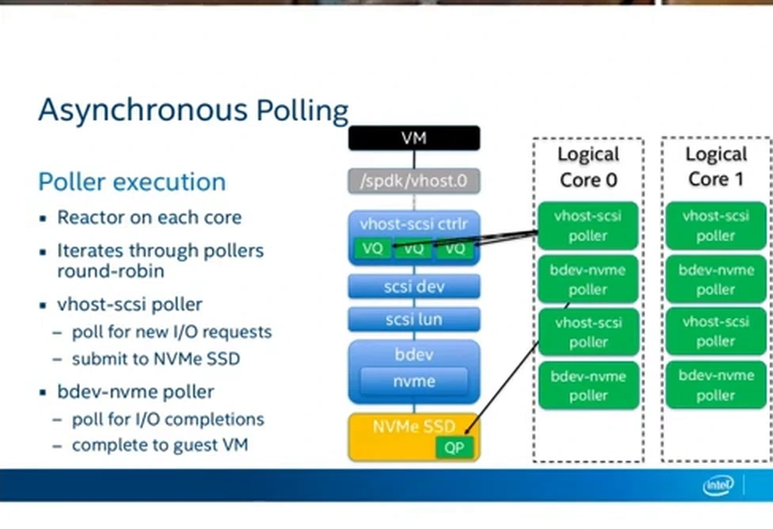
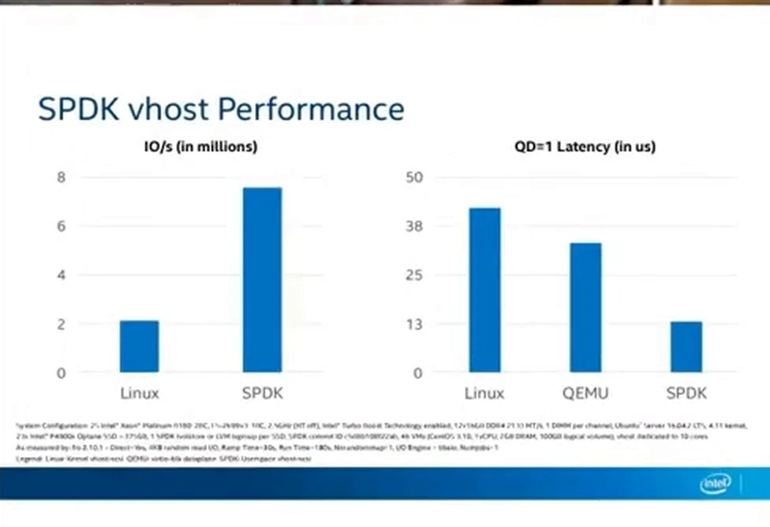

# vhost-user-scsi：把 virtio-scsi 数据面卸载到用户态进程

> 视频来源：[Introducing vhost-user-scsi and its applications](https://www.youtube.com/watch?v=DxqEaCPijlI)（KVM Forum 2017 · Felipe Franciosi（Nutanix）与 Jim Harris（Intel/SPDK））｜时长约 38 分钟
> 导读：这是一支把「后端搬出 QEMU」讲得最完整的会议演讲——先画清 QEMU 自己处理 virtqueue 的老路径，再并排对比 vhost（内核态）与 vhost-user（用户态独立进程）两套控制面，最后用 SPDK 的 vhost-user-scsi 给出 IOPS 与延迟数据。字幕为机器翻译，术语已按上下文校正。

## 本讲要解决的核心问题（SCQA）

**背景**：virtio 设备的数据面很朴素——客户机里的前端驱动把请求填进 virtqueue，发一个 kick；宿主侧的后端把请求取出来、交给真正的存储或网卡，完成后把结果写回 used 环并注入中断。在 QEMU 里，这个「后端」就是 QEMU 进程自己的一条设备模拟线程。

**冲突**：这套结构把「一台虚拟机」和「一个处理它 virtqueue 的宿主进程」死死绑成一对一。演讲者列出的四条限制都源于这一点：一个进程管不了多台虚拟机；因此也没法用一个进程高效轮询多台虚拟机；想摆脱中断模型、让一个进程在所有虚拟机之间轮转，做不到；想在用户态把一块 NVMe SSD 虚拟化给多台虚拟机共享，也很别扭。

**疑问**：既然瓶颈是「后端和 VMM 挤在同一个进程里」，那把数据面整个搬出去、交给一个独立的用户态进程，会变成什么样？搬走之后又丢了什么？

**回答（中心思想）**：vhost-user 把 virtio 后端从 QEMU 进程里剥离成一个独立用户态进程，控制面改用 Unix domain socket 传递「客户机内存在哪、virtqueue 在哪、用哪些文件描述符做通知」，数据面则靠共享内存直接读写 virtqueue。它换来了单进程管多机、多线程多队列、批量提交和纯轮询，代价是安全爆炸半径变大、QEMU 块层与 libvirt 的既有能力失效、以及异步消息语义需要 `F_REPLY_ACK` 这样的补丁来兜底。

## 一、先看清老路径：一次 virtio-scsi 请求要穿过几层

### 1.1 从 kick 到 QEMU 主循环

演讲开头用一张分层图回顾了「QEMU 自己处理 virtqueue」的典型数据路径：最底下是硬件，往上是宿主内核里的 `kvm.ko`，再往上是用户空间的 QEMU（它拥有全部 vCPU 线程和设备模拟线程），最上面是客户机里的 virtio-scsi 驱动和存储负载。

请求的流转是这样的：virtio-scsi 驱动先把请求写进内存、填满控制器的 virtqueue（下文简称 VQ），然后发一个 kick。这个 kick 被 KVM 模块捕获，KVM 再通过一个 eventfd 把「有活干了」这件事转告 QEMU。[【跳转到 00:58】](https://www.youtube.com/watch?v=DxqEaCPijlI&t=58)

QEMU 看到这个文件描述符被触发，就知道请求来自哪个队列；它进入客户机内存，从队列里取出请求，再交给对应的后端——可能是一张接 NBD 或 NFS 的网卡，也可能是一块 qcow 文件或逻辑卷上的裸设备。[【跳转到 01:23】](https://www.youtube.com/watch?v=DxqEaCPijlI&t=83)

### 1.2 完成路径与中断注入

请求做完之后，后端把响应结构填回 virtqueue，然后通知客户机。通知的方式同样是「写一个文件描述符」：客户机侧写 KVM 的 fd，由 KVM 把中断注入进去。[【跳转到 02:03】](https://www.youtube.com/watch?v=DxqEaCPijlI&t=123)

所以整条路径上，一次 I/O 至少要经过「客户机 → VM exit → 宿主内核 → 唤醒 QEMU 线程 → 处理 → 写 fd → 注入中断」这么多跳。注意这里的关键不是跳数本身，而是**这些跳全都发生在同一个 QEMU 进程的上下文里**。

### 1.3 一对一绑定带来的四条限制

演讲者把动机总结成一页幻灯片，四条限制全部指向同一个根因：

- **一个进程管不了多台虚拟机**：处理 VQ 的宿主进程和虚拟机是一一对应的。
- **因此没法高效轮询多台虚拟机**：如果你想摆脱中断模型、让一个进程在所有虚拟机上轮转，在一对一模型里根本不可能实现。
- **每台虚拟机都要占一个核**：当然你还是可以让每个 QEMU 各跑各的，但那样密度就没了。
- **用户态共享一块 NVMe 很难**：用 SPDK 这类技术在用户空间虚拟化单块 NVMe 设备、再分给多台虚拟机，在一对一模型下非常别扭。

解法就是演讲的标题：**建立一套把数据面卸载到独立进程的机制**。而这件事此前已经有先例——网络侧的 `vhost-user-net`，它为 OVS 和 DPDK 做了几乎一样的事情。[【跳转到 03:53】](https://www.youtube.com/watch?v=DxqEaCPijlI&t=233)

## 二、搬法：把主循环换成另一个进程

### 2.1 形态上只是换了个循环

从结构图上看，vhost-user 做的事情非常朴素：把原来 QEMU 里那个「读 eventfd、取 VQ、提交给后端」的主循环，换成一个独立的 vhost-user 应用程序。也就是说，有另一个不是 QEMU 的进程在处理 I/O。[【跳转到 04:09】](https://www.youtube.com/watch?v=DxqEaCPijlI&t=249)

出于性能考虑，你理想上会希望**在这个模型里用单个进程管理多台虚拟机**——这正是搬出去的意义。

### 2.2 换来的四样好处

演讲者把好处归纳为四条，都属于「一个进程能同时看到很多队列」带来的红利：

1. **多线程多队列更容易**。QEMU 自己的数据面和多线程其实也在往这个方向做，但做了很久、很有挑战，原因之一是 I/O 路径上到处都要加锁。[【跳转到 04:34】](https://www.youtube.com/watch?v=DxqEaCPijlI&t=274)
2. **批处理更容易**。这一点常被忽略：用这个模型，你可以从多个 virtqueue 收集请求，然后一次性提交；即使不用 SPDK，也可以从不同线程向 socket 做一次写、或做一次 I/O 提交。
3. **纯轮询成为可能**。如果你只有一个进程，可以把它下面所有 virtqueue 扫一遍看有没有请求，纳秒级的检查，因此一个宿主里扫几百个 virtqueue 是现实的。[【跳转到 04:59】](https://www.youtube.com/watch?v=DxqEaCPijlI&t=299)
4. **一块设备可以切给多台虚拟机**。这是 SPDK 侧最直接的诉求：一块 NVMe SSD 不该只服务一台虚拟机。

### 2.3 付出的四样代价

同一页幻灯片的后半段讲缺点，这部分是本节最需要记住的内容：

- **安全爆炸半径变大**。如果你用单个进程处理多台虚拟机，那么一旦某台虚拟机利用数据结构处理例程里的漏洞攻破了这个进程，它就把**其他所有虚拟机**一起暴露了。这是把后端集中化的必然代价，得靠额外的设计去缓解。[【跳转到 05:24】](https://www.youtube.com/watch?v=DxqEaCPijlI&t=324)
- **稳定性与拒绝服务**。如果这个进程崩了，你得考虑怎么重启它、让 QEMU 重新连上来。演讲者补了一句：如果你本来就只有一台虚拟机，那这和你现在的情况差别不大。
- **不再感知 LUN**。这一点和内核里的 vhost-scsi 不同：vhost-scsi 的实现知道有哪些 target、哪些 LUN；而 vhost-user-scsi 里 QEMU 只知道它虚拟化给客户机的那个**控制器本身**，不知道哪些 target、哪些 LUN 挂在控制器上。所以插盘、热插拔这些操作必须放到 QEMU 之外去做。[【跳转到 06:14】](https://www.youtube.com/watch?v=DxqEaCPijlI&t=374)
- **libvirt 与 QEMU 块层功能失效**。libvirt 根本不知道你最终的目标应用长什么样，所以你也用不了 libvirt 来管这些盘；同理，凡是依赖 QEMU 块层的功能全部消失。演讲者对此的判断很坦率：如果你在研究这类技术，大概本来也用不上这些功能，所以问题不大。[【跳转到 07:04】](https://www.youtube.com/watch?v=DxqEaCPijlI&t=424)

## 三、并排看：vhost 走 ioctl，vhost-user 走 Unix socket

### 3.1 客户机侧完全一样

把 vhost-user 和 vhost 并排放在一张图上，差别只出现在宿主侧：左边 vhost-user 在用户空间多了一个 vhost-user-scsi 应用，就在 QEMU 旁边；右边 vhost-scsi 则是内核里多了一个模块。

对客户机来说，两者**完全一样**：分配 virtqueue，通过 PCI 配置空间告诉设备 virtqueue 在哪，然后就开始跑。区别从「设备初始化」这一步之后才开始。[【跳转到 07:48】](https://www.youtube.com/watch?v=DxqEaCPijlI&t=468)

### 3.2 socket 上到底传了什么

这是本节的技术核心。在 vhost-user 的情况下，QEMU 和你的应用之间有一条专属 socket，QEMU 往这个 socket 上发一组消息，内容包括：

- **客户机内存是这几个文件描述符**，你可以 `mmap` 它们；
- **virtqueue 在这些地址、这么大**；
- **用于 kick、接收 kick、以及向客户机投递中断的文件描述符**。

而在内核侧的 vhost 里，这同一组信息是通过 ioctl 传的：你发一个 ioctl，发的基本是同样的内容，然后就可以在内核里开始处理设备和队列了。[【跳转到 08:38】](https://www.youtube.com/watch?v=DxqEaCPijlI&t=518)

一句话概括两者的分工：**控制面走 socket 还是走 ioctl，数据面都走共享内存里的 virtqueue**。所以 vhost-user 不是「把数据也搬进 socket」，socket 上只传描述（fd 与地址），真正的报文和请求仍然零拷贝地留在共享内存里。

### 3.3 同步与异步：一个必须补的坑

演讲者特别强调了一个容易被忽视的差异：**vhost 的 ioctl 是同步的，vhost-user 的 Unix socket 消息是异步的**。ioctl 会一直阻塞，直到内核模块把这条命令执行完。[【跳转到 11:58】](https://www.youtube.com/watch?v=DxqEaCPijlI&t=718)

这个差异在内存热插拔时会咬人。假设 QEMU 告诉设备「某段内存被热插拔进来了」：

- 走 ioctl：ioctl 返回时，设备**肯定**已经把新内存映射进自己的地址空间了。
- 走 socket：QEMU 只是发了一条消息说「这台虚拟机上有一个新的文件描述符、一块新的内存区域」，然后 QEMU 就发下一条消息让虚拟机用这块新内存继续跑——可你的设备可能还没完成映射。[【跳转到 12:23】](https://www.youtube.com/watch?v=DxqEaCPijlI&t=743)

解决办法是给 vhost-user 协议加一个特性：`F_REPLY_ACK`。对某些消息你可以打上这个标志，QEMU 就会等你回复之后才继续；而在原始协议规范里，这类消息本来并不期待回复。[【跳转到 12:48】](https://www.youtube.com/watch?v=DxqEaCPijlI&t=768)

> 这是理解 vhost-user 的一个通用结论：**凡是「搬进独立进程」的控制面，都要为异步语义付一笔设计税**。内核态 vhost 天然同步，用户态 vhost-user 必须显式补上确认机制。

## 四、实现细节：重构、静默与迁移

### 4.1 QEMU 侧的小重构

实现上值得一提的改动是：把 QEMU 里的 vhost-scsi 拆成 `vhost-scsi-common` 和 `vhost-scsi`，前者是父级；然后引入 `vhost-user-scsi` 作为 `vhost-scsi` 的兄弟组件。这样两者共享公共逻辑，只在「控制面怎么走」上分叉。[【跳转到 09:28】](https://www.youtube.com/watch?v=DxqEaCPijlI&t=568)

### 4.2 热迁移：GET_VRING_BASE 与缺失的限流

热迁移本身其实很简单，第一个补丁就支持了，只是合并时被别的改动挤掉了，之后会重新加回来。要做的事是：在开始迁移之前，确保接收端已经把目标应用起起来，或者用包装脚本帮你完成。

让设备静默的技巧是用 `GET_VRING_BASE` 这条 vhost 消息：QEMU 问设备（可能是内核里的 vhost-scsi，也可能是 vhost-net）「你在 available 环上的位置在哪、处理到哪了」，然后把这个信息通过迁移流传到对端，告诉对端必须从那里继续。设备收到这条消息后，就要停止从环上取请求。[【跳转到 10:18】](https://www.youtube.com/watch?v=DxqEaCPijlI&t=618)

还缺的一块是**限流**。做热迁移、想让迁移收敛时，你可能需要限制 CPU 用量让虚拟机慢下来；但目前没有任何机制能指示 vhost/vhost-user 设备降速，设备本身可能以非常高的频率持续弄脏内存。演讲者指出这不是 SCSI 特有的问题，而是 vhost 与 vhost-user 的通用问题。[【跳转到 11:08】](https://www.youtube.com/watch?v=DxqEaCPijlI&t=668)

## 五、SPDK 侧：一个纯轮询的后端长什么样

### 5.1 配置：JSON-RPC 加每控制器一个 socket

SPDK 本质上是一组软件构建模块，最初是一个轮询模式的 NVMe 驱动——相当于把 DPDK 在网络领域做的事搬到 NVMe 存储领域；项目早期就叫「面向存储的 DPDK」，2015 年以 BSD 许可开源。[【跳转到 13:50】](https://www.youtube.com/watch?v=DxqEaCPijlI&t=830)

配置走 JSON-RPC：为 vhost 设备（本例中是 vhost-scsi 控制器）和后端存储创建各种 SPDK 结构，并**为每个 vhost-scsi 控制器创建一个 domain socket**。随着你为越来越多虚拟机建越来越多控制器，每个控制器都会有自己的 socket，连上这个 socket 就是虚拟机访问它存储的方式。[【跳转到 15:32】](https://www.youtube.com/watch?v=DxqEaCPijlI&t=932)

虚拟机启动时，QEMU 连上这个 domain socket，开始传 vhost 消息，把内存在哪、队列信息等交给 SPDK。[【跳转到 16:31】](https://www.youtube.com/watch?v=DxqEaCPijlI&t=991)

### 5.2 reactor 与两个 poller 的「乒乓球」

SPDK 在每个逻辑核上跑一个叫 reactor 的东西，它其实就是一个小型调度器，在这些轮询循环上迭代。对 SPDK 来说，这些核基本上只跑这一个程序。[【跳转到 17:58】](https://www.youtube.com/watch?v=DxqEaCPijlI&t=1078)

一次 I/O 在 SPDK 里是这样走完的：

1. **vhost-scsi poller** 轮询与控制器关联的 virtqueue，拉取新的 I/O 请求；
2. 一旦找到请求，构建数据结构，往下传给 `scsi dev` → `scsi lun` → `bdev` → `nvme`，通过 I/O 提交给 NVMe SSD；
3. 到这一步 vhost-scsi poller 的活就结束了，它**不负责**检查完成；
4. **bdev-nvme poller** 运行时检查这些队列对，看有没有完成项发布；
5. 有完成项就调用与这个 I/O 关联的回调，一层层往上返回，最后 vhost-scsi poller 通知虚拟机请求已完成。

为什么轮询在这里不亏？因为检查成本极低：Intel 至强处理器有 DDIO，NVMe 设备发布完成项时，完成项会落在 LLC（末级缓存）里，检查它什么时候更新非常便宜。[【跳转到 18:23】](https://www.youtube.com/watch?v=DxqEaCPijlI&t=1103)

### 5.3 用户态的「块层」：blobstore 与逻辑卷

把后端搬到用户态，就意味着内核里那些块层设施全都不在手里了。LVM 很好，但它在内核里，而所有操作都在用户空间；要让 Linux 内核与用户空间块驱动配合，说得好听点叫「有挑战性」。[【跳转到 20:43】](https://www.youtube.com/watch?v=DxqEaCPijlI&t=1243)

SPDK 的补法是自建两层：

- **blobstore**：用户空间的块分配器，以簇（默认 1 MB，可调）为单位分配，一切基于 ID、没有命名，完全异步非阻塞，I/O 路径上没有锁；它依赖 NVMe「至少 4 KB 写是原子的」这一保证来设计元数据，因此没有元数据日志。
- **逻辑卷（LVStore / LVol）**：用 UUID 扩展属性实现，提供类似 LVM 的友好名字。SPDK vhost-user-scsi 更常见的用法是虚拟机连到逻辑卷，而不是直接连 NVMe SSD。[【跳转到 23:59】](https://www.youtube.com/watch?v=DxqEaCPijlI&t=1439)

## 六、量化：省下来的到底是什么

### 6.1 测试配置

测试平台是双路至强（Skylake），关掉超线程、只用物理核，每插槽 28 核。46 个核分给虚拟机（每核一台），另外 10 个核专门跑 vhost 应用；存储用 Optane SSD，每块 SSD 上放一个逻辑卷存储，最终是两台虚拟机分别与每块 SSD 通信。[【跳转到 25:02】](https://www.youtube.com/watch?v=DxqEaCPijlI&t=1502)

### 6.2 IOPS 与 QD1 延迟

结果分两个指标看：

- **吞吐**：同样的 10 个核，Linux 内核 vhost-scsi 大约 200 万 IOPS，SPDK 大约 750 万到 800 万。[【跳转到 27:00】](https://www.youtube.com/watch?v=DxqEaCPijlI&t=1620)
- **延迟**：这才是关键。忽略软件驱动开销，Optane SSD 从介质取数据约 6.5 到 7 微秒，宿主驱动再加 3 到 4 微秒，宿主上约 10 微秒；加上逻辑卷这层栈之后，Linux 加 QEMU 完全虚拟化后预计 30 到 40 微秒，而 SPDK 约 14 微秒。[【跳转到 27:50】](https://www.youtube.com/watch?v=DxqEaCPijlI&t=1670)

用一句话概括这个差距的来源：SPDK 的提交与完成路径执行一次 I/O 的成本约 500 纳秒，而省掉的是「VM exit 加两次上下文切换」那一档开销。[【跳转到 29:05】](https://www.youtube.com/watch?v=DxqEaCPijlI&t=1745)

### 6.3 省掉了 VM exit，但没省掉中断

这里有一个非常值得记住的细节，也是「代价」的具体形态：

- **提交路径上没有 VM exit**。因为后端在轮询，客户机提交 I/O 时不需要通知宿主，VM exit 就被省掉了。
- **但客户机不做轮询**，所以中断仍然要送回客户机。在他们做的一些基准测试里，这件事最终吃掉了跑 SPDK 的那 10 个核 **35% 到 40% 的 CPU**。[【跳转到 28:15】](https://www.youtube.com/watch?v=DxqEaCPijlI&t=1695)
- NVMe 这一侧同理，省掉了 3 到 5 微秒的开销。

也就是说：**卸载掉的是「进内核再回来」的那一段，卸载不掉的是「必须告诉客户机活干完了」这一件事**。要再往下压，就得让客户机侧也轮询（virtio-blk 的轮询模式驱动），演讲者在问答里确认他们正在做这件事，思路是先检查中断标志是否已被清除，清掉了就不发中断。[【跳转到 33:15】](https://www.youtube.com/watch?v=DxqEaCPijlI&t=1995)

### 6.4 运维前提：必须绑核

问答环节有人问了一个很实际的问题：你们发布这类东西时，有没有宣传过要把它绑定到用户空间进程？因为最终用户会把它和一大堆 vCPU 线程一起跑，它们会互相抢 CPU。

回答很直接：确实需要绑核，需要了解系统上跑着什么，否则调度器会用别的程序替换掉 SPDK 线程，那会非常糟糕。[【跳转到 32:00】](https://www.youtube.com/watch?v=DxqEaCPijlI&t=1920)

CPU 预算的经验值也给了一个：粗略估计每个核 80 万到 100 万 IOPS；拉 1 台还是拉 10 台虚拟机，轮询成本几乎一样，所以虚拟机数量不是主要变量，**负载类型**才是——如果换成 iSCSI 这类协议开销更大的路径，同样的核数就跑不出同样的 IOPS。[【跳转到 36:53】](https://www.youtube.com/watch?v=DxqEaCPijlI&t=2213)

## 小结

- **搬的动机是一对一绑定**：QEMU 里「一台虚拟机配一个处理 VQ 的进程」这条约束，同时挡住了单进程管多机、高效轮询、多线程多队列和用户态共享 NVMe 四件事。
- **搬法只有一句话**：控制面从 ioctl 换成 Unix domain socket，数据面仍然是共享内存里的 virtqueue；socket 上传的是内存 fd、virtqueue 地址与大小、以及 kick 与中断用的 fd。
- **vhost 与 vhost-user 的客户机侧完全一样**，差别只在宿主侧后端住在内核还是住在独立进程里。
- **异步是用户态控制面的固有代价**：ioctl 阻塞到执行完，socket 消息不等回复，所以协议必须补 `F_REPLY_ACK` 这类确认机制。
- **集中化后端换来性能也放大风险**：单进程管多机意味着一次攻破波及所有虚拟机，同时失去 LUN 感知、libvirt 集成与 QEMU 块层功能。
- **性能收益来自省掉 VM exit**：10 个核上 IOPS 从约 200 万到约 750 万，QD1 延迟从 30-40 微秒降到约 14 微秒；但中断仍要注入，能吃掉轮询核 35%-40% 的 CPU。
- **运维前提是绑核**：SPDK 线程必须独占物理核，否则和 vCPU 线程抢 CPU，基准测试里的数字就无从谈起。

## 关键术语速查

| 术语 | 一句话解释 |
| --- | --- |
| virtqueue（VQ） | 客户机与后端共享的环形队列，前端放请求、后端放结果 |
| kick | 客户机通知宿主「队列里有新请求」的动作，通常表现为一次 VM exit |
| eventfd | Linux 提供的轻量通知文件描述符，KVM 用它把 kick 转成对用户态线程的唤醒 |
| vhost | 把 virtio 数据面放进宿主内核的协议，控制面通过 ioctl 配置 |
| vhost-user | 把 virtio 数据面放进独立用户态进程的协议，控制面通过 Unix domain socket 配置 |
| domain socket | Unix domain socket，本机进程间通信通道，vhost-user 的控制面就建在它上面 |
| `GET_VRING_BASE` | vhost 消息，用来问设备「你处理到环的哪个位置了」，热迁移时用它让设备静默 |
| `F_REPLY_ACK` | vhost-user 协议特性，让某些异步消息变成「等对方确认」 |
| reactor | SPDK 在每个逻辑核上跑的小调度器，本质是一个轮询循环 |
| poller | reactor 调度的轮询任务，如 vhost-scsi poller 与 bdev-nvme poller |
| blobstore | SPDK 的用户空间块分配器，按簇分配、无元数据日志 |
| QD1 延迟 | 队列深度为 1 时的单次 I/O 延迟，反映纯路径开销而非排队开销 |