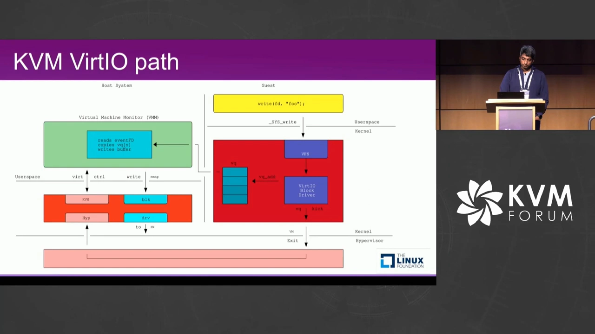
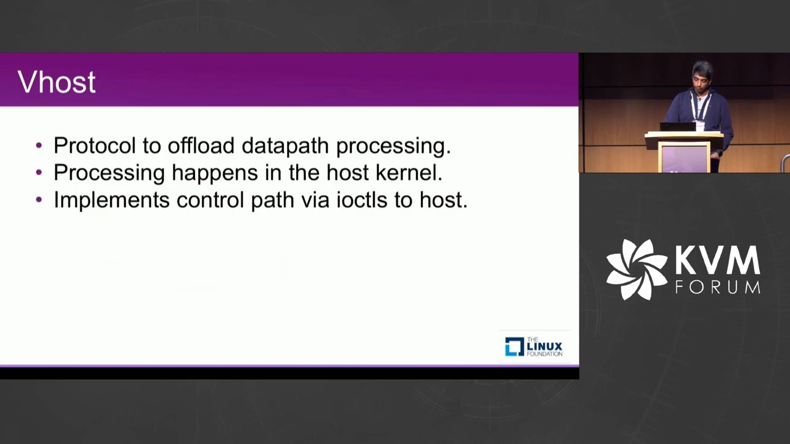
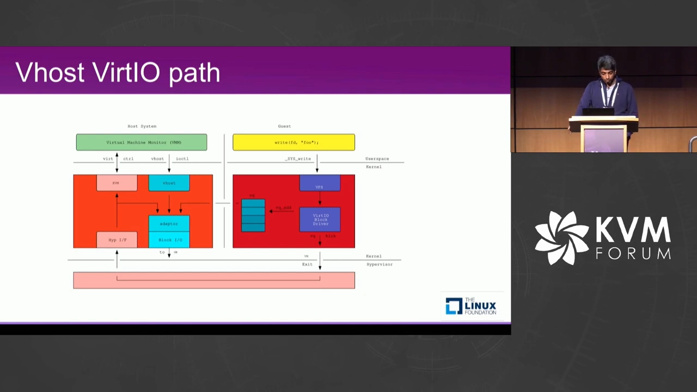
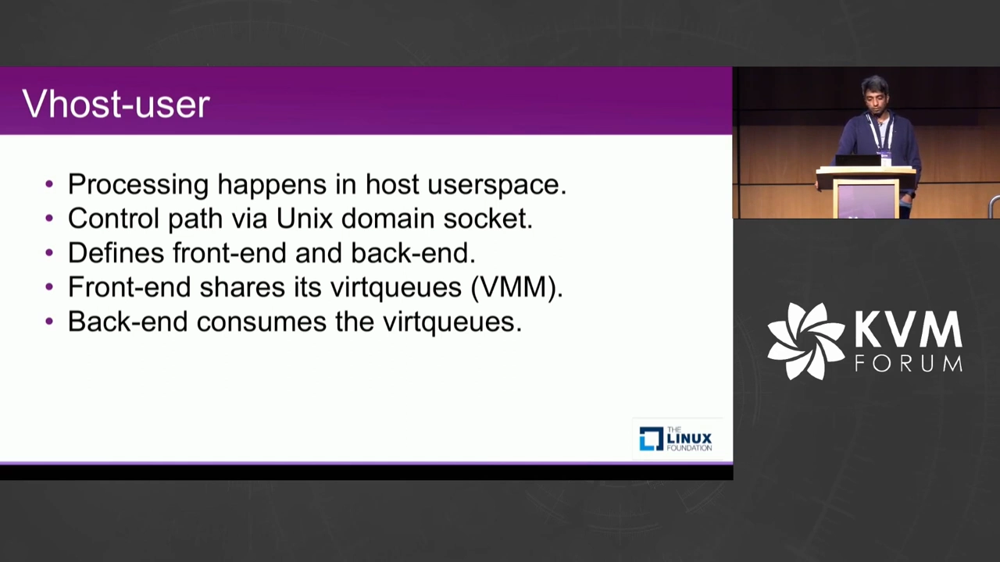
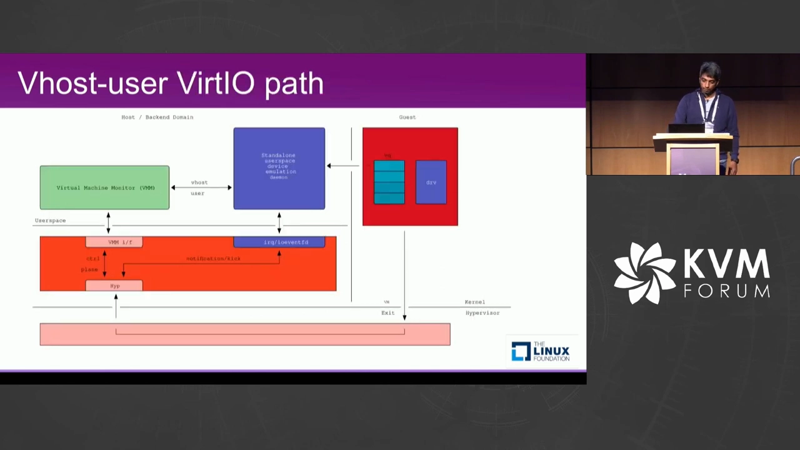
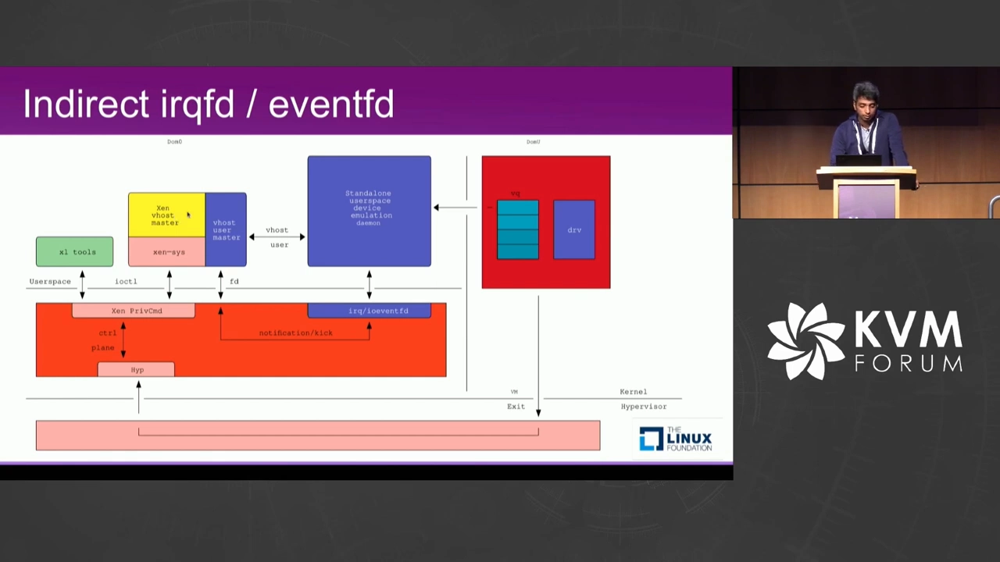
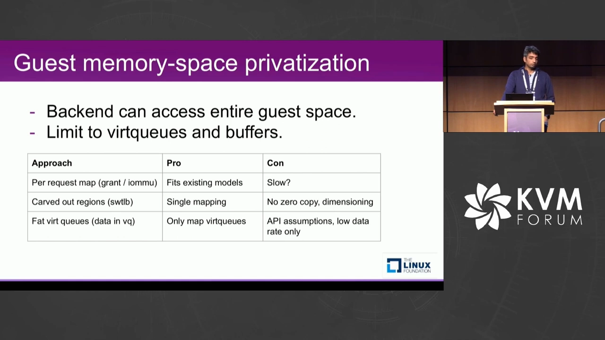

# 用 Rust 写与 hypervisor 无关的 virtio 后端：vhost 与 vhost-user 的演进

> 视频来源：[Rust Based Virtio Backends for Hypervisor Agnostic Solutions](https://www.youtube.com/watch?v=BYs1fjOGu5U)（KVM Forum · Viresh Kumar 与 Alex Bennée，Linaro）｜时长约 22 分钟
> 导读：这支演讲把 vhost 与 vhost-user 放回「virtio 后端可以住在哪」这条主线上讲清楚，然后回答一个更工程化的问题——后端能不能脱离 QEMU、变成任何 hypervisor 都能用的独立进程？答案是能，但换 hypervisor 时内存映射语义会咬人。字幕为自动生成，术语已按上下文校正。

## 本讲要解决的核心问题（SCQA）

**背景**：virtio 从一开始就把设备拆成两半：客户机里的前端驱动负责把请求放进 virtqueue，宿主侧的后端负责消费这些队列。后端住在哪里是可以选的——宿主内核、宿主用户空间，或者 hypervisor 的控制域。

**冲突**：现实中的后端实现和 hypervisor 绑得很紧。QEMU 里确实有一些 vhost-user 后端能脱离 QEMU 独立运行，但它们仍然和 QEMU 共享大量代码，谈不上真正独立。结果是：汽车、移动、医疗、物联网这些场景每换一个 hypervisor，后端就得重写一遍。

**疑问**：能不能让同一个后端进程，既跑在 QEMU 加 KVM 上，也跑在 Xen 上，甚至跑在 Cloud Hypervisor 上，一行代码都不改？

**回答（中心思想）**：能。vhost-user 把控制面收敛到「Unix socket 上传内存映射与 eventfd」这一组消息上，后端只要实现这组消息、并自己完成客户机内存的映射，就和 hypervisor 解耦了。Linaro 的 Stratos 项目用 Rust 做出了这样一批后端，并真的在 Xen 上不做修改地跑通了。代价有三处：内存映射的语义差异（KVM 的 `/dev/shm` 用户页 vs Xen 的内核页）、通知路径上多出来的两次内核往返，以及「后端能看到整个客户机地址空间」这个尚未定论的安全问题。

## 一、virtio 的两个实体，与后端的三个落点

### 1.1 virtio 设备与 virtio 驱动

virtio 被设计成一套标准开放接口，让虚拟机把**数据面处理卸载到宿主**——卸载目标可以是宿主内核、宿主控制面，或者宿主用户空间，总之不在客户机里做。它定义两个实体：

- **宿主侧**：负责共享 virtqueue，叫 **virtio 设备**，本质上是在模拟一个虚拟设备；
- **客户机侧**：共享自己的 virtqueue，供宿主侧设备访问，叫 **virtio 驱动**。

virtio 已经实现了多种传输方式，比如 PCI、MMIO、channel I/O。但要注意一点：块设备这类**更高层的设备抽象与底层传输机制是相互独立的**。[【跳转到 01:13】](https://www.youtube.com/watch?v=BYs1fjOGu5U&t=73)

这条「设备语义与传输解耦」的性质，正是后面「后端可以换 hypervisor」的前提——设备逻辑不依赖具体传输，也就不该依赖具体 hypervisor。

### 1.2 一次 read 的完整事件序列

演讲用一张图展示了数据从客户机到宿主的基本路径。左边是宿主，右边是客户机。

一次普通的 `read` 系统调用最终会走到客户机侧的 virtio-blk 驱动。这个驱动负责准备数据包、把它们放进 virtqueue，然后向宿主内核发一个 kick。kick 一发出就发生一次 **VM exit**，控制权交到宿主内核。[【跳转到 02:08】](https://www.youtube.com/watch?v=BYs1fjOGu5U&t=128)

在这个例子里后端（vhost-user 守护进程）实现在用户空间，所以宿主内核把控制权交给用户空间的 VMM，后端读 eventfd 拿到通知，处理 virtqueue、读出数据包，必要时通过命令去编程硬件——设备之前已经映射好了。做完之后它可能更新 virtqueue 上的状态，然后给客户机回一个通知。[【跳转到 02:33】](https://www.youtube.com/watch?v=BYs1fjOGu5U&t=153)

这里有一个容易被忽略的性质：**virtio 是异步协议**。客户机不需要一直等着宿主完成操作，它可以继续往下跑，响应稍后再送回来。[【跳转到 03:23】](https://www.youtube.com/watch?v=BYs1fjOGu5U&t=203)

### 1.3 Xen 的差异：后端自己实现 ioreq server

同样的路径换到 Xen 上就不一样了。在 Xen 里 VMM 不负责做这些事，VMM 只负责创建和销毁客户机；后端实现的是 Xen 特有的 **ioreq server**，它让后端能从客户机内核拿到事件和信息，这一层负责处理 virtqueue。[【跳转到 03:48】](https://www.youtube.com/watch?v=BYs1fjOGu5U&t=228)

这个差异很关键：**后端要「与 hypervisor 无关」，就必须把这种 hypervisor 特有的取事件机制抽象出去**，否则每换一个 hypervisor 就得重写一遍。

## 二、vhost：把数据面放进宿主内核

vhost 是一套把数据面处理从客户机卸载到**内核**的协议，处理当然就发生在内核里。VMM 要把 virtqueue 共享给宿主内核，靠的是 **ioctl 提供的控制通道**。[【跳转到 04:07】](https://www.youtube.com/watch?v=BYs1fjOGu5U&t=247)

把 vhost 的路径画出来，客户机侧和前面几乎一样，宿主侧的主要区别是**处理发生在内核里**：客户机 VM exit 之后宿主内核接手，它去处理 virtqueue 里的全部数据，最后把结果送回客户机。[【跳转到 04:28】](https://www.youtube.com/watch?v=BYs1fjOGu5U&t=268)

注意这张图里 VMM 的位置：它只剩 `ctrl`（控制面）和 `vhost ioctl` 两条线，数据面完全不在它手上。VMM 在这里实现的是 vhost ioctl，用来把各种 virtio 信息配置给内核里的 vhost 驱动。[【跳转到 04:53】](https://www.youtube.com/watch?v=BYs1fjOGu5U&t=293)

## 三、vhost-user：把数据面放进独立进程

vhost-user 协议是对 vhost 的补充：它的**控制面用 Linux Unix domain socket 实现**，主要目的是把后端（vhost-user 守护进程）放到**内核之外的用户空间**里实现。[【跳转到 05:18】](https://www.youtube.com/watch?v=BYs1fjOGu5U&t=318)

它定义两个主要实体：

- **前端**：共享 virtqueue 的那一方。它看起来有点像 virtio 驱动，但实际上它是 VMM，比如本例里的 QEMU。
- **后端**：消费 virtqueue 的那一方。

把路径画出来，和 vhost 非常像，主要区别是**多了一个独立的用户态设备模拟守护进程**，它通过 Unix socket 上的 vhost-user 协议和 VMM 通信，并处理来自客户机的 virtqueue。[【跳转到 05:50】](https://www.youtube.com/watch?v=BYs1fjOGu5U&t=350)

这张图里最重要的一条线是中间那条 `notification/kick`：它从客户机出发，穿过内核里的 `irq/ioeventfd`，才到用户态的后端进程。**这就是 vhost-user 相比 vhost 多出来的那一跳**，也是后面「间接 eventfd」一节要展开的代价来源。

## 四、为什么非要「与 hypervisor 无关」

### 4.1 QEMU 的后端并不真的独立

Linaro 的 Stratos 项目目标就是让 virtio 成为标准接口，让物联网和移动这些平台能独立运行，让后端可以在 hypervisor 之间移植。但现状是：QEMU 里实现的一些 vhost-user 后端虽然可以脱离 QEMU 独立运行，**仍然和 QEMU 共享大量代码**，所以并没有真正做到独立。[【跳转到 06:15】](https://www.youtube.com/watch?v=BYs1fjOGu5U&t=375)

他们的目标很具体：同一个后端，既能在 QEMU 加 KVM 上跑，也能在 Xen 以及 Cloud Hypervisor 之类的 hypervisor 上跑。[【跳转到 06:40】](https://www.youtube.com/watch?v=BYs1fjOGu5U&t=400)

### 4.2 Rust-VMM 的 crate 组合

Rust-VMM 是一个用来构建 VMM 的框架，托管在 GitHub 上。它把功能拆成一个个 **crate**（可以粗略理解成模块或仓库）：有 vhost 的 crate，也有 vhost-backend、vhost-frontend 这些 crate，组合起来才构成完整的东西。[【跳转到 08:45】](https://www.youtube.com/watch?v=BYs1fjOGu5U&t=525)

已经有很多 hypervisor 在使用和共享这些模块，比如 CrosVM、Firecracker、Cloud Hypervisor 都在大量使用这些 crate。[【跳转到 09:10】](https://www.youtube.com/watch?v=BYs1fjOGu5U&t=550)

### 4.3 为什么选 Rust

他们一开始全部用 C 写，后来决定试试 Rust。理由很直接：**Rust 能保证性能、安全和并发**，而他们必须在宿主侧处理不受信任的客户机数据，这些保证在这里意义很大。[【跳转到 07:55】](https://www.youtube.com/watch?v=BYs1fjOGu5U&t=475)

由于当时的 Rust-VMM 里还没有专门放设备实现、设备模拟的地方，他们自己创建了 **vhost-device** crate。已经上游的设备包括 GPIO、I2C、随机数发生器；RPMB、SCSI、vsock 的 Rust 支持还在推进中；SCMI 和 video 目前仍是 C 实现，也打算迁到 Rust。[【跳转到 09:35】](https://www.youtube.com/watch?v=BYs1fjOGu5U&t=575)

## 五、换 hypervisor 时踩到的坑

### 5.1 先在 QEMU 上开发，再去找第二个 hypervisor

一开始他们全都在 QEMU 上开发，因为方便、快，本机就能跑。等有了几个后端之后才意识到：他们声称这些后端与 hypervisor 无关，但其实只在 KVM 加 QEMU 这一个 hypervisor 上验证过。[【跳转到 10:25】](https://www.youtube.com/watch?v=BYs1fjOGu5U&t=625)

选 Xen 的理由是：它是 type-1 hypervisor，很契合 ARM 的 hypervisor 模型，上游支持好、社区也活跃。但转到 Xen 时发现很多东西都没有——vhost、vhost-user 协议在 Xen 上都没有实现，能找到的只有一个用 C 写的磁盘设备模拟。[【跳转到 11:15】](https://www.youtube.com/watch?v=BYs1fjOGu5U&t=675)

最后他们做出了一套能跑的环境：现有后端**不做修改**就能在 Xen 上测试，从而证明了这些后端确实与 hypervisor 无关。为此新增了三个组件：`xen-io`（通过 ioctl 提供 Xen hypercall 支持，也支持裸机）、`vhost-user-master` crate（提供 vhost-user 前端侧能力，代码大量取自 Cloud Hypervisor，且不绑定 Xen）、以及 Xen 专用的 `xen-vhost-master`（包含映射内存所需的全部事件序列与 Xen ioreq server）。[【跳转到 12:26】](https://www.youtube.com/watch?v=BYs1fjOGu5U&t=746)

### 5.2 第一个坑：客户机内存是用户页还是内核页

这是整场演讲最有价值的一段工程细节。

在 KVM 上，客户机内存是通过 `/dev/shm` 映射的，是**用户空间页**。用 `/dev/shm` 的好处是能走 Linux 内核的标准映射方式：只要 `mmap` 一下，宿主内核和后端就能拿到客户机内存，一切正常。Rust-VMM 项目也是这么对齐的——它们只做一次 `mmap`，然后期望它能工作。[【跳转到 14:06】](https://www.youtube.com/watch?v=BYs1fjOGu5U&t=846)

但在 Xen 上，Xen 社区没法用用户空间页，必须改用**内核空间页**。原因是内核有时会把页表项置成无效状态，如果 Xen 正好在那一刻访问这个页，就会出错。[【跳转到 14:31】](https://www.youtube.com/watch?v=BYs1fjOGu5U&t=871)

### 5.3 第二个坑：memfd 不够，只能在 mmap 里塞 ioctl

为了支持内核页，Xen 提供了很多 hypercall，不只是 `mmap`。为了用统一的方式做所有 hypercall，他们的做法是：`mmap` 之前要先做 `memfd_create` 设一些标志，但最终还得发一个 **ioctl**。[【跳转到 14:56】](https://www.youtube.com/watch?v=BYs1fjOGu5U&t=896)

这就是他们踩坑的地方——他们原以为 `memfd` 就够了。目前的解决办法是在 Xen 的内核驱动和 pre-cmd 文件里做了 hack，把本来由 ioctl 完成的映射动作直接塞进 `mmap` 里。**能跑，但这不是一个可以上游的方案**，还得继续找解法。[【跳转到 15:21】](https://www.youtube.com/watch?v=BYs1fjOGu5U&t=921)

> 这条经验对任何「把后端做成通用进程」的尝试都成立：**控制面协议可以标准化，内存映射的语义却绑死在 hypervisor 上**。这是 vhost-user 抽象层最薄的一处。

### 5.4 第三个坑：间接 eventfd 的两次内核往返

看这张图：控制权从客户机经过 VM exit 到宿主，最终到达他们实现的 Xen-vhost-master（ioreq 部分）。事件到达这里，说明 virtqueue 里有数据，然后他们**从这里再发一次 eventfd**，它又进一次内核，再回来唤醒后端。[【跳转到 16:36】](https://www.youtube.com/watch?v=BYs1fjOGu5U&t=996)

也就是说：为了唤醒用户态后端，先唤醒另一个线程，中间还有一次到内核的上下文切换，而这正是他们想避免的。他们的期望是：如果内核能直接处理来自 VM 的中断并立刻转给后端就好了。目前还没有解法，但演讲者提到同场另一位讲者（Paolo）上午讲过「内部 event 投递机制」，那对他们可能很有意思。[【跳转到 17:01】](https://www.youtube.com/watch?v=BYs1fjOGu5U&t=1021)

### 5.5 第四个坑：后端能看到整个客户机地址空间

在目前的设置里，后端能看到**整个客户机地址空间**，这当然不理想——我们可能希望客户机是安全的，不希望它把整个地址空间都暴露出来。客户机里 virtqueue 区域在宿主侧总是被映射的，所以宿主总能看见队列区域，但**客户机填进去的数据缓冲区才是麻烦的部分**。[【跳转到 17:34】](https://www.youtube.com/watch?v=BYs1fjOGu5U&t=1054)

演讲给了三种方案，并直接列了优缺点：

| 方案 | 做法 | 优点 | 缺点 |
| --- | --- | --- | --- |
| 按请求映射（Xen grant 或 IOMMU） | 每个请求现场把它的缓冲区映射进来 | 契合现有模型，已合入内核 | 每请求多缓冲区时映射次数多，可能太慢 |
| 划出固定区域（swtlb） | 客户机与宿主之间建一块固定区域，缓冲区往里拷贝 | 只映射一次 | 不再是零拷贝，且有容量规划问题 |
| 胖 virtqueue（数据放进 vq） | 既然工作内存总是映射的，就把数据直接放进 virtqueue | 只需映射 virtqueue | 依赖 API 假设，只适合低数据率 |

演讲者对这三条的态度很诚实：**并不确定该往哪个方向走**。[【跳转到 19:14】](https://www.youtube.com/watch?v=BYs1fjOGu5U&t=1154)

## 六、这三条路径怎么选

把全篇的对比压成一张表，就能看出三种后端落点的取舍：

| 维度 | 后端在 VMM 用户态（QEMU 主循环） | vhost（宿主内核） | vhost-user（独立用户态进程） |
| --- | --- | --- | --- |
| 队列处理在哪 | QEMU 设备模拟线程 | 宿主内核 | 独立用户态进程 |
| 控制面 | 进程内调用 | ioctl | Unix domain socket |
| 通知路径 | eventfd 唤醒 QEMU 线程 | 内核内直接处理 | eventfd 经内核转给用户态进程 |
| 能否跨 hypervisor 复用 | 否，绑在 VMM 里 | 否，绑在内核模块里 | 是，协议层可复用 |
| 实现语言/生态 | C/C++ | C | 任意（Rust 已有 vhost-device 系列） |
| 主要代价 | 上下文切换多、单进程管多机困难 | 逻辑在内核，迭代与调试成本高 | 内存映射语义、通知多两跳、地址空间暴露 |

## 小结

- **virtio 的价值在于「设备语义与传输解耦」**，这条性质是后端可以搬家的前提；而 virtio 的异步语义让客户机不必等宿主完成。
- **vhost 把数据面放进宿主内核**，VMM 只剩 ioctl 控制面；**vhost-user 把数据面放进独立用户态进程**，控制面换成 Unix domain socket。
- **vhost-user 是唯一能做到「后端与 hypervisor 无关」的落点**，因为它把 hypervisor 相关的东西压缩到「内存映射 + 取事件」两件事上。
- **Stratos 的实践证明这条路可行**：同一批 Rust 后端在 QEMU/KVM 与 Xen 上不做修改即可运行，代价是要为每个 hypervisor 补一个 master 侧实现。
- **最薄的一层是内存映射**：KVM 用 `/dev/shm` 的用户页一次 `mmap` 搞定，Xen 必须用内核页、还得补 ioctl，这是当前无法上游的 hack。
- **通知路径仍有两跳**：间接 eventfd 让「唤醒用户态后端」变成「先唤醒另一个线程、再进一次内核」，这是 vhost-user 相对 vhost 的结构性开销。
- **安全问题没有定论**：后端能看到整个客户机地址空间，三种私有化方案各有明确缺陷，社区仍在选型。

## 关键术语速查

| 术语 | 一句话解释 |
| --- | --- |
| virtio 设备 / virtio 驱动 | 宿主侧共享 virtqueue 的实体 / 客户机侧填充 virtqueue 的实体 |
| VM exit | 客户机执行敏感操作时陷入 hypervisor，控制权交给宿主 |
| vhost | 把 virtio 数据面放进宿主内核的协议，控制面是 ioctl |
| vhost-user | 把 virtio 数据面放进独立用户态进程的协议，控制面是 Unix domain socket |
| 前端 / 后端 | vhost-user 里共享 virtqueue 的 VMM / 消费 virtqueue 的守护进程 |
| ioreq server | Xen 里让后端从客户机内核取事件与信息的机制 |
| Rust-VMM | 用 Rust 构建 VMM 的 crate 框架，Firecracker、Cloud Hypervisor 都在用 |
| vhost-device | Linaro 创建并维护的 crate，存放与 hypervisor 无关的 virtio 后端设备实现 |
| `/dev/shm` | 基于 tmpfs 的共享内存，KVM 下客户机内存常从这里 mmap 出来 |
| memfd | 匿名内存文件，可传 fd，但不足以表达 Xen 的映射语义 |
| eventfd | 轻量通知 fd，用于 kick 与中断的传递 |
| swtlb | 客户机与宿主之间划出的固定共享窗口，用拷贝换单次映射 |