# 9p 与 virtio-fs 对比：共享目录的瓶颈在协议不在传输

> 视频来源：[virtio-fs: A shared file system for virtual machines](https://www.youtube.com/watch?v=EIVOzTsGMMI)（YouTube · FOSDEM 2020，讲者 Stefan Hajnoczi，Red Hat）｜时长约 25 分钟
> 导读：这是一场把 virtio-fs 讲透的技术演讲，其中第 6 页那张「virtio-9p / virtio-fs / virtio-blk」随机 I/O 柱状图，是本小节最直接的对比证据。本文只写「两种共享文件系统方案怎么比」：协议模型、实测数字、语义完整性、安全模型与适用场景。virtiofsd 的进程架构留给 3.4.2，DAX 窗口的映射细节留给 3.4.3。演讲没有展开 9p 的报文格式，凡属推断的地方本文会明确标注。

## 本讲要解决的核心问题（SCQA）

**背景**：虚拟机想访问宿主上的一个目录，最省事的办法不是造一个磁盘镜像、再在里面建文件系统，而是把宿主上已经挂好的目录直接挂进客户机。QEMU 里干这件事的老方案是 **virtio-9p**——Linux 支持它，已经存在很久 [【跳转到 02:27】](https://www.youtube.com/watch?v=EIVOzTsGMMI&t=147)。

**冲突**：同样跑在 virtio 上、同样是「把宿主目录交给客户机」，virtio-fs 的随机 I/O 数字比 virtio-9p 高出一大截：4K 随机读约 3 倍，64K 随机读 20 倍以上 [【跳转到 02:52】](https://www.youtube.com/watch?v=EIVOzTsGMMI&t=172)。

**疑问**：传输层是同一个 virtio，差距到底从哪来？两种方案在协议、语义、安全上各自付了什么代价？什么场景该用哪个？

**回答（中心思想）**：**差距不在传输，在协议和数据面。** 9p 属于「每次 I/O 都要往返一次、数据要拷进客户机」这一类（视频没有逐条拆 9p 的报文，这一点是从它的基准表现推断的）；virtio-fs 把协议换成 Linux FUSE——语义更完整、可扩展，并且额外拿到一块共享内存窗口，让数据面可以绕过「每次 I/O 都通信」。所以 virtio-fs 适合容器 rootfs 与开发目录，9p 退回到简单共享与调试。

## 一、先分清两件事：传输和协议

### 1.1 任何远程文件系统都由「传输 + 协议」两块拼成

讲者给了一个很干净的框架：远程文件系统只有两个组成部分 [【跳转到 04:07】](https://www.youtube.com/watch?v=EIVOzTsGMMI&t=247)。

- **传输（transport）**是通信链路，它让客户端能把服务器上的文件系统挂载过来，于是服务器上的文件和目录客户端就能访问。例子：TCP/IP、USB、RDMA。
- **协议（protocol）**是客户端表达「我想对这些文件做什么」的词汇表。例子：NFS、CIFS、MTP、FTP。

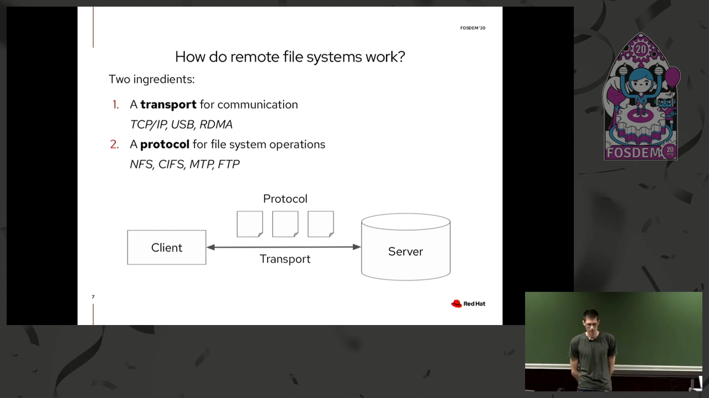

上图就是这张框架图：中间三个小方块是「协议」，左右两个方框之间的双向箭头是「传输」。**两个共享文件系统方案的差别，可能出在传输，也可能出在协议**——这正是本文要拆开看的地方。

### 1.2 协议决定「你能做什么」，这比「传得快不快」更根本

讲者强调，协议就是文件系统能力的词汇表，所以它直接决定两件事：**应用兼容性**和**性能** [【跳转到 05:22】](https://www.youtube.com/watch?v=EIVOzTsGMMI&t=322)。

他用 FTP、MTP 和 NFS 做对照：FTP 和 MTP 是**传输协议**，不是文件系统协议，它们只关心整文件的 get/put，有点像对象存储、有点像 Amazon S3；而 NFS 实现的是完整的 POSIX 文件系统语义——你可以打开一个文件，然后在更细的粒度上做读和各种其它操作 [【跳转到 04:57】](https://www.youtube.com/watch?v=EIVOzTsGMMI&t=297)。

这个区分对本文很关键：**9p 和 virtio-fs 都是「文件系统协议」，不是「传输协议」**。它们都要回答「打开、读、写、改属性、建硬链接」这些动作怎么表达，差别在于词汇表的丰富程度和每次动作要付多少通信代价。

## 二、实测：同一块 NVMe 上，9p 与 virtio-fs 差多少

### 2.1 基准图：随机 I/O 上 9p 落后一个档位

这是全场唯一一张三方对比图，也是本小节最硬的证据 [【跳转到 02:52】](https://www.youtube.com/watch?v=EIVOzTsGMMI&t=172)。

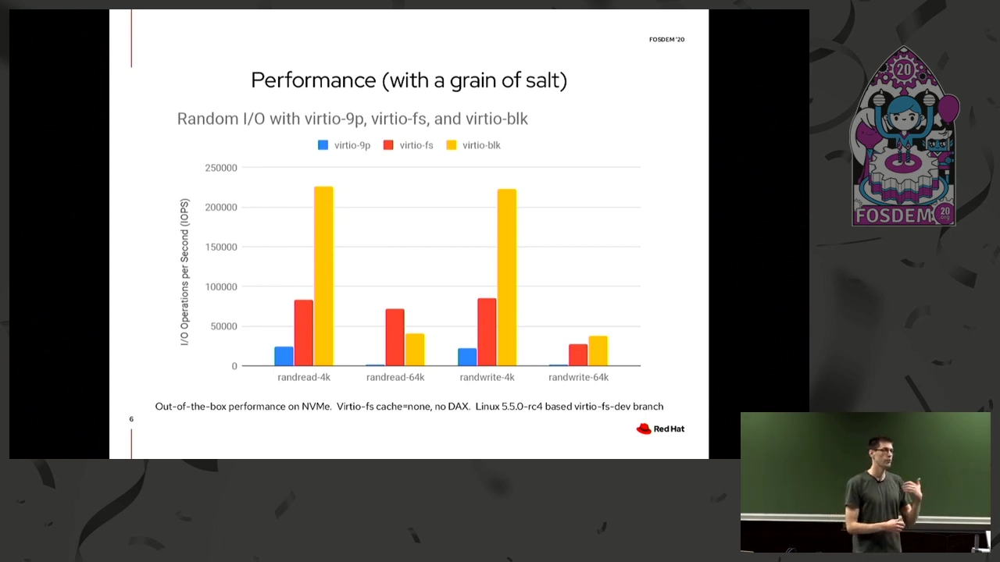

横轴是四种随机负载（4K 读、64K 读、4K 写、64K 写），纵轴是每秒 I/O 次数（IOPS）。蓝柱是 virtio-9p，红柱是 virtio-fs，黄柱是 virtio-blk。按图读数大致如下（目测柱高，量级参考）：

| 负载 | virtio-9p | virtio-fs | virtio-blk |
| --- | --- | --- | --- |
| 4K 随机读 | 约 2.4 万 | 约 8.2 万 | 约 22 万 |
| 64K 随机读 | 约 0.3 万 | 约 7.2 万 | 约 4.3 万 |
| 4K 随机写 | 约 2.1 万 | 约 8.4 万 | 约 22 万 |
| 64K 随机写 | 约 0.1 万 | 约 2.6 万 | 约 3.8 万 |

两个结论可以直接读出来：

1. **四个场景里 9p 都是最低的一根柱子**，而且 64K 随机读、64K 随机写的差距最大（20 倍以上）。
2. **virtio-fs 不是最快的，但它在所有场景里都不低于 9p**。讲者因此给了一句非常实用的建议：如果你已经在用 virtio-9p，那就考虑换成 virtio-fs，因为它的性能**至少不会更差** [【跳转到 03:17】](https://www.youtube.com/watch?v=EIVOzTsGMMI&t=197)。

### 2.2 这张图该怎么读：它比的是「默认配置」，不是极限

讲者自己先泼了冷水，这段话比数字本身更值得记住 [【跳转到 02:52】](https://www.youtube.com/watch?v=EIVOzTsGMMI&t=172)：

- 三者都有**大量配置项**，如果他想，可以让这张图呈现出很多不同的结果；
- 它们是**完全不同的代码路径和软件栈**，很难做真正的苹果对苹果比较；
- 你看到的是三者**默认配置**下的表现。

图的脚注还交代了测试条件：NVMe 上的开箱性能，virtio-fs 用 `cache=none`、**没有开 DAX**，客户机内核是 Linux 5.5.0-rc4 加 virtio-fs-dev 分支。这几点在解读时都要带上：**没开 DAX 的 virtio-fs 已经比 9p 快，开了 DAX 只会更好；而 virtio-blk 在 4K 随机负载上依然明显领先**，因为它是块设备，路径完全不同 [【跳转到 03:42】](https://www.youtube.com/watch?v=EIVOzTsGMMI&t=222)。

## 三、virtio-fs 的协议模型：把 FUSE 搬到 virtio 上

### 3.1 协议用 FUSE，传输用 virtio，服务器是宿主上的一个进程

回到「传输 + 协议」框架，virtio-fs 的答案是 [【跳转到 05:47】](https://www.youtube.com/watch?v=EIVOzTsGMMI&t=347)：

- **协议**基于 Linux FUSE，但**不是**「把现成的 FUSE 文件系统搬到 virtio 上跑」——架构做了改动，协议也做了扩展；
- **传输**是 virtio，并且额外扩展了 virtio，给它加上**共享内存资源**。

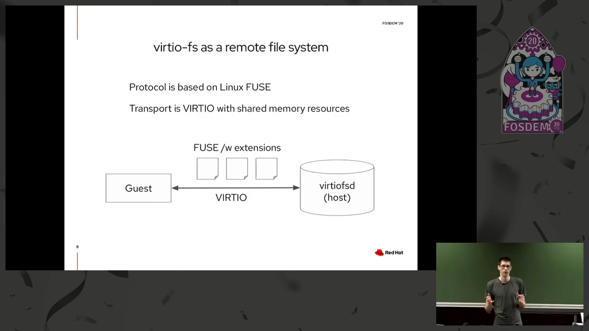

上图左边是客户机，右边是宿主上的 **virtiofsd** 进程，中间那条标着 VIRTIO 的箭头就是传输，箭头上方三个小方块是「带扩展的 FUSE」协议。**和 9p 最大的结构差别在这里：virtio-fs 的服务器端是一个普通的用户态进程**，它负责模拟这个 virtio-fs 设备 [【跳转到 06:12】](https://www.youtube.com/watch?v=EIVOzTsGMMI&t=372)。

### 3.2 FUSE 是什么：内核负责转发，用户态进程负责实现

FUSE 是「用户态文件系统接口」，它的工作方式很朴素 [【跳转到 07:02】](https://www.youtube.com/watch?v=EIVOzTsGMMI&t=422)：用户态应用要打开文件 `foo`，发起系统调用；`fuse.ko` 这个内核模块接管这次调用（因为它负责那个被挂载的文件系统），但它自己不知道该怎么处理，于是发一条 `FUSE_OPEN` 消息给用户态的文件系统服务器。

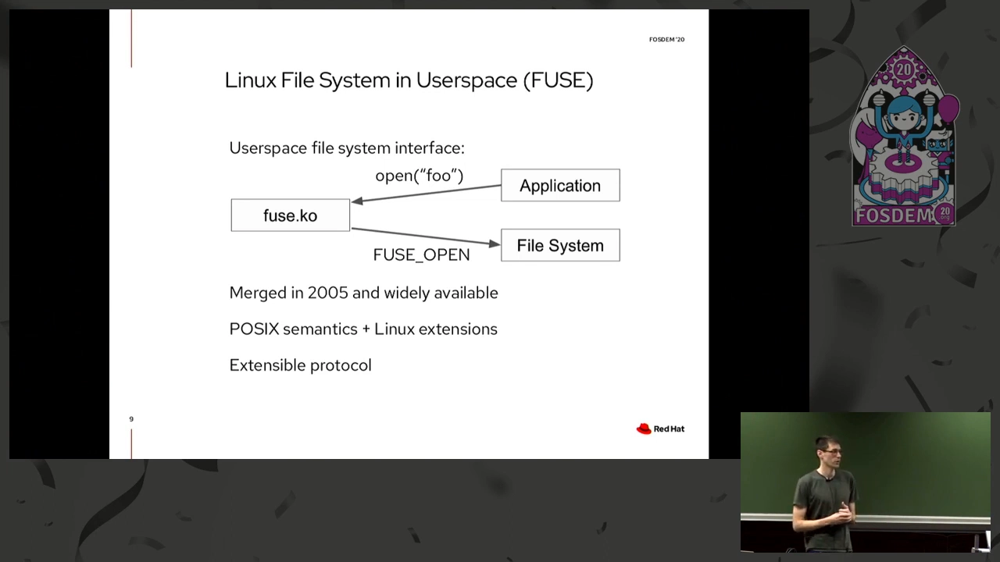

**FUSE 内核模块的角色基本上就是转发**：把系统调用转给实现该文件系统的用户态进程。它 2005 年就合入主线，非常成熟、可用性很广——即使你没直接用过，多半也间接用过，比如手机连电脑时用的 MTP 实现就是一个 FUSE 文件系统 [【跳转到 07:27】](https://www.youtube.com/watch?v=EIVOzTsGMMI&t=447)。

### 3.3 为什么选 FUSE 而不是另造一套协议

讲者给了三条理由，恰好也是 virtio-fs 相对 9p 在「词汇表」上的优势 [【跳转到 07:52】](https://www.youtube.com/watch?v=EIVOzTsGMMI&t=472)：

1. **贴近原生 Linux 文件系统**。FUSE 本身是 Linux 内核模块，所以它不只是「一个 POSIX 文件系统」，它拥有和既有应用兼容所需的整套词汇表。
2. **带 Linux 扩展**。比如 copy offload 这类新特性也能通过 FUSE 完成。
3. **可扩展**。它是一个可以往里加新特性的协议。

### 3.4 协议没文档，但 ABI 是稳的——这决定了升级兼容性

FUSE 的协议定义在 `<linux/fuse.h>` 里，头文件里只有常量和结构体，**没有文档**；想写低层实现，得去读 `fuse.ko` 的源码 [【跳转到 08:42】](https://www.youtube.com/watch?v=EIVOzTsGMMI&t=522)。

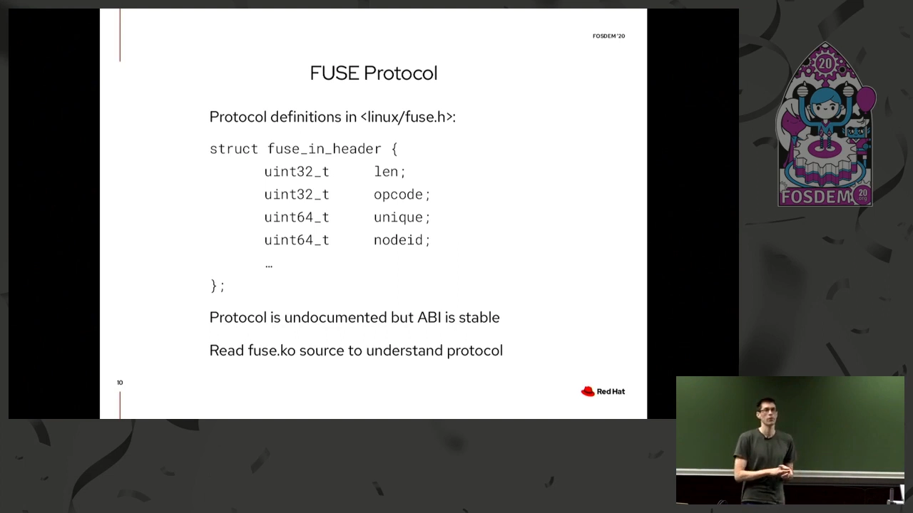

上图是 `struct fuse_in_header`：`len`（消息总长）、`opcode`（操作码）、`unique`（请求编号）、`nodeid`（目标 inode）。**一条 FUSE 消息就是一次请求**，这个「一请求一消息」的形态，决定了后面第四章要算的那笔账。

但没文档不等于不稳定。这个头文件是**导出给用户态的内核 API**，内核不允许改动这些结构体的定义，所以它是稳定的 ABI [【跳转到 09:07】](https://www.youtube.com/watch?v=EIVOzTsGMMI&t=547)。讲者特意点出它的实际意义：一台虚拟机在跑 virtio-fs，你升级了宿主（或者反过来，新虚拟机配老宿主），双方**依然能通信**，因为协议稳定、而且有特性协商。

### 3.5 设备长什么样：一个 tag 加三个 virtqueue

virtio-fs 设备本身很简单 [【跳转到 11:12】](https://www.youtube.com/watch?v=EIVOzTsGMMI&t=672)：

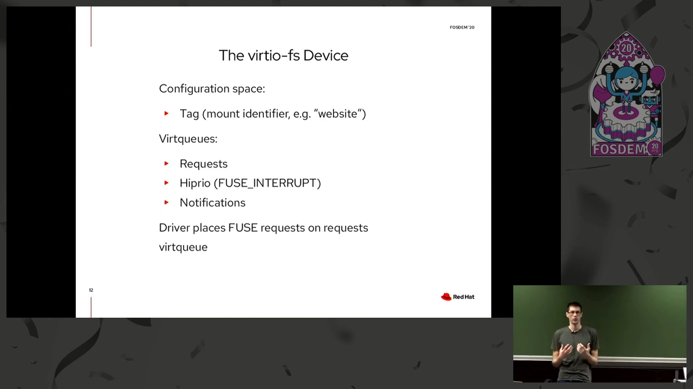

- **配置空间**里只有一个 **tag**，也就是挂载标识符（例子里的 `website`）。一台虚拟机上可以挂 10 个 virtio-fs 设备，靠 tag 区分谁是谁。
- **virtqueue** 有三个：`requests` 放 FUSE 请求；`hiprio` 专门处理 `FUSE_INTERRUPT`（FUSE 支持取消请求，而 virtqueue 是**只追加**的、不能回头改，所以必须另开一条高优先级队列）；`notifications` 处理服务器主动发起的反向消息。

**客户机驱动把 FUSE 请求放到 requests virtqueue 上，virtiofsd 取走处理、再回送响应**——这一步和 9p 的形态是一致的：都是「客户机发一条请求、宿主回一条响应」。

## 四、一次读文件要几个来回：两种方案都逃不掉的那笔账

### 4.1 virtio-fs 的读路径：四条消息

讲者把「读一个文件」拆成了四步 [【跳转到 13:17】](https://www.youtube.com/watch?v=EIVOzTsGMMI&t=797)：

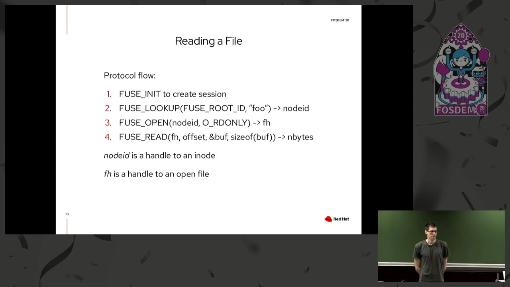

1. `FUSE_INIT`：建立会话，协商参数；
2. `FUSE_LOOKUP(FUSE_ROOT_ID, "foo") -> nodeid`：把路径解析成 inode 编号；
3. `FUSE_OPEN(nodeid, O_RDONLY) -> fh`：拿到打开文件的句柄；
4. `FUSE_READ(fh, offset, &buf, sizeof(buf)) -> nbytes`：读数据。

其中 `nodeid` 是 inode 的句柄，`fh` 是打开文件的句柄。讲者说，如果你想给 virtio-fs 写一个引导程序（从 virtio-fs 文件系统里取出内核），**这四条消息基本就是你要实现的全部** [【跳转到 15:22】](https://www.youtube.com/watch?v=EIVOzTsGMMI&t=922)。

### 4.2 关键一句：每一比特 I/O 都需要通信

紧接着讲者自己指出了这套流程的代价，这也是本文标题的出处 [【跳转到 15:22】](https://www.youtube.com/watch?v=EIVOzTsGMMI&t=922)：

> 每一比特的 I/O 都需要通信——客户机要读文件里的任何一段，都得和 virtiofsd 打交道。

而且 `FUSE_READ` / `FUSE_WRITE` 都涉及客户机内存，所以你还**在拷贝数据**：从宿主拷进客户机 RAM，或者从客户机写回宿主 [【跳转到 15:47】](https://www.youtube.com/watch?v=EIVOzTsGMMI&t=947)。

**这段话虽然是针对 virtio-fs（未开 DAX）说的，但它描述的正是 9p 这一整类方案的处境**：没有共享内存窗口，数据面就只能靠「请求—响应 + 拷贝」。讲者没有逐条拆 9p 的报文，但把 9p 放在同一张基准图里当基线，结果就是第二章那张表——**往返次数和拷贝次数，最终都会体现在 IOPS 上**。

### 4.3 语义上的额外成本：路径不等于文件

FUSE 的读路径里有一个容易被忽略的设计：**先 lookup 路径拿到 nodeid，再对 nodeid 做操作**。为什么不能直接用路径？因为 POSIX 文件系统里，「路径」和「文件」是两回事 [【跳转到 14:07】](https://www.youtube.com/watch?v=EIVOzTsGMMI&t=847)：

- 一个文件可以有多个文件名指向它，这就是**硬链接**；
- 甚至可以有没有路径名的 inode：你打开一个文件、把它从文件系统里删掉，但你依然能访问它。

所以协议必须把 inode 和路径分开表达。**共享文件系统要「语义完整」，就得为这些概念付出额外的消息和状态**——这是 9p 与 virtio-fs 对比时容易被忽略的一维：不只是快慢，还有「能不能正确表达 Linux 的语义」。

## 五、语义完整性：virtio-fs 靠 FUSE 拿到了 POSIX 的全套语义

### 5.1 硬链接与 inode

如上节所述，FUSE 的工作方式是「先 lookup 路径、解析成 node id」，之后所有操作都针对 node id（inode）而不是路径 [【跳转到 14:57】](https://www.youtube.com/watch?v=EIVOzTsGMMI&t=897)。**这正是硬链接能工作的前提**：多个目录项指向同一个 inode，inode 才是文件本身。

### 5.2 unlink 之后文件句柄仍然可用

现场提问专门问了这一点：文件被打开、然后被 unlink，那个文件描述符还能继续用吗？讲者的回答是**能**——FUSE 协议支持这些 POSIX 语义：你可以 unlink 掉目录项，而 inode 和 file handle 仍然在，它们继续可用 [【跳转到 24:19】](https://www.youtube.com/watch?v=EIVOzTsGMMI&t=1459)。

这对开发目录场景很实际：编译器、包管理器、编辑器经常「删掉旧文件、继续用已打开的句柄」写新内容（先写临时文件再 rename 也是同一族操作）。**共享文件系统如果不能表达这些语义，应用就会以奇怪的方式失败**，而不是变慢。

### 5.3 扩展属性与 SELinux：特性在，成熟度待验证

提问还问到 SELinux 标签怎么映射过去。讲者的回答很坦诚：**给不出确切答案**；他认为如果启用了**扩展属性（xattr）**，那是起点，特性是有的，但透传效果如何他没有测过，并判断这是个非常重要的特性、肯定会被解决 [【跳转到 23:29】](https://www.youtube.com/watch?v=EIVOzTsGMMI&t=1409)。

这一段值得原样保留：**对比两种方案时，「语义上支持」和「生产上验证过」是两件事。**

## 六、数据面：DAX 把「每次都通信」换成「映射一次」

### 6.1 问题的提出：10 台客户机为什么要各拷一份

讲者的推理很直接 [【跳转到 16:12】](https://www.youtube.com/watch?v=EIVOzTsGMMI&t=972)：假设你要把一个只读目录共享给 10 台甚至 100 台客户机，难道它们都要把数据拷进各自的客户机 RAM 才能处理吗？如果能共享，不是更好吗？

### 6.2 做法：一块固定大小的 DAX window

virtio-fs 的答案是实验性特性 **DAX**（讲时还没上游化，正在推进）[【跳转到 16:37】](https://www.youtube.com/watch?v=EIVOzTsGMMI&t=997)：

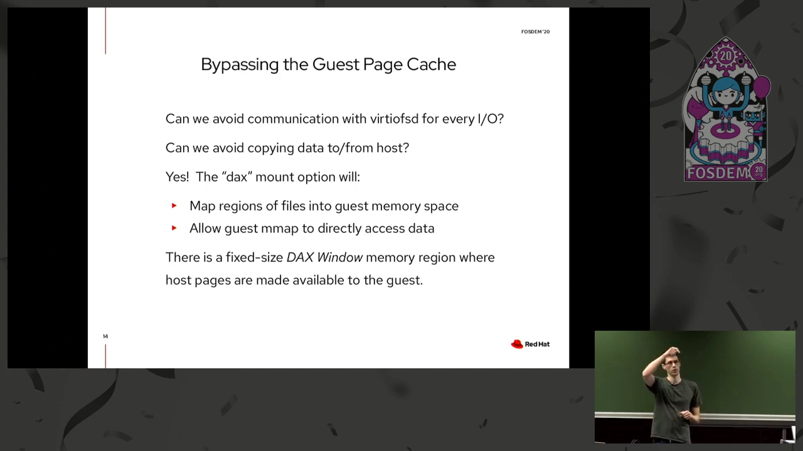

- 它把**文件的一段映射进客户机的内存空间**；
- 让客户机的 `mmap` 能直接访问数据；
- 实现上，设备有一块**固定大小的 DAX window** 内存区域，宿主页通过它暴露给客户机。

这也解释了为什么 virtio-fs 要扩展 virtio、给它加共享内存资源：**DAX window 就是一块共享内存区域** [【跳转到 17:02】](https://www.youtube.com/watch?v=EIVOzTsGMMI&t=1022)。

### 6.3 读路径的变化：第 4 步从「读数据」变成「建映射」

对比 4.1 节的四步流程，开了 DAX 之后流程变成五步 [【跳转到 17:52】](https://www.youtube.com/watch?v=EIVOzTsGMMI&t=1072)：

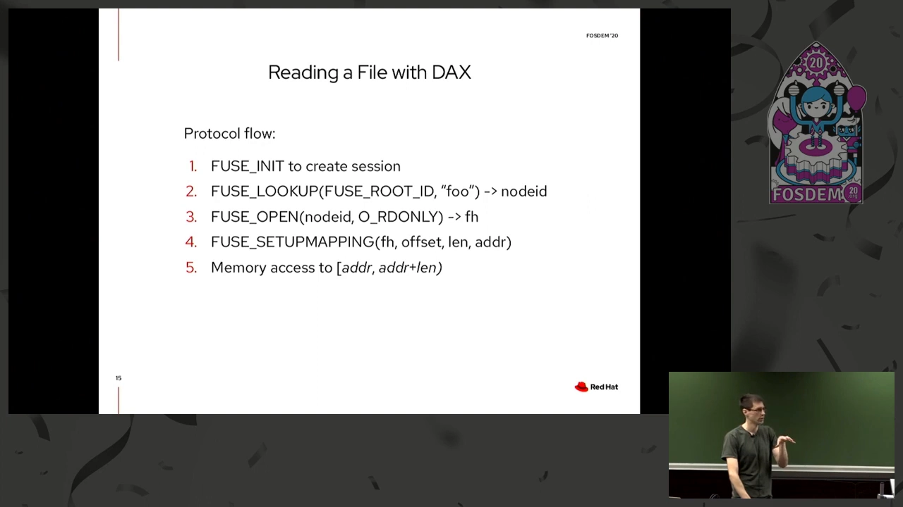

1. `FUSE_INIT` 建会话；
2. `FUSE_LOOKUP` 拿 nodeid；
3. `FUSE_OPEN` 拿 file handle；
4. **`FUSE_SETUPMAPPING(fh, offset, len, addr)`**：把文件区间映射到客户机地址 `addr`；
5. **直接访问 `[addr, addr+len)` 这段内存**。

映射建好之后，你只需要执行 load / store 这类 CPU 指令，**不再需要和 virtiofsd 进程通信**，因为那些内存页已经在手上了 [【跳转到 17:27】](https://www.youtube.com/watch?v=EIVOzTsGMMI&t=1047)。讲者点出两个收益：**频繁 I/O 的场景非常划算**；以及**多台虚拟机共享同一份数据时能降低内存占用**，因为它们可以共享同一批宿主页缓存页。

### 6.4 DAX 是可选的，而且不是所有传输都支持

讲者在提问环节补了三个限制条件 [【跳转到 20:34】](https://www.youtube.com/watch?v=EIVOzTsGMMI&t=1234)：

- **它是可选的**：你可以在不用 DAX 的情况下跑 virtio-fs，那样就不用共享内存这一套，virtio 设备模型本身并不假定有共享内存；
- **取决于传输方式**：virtio 有 PCI 传输（主要用在 x86）、MMIO 传输，s390 大型机又是另一种，共享内存这个特性是否可用要看传输；
- 共享内存是**通用的 virtio 特性**，不是 virtio-fs 专属：在 virtio 规范里，一个设备可以声明任意数量的共享内存区域，各自承担不同功能，virtio-gpu 已经有这样的用例 [【跳转到 21:24】](https://www.youtube.com/watch?v=EIVOzTsGMMI&t=1284)。

**对 9p 来说这一维是缺失的**：视频没有提到 9p 有类似的共享内存窗口，它的数据面只能走「请求—响应 + 拷贝」那条路。

## 七、安全模型：两者的边界都画在「一个子目录」上

### 7.1 共同的底线：只能看到那棵子树

virtio-fs 的关键安全属性只有一句话：**你只能访问宿主上那一棵子树，无法越界去访问其它文件** [【跳转到 02:02】](https://www.youtube.com/watch?v=EIVOzTsGMMI&t=122)。讲者把它列为「最关键的安全要求之一」。

### 7.2 virtiofsd 的权限模型：uid/gid 一对一透传

宿主和客户机是两套用户体系，怎么对齐？目前 virtiofsd 的做法是 [【跳转到 22:39】](https://www.youtube.com/watch?v=EIVOzTsGMMI&t=1359)：

- 你给它一个子目录，**允许客户机在这个子目录里设置 uid 和 gid**，这样普通应用能跑、一整个系统也能跑；
- 这些 uid/gid 是**一对一透传**的；
- 想做映射得另找办法（比如 uid shifting），**virtiofsd 本身不实现**，但可以用内核模块之类的机制叠在上面做映射 [【跳转到 23:04】](https://www.youtube.com/watch?v=EIVOzTsGMMI&t=1384)。

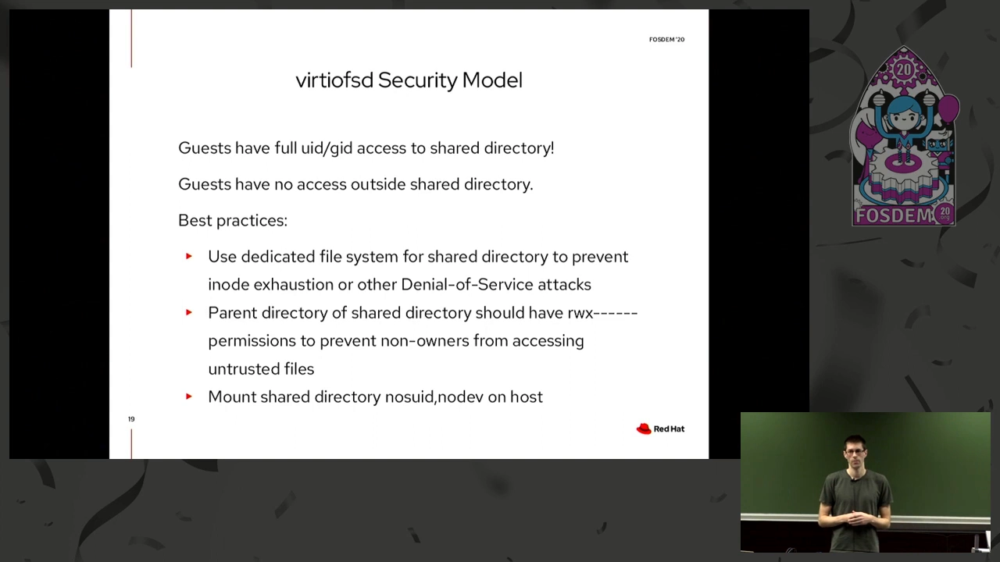

上图把边界画得很清楚：**客户机对共享目录有完整的 uid/gid 访问权，但目录之外一概没有**。幻灯片还给了三条最佳实践——用**专用文件系统**放共享目录（防止 inode 耗尽之类的拒绝服务攻击）；共享目录的**父目录权限设成 `rwx------`**（防止非属主访问不可信文件）；在宿主上以 **`nosuid,nodev`** 挂载共享目录。

### 7.3 服务器进程本身也要被关起来

virtiofsd 需要特权才能以任意 uid/gid 访问文件，那它自己被攻破怎么办？答案是**沙箱** [【跳转到 24:19】](https://www.youtube.com/watch?v=EIVOzTsGMMI&t=1459)：

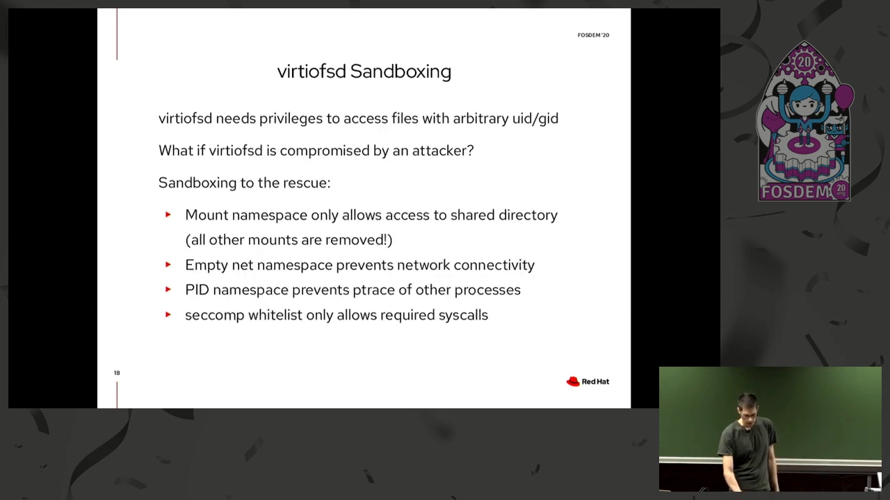

- **mount namespace** 只允许访问共享目录，**其它挂载全部移除**；
- **空的 net namespace** 切断网络连接；
- **PID namespace** 阻止 `ptrace` 其它进程；
- **seccomp 白名单**只放行必需的 syscall。

**这是两种方案在安全维度上最实质的差别：virtio-fs 的服务器是一个独立的用户态进程，因此可以被单独关进一套 namespace + seccomp 里。** 视频没有讨论 9p 服务器侧的进程边界与沙箱能力，所以在这一维上给不出与 virtio-fs 同等的对比结论——这本身就是一处信息缺口。

## 八、适用场景：什么时候用 virtio-fs，什么时候 9p 还够用

### 8.1 virtio-fs 的目标场景

讲者列出的用例清单基本就是「该用 virtio-fs」的答案 [【跳转到 19:44】](https://www.youtube.com/watch?v=EIVOzTsGMMI&t=1184)：

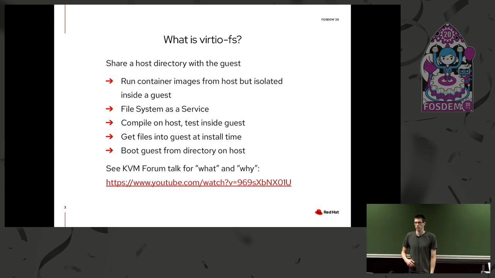

- 从宿主跑容器镜像，但隔离在客户机里（Kata Containers 就是这类用法）；
- 文件系统即服务（File System as a Service）；
- **在宿主上编译、在客户机里测试**——典型的开发目录场景；
- 装机时把文件送进客户机；
- **从宿主上的目录直接启动客户机**。

最后一条在提问环节被追问过：能不能把整个客户机文件系统都放在 virtio-fs 上？**可以，你可以直接从 virtio-fs 启动**，这有点像搭一个 chroot 或容器环境——你有一个路径，完整的根文件系统就在里面 [【跳转到 19:19】](https://www.youtube.com/watch?v=EIVOzTsGMMI&t=1159)。唯一的问题是当时做这件事的**语法还有点别扭**，讲者已经发了补丁、还需要打磨。**这正是「容器 rootfs 用 virtio-fs」的技术基础。**

### 8.2 配置成本：virtio-fs 当年还不是开箱即用

讲时（2020 年初）virtio-fs 的落地状态是：**发行版里还没有广泛可用**，libvirt 的 domain XML 是「提议中」的形态 [【跳转到 01:37】](https://www.youtube.com/watch?v=EIVOzTsGMMI&t=97)：

```xml
<filesystem type='mount' accessmode='passthrough'>
  <driver type='virtiofs'/>
  <source dir='/var/www'/>
  <target dir='website'/> <!-- not treated as a path -->
</filesystem>
```

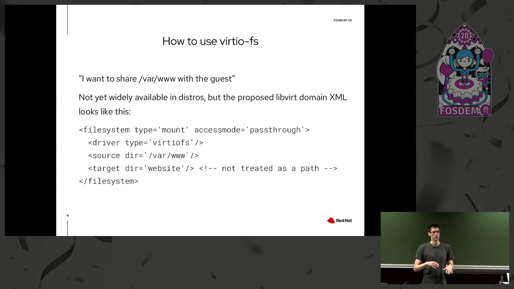

注意 `<target dir='website'/>` 那个注释：**它不是路径，而是 tag**，对应 3.5 节设备配置空间里的那个名字。客户机侧则只有一行 [【跳转到 02:02】](https://www.youtube.com/watch?v=EIVOzTsGMMI&t=122)：

```bash
guest# mount -t virtiofs website /var/www
```

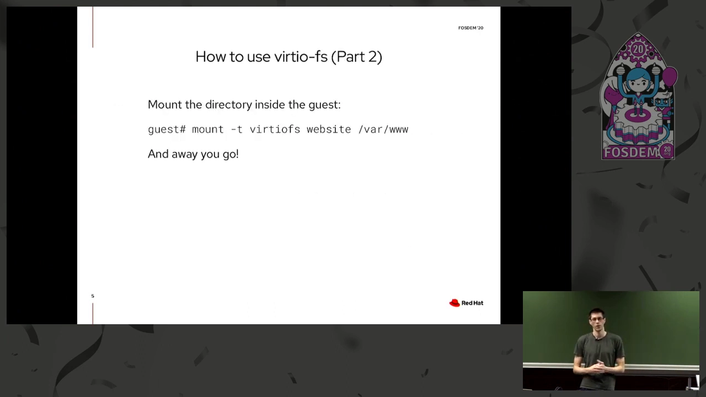

对比时间线：**virtio-9p 在 QEMU 里已经存在很久，virtio-fs 从 QEMU 5.0 才开始提供** [【跳转到 03:17】](https://www.youtube.com/watch?v=EIVOzTsGMMI&t=197)。所以「9p 适合简单共享与调试」不是因为它更好，而是因为它**更老、更普及、依赖更少**；一旦发行版跟上，virtio-fs 就是默认选择。

### 8.3 还能自己写服务器

最后一点对做平台的人有用：宿主上现有的 virtiofsd 只做一件事——把子目录透传给客户机。但 **virtio-fs 是一个标准规范**，你可以实现自己的服务器 [【跳转到 17:52】](https://www.youtube.com/watch?v=EIVOzTsGMMI&t=1072)：

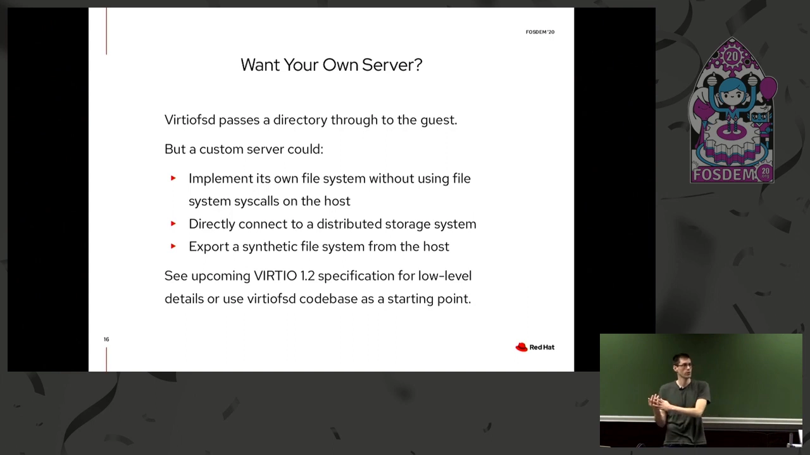

- 不调用宿主文件系统 syscall，自己实现一套文件系统；
- 直接连分布式存储；
- 从宿主导出一个**合成文件系统**（synthetic filesystem）。

起点可以是 virtiofsd 的代码库，也可以照规范用别的语言写。**这种「协议是标准、服务器可替换」的开放性，是 9p 之外另一条值得比较的维度**：它让共享文件系统从「挂个目录」变成「一个可编程的数据面」。

## 小结

- **先分清传输和协议**：9p 与 virtio-fs 都跑在 virtio 上，所以性能差距不能归因于传输，只能归因于协议与数据面。
- **实测差距**：默认配置、`cache=none`、未开 DAX 的条件下，virtio-fs 在四种随机负载上全面高于 virtio-9p；4K 随机读约 3 倍，64K 随机读 20 倍以上；virtio-blk 在 4K 随机负载上仍然最快。
- **协议模型**：virtio-fs 用扩展过的 FUSE 做协议、用 virtio 做传输、用宿主上的 virtiofsd 用户态进程做服务器；一条 FUSE 消息就是一次请求，`requests`、`hiprio`、`notifications` 三个 virtqueue 分工。
- **代价**：不开 DAX 时，每一比特 I/O 都要通信、还要拷贝数据；DAX 用一块固定大小的共享内存窗口把这个循环换成「映射一次 + load/store」，但它是可选的、且依赖传输方式支持共享内存。
- **语义**：FUSE 让 virtio-fs 能表达硬链接、inode、unlink 后句柄仍可用这些 POSIX 语义；xattr 与 SELinux 标签透传当时还没验证。
- **安全**：两者都靠「只暴露一个子目录」画边界；virtio-fs 的服务器是独立进程，因此可以额外套上 mount/net/PID namespace 与 seccomp 白名单；uid/gid 一对一透传，不做映射。
- **选型**：容器 rootfs、开发目录、从宿主目录启动客户机 → virtio-fs；只是临时共享一个目录、图省事、环境里只有老 QEMU → 9p 仍然可用，但换成 virtio-fs 不会更差。

## 关键术语速查

| 术语 | 一句话解释 |
| --- | --- |
| virtio-9p | QEMU 里的前代共享文件系统，把宿主目录挂进客户机，Linux 支持已久 |
| virtio-fs | 基于 FUSE 协议、走 virtio 传输的共享文件系统，QEMU 5.0 起提供 |
| 传输 vs 协议 | 传输是通信链路（TCP、USB、virtio），协议是文件操作的词汇表（NFS、FUSE、9p） |
| FUSE | 用户态文件系统接口：内核模块把系统调用转发给用户态进程实现 |
| virtiofsd | 宿主上的 virtio-fs 服务器进程，模拟 virtio-fs 设备并访问真实目录 |
| nodeid | FUSE 里 inode 的句柄，由 LOOKUP 从路径解析得到 |
| file handle（fh） | FUSE 里「已打开文件」的句柄，相当于文件描述符 |
| DAX | virtio-fs 的实验性特性，把文件区间映射进客户机内存，绕开逐次 I/O 通信 |
| DAX window | 设备暴露给客户机的一块固定大小共享内存区域，宿主页经由它可见 |
| hiprio virtqueue | 专门走 FUSE_INTERRUPT 等高优先级消息的队列（virtqueue 只追加，无法插队） |
| uid/gid 透传 | 客户机在共享目录内设置的 uid/gid 原样落到宿主，不做映射 |