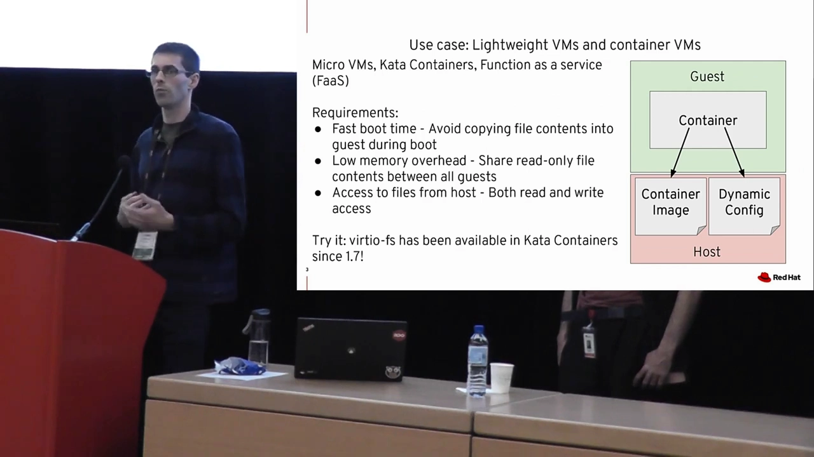
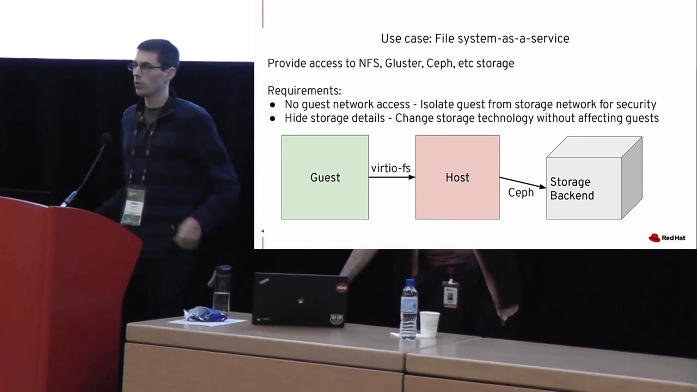
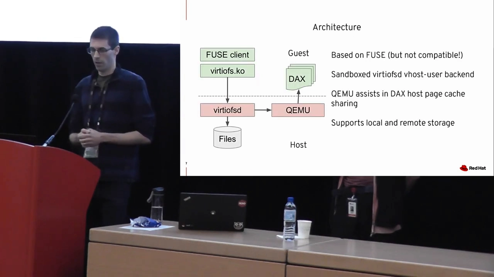
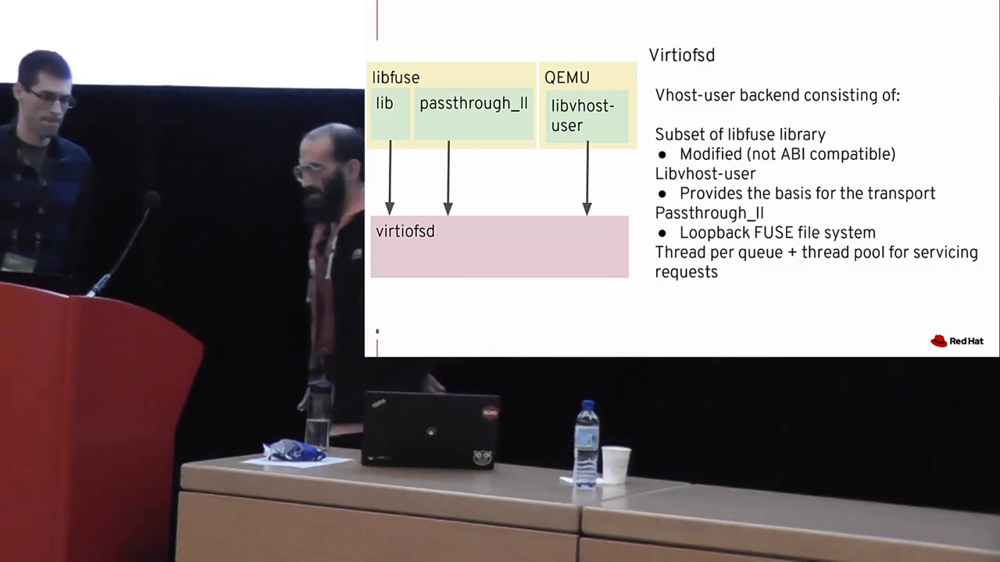
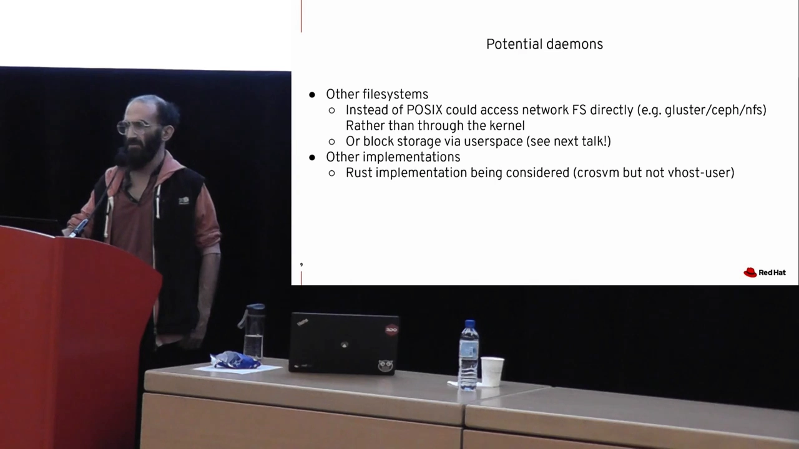
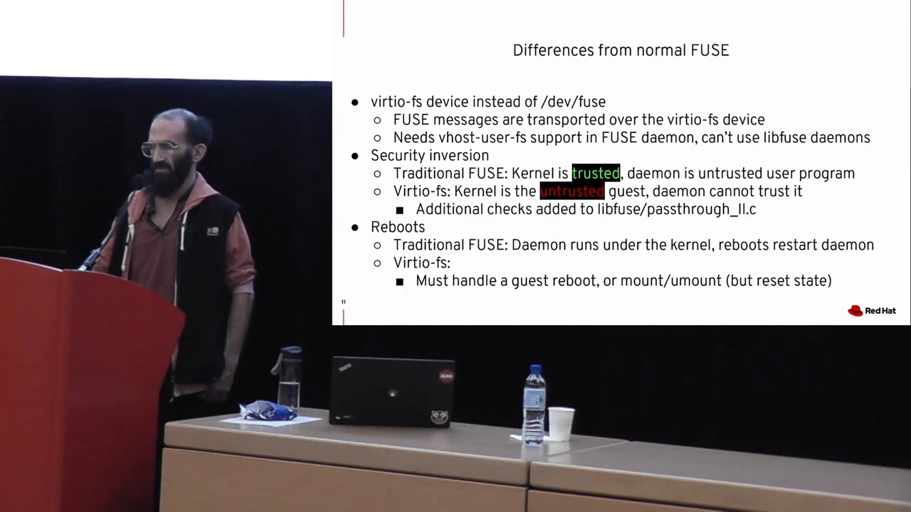
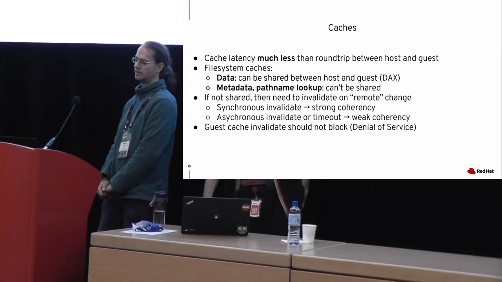
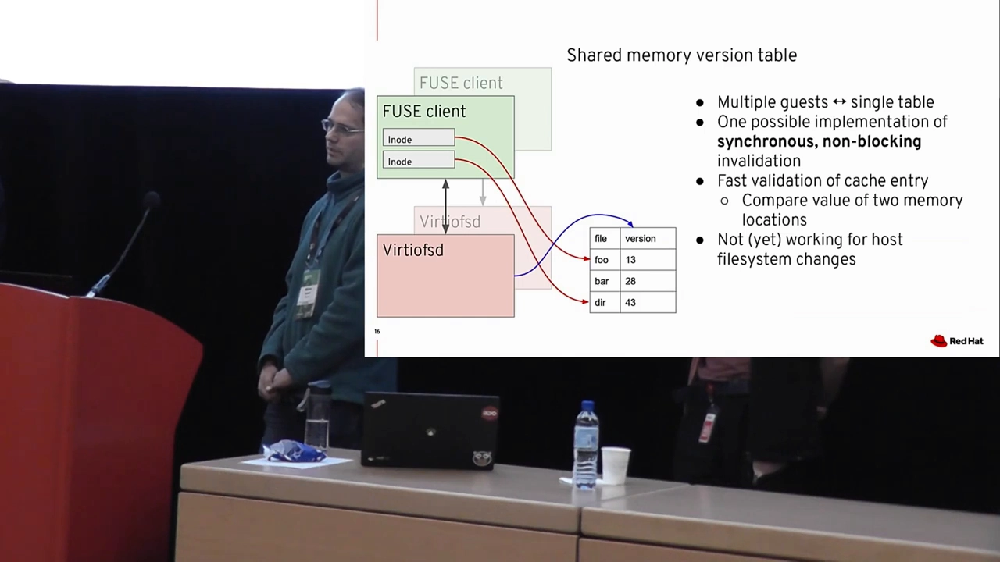
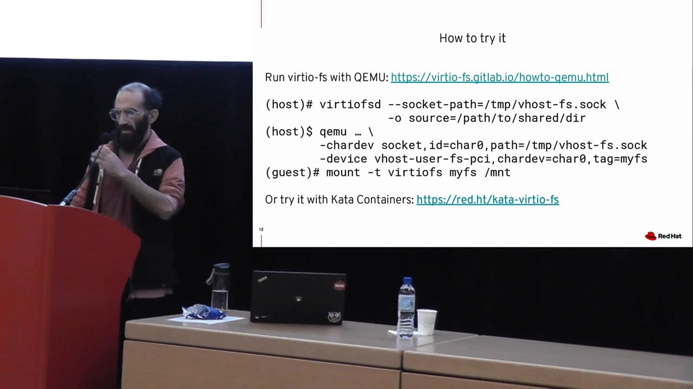
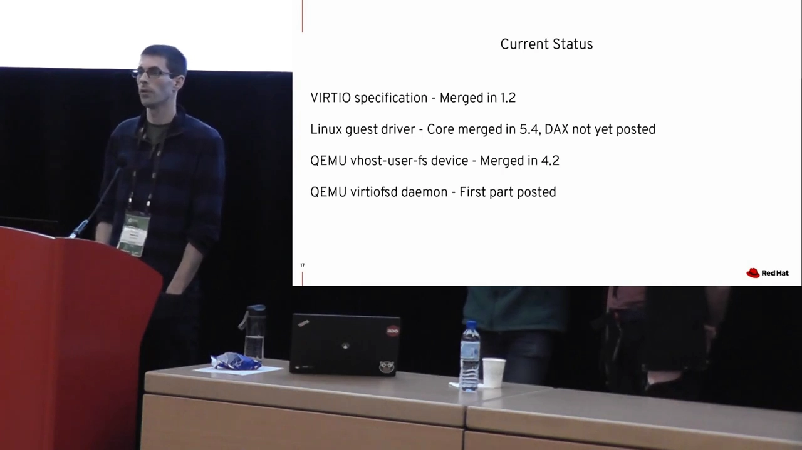

# virtio-fs 的请求路径：virtiofsd 是宿主侧那个"不信任客户机"的 FUSE 服务器

> 视频来源：[virtio-fs: A Shared File System for Virtual Machines](https://www.youtube.com/watch?v=969sXbNX01U)（YouTube · KVM Forum 2019 · Stefan Hajnoczi，Red Hat）
> 导读：这是 virtio-fs 作者本人讲架构的一场报告，25 分钟把"客户机里的 FUSE 客户端 + 宿主里的 virtiofsd 进程"这条链路讲透。本文只取其中与 **virtiofsd 的角色和请求路径**有关的部分：前后端分工、vhost-user 传输、进程与线程模型、与普通 FUSE 的三处差异、缓存失效责任，以及怎么把 virtiofsd 拉起来。9p 与 virtio-fs 的性能对比、DAX 窗口映射分别属于相邻小节，这里只在必要处点到。本讲录制于 2019 年，当时 virtiofsd 尚未合入上游，后来版本新增的 `--sandbox`、`--cache` 等开关不在视频范围内，本文也不涉及。

## 本讲要解决的核心问题（SCQA）

**背景**：虚拟机要访问宿主上的文件，传统做法是走网络文件系统——客户机里配好网络、挂上 NFS 或 Ceph，像访问远程服务器一样读写。

**冲突**：这个做法把两件本不相干的事绑在了一起。客户机必须能连上存储网络、必须持有登录存储的配置，于是存储技术一旦更换（比如从 NFS 换成 Ceph），所有客户机都得改；而客户机往往既不由你管理、也不归你所有。另一方面，微虚拟机、Kata Containers、FaaS 这类负载要的是"快启动、低内存"，它们既不能等一个网络栈就绪，也不能把容器镜像复制进客户机。

**疑问**：虚拟机和 hypervisor 明明跑在同一台物理机上，为什么还要用"跨网络发消息"的方式共享文件？能不能让客户机直接看到宿主的一个目录，同时又不给它任何多余的权限？

**回答（中心思想）**：virtio-fs 把这件事拆成前后端两半——客户机内核里跑一个 **FUSE 客户端**（`virtiofs.ko`），宿主上跑一个**独立的用户态进程 virtiofsd** 充当 FUSE 服务器；两者之间用一条 virtio 队列（vhost-user 传输）传 FUSE 消息。因为 virtiofsd 是宿主上的普通进程，它可以在启动时把自己关进沙箱、只暴露共享目录；也正因为客户机是不可信的一方，virtiofsd 必须对每个请求做完整校验。这条"客户机内核 → virtqueue → virtiofsd → 宿主文件系统"的路径，就是 virtio-fs 的全部秘密。

## 一、先想清楚：为什么不用网络文件系统

### 1.1 三类负载要的是"直接看见宿主目录"

讲者在给出架构之前，先列了三类场景，它们的共同点是"文件本来就在宿主上"（[【跳转到 01:54】](https://www.youtube.com/watch?v=969sXbNX01U&t=114)）。

第一类是**轻量虚拟机与容器虚拟机**：microVM、Kata Containers、Function-as-a-Service。它们的诉求高度一致——启动要快、内存开销要低。容器镜像放在宿主上而不是客户机里（容器 VM 可能活得很短，镜像没必要搬进去），`/etc/resolv.conf` 这类配置还要由容器运行时按 VM 现场生成，根本不属于镜像。要拿到这些东西，最省事的办法就是"透传一个目录"。



第二类是**文件系统即服务**：云厂商想给实例提供文件卷。用 NFS、Gluster、Ceph 当然可以，但客户机就得能进存储网络、还得存着登录配置（[【跳转到 03:09】](https://www.youtube.com/watch?v=969sXbNX01U&t=189)）。virtio-fs 在这里的价值是当一层**间接层**：客户机只看见一个 virtio-fs 设备，它不知道底层是 Ceph 还是 NFS，于是存储技术可以随便换，客户机不用动。



第三类就是**传统虚拟化的目录共享**：开发时把宿主目录挂进 VM，甚至干脆用宿主上的一个 chroot 当客户机根文件系统，连磁盘镜像都不做——在宿主上重编译内核、立刻进客户机验证（[【跳转到 04:24】](https://www.youtube.com/watch?v=969sXbNX01U&t=264)）。

### 1.2 真正的硬要求是"零手工配置"

讲者特别强调了一条容易被忽略的要求：这套功能必须能被**自动化**地提供，不能有手工步骤——不用加网卡、不用分 IP、不用配 NFS。virtio-fs 的配置"非常简单"，所以 libvirt 这类管理工具可以把它做成一条命令：用户说"把这个目录共享出去"，它就生效了（[【跳转到 04:49】](https://www.youtube.com/watch?v=969sXbNX01U&t=289)）。

这也解释了为什么不用 9p：virtio-9p 在 2012 年就停止了活跃开发，始终没达到生产质量；而且既然 VM 和 hypervisor 同机，就不该满足于"像网络文件系统那样互发消息"，应该利用同机这个事实做更多事（[【跳转到 05:39】](https://www.youtube.com/watch?v=969sXbNX01U&t=339)）。

## 二、架构：前端一个设备，后端一个进程

### 2.1 四层分工

virtio-fs 没有发明新的 RPC 协议，它复用了 Linux 已有的"文件系统在用户态"基础设施 FUSE，并做了扩展。讲者明确说：它基于 FUSE，复用了（客户机内核里的）FUSE 客户端代码，但**与现有的 FUSE 不兼容**，连 sshfs 这类现成 FUSE 文件系统也不能直接拿来用（[【跳转到 06:29】](https://www.youtube.com/watch?v=969sXbNX01U&t=389)）。



按这张架构图，一条共享目录的链路可以拆成四层：

| 层 | 位置 | 职责 |
| :--- | :--- | :--- |
| FUSE 客户端 | 客户机内核（`virtiofs.ko`） | 把 VFS 操作翻译成 FUSE 消息，收回复 |
| virtio-fs 设备 | 客户机 PCI 侧 | 把 FUSE 消息装进 virtqueue，收发缓冲 |
| vhost-user 传输 | 宿主 QEMU 与 virtiofsd 之间 | 用 socket 把队列"交给"外部进程处理 |
| virtiofsd | 宿主用户态进程 | 解析 FUSE 消息，落到宿主文件系统 |

讲者对 virtiofsd 的定位有三句话，值得逐句记住（[【跳转到 07:19】](https://www.youtube.com/watch?v=969sXbNX01U&t=439)）：

1. 它是**宿主上的用户态进程**，与 hypervisor 是两个进程——不是 QEMU 里的一个线程。
2. 它通过 **vhost-user 协议**与 QEMU 通信；因此凡是支持 vhost-user 的 hypervisor 都能用它，不限于 QEMU。
3. 它是**沙箱化**的：启动时就确保这个进程能看到的文件只有那个共享目录，别的什么都没有。

### 2.2 它还能和 QEMU 一起做共享映射

除了一问一答地传 FUSE 消息，virtiofsd 还能与 QEMU 配合建立**共享文件映射**：把宿主上的一个文件直接映射进客户机的内存空间（不是 ROM，是内存空间），这样文件内容不必复制进客户机内存，客户机读的就是宿主 page cache 里的那一份（[【跳转到 07:44】](https://www.youtube.com/watch?v=969sXbNX01U&t=464)）。这正是网络文件系统做不到的事——消息传递只能搬数据，搬不了"映射"。

这里只需要记住 virtiofsd 在其中的动作：客户机内核发一条特殊的 FUSE 消息请求映射某个已打开文件的一段，**virtiofsd 负责打开文件拿到文件描述符，并把它交给 QEMU**，由 QEMU 去 `mmap`（[【跳转到 11:29】](https://www.youtube.com/watch?v=969sXbNX01U&t=689)）。映射窗口大小有限，用满了要淘汰复用（[【跳转到 12:19】](https://www.youtube.com/watch?v=969sXbNX01U&t=739)）。窗口怎么组织、DAX 怎么用，是下一小节的话题，这里只强调一点：**"打开文件、交出 fd"这个动作只能由 virtiofsd 做**，因为只有它站在宿主文件系统这一侧。

### 2.3 底层放什么，virtiofsd 不关心

virtiofsd 下面就是一层普通的透传文件系统：可以是本地 XFS，也可以是一个 NFS 挂载（[【跳转到 08:09】](https://www.youtube.com/watch?v=969sXbNX01U&t=489)）。这个"不关心"很重要——它让 virtio-fs 能同时服务前面说的三类场景，而客户机侧完全无感。

## 三、请求路径：一条 FUSE 请求怎么走完一个来回

### 3.1 与普通 FUSE 的第一处差别：消息不走 `/dev/fuse`

普通 FUSE 的路径是：应用发起系统调用 → 内核 VFS → FUSE 内核模块 → `/dev/fuse` → 用户态守护进程。virtio-fs 把中间那段换掉了：**FUSE 消息改为经由 virtio-fs 设备传输**（[【跳转到 12:44】](https://www.youtube.com/watch?v=969sXbNX01U&t=764)）。

于是同一条请求变成了：

```
客户机应用 read()/open()
   ↓ VFS
客户机内核 FUSE 客户端（virtiofs.ko）
   ↓ 打包成 FUSE 请求，放进 virtqueue
virtio-fs 设备（PCI）
   ↓ 通知（kick）
宿主 QEMU 的 vhost-user 后端（不解析内容，只搬运）
   ↓ vhost-user socket
virtiofsd：从 virtqueue 取出请求
   ↓ libfuse 解析 FUSE 消息
passthrough_ll 后端
   ↓ 普通 POSIX 系统调用（open/read/stat…）
宿主文件系统
   ↑ 结果原路返回：virtiofsd 写回 virtqueue → 通知客户机 → FUSE 客户端
```

（队列本身的三环结构与通知抑制机制见本系列 3.2.2、3.2.3，这里只关心消息在谁手里。）

讲者的原话是：vhost-user 是一种"把 virtio 消息拿到外部进程里去处理"的传输方式，它负责 socket 上的建链与协议处理（[【跳转到 09:24】](https://www.youtube.com/watch?v=969sXbNX01U&t=564)）。这句话点出了请求路径的关键性质：**QEMU 不在数据通路上做解析**，它只负责把队列交给 virtiofsd，真正干活的是那个独立进程。

### 3.2 一次操作要几个来回，取决于缓存

讲者在讲缓存时给了一个很有用的量化直觉：每个文件系统操作如果没命中缓存，会造成"至少一次、通常不止一次"的宿主-客户机往返（[【跳转到 16:04】](https://www.youtube.com/watch?v=969sXbNX01U&t=964)）。也就是说，路径长度不是固定的：一次 `open()` 可能要先查路径、再查 inode 属性、最后才打开，每一步都可能是一次独立的请求-应答。

这就是为什么 virtiofsd 不只是"翻译器"，它还是**缓存一致性的责任方**——下一节展开。

### 3.3 这条路径为什么能比 9p 短

讲者给出的理由是"同机"这个事实：网络文件系统只能互发消息，而 virtio-fs 因为是同机，可以做映射这种消息之外的事（[【跳转到 06:04】](https://www.youtube.com/watch?v=969sXbNX01U&t=364)）。性能数字本身属于 9p 与 virtio-fs 对比那一节，这里只留下结论：**路径短在"宿主内存里的那一份数据可以被客户机直接看到"，而不是短在少发几条消息。**
## 四、virtiofsd 的进程模型：三个现成组件拼出来

### 4.1 它不是一个从零写的守护进程

讲者说得很直白：virtiofsd 的实现"从两个已有的部分开始"（[【跳转到 08:34】](https://www.youtube.com/watch?v=969sXbNX01U&t=514)）。这三个组件各自负责一件事，拼起来正好覆盖一条请求路径的三段：



| 组件 | 来源 | 在请求路径上干什么 |
| :--- | :--- | :--- |
| `libfuse`（改造过） | FUSE 项目 | 拆开、组装、解释 FUSE 消息，并向上提供"文件系统"的抽象接口 |
| `passthrough_ll` | FUSE 的示例文件系统 | 后端实现：几乎直通到 POSIX 系统调用 |
| `libvhost-user` | QEMU | 传输：把 virtio 消息经由 socket 交给外部进程，负责建链与协议处理 |

两个细节值得注意。第一，改造后的 libfuse **与现有 libfuse 不 ABI 兼容**——因为要换掉传输层，必须动到库的内部（[【跳转到 09:49】](https://www.youtube.com/watch?v=969sXbNX01U&t=589)）。第二，后端文件系统被**加了线程**，因为一个请求可能要阻塞在宿主 I/O 上，不能把整个队列堵死。

### 4.2 线程模型：一个队列一个线程，加一个线程池

幻灯片上写得很清楚：**Thread per queue + thread pool for servicing requests**（[【跳转到 08:34】](https://www.youtube.com/watch?v=969sXbNX01U&t=514)）。拆开看是两层：

- **每个 virtqueue 一个线程**：virtio 的队列是并行的，一个队列一个线程去取请求，天然对应"多队列并行"。
- **一个线程池处理请求**：取到的请求交给池里的工作线程执行，慢请求（比如一次真正的磁盘读）不会阻塞队列上的后续消息。

这解释了为什么 virtiofsd 能在不复制数据的前提下还保持吞吐：请求的"取"和"做"是解耦的，前者是队列级的顺序，后者是线程级的并发。

### 4.3 后端是可替换的

讲者特意强调"这只是一种可能的实现"，并给了另外两条路（[【跳转到 10:14】](https://www.youtube.com/watch?v=969sXbNX01U&t=614)）：



- **后端不用 POSIX**：现成的 FUSE 守护进程里就有直接讲网络文件系统（gluster、ceph、nfs）的实现，绕开内核。
- **后端讲块存储**：在外部进程里用用户态方式访问块设备（讲者提到这是下一场报告的主题）。
- **换语言重写**：CrosVM 里有一个 Rust 实现，但它与 QEMU 通信时没有用 vhost-user，两者怎么接当时还在看。

这条"后端可替换"的性质，正好对应第一节的"文件系统即服务"：换存储技术只需要换 virtiofsd 下面的那一层，客户机侧一个字节都不用改。

## 五、与普通 FUSE 的三处关键差异

讲者用一页幻灯片把差异归纳成三条（[【跳转到 12:44】](https://www.youtube.com/watch?v=969sXbNX01U&t=764)）。这三条不是"实现细节不同"，而是**决定了 virtiofsd 必须怎么写**的三条约束。



### 5.1 传输：`/dev/fuse` 换成了 virtio-fs 设备

普通 FUSE 守护进程靠 `/dev/fuse` 收发消息，因此任何 libfuse 守护进程都能直接用。virtio-fs 换成了自己的传输（vhost-user），代价是**用不了现成的 libfuse 守护进程**，FUSE 守护进程必须支持 vhost-user-fs（[【跳转到 12:44】](https://www.youtube.com/watch?v=969sXbNX01U&t=764)）。这也是为什么 virtiofsd 要自带一份改造过的 libfuse，而不是链接系统里的那份。

### 5.2 信任方向反转：客户机是不可信的一方

这是全篇最重要的一条。普通 FUSE 里，**内核是可信的那一半**，守护进程是跑在内核控制下的普通用户程序；virtio-fs 里这个关系**反过来了**：内核这一侧是不可信的客户机，守护进程跑在宿主上、手里握着宿主文件系统的访问权（[【跳转到 13:09】](https://www.youtube.com/watch?v=969sXbNX01U&t=789)）。

由此推出的工程要求是具体的：

- 必须**完全不信任客户机**；
- 必须**校验每一条路径**，防止客户机构造出逃出共享目录的路径；
- 必须真的把它锁死——沙箱、seccomp 全上。

这也解释了 2.1 里"启动时就只暴露共享目录"的设计：沙箱不是可选项，而是信任模型倒转后的必然结果。**客户机发来的每一条 FUSE 消息，在 virtiofsd 眼里都等同于不可信输入。**

### 5.3 生命周期：客户机重启，守护进程不能跟着重启

普通 FUSE 里守护进程跑在内核之下，内核一重启，守护进程跟着重启就行。virtio-fs 里客户机可能干净重启、也可能非干净重启（讲者举例：有人往 `/proc/sysrq-trigger` 里 echo 一个 `b`），还可能只是卸载再重新挂载——**virtiofsd 必须自己处理这些情况**，而这是普通 FUSE 守护进程不需要面对的（[【跳转到 13:34】](https://www.youtube.com/watch?v=969sXbNX01U&t=814)）。

换句话说，virtiofsd 的生命周期比客户机长：客户机换了一茬，宿主上的进程还在，它得把内部状态（打开了哪些文件、映射了哪些窗口）清理干净再继续服务。

## 六、缓存失效也是 virtiofsd 的责任

### 6.1 元数据缓存不能共享

讲者把文件系统缓存分成两类（[【跳转到 15:39】](https://www.youtube.com/watch?v=969sXbNX01U&t=939)）：

- **数据缓存**：可以和宿主共享（DAX 就是干这个的）；
- **元数据与路径名查找缓存**：**不能**共享。



不能共享就得失效。而失效的时机、方式，直接决定了客户机看到的一致性强度：

| 失效方式 | 一致性 | 代价 |
| :--- | :--- | :--- |
| 同步失效 | 强一致：改目录/改元数据的操作要等所有客户机缓存都失效完才返回 | 慢；且如果客户机侧能阻塞失效，一个坏客户机就能拖住操作 |
| 异步失效或超时 | 弱一致：不保证各客户机同时看到变更 | 快，但有窗口期 |

关键约束是那句"**客户机侧的缓存失效不应该阻塞**"：如果失效是同步且可阻塞的，那么一台行为异常的客户机就能让宿主的文件系统操作卡住，形成拒绝服务（[【跳转到 17:19】](https://www.youtube.com/watch?v=969sXbNX01U&t=1039)）。这是个很典型的"共享文件系统 + 不可信客户机"才会有的问题。

### 6.2 用共享内存版本表做到"同步但不阻塞"

讲者给出的方案是：拿一块共享内存放一张**版本表**，每个文件一个版本号；文件的元数据或目录内容一变，版本号就加一；这块内存**客户机和 virtiofsd 都看得见**（[【跳转到 17:44】](https://www.youtube.com/watch?v=969sXbNX01U&t=1064)）。



于是客户机验证缓存只需要做一次内存比较：把上次记下的版本号和共享内存里的当前值比一下，相等就说明缓存还有效（[【跳转到 18:59】](https://www.youtube.com/watch?v=969sXbNX01U&t=1139)）。这同时满足了两个看似矛盾的要求——**语义上是同步的**（版本号在变更时就已更新，不存在"还没通知到"的窗口），**执行上是不阻塞的**（客户机只是读一块内存，不会卡住宿主的操作）。

讲者也如实说明了两处局限：当时这套机制对"通过宿主文件系统直接改动文件"的情况还不生效；而如果底层是网络文件系统，理论上要靠它的通知机制一路接到客户机，代价是要出机器（[【跳转到 21:17】](https://www.youtube.com/watch?v=969sXbNX01U&t=1277)）。

## 七、落地：谁把 virtiofsd 拉起来，fd 怎么交给 VMM

### 7.1 三条命令看清进程关系

这一页是全场最"可操作"的一页（[【跳转到 14:10】](https://www.youtube.com/watch?v=969sXbNX01U&t=850)）：



```bash
# 1) 宿主上先起 virtiofsd：监听一个 unix socket，共享目录通过 -o source= 指定
(host)# virtiofsd --socket-path=/tmp/vhost-fs.sock \
                  -o source=/path/to/shared/dir

# 2) QEMU 把这个 socket 当成一个 chardev，再挂上 vhost-user-fs-pci 设备
(host)$ qemu ... \
        -chardev socket,id=char0,path=/tmp/vhost-fs.sock \
        -device vhost-user-fs-pci,chardev=char0,tag=myfs

# 3) 客户机里按 tag 挂载
(guest)# mount -t virtiofs myfs /mnt
```

这三条命令把进程模型讲完了：

- **virtiofsd 先启动**，它自己创建并监听 socket，此时还不知道谁会连上来；
- **QEMU 后启动**，通过 `-chardev socket` 连到这个 socket，再用 `vhost-user-fs-pci` 设备把队列"托付"给它；
- 客户机里 `mount -t virtiofs myfs /mnt` 中的 `myfs` 就是 QEMU 命令行里的 `tag`——它是客户机找到对应设备的唯一线索。

所以"谁拉起 virtiofsd"这个问题，在这套最朴素的用法里答案是：**管理工具（或人）先起它，再起 QEMU**。讲者在前面说过，virtio-fs 的配置足够简单，所以 libvirt 这类工具可以把它自动化（[【跳转到 05:14】](https://www.youtube.com/watch?v=969sXbNX01U&t=314)）；Kata Containers 从 1.7 起把它作为实验特性引入，也是同一个道理——由运行时负责起 virtiofsd、把 socket 交给 VMM（[【跳转到 02:44】](https://www.youtube.com/watch?v=969sXbNX01U&t=164)）。

### 7.2 "fd 怎么传给 VMM"其实有两处

一处是**控制面**：QEMU 通过 chardev 连上 virtiofsd 的 socket，`libvhost-user` 在这个 socket 上完成 vhost-user 协议的建链与初始化，此后队列的通知与中断都走这条通道。

另一处是**数据面里的共享映射**：客户机请求映射某个已打开文件的一段时，是 **virtiofsd 打开文件、把文件描述符交给 QEMU**，再由 QEMU `mmap` 进客户机可见的窗口（[【跳转到 11:29】](https://www.youtube.com/watch?v=969sXbNX01U&t=689)）。这两处传的东西不一样：前者传的是"队列的所有权"，后者传的是"某个具体文件的 fd"。

## 八、当时的实现状态，以及没解决的问题

### 8.1 四个组件的进度

讲者在结尾给了一张状态表（[【跳转到 19:49】](https://www.youtube.com/watch?v=969sXbNX01U&t=1189)）：



| 组件 | 当时状态 |
| :--- | :--- |
| virtio 规范里的 virtio-fs 设备 | 已并入 virtio 1.2 |
| Linux 客户机驱动 | 核心部分并入 Linux 5.4，DAX 特性尚未包含 |
| QEMU 的 vhost-user-fs 设备 | 并入 QEMU 4.2 |
| virtiofsd 守护进程 | 当时刚发出第一部分补丁，是最后一个待上游化的部件 |

这张表也说明了 virtio-fs 的"分层"：设备规范、客户机驱动、VMM 侧设备、宿主守护进程是四个独立演进的部件，virtiofsd 只是最后一块拼图。

### 8.2 讲者承认的三个未解问题

- **其他操作系统的驱动**：当时还没有 Windows 的 virtio-fs 驱动，讲者希望"很快会有"（[【跳转到 20:27】](https://www.youtube.com/watch?v=969sXbNX01U&t=1227)）。
- **宿主侧进程改动的一致性**：版本表只能覆盖"经过 virtiofsd 的改动"，如果宿主上的进程直接改了文件，客户机看不到。讲者的设想是复用 vhost-user 设备与 mdev，把 virtio-fs 设备也挂到宿主上，让宿主进程和客户机走同一条代码路径、共用同一套共享内存数据结构——但当时还没开始做（[【跳转到 21:42】](https://www.youtube.com/watch?v=969sXbNX01U&t=1302)）。
- **热迁移**：当时完全没开始。讲者的思路是复用 CRIU 迁移文件描述符的代码，因为 virtiofsd 手里有一堆 fd 要搬；vhost 那一侧的迁移应该和 vhost-net 类似，难点在 DAX 窗口（[【跳转到 23:37】](https://www.youtube.com/watch?v=969sXbNX01U&t=1417)）。这也从侧面印证了 virtiofsd 的本质：**它的状态主要就是一堆文件描述符。**

## 小结

- virtio-fs 把共享文件系统拆成**客户机内核里的 FUSE 客户端**和**宿主上的 virtiofsd 进程**两半，中间用 virtio 队列 + vhost-user 传输传 FUSE 消息。
- virtiofsd 是**独立于 hypervisor 的用户态进程**，凡是支持 vhost-user 的 VMM 都能用它；启动时自我沙箱化，只暴露共享目录。
- 一条请求的路径是：客户机 VFS → FUSE 客户端 → virtqueue → vhost-user socket → virtiofsd（libfuse 解析 + passthrough_ll 落到 POSIX）→ 宿主文件系统，结果原路返回；QEMU 不在数据通路上解析内容。
- 进程模型是**每个 virtqueue 一个线程 + 一个请求线程池**，取请求与做请求解耦。
- 与普通 FUSE 的三处根本差异：传输从 `/dev/fuse` 换成 virtio-fs 设备；**信任方向反转**（客户机不可信，必须校验每条路径并上沙箱/seccomp）；virtiofsd 要自己处理客户机重启与重新挂载。
- 缓存失效是 virtiofsd 的责任：元数据与路径名缓存不能共享，用**共享内存版本表**实现"同步但不阻塞"的失效。
- 落地方式是"先起 virtiofsd 监听 socket，再让 QEMU 用 chardev + `vhost-user-fs-pci` 连上去，客户机按 tag 挂载"；Kata Containers 1.7 起把它作为实验特性接入。
- 2019 年的状态：规范、驱动、QEMU 设备都已上游，virtiofsd 是最后一块；Windows 驱动、宿主侧改动的一致性、热迁移当时都还没有。

## 关键术语速查

| 术语 | 一句话解释 |
| :--- | :--- |
| FUSE | Filesystem in Userspace，把文件系统实现搬到用户态进程，内核只做转发 |
| virtio-fs 设备 | 新增的 virtio 设备类型，负责在客户机与宿主之间搬运 FUSE 消息 |
| virtiofsd | 宿主上的用户态守护进程，virtio-fs 的后端，充当 FUSE 服务器 |
| vhost-user | 一种把 virtio 设备的队列处理放到外部进程、通过 unix socket 通信的传输方式 |
| libvhost-user | QEMU 提供的库，实现 vhost-user 在 socket 上的建链与协议处理 |
| passthrough_ll | FUSE 自带的示例文件系统，几乎直通到 POSIX 系统调用，virtiofsd 的后端基础 |
| PCI BAR | 设备的基址寄存器窗口，DAX 用它把宿主文件的一段映射进客户机 |
| 强一致 / 弱一致 | 变更是否在所有客户机缓存失效后才算完成；同步失效给强一致，异步或超时给弱一致 |
| 版本表 | 放在共享内存里、每个文件一个版本号的表，客户机靠比对版本号快速验证缓存 |
| seccomp | Linux 的系统调用过滤器，用来把进程可用的系统调用裁到最小集合 |
