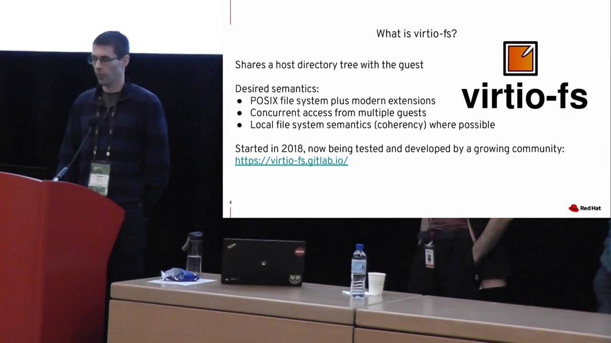
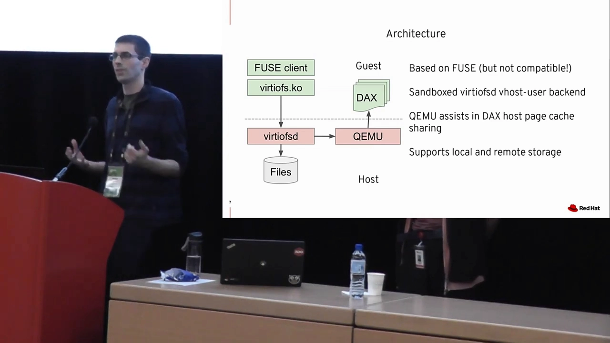
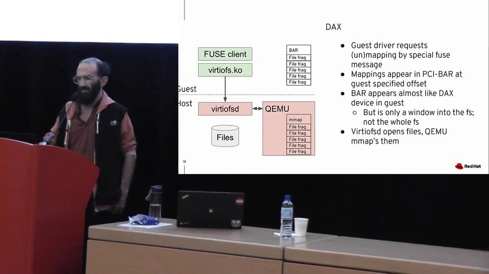
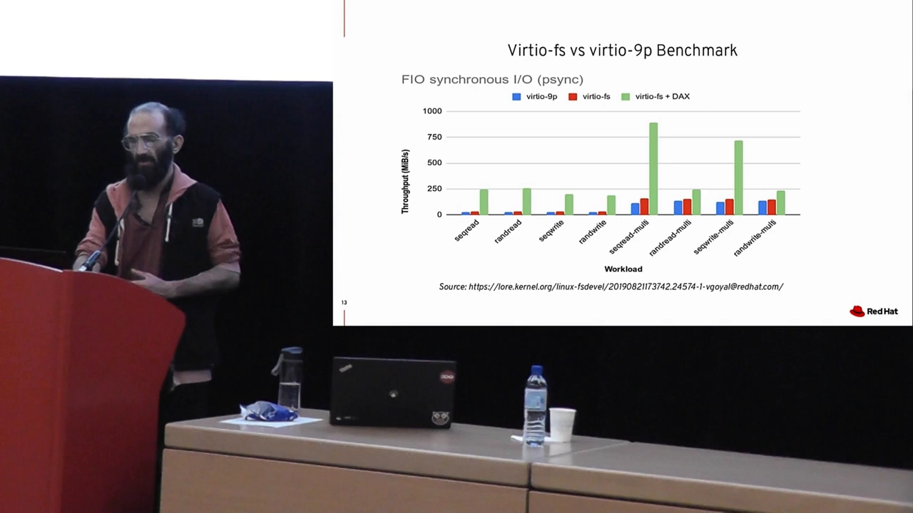
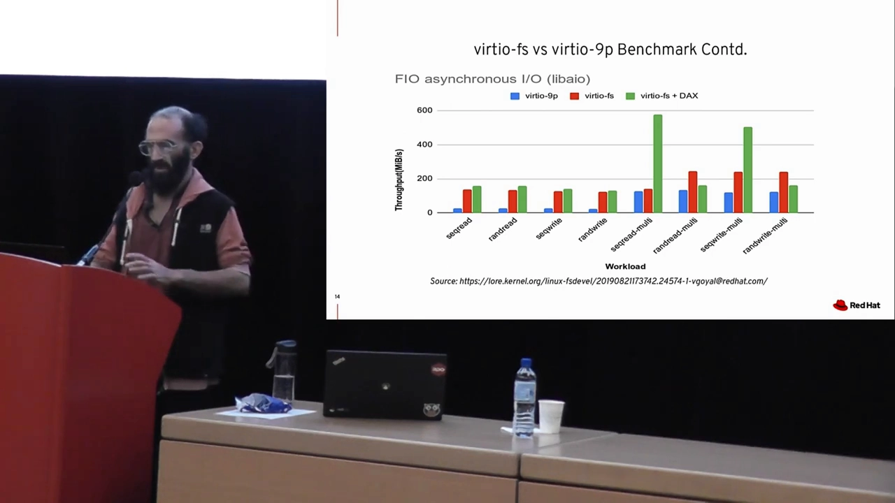
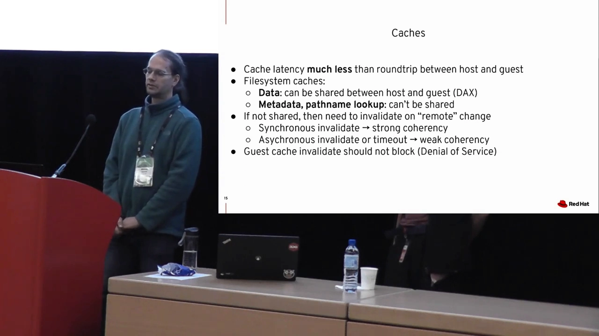
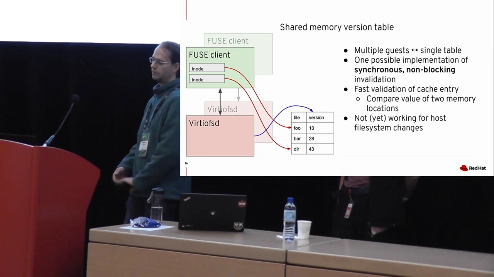
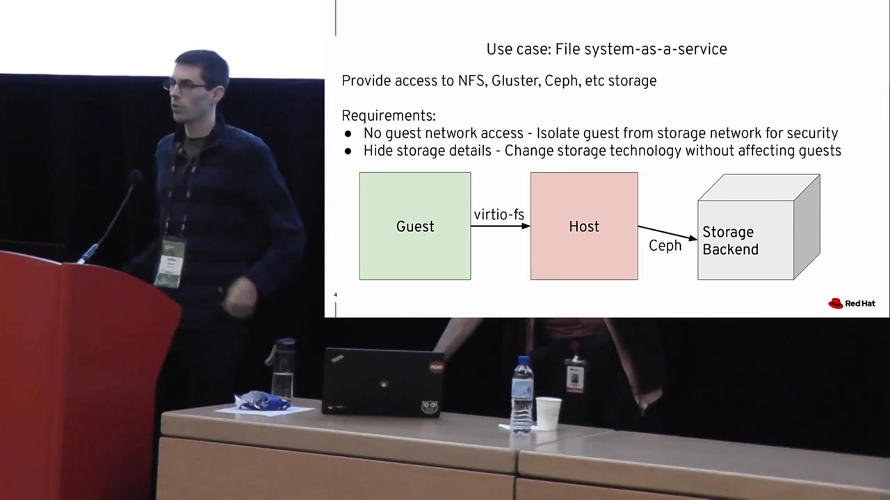

# virtio-fs 的 DAX 窗口：用一块共享内存省掉数据拷贝

> 视频来源：[virtio-fs: A Shared File System for Virtual Machines](https://www.youtube.com/watch?v=969sXbNX01U)（KVM Forum 2019 · Stefan Hajnoczi，Red Hat）｜时长约 25 分钟
> 导读：本文只取这支演讲里"DAX"这一条线——普通 virtio-fs 为什么要把数据拷两遍、DAX 用一块共享内存窗口怎么绕开客户机页缓存、窗口不够大时会出什么问题、以及它成立的前提。virtio-fs 的协议分层、virtiofsd 进程模型与 FUSE 请求路径在同节另一篇里讲，本文不重复。

## 本讲要解决的核心问题（SCQA）

**背景**：virtio-fs 把宿主上的一个目录树透传进客户机，客户机 `mount -t virtiofs` 之后就能像访问本地文件一样访问宿主的文件，不需要磁盘镜像（[【跳转到 00:14】](https://www.youtube.com/watch?v=969sXbNX01U&t=14)）。

**冲突**：这条路径上，客户机每读一个字节都要和宿主侧的 `virtiofsd` 通信；而 FUSE 的 read/write 命令本身是带客户机内存缓冲区的，所以数据还要在宿主和客户机之间拷一遍。一台客户机拷一份就算了，如果同一个只读目录共享给 10 台、100 台客户机，难道每台都要在自己的 RAM 里存一份副本（[【跳转到 16:12】](https://www.youtube.com/watch?v=969sXbNX01U&t=972)）？

**疑问**：虚拟机和管理程序（hypervisor）明明在同一台物理机上，能不能让客户机直接读宿主页缓存里的那份数据，既不发请求也不拷贝？

**回答（中心思想）**：能，这就是 DAX。宿主把文件 `mmap` 进一块内存，这块内存作为 **PCI BAR** 暴露给客户机；客户机把它当成一个"DAX 设备"，按需把文件的某一段映射进这块窗口，之后用普通的 load/store 指令访问。数据只有一份，就是宿主页缓存里的那一份。代价是：**窗口大小有限，必须换入换出**；**建立映射本身有延迟**；**只有数据能共享，元数据不能**；而且**要求传输层支持共享内存**。



## 一、普通 virtio-fs 的读路径：一次往返加一次拷贝

先看没有 DAX 时读一个文件要付什么代价。

演讲里把这条路径拆得很直白（[【跳转到 15:22】](https://www.youtube.com/watch?v=969sXbNX01U&t=922)）：**每读文件的一小段，客户机都必须和 virtiofsd 说话**。FUSE 的基本流程是 lookup（把路径解析成 inode）→ open（拿到 file handle）→ read，每一步都是一次（通常还不止一次）宿主与客户机之间的往返。

更贵的是数据本身（[【跳转到 15:47】](https://www.youtube.com/watch?v=969sXbNX01U&t=947)）：FUSE 的 read 和 write 命令都涉及客户机内存，所以一次读就是把数据从宿主（页缓存）拷进客户机 RAM，一次写就是把数据从客户机 RAM 拷到宿主。于是同一份文件内容在内存里存在两份：

```
宿主页缓存 ──copy──> 客户机页缓存 ──> 应用程序
        （DAX 要消灭的就是这个 copy）
```

对顺序大文件读来说，这个拷贝就是纯粹的浪费——数据本来就在宿主的页缓存里，客户机只是需要"看见"它。



## 二、DAX 的做法：建一次映射，之后只有 load/store

### 2.1 一句话版本

DAX 不再为每次 I/O 发命令，而是让**客户机驱动建立一次映射**，把文件的某一段直接映射进客户机的内存空间；此后客户机访问这段地址，用的就是 CPU 的 load/store 指令，不再和 virtiofsd 通信（[【跳转到 16:37】](https://www.youtube.com/watch?v=969sXbNX01U&t=997)）。

关键在"这块内存从哪来"：设备有一块内存区域叫 **DAX window**，它就是一块**共享内存区域**——这也是为什么 virtio 需要新增"共享内存区域"这个扩展（[【跳转到 17:02】](https://www.youtube.com/watch?v=969sXbNX01U&t=1022)）。

### 2.2 幻灯片上的四条要点

演讲第 10 页把机制压缩成四句话，值得逐条读：

- 客户机驱动用**特殊的 FUSE 消息**请求建立（或撤销）映射；
- 映射出现在 **PCI BAR** 里、位于**客户机指定的偏移**；
- 这个 BAR 在客户机里看起来几乎就像一个 DAX 设备，**但它只是文件系统的一个窗口，不是整个文件系统**；
- `virtiofsd` 负责打开文件，**QEMU 负责 `mmap`**。



### 2.3 一次映射的完整流程

把演讲的口述和幻灯片合起来，流程是这样（[【跳转到 11:04】](https://www.youtube.com/watch?v=969sXbNX01U&t=664)、[【跳转到 11:29】](https://www.youtube.com/watch?v=969sXbNX01U&t=689)、[【跳转到 11:54】](https://www.youtube.com/watch?v=969sXbNX01U&t=714)）：

```
客户机内核（FUSE client / virtiofs.ko）
   │  1. 通过 virtio 发一条特殊 FUSE 消息：
   │     "把这个已打开文件的这一段映射给我"
   ▼
virtiofsd（宿主用户态进程）
   │  2. 打开文件，把 fd 交给 QEMU
   ▼
QEMU
   │  3. 把这个文件 mmap 进一块内存
   │  4. 这块内存作为 PCI BAR 的一部分暴露给客户机
   ▼
客户机
     5. 映射落在客户机驱动自己挑的偏移上
     6. 之后用 load/store 直接读写，不再经过 virtiofsd
```

第 5 步值得单独说一句：映射位置由**客户机驱动**分配，而不是让 daemon 去猜，这比"把映射的活儿交给 daemon"容易得多（[【跳转到 11:54】](https://www.youtube.com/watch?v=969sXbNX01U&t=714)）。

### 2.4 省下来的到底是什么

- **省掉拷贝**：客户机读到的页就是宿主页缓存里的页，不再有第二份副本（[【跳转到 17:27】](https://www.youtube.com/watch?v=969sXbNX01U&t=1047)）。
- **省掉往返**：映射建立之后，访问这段内存不需要任何 virtio 消息。
- **省掉内存**：多台客户机共享同一份内容时，它们共享同一批宿主页缓存页，内存占用随客户机数量增长的部分被削掉了（[【跳转到 17:27】](https://www.youtube.com/watch?v=969sXbNX01U&t=1047)）。这一点对"同一个只读目录挂给 100 台 VM"的场景最直接。

## 三、窗口是有限的：换入换出与"DAX 也会更慢"

DAX 不是"把整个文件系统映射进客户机"。演讲明确点出问题所在（[【跳转到 12:19】](https://www.youtube.com/watch?v=969sXbNX01U&t=739)）：**窗口大小是有限的，不可能把客户机打开的所有文件都映射进来，必须换出（evict）再复用**。

于是 DAX 的收益不是无条件的，基准测试给出了两面：

**同步 I/O（FIO psync）**：红条是 virtio-fs，绿条是 virtio-fs + DAX。几乎所有工作负载下 DAX 都大幅领先，`randread-multi`、`seqwrite-multi` 这类多线程项甚至高出数倍（[【跳转到 14:24】](https://www.youtube.com/watch?v=969sXbNX01U&t=864)）。



**异步 I/O（libaio）**：整体趋势一样，但右侧的 `randwrite-multi` 上，绿条（DAX）反而低于红条（virtio-fs）。演讲者解释得很具体（[【跳转到 14:49】](https://www.youtube.com/watch?v=969sXbNX01U&t=889)）：客户机要先说"我想把文件这一段映射进来"，请求上行到 daemon，daemon 打开文件，再请求 QEMU，QEMU 完成映射，然后才能继续——**这一段映射建立的延迟**在短促的随机写里摊不掉。



所以演讲把后续工作归成两件事（[【跳转到 15:14】](https://www.youtube.com/watch?v=969sXbNX01U&t=914)）：**降低映射建立的延迟**，以及**研究"该映射什么"的启发式**——窗口有限，就得决定哪些片段值得占着窗口。

## 四、DAX 只共享数据，不共享元数据

DAX 解决的是"文件内容"这一半问题。演讲在缓存那一节把边界划得很清楚（[【跳转到 15:39】](https://www.youtube.com/watch?v=969sXbNX01U&t=939)）：

- 缓存的延迟远小于一次宿主与客户机之间的往返，所以缓存对性能至关重要；
- 文件系统缓存分两类：**数据**可以在宿主与客户机之间共享（这正是 DAX 干的），**元数据和路径查找**不能共享；
- 不能共享就必须在"远端"发生变化时让客户机侧的缓存失效：同步失效得到强一致，异步失效或超时得到弱一致；
- 客户机侧的失效**不能阻塞**，否则一台行为异常的客户机会让整个操作卡住，形成拒绝服务。



有意思的是，演讲者给出的元数据失效方案**又是一块共享内存**（[【跳转到 17:44】](https://www.youtube.com/watch?v=969sXbNX01U&t=1064)、[【跳转到 18:09】](https://www.youtube.com/watch?v=969sXbNX01U&t=1089)）：一块共享内存里放一张表，为每个文件记一个版本号；谁改了元数据或目录内容就把版本号加一。客户机要验证缓存，只要比较"自己记住的版本"和"共享内存里的版本"这两个内存位置，非常快——这就实现了**同步且非阻塞**的失效。局限也直说了：宿主侧直接改文件这条路径当时还没覆盖。



这也说明"共享内存窗口"在 virtio-fs 里不止 DAX 一个用途：DAX 用它搬文件数据，版本表用它传一致性信息。

## 五、适用条件：什么时候能用 DAX

把演讲里散落的限定条件收拢，DAX 成立需要同时满足下面几条。

**1. 客户机与宿主在同一台机器上。** 整支演讲的出发点就是"VM 和 hypervisor 同机"这个事实——网络文件系统只能靠消息传递，而同机才有额外的手段（[【跳转到 06:04】](https://www.youtube.com/watch?v=969sXbNX01U&t=364)）。DAX 依赖的共享内存区域是客户机与宿主之间的内存通路，跨机的网络文件系统没有这条通路。

**2. 传输层支持共享内存。** 演讲后的问答里说得很明确（[【跳转到 20:09】](https://www.youtube.com/watch?v=969sXbNX01U&t=1209)）：共享内存是**可选的**，不用 DAX 也能跑 virtio-fs；virtio 有多种传输（x86 上常用的 PCI、MMIO、s390 上的另一种），**是否支持共享内存取决于传输方式**，所以不是所有传输上都能用。

**3. 共享内存是 virtio 的通用能力，不是 virtio-fs 专有。** 任何 virtio 设备都可以拥有若干个功能不同的共享内存区域，怎么映射（比如是否走 PCI）由设备决定，virtio-gpu 也有自己的用例（[【跳转到 21:24】](https://www.youtube.com/watch?v=969sXbNX01U&t=1284)）。

**4. 后端是什么存储不改变"映射"这件事。** virtio-fs 下面接的可以是本地 XFS，也可以是 NFS、Ceph 这类网络存储（[【跳转到 03:09】](https://www.youtube.com/watch?v=969sXbNX01U&t=189)）。DAX 映射的是**宿主页缓存**里的页，所以后端类型不影响这条内存通路；但前提仍然是宿主能把文件 `mmap` 出来。



**5. 成熟度：DAX 当时还没进上游。** 状态幻灯片写得很清楚（[【跳转到 19:24】](https://www.youtube.com/watch?v=969sXbNX01U&t=1164)）：virtio 规范已合入（幻灯片标注 1.2）；Linux 客户机驱动核心进了 5.4，**DAX 还没有提交**；QEMU 的 vhost-user-fs 设备在 4.2 合入；virtiofsd 的第一部分已提交。演讲开头也提醒过，前面那组基准测试**没有开 DAX**，原因就是它不在上游（[【跳转到 02:52】](https://www.youtube.com/watch?v=969sXbNX01U&t=172)）。

换句话说：DAX 是一层**可选加速**，不是 virtio-fs 的默认形态。演讲没有展开 QEMU 侧 `cache` 模式与 `dax` 选项的具体组合，只强调它是可选项、需要额外的工作才能用上——这属于后来才补齐的工程细节，本文不臆测。

## 六、边界：本文只讲内存这条通路

DAX 这个词在不同语境下指不同东西：宿主上的持久内存设备（PMEM、devdax）、CXL 共享内存、以及 virtio-fs 的 DAX 窗口。本文只覆盖最后一种——**客户机与宿主之间的一块共享内存窗口**。设备侧的持久内存格式、共享内存池怎么跨机分配，属于存储与持久内存的话题，不在本文范围。

## 小结

- 普通 virtio-fs 读文件要付两份代价：**每次 I/O 一次往返**，以及**把数据从宿主页缓存拷进客户机页缓存**（[15:22](https://www.youtube.com/watch?v=969sXbNX01U&t=922)、[15:47](https://www.youtube.com/watch?v=969sXbNX01U&t=947)）。
- DAX 用一块**共享内存窗口**（DAX window，经 PCI BAR 暴露）把文件片段直接映射进客户机地址空间，之后只有 load/store，没有消息、没有第二份拷贝（[16:37](https://www.youtube.com/watch?v=969sXbNX01U&t=997)、[17:27](https://www.youtube.com/watch?v=969sXbNX01U&t=1047)）。
- 窗口**大小有限**，必须换出复用；映射建立本身有延迟，所以 DAX 在 `randwrite-multi` 这类负载上会输给普通 virtio-fs（[12:19](https://www.youtube.com/watch?v=969sXbNX01U&t=739)、[14:49](https://www.youtube.com/watch?v=969sXbNX01U&t=889)）。
- DAX 只共享**数据**；元数据和路径查找仍要靠失效协议，而失效协议本身也可以用一块共享内存（版本表）来做（[15:39](https://www.youtube.com/watch?v=969sXbNX01U&t=939)、[17:44](https://www.youtube.com/watch?v=969sXbNX01U&t=1064)）。
- 适用条件：**同机**、**传输层支持共享内存**、DAX 可选且当时未上游；后端是本地盘还是网络存储不影响这条内存通路（[06:04](https://www.youtube.com/watch?v=969sXbNX01U&t=364)、[20:09](https://www.youtube.com/watch?v=969sXbNX01U&t=1209)、[19:24](https://www.youtube.com/watch?v=969sXbNX01U&t=1164)）。

## 关键术语速查

| 术语 | 一句话解释 |
| --- | --- |
| DAX | Direct Access，让文件内容直接映射进使用者的地址空间，读写不经过一次数据拷贝 |
| 页缓存 | 内核为文件内容保留的内存副本，读写文件时先落在它上面 |
| DAX window | virtio-fs 设备上的一块共享内存区域，客户机把文件片段映射进来，大小有限 |
| PCI BAR | PCI 设备暴露给系统的一段地址窗口，这里被用来把共享内存呈现给客户机 |
| mmap | 把一个文件映射进进程地址空间，之后按内存访问即可读写文件内容 |
| virtiofsd | 宿主侧的用户态文件服务进程，实现 virtio-fs 设备后端 |
| FUSE | 用户态文件系统框架，内核把文件系统请求转发给用户态进程处理 |
| vhost-user | 把 virtio 设备后端放到独立进程、通过 socket 与 VMM 通信的传输方式 |
| 强一致与弱一致 | 变更是否在所有客户机同时可见；同步失效得强一致，异步失效或超时得弱一致 |