# vsock 的地址模型：一台没有 IP 的虚拟机，凭什么被宿主找到

> 视频来源：[VSOCK: VM ↔ host socket with minimal configuration - DevConf.CZ 2020](https://www.youtube.com/watch?v=R5DQWdPUQSY)（YouTube · DevConf.CZ 2020，讲者是 Red Hat 虚拟化团队的工程师）｜时长约 23 分钟
> 导读：这支演讲是 vsock 的入门级全景，重点不在协议栈怎么实现，而在**地址怎么填**：CID 是什么、哪些 CID 被保留、端口和 TCP 端口是什么关系、为什么客户机零配置就能被找到。本文只讲地址模型这一层，传输层实现（virtio/vhost 的队列与中断）留给同节的下一篇。

## 本讲要解决的核心问题（SCQA）

**背景**：宿主和客户机之间总要有条"侧信道"——宿主要进沙箱执行命令、读文件、取日志，客户机里的 agent（比如 QEMU guest agent、Kata 的 kata-agent）要接指令。大家最熟悉的做法是给虚拟机配一块网卡、一个 IP，然后像访问另一台机器一样访问它。

**冲突**：这条路在自动化时非常脆。给虚拟机加网卡意味着要配 IP、配路由、起网络栈，还要处理防火墙规则和接口命名；客户机可能是各种发行版的 Linux，也可能是 Windows，管理工具很难在不打扰客户机的前提下把这一切做对。更糟的是，云上虚拟机的管理员并不知道平台内部有这么一条通道，一条严格的防火墙规则就能把它掐断。而在 MicroVM 这类场景里，客户机的网络栈可能压根还没起来，甚至没有网卡。

**疑问**：不配 IP、不走路由，宿主凭什么能定位到沙箱里的某个进程？沙箱又凭什么总能找回宿主？

**回答（中心思想）**：vsock 把"地址"从 IP 换成了一个 32 位的**上下文标识 CID**（Context Identifier），寻址变成 `(CID, port)` 二元组：CID 标识"哪台虚拟机/哪个宿主"，port 标识"里面的哪个服务"。CID 由宿主在创建虚拟机时一次性指定，客户机开机即知、无需任何配置；宿主自己则占用一个固定 CID（2），客户机永远知道该往哪连。剩下的 socket 语义（`bind`/`listen`/`connect`/`send`/`recv`）与 TCP 完全一致，所以已有的网络程序几乎不用改。

## 一、寻址的差别：从 `(IP, port)` 到 `(CID, port)`

### 1.1 CID 是虚拟机的身份，不是网络地址

vsock 全称是 VM socket（虚拟机套接字）。它提供的是**标准 POSIX socket 接口**，只是把地址族从 `AF_INET` 换成了 `AF_VSOCK`。在 `AF_VSOCK` 里，一个 socket 由两部分定位：

- **CID**：32 位整数，标识通信的一端——一台客户机，或者宿主本身。
- **port**：32 位整数，标识这一端上的具体服务。

演讲里给出的对照非常直白：一台宿主机下面挂着三台客户机，它们的 CID 分别是 3、54、135，而宿主自己的地址是固定值 2。宿主与每台客户机之间是各自独立的一对连线，不存在"网段"这个概念。[【跳转到 01:25】](https://www.youtube.com/watch?v=R5DQWdPUQSY&t=85)

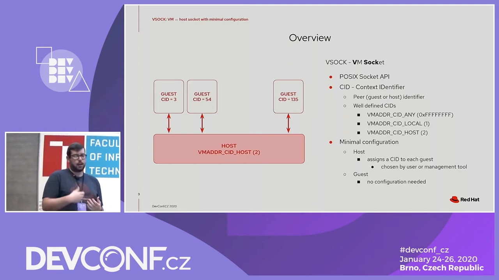

这里的关键认知是：**CID 不是 IP 的另一种写法**。它不参与路由，没有子网掩码，没有网关，也不做 ARP/DNS。它更像"这台虚拟机在宿主眼里的编号"——由宿主在创建虚拟机时分配，分配者可以是人（写死在命令行里），也可以是管理工具（比如 libvirt 自动挑一个空闲的）。

### 1.2 端口还是端口，但和 TCP 端口是两套命名空间

端口这一层看起来和 TCP 一样：服务端 `bind` 一个端口、`listen`、客户端 `connect` 过去[【跳转到 02:40】](https://www.youtube.com/watch?v=R5DQWdPUQSY&t=160)。但两边的端口空间是**彼此独立的**——vsock 的 1234 和 TCP 的 1234 没有任何关系，同一个数字在两边同时被占用不会冲突。演讲里的所有 demo 都统一用 1234，正是因为它在 vsock 世界里只是一个普通数字。

32 位端口带来的直接后果是端口号可以很大。演示里服务端监听后，`ncat` 打印出这样一行：

```text
Ncat: Listening on 4294967295:1234
```

`4294967295` 就是 `0xFFFFFFFF`，也就是 `VMADDR_CID_ANY`——"监听任意 CID"。这是**绑定时的通配符**：服务端不关心客户端从哪个 CID 来，谁连都接。

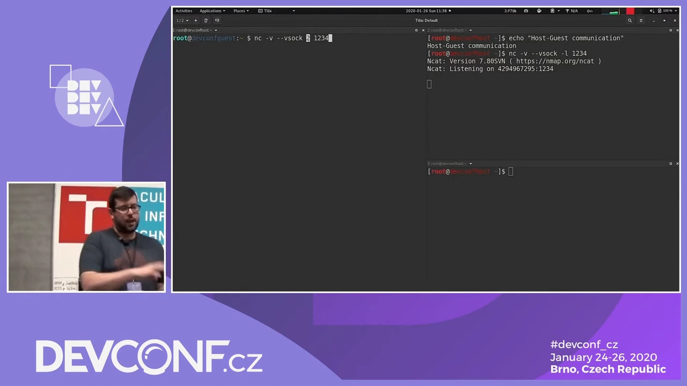

客户端那一侧的地址则必须是具体的。演示中客户机连宿主时用的是 `VMADDR_CID_HOST`（值为 2），宿主连客户机时用的是创建虚拟机时指定的 CID（演示里是 33）。

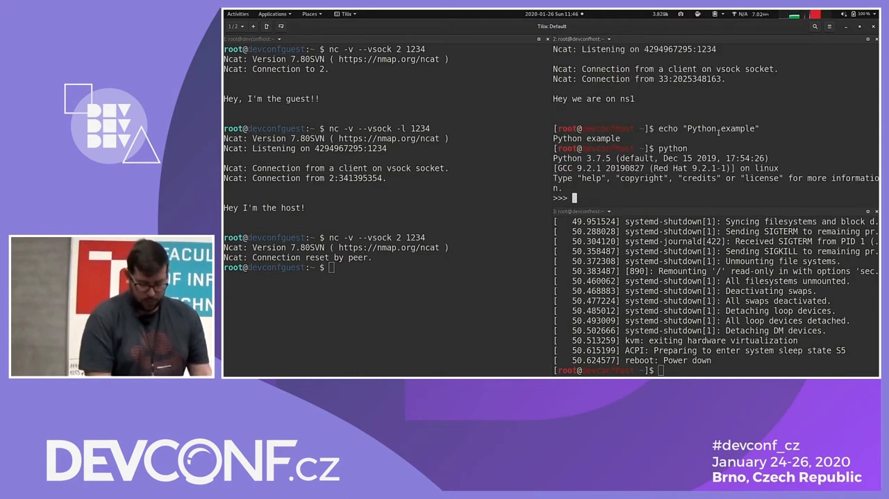

注意第二张图里 `Connection from 33:2025348163` 这一行：`2025348163` 不是谁手工指定的端口，而是客户机内核给这个 socket 分配的**临时端口**（ephemeral port）。这对应 `VMADDR_PORT_ANY` 的用法——绑定端口时填"随便"，内核挑一个空闲的给你，之后用 `getsockname()`/`getpeername()` 把实际值读回来。

### 1.3 地址族换掉，其余 socket 语义不变

对写代码的人来说，把已有的 TCP 程序改成 vsock，改动小到只有"地址"这一处[【跳转到 02:15】](https://www.youtube.com/watch?v=R5DQWdPUQSY&t=135)：

```python
import socket

s = socket.socket(socket.AF_VSOCK, socket.SOCK_STREAM)
s.bind((socket.VMADDR_CID_ANY, 1234))   # 监听任意 CID 的 1234
s.listen()
conn, addr = s.accept()                # addr 形如 (cid, port)
```

客户机侧则是：

```python
s = socket.socket(socket.AF_VSOCK, socket.SOCK_STREAM)
s.connect((socket.VMADDR_CID_HOST, 1234))   # 连宿主
```

`SOCK_STREAM`（对应 TCP 的流式语义）在所有 transport 上都支持[【跳转到 01:55】](https://www.youtube.com/watch?v=R5DQWdPUQSY&t=115)；`SOCK_DGRAM`（对应 UDP 的数据报语义）则**取决于 transport**，不是每个后端都实现。

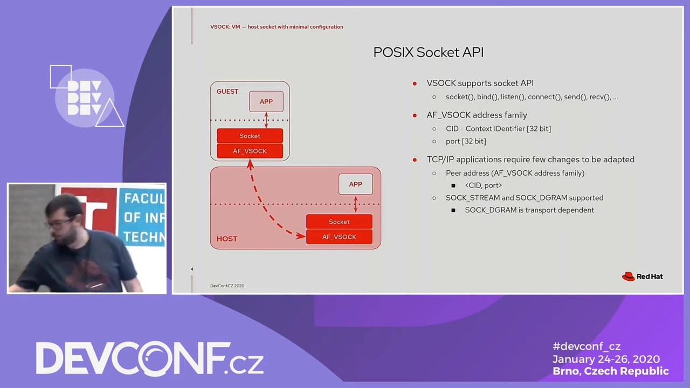

正因为"只是换地址"[【跳转到 03:30】](https://www.youtube.com/watch?v=R5DQWdPUQSY&t=210)，vsock 的实际用户里塞满了本来就要做宿主-客户机通信的东西：QEMU guest agent、Kata 的 container agent（用它启动并控制 VM 里的容器）、Android Debug Bridge（模拟器里的 Android 设备不必配网卡就能 `adb`）。

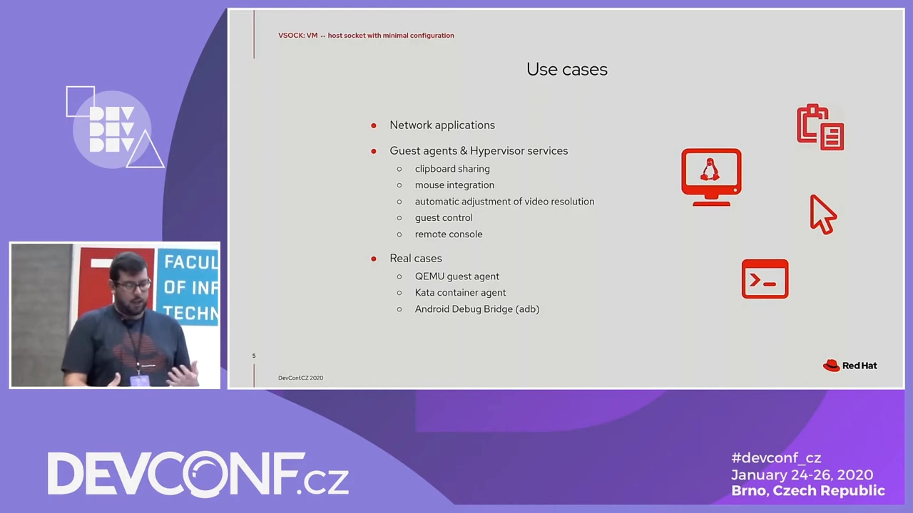

## 二、保留 CID：为什么 0、1、2 不能随便用

地址模型里最容易踩坑的地方是那几个"写死的数字"[【跳转到 01:25】](https://www.youtube.com/watch?v=R5DQWdPUQSY&t=85)。演讲把其中三个直接印在幻灯片上：

| 常量 | 值 | 含义 |
| --- | --- | --- |
| `VMADDR_CID_ANY` | `0xFFFFFFFF`（4294967295） | 绑定时的通配，表示"任意 CID" |
| `VMADDR_CID_LOCAL` | 1 | 本机回环（Linux 5.6 起） |
| `VMADDR_CID_HOST` | 2 | 宿主，客户机永远可以用它找到宿主 |

Linux 头文件里还定义了两个：`VMADDR_CID_HYPERVISOR`（0，指宿主内核）和 `VMADDR_CID_RESERVED`（3，保留）。所以**客户机的 CID 从 3 以上开始分配**——演讲里的示例值 3、33、54、135 全都落在这个区间里。

为什么要保留这几个值？因为它们要回答一个"鸡生蛋"的问题：客户机刚启动、什么都不知道的时候，怎么找到宿主？如果宿主的地址也需要配置或查询，那"零配置"就不成立了。把宿主钉死在 2 上，客户机里的 agent 可以在网络栈还没起来的时候直接 `connect((2, port))`——演讲里的说法是"客户机在任何情况下都能用 CID 2 找到宿主"。

`VMADDR_CID_LOCAL`（1）则是后来的补充：它让**同一台机器上的两个进程**也能用 vsock 互相通信，不需要真的跑一台虚拟机。这个值不能和 2 混用，因为 2 在嵌套场景里指向的是"我的上一层宿主"，而 1 明确表示"就在本机"。

## 三、零配置是怎么做到的：CID 由宿主一次性写入

演讲里最值得记住的一句话是：**"整个需要配置的东西，只有分配给这台虚拟机的 CID。"**[【跳转到 01:50】](https://www.youtube.com/watch?v=R5DQWdPUQSY&t=110)

具体流程是这样的：创建虚拟机时，命令行（或 libvirt 的 XML）里加一个 vsock 设备，并指定 CID；管理工具把它翻译成 QEMU 的参数，QEMU 启动时把 CID 写进这个 virtio 设备的配置空间；客户机里的驱动一加载，就从这个设备读到"我的地址是 33"。演讲把它类比成网卡从 EEPROM 里读 MAC 地址——**地址是设备自带的属性，不是运行时协商出来的**。

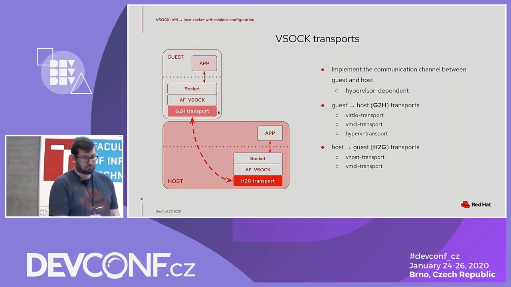

在 Linux 宿主上，这一步落在 `vhost-vsock` 这个字符设备上：用户态（QEMU、Firecracker、Cloud Hypervisor）打开 `/dev/vhost-vsock`，通过 `ioctl(VM_SET_GUEST_CID)` 把 CID 交给内核，之后数据面的收发都在内核里完成。CID 的分配责任因此完全在宿主侧：谁创建虚拟机，谁负责给一个不冲突的号。

对比一下网卡方案要做的功：配 IP、配路由、起网络栈、写防火墙规则、处理接口命名，还要在 Linux 各发行版和 Windows 之间做兼容——而且每一步都可能被客户机里的管理员无意中破坏。vsock 把这些全省掉了：**没有 DHCP，没有配置，开机就在**。

（传输层怎么用 virtqueue 搬数据、vhost 怎么用 eventfd/irqfd 收发中断，是同节下一篇的主题，这里不展开。）

## 四、两个方向都能连：地址模型是对称的

地址模型一旦统一成 `(CID, port)`，两个方向就只是"填谁的 CID"的区别[【跳转到 06:17】](https://www.youtube.com/watch?v=R5DQWdPUQSY&t=377)：

1. 宿主监听、客户机连接：宿主 `bind((VMADDR_CID_ANY, 1234))`，客户机 `connect((VMADDR_CID_HOST, 1234))`。
2. 客户机监听、宿主连接：客户机 `bind((VMADDR_CID_ANY, 1234))`，宿主 `connect((33, 1234))`——33 就是这台虚拟机的 CID。

演讲里用 `ncat --vsock` 把这四种组合都跑了一遍，两个方向都能通。这里体现的正是地址模型的价值：**它没有"服务端必须在宿主"这种隐含假设**，谁提供能力谁监听，另一方按 CID 找过去即可。

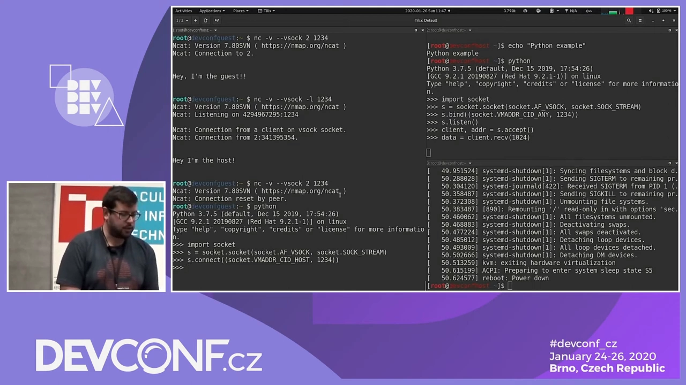

连接建立之后，两端都能通过 `getsockname()`/`getpeername()` 拿回完整的 `(CID, port)` 地址对——演讲里打印出的"远端 CID 是 33、远端端口是内核随机分配的"就是这一步的输出。这也是排查问题的第一手材料：连错了 CID，看对端地址就能发现。

## 五、没有"路由"这一步：vsock 与 TCP 的能力差异

地址模型的简化，代价是能力的收窄。以下几点都是从"没有 IP 层"直接推出来的：

- **没有广播和多播**。CID 指向的是一条确定的点对点链路，"发给所有人"在这个模型里没有意义。演讲对它的定位就是"宿主与客户机之间的**点对点**连接"。
- **不能跨宿主**。CID 只在同一个宿主内部有意义，它没有全局唯一性，也没有跨机的寻址方式。要跨机，得在两端各起一个用户态程序做桥接（比如把 vsock 和 TCP 拼起来）。
- **没有路由、NAT、DNS**。`connect` 的目标必须**当场存在**：宿主那边没人监听这个端口，连接就直接被拒。演讲的网络命名空间演示里，"客户机连宿主被 refused"就是这种情况——不是网络不通，而是那个命名空间里的宿主侧根本没有监听者。
- **TCP 的那一堆选项大多不适用**。拥塞控制、窗口缩放这类建立在 IP 网络之上的机制在这里没有对应物，流控由 transport 自己负责，而不是靠 TCP 的滑动窗口。

换句话说，vsock 换来的不是"更强的网络"，而是"**不需要网络就能通信**"：它跑在 virtio 传输层上，只依赖宿主与客户机之间那条设备通道，不依赖客户机的网络栈是否就绪。

## 六、同一套地址模型的三个延伸

演讲的后半段讲了三个围绕地址模型的新特性[【跳转到 07:47】](https://www.youtube.com/watch?v=R5DQWdPUQSY&t=467)，它们都在回答"CID 的作用域到底有多大"。

**多 transport 共存（Linux 5.5 起）**。在此之前，vsock 核心在运行时只能挂一个 transport，于是嵌套虚拟机里没法同时具备"我是客户机"和"我是宿主"两种身份。5.5 之后可以同时加载两个：L1 里的客户机既用 G2H transport（virtio）跟 L0 通信，又用 H2G transport（vhost）跟 L2 通信。地址模型不变，只是"2 指的是谁"要看你在哪一层。

**本地回环（Linux 5.6 起）**[【跳转到 08:37】](https://www.youtube.com/watch?v=R5DQWdPUQSY&t=517)。新增 `vsock-loopback` transport 和 `VMADDR_CID_LOCAL`（1），让同一台机器上的两个进程不用跑虚拟机就能用 vsock 通信。这对测试和 CI 很有用：不必为了跑一个 vsock 测试而起一台虚拟机。演讲还补了一句边界条件：在 L0 宿主上，`VMADDR_CID_HOST`（2）也能用于本地通信，因为"下面没有别的虚拟机了"；但这个用法只在宿主侧 transport 已加载、且没有更下层时才成立。

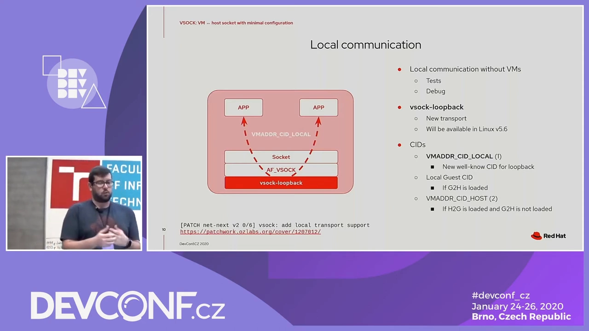

**网络命名空间（当时仍在开发中）**[【跳转到 10:26】](https://www.youtube.com/watch?v=R5DQWdPUQSY&t=626)。默认实现里 CID 分配是全局的，所有网络命名空间共享一份号池。演讲者提交的 RFC 补丁想让 CID 分配变成**每个网络命名空间各自一份**，于是同一个 CID 可以在不同命名空间里重复使用，同一个端口号也能在不同命名空间里各有一个监听者。演示里就出现了"两个不同命名空间的虚拟机都叫 CID 33"的场面。

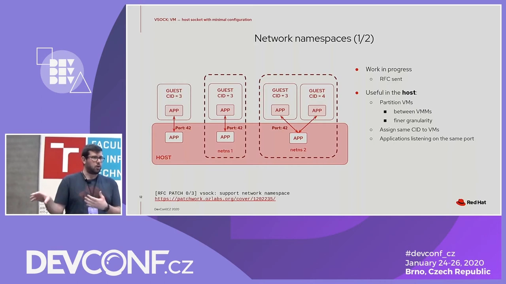

这里也顺带暴露了地址模型的边界：命名空间之间默认**不能**用 vsock 互通。要跨命名空间通信，得靠用户态程序做桥接（UNIX domain socket、TCP 都行）。演讲里有人问"能不能把 vsock socket 映射成一个 UNIX socket 文件"，答案是需要一个用户态应用来做这件事。

## 七、生态已经把 `(CID, port)` 当成一等地址

地址模型是否成立，最终看工具有没有接受它。演讲列出的清单[【跳转到 14:00】](https://www.youtube.com/watch?v=R5DQWdPUQSY&t=840)说明这件事已经完成：`wireshark` 能抓 vsock 流量、`iproute2` 的 `ss` 能列出 vsock socket、`tcpdump` 已合并支持、`nmap` 的 `ncat` 带 `--vsock`、`nbd` 可以走 vsock 访问块设备，还有 `iperf-vsock`、`socat-vsock` 这类分支工具用来压测和转发。

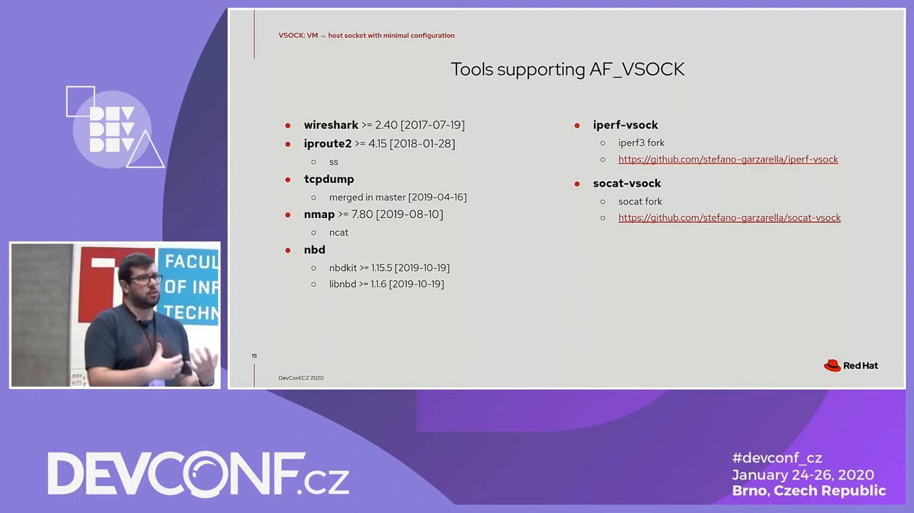

语言侧的绑定也基本齐了：Python 的 `socket` 模块里直接就有 `AF_VSOCK` 和 `VMADDR_CID_*` 常量，其他语言则各自提供对 vsock 地址族的绑定。对使用者来说，这意味着**不需要学一套新的 API**——地址换了，编程模型没换。

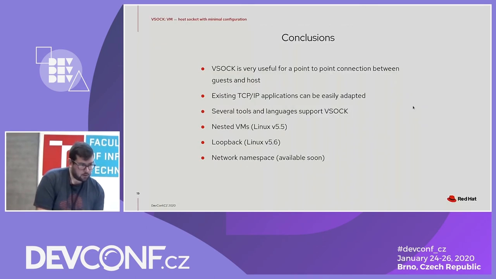

## 小结

- vsock 的地址是 `(CID, port)` 二元组：CID 是 32 位的"虚拟机身份"，port 是 32 位的"服务编号"，两者都不参与路由。
- CID 由宿主在创建虚拟机时分配并写进设备配置，客户机开机即知，**零配置**；宿主固定占用 2，所以客户机永远知道往哪连。
- 保留值各有职责：`0xFFFFFFFF` 是绑定通配，1 是本机回环，2 是宿主，0 和 3 也保留，因此客户机 CID 从 3 以上开始分配。
- vsock 端口与 TCP 端口是**两套独立命名空间**，同一个数字互不冲突；`VMADDR_PORT_ANY` 让内核挑临时端口，之后用 `getsockname`/`getpeername` 读回实际值。
- 它解决的是"客户机网络栈没起来甚至没有网卡时，宿主仍要能进沙箱"的问题：走 virtio 传输层，不依赖 IP、NAT、DNS。
- 代价是能力收窄：没有广播/多播、不能跨宿主、没有路由这一步、`connect` 的目标必须当场存在；TCP 的多数选项不适用。
- CID 的作用域可以按 transport 和网络命名空间切分：嵌套场景下 L1 同时具备两个身份，本地回环让无虚拟机测试成为可能，per-netns 的 CID 分配则允许复用同一个号。

## 关键术语速查

| 术语 | 一句话解释 |
| --- | --- |
| vsock | VM socket，宿主与客户机之间的套接字通道，用标准 POSIX socket API |
| CID | Context Identifier，32 位整数，标识一台客户机或宿主，相当于"虚拟机的身份编号" |
| `AF_VSOCK` | vsock 的地址族，替代 `AF_INET`；地址结构是 `(CID, port)` |
| `VMADDR_CID_ANY` | `0xFFFFFFFF`，绑定时的通配，表示监听任意 CID |
| `VMADDR_CID_LOCAL` | 值为 1，本机回环用的 CID（Linux 5.6 起） |
| `VMADDR_CID_HOST` | 值为 2，宿主的固定 CID，客户机在任何情况下都能用它找到宿主 |
| `VMADDR_PORT_ANY` | 绑定端口时表示"由内核挑一个空闲端口" |
| G2H / H2G transport | 客户机到宿主 / 宿主到客户机的传输实现，如 virtio、vhost、vmci、hyperv |
| vhost-vsock | 宿主内核里的 vsock 后端，通过 `/dev/vhost-vsock` 接收 CID 与 virtqueue |
| 临时端口 | 客户端未指定端口时内核分配的端口，如演示里的 2025348163 |