# vsock 的传输实现：`AF_VSOCK` 落在内核的哪一层

> 视频来源：[virtio-vsock in QEMU, Firecracker and Linux: Status, Performance and Challenges](https://www.youtube.com/watch?v=LFqz-VZPhFE)（YouTube · KVM Forum 2019，讲者是 AWS 的 Andra Paraschiv 与 Red Hat 的 Stefano Garzarella）｜时长约 30 分钟
> 导读：这是一支"实现位置"导向的演讲。它不解释 CID 是什么（那是同节上一篇 4.1.1 的内容），而是回答：同一份 `AF_VSOCK` socket 程序，在客户机里跑和在宿主里跑，底下各自挂着哪几个内核模块、哪几个函数、哪几个队列；宿主侧的后端为什么可以在内核里、也可以在 VMM 里、还可以在用户态进程里。

## 本讲要解决的核心问题（SCQA）

**背景**：上一篇已经知道，vsock 把寻址从 `(IP, port)` 换成 `(CID, port)`，`bind`/`listen`/`connect`/`send`/`recv` 的语义与 TCP 一模一样，所以已有的网络程序几乎不用改。

**冲突**：但"地址族"不是一句抽象承诺，它必须落在具体的内核代码里。同一个 `AF_VSOCK` 常量，在客户机内核里连着 `virtio_transport`，在宿主内核里连着 `vhost_transport`；而宿主侧的后端实现还有第三种可能——干脆不进内核，由 VMM 自己模拟设备、对外只暴露一个 UNIX domain socket。三种落点，安全模型、性能上限、依赖的内核特性完全不同。

**疑问**：`AF_VSOCK` 到底实现在哪一层？客户机和宿主各自的内核里有哪些模块？一条 `send()` 发出的数据，经过哪些函数、哪几个队列、被谁唤醒？

**回答（中心思想）**：vsock 是一条**三层结构**——最上面是 `AF_VSOCK` 地址族（由 `vsock` 核心模块提供，与传输无关），中间是可插拔的**传输层**（客户机侧 `virtio_transport`、宿主侧 `vhost_transport`），最下面是**设备与队列**（virtio-vsock 的 virtqueue，或 VMM 模拟的 MMIO 设备 + UNIX domain socket）。换传输不换 socket 语义，这正是 vsock 能在 QEMU、Firecracker、Hyper-V、VMware 上同时存在的原因。

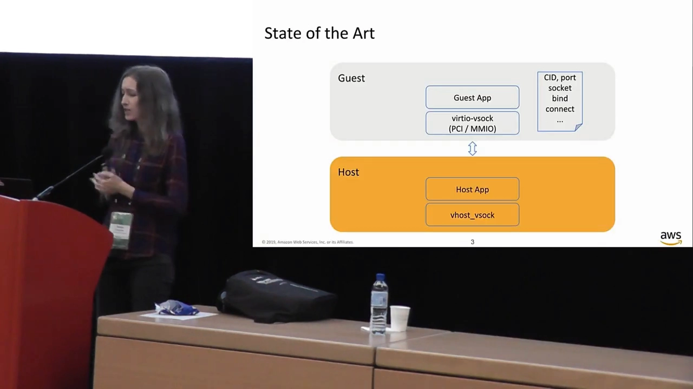

## 一、三层结构：地址族、传输层、设备层

### 1.1 换掉的只有寻址，不是 socket 接口

演讲开场的对照图很直白：客户机与宿主各有一个应用，想在两者之间开一条本地通道。传统做法是放一块网卡，配 IP、配路由，然后用 socket API 按 IP 和端口寻址；vsock 的做法是**去掉寻址相关的全部配置**，换成一块专用设备，应用侧只把"IP"换成"CID"（上下文标识），端口保持不变。[【跳转到 00:56】](https://www.youtube.com/watch?v=LFqz-VZPhFE&t=56)

这个替换之所以成立，前提是**内核里要有对应的支持**：客户机侧要有 vsock 支持，宿主侧要有 vhost 支持；客户机侧呈现给它的设备可以是 PCI，也可以是 MMIO，由客户机自己选择。[【跳转到 01:46】](https://www.youtube.com/watch?v=LFqz-VZPhFE&t=106)

需要这条通道的典型场景有三类：**guest agent**（宿主进客户机执行命令、取状态）、**普通网络应用**（`SOCK_STREAM` 类型的程序，不用改代码就能跑在 vsock 上）、**hypervisor 服务**（文件共享、日志与指标采集）。演讲里举的例子是：看客户机里发生了什么、行为是否异常，都可以走这条通道而不是走网络。[【跳转到 02:11】](https://www.youtube.com/watch?v=LFqz-VZPhFE&t=131)

顺带说清一个边界：本讲全程讨论的都是**客户机与宿主之间**的通信。如果想让两台客户机直接通信，宿主必须额外实现"转发/路由"或"共享内存"，当前实现并不做这件事（后面问答部分会再展开）。

### 1.2 客户机侧：`AF_VSOCK` 在核心，`virtio_transport` 在传输层

真正把分层画清楚的是 QEMU 那一页幻灯片。客户机内核里自上而下是三层：

```text
Guest app
   ↕  socket(AF_VSOCK, ...) 等系统调用
Socket      ← 通用 socket 层，按地址族分发
VSOCK       ← vsock 核心（地址族实现，与传输无关）
virtio_transport   ← 传输层：把 vsock 的字节流切成 virtio-vsock 包
   ↕  virtqueue / 中断
（virtio-vsock 设备）
```

宿主内核里则是另外三层，最下面那一层名字不同：

```text
Host app
   ↕  socket(AF_VSOCK, ...)
Socket
VSOCK
vhost_transport    ← 传输层：直接操作客户机的 virtqueue
```

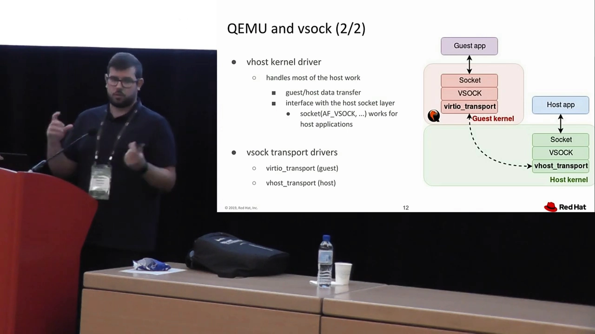

这张图是本节的核心结论：**`AF_VSOCK` 是"核心"这一层的东西，客户机和宿主用的是同一份核心代码；不同的是它下面挂的传输驱动。** 所以宿主上的应用用 `AF_VSOCK` 地址族加 `SOCK_STREAM` 类型建 socket，也能直接和客户机里的应用对话——它并不需要"模拟"一个客户机，只需要一个能操作客户机队列的传输驱动。[【跳转到 14:16】](https://www.youtube.com/watch?v=LFqz-VZPhFE&t=856)

### 1.3 传输层是可插拔的：一份核心，多条传输

演讲里给了一条时间线：Linux 内核里的 vsock 故事始于 2013 年，第一版实现随 **VMCI** 传输一起合入；2016 年加入 **virtio** 与 **vhost** 两条传输；2017 年又加入 **Hyper-V** 传输。[【跳转到 14:41】](https://www.youtube.com/watch?v=LFqz-VZPhFE&t=881)

也就是说，"vsock"这个词指的是**地址族加核心**，而"virtio-vsock"只是它下面众多传输中的一条。这一点在讲多传输支持时会再次出现：`af_vsock.ko` 这个模块的别名由 `MODULE_ALIAS_NETPROTO` 与 `PF_VSOCK` 组成，意味着**核心可以独立于任何传输被加载**。[【跳转到 23:26】](https://www.youtube.com/watch?v=LFqz-VZPhFE&t=1406)

这套代码的维护规模也值得一提：演讲那年，整个 vsock 子系统（含核心与全部传输）收到 **16 位开发者的 45 个提交**，新增 674 行、删除 426 行；按雇主统计，Red Hat 占 46.7% 的提交、44.6% 的行数，Microsoft 与 Linutronix 紧随其后。[【跳转到 15:06】](https://www.youtube.com/watch?v=LFqz-VZPhFE&t=906)

## 二、宿主侧后端落在哪里：内核、VMM、还是用户态

客户机侧的实现位置基本是固定的（virtio-vsock 设备驱动 + `virtio_transport`）。真正有多种选择的是**宿主侧**，而这三个选择恰好对应三种不同的安全与性能取舍。

### 2.1 vhost-vsock：把后端放进宿主内核

第一代做法是 vhost。它的思路是：设备配置由 VMM 完成，配置好之后**数据通路完全绕开 VMM**——宿主内核直接访问客户机内存里的缓冲区，双方用 eventfd 互相通知。[【跳转到 03:51】](https://www.youtube.com/watch?v=LFqz-VZPhFE&t=231)

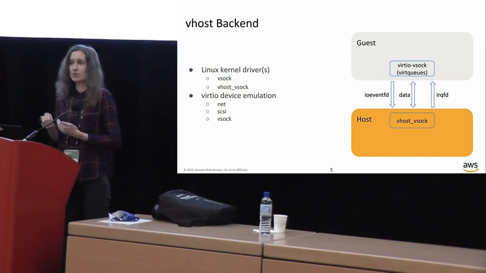

具体到三条通路：

- **ioeventfd**：客户机 kick 队列时，写一个 MMIO/PIO 地址，内核里的 eventfd 被触发，vhost 线程被唤醒；
- **data**：vhost 直接读客户机预分配的缓冲区，不需要 VMM 参与拷贝；
- **irqfd**：宿主有数据要送进客户机时，往 eventfd 写一下，内核直接给客户机注入中断。

这套机制在 virtio-net、virtio-scsi、virtio-vsock 上是同一套，所以演讲里说"上游对 net、scsi、vsock 都已有支持"。[【跳转到 03:26】](https://www.youtube.com/watch?v=LFqz-VZPhFE&t=206)

### 2.2 QEMU：设备只做配置与迁移

QEMU 的用法一行命令行就能说清：

```text
qemu-system-x86_64 ... -device vhost-vsock-pci,guest-cid=3
```


关键认知是：**QEMU 里的这个"设备"其实是个空壳**。它只负责两件事——让用户或管理工具设置客户机 CID，以及处理热迁移；真正干活的（virtqueue 操作、内部 virtio 设备模拟、与宿主 socket 层的对接）全在 vhost 内核驱动里。演讲者明确说，正因为把工作放在内核里，才能拿到更好的性能。[【跳转到 13:51】](https://www.youtube.com/watch?v=LFqz-VZPhFE&t=831)

热迁移的语义也由此决定：迁移之后，已经连上的 `SOCK_STREAM` socket 会断开，应用必须处理连接重置错误并重连；客户机 CID 在新宿主上可能不可用（比如迁到了另一台机器），这时设备会主动通知客户机 CID 变了。

### 2.3 Firecracker：干脆不要 vhost

Firecracker 走过一条相反的路。它在 v0.18 之前用的是 vhost 实现，但那是**实验性**的：想用 virtio-vsock 必须在编译期打开对应 feature，不是默认可用。[【跳转到 05:31】](https://www.youtube.com/watch?v=LFqz-VZPhFE&t=331)

从 v0.18 起，Firecracker 换成了 **vhost-less** 方案：virtio-vsock 的设备模型跑在 VMM 自己里面（走 MMIO），宿主侧对外只暴露一个 **UNIX domain socket**。[【跳转到 04:41】](https://www.youtube.com/watch?v=LFqz-VZPhFE&t=281)

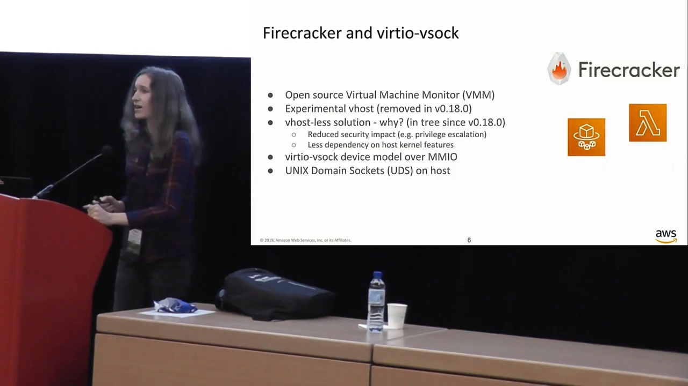

为什么放弃 vhost？演讲给了两条理由：

1. **安全面**：vhost 让宿主内核对客户机缓冲区有直接访问权，vhost 驱动里一个 bug 就可能变成客户机逃逸到宿主的提权路径。演讲者提到当时刚有一个 vhost 内核实现的 CVE，是缓冲区溢出导致从客户机提权。[【跳转到 06:46】](https://www.youtube.com/watch?v=LFqz-VZPhFE&t=406)
2. **功能面与依赖面**：换成 UDS 之后，宿主侧只需要一个普通的 UNIX socket 服务器，不必依赖宿主内核的 vhost 特性，需要维护的代码面也变小了。

代价是数据要多走一次用户态：客户机 → VMM 的 virtio-vsock 设备模型 → 环形缓冲区 → UNIX domain socket → 宿主应用。

### 2.4 两种落点的对照

| 维度 | vhost-vsock（QEMU） | vhost-less（Firecracker） |
| :--- | :--- | :--- |
| 设备模拟位置 | 宿主内核 | VMM 用户态进程 |
| 数据通路 | 内核直接读写客户机缓冲区 | VMM 转发到 UNIX domain socket |
| 宿主对客户机内存的访问 | 有（vhost 驱动） | 无（只有 VMM 通过已映射的队列访问） |
| 依赖的宿主内核特性 | vhost 模块 | 无，只要 UDS |
| 主要风险 | vhost 驱动漏洞导致提权 | 多一次拷贝，吞吐受用户态限制 |
| 性能 | 更高 | 略低，但可通过调大缓冲区追平 |

## 三、配置面：一个设备、一个 CID、一个 socket 路径

Firecracker 的配置模型很简洁：**每台虚拟机一个 virtio-vsock 设备**，配置项只有两个——客户机 CID 和宿主侧的 UDS 路径；VMM 默认在这个 UDS 路径上监听，连接的发起方向可以是宿主发起，也可以是客户机发起。[【跳转到 08:01】](https://www.youtube.com/watch?v=LFqz-VZPhFE&t=481)

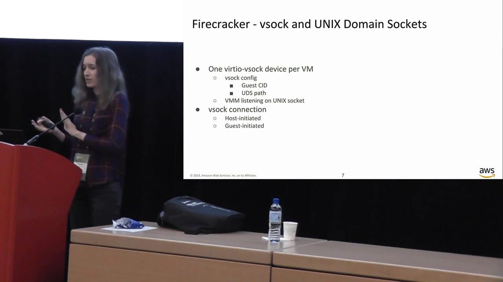

### 3.1 宿主发起：UDS 之上还要一次"连接协商"

宿主应用只知道一个 UDS 路径，而客户机里的服务监听在某个 vsock 端口上，两者之间需要有人做映射——这个人是 VMM。VMM 内部有一个 vsock endpoint，它持有 `VMADDR_CID_HOST`（也就是 2），一侧对着客户机的 vsock，另一侧对着宿主配置的 UDS 路径。[【跳转到 08:26】](https://www.youtube.com/watch?v=LFqz-VZPhFE&t=506)

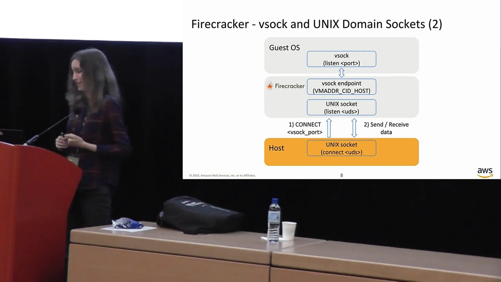

注意图中标注的那条 `CONNECT` 消息（携带目标 vsock 端口）：宿主在真正发数据之前，必须先发一条特殊消息告诉 VMM"我要连某个端口"，因为 VMM 需要知道该把这个 UDS 连接映射到客户机的哪个 endpoint。映射建立之后，后续数据就直通了。

### 3.2 客户机发起：UDS 路径带上端口

反方向更简单，也更"像 socket"。客户机应用 `connect` 到 CID 2 的某个端口；宿主侧则监听一个**按端口区分**的 UDS 路径——也就是配置时给的基础路径再拼上端口号。中间 VMM 依然扮演 vsock endpoint，但这次不需要额外的协商消息，数据可以直接双向流动。[【跳转到 09:41】](https://www.youtube.com/watch?v=LFqz-VZPhFE&t=581)

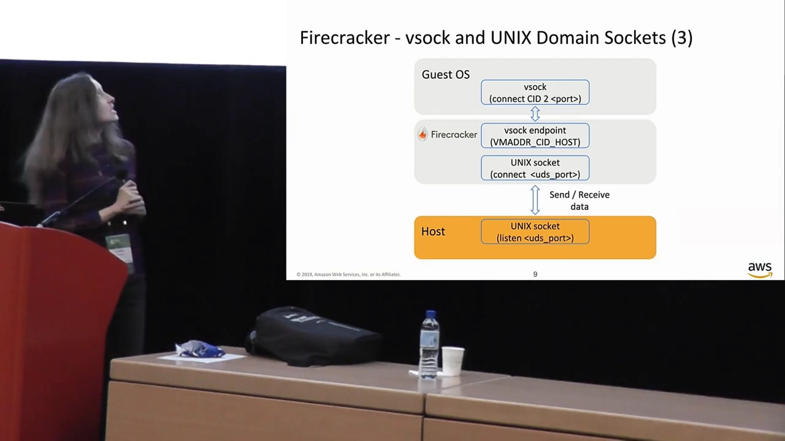

两条路径合起来说明一件事：**UDS 只是宿主侧的"落地点"，CID 与端口语义仍然完整保留在 VMM 内部。** 宿主应用看到的不是 CID，而是一个文件系统路径；这正是 vhost-less 方案能减少内核依赖的原因，也是它必须由 VMM 承担映射的原因。

### 3.3 这条路径的性能上限

多一次用户态转发，代价有多大？演讲给了一组实测：客户机到宿主方向，横轴是给 iperf 的用户态缓冲区大小，纵轴是吞吐；四条曲线对应不同的 UNIX socket 发送缓冲区（64K / 128K / 256K / 512K）。[【跳转到 11:21】](https://www.youtube.com/watch?v=LFqz-VZPhFE&t=681)

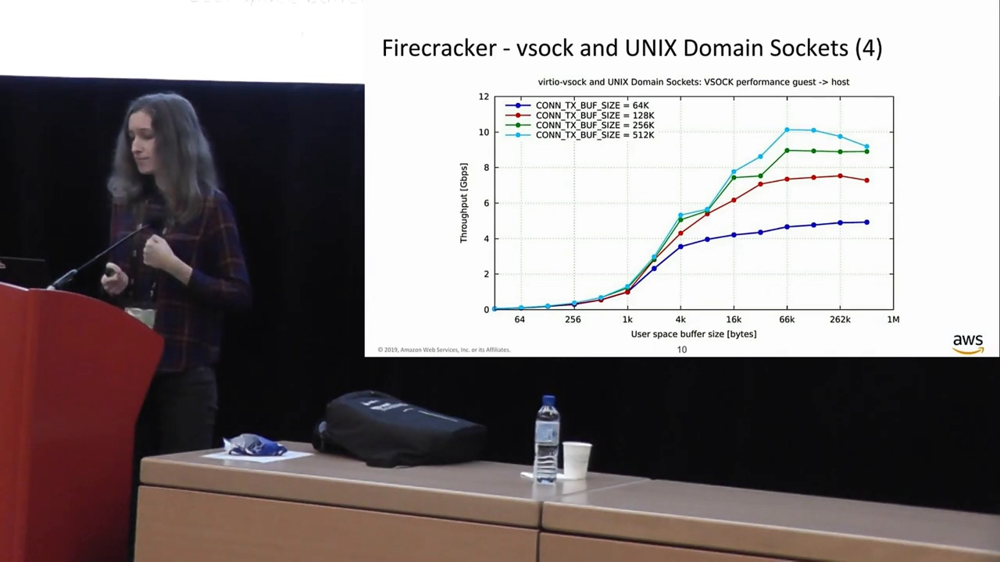

结论是：**瓶颈不在 vsock 协议本身，而在缓冲区大小**。把两端的缓冲区都调大，这条"多绕一次用户态"的路径也能跑到 10 Gbps 量级。VMM 内部那个环形缓冲区的作用也在这里——当宿主来不及从 UDS 取走数据时，包先落进环形缓冲区排队。

## 四、数据面：一帧 `virtio_vsock_hdr` 与 credit 流控

传输层要做的事，说到底是把字节流切成 virtio-vsock 的包，并在包头上携带流控信息。virtio-vsock 用的是**基于 credit 的流控**，每个 peer 在自己的 socket 状态里维护三个变量：[【跳转到 15:56】](https://www.youtube.com/watch?v=LFqz-VZPhFE&t=956)

- `buf_alloc`：接收缓冲区大小，即"用户还没读走的字节最多能堆多少"，可用 `setsockopt()` 调整，默认 256 KB；
- `fwd_cnt`：已经收到的字节数，"已交付"计数，用户态每消费一些就增加；
- `tx_cnt`：已经发出的字节数。

这些变量通过两种方式同步给对方：**每个数据包的包头里都带**，或者用一条**专门的消息**（`VIRTIO_VSOCK_OP_CREDIT_UPDATE`）只更新 credit 而不携带数据。

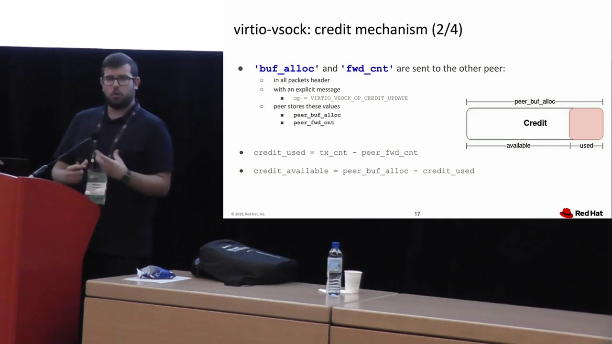

对端拿到这两个值后，能反推出自己还能发多少：

$$
\text{credit\_used} = \text{tx\_cnt} - \text{peer\_fwd\_cnt}
$$

$$
\text{credit\_available} = \text{peer\_buf\_alloc} - \text{credit\_used}
$$

当 `credit_available` 归零，发送方就必须停下，直到收到新的 credit 更新。这就实现了"接收方不溢出、发送方不空转"的可靠连接语义——注意它替代的是 TCP 的滑动窗口，而不是 IP 层的拥塞控制。

### 4.1 优化一：用阈值把 CREDIT_UPDATE 消息压下去

老实现的逻辑很朴素：接收方**只要用户读走了一个字节**，就发一条 `CREDIT_UPDATE` 告诉对端。结果是一条数据流旁边跟着一串碎小的 credit 消息，包数量翻倍。[【跳转到 17:11】](https://www.youtube.com/watch?v=LFqz-VZPhFE&t=1031)

优化办法是在 credit 条上画一条**阈值线**：只有当发送方看到的可用 credit 掉到阈值以下时，接收方才主动发 `CREDIT_UPDATE`；其余时候靠数据包头里的字段"顺路"更新。[【跳转到 17:36】](https://www.youtube.com/watch?v=LFqz-VZPhFE&t=1056)

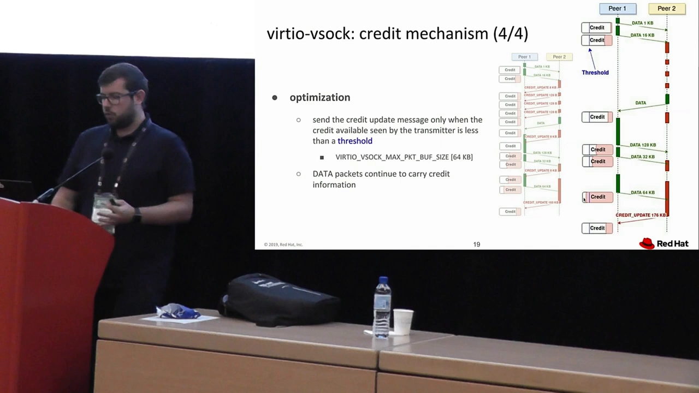

对比两张信用条图可以直观看到效果：优化前每个小包后面都跟一条 `CREDIT_UPDATE`，优化后整段数据流只在末尾补一条较大的更新。这个改动很小，但把"每包一次通知"降成了"每窗口一次通知"。

### 4.2 优化二：把包从 4 KB 放大到 64 KB

第二个瓶颈在发送路径上。演讲给了一张完整的 `send()` 调用链：[【跳转到 18:01】](https://www.youtube.com/watch?v=LFqz-VZPhFE&t=1081)

```text
用户态 buffer
   │ send()
   ↓
sock->ops->sendmsg()            ← 通用 socket 层
   ↓
vsock_stream_sendmsg()          ← vsock 核心：循环调用传输层
   ↓
transport->stream_enqueue()
   ↓
virtio_transport_stream_enqueue()   ← 客户机与宿主共用的代码
   ↓
transport->send_pkt()
   ├─ virtio_transport_send_pkt()   ← 客户机：virtqueue_add_sgs → send worker → virtqueue_kick
   └─ vhost_transport_send_pkt()    ← 宿主：vhost_get_vq_desc → send worker → vhost_signal
```

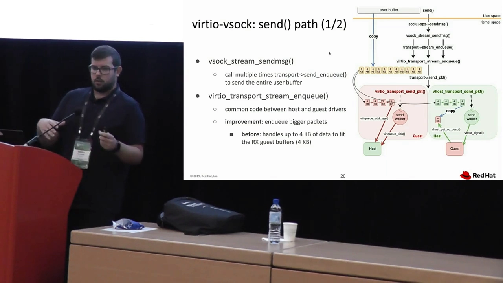

注意图中的 `copy`：用户缓冲区的内容要先拷进传输层的包，因为包大小有上限，所以 `vsock_stream_sendmsg` 必须**多次调用** `stream_enqueue` 才能发完一整块数据。

这个上限原来是 **4 KB**。原因是这段代码在客户机与宿主驱动之间共用，而宿主侧的缓冲区是由客户机预分配的，客户机那边只给了 4 KB 一块。[【跳转到 18:26】](https://www.youtube.com/watch?v=LFqz-VZPhFE&t=1106)

优化做了两件事：

1. 把 `virtio_transport_stream_enqueue` 生成的包上限提到 **64 KB**（即 `VIRTIO_VSOCK_MAX_PKT_BUF_SIZE`，virtio-vsock 设备能处理的最大包）；
2. 让宿主驱动按客户机实际分配的缓冲区大小（仍是 4 KB）**把大包再拆开**送进队列。

这样客户机就能一次把 64 KB 交给宿主，而不必拆成 16 次。

### 4.3 顺带修掉的一个内存坑

开发这组补丁时还发现一个问题：客户机收到**小包**时会占用巨量内存。修法是加一次额外拷贝来限制内存占用——也就是说，为了省内存，宁可多拷一次。[【跳转到 19:16】](https://www.youtube.com/watch?v=LFqz-VZPhFE&t=1156)

这组改动合起来就是一个 5 个补丁的系列，随 **Linux 5.4** 上游发布：[【跳转到 19:41】](https://www.youtube.com/watch?v=LFqz-VZPhFE&t=1181)

- 限制每个 socket 的内存占用（对小包加一次拷贝）；
- 减少 credit 更新消息；
- 修 `virtio_transport_inc_tx_pkt` 的锁；
- vhost/vsock 用多个缓冲区拆包发送；
- 把允许的最大包大小改为 `VIRTIO_VSOCK_MAX_PKT_SIZE`。

效果是客户机到宿主方向的吞吐出现一个明显的台阶：

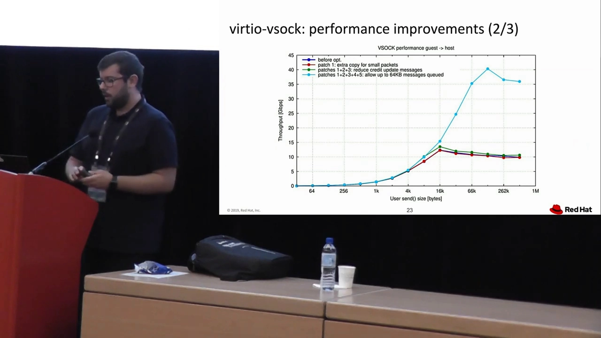

四条线是**累积**关系（浅蓝包含全部补丁）。可以看出真正的大跳变来自最后那个 64 KB 包的改动；反方向（宿主到客户机）没有同样的尖峰，因为客户机侧的缓冲区仍然是 4 KB，瓶颈换到了客户机。

## 五、多传输：一个 socket 怎么选传输

前面说过，`af_vsock.ko` 这个核心模块可以独立于传输加载。但老实现有个硬限制：**运行时只允许加载一条传输**（`virtio_transport` 或 `vhost_transport`）。这在嵌套虚拟化里直接卡死——L1 既是客户机（对上要用 `virtio_transport`）又是 hypervisor（对下要用 `vhost_transport`），两条必须同时存在。[【跳转到 22:11】](https://www.youtube.com/watch?v=LFqz-VZPhFE&t=1331)

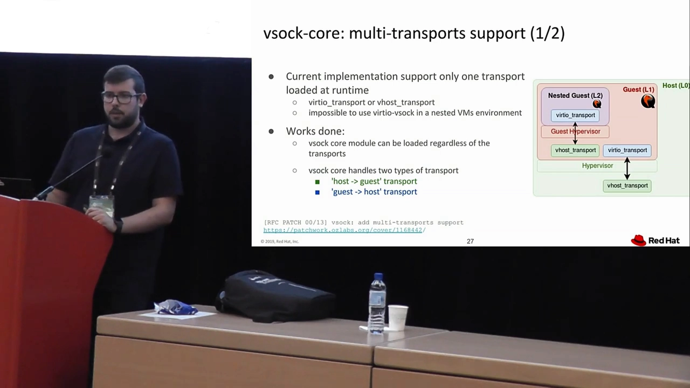

多传输支持的解法是**按远端 CID 选传输**，把传输分成两类：[【跳转到 23:26】](https://www.youtube.com/watch?v=LFqz-VZPhFE&t=1406)

- **host → guest 传输**：处理通信中宿主的那一半，QEMU/KVM 场景下就是 `vhost_transport`；
- **guest → host 传输**：处理通信中客户机的那一半，就是 `virtio_transport`。

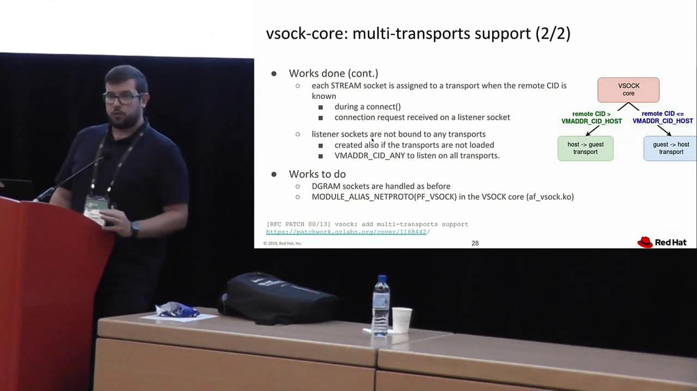

分派时机有两个：

- `connect()` 时——用户已经指定了远端 CID；
- 监听 socket 收到连接请求时——此时远端 CID 就是发起方的 CID。

而**监听 socket 本身不绑定任何传输**：它可以在传输模块还没加载时就创建出来，也可以用 `VMADDR_CID_ANY` 在所有传输上监听。这条设计让"先起服务、后加载驱动"成为可能。

### 5.1 另外两条待办

除了多传输，演讲列出的下一步还有两个：

- **network namespace**：把 vsock 的地址空间按 namespace 切开，这样不同 namespace 里的应用可以绑定同一个端口。这在嵌套环境里尤其有用——可以把宿主侧应用与客户机侧应用隔到不同域里，避免端口冲突。[【跳转到 21:21】](https://www.youtube.com/watch?v=LFqz-VZPhFE&t=1281)
- **vhost-user 作为传输**：让后端跑在独立用户态进程里（与 virtio-fs 的 virtiofsd 是同一思路）。好处是不必为 vsock 重新实现 virtio 已经做好的特性，比如 mergeable buffers。[【跳转到 21:46】](https://www.youtube.com/watch?v=LFqz-VZPhFE&t=1306)

## 六、生态与边界

### 6.1 工具与语言的支持情况

到 2019 年，vsock 的工具链已经基本齐了：`wireshark` 能解析 vsock 流量，`iproute2` 的 `ss` 能列出 vsock socket，`tcpdump` 已合入主分支，`nmap` 的 `ncat` 支持 `--vsock`，`nbd`/`libnbd` 能通过 vsock 访问块设备，还有一个 iperf3 的 fork 专门做 vsock 压测。[【跳转到 20:56】](https://www.youtube.com/watch?v=LFqz-VZPhFE&t=1256)

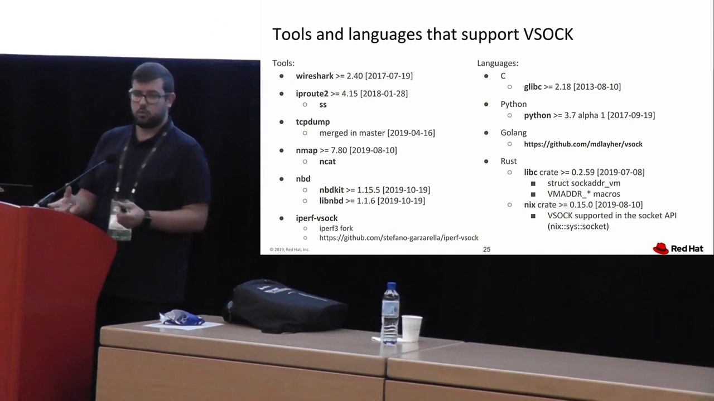

语言侧的关键是**地址结构的绑定**：C 靠 glibc 的 `sockaddr_vm`，Python 3.7 起原生支持，Go 有 `mdlayher/vsock`，Rust 有 `nix` 的 VMADDR 系列宏与 `libc` 的 `sockaddr_vm`。

### 6.2 三个明确的"不支持"

问答环节把边界划得很清楚：

- **没有 loopback**。宿主上起两个 vsock，一个监听一个连接，它们连不到一起。原因是缺少一个"本地 CID"的概念；这也让嵌套环境下的自动化测试很难写——L1 里的测试进程无法用 loopback 自测。[【跳转到 24:41】](https://www.youtube.com/watch?v=LFqz-VZPhFE&t=1481)
- **没有客户机到客户机的直连**。当前实现是**点对点**的，不做路由；要让两台客户机通信，宿主必须额外实现转发。曾经有过这样的实现，但因为会引入客户机之间的攻击面而被移除。[【跳转到 27:42】](https://www.youtube.com/watch?v=LFqz-VZPhFE&t=1662)
- **Windows 驱动没有上游**。目前只有串口路径，vsock 驱动尚未进入上游。[【跳转到 25:31】](https://www.youtube.com/watch?v=LFqz-VZPhFE&t=1531)

此外，同一宿主上混跑不同传输（VMware 的 VMCI、Hyper-V 的传输、Linux 的 virtio）目前也不支持，属于未来工作。

## 小结

- vsock 是**三层结构**：`AF_VSOCK` 地址族（`vsock` 核心，`af_vsock.ko`，与传输无关）+ 可插拔传输层 + 设备与队列层。客户机与宿主共用同一份核心，差别只在传输驱动。
- 客户机侧的落点是固定的：`virtio_transport` 加 virtio-vsock 设备（PCI 或 MMIO）；宿主侧有三种落点——内核的 `vhost_vsock`、VMM 内的设备模型加 UDS、以及用户态后端。
- vhost 的性能来自"绕开 VMM"：配置完成后，宿主内核直接读写客户机缓冲区，用 ioeventfd/irqfd 双向通知。
- vhost-less 的收益是安全面与依赖面：宿主不再直接访问客户机内存，也不再依赖 vhost 内核特性；代价是多一次用户态转发，靠调大缓冲区仍可到 10 Gbps 量级。
- 数据面的核心是 credit 流控：`buf_alloc`/`fwd_cnt`/`tx_cnt` 三个变量经包头或 `CREDIT_UPDATE` 同步，发送方据此算出可用 credit 并限流。
- 两个关键优化：用阈值把 `CREDIT_UPDATE` 从"每包一次"降为"每窗口一次"；把包上限从 4 KB 提到 64 KB 并让宿主按 4 KB 拆包。两者叠加，客户机到宿主吞吐出现台阶式提升（Linux 5.4）。
- 多传输支持按**远端 CID** 分派 `host → guest` 与 `guest → host` 两类传输，监听 socket 不绑定传输，从而支持嵌套虚拟化。

## 关键术语速查

| 术语 | 一句话解释 |
| --- | --- |
| `AF_VSOCK` | vsock 的地址族常量，落在 socket 核心层，客户机与宿主共用同一份实现 |
| vsock 核心（`af_vsock.ko`） | 只做地址族与 socket 语义，不关心底下用哪条传输；别名由 `MODULE_ALIAS_NETPROTO` 与 `PF_VSOCK` 组成 |
| `virtio_transport` | 客户机侧的传输驱动，把字节流切成 virtio-vsock 包并塞进 virtqueue |
| `vhost_transport` / `vhost_vsock` | 宿主侧的传输驱动，直接操作客户机的 virtqueue，绕开 VMM |
| `virtio-vsock` 设备 | 客户机看到的设备，可以是 PCI 也可以是 MMIO，由客户机选择 |
| ioeventfd / irqfd | vhost 与客户机之间的两条通知通路：前者客户机通知宿主，后者宿主注入中断 |
| `VIRTIO_VSOCK_OP_CREDIT_UPDATE` | 只更新 credit、不携带数据的独立消息；优化后改为低于阈值才发 |
| `buf_alloc` / `fwd_cnt` / `tx_cnt` | credit 流控的三个状态量：接收缓冲区大小、已交付字节数、已发送字节数 |
| `VIRTIO_VSOCK_MAX_PKT_BUF_SIZE` | virtio-vsock 设备能处理的最大包，64 KB；优化前发送路径被限制在 4 KB |
| vhost-less | Firecracker v0.18 起的方案：设备模型在 VMM 内，宿主侧只暴露 UNIX domain socket |
| `VMADDR_CID_HOST` | 宿主固定使用的 CID（值为 2），客户机侧连宿主时填它 |
| 多传输（multi-transport） | 同一内核同时加载多条传输，按远端 CID 分派 host→guest 与 guest→host 两类传输 |