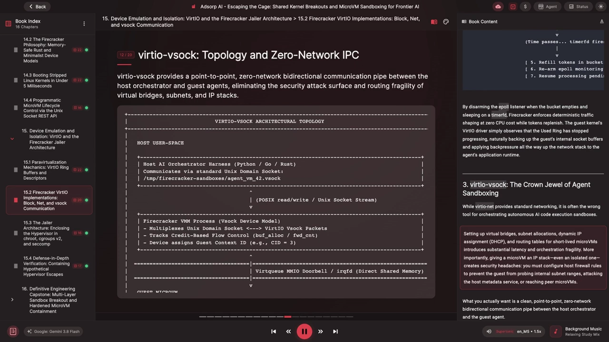
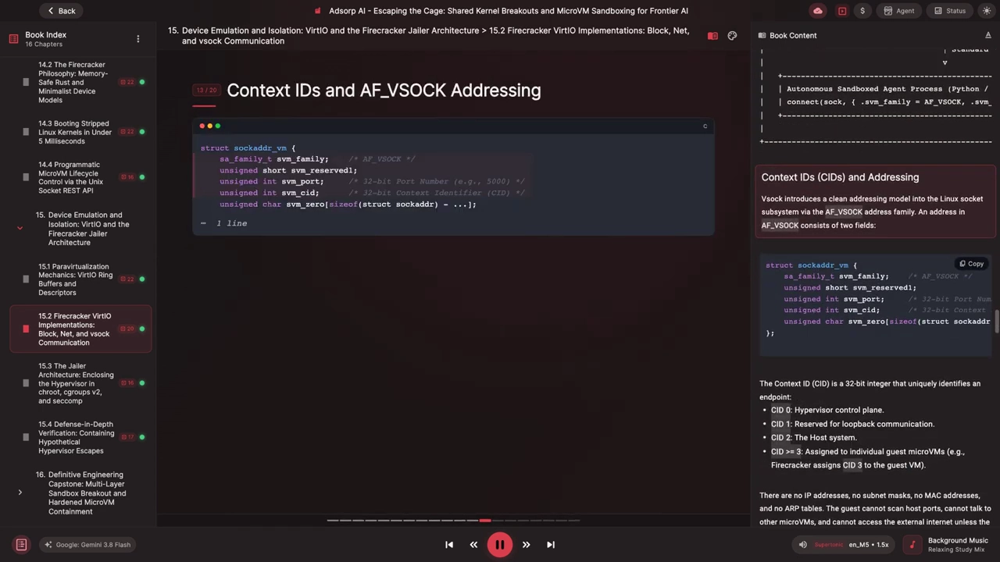
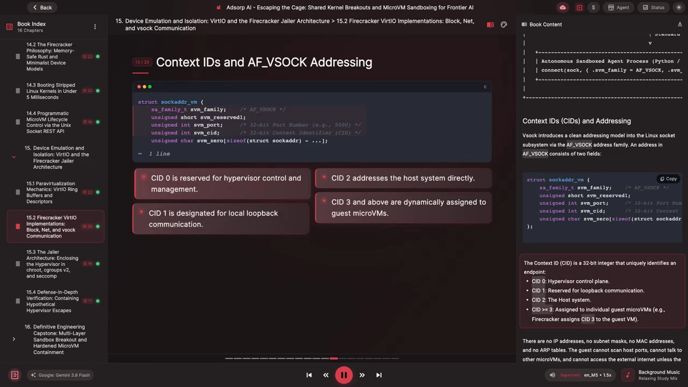
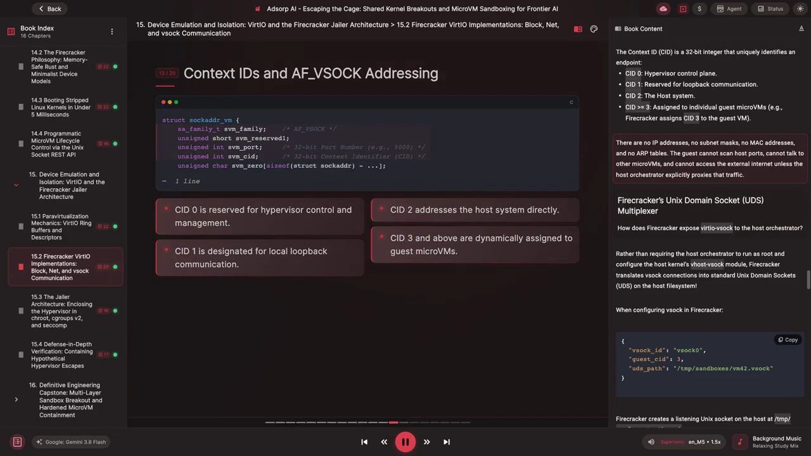
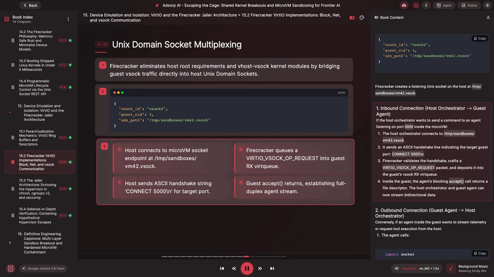
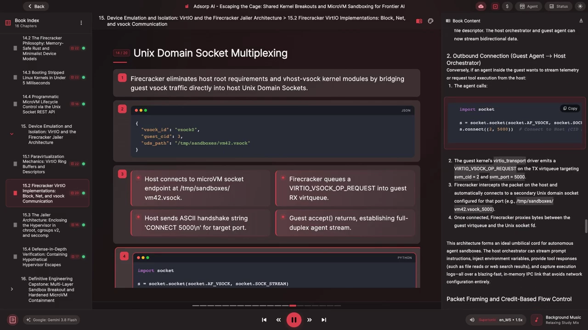
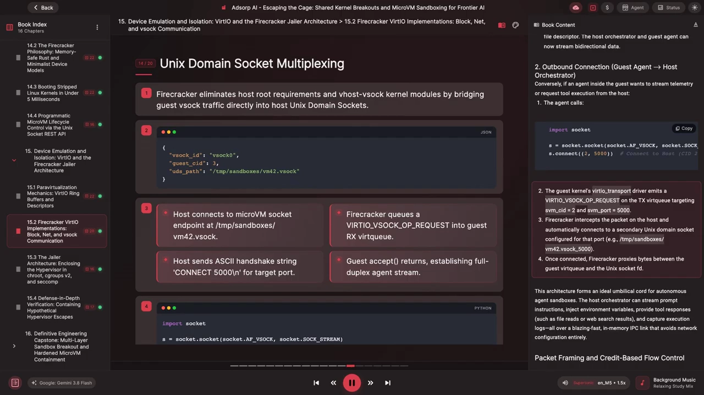
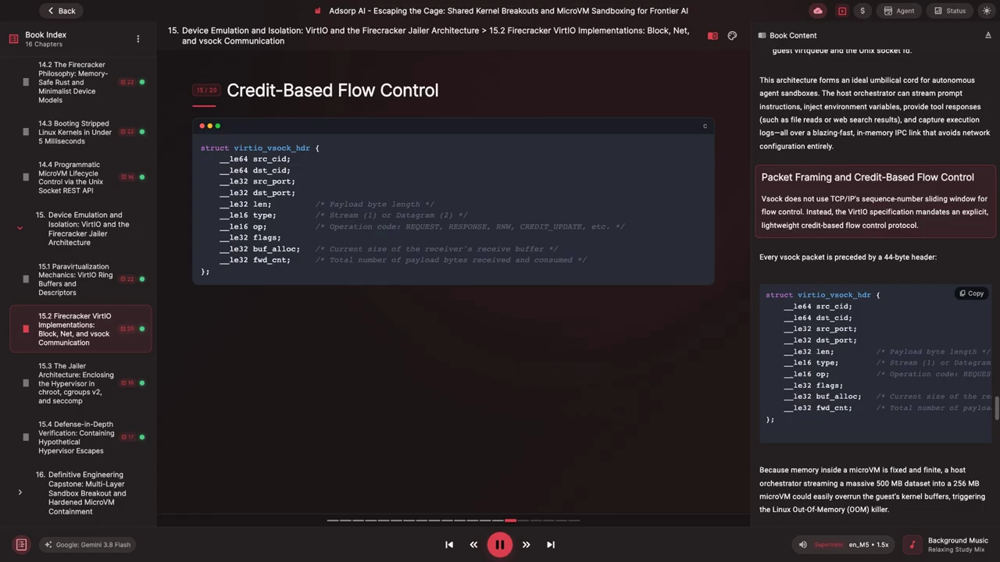
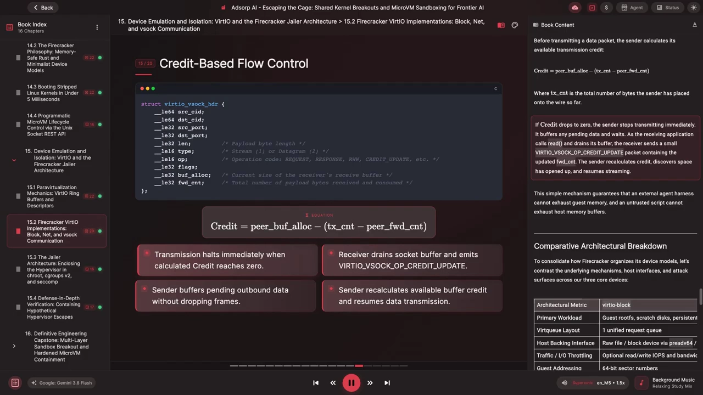
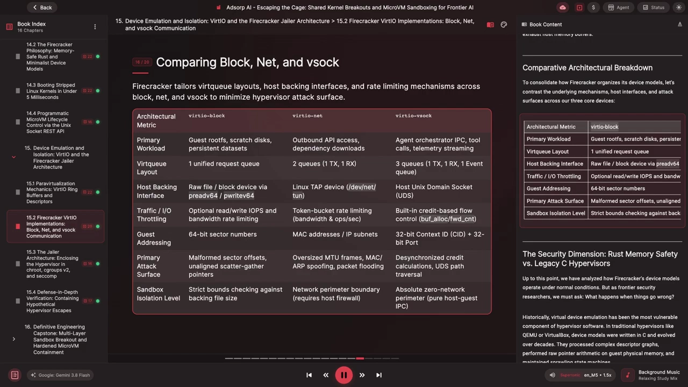

# 用 vsock 当控制通道：宿主怎么在一个 UDS 文件上给沙箱下命令

> 视频来源：[15.2 Firecracker VirtIO: Block, Net, & vsock | VirtIO & the Firecracker Jailer Architecture](https://www.youtube.com/watch?v=bLkoULQ_og0)（YouTube · Adsorp AI）｜时长约 24 分钟
> 本文只覆盖其中的 vsock 部分（约 11:34–19:00）：宿主编排器如何通过一个 Unix 域套接字文件，在沙箱里执行命令、收日志、灌数据。视频前半段讲 virtio-blk 与 virtio-net，与本小节无关，未收录。字幕为自动生成，术语已按上下文订正（`sock` → vsock、`SVM` → `svm_` 字段等）。

## 本讲要解决的核心问题（SCQA）

**背景**：一台 Firecracker microVM 里跑着不可信的 AI agent 代码，宿主需要给它下发提示词、注入环境变量、把工具执行结果递进去、再把执行日志收回来。

**冲突**：最直觉的做法是给 microVM 一张网卡。但为短命的 microVM 搭虚拟网桥、划分子网、跑 DHCP、维护路由表，会带来可观的启动延迟和编排上的脆弱性；更糟的是，一旦客户机有了 IP 栈（哪怕是隔离的），你就得配宿主防火墙规则，阻止它探测内网、攻击宿主元数据服务、访问同一宿主上的其他 microVM。

**疑问**：不配网络，宿主靠什么在沙箱里执行命令、搬运数据？

**回答（中心思想）**：用 virtio-vsock 当控制通道。Firecracker 把 vsock 连接翻译成宿主文件系统上的一个 Unix 域套接字（UDS），宿主编排器只是往这个文件里读写字节；客户机侧则是一个监听固定端口的 agent，用标准 POSIX socket API 接受连接。整条链路没有 IP、没有 DHCP、没有 NAT、没有网卡，却依然是一条双向、有流控、可承载命令与数据的可靠管道。

## 一、为什么要绕开网络栈：vsock 是一条"零网络"的点对点管道

[【跳转到 11:34】](https://www.youtube.com/watch?v=bLkoULQ_og0&t=694) 视频把 virtio-sock 称为"agent 沙箱的皇冠明珠"，理由很直接：virtio-net 提供的是标准网络能力，而标准网络恰恰是把自主 AI 代码执行沙箱编排起来的**错误工具**。

给 microVM 上网络要付三笔账：

1. **编排账**：虚拟网桥、子网划分、DHCP 动态地址分配、路由表，每一项都要为一批活不过几分钟的 microVM 重复配置。
2. **安全账**：有了 IP 栈就有了一整片可探测的空间。宿主必须写防火墙规则，拦住客户机对内网网段、宿主元数据服务、同宿主其他 microVM 的访问。
3. **语义账**：你真正想要的并不是"一台能上网的机器"，而是宿主编排器与客户机 agent 之间一条干净、点对点、双向的通信管道。

virtio-sock（虚拟套接字）给的就是这条管道。它把"套接字"这个抽象保留下来（客户机里的程序照样 `socket()`、`connect()`、`read()`、`write()`），但把底下的 IP/TCP 换成了 virtqueue 上的报文。



## 二、拓扑：四段接力，每段都只是一个文件描述符

[【跳转到 12:04】](https://www.youtube.com/watch?v=bLkoULQ_og0&t=724) 这张拓扑图把链路拆成四段，从外到内依次是：

| 层 | 组件 | 这一层看到的"连接" |
| --- | --- | --- |
| 宿主用户态 | 宿主编排器（Python / Go / Rust 写的 harness） | 一个路径为 `/tmp/firecracker-sandboxes/agent.vm42.sock` 的 Unix 域套接字，用 POSIX `read`/`write` 读写 |
| 宿主用户态 | Firecracker VMM 进程里的 vsock 设备模型 | 在 UDS 与 virtio-vsock 报文之间做多路复用，用 `buf_alloc` / `fwd_cnt` 跟踪基于信用的流控，并给客户机分配上下文 ID（例如 CID = 3） |
| 边界 | virtqueue 的 MMIO doorbell 或 irqfd | 共享内存 + 事件通知，和块设备、网卡走的是同一套 virtio 机制 |
| 客户机 | 内核里的 `vsock.ko` 与 `virtio_transport.ko` | 对上暴露标准 POSIX socket API（`AF_VSOCK`、`SOCK_STREAM`），agent 进程用普通套接字编程即可 |

关键认识：**宿主侧根本不需要 root，也不需要加载宿主内核的 virtio-vsock 模块**。Firecracker 把 vsock 连接翻译成宿主文件系统上的普通 UDS，于是"在沙箱里执行命令"这件事，在宿主看来退化成"往一个文件里写字节"。

## 三、寻址：客户机怎么知道"宿主在哪"

[【跳转到 12:54】](https://www.youtube.com/watch?v=bLkoULQ_og0&t=774) vsock 通过 `AF_VSOCK` 地址族给 Linux socket 子系统引入了一套自己的寻址模型。地址结构体只有两个有效字段：

```c
struct sockaddr_vm {
    sa_family_t    svm_family;   /* AF_VSOCK */
    unsigned short svm_reserved;
    unsigned int   svm_port;     /* 32 位端口号，例如 5000 */
    unsigned int   svm_cid;      /* 32 位上下文标识符 CID */
    unsigned char  svm_zero[sizeof(struct sockaddr) - ...];
};
```



CID（Context ID）是一个 32 位整数，唯一标识一个端点。它的取值规则决定了控制通道的寻址方式：

- **CID 0**：hypervisor 控制平面；
- **CID 1**：保留给回环通信；
- **CID 2**：宿主系统——客户机里的 agent 要连宿主，永远写 2；
- **CID ≥ 3**：动态分配给各台客户机 microVM，例如 Firecracker 给这台客户机分配 CID 3。



这套寻址带来一个直接的安全后果：**没有 IP 地址、没有子网掩码、没有 MAC 地址、没有 ARP 表**。客户机扫描不到宿主端口，连不上其他 microVM，也访问不了外网——除非宿主编排器显式代理这些流量。多租户隔离因此不需要防火墙规则，而是靠"每台 VM 独占一个 CID，且 CID 之间没有路由"这件事实本身。

## 四、握手：两个方向，两种写法

控制通道要双向可用：宿主能主动下发命令，agent 也能主动上报遥测或请求工具执行。Firecracker 对两个方向的处理并不对称。

### 4.1 入向：宿主 → 客户机，先发一行 ASCII 握手

[【跳转到 14:00】](https://www.youtube.com/watch?v=bLkoULQ_og0&t=840) 配置 vsock 时，Firecracker 只认三个字段：一个标识符、客户机上下文 ID、以及宿主侧的 UDS 路径。

```json
{
  "vsock_id": "vsock0",
  "guest_cid": 3,
  "uds_path": "/tmp/sandboxes/vm42.vsock"
}
```



Firecracker 随即在宿主上创建监听用的 Unix 套接字 `/tmp/sandboxes/vm42.vsock`。当宿主编排器想给 microVM 里监听 5000 端口的 agent 发命令时，走的是四步：

1. 编排器连接到 `/tmp/sandboxes/vm42.vsock`；
2. 先发一行 ASCII 握手，指明目标客户机端口：`CONNECT 5000\n`；
3. Firecracker 校验这行握手，构造一个 `VIRTIO_VSOCK_OP_REQUEST` 报文，投递到客户机的 vsock RX virtqueue；
4. 客户机里 agent 阻塞中的 `accept()` 返回一个文件描述符，双方从此可以双向流式传输。



这行 `CONNECT 5000\n` 是整个设计的枢纽：它把"连到哪个客户机端口"这件本该由 TCP 三次握手携带的信息，压缩成一行文本，交给 Firecracker 去翻译成 vsock 的 `OP_REQUEST`。宿主侧完全不需要理解 vsock 协议。

### 4.2 出向：客户机 → 宿主，走标准 `connect()`

[【跳转到 14:50】](https://www.youtube.com/watch?v=bLkoULQ_og0&t=890) 反方向则完全是普通套接字编程。客户机里的 agent 想上报遥测或请求宿主执行工具时：

```python
import socket
s = socket.socket(socket.AF_VSOCK, socket.SOCK_STREAM)
s.connect((2, 5000))   # CID 2 = 宿主，端口 5000
```

客户机内核的 virtio 传输驱动会在 TX virtqueue 上发出一个 `VIRTIO_VSOCK_OP_REQUEST`，目标 `svm_cid = 2`、`svm_port = 5000`。Firecracker 在宿主侧截获该报文，自动去连接为该端口配置的第二条 Unix 域套接字（例如 `/tmp/sandboxes/vm42_sock5000`）；连上之后，Firecracker 在客户机 virtqueue 与这个 UDS 的文件描述符之间代理字节。





### 4.3 这条通道上到底跑什么

[【跳转到 15:40】](https://www.youtube.com/watch?v=bLkoULQ_og0&t=940) 视频把这条链路称为自主 agent 沙箱理想的"脐带"。宿主编排器可以在这条链路上：

- 流式下发提示词指令；
- 注入环境变量；
- 提供工具响应——比如文件读取的结果、网络搜索的结果；
- 捕获执行日志。

全部走一条极快的内存 IPC 链路，完全不需要网络配置。**这就是"在客户机里执行命令"的真实形态**：不是一个神秘的 RPC，而是宿主往 UDS 里写一段请求字节、agent 从 vsock 上读出来、执行完再把结果写回去。

## 五、协议：44 字节头 + 基于信用的流控

[【跳转到 15:40】](https://www.youtube.com/watch?v=bLkoULQ_og0&t=940) vsock 不用 TCP/IP 的序号和滑动窗口做流控，virtio 规范要求的是一套显式的、轻量的**基于信用的流控**。每个 vsock 报文前面都有一个 44 字节的头部：

```c
struct virtio_vsock_hdr {
    __le64 src_cid;
    __le64 dst_cid;
    __le32 src_port;
    __le32 dst_port;
    __le32 len;        /* 载荷字节数 */
    __le16 type;       /* Stream(1) 或 Datagram(2) */
    __le16 op;         /* 操作码：REQUEST / RESPONSE / RW / CREDIT_UPDATE 等 */
    __le32 flags;
    __le32 buf_alloc;  /* 接收方缓冲区总大小 */
    __le32 fwd_cnt;    /* 应用已读走的字节总数 */
};
```



头部里的 `len` 就是"长度前缀"：接收方先读 44 字节定长头，知道后面还有多少字节载荷，再按需读取。这套分帧方式让 vsock 上的请求-响应协议可以自描述，不需要额外的边界标记。

流控的必要性来自一个具体场景：microVM 的内存是固定且有限的。宿主编排器往一台 256 MB 的 microVM 里灌 500 MB 数据，很容易冲垮客户机内核缓冲区，触发 Linux 的 OOM killer。于是接收方在每个报文头里用两个值持续告知自己的可用容量：

- `buf_alloc`：这个套接字总共分配的缓冲区大小，例如 262144 字节；
- `fwd_cnt`：一个自由递增的计数器，记录应用已经从内核 socket 缓冲区读走多少字节。

发送方在发数据前先算自己的可用信用：

$$
\text{credit} = \text{peer\_buf\_alloc} - (\text{tx\_cnt} - \text{peer\_fwd\_cnt})
$$

其中 `tx_cnt` 是发送方至今放到线上的总字节数。



信用降到 0 时，发送方立刻停发，把待发数据缓冲起来等待（**不丢帧**）。接收方应用调用 `read` 把缓冲区排空后，会发一个小的 `VIRTIO_VSOCK_OP_CREDIT_UPDATE` 报文带上更新后的 `fwd_cnt`；发送方重算信用，发现空间腾出来了，就恢复流式发送。

这个简单机制保证了两件事：外部 agent 框架无法耗尽客户机内存，不可信脚本也无法耗尽宿主的内存缓冲区。**换句话说，控制通道的流控同时也是沙箱边界的一部分**——它不允许任何一方用"发得太快"来打垮另一方。

## 六、把三种设备放在一起看：vsock 的定位

[【跳转到 17:20】](https://www.youtube.com/watch?v=bLkoULQ_og0&t=1040) 视频用一张表收束 Firecracker 的三个核心 virtio 设备，对比它们的队列布局、宿主接口、限流机制、寻址方式和攻击面。其中队列数的差异值得单独记一笔：块设备 1 个统一请求队列、网卡 2 个（TX/RX）、vsock 3 个（TX/RX/event）[【跳转到 17:45】](https://www.youtube.com/watch?v=bLkoULQ_og0&t=1065)。

| 维度 | virtio-blk | virtio-net | virtio-vsock |
| --- | --- | --- | --- |
| 主要负载 | 客户机根文件系统、临时盘、持久数据集 | 对外 API 访问、依赖下载 | agent 编排器的进程间通信、工具调用、遥测上报 |
| virtqueue 布局 | 1 个统一请求队列 | 2 个队列（TX、RX） | 3 个队列（TX、RX、event） |
| 宿主接口 | 裸文件或块设备（preadv64 / pwritev64） | Linux TAP 设备（`/dev/net/tun`） | 宿主 Unix 域套接字（UDS） |
| 限流 | 可选读写 IOPS 与带宽限速 | 令牌桶限速（带宽 + 每秒操作数） | 内置基于信用的流控（`buf_alloc` / `fwd_cnt`） |
| 客户机寻址 | 64 位扇区号 | MAC 地址 + IP 子网 | 32 位 CID + 32 位端口 |
| 主要攻击面 | 畸形扇区偏移、未对齐的分散聚集指针 | 超大 MTU 帧、MAC 欺骗、报文洪泛 | 信用计算失步、UDS 路径穿越 |
| 沙箱隔离强度 | 对后端文件大小做严格边界检查 | 依赖网络边界，需要宿主防火墙 | 绝对的零网络边界（纯宿主-客户机 IPC） |



这张表说明 vsock 在设备模型里的位置：它和块设备、网卡共用同一套 virtqueue 与 doorbell 机制，只是把"对端"从磁盘文件、TAP 设备换成了宿主上的一个 UDS 文件。**换掉对端，就换掉了整个攻击面。**

## 七、安全边界：能连上那个 UDS，就等于能在客户机里执行命令

[【跳转到 18:35】](https://www.youtube.com/watch?v=bLkoULQ_og0&t=1115) 上面这张表里 vsock 一行的"攻击面"写着两件事：信用计算失步、UDS 路径穿越。这两条恰好指出了控制通道的两个安全要点。

**第一，通道本身极窄。** vsock 的隔离强度是"绝对的零网络边界"：它没有 IP 栈可探测，没有端口扫描可言，客户机之间没有路由。攻击者要利用这条通道，必须先拿到宿主上那个 UDS 文件的访问权——而 UDS 是文件系统对象，它的权限就是宿主文件系统的权限。**换句话说，谁有权连接 `/tmp/sandboxes/vm42.vsock`，谁就有权在客户机里执行命令。** 控制通道的权限模型不在 vsock 里，而在宿主文件系统与编排器的进程权限里。

**第二，设备模型本身要抗住不可信的客户机。** 视频后半段（19:00 之后）用大量篇幅讲 Firecracker 如何在设备模型层面把客户机内存当作敌意输入处理，其中四条对 vsock 同样适用：

1. **强类型地址域**：客户机地址（`GuestAddress`）被包在独立类型里，不能被意外转成宿主裸指针；任何 GPA → HVA 的转换必须经过 guest memory map 抽象，保证落在显式分配的 KVM 内存槽内。
2. **防御性边界校验**：检查描述符长度时不做裸指针加法 `addr + len`（会在 32/64 位边界上溢出），而用带检查的算术；越界时返回 `GuestMemoryError::InvalidGuestAddress`，Firecracker 记录错误、把设备标记为 broken、挂起该队列。
3. **消灭时序类内存 bug**：Rust 的借用检查器在编译期阻止 use-after-free、double free 与竞争条件——多线程 VMM 里 epoll 事件循环、vCPU 线程、异步 I/O 引擎并发访问描述符状态时，"在 I/O 仍引用某缓冲区时释放它"变得不可能。
4. **volatile 访问语义**：客户机 RAM 是共享内存，恶意客户机内核可以在一个 vCPU 上改写描述符缓冲区、而宿主正在另一个 vCPU 上读它（TOCTOU）。Firecracker 用 volatile slice 确保每次解引用都是 volatile 读，阻止编译器把读值缓存进寄存器。

视频用 QEMU 的历史漏洞作为反面对照：VENOM（CVE-2015-3456）里，软盘控制器驱动在特定 FIFO 命令下没有重置缓冲区偏移，客户机 root 可以溢出 hypervisor 堆上固定的 512 字节缓冲区，直接逃逸到宿主；CVE-2019-21155 是 virtio-net 在描述符清理时的 use-after-free；CVE-2021-3975 是 virtio-crypto 与 virtio-balloon 在传递分散聚集列表时的整数溢出与越界写。这些都属于"设备模型用 C 写、处理不可信描述符图"这一整类问题。

**纵深防御的下一层**：[【跳转到 23:23】](https://www.youtube.com/watch?v=bLkoULQ_og0&t=1403) 即使有 Rust 的编译期内存安全，也可能有未处理的 panic、依赖 crate 里的整数回绕、或者直接打宿主内核 KVM ioctl 的 0-day。所以 Firecracker 进程本身还要被 jailer 关进 chroot、cgroups v2 与 seccomp 里——**不允许它浏览宿主文件系统、fork shell、修改设备、窥探其他进程**。这层围栏和 vsock 的 UDS 权限一起，构成控制通道真正的安全边界。

## 小结

- 沙箱不需要网卡也能通信：vsock 提供的是宿主编排器与客户机 agent 之间的点对点双向管道，绕开了网桥、子网、DHCP、路由表和防火墙这一整套编排负担。
- 宿主侧看到的是一个 UDS 文件：Firecracker 把 vsock 连接翻译成宿主文件系统上的 Unix 域套接字，宿主编排器不需要 root，也不需要加载宿主内核的 virtio-vsock 模块。
- 入向连接靠一行 ASCII 握手：编排器连上 `vm42.vsock` 后发 `CONNECT 5000\n`，Firecracker 校验后构造 `VIRTIO_VSOCK_OP_REQUEST` 投进客户机 RX virtqueue，agent 的 `accept()` 返回 fd。
- 出向连接是普通套接字编程：agent 用 `AF_VSOCK` 连 `(cid=2, port=5000)`，Firecracker 把它接到该端口对应的第二条 UDS，并在 virtqueue 与 UDS 之间代理字节。
- 协议是 44 字节定长头加载荷：头部里的 `len` 就是长度前缀，`buf_alloc` 与 `fwd_cnt` 支撑基于信用的流控，信用归零即停发、不丢帧。
- 流控同时是隔离手段：它保证外部编排器灌不爆 256 MB 的客户机内存，不可信脚本也耗不尽宿主缓冲区。
- 安全边界落在两个地方：UDS 文件的访问权限（能连上就能在客户机执行命令），以及设备模型对不可信描述符的防御（强类型地址、带检查算术、借用检查、volatile 读），外加 jailer 的 chroot/cgroups/seccomp 围栏。

## 关键术语速查

| 术语 | 一句话解释 |
| --- | --- |
| vsock（virtio-vsock） | 虚拟机与宿主之间的套接字通道，走 virtqueue 而不走 IP 网络 |
| CID | 32 位上下文 ID，vsock 的"地址"：0 控制平面、1 回环、2 宿主、3 及以上是各台 microVM |
| UDS | Unix 域套接字，宿主文件系统上的一个路径，Firecracker 用它把 vsock 暴露给编排器 |
| `CONNECT 5000\n` | 宿主连上 vsock UDS 后发的 ASCII 握手行，指明要连客户机的哪个端口 |
| `VIRTIO_VSOCK_OP_REQUEST` | vsock 协议里的连接请求操作码，由 Firecracker 或客户机内核生成 |
| `virtio_vsock_hdr` | 每个 vsock 报文前的 44 字节头部：CID、端口、长度、类型、操作码、流控字段 |
| `buf_alloc` / `fwd_cnt` | 接收方公布的缓冲区总大小与已读走字节数，发送方据此算可用信用 |
| 信用流控 | 发送方按 `peer_buf_alloc - (tx_cnt - peer_fwd_cnt)` 计算可发字节，归零即停 |
| jailer | Firecracker 的宿主侧围栏，用 chroot、cgroups v2、seccomp 限制 VMM 进程 |