# 串口控制台：没有屏幕时，客户机的启动日志只能从这里出来

> 视频来源：[Console types, communicating via a serial line, remote Shell and kernel boot with serial console](https://www.youtube.com/watch?v=meQClmBpjTc)（YouTube · Ron Munitz）｜时长约 15 分钟
> 导读：讲者用一台带物理串口的旧笔记本现场演示“没有屏幕、没有键盘时怎么拿到一台机器的输出”：先分清 `/dev/console`、`/dev/tty2`、`/dev/ttyS0` 三个终端，再用 `stty` 对齐波特率，最后改内核命令行 `console=ttyS0,115200`，让整段启动日志从串口流出来。视频里用的是一根真串口线，讲者反复强调这套操作在 QEMU 里一模一样——本文最后一节把这条线换回虚拟机里的说法。

## 本讲要解决的核心问题（SCQA）

**背景**：机器一上电，内核就开始往一个叫“控制台”（console）的地方打日志：检测到几颗 CPU、挂载了哪个根文件系统、哪个驱动初始化失败。平时我们在显示器上看到的就是这些字。

**冲突**：云上的虚拟机、机架上的开发板、刚出问题的服务器，往往没有可用的显示器，也没有键盘。更要命的是，如果内核在挂载根文件系统之前就卡住了，你连 SSH、连日志文件都没有——那些东西依赖的驱动和服务根本还没启动。

**疑问**：在没有图形界面、甚至没有任何网络的情况下，还有什么通道能把客户机的输出送出来？

**回答（中心思想）**：**内核消息的默认出口是一个叫 console 的终端设备，而不是“屏幕”这个东西本身**。console 默认指向“屏幕 + 键盘”这个组合，但只要你在内核命令行里把它改成串口（`console=ttyS0,115200`），内核从最早的自检开始写的每一个字就会从串口线送出去，你在另一台机器上用一个终端模拟器就能全部收到。串口之所以能承担这个角色，是因为它简单到不需要任何初始化：内核在 initramfs 阶段就能往 UART 的寄存器里写字节，而那个时刻网络栈和 virtio 驱动都还不存在。

## 一、console 是一个设备，不是一个窗口

### 1.1 先学会改内核命令行

演示从 GRUB 菜单开始。讲者按 `e` 进入编辑模式，把要启动的那行内核命令改掉，删掉自己“并不需要”的部分：终端相关的参数、启动画面（splash）、以及根文件系统的挂载参数 [【跳转到 00:46】](https://www.youtube.com/watch?v=meQClmBpjTc&t=46)。

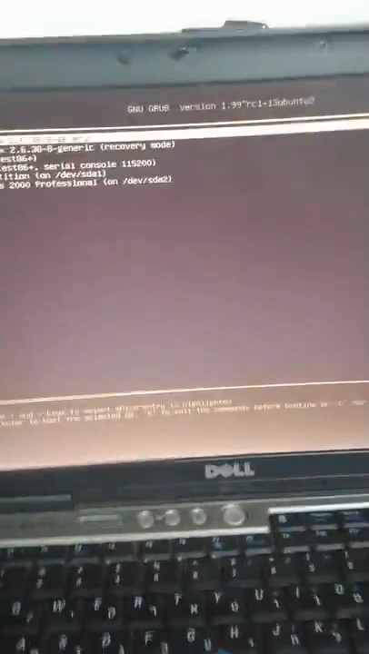

这个动作本身就是本节最重要的一课：**“日志从哪出来”不是内核编译时定死的，而是启动时由命令行参数决定的**。同一个内核，命令行里不写 `console=`，日志就走默认的屏幕；写了 `console=ttyS0`，日志就走串口。视频后半段会回到这个编辑界面，只改这一个参数，就把整个控制台搬到了串口上。

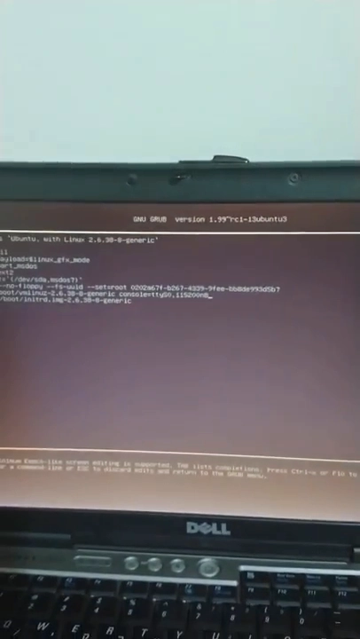

### 1.2 早期启动阶段，console 上已经能看到内核消息

删掉根文件系统参数后，机器进不了正常的 init，直接掉进 initramfs 里的 busybox shell。此时屏幕上已经滚过一大段内核消息——USB hub 探测、端口数量、设备地址，最后是那句提示 `No init found. Try passing init= bootarg.` [【跳转到 01:21】](https://www.youtube.com/watch?v=meQClmBpjTc&t=81)。

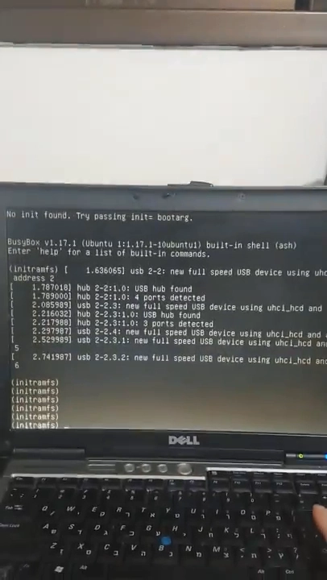

这张图正是“串口为什么不可替代”的证据：**这些日志产生的时候，根文件系统还没挂上，日志文件、syslog、远程采集全都无从谈起**。它们唯一的去处就是 console 这个设备。如果 console 是屏幕，人不在机器前面就等于丢掉了；如果 console 是串口，一条线就能把它们引到隔壁机器上。

在这个 shell 里执行 `tty`，返回的是 `/dev/console`：

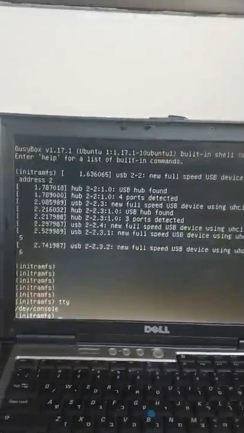

讲者对它的解释很直白：console 这个设备背后“有一个屏幕和一个键盘” [【跳转到 01:26】](https://www.youtube.com/watch?v=meQClmBpjTc&t=86)。注意这里有个容易混淆的点——`/dev/console` 不是某块具体的硬件，它是内核认定的“当前控制台”这个抽象；它现在指向屏幕，等我们把命令行改成 `console=ttyS0` 之后，同一个 `/dev/console` 就会指向串口。

### 1.3 一块屏幕上可以有很多个 tty

接着讲者演示了虚拟终端（virtual terminal，VT）：Linux 默认在同一块物理屏幕上提供多个互相独立的终端，用 `Alt-F1`、`Alt-F2` 切换。直接按 `Alt-F2` 会发现“像卡住了”，其实不是坏了，而是那个虚拟终端还没被创建——需要先 `openvt -c 3` 把它开出来 [【跳转到 01:36】](https://www.youtube.com/watch?v=meQClmBpjTc&t=96)。

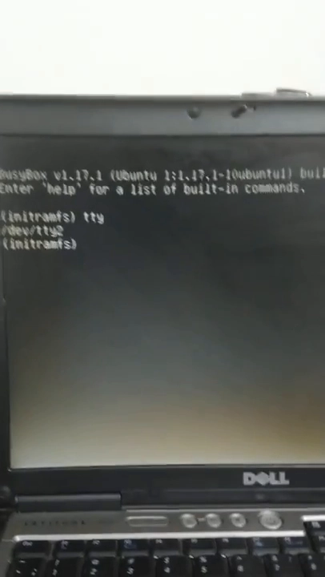

切到新终端后 `tty` 返回 `/dev/tty2` [【跳转到 02:40】](https://www.youtube.com/watch?v=meQClmBpjTc&t=160)。到这里已经出现了三个不同的名字，先记住它们的区别，后面接串口时会反复用到：

- `/dev/console`：内核认定的当前控制台，是个“转发器”，指向谁由内核命令行决定；
- `/dev/tty1`、`/dev/tty2`……：屏幕上的第 1、2 个虚拟终端；
- `/dev/ttyS0`：第一块串口（serial），跟屏幕完全无关。

## 二、把串口线接上：/dev/ttyS0 只是一个字符设备

### 2.1 先确认进程的三个标准描述符指向谁

讲者把串口线从这台笔记本接到另一台电脑，并说明这条线在系统里就是 `/dev/ttyS0` [【跳转到 03:39】](https://www.youtube.com/watch?v=meQClmBpjTc&t=219)。在动手之前，他先做了一次“体检”：`echo $$` 拿到当前 shell 的 PID，再看 `/proc/<pid>/fd`，确认标准输入、标准输出、标准错误这三个描述符都指向 `/dev/tty2` [【跳转到 04:19】](https://www.youtube.com/watch?v=meQClmBpjTc&t=259)。

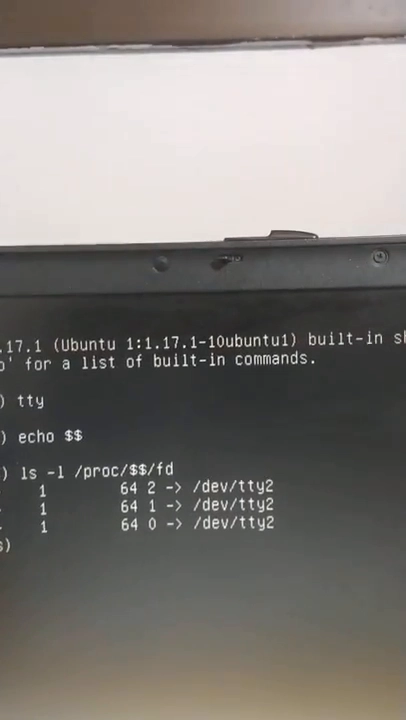

回到第一个虚拟终端做同样的操作，三个描述符就都指向 `/dev/console` [【跳转到 04:42】](https://www.youtube.com/watch?v=meQClmBpjTc&t=282)。

这一步看起来琐碎，其实是后面所有实验的前提：**一个进程的输出去哪，完全由它的文件描述符决定，跟“这台机器的屏幕”没有必然关系**。所以“把输出送到串口”这件事，本质上就是“把某个进程的 fd 换成 `/dev/ttyS0`”，或者“让内核的 console 指向 `/dev/ttyS0`”。

### 2.2 直接往 /dev/ttyS0 写，对面为什么一个字都收不到

最直接的实验是 `echo "Hello World" > /dev/ttyS0`，另一台电脑上什么都没出现。讲者用 `stty -F /dev/ttyS0` 查了这条串口的参数，发现本机是 **9600** 波特率，而对面主机设的是 **115200** [【跳转到 07:34】](https://www.youtube.com/watch?v=meQClmBpjTc&t=454)。

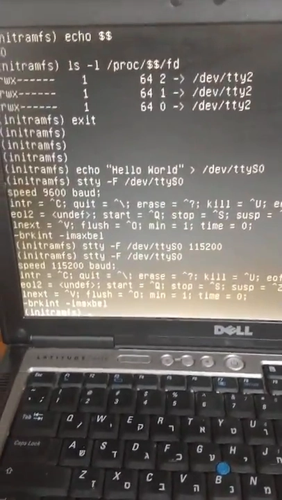

这就是串口最经典的一个坑：**它是一条异步的比特流，两端必须事先约定同一个速度**。速度不一致时，接收方采样到的位边界全错，解出来的就是乱码或干脆什么都没有——不是“没发出去”，而是“发出去但对面读不懂”。所以 `stty -F /dev/ttyS0 115200` 这一步不是可选的调优，而是让通道成立的必要条件 [【跳转到 07:49】](https://www.youtube.com/watch?v=meQClmBpjTc&t=469)。改完之后再 `echo hello world`，对面立刻就能看到。

顺带算一下这条通道的带宽上限：115200 波特率意味着每秒 115200 个比特，串口一帧大约 10 个比特（1 起始位 + 8 数据位 + 1 停止位），于是

$$
\frac{115200\ \text{bit/s}}{10\ \text{bit/字节}} \approx 11520\ \text{字节/秒} \approx 11\ \text{KB/s}
$$

一分钟最多也就 700 KB 左右。这个数字决定了串口只能当“排障通道”，不能当“日志管道”：内核启动日志一多，输出就会跟不上，后面的行会被覆盖或丢弃。

### 2.3 双向通道，以及“把自己锁死”的坑

反过来写也一样：`cat > /dev/ttyS0` 之后，在这边敲的每个字符都会出现在对面的终端上 [【跳转到 06:33】](https://www.youtube.com/watch?v=meQClmBpjTc&t=393)。把两个方向都接上，就得到了一条能跑 shell 的通道：`sh < /dev/ttyS0 > /dev/ttyS0`。

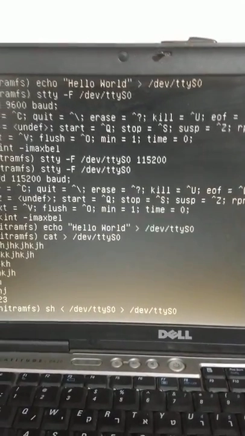

但这里有个陷阱：**如果 stdin 和 stdout 都指向同一个串口设备，你在对面敲什么都没法把进程退出**，因为你的按键和程序的输出走的是同一条线，`Ctrl-C` 这类控制字符也会被当成普通数据。讲者的解法是提前开好多个虚拟终端——本地屏幕上还留着一个 `/dev/tty1`，切过去就能把卡住的进程杀掉 [【跳转到 08:59】](https://www.youtube.com/watch?v=meQClmBpjTc&t=539)。这也是他一开始就先 `openvt -c 3`、`openvt -c 4` 的原因。

## 三、正确姿势：终端模拟器 + console=ttyS0,115200

### 3.1 裸重定向为什么满屏都是控制字符

用 `sh < /dev/ttyS0 > /dev/ttyS0` 跑通之后，对面的屏幕上能看到 busybox 的 banner，但每个回车后面都跟着一串回车符（显示为 ^M）之类的控制字符，`ls` 的输出也排不齐 [【跳转到 10:25】](https://www.youtube.com/watch?v=meQClmBpjTc&t=625)。

原因在于终端的两端都要“懂终端”：程序输出的是行结束符和光标控制序列，需要由**终端模拟器**解释成“换行”“清屏”“移动光标”。裸重定向只是把字节搬过去，没有人解释这些字节，于是它们就以原始形式显示出来。讲者由此给出结论：正确做法是在另一端跑一个终端模拟器，它同时负责把键盘输入和屏幕输出复用在这一条线上 [【跳转到 09:20】](https://www.youtube.com/watch?v=meQClmBpjTc&t=560)。

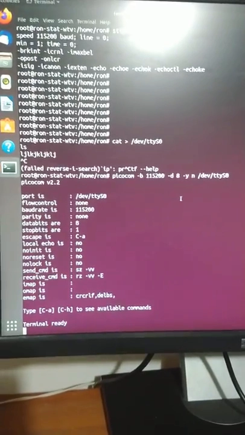

他用的就是 `picocom`：`picocom -b 115200 -d 8 -y n /dev/ttyS0`，其中 `-b` 指定波特率，必须与对端一致。启动后 picocom 会打印它实际采用的参数，并显示 `Terminal ready`：

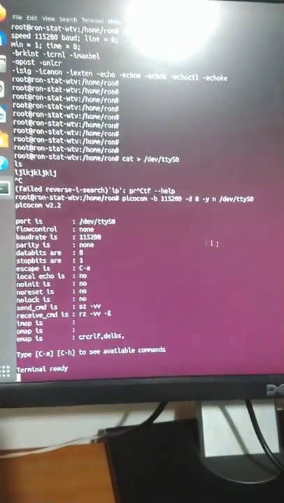

### 3.2 改一个参数，把整个控制台搬到串口上

前面都是“手工搬运某个进程的输入输出”。真正干净的办法是让**内核自己**把 console 指向串口：回到 GRUB，按 `e` 编辑内核命令行，把参数换成 `console=ttyS0,115200`（视频里写作 `console=ttyS0,115200n8`，`n8` 表示无校验、8 位数据位）[【跳转到 12:50】](https://www.youtube.com/watch?v=meQClmBpjTc&t=770)。

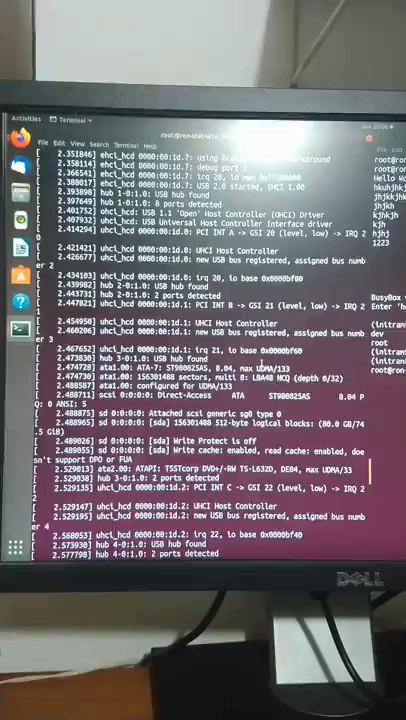

重启之后是本节最有说服力的一幕：**笔记本自己的屏幕上一片空白，而另一台电脑的 picocom 窗口里滚出了整段内核启动日志** [【跳转到 13:26】](https://www.youtube.com/watch?v=meQClmBpjTc&t=806)。注意这里的因果关系——屏幕不是“坏了”，而是内核根本没往它写：`console=` 只有一个，指向了串口，屏幕就被排除在外了。

此时在串口这一侧执行 `tty`，返回的仍然是 `/dev/console` [【跳转到 13:36】](https://www.youtube.com/watch?v=meQClmBpjTc&t=816)。这印证了 1.2 节的判断：`/dev/console` 是个转发器，它的背后从“屏幕 + 键盘”换成了“串口线”，但名字没变。

### 3.3 屏幕和串口可以同时是 console

最后讲者演示了两条通道并存：从串口控制台里 `openvt -c 1`、`openvt -c 2`、`openvt -c 3` 把虚拟终端开出来，再到本地屏幕按 `Alt-F1` 切回去，`tty` 返回 `/dev/tty1` [【跳转到 14:11】](https://www.youtube.com/watch?v=meQClmBpjTc&t=851)。

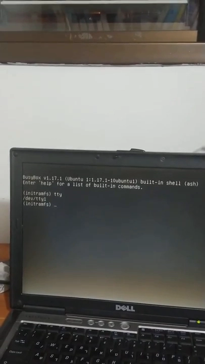

于是同一台机器上同时存在两种观察方式：串口那头看着启动日志，本地屏幕这头可以继续操作 [【跳转到 14:36】](https://www.youtube.com/watch?v=meQClmBpjTc&t=876)。讲者还提到，如果再加上帧缓冲（frame buffer），屏幕上还能显示图形——但对排障来说，串口这条纯文本通道永远是最后能用的那一条。

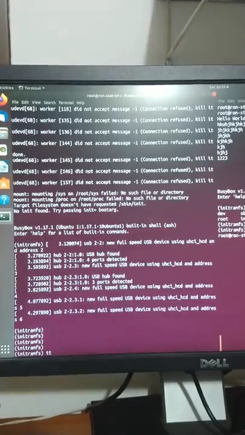

## 四、把这条线换回虚拟机：VMM 侧的串口后端

视频演示的是一根物理串口线，但讲者反复强调：**“这些事就是我在 QEMU 或别的模拟器里做的事，它们是真的，也代表真实世界”** [【跳转到 12:11】](https://www.youtube.com/watch?v=meQClmBpjTc&t=731)。把这句话展开，正好落回本节要回答的问题——虚拟机里没有串口线，“线”的另一头接在哪？

在客户机看来，一切都没变：它仍然看到一块 16550/8250 兼容的 UART，仍然叫 `/dev/ttyS0`，仍然在命令行里写 `console=ttyS0,115200`。变的只是 UART 背后那一端：客户机写 UART 寄存器时会触发一次 VM exit，VMM 在用户态收到这次 I/O，把字节转交给宿主侧的一个字符设备。常见的落点有四类：

- **stdio**：直接接到 VMM 进程自己的标准输入输出，于是串口内容就出现在你启动 VMM 的那个终端里。QEMU 的 `-nographic` 就是这种用法——它把图形输出关掉，把串口和 monitor 一起重定向到当前终端；
- **pty**：VMM 分配一个伪终端，你用 `screen`、`picocom` 连上去，等价于视频里“另一台电脑接串口线”；
- **文件**：把串口输出追加写进一个日志文件，适合事后翻查；
- **Unix domain socket**：接到另一个进程，由它转发、落盘或做采集。

三种运行时里都能看到同一个参数名的影子：QEMU 用 `-serial`，Firecracker 用 `--serial`，Cloud Hypervisor 也用 `--serial`。它们表达的是同一件事——**“客户机的这块 UART，接到宿主的哪里”**。理解了视频里 `stty` 对齐波特率、`picocom -b 115200` 这两步，再看这些参数就不会觉得是魔法：它们只是把“物理线”换成了“宿主上的一个文件描述符”。

## 小结

- **console 是内核认定的日志出口，不是“屏幕”**。改内核命令行里的 `console=`，就能把整段启动日志搬到串口上，屏幕随之安静。
- **`/dev/console`、`/dev/ttyN`、`/dev/ttyS0` 是三种不同的东西**：前者是转发器，中者是屏幕上的虚拟终端，后者是串口设备本身。
- **串口能承担早期排障，是因为它简单**：initramfs 阶段网络和存储驱动都还没有，UART 已经能写字节了。
- **两端必须约定同一个波特率**。速度不一致时表现是“对面什么都没有”，而不是报错，所以 `stty -F /dev/ttyS0` 查参数是第一步。
- **裸重定向不等于终端**。要看到正常的换行和排版，另一端必须跑终端模拟器（如 picocom）。
- **把 stdin 和 stdout 同时接到同一个串口会把自己锁死**，动手前先留一个本地虚拟终端当后路。
- **串口带宽只有约 11 KB/s**（115200 波特率、10 比特一字节），它适合看启动日志和 panic，不适合当持续日志管道；结构化日志应当交给客户机内的采集 agent 走 vsock 之类的通道。
- **虚拟机里这条线的另一端由 VMM 决定**：QEMU 的 `-serial` / `-nographic`、Firecracker 与 Cloud Hypervisor 的 `--serial`，选的都是“接到 stdio、pty、文件还是 socket”。

## 关键术语速查

| 术语 | 一句话解释 |
| --- | --- |
| console（控制台） | 内核打印日志的默认设备，由内核命令行 `console=` 指定，默认是屏幕加键盘 |
| `/dev/console` | 指向“当前控制台”的转发设备，控制台改成串口后它也跟着变 |
| `/dev/tty1`…`/dev/ttyN` | 同一块屏幕上互相独立的虚拟终端，用 Alt-FN 切换，`openvt` 创建 |
| `/dev/ttyS0` | 第一块串口设备，与屏幕无关，是纯字符流 |
| 波特率（baud rate） | 串口每秒传输的比特数，两端必须一致，否则收到的是乱码或空白 |
| `stty -F <设备>` | 查看或设置某个终端设备的参数（波特率、校验位、数据位等） |
| `console=ttyS0,115200` | 内核命令行参数，把控制台指向串口 0 并约定 115200 波特率 |
| initramfs | 内核启动早期加载的最小根文件系统，此阶段只有 console 可用 |
| picocom | 一个终端模拟器程序，把串口字节流解释成可读的终端画面 |
| `-nographic` / `-serial` | QEMU 的参数：前者关掉图形输出并把串口接到当前终端，后者指定串口接到哪里 |