# ivshmem 只给窗口和门铃：Jailhouse 的共享内存通道怎么建、代价在哪

> 视频来源：[一颗芯片跑多套系统：Jailhouse 分区虚拟化与共享内存通信](https://www.bilibili.com/video/BV1Z9x463EsJ/)（B 站 · ARM64 全流程演示）｜时长约 8 分钟
> 导读：这支视频用一张张架构图讲清了一件事——共享内存通道的"底座"和"协议"是两层东西。底座 ivshmem 只给你一块共享窗口、一个门铃和几个状态寄存器；分包、流控、路由、保活、异常恢复全得自己写。本文按视频顺序拆开这两层，并说明为什么"零拷贝"省下的是拷贝，换来的却是同步的活。

## 本讲要解决的核心问题（SCQA）

**背景**：一颗 SoC 上可以同时跑三类系统——Linux 负责生态和复杂业务，RTOS（实时操作系统，AUTOSAR、RT-Thread、Zephyr 都属于这一类）保证硬实时，裸机程序贴近硬件。Jailhouse 这类分区型 hypervisor 把 CPU、内存、设备静态切成若干 cell（分区），资源分给谁就由谁独占。

**冲突**：切干净之后，隔离是好了，可 cell 之间"没有正常的共享内存通道"了（[【跳转到 02:12】](https://www.bilibili.com/video/BV1Z9x463EsJ/?t=132)）。Jailhouse 给出的数据面叫 ivshmem，但它只提供三样东西：一块共享内存窗口、一个门铃、一组状态寄存器。至于"这条消息有多长、发到哪个对端、丢了怎么办"，ivshmem 一概不管。

**疑问**：一条能用的共享内存通道，到底由哪些零件构成？哪些是设备给的，哪些必须自己在上面补？补上之后，代价又落在哪里？

**回答（中心思想）**：ivshmem 解决的是"数据放在哪儿"——映射一次，之后双方看到同一批物理页，读写就是普通的 load/store，接收侧可以做到零拷贝；它不解决"你怎么知道对方写完了"——那要靠门铃加中断，以及在共享内存里自己维护的 ring 控制块和状态表。所以共享内存通道的真实成本不是拷贝，而是**同步与协议**：分包、流控、路由、保活、异常恢复，一层都省不掉。视频里的 `jh-ivshmem-lib` 就是把这层补上的尝试。

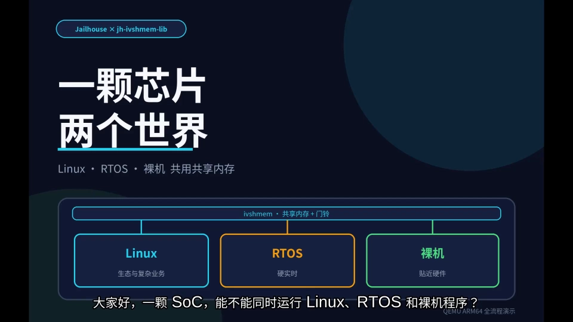

## 一、先看清宿主：Jailhouse 为什么"简单到只剩分区"

要理解这条通道为什么长这样，得先看它所在的分区模型。

Jailhouse 追求的是**简单和可预测**，而不是功能丰富（[【跳转到 00:07】](https://www.bilibili.com/video/BV1Z9x463EsJ/?t=7)）。它把 CPU、内存和设备静态切分，资源分给谁就由谁独占：不做超分（不把一份 CPU 时间卖给两个系统），也不在系统之间做时间片调度。能由硬件直接隔离的就直接隔离，只在中断投递这类必须介入的地方补一层软件。

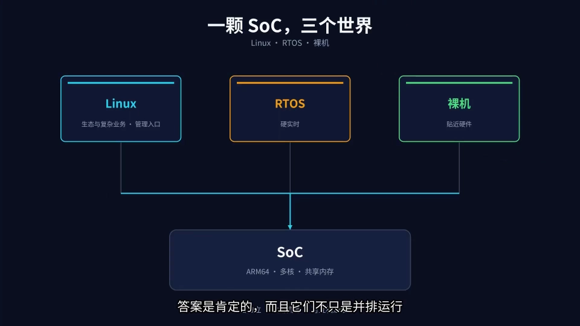

落到 ARM64 的异常级上，层次非常清楚（[【跳转到 00:57】](https://www.bilibili.com/video/BV1Z9x463EsJ/?t=57)）：管理工具跑在 root cell 的 EL0，Linux 内核跑在 EL1，Jailhouse 自己跑在 EL2；guest cell 里可以是 Linux、AUTOSAR 或裸机，**正常执行不会陷入**，只有 MMIO、中断和 PSCI 这类敏感操作才进 EL2。

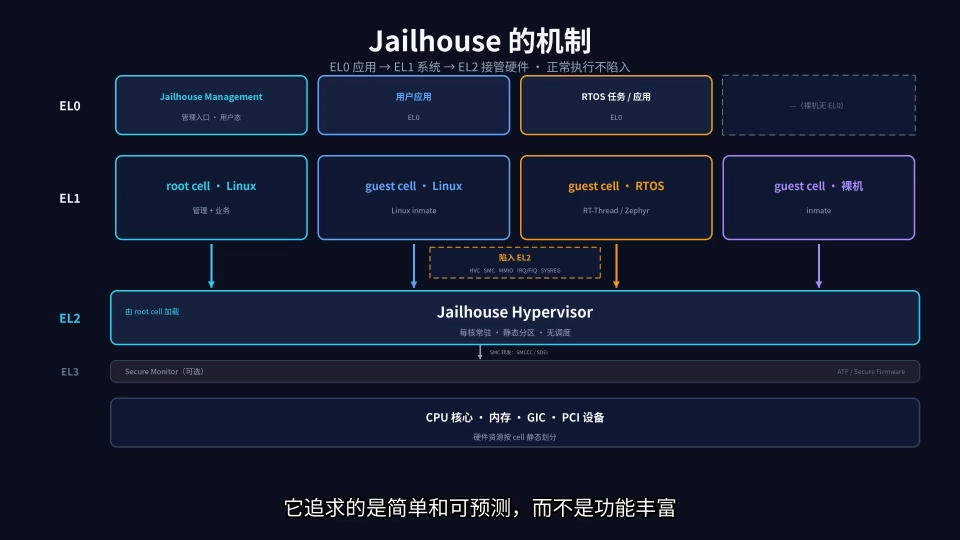

这套设计还有一个工程上的巧思：让 Linux 先启动，再由 root cell 加载和配置 Jailhouse，管理、驱动、调试全部复用 Linux 生态的代码（[【跳转到 01:22】](https://www.bilibili.com/video/BV1Z9x463EsJ/?t=82)）。规模小、执行路径简单，对需要功能安全认证的系统是减负。代价也很明确：**牺牲灵活性换取确定性**。

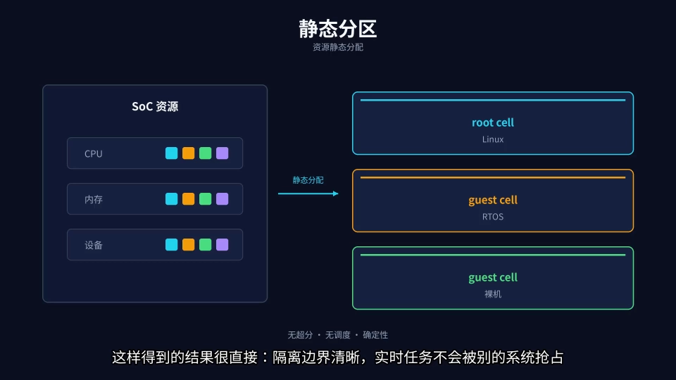

一句话总结这一层：分区越彻底，系统之间越"像两台独立的机器"。而两台独立的机器要通信，就得有一条真正的通道。

## 二、ivshmem 的数据面：一块共享内存加一个门铃

Jailhouse 提供的数据面是 ivshmem。它的形态很朴素（[【跳转到 02:12】](https://www.bilibili.com/video/BV1Z9x463EsJ/?t=132)）：root 和 guest **各自看到一个虚拟 PCI 设备**，底层指向同一块物理内存。设备里只有三样东西：

- **共享内存窗口**：真正放数据的地方；
- **门铃**：写完数据敲一下，对端收到中断；
- **状态寄存器**：给双方一个约定好的"状态位"。

幻灯片把这块窗口切成了三段，这是理解后面所有协议的基础：

| 区域 | 内容 | 谁来写 |
| :--- | :--- | :--- |
| State Table | 状态表，只读视图 | 由一侧初始化，另一侧只读 |
| R/W Section | 读写区，放 ring 控制块 | 双方按协议读写 |
| Output Section | 每个 peer 一块独立 buffer | 各自写自己那块 |

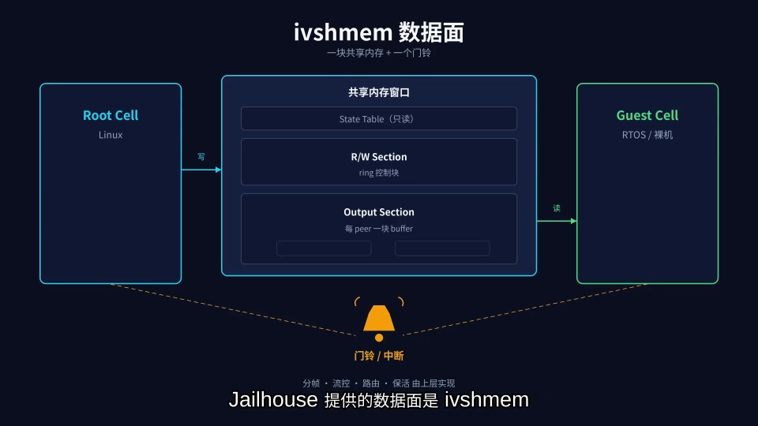

这张图最该记住的是最下面那行小字：**分帧、流控、路由、保活，都由上层实现**。ivshmem 本身不管这些。

这就是共享内存通道与 vsock 这类"有协议的通道"最根本的差别：vsock 一次 `send`，内核替你处理了排队、分片、重传、唤醒；ivshmem 只把一块内存摆在你面前，剩下的全是你的代码。**映射一次之后只有 load/store，这是零拷贝的来源；也正因为如此，"对方写完了没有"没有任何人替你回答。**

## 三、同步代价：门铃响了，然后呢

视频里对同步的解释只有一句，但信息量很大："写完数据敲一下门铃，对端收到中断"（[【跳转到 02:12】](https://www.bilibili.com/video/BV1Z9x463EsJ/?t=132)）。把它拆开就是共享内存通道要付的三笔账。

**第一笔：通知本身要陷入。** 门铃不是普通内存写，它要走 MMIO，在 ARM64 上就是一次进 EL2 的陷入，再由 hypervisor 转成对端的中断。这条路径比一次 `memcpy` 贵得多，所以共享内存通道的优化重点从来不是"少拷一次"，而是**少敲几次门铃**——攒批、合并通知，是这类通道的常规做法。

**第二笔：数据可见性要靠约定。** 门铃只告诉对方"有新数据"，不告诉对方"数据到哪个字节为止"。所以共享内存里必须有 ring 控制块：生产方先写数据、再更新索引，消费方读索引、再读数据。索引放在哪、什么时候更新，就是双方必须一致的协议。视频里 Output Section 按 peer 切成独立 buffer，本质上就是把"谁写哪块"用空间换掉了竞争。

**第三笔：状态与保活要自己维护。** State Table 只读、R/W Section 放 ring 控制块，这套划分让"谁改了什么"有据可查；而对端是不是还活着、链路是不是断了，ivshmem 也不管，得靠上层的保活机制。

把两代通道的成本写成式子，差别一目了然：

$$
T_{\text{shared}} \approx T_{\text{doorbell}} + T_{\text{sync}}, \qquad T_{\text{vsock}} \approx 2\,T_{\text{copy}} + T_{\text{notify}}
$$

其中 $T_{\text{copy}}$ 随消息长度线性增长，$T_{\text{doorbell}}$ 与 $T_{\text{notify}}$ 基本是一次陷入的固定开销。消息越大，共享内存的优势越明显；消息越小，两者都被通知成本主导，差距反而缩小——这也解释了为什么这类通道的调优重点永远是"少敲门铃"而不是"少拷贝"。

用一句话概括：共享内存把"数据搬运"的成本降到了接近零，却把"同步"的成本全部转移给了软件。前者是硬件红利，后者是写代码的人要还的债。

## 四、协议层的缺口：官方只给 demo，virtio 又太重

意识到"只有底座不够"之后，视频把可选路线摆了出来（[【跳转到 02:37】](https://www.bilibili.com/video/BV1Z9x463EsJ/?t=157)）。

第一条是官方示例：它能证明链路连通，但**不构成一套可复用的通信协议**。第二条是在共享内存上承载 virtio——业界常见做法，Jailhouse 文档里也提供了 `uio_ivshmem` 驱动和 virtio 控制台、virtio 块设备的演示。

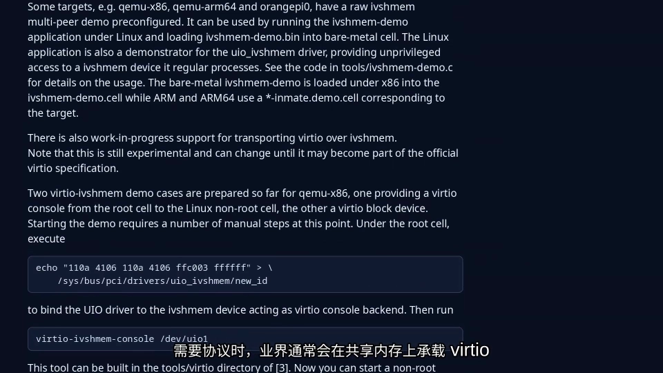

但视频紧接着给了否定理由（[【跳转到 02:48】](https://www.bilibili.com/video/BV1Z9x463EsJ/?t=168)）：virtio 的特性协商和设备状态机是贴着"完整操作系统"设计的，把它搬进 AUTOSAR 或裸机 guest，**成本太高**；官方也仍把这条路标为 work in progress。

于是缺口变得非常具体，幻灯片上直接写了两个字——缺失：

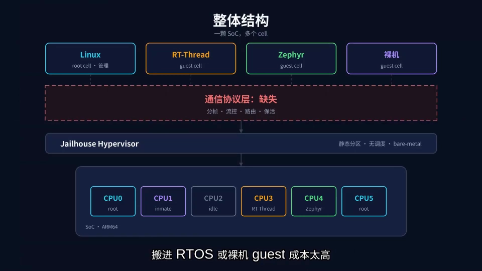

- 机制已经有了（ivshmem 的窗口与门铃）；
- 协议还没有；
- 通用方案（virtio）又太重。

中间需要的就是一层**轻量的通信协议**。视频里的 `jh-ivshmem-lib` 补的正是这一层。

## 五、补上的一层：点对点 link、三类端点、接收侧零拷贝

这层库的设计可以按"从上往下"读（[【跳转到 03:04】](https://www.bilibili.com/video/BV1Z9x463EsJ/?t=184)、[【跳转到 03:29】](https://www.bilibili.com/video/BV1Z9x463EsJ/?t=209)）：

- **核心层**：把 ivshmem 的数据面整理成点对点的 link——共享内存 ring、设备端点。它**不依赖 hypervisor**，负责 ring、路由、门铃和保活，接收侧做零拷贝；
- **平台适配层**：按操作系统选择 HAL（硬件抽象层）和设备驱动层；
- **驱动层**：把 link 注册成系统熟悉的设备，上层应用不用改代码。

root 与 guest 运行同一套核心，差异只落在 HAL 和驱动两端；**真正共享的仍然只有那块 ivshmem**。

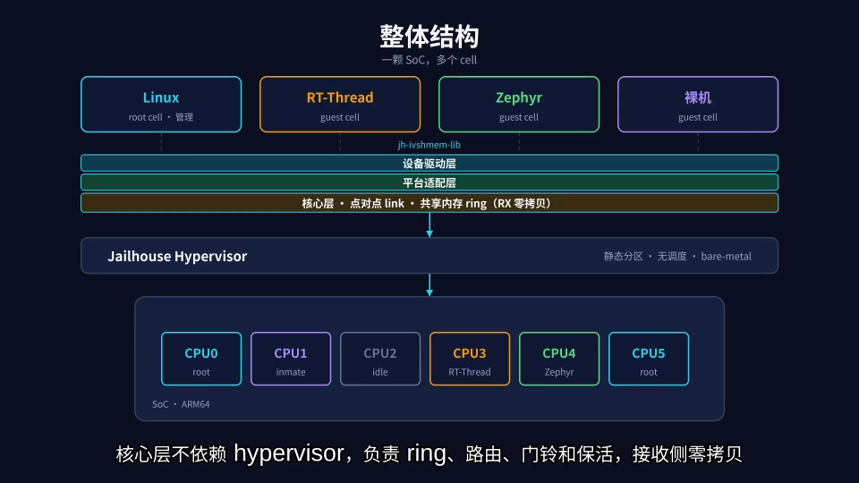

向上最常用的是三类端点，它们正好覆盖了"一台机器上两个系统需要互相说的三种话"：

| 端点 | 方向 | 用途 | root 侧形态 |
| :--- | :--- | :--- | :--- |
| UART（EP_SERIAL） | 双向 | 给 root 一个可交互的测试终端 | `/dev/ttyIVSHM-N` |
| LOG（EP_LOG） | 单向 | 把 guest 的 console 输出送到 root | `/dev/ivshm-logN` 写入 `guestN.log` |
| NET（EP_NET） | 双向 | 搬运标准以太网帧 | `ivshmN` 挂到网桥 `jhbr0` |

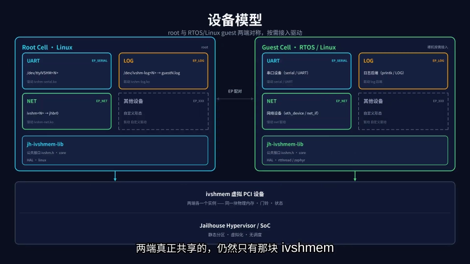

这套分层带来一个很实际的收益：**端点可以继续扩展**。新增一种设备，两端各写一个驱动，核心不用改（[【跳转到 04:19】](https://www.bilibili.com/video/BV1Z9x463EsJ/?t=259)）。串口和日志分道之后，唯一一根物理 UART 可以留给 root，guest 的输出改走共享内存协议，完全私有，不依赖 virtio 驱动——驱动只负责透传字节，分包、路由、门铃、保活都由库负责。

## 六、跑起来看：四套系统、三条链路、一个网桥

视频后半段是完整的演示（[【跳转到 05:06】](https://www.bilibili.com/video/BV1Z9x463EsJ/?t=306)）：在 QEMU 上 `up` 加载 Jailhouse，状态变成 enabled，然后依次启动 3 个 guest，加上 root 共 4 个 cell 同时 running。表格里 peer 2、3、4 分别对应三套串口、日志、网口和 IP。

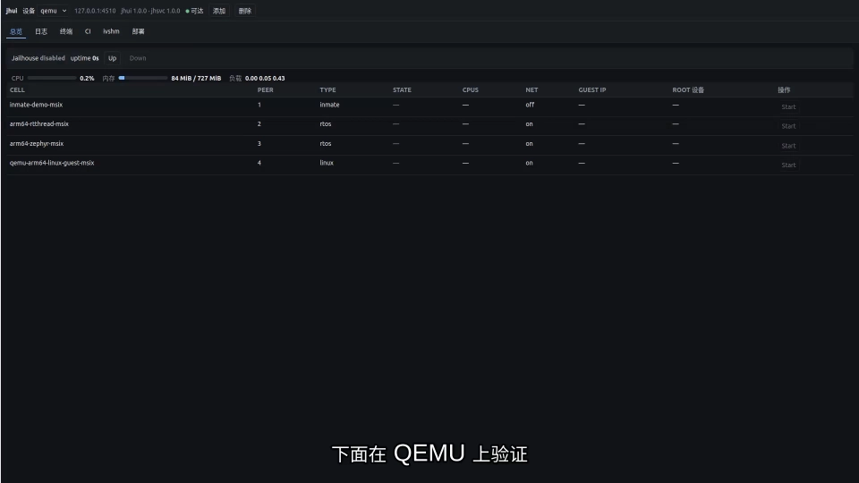

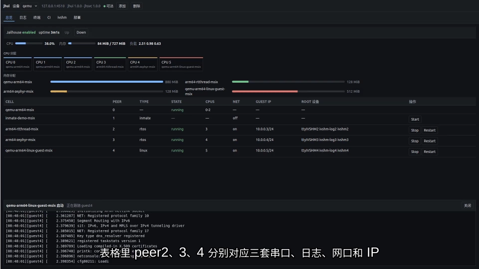

串口这一路，物理 UART 只留给 root，guest 的交互分别走 `ttyIVSHM2/3/4`；日志这一路有个细节值得注意：**guest 启动很早的输出会先进入私有内存环，链路建立后再送到 root**（[【跳转到 05:31】](https://www.bilibili.com/video/BV1Z9x463EsJ/?t=331)）。这是共享内存通道必须处理的问题——对端还没就绪时，数据不能丢，也不能阻塞启动，只能先在本地缓冲。

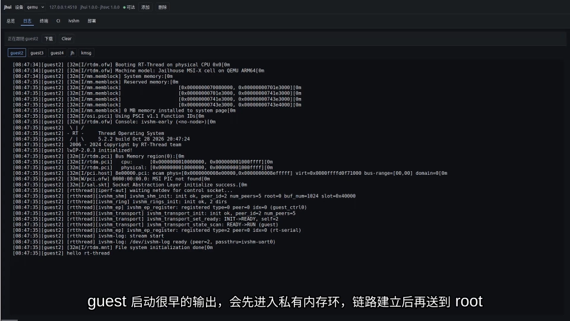

网络这一路最能体现"拓扑决定语义"。三个 guest 分别在 `10.0.0.3`、`10.0.0.4`、`10.0.0.5`，root 用 `jhbr0` 桥接三条链路（[【跳转到 05:56】](https://www.bilibili.com/video/BV1Z9x463EsJ/?t=356)）。root ping 三个 guest 都通；但 **guest 之间没有直连**，guest 2 ping guest 3 时，数据要先到 root 的 `jhbr0` 再转发过去（[【跳转到 06:28】](https://www.bilibili.com/video/BV1Z9x463EsJ/?t=388)）。

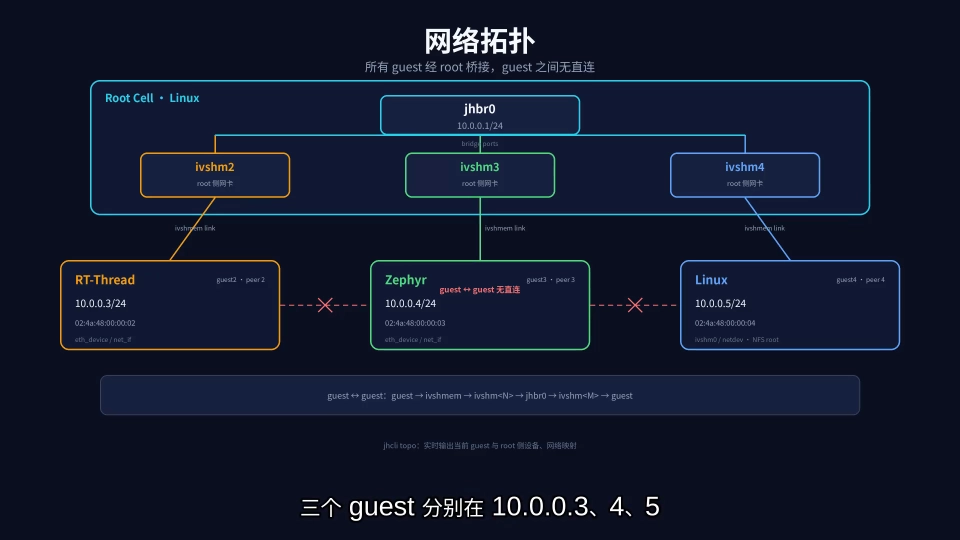

最后是 Linux guest 的根文件系统：`df` 一看，根文件系统是 NFS，挂载在 root 上（[【跳转到 07:11】](https://www.bilibili.com/video/BV1Z9x463EsJ/?t=431)）。也就是说，这条共享内存链路不仅承载控制台和网口，还能承载 guest 的存储。

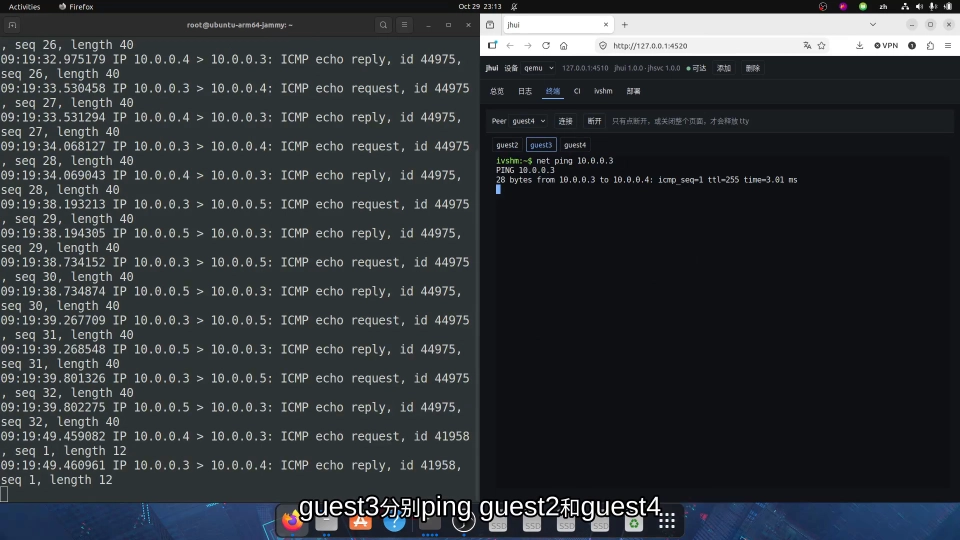

## 七、边界：只适合同一颗芯片上的互信系统

视频结尾把适用范围说得很克制（[【跳转到 07:22】](https://www.bilibili.com/video/BV1Z9x463EsJ/?t=442)）：本库当前是 **root 星型链路**，guest 不能直连互通，要经 root 桥接，这是集成上的选择；Jailhouse 的 ivshmem 本身支持多 peer。当前实现基于 ARM64，其余平台预留。

由此可以划出这条通道的适用边界：

- **必须同机**：共享内存的前提是双方能映射到同一块物理内存，跨机器就回到网络；
- **必须互信**：共享窗口没有"边界检查"，对端写进来的内容可以被直接读到，协议校验只能靠上层；
- **适合静态分区**：车载、工业控制、机器人、医疗设备、电信与边缘、航空航天——一台机器、四个系统、共用一套通信底座；
- **不适合需要动态超分和大量虚拟机的云场景**（这一点幻灯片上写得很直接）。

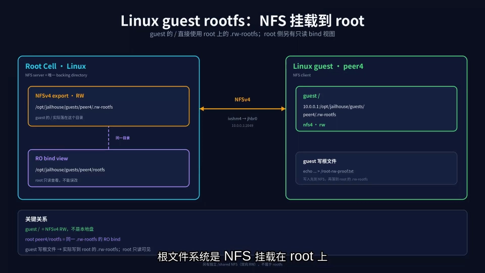

## 小结

- 共享内存通道分两层：**数据面**（ivshmem 给的窗口、门铃、状态寄存器）和**协议层**（分包、流控、路由、保活、异常恢复）。前者是设备的事，后者全是软件的事。
- ivshmem 的窗口按用途切成 State Table、R/W Section、Output Section，每个 peer 一块独立 buffer，这是"谁写哪块"的物理约定。
- 相比 vsock 这类有协议的通道，共享内存省掉的是每次收发的拷贝与协议栈开销，换来的是同步的活：门铃要陷入、索引要自己更新、对端状态要自己维护。
- 官方示例只能证明链路连通；在共享内存上跑 virtio 是业界常见做法，但对 AUTOSAR 或裸机 guest 太重，于是需要一个轻量协议层。
- `jh-ivshmem-lib` 的分层是：核心层（ring、路由、门铃、保活、接收侧零拷贝）加平台适配层加驱动层，root 与 guest 共用同一套核心。
- 三类端点（串口、日志、网络）证明这套抽象够用，且可以继续扩展；guest 早期日志先进私有内存环，是对"对端未就绪"的处理。
- 拓扑是 root 星型的点对点链路，guest 之间经 root 桥接；同机、互信、静态分区是它的三条前提。

## 关键术语速查

| 术语 | 一句话解释 |
| :--- | :--- |
| cell | Jailhouse 里的分区单位，一组静态分配的 CPU、内存和设备 |
| root cell | 最先启动的 cell，负责加载 hypervisor 并创建、启停其他 cell |
| ivshmem | 虚拟机间共享内存设备，双方各看到一个虚拟 PCI 设备，底层指向同一块物理内存 |
| 门铃（doorbell） | 写完数据后触发对端中断的一次 MMIO 写，是共享内存通道唯一的通知手段 |
| ring 控制块 | 放在共享内存读写区里的生产/消费索引，用来约定"数据写到哪了" |
| 零拷贝接收 | 数据直接落在共享内存里被上层读取，不在内核缓冲区与用户缓冲区之间再拷一次 |
| 保活（keepalive） | 判断对端是否还在、链路是否可用的周期性探测，ivshmem 不提供，需上层实现 |
| HAL | 硬件抽象层，这里指按操作系统（Linux、RT-Thread、Zephyr）适配的那一层 |