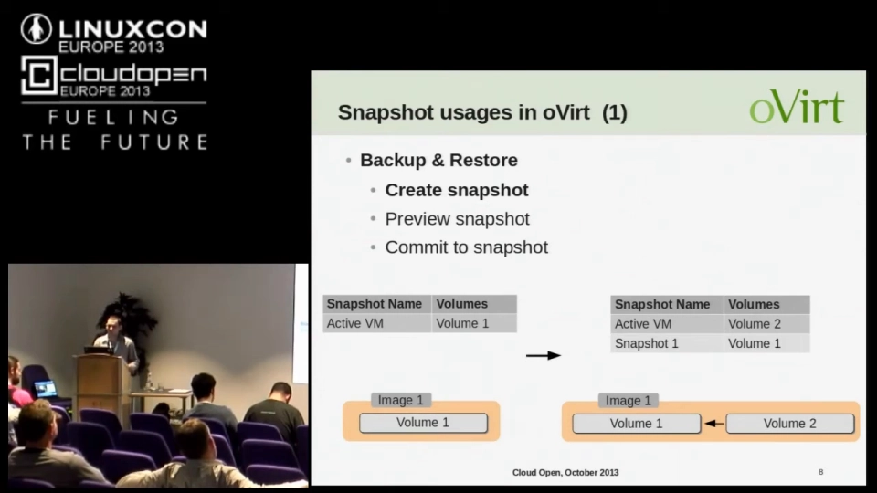
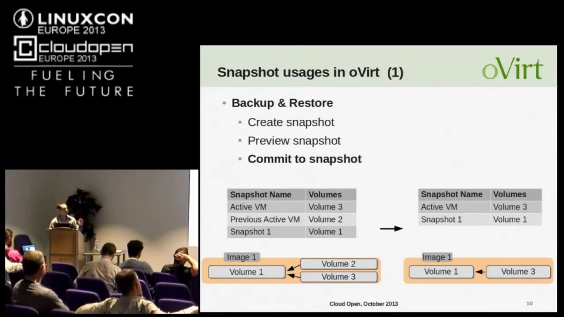
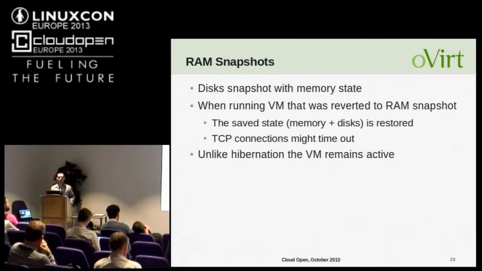
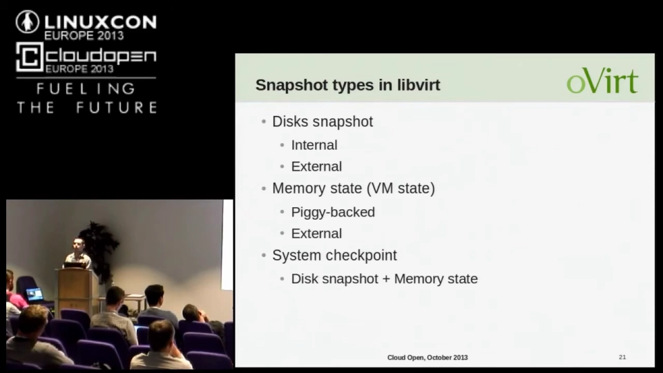
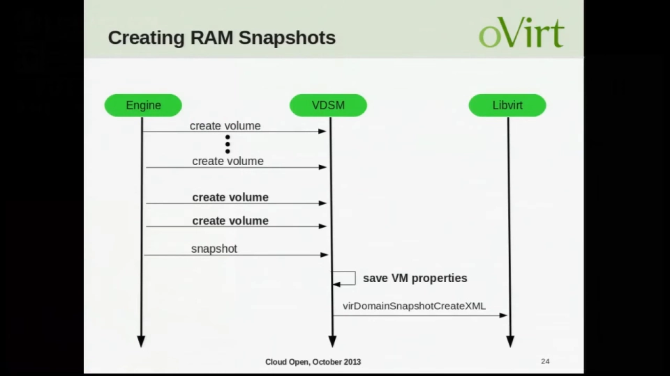
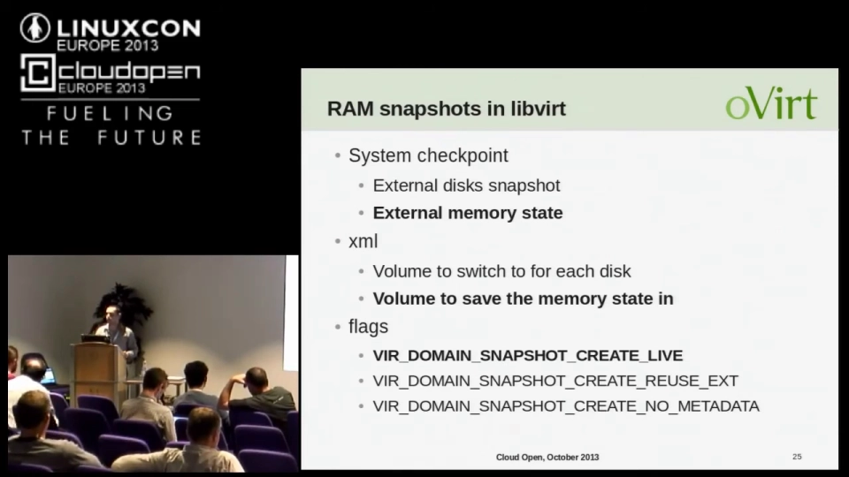
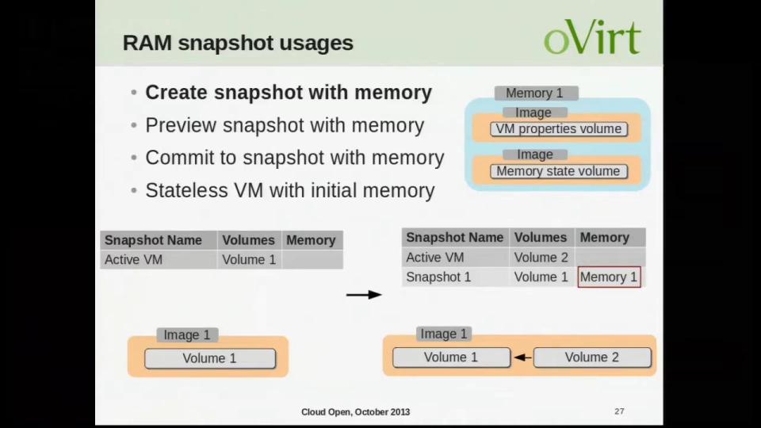
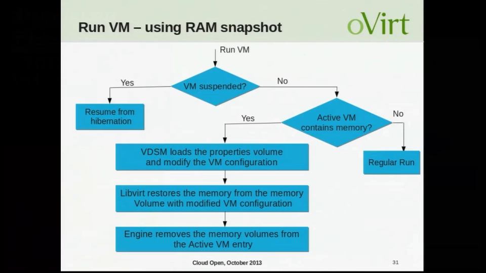
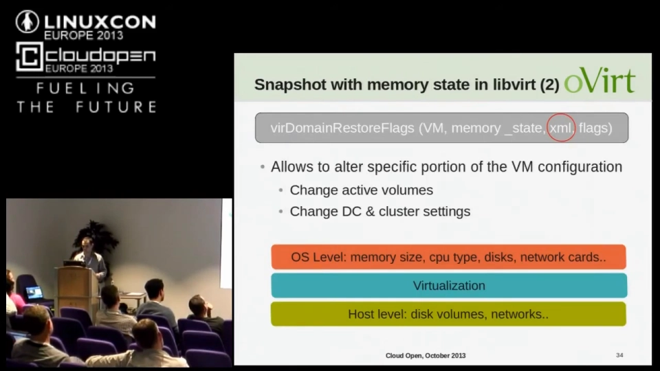
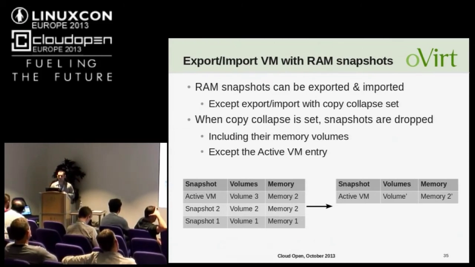

# 内存快照是一块卷：oVirt 如何把整台机器的内存存进快照链

> 视频来源：[RAM Snapshots in oVirt - Arik Hadas, Red Hat](https://www.youtube.com/watch?v=xIhPV66uGo8)（YouTube · LinuxCon/CloudOpen Europe 2013 · 讲者 Arik Hadas，Red Hat oVirt 团队）｜时长约 42 分钟
> 导读：这是一场 2013 年的实现分享，讲 oVirt 3.3 怎么在已有的 qcow2 卷链之上"顺手"加上内存：内存不是特殊文件，而是一块普通的卷，和一块保存 VM 配置的卷一起挂在快照表的 memory 列上。本文按"卷链 → 磁盘快照 → 内存卷 → 恢复顺序 → 链的合并"重排，末尾把 oVirt 的全量做法与增量脏页快照放在同一张坐标纸上对比。字幕由语音识别生成，oVirt、VDSM、libvirt、qcow2 等专有名词已按上下文订正。

## 本讲要解决的核心问题（SCQA）

**背景**：oVirt 管的是虚拟数据中心。它的磁盘快照早就实现了：每做一次快照，就给每块磁盘加一个空的 qcow2 卷，新的写落在新卷上，旧的卷从此只读。回滚快照，就是把"活动卷"指回旧的那个卷。

**冲突**：这种快照只存了磁盘。把 VM 回滚到三天前，磁盘数据回来了，可 VM 还得从头开机：内存里的进程、页缓存、已登录的会话、剪贴板，全部清零。对使用者来说，"回到三天前那一刻"和"用三天前的磁盘重新装一遍系统"是两件完全不同的事。

**疑问**：要把一台**正在运行**的机器真正冻结下来，内存这一半该存到哪里去？它怎么和磁盘那一半对齐？恢复时又按什么顺序拼回来？

**回答（中心思想）**：oVirt 把内存当成**又一块卷**。创建 RAM 快照时，除了给每块磁盘加一个空卷，再加两块卷：一块存 VM 的配置（XML），一块存整份内存镜像；两块卷一起被记进快照表的 `memory` 列。恢复时先读配置卷、改掉"活动卷指向哪"，再用改好的配置把内存卷灌回客户机，最后立刻把内存关联从活动条目上摘掉，防止内存与磁盘错配。这套做法存的是**全量内存**——体积等于客户机内存大小，代价是停机时间；它没有脏页增量，增量要靠卷链在磁盘侧完成。

---

## 一、先看清 oVirt 的存储模型：卷、链、活动卷

### 1.1 卷是磁盘的组成单元，只有两种格式

一台 VM 的虚拟磁盘不是一个大文件，而是由若干**卷（volume）**拼起来的。卷可以是文件，也可以是块设备，取决于存储域的类型。oVirt 里只有两种卷格式：

- **raw 卷**：最朴素的格式，里面就是一段连续的二进制数据，没有元数据、没有索引；
- **qcow2 卷**（QEMU copy-on-write version 2）：只装"变化过的那部分数据"，自带一段元数据说明自己到底装了哪些块。

[【跳转到 03:49】](https://www.youtube.com/watch?v=xIhPV66uGo8&t=229)

这个"只装变化部分"的特性，正是整场演讲的地基：**快照不需要复制数据，只需要换一个空卷上去**。

### 1.2 链与活动卷：写只落在最后一个卷，读从后往前找

一块典型的磁盘（演讲里叫 image 1）是一条**卷链**：最底下是基础卷，可以是 raw 也可以是 qcow2；上面叠着的每一层都是 qcow2。链的最后一个卷叫**活动卷（active volume）**，VM 直接对着它读写。

[【跳转到 04:19】](https://www.youtube.com/watch?v=xIhPV66uGo8&t=259)

规则只有两条：

1. **写**：新数据一律落在活动卷里。因为每个卷创建时都是空的，所以一个卷里只装"它在当活动卷的那段时间里被改过的数据"。
2. **读**：先问活动卷有没有这块数据。活动卷的元数据会说明自己装了哪些块；没有就往上找父卷，父卷没有就再往上，直到基础卷。

[【跳转到 06:29】](https://www.youtube.com/watch?v=xIhPV66uGo8&t=389)

由此得到一个关键推论：**链上除活动卷以外的所有卷都是只读的**，因为它们再也不会被写。只读意味着它们可以被安全地复制、被多个 VM 共享、被当作基线——这也是后面"合并"和"迁移"能成立的原因。

### 1.3 快照表：一张两列的表，记着"哪个时刻对应哪些卷"

oVirt 的 engine（Java 写的管理后端，数据落在 PostgreSQL 里）维护一张**快照表**。简化成两列：

| Snapshot Name | Volumes |
| --- | --- |
| Active VM | Volume 1 |

每台 VM 一开始只有一行：`Active VM`。这一行关联的卷，就是"下次开机时该用的活动卷"——如果 VM 正在运行，那它就是当前的活动卷。

[【跳转到 07:24】](https://www.youtube.com/watch?v=xIhPV66uGo8&t=444)

理解了这张表，后面所有的操作都可以翻译成一句话：**改表里的指针，而不是搬数据**。

## 二、磁盘快照：一次快照只是加一个空卷

### 2.1 创建：新卷挂成旧活动卷的子卷

做快照时，VDSM（跑在宿主机上的 Python 代理，负责实际动手）给每块磁盘加一个新卷，把它设成原活动卷的子卷，然后改表：

- 新卷 → 关联到 `Active VM` 行（它成为新的活动卷）；
- 旧卷 → 关联到新加的一行，比如 `Snapshot 1`。

[【跳转到 08:19】](https://www.youtube.com/watch?v=xIhPV66uGo8&t=499)

注意这里没有任何数据复制。`Snapshot 1` 之所以能代表"快照那一刻的磁盘"，是因为它指向的 Volume 1 从那一刻起就再也不会被写——它天然就是那一刻的只读快照。

### 2.2 预览与撤销：先试穿，再决定

回滚不是直接改，而是先**预览（preview）**：在快照关联的卷下面再加一个新卷（例子里的 Volume 3），把 `Active VM` 行克隆成 `Previous Active VM`，然后把新卷挂到 `Active VM` 上。下次开机，VM 就对着这个空卷读写，读不到的数据自然从 Volume 1 里来。

[【跳转到 09:29】](https://www.youtube.com/watch?v=xIhPV66uGo8&t=569)

预览期间**没有删掉任何卷、也没有删掉表里的任何行**，所以可以撤销（undo），状态原样回到预览之前。预览只能在 VM 关机时做。

### 2.3 提交：把不在链上的卷合并掉

确认要停在这个快照上时，执行**提交（commit）**：把所有"不在活动卷这条链上"的卷删掉——例子里是 Volume 2，以及和它绑定的 `Previous Active VM` 行。

[【跳转到 10:58】](https://www.youtube.com/watch?v=xIhPV66uGo8&t=658)

这一步就是本节关心的"**增量链与合并**"在磁盘侧的形态：快照链越长，读一次数据要往上找的层数越多、占的存储越多，所以要用提交把链截断。演讲在后面讲 copy-collapse 时也给了同样的理由——快照占存储，而且"读会变慢"。

### 2.4 快照在 oVirt 里的三种用法

演讲列了三种用法，它们决定了后面内存快照必须兼容哪些语义：

1. **备份与恢复**：保存某个时间点的状态，之后能回滚——这就是上面讲的创建/预览/提交三件套；
2. **无状态 VM（stateless VM）**：每次开机都从同一状态开始。做法是给每块磁盘加一个临时卷，把 `Active VM` 行克隆成 `Stateless snapshot`，关机时丢弃临时卷，等于回到开机前；
3. **在线存储迁移（LSM，live storage migration）的预备步骤**：先把磁盘切成"只读的历史 + 可写的活动卷"，然后整条链搬到另一个存储域。只读的历史卷可以用普通拷贝同步，只有活动卷需要 hypervisor 配合做增量同步——快照把"难同步的数据量"压到了最小。

[【跳转到 12:49】](https://www.youtube.com/watch?v=xIhPV66uGo8&t=769)

## 三、内存那一半：RAM 快照把内存写成两块卷

### 3.1 只有磁盘的快照，恢复后必须重新开机

演讲把话说得很直白：到目前为止所有快照都只含磁盘数据，所以回滚之后 VM **必须开机才能跑**。RAM 快照要做的，是把内存状态和磁盘状态一起存下来，回滚之后"几乎和快照那一刻一样"：你还处于登录状态，开着的应用还开着、状态不变，剪贴板内容也一样。唯一的例外是 **TCP 连接大概率已经超时**——对端早就把这个连接忘了。

[【跳转到 20:50】](https://www.youtube.com/watch?v=xIhPV66uGo8&t=1250)

保存内存这件事在 oVirt 里并不新鲜：**休眠（hibernate）**早就在做了，内存数据也是存进一块单独的卷。区别在于休眠之后 VM 不能再用，只能"恢复回来"；而 RAM 快照存完之后 VM 照常运行，用户随时可以选择回到那一刻。

[【跳转到 21:40】](https://www.youtube.com/watch?v=xIhPV66uGo8&t=1300)

### 3.2 在 libvirt 眼里，内存状态有三种形态

oVirt 自己不实现快照，它调 libvirt。libvirt 把快照分成三类：

- **磁盘快照（disks snapshot）**：只含磁盘数据。又分 internal（快照数据写进原来那个 qcow2 卷里）和 external（新加一个卷）；
- **内存状态（memory state / VM state）**：只含内存数据。同样分 piggyback（借宿在原来的 qcow2 磁盘卷里）和 external（单独一块卷）；
- **系统检查点（system checkpoint）**：磁盘快照 + 内存状态，两者都要。

[【跳转到 16:49】](https://www.youtube.com/watch?v=xIhPV66uGo8&t=1009)

oVirt 选的是 **external** 路线：内存单独一块卷。原因和它当年选 external 磁盘快照一样——internal 只能用在 qcow2 卷上，而 oVirt 要支持 raw 卷；external 还能做到创建期间 VM 不停机。

[【跳转到 18:53】](https://www.youtube.com/watch?v=xIhPV66uGo8&t=1133)

### 3.3 一次 RAM 快照多出两块卷：配置卷与内存卷

这是本节最该记住的一张图。创建 RAM 快照时，VDSM 做两件事：

1. 照旧给每块磁盘建一个新卷；
2. **再建两块额外的卷**：一块存 **VM properties**（这台 VM 的完整配置，XML 形式），一块存 **memory state**（整份内存镜像）。

然后它调用 libvirt 的 `virDomainSnapshotCreateXML`，XML 参数里除了"每块磁盘该切到哪个卷"，还要多给一个"内存存到哪个卷"的路径。

[【跳转到 22:37】](https://www.youtube.com/watch?v=xIhPV66uGo8&t=1357)

在 libvirt 侧，这次调用创建的是 **system checkpoint**（因为要存内存），内存以 **external** 方式落到单独那块卷里，flags 里不再带 `disk-only`，也不能带 `quiesce`（系统检查点不支持静默文件系统）。

[【跳转到 23:15】](https://www.youtube.com/watch?v=xIhPV66uGo8&t=1395)

快照表也跟着长出一列 `memory`。这两块卷被当成一个整体，演讲里叫它 `Memory 1`，挂到 `Snapshot 1` 那一行上。

[【跳转到 25:56】](https://www.youtube.com/watch?v=xIhPV66uGo8&t=1556)

### 3.4 create-live 标志：停机时间与体积的取舍

oVirt 3.3 创建 RAM 快照时**不加** `VIR_DOMAIN_SNAPSHOT_CREATE_LIVE`。这意味着 VM 在整个"把内存 dump 出去"的过程中都是**暂停**的——内存有多大，停机就有多久。

如果加上这个标志，VM 几乎全程都在跑，只在很短的一瞬间被冻结。代价有两个：

- 存下来的内存卷会**更大**：VM 在 dump 期间还在改内存，那些页必须先被写出去、再写新的，等于多存了一份；
- 最坏情况下 dump **不收敛**：客户机写脏页的速度一直追不上，永远写不完。

[【跳转到 24:10】](https://www.youtube.com/watch?v=xIhPV66uGo8&t=1450)

这段取舍值得停一下：它其实就是"**全量快照 vs 增量快照**"在时间维度上的同一个矛盾。全量快照要写完整份内存，写的过程中内存还在变，于是要么停下来（停机换一致性），要么边写边记变更（体积换停机）。演讲里提到的"不收敛"，和后面增量快照里"脏页产生速度超过同步速度"是同一类问题。

## 四、恢复：先改配置，再灌内存，最后清掉关联

### 4.1 运行一台带内存的 VM，是一棵判定树

创建完 RAM 快照后，"运行 VM"这个动作变成了三段判断：

1. VM 处于 **suspended** 状态？那是休眠过的，走"从休眠恢复"；
2. 否则看 `Active VM` 条目上有没有关联内存。没有 → 普通开机；
3. 有 → 先由 VDSM 读出配置卷并**修改配置**，再由 libvirt 用改好的配置把内存卷恢复进客户机；engine 一旦发现 VM 已经起来、可能开始改磁盘，就**立刻把内存从 `Active VM` 条目上摘掉**。

[【跳转到 27:37】](https://www.youtube.com/watch?v=xIhPV66uGo8&t=1657)

第三步容易被忽略，但它是正确性的关键：内存镜像对应的是**快照那一刻的磁盘状态**。如果 VM 已经跑起来、磁盘已经变了，还留着这份内存关联，下次再拿它恢复，就会得到"旧内存 + 新磁盘"的组合，直接导致数据损坏。

[【跳转到 28:32】](https://www.youtube.com/watch?v=xIhPV66uGo8&t=1712)

### 4.2 为什么一定要先改配置：活动卷变了

配置卷里存的是快照那一刻的 VM 配置，其中包括"每块磁盘的活动卷是谁"。快照时 image 1 的活动卷是 Volume 1；提交快照之后，活动卷变成了 Volume 3。如果直接按配置卷恢复，VM 会去用 Volume 1 当活动卷——那是只读的历史卷。

所以恢复前必须把配置里的活动卷从 Volume 1 改成 Volume 3。这就是"**基线 + 增量**"在 oVirt 里的具体形态：内存是基线，磁盘链的当前活动卷是增量，两者必须重新对齐才能拼成一台能跑的机器。

[【跳转到 29:50】](https://www.youtube.com/watch?v=xIhPV66uGo8&t=1790)

### 4.3 `virDomainRestoreFlags` 的四个参数与三层模型

恢复走 libvirt 的 `virDomainRestoreFlags`，四个参数：VM 的 ID、内存所在的卷、flags（这里不用）、以及 **XML**。

[【跳转到 30:38】](https://www.youtube.com/watch?v=xIhPV66uGo8&t=1838)

XML 参数的作用是**覆盖**配置里的一部分内容。演讲用"三层"来解释它为什么安全：

- **OS 层**：客户机操作系统看到的东西——内存大小、CPU 类型、磁盘、网卡；
- **宿主层**：真实存在的东西——磁盘卷在哪、网络怎么接；
- **虚拟化层**：夹在中间，把宿主层的现实"翻译"成 OS 层看到的样子。

XML 参数改的是**宿主层**，改动被虚拟化层挡住，客户机完全察觉不到。所以你可以把一份内存镜像恢复到"活动卷换了、所在数据中心或集群也换了"的环境里，客户机醒来时仍然以为自己还在原地。

[【跳转到 31:38】](https://www.youtube.com/watch?v=xIhPV66uGo8&t=1898)

## 五、链的合并与搬运：copy-collapse 会丢快照，但保住活动内存

### 5.1 导出与导入

把 VM 搬到另一个数据中心，走的是**导出/导入**：先复制到 export domain，把 export domain 挂到目标数据中心，再导入。默认情况下快照会跟着一起搬，RAM 快照的内存卷当然也一起搬。

[【跳转到 33:41】](https://www.youtube.com/watch?v=xIhPV66uGo8&t=2021)

### 5.2 copy-collapse：合并整条链，只留活动条目

如果导出时勾了 **copy-collapse**，所有磁盘卷会被合并成一个卷，快照表里除 `Active VM` 之外的所有条目都会被删掉——快照没了，内存卷自然也一起没。

[【跳转到 34:31】](https://www.youtube.com/watch?v=xIhPV66uGo8&t=2071)

这里有个细节值得记：**挂在 `Active VM` 条目上的内存会被复制**。所以如果希望内存跟着 VM 一起搬走，必须先"提交到 RAM 快照"，让内存挂到活动条目上。这是"链的合并"与"内存的归属"之间唯一的一条硬约束。

[【跳转到 34:56】](https://www.youtube.com/watch?v=xIhPV66uGo8&t=2096)

### 5.3 界面上的样子

最后几分钟是 web admin 的截图演示：快照页多了一列 Memory，每个条目一个只读的勾选框；创建快照的对话框里多一个"保存内存"的勾选项（默认勾上，且只在创建在线快照时出现）；预览 RAM 快照时也有一个"是否连内存一起恢复"的勾选项——不勾就只回滚磁盘，VM 需要重新开机。

[【跳转到 36:29】](https://www.youtube.com/watch?v=xIhPV66uGo8&t=2189)

REST API 侧对应两个属性：一个叫 persist memory state，表示这个快照是否含内存；另一个叫 restore memory，表示恢复时是否连内存一起恢复。

[【跳转到 39:19】](https://www.youtube.com/watch?v=xIhPV66uGo8&t=2359)

## 六、把 oVirt 的做法放回"全量 vs 增量"的坐标系

oVirt 的 RAM 快照是**全量内存快照**的教科书样本，它把全量路线的每一个代价都暴露得很清楚：

| 维度 | 全量内存快照（oVirt 的做法） | 增量脏页快照 |
| --- | --- | --- |
| 写什么 | 整份客户机内存镜像，一块卷 | 只写自上次基线以来被写过的页，加一份脏页集 |
| 体积 | 约等于客户机内存大小 | 与"这段时间改了多少页"成正比，通常远小于内存 |
| 停机 | 不加 live 标志时，等于 dump 完整个内存的时间 | 只需在冻结瞬间拿到脏页集，停机可压到很短 |
| 恢复 | 把整块内存卷读回客户机 | 先铺基线，再按顺序叠加增量，最后才 `KVM_RUN` |
| 一致性 | 内存与磁盘在同一冻结时刻取得，天然对齐 | 必须记录"基线是哪个快照""增量基于哪个基线"，链断一环就不可恢复 |
| 主要风险 | 停机时间长；加 live 后体积变大甚至不收敛 | 链变长后恢复变慢；脏页集本身有精度与开销问题 |

由此可以回答本节的学习目标：**全量与增量的差别不在"存不存内存"，而在"存多少、什么时候存、恢复时怎么拼"**。全量快照把"拼"这件事省掉了——一份内存卷就是完整状态；增量快照省的是体积和停机，代价是把"拼"的责任转移到恢复路径上，并且必须额外记录设备状态与基线关系。

oVirt 这场演讲里没有脏页增量，但它的卷链已经给出了增量思想的另一半：**只读的父卷是基线，可写的活动卷是增量，读的时候从活动卷往回找**。内存如果要走增量路线，缺的正是"活动卷里该装哪些页"这个判据——也就是脏页集。

## 小结

- oVirt 的存储模型是**卷链**：写只落活动卷，读从活动卷往回找，链上其余卷只读；快照只是"加一个空卷 + 改表里的指针"。
- 磁盘快照的创建/预览/提交，本质是**指针的移动与链的截断**；提交会删掉不在活动链上的卷，这是"增量链合并"的磁盘侧形态。
- RAM 快照多出**两块卷**：VM properties（配置）与 memory state（整份内存），两者一起记在快照表的 `memory` 列上。
- 恢复顺序是硬性的：**先改配置里的活动卷 → 再灌内存 → 起来后立刻摘掉内存关联**，否则会得到"旧内存 + 新磁盘"的错配。
- `virDomainRestoreFlags` 的 XML 参数只改宿主层，客户机看到的 OS 层不变，所以内存镜像可以恢复到换了卷、换了集群的环境。
- 全量 vs 增量的取舍：全量省掉"拼接"但体积与停机大；增量省体积与停机，但必须维护脏页集、基线与恢复顺序。

## 关键术语速查

| 术语 | 一句话解释 |
| --- | --- |
| 卷（volume） | 虚拟磁盘的组成单元，oVirt 里只有 raw 与 qcow2 两种格式 |
| 活动卷（active volume） | 卷链最上面那一个，VM 的写全部落在它身上 |
| 快照表 | engine 数据库里的表，记录"哪个快照对应哪些卷、哪块内存卷" |
| 预览 / 提交 | 预览是试穿（可撤销），提交是确认（删掉不在链上的卷） |
| 系统检查点 | libvirt 的术语，指磁盘快照 + 内存状态一起存 |
| piggyback / external | 内存数据借宿在磁盘 qcow2 卷里 / 单独存一块卷 |
| VM properties 卷 | 存 VM 完整配置（XML）的卷，恢复时先读它再改活动卷 |
| create-live | libvirt 标志，让 VM 在 dump 内存期间几乎不停机，代价是卷更大、可能不收敛 |
| copy-collapse | 导出/导入时把整条卷链合并成一个卷，快照条目被丢弃 |
| 脏页集 | 自基线以来被写过的页的集合，是增量快照唯一需要额外保存的东西 |