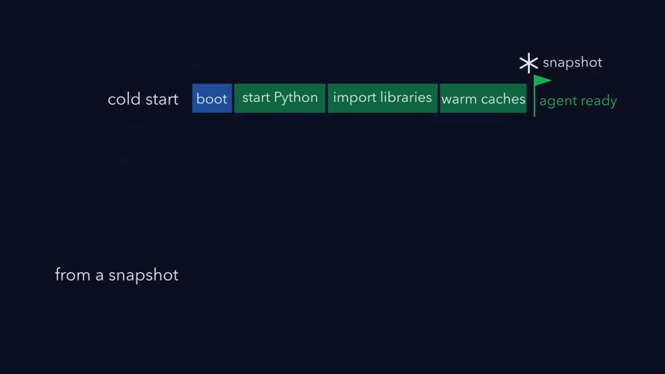
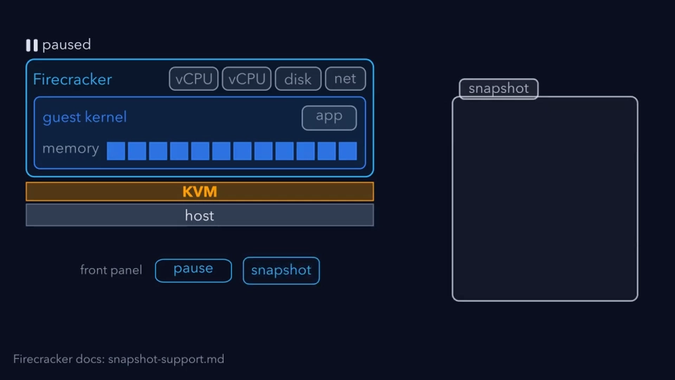
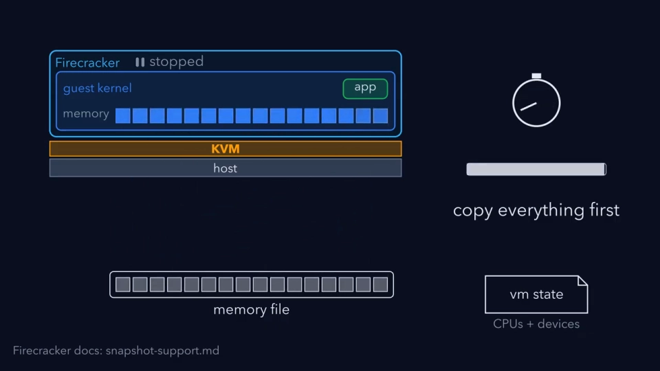
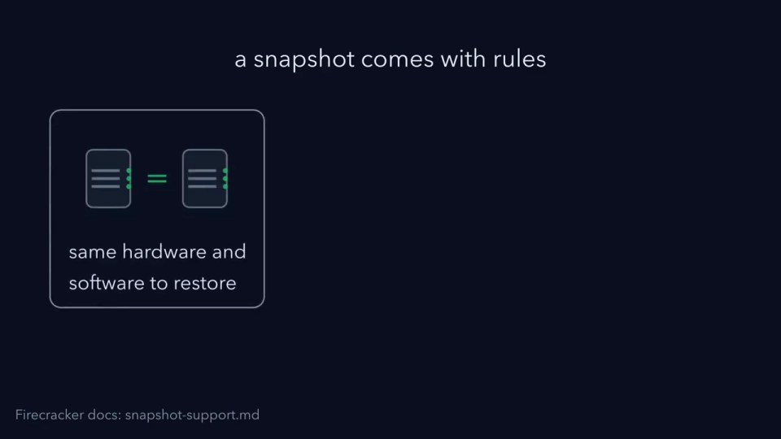
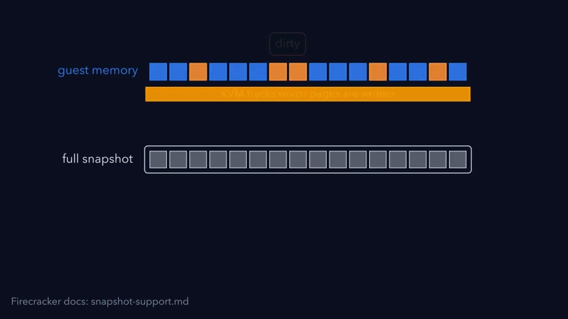
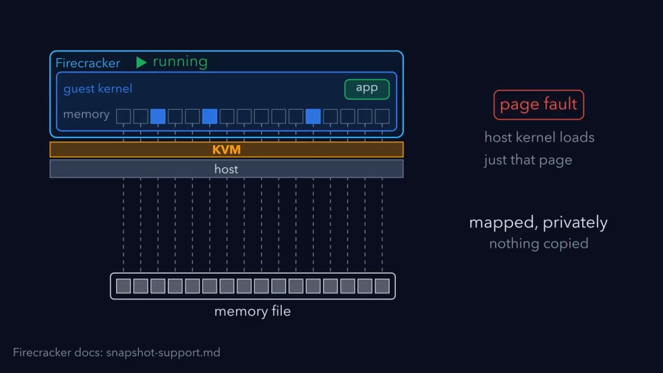
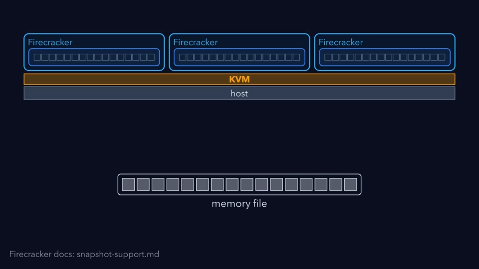
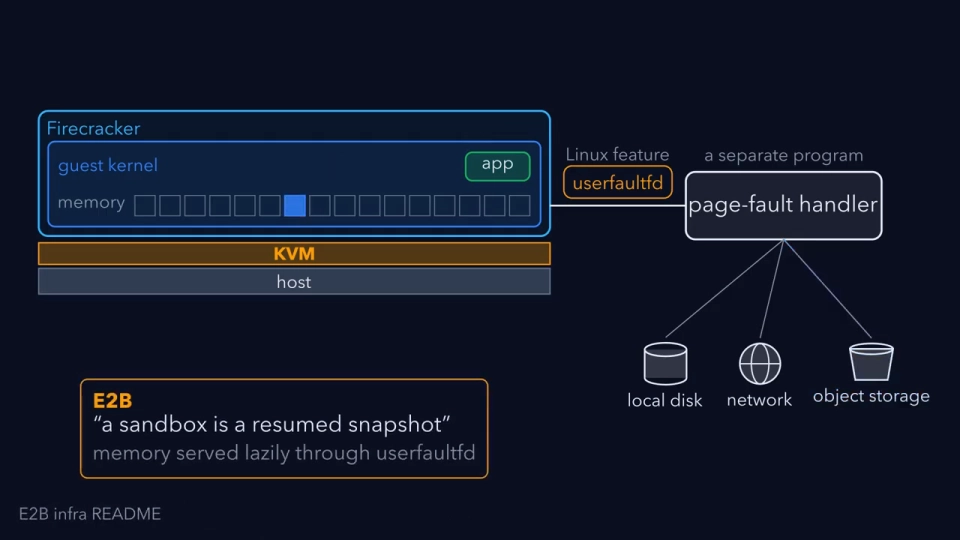
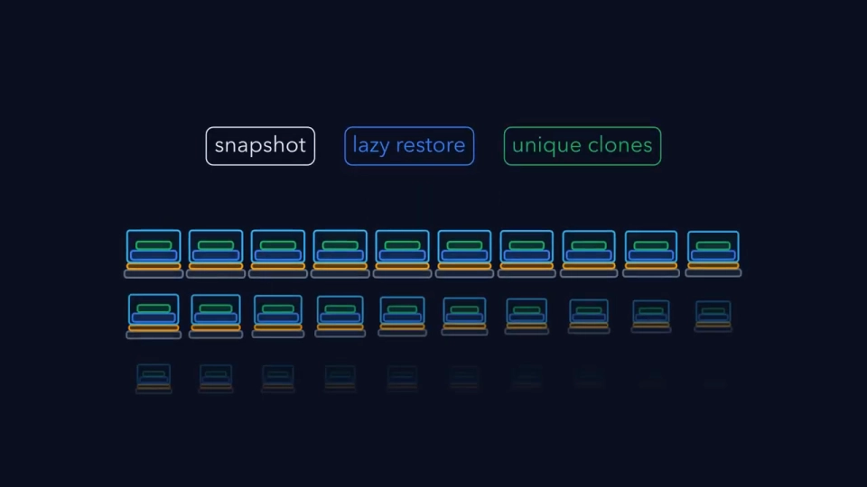

# 快照是冷启动里最慢的那一段：Firecracker 把内存存成两份文件

> 视频来源：[How AI Agent Sandboxes Actually Work: Firecracker MicroVMs, Snapshots & 125 ms Boots](https://www.youtube.com/watch?v=HhW1lnN6xc0)（YouTube · XOR）｜时长约 24 分钟
> 导读：这支视频讲的是 AI agent 沙箱的整条技术栈——隔离阶梯、Firecracker 的线程模型、jailer 与 seccomp、快照、懒加载、克隆唯一性、AWS Lambda SnapStart。本文只取与"快照里内存那一半"直接相关的第 6–10 章：内存文件与 vmstate 文件怎么分工、增量快照为什么只写脏页、恢复时内存为什么可以不先搬回来、以及同一份内存被反复恢复会撞上什么问题。隔离与安全那几章属于本系列 6.1、6.2 的内容，这里不展开。

## 本讲要解决的核心问题（SCQA）

**背景**：沙箱要"起得快"。可一次冷启动里最慢的往往不是内核，而是语言运行时初始化、加载库、预热缓存这几段。而这些工作，对同一份代码来说每次都是一模一样的。

**冲突**：既然每次都一样，那就做一次、把整台机器冻起来、以后从冻结点开始跑。可一台沙箱的内存动辄几个 GB，把整份内存复制成文件要时间，恢复时再复制回来又要时间——快照看起来只是把"启动慢"换成了"存得慢、恢复得慢"。

**疑问**：快照到底该存什么？全量内存和"只存改过的页"差在哪里？恢复的时候，非得把整份内存搬回 RAM 才能开跑吗？

**回答（中心思想）**：Firecracker 把快照拆成**两份文件**——一份是客户机内存的每一个字节，一份是 vCPU 与设备的状态（vmstate），磁盘另外自己存。**增量快照**不重写整份内存，只把"自上次快照以来被写过的脏页"叠在全量之上。**恢复**则干脆不复制：把内存文件私有映射进新机器，缺哪页加载哪页。体积、停机时间、恢复时间这三件事，因此可以分开优化。

---

## 一、快照的定位：把冷启动里最慢的一段只做一次

### 1.1 冷启动的时间花在哪

视频把一次冷启动拆成几段：boot（内核启动）→ start Python（启动语言运行时）→ import libraries（加载库）→ warm caches（预热缓存）→ agent ready（程序真正就绪）。

[【跳转到 11:44】](https://www.youtube.com/watch?v=HhW1lnN6xc0&t=704)

这张图解释了为什么"快照"值得做：前面几段加起来可能只有几十毫秒，后面几段却可能是几百毫秒到几秒。而后面几段的结果，全部沉淀在**内存**里——运行时堆、已加载的共享库、填满的缓存。所以"冻结一台机器"这件事，九成是在冻结内存。

### 1.2 快照点选在"就绪"那一刻

Firecracker 的做法是：把机器暂停（pause），然后请求一个快照。快照写出的东西被明确分成两份，磁盘不在其中。

[【跳转到 12:09】](https://www.youtube.com/watch?v=HhW1lnN6xc0&t=729)

这个"磁盘自己存"的边界很重要：内存快照只负责 RAM，块设备的持久化是另一条线（本系列 5.1.2 讲设备状态，S07 讲持久化）。把两者混在一个文件里，会让快照体积和恢复路径都变得不可控。

## 二、全量内存快照：一份内存文件，一份 vmstate 文件

### 2.1 两份文件的分工

Firecracker 的快照是两个文件：

- **内存文件**：装客户机内存的**每一个字节**。它对应的是客户机物理地址空间（GPA）的完整镜像——不是"用到的部分"，是整个地址空间；
- **vmstate 文件**：装"内存之外的一切"——每个虚拟处理器的寄存器状态，以及每个设备的状态。

[【跳转到 12:16】](https://www.youtube.com/watch?v=HhW1lnN6xc0&t=736)

### 2.2 为什么必须拆成两份

因为这两份东西的性质完全不同：

- **内存是"数据"**：它很大、按页访问、可以按页懒加载、可以被多台机器共享只读页；
- **vmstate 是"指针"**：它很小，但必须**整体、原子**地恢复——vCPU 的程序计数器、页表基址寄存器、设备的队列指针，少一个字段机器就跑不起来。

如果混成一个文件，恢复时就没法对内存做"按页懒加载"，因为读 vmstate 之前你根本不知道该从哪一页开始。拆开之后，恢复路径可以做到"先把 vmstate 读进来、把 vCPU 摆好，内存一页都还没到就开跑"——这正是第四章要讲的懒加载的前提。

### 2.3 快照的三条规矩

视频里明确列了三条限制，它们都是"内存被完整保存"带来的直接后果：

1. **只能在同种硬件、同种软件上恢复**：内存镜像里存的是按当时那套 CPU 特性、设备模型布局排好的字节，换了宿主或换了 Firecracker 版本，布局就对不上；
2. **快照文件里含内存中的一切，包括密钥**：客户机内存里可能有 TLS 私钥、token、明文口令，所以文档要求把快照文件当机密来保护；
3. **版本门槛**：Firecracker 的快照能力在 2025 年的 1.13 版本转为正式可用（GA）。

[【跳转到 12:37】](https://www.youtube.com/watch?v=HhW1lnN6xc0&t=757)

第 1 条规矩值得多想一层：它说明"内存快照"不是一份自描述的数据，而是**对某套地址空间布局的原始转储**。这也是为什么后面讲增量时，必须额外记录"这份增量基于哪份全量"——否则恢复端根本不知道该把脏页盖到哪张底图上。

## 三、增量快照：在全量之上只写脏页集

### 3.1 KVM 记得住"哪些页被写过"

增量快照的全部前提，是**脏页追踪**：KVM 能记录客户机自上次某个时间点以来写过哪些页。视频只用一句话带过这个能力，但它是整条链的地基。

[【跳转到 12:16】](https://www.youtube.com/watch?v=HhW1lnN6xc0&t=736)

### 3.2 diff 快照 = 全量 + 脏页集

视频的说法很干脆：**diff 快照只把那些脏页写在一份全量快照之上**。这句话里藏着三个要素：

- **基线（全量快照）**：提供完整的地址空间底图，每个页的初始内容都在这里；
- **增量（脏页集）**：提供"哪些页、页里的新内容"；
- **归属关系**：增量必须知道自己基于哪一份全量，否则恢复端无法拼。

恢复时的顺序因此是固定的：**先铺基线，再按顺序把增量盖上去，最后才让 vCPU 跑**。如果只拿增量去恢复，得到的是"大部分页缺失 + 少量页是新的"的残骸；如果先盖增量再铺基线，新数据会被底图覆盖掉。

### 3.3 脏页集怎么表示

脏页集本质上是一个**页号集合**。最省空间的表示是**位图**：客户机内存按页切分，一位对应一页，写过就置 1。位图的大小只与内存大小有关（例如 4 KiB 一页、1 GiB 内存就是 256 Kibit，即 32 KiB 的位图），与"实际改了多少页"无关。

另一种表示是**哈希表或页号列表**：只记录真正脏了的页号及其内容。它在"脏页很少"时比位图更省，但需要处理哈希冲突、遍历开销，且不利于顺序写盘。位图胜在简单、可顺序扫描、可直接对应到文件偏移；哈希胜在稀疏场景下的空间效率。两种表示的共同点是：**它们都只是"索引"，真正的数据仍然要逐页写出**。

（脏页追踪本身的实现——写保护、KVM 的 dirty log、位图精度带来的开销——是本系列 2.4 的内容，这里不重复。）

### 3.4 为什么增量在 Firecracker 里还只是开发者预览

视频给了一句限定：在 Firecracker 里，增量快照**仍是 developer preview**。原因不难推：一旦允许"全量 + 增量"，就必须回答一连串新问题——增量能不能再叠增量（链有多长）、链中间某一环被删了怎么办、设备状态（vmstate）要不要跟着每层增量各存一份、恢复时按什么顺序合并。全量快照把这些问题全部绕开了，所以它先成熟。

## 四、恢复：内存不必先搬回来

### 4.1 朴素做法：先把整份内存复制回 RAM

最直白的恢复方式是：把内存文件整份读进 RAM，然后按下"继续"。代价是**停机时间与内存大小成正比**——一个 4 GiB 的沙箱，就要等 4 GiB 的数据从存储走到内存。

[【跳转到 13:15】](https://www.youtube.com/watch?v=HhW1lnN6xc0&t=795)

### 4.2 Firecracker 的做法：私有映射 + 缺页加载

Firecracker 不复制。它把内存文件**私有地映射（mmap, MAP_PRIVATE）**进新机器的地址空间，然后**立刻**让 vCPU 跑起来。客户机第一次碰到某一页时，宿主内核悄悄把那一页从文件读进来；第一次**写**某一页时，才给它一份私有副本（copy-on-write），文件本身永远不变。

[【跳转到 13:36】](https://www.youtube.com/watch?v=HhW1lnN6xc0&t=816)

这一步把"恢复时间"从"内存大小"解耦成了"程序实际碰到的页数"。沙箱的内存可能有几个 GB，但真正跑起来只会碰其中一小部分——启动阶段的收益就来自这个差集。

### 4.3 顺带得到的 CoW：一份内存文件喂多台机器

因为映射是私有的、文件从不被写，把同一份内存文件恢复到多台机器是天然安全的：它们共享所有**只读**的页，各自只为自己**写过**的页保留副本。

[【跳转到 14:12】](https://www.youtube.com/watch?v=HhW1lnN6xc0&t=852)

这就是"模板"能成立的原因：一份快照文件在存储上只有一份，恢复出来的 N 台机器在内存里也只多出"各自写过的那些页"。

### 4.4 更可控的版本：userfaultfd

私有映射只能从**本地文件**取页。如果想要更灵活——比如从网络或对象存储按需取页——Linux 还有一个机制：**userfaultfd**。它把某台机器的缺页事件交给一个**用户态程序**处理：客户机碰到缺失的页时，那个程序收到消息，从任何地方（本地磁盘、网络、对象存储）取来那一页，塞进去。

[【跳转到 14:24】](https://www.youtube.com/watch?v=HhW1lnN6xc0&t=864)

视频提到 E2B 就是这么做的：它的文档里写得很直白——"一个沙箱就是一次被恢复的快照"，内存通过 userfaultfd 懒加载。

### 4.5 懒加载不是免费的

两条代价：

- **性能**：页是一页一页到的，每次缺页都是一次小等待。视频引用了一项 2021 年的研究：从快照跑起来的函数，平均比"内存已经就位"时慢 95%。那项工作的解法是**记录一个函数固定需要哪些页**，恢复时一次性预取，平均把冷启动延迟缩短到 1/3.7。
- **可靠性**：如果处理缺页的那个程序挂了，机器会在下一次缺页时**直接卡死**。

[【跳转到 14:49】](https://www.youtube.com/watch?v=HhW1lnN6xc0&t=889)

所以"懒加载"和"全量预取"不是对错之分，而是同一条曲线上的两个点：预取越多，启动越慢、但跑起来越顺；预取越少，启动越快、但执行期要还债。前面提到的那项研究，本质上是把"预取哪些页"从"全部"缩小到了"工作集"。

## 五、同一份内存被反复恢复：唯一性与时间

### 5.1 一百个克隆，同一副骰子

把同一份快照恢复一百次，就得到一百台"记得同一时刻"的机器——包括它们的**随机数发生器状态**。于是每个克隆都会掷出同样的骰子：同样的"随机"密钥、同样的唯一 ID、同样的 nonce。

[【跳转到 16:04】](https://www.youtube.com/watch?v=HhW1lnN6xc0&t=964)

Firecracker 的文档对此毫不含糊：如果没有可靠的办法保证唯一性，它认为"把同一份状态恢复多次"是不安全的。

### 5.2 VMGenID：每次恢复换一个 16 字节

解法是一个很小的虚拟设备：**VM generation ID**。每次恢复时，Firecracker 往里面写一个新的 16 字节随机值并通知客户机；客户机内核看到变化，就重新给随机数发生器播种。从此每个克隆抽到的数不一样。

[【跳转到 16:29】](https://www.youtube.com/watch?v=HhW1lnN6xc0&t=989)

### 5.3 时间与连接：内存里记着"旧世界"

还有两个问题不在内存里，但由"内存被冻结"直接引起：

- **时钟**：恢复出来的机器以为自己还停在快照那一刻。Firecracker 后来加了时钟设备，让客户机知道时间跳过了一段；
- **连接**：机器记得自己有哪些 TCP 连接，但对端早就超时放弃了。这类状态没法靠设备修复，只能由程序自己处理。

[【跳转到 17:19】](https://www.youtube.com/watch?v=HhW1lnN6xc0&t=1039)

AWS Lambda 给函数的建议是两个钩子：一个在**快照前**跑，一个在**每次恢复后**跑；所有唯一 ID、密钥、随机性都放在恢复之后生成，绝不在快照前生成。

[【跳转到 17:44】](https://www.youtube.com/watch?v=HhW1lnN6xc0&t=1064)

## 六、生产里的三个数字

### 6.1 Lambda SnapStart：从 6 秒到 200 毫秒

Lambda 的 SnapStart 就是这套机制的规模化版本：发布函数时跑一次初始化，然后对**内存和磁盘**做一次 Firecracker 快照，加密后缓存；之后每个新副本都从这份快照恢复，并且**按需分块取快照**。2022 年的演示里，一个 Java Spring Boot 函数从 6 秒多降到 200 毫秒以内。

[【跳转到 18:09】](https://www.youtube.com/watch?v=HhW1lnN6xc0&t=1089)

注意"按需分块取"这几个字：它说明在生产里，连"内存文件"本身都不要求先完整下载到本地——恢复路径可以一边跑一边从远端拉页。

### 6.2 2026 年的 Lambda microVM

视频提到 2026 年 6 月 AWS 把同一套机器用到了 AI agent 上：Lambda microVM 为不可信代码提供隔离、有状态的沙箱，最长跑 8 小时，**从快照恢复而不是开机**。

[【跳转到 18:49】](https://www.youtube.com/watch?v=HhW1lnN6xc0&t=1129)

### 6.3 E2B：暂停 4 秒每 GB

E2B 的文档给出的数字是：暂停大约 **4 秒每 GB 内存**，恢复则通过 userfaultfd 懒加载。这个数字很能说明全量内存快照的成本结构——暂停时间基本就是"把内存写出去"的时间，与内存大小线性相关。

[【跳转到 19:39】](https://www.youtube.com/watch?v=HhW1lnN6xc0&t=1179)

## 七、把两条路线放在一起

| 维度 | 全量内存快照 | 增量脏页快照 |
| --- | --- | --- |
| 写什么 | 客户机地址空间的每个字节 | 自基线以来被写过的页 + 基线引用 |
| 体积 | 约等于客户机内存大小 | 与改动的页数成正比 |
| 停机 | 与内存大小成正比（E2B 约 4 秒每 GB） | 只需在冻结瞬间取到脏页集 |
| 恢复 | 映射整份内存文件，按需加载 | 先铺基线，再叠增量，最后才跑 vCPU |
| 一致性负担 | 低：一份文件就是完整状态 | 高：必须记录基线与顺序，链不能断 |
| 典型风险 | 体积大、跨版本不可恢复 | 链变长后恢复变慢，增量层数需要治理 |

把这张表和 oVirt 那套"内存写成一块卷"的做法对照着看，会发现两条路线的分歧点只有一个：**要不要维护一个"基线 + 增量"的链**。全量快照用体积换简单，增量快照用简单换体积。而无论走哪条，恢复端都必须先拿到 vCPU 与设备状态（vmstate），因为内存里装的是数据，不是"机器现在执行到哪"。

## 小结

- 冷启动里最慢的几段（运行时、库、缓存）结果都沉淀在内存里，所以快照主要是在冻结内存。
- Firecracker 的快照是**两份文件**：内存文件装每个字节，vmstate 文件装 vCPU 与设备状态；磁盘另存。
- 拆成两份的原因是性质不同：内存可以按页懒加载、可以共享只读页；vmstate 必须整体原子恢复，是懒加载的前提。
- 增量快照只写**脏页集**，叠在一份全量基线之上；恢复顺序必须是"基线 → 增量 → 运行"。
- 恢复不复制内存：私有 mmap + 缺页加载，或用 userfaultfd 把缺页交给用户态程序；代价是执行期变慢（研究中平均慢 95%）和依赖缺页处理程序存活。
- 同一份内存被反复恢复会带来唯一性与时间问题，解法是 VMGenID、时钟设备，以及"唯一的东西在恢复之后再生成"。

## 关键术语速查

| 术语 | 一句话解释 |
| --- | --- |
| 内存文件 | 客户机物理地址空间的完整字节镜像，全量快照的主体 |
| vmstate 文件 | vCPU 寄存器与设备状态的序列化结果，必须整体恢复 |
| 脏页集 | 自基线以来被写过的页的集合，增量快照唯一需要额外保存的东西 |
| 位图表示 | 一位对应一页，空间只与内存大小有关，可顺序扫描 |
| 私有映射 | MAP_PRIVATE，读共享、写复制，文件本身永不改变 |
| userfaultfd | 把缺页事件交给用户态程序处理的 Linux 机制，可按需从远端取页 |
| VMGenID | 每次恢复写入新随机值的虚拟设备，用来让客户机重新播种随机数 |
| SnapStart | AWS Lambda 的"发布时快照、调用时恢复"功能 |