# QEMU 快照为什么慢：冻结的顺序、序列化的字节流与落盘的带宽

> 视频来源：[QEMU Snaphosts Are So Slow. Really?](https://www.youtube.com/watch?v=IM5u1xAQWw8)（YouTube · KVM Forum 2020 · Denis Lunev / Virtuozzo）｜时长约 21 分钟
> 导读：这是一场“从一次客户投诉倒推实现”的演讲。作者把 QEMU 内部快照拆成“冻结 → 序列化 → 落盘”三段，先用 blktrace 找出写盘为什么只有 27 MB/s，再用 userfaultfd 写保护把内存搬出停机窗口。本文只讲**冻结、序列化与落盘**这一段，恢复路径与模板复用留给后续小节。

## 本讲要解决的核心问题（SCQA）

**背景**：快照就是把一台正在运行的虚拟机“按暂停键”，把它的全部状态写进文件，之后可以从这个文件把机器原样唤醒。这件事听起来只是“把内存复制一份”。

**冲突**：一位客户的 8 GB 虚拟机做一次快照要停机 **300 秒**；他的存储明明有 **150 MB/s** 的写能力，实际却只跑出 **27 MB/s**。也就是说，机器停着的时间，比“把 8 GB 写完”本该花的时间长了五倍多。

**疑问**：这 300 秒到底花在哪一步？是状态导出慢，还是写盘慢？如果只是写盘慢，把 IO 修好是不是就够了？

**回答（中心思想）**：停机时间几乎完全由“**把内存写进文件**”这一步决定，而这一步又同时受两件事拖累——落盘带宽（27 MB/s 而非 150 MB/s）和**冻结窗口的长度**（内存必须在这段窗口里写完）。所以作者做了两层工作：先把落盘带宽修回来，把 300 秒压到 75 秒；再承认这只是“创可贴”，真正的解法是**让内存落盘发生在 vCPU 恢复运行之后**（写保护 + 后台快照），并把内存从顺序字节流里拆出来单独存进 qcow2 镜像。

## 一、冻结的顺序是固定的：先停 vCPU，再存状态，最后才动内存

### 1.1 六步序列

QEMU 内部快照的代码路径可以概括成六步，顺序不能随意调换：

1. **Stop VM CPUs** —— 停掉所有 vCPU 线程；
2. **Commit all pending IO** —— 把还没完成的 IO 提交完；
3. **Save CPU/devices state** —— 导出 CPU 与设备状态；
4. **Save RAM** —— 把全部内存写出去；
5. **Make disk snapshot** —— 对磁盘镜像做快照；
6. **Start VM CPUs** —— 恢复 vCPU 运行。

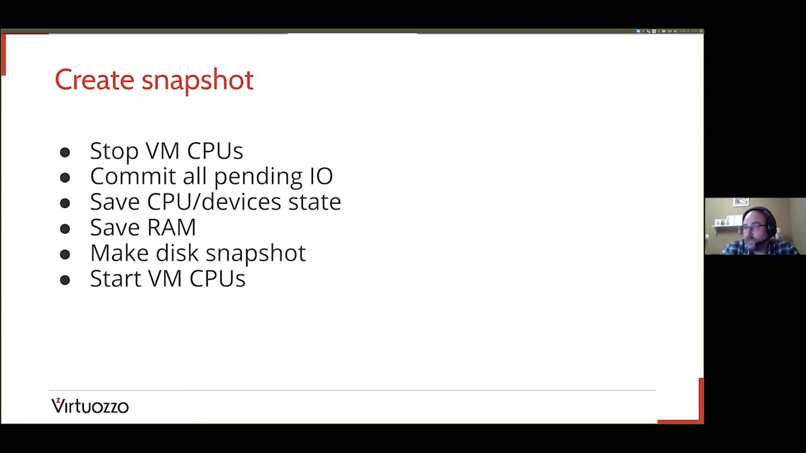

[【跳转到 01:57】](https://www.youtube.com/watch?v=IM5u1xAQWw8&t=117)

### 1.2 状态只有几 MB，内存才是大头

第 3 步导出的 CPU 与设备状态“不大，只有几 MB”；真正吃掉时间的是第 4 步的 RAM。作者的说法很直接：**vCPU 从第 1 步一直停到第 6 步，也就是“整块内存写完”才恢复**——这就是停机时间巨大的直接原因。

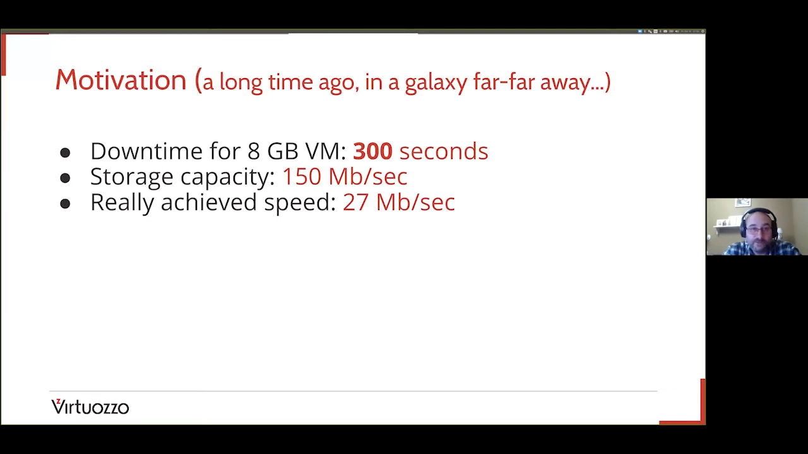

[【跳转到 01:07】](https://www.youtube.com/watch?v=IM5u1xAQWw8&t=67)

这里可以把停机时间写成一个很朴素的式子。设内存大小为 $M$、落盘带宽为 $B$，忽略状态导出与磁盘快照这两段小开销：

$$
T_{\text{downtime}} \approx \frac{M}{B}
$$

代入客户的数字：$8\,\text{GB} / 27\,\text{MB/s}$ 量级正好是几百秒，而 $8\,\text{GB} / 150\,\text{MB/s}$ 只要一分钟左右。**停机时间由“内存大小 ÷ 带宽”决定**，这句话是整场演讲的骨架：后面所有优化，要么提高 $B$，要么把 $M$ 从停机窗口里拿掉。

### 1.3 冻结期间谁在干活

vCPU 停了，但 QEMU 进程没停：写盘是由**迁移代码**驱动的（快照复用了热迁移那条代码路径）。这一点在后面的优化里很关键——因为“谁在写”决定了能不能把写操作改成异步：只要让迁移代码在数据写到磁盘的同时继续往下走，vCPU 的停机时间就可能缩短。

## 二、序列化：CPU 与设备状态走的是“迁移流”

### 2.1 快照复用了热迁移的字节流

QEMU 没有为快照单独发明一套格式，而是复用了热迁移的机制。迁移代码是**面向字节的（byte oriented）**，最初是为 `IOChannel` 写的，落到快照场景里就是一条经过 `QEMUFile` 的顺序字节流；这条流再穿过 `BlockBackend`，最终由块层（`Block Driver Core` → `Block Driver`）写进镜像。

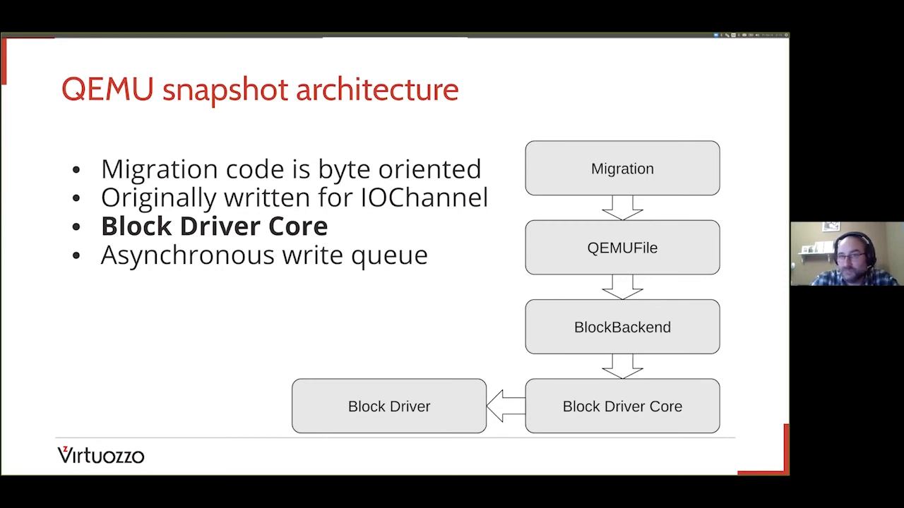

[【跳转到 09:02】](https://www.youtube.com/watch?v=IM5u1xAQWw8&t=542)

这条路径解释了两件事：

- **格式是“流”而不是“结构体”**：CPU 状态、设备状态、内存页依次排在同一条字节流里，没有目录、没有索引；
- **写盘是块层的事**：迁移代码只负责“产生字节”，它不关心这些字节最后落在哪个簇、要不要对齐——这正是后面 IO 问题的伏笔。

### 2.2 为什么第 2 步“提交未完成 IO”不能省

冻结的原子性不只体现在“停 vCPU”上，还体现在第 2 步：如果还有 IO 在飞，那么设备状态里记录的队列位置和磁盘上的真实内容就会对不上。先把未完成的 IO 提交完，再导出设备状态，导出的状态才是一个自洽的切面。这也是为什么六步里“Commit all pending IO”被放在“Save CPU/devices state”之前，而不是之后。

### 2.3 顺序流没有索引，这个设计后面会反咬一口

“顺序、无索引”在写的时候很省事，在读的时候就是灾难：如果将来想做到“guest 访问哪一页就加载哪一页”，就必须能在文件里定位任意一页。这一点在第 5 节会变成真正的架构障碍。

## 三、落盘：写 8 GB 内存为什么只跑出 27 MB/s

### 3.1 表象：QEMU 眼里是漂亮的 100 KB 顺序写

从 QEMU 自己的 trace 看，快照写盘是一串**约 100 KB 的顺序写**，缓冲区大小也不难看。既然是这样，为什么还慢？作者的原话是“QEMU 在 trace 里骗我们吗？不，它没骗人”——只是它看到的层次不对。

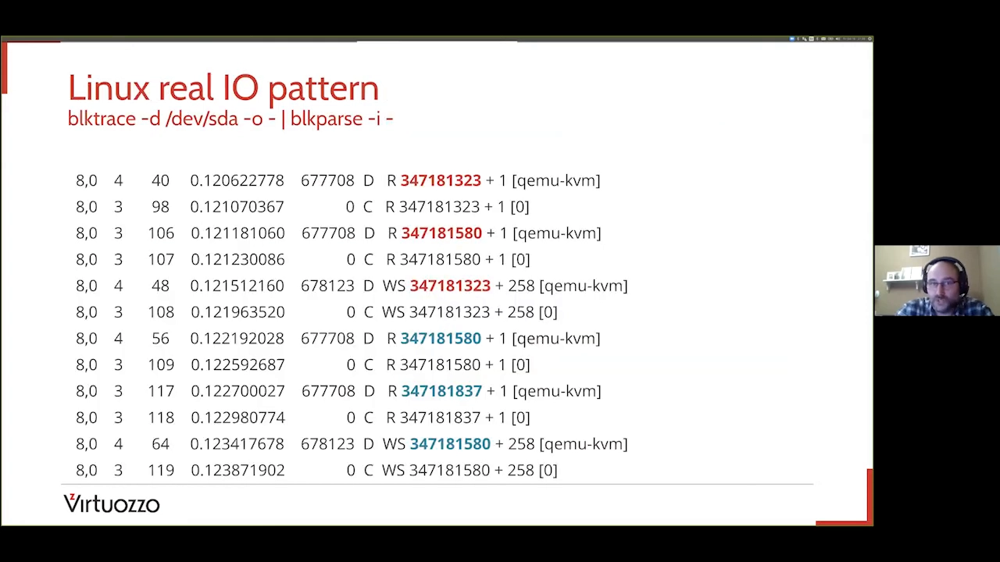

[【跳转到 03:37】](https://www.youtube.com/watch?v=IM5u1xAQWw8&t=217)

### 3.2 真相：非缓存 IO 的 512 字节对齐，把顺序写变成读-改-写

换到 Linux 内核视角，情况完全不同：先是一个 **512 字节的小读**，接着在待写数据的**尾部**再来一个 512 字节的小读，两次读都完成了，写请求才真正发出。这个模式在整个快照过程中反复出现。

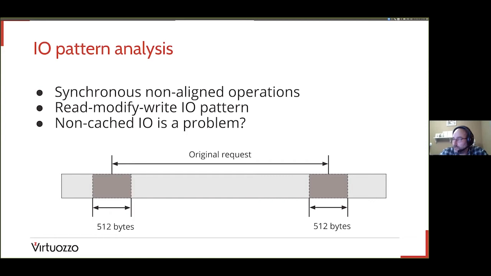

[【跳转到 04:52】](https://www.youtube.com/watch?v=IM5u1xAQWw8&t=292)

原因是 QEMU 用的是**非缓存 IO**（绕过页缓存、直接对块设备发请求），这类请求必须按 512 字节对齐：如果一次写没有落在扇区边界上，就必须先把首尾两个不完整的扇区读上来，拼好，再整块写回去。于是“一次顺序写”变成了“两次读 + 一次写”。

### 3.3 那为什么不干脆换成缓存 IO

作者专门回答了这个问题：**非缓存 IO 本身不是问题，它在很多场景下更好**。换成缓存 IO 的代价是：

- 缓存 IO 要配合协程，必须丢到**独立的工作线程**里执行，每个 IO 请求都要转一次线程；
- 对 NVMe 这种百万 IOPS 的盘，线程开销非常可观，还会产生大量线程；
- 宿主需要预留大量空闲内存来缓冲这些 IO 数据；
- 一旦遇到限流（throttling），缓存 IO 的延迟会变得**不可预测**。

所以结论是：继续用非缓存 IO，把该修的地方修掉。

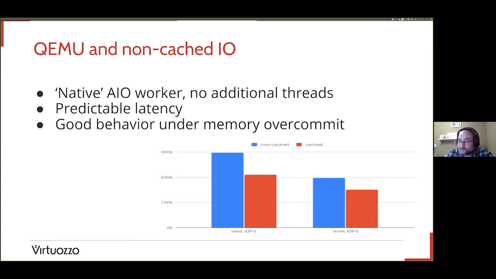

[【跳转到 06:07】](https://www.youtube.com/watch?v=IM5u1xAQWw8&t=367)

### 3.4 第二层浪费：qcow2 的新簇分配

如果镜像用标准 qcow2 格式，快照数据每次都会写进**新簇**。当一次 IO 没有对齐到簇边界时，簇分配流程会对数据没覆盖到的部分调用 `fallocate` 补齐——**每个簇因此产生两次元数据更新**。这又是一笔纯开销。

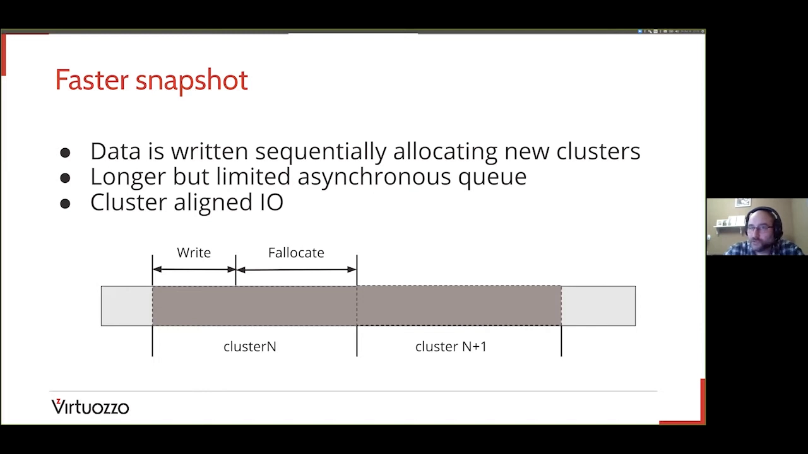

[【跳转到 06:57】](https://www.youtube.com/watch?v=IM5u1xAQWw8&t=417)

## 四、修好 IO 只能把 300 秒变成 75 秒

### 4.1 三个改动

作者团队的改法可以归成三条：

1. **数据按簇对齐**：把迁移代码那条顺序流切成对齐的块，避免读-改-写，也避免额外的 `fallocate`；
2. **一个足够长但有上限的异步队列**：让写请求排起队来，而不是一次一个同步等；
3. **把写改成异步**：发出写请求后就让迁移代码继续干活，而不是阻塞等写完。

改动放在哪里也有讲究：迁移代码不想在内部做块层动作（从封装角度看很糟），所以这些逻辑被放进**块驱动核心**，而不是某个具体块驱动里——反正广泛使用的块驱动只有 qcow2。

[【跳转到 07:47】](https://www.youtube.com/watch?v=IM5u1xAQWw8&t=467)

### 4.2 结果：写快 4 倍，回滚在 NVMe 上快 10 倍

对非缓存文件描述符，NVMe 与 HDD 的快照写时间都**提升到 4 倍**；同时省掉了两次额外的读请求和元数据更新。

回滚（revert）方向不能照搬：如果同样用一个队列，QEMU 块层的协程引擎会打乱顺序，机械盘反而变得很差。所以回滚改成“一次只发一个 MB 级读请求，完成后再发下一个”，受块层缓冲的空闲空间约束。

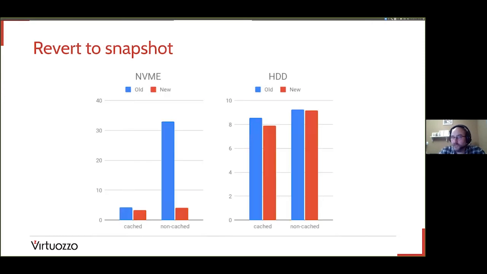

[【跳转到 12:10】](https://www.youtube.com/watch?v=IM5u1xAQWw8&t=730)

这组数据是在 4 GB 内存的虚拟机上、用 QEMU 5.1 测出来的。作者特别提到一个反直觉的现象：**旧代码里 NVMe 的回滚比机械盘还慢 3 倍**——因为机械盘有硬件预读，而某些 NVMe 盘没有；不对齐的小块 IO 在这种盘上代价极高。

### 4.3 但这些都是创可贴

三条经验被总结成：写必须有好的队列；簇对齐 IO 是必须的；机械盘的顺序 IO 比长队列更重要。紧接着就是全场最重要的一句转折：

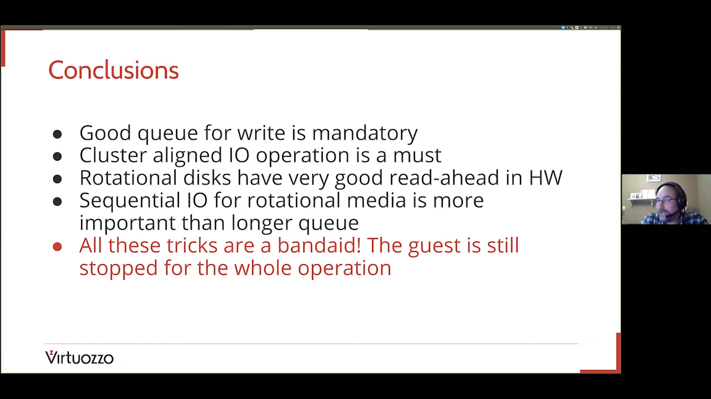

[【跳转到 14:02】](https://www.youtube.com/watch?v=IM5u1xAQWw8&t=842)

300 秒的停机，修完 IO 变成 **75 秒**。好多了，但还不够——因为**guest 从头到尾都停着**，而停机时间仍然正比于内存大小。要提高 $B$ 已经提了，接下来只能动 $M$：把内存从停机窗口里搬出去。

## 五、把内存搬出停机窗口：写保护 + 后台快照

### 5.1 新序列：内存不再在停机期间写

后台快照（background snapshot）的补丁集把六步改成了八步：

1. Stop VM CPUs
2. Commit all pending IO
3. Save CPU/devices state
4. **Protect VM memory for write**（把内存页设为写保护）
5. Make disk snapshot
6. **Start VM CPUs**（提前恢复运行）
7. Store VM memory in background（后台线程慢慢写内存）
8. Save memory pages written by guest out of order（guest 写过的页再补存）

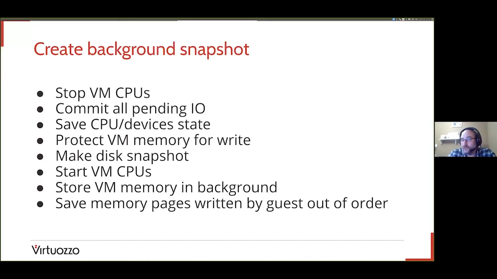

[【跳转到 14:50】](https://www.youtube.com/watch?v=IM5u1xAQWw8&t=890)

对比第 1 节的六步，关键差别只有一处：**“Save RAM”从停机窗口里被挪到了窗口之后**。停机窗口里只剩下“停 vCPU → 提交 IO → 存几 MB 状态 → 加写保护 → 磁盘快照 → 恢复 vCPU”。

### 5.2 写保护怎么保证快照仍然一致

内存被设成写保护后，guest 一旦要写某一页，就会触发一次通知，QEMU 借此知道“这一页即将被改”，可以先把**旧内容**存进快照，再放行这次写；与此同时后台线程继续把 guest 没碰过的页写出去。两条路径合起来，快照里保存的仍然是“冻结那一刻”的内存镜像。

这套通知机制就是 **userfaultfd 的写保护**，Linux 5.7 已经合入；有意思的是，QEMU 里做这类迁移的代码本身被当作这个内核特性的单元测试，所以这个功能是真的能跑。

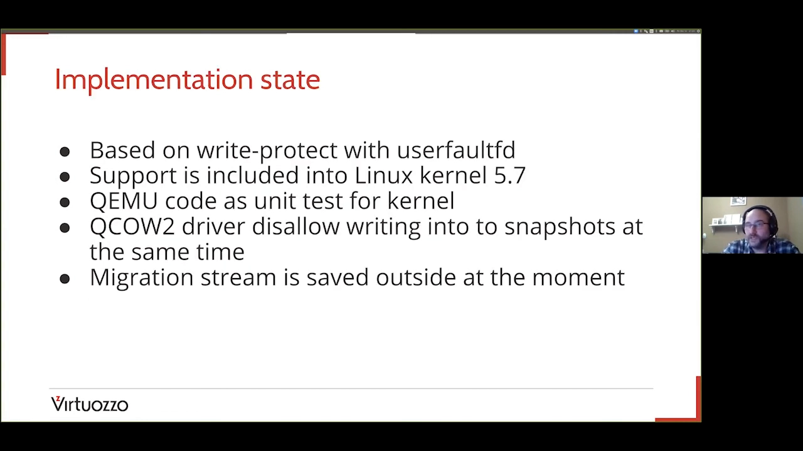

[【跳转到 16:05】](https://www.youtube.com/watch?v=IM5u1xAQWw8&t=965)

于是停机时间不再正比于内存大小：

$$
T_{\text{downtime}} \approx \text{固定开销（停 vCPU + 存状态 + 磁盘快照）}
$$

这正是“停机时间与 RAM 大小无关”那句话的含义——作者自己也说这“会是个奇迹”。

### 5.3 但架构上撞了两堵墙

**第一堵墙：不能同时写两个活跃快照。** 现有的内部快照把快照放在虚拟磁盘的 qcow2 镜像里，表示“之前的磁盘状态”；而后台快照要求 QEMU 一边服务 guest 写新状态、一边服务 userfaultfd 线程写内存页，这在当前架构里做不到。所以测试补丁集只能把迁移流写到**外部文件**（通过文件描述符传给 QEMU）。

**第二堵墙：顺序流没有索引。** 如果将来要做到“恢复时按页加载”，就必须能从文件里定位任意一页；可迁移流是顺序的、没有索引。给 1 TB 内存的虚拟机建页级索引，光索引本身就要吃掉大量内存——而造一个新格式又极难（作者说，光是给 qcow2 格式加一点修改就花了一年半）。

### 5.4 解法：把 qcow2 当容器用

最后的方案很务实：**不造新格式，换个方式用 qcow2**。

1. 解析迁移流，把其中的**内存段**摘出来；
2. 内存内容作为**数据**写进一个**独立的 qcow2 镜像**；
3. 迁移流（CPU/设备状态等）照常保存。

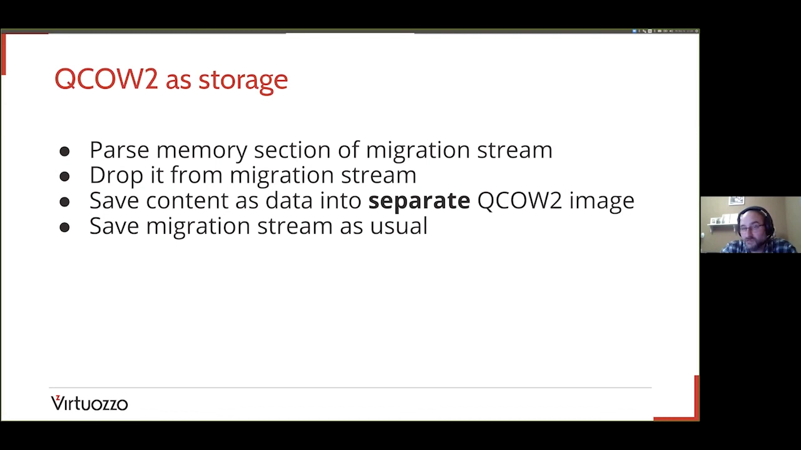

[【跳转到 19:50】](https://www.youtube.com/watch?v=IM5u1xAQWw8&t=1190)

这样白捡了 qcow2 的一堆现成能力：整簇写可以做**内存压缩**、不存在的内存可以**稀疏**表示，而且它有一个工作得很快的**索引**——正好补上“顺序流无法定位页”这个缺口。作者说这正是他们现在在积极实现的方向。

## 六、回到本节：冻结、序列化、落盘各自的关键约束

把整场演讲压缩成三句话：

- **冻结**：顺序是硬约束——停 vCPU → 提交未完成 IO → 导出 CPU/设备状态 → （传统做法）写内存 → 磁盘快照 → 恢复 vCPU。原子性来自“先停、再提交、最后导出”，任何一步提前或推后，导出的状态就不是一个自洽的切面。
- **序列化**：QEMU 复用热迁移的**顺序字节流**（`QEMUFile`），CPU/设备状态在前、内存段在后。顺序流写起来省事，但没有索引，导致“按页加载”和“增量”都很难做。
- **落盘**：真正的瓶颈不是“内存大”，而是“内存必须在停机窗口里写完”。提高带宽（簇对齐、异步队列、避免读-改-写）能把 300 秒压到 75 秒；把内存移出窗口（写保护 + 后台线程）才能让停机时间与内存大小解耦。

## 小结

- 快照的停机时间近似等于“内存大小 ÷ 落盘带宽”，状态导出只有几 MB，不是瓶颈。
- 冻结的六步里，“提交未完成 IO”排在“导出设备状态”之前，这是冻结原子性的一部分。
- 快照序列化复用的是热迁移的字节流：顺序、无索引、CPU/设备状态与内存混在一条流里。
- 27 MB/s 的根因是非缓存 IO 的 512 字节对齐造成的读-改-写，加上 qcow2 新簇分配带来的两次元数据更新。
- 簇对齐 + 异步队列 + 异步写，把写时间提升 4 倍、NVMe 回滚提升 10 倍，但停机时间只从 300 秒降到 75 秒。
- 后台快照用 userfaultfd 写保护，让 vCPU 在内存落盘之前就恢复运行，停机时间不再随内存增长。
- 顺序流没有索引，所以内存最终被拆出来单独存进 qcow2 镜像，借用它的压缩、稀疏与索引能力。

## 关键术语速查

| 术语 | 一句话解释 |
| --- | --- |
| 内部快照（internal snapshot） | 把 VM 状态与内存写进虚拟磁盘镜像（qcow2）里的快照方式 |
| 停机时间（downtime） | vCPU 被停住、guest 完全不能执行指令的那段时间 |
| 迁移流（migration stream） | 热迁移用的顺序字节流，快照复用它来承载 CPU/设备状态与内存 |
| 非缓存 IO（non-cached IO） | 绕过页缓存直接对块设备发请求，要求按 512 字节对齐 |
| 读-改-写（read-modify-write） | 非对齐写必须先读首尾扇区、拼好再写回，导致额外两次读 |
| 簇（cluster） | qcow2 分配空间的基本单位，非对齐写会触发额外的 `fallocate` 与元数据更新 |
| userfaultfd 写保护 | 内核提供的“页被写时通知用户态”机制，后台快照靠它捕获被改动的页 |
| 后台快照（background snapshot） | 停机窗口内只冻结状态、不写内存，内存由后台线程在 vCPU 恢复后落盘 |
| 回滚（revert） | 从快照把 VM 恢复到快照时刻，是快照的逆过程 |