# 恢复比冷启动快，是因为内存不必先搬回来

> 视频来源：[How AI Agent Sandboxes Actually Work: Firecracker MicroVMs, Snapshots & 125 ms Boots](https://www.youtube.com/watch?v=HhW1lnN6xc0)（YouTube · XOR）｜时长约 24 分钟
> 导读：这支视频用「一台已经热好的机器被冻住、再被叫醒」这条主线，把 MicroVM 沙箱的四个积木讲了一遍。本文只取其中的**恢复路径**一段：恢复时内存为什么不用先搬回来、懒加载靠什么实现、以及同一份快照被反复恢复时会踩到哪些坑。冻结与序列化（5.2.1）、预热池与模板管理（5.2.3）留给相邻小节。

## 本讲要解决的核心问题（SCQA）

**背景**：上一小节你已经看到，一台跑热的 MicroVM 可以被暂停、写成一个内存文件加一个状态文件。平台也一直在宣传「百毫秒级起机」——AWS Lambda 的 SnapStart 把 Java 函数从 6 秒多压到 200 毫秒以内。

**冲突**：可如果恢复就是把整个内存文件重新拷回 RAM，再按一下播放键，那恢复时间就与内存大小成正比。一台沙箱动辄几个 GB，这条路根本快不起来。而真实平台上的恢复，确实不是这么做的。

**疑问**：恢复路径上到底省掉了哪一步，才让「百毫秒」成立？省掉的那一步又会以什么形式回来找你？

**回答（中心思想）**：**恢复之所以快，是因为它把「搬内存」整件事从恢复路径上挪走了**。恢复时只做三件事：建出机器、把内存文件**私有映射**进来、把 vCPU 与设备的状态写回去，然后立刻开跑；内存页在客户机第一次碰到它时，才由宿主内核（或一个用户态的缺页处理程序）从文件里补上。代价是三条：缺页延迟、对外部页服务进程的依赖，以及每个克隆都带着同一份「记忆」——随机数、时钟、连接全都一样。

## 一、恢复要还原的不是「内存内容」，而是「那一刻的整台机器」

先看恢复的输入。视频里说得很直接：在 Firecracker 里你暂停机器、请求一次快照，它写出**两个文件**。[【跳转到 12:09】](https://www.youtube.com/watch?v=HhW1lnN6xc0&t=729)

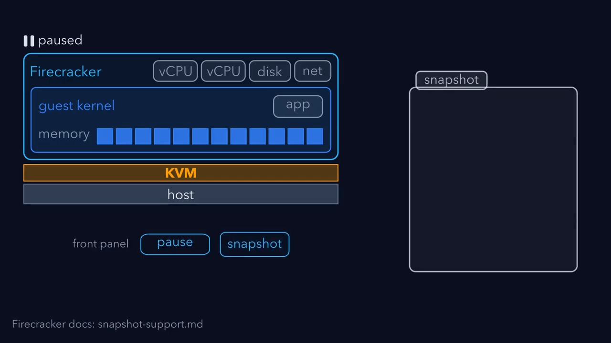

- 一个文件装**客户机内存的每一个字节**；
- 另一个文件装**其余一切**：每个虚拟处理器（vCPU）的状态，以及每个设备的状态；
- 磁盘不在这两个文件里，要你自己另外保存。

所以「恢复」这个词其实有点误导：它不是把内存读回来那么简单，而是要把**整台机器在某一刻的样子**重新装配出来——CPU 停在哪条指令、页表指向哪里、设备队列排到第几项、时钟走到几点。这也解释了为什么快照恢复对版本如此敏感：这些东西的形状由 VMM 的代码决定，换个版本就可能对不上。

那为什么值得这么麻烦？因为冷启动里最贵的部分**根本不是内核**。视频给的时间线是这样的：boot 之后是 `start Python`、`import libraries`、`warm caches`，最后才是 agent ready。[【跳转到 11:44】](https://www.youtube.com/watch?v=HhW1lnN6xc0&t=704)

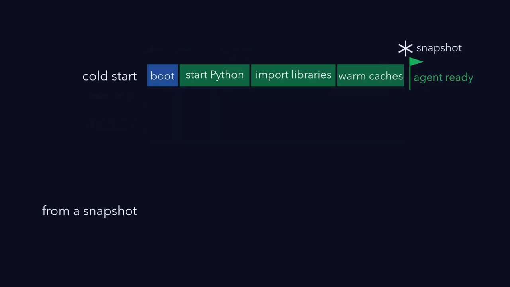

对一个 Python 或 Java 的 agent 沙箱来说，启动语言运行时、加载库、预热缓存这几步占了大头，而且**每一次都一模一样**。既然结果每次都相同，就做一次、在那一刻把机器冻住，之后每个新沙箱都从那里出发。恢复快，第一层原因就在这里：它跳过的是「重复劳动」，不是「内核启动」。

## 二、恢复路径的第一个岔路口：先搬内存，还是先跑起来

拿到两个文件之后，最直觉的做法是：把内存文件整个拷进 RAM，然后按播放。视频把这条路单独画了一页，标题就叫「copy everything first」。[【跳转到 13:36】](https://www.youtube.com/watch?v=HhW1lnN6xc0&t=816)

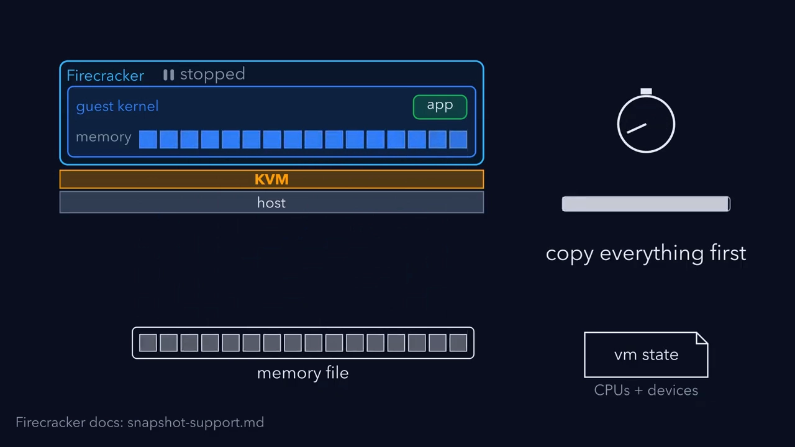

问题在于**比例**：一台沙箱可能有几个 GB 内存，而它真正跑起来只会碰到其中很小一部分。为了那一小部分，先把几个 GB 搬一遍，纯属浪费——而且这段时间完全在关键路径上。

Firecracker 的做法相反：**不预先拷任何东西**。它把内存文件**私有地映射**进新机器，然后立刻开跑。客户机第一次访问某一页时，宿主内核悄悄地把那一页从文件里读进来——这就是一次缺页（page fault）。[【跳转到 13:36】](https://www.youtube.com/watch?v=HhW1lnN6xc0&t=816)

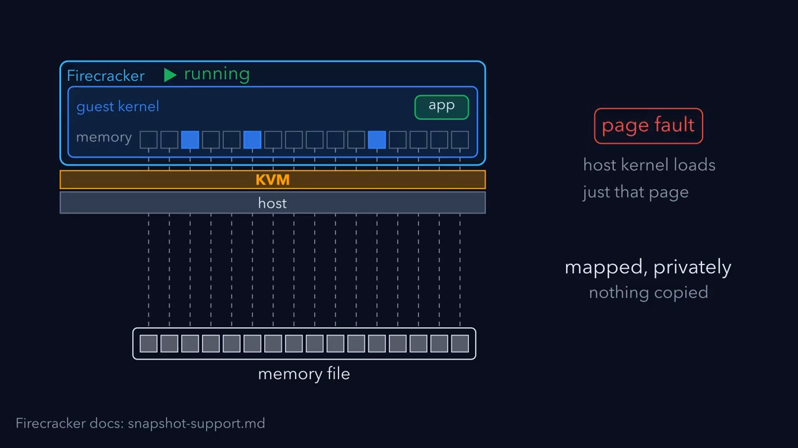

「私有」这两个字是关键。如果客户机**写**某一页，它拿到的是自己的一份私有副本，**文件本身永远不变**。这一点带来一个很漂亮的副作用：同一份内存文件可以同时恢复进好几台机器，它们共享所有只读的页，各自只为自己改过的页留副本——这就是写时复制（copy on write，CoW）。[【跳转到 14:01】](https://www.youtube.com/watch?v=HhW1lnN6xc0&t=841)

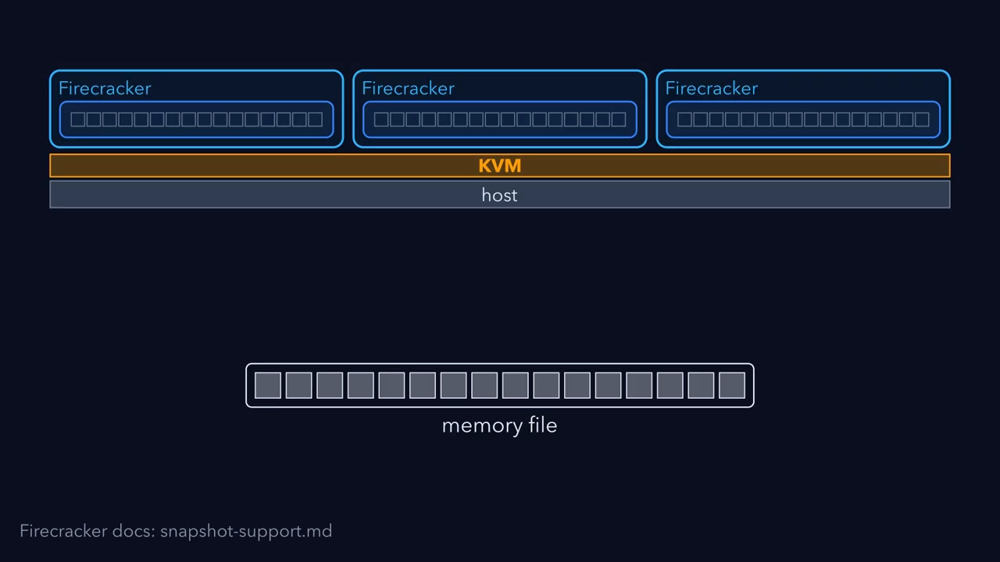

把这三步连起来看，恢复路径的顺序就清楚了，而且每一步都便宜：

1. **建机器**：进程起来、KVM 里建出 VM 与 vCPU、把设备摆好——不跑客户机代码；
2. **映射内存**：`mmap` 内存文件，私有映射，不预读、不拷贝；
3. **写回状态**：把状态文件里那些 vCPU 寄存器与设备状态填回去；
4. **开跑**：进 `KVM_RUN`，客户机从快照那一刻继续执行，缺页在后面按需发生。

于是恢复耗时不再与内存大小成正比，而只与「真正被碰到的页」成正比。这也解释了 E2B 文档里那组数字为什么长这样：暂停大约**每 GB 内存 4 秒**（那是要老老实实写盘），而恢复只要**每 GB 约 1 秒**（因为大部分内存根本没被碰）。[【跳转到 19:39】](https://www.youtube.com/watch?v=HhW1lnN6xc0&t=1179)

## 三、`userfaultfd`：把缺页处理从内核搬到用户态

私有映射这条路，页只能来自**本地的那份文件**。可平台想要的往往更多：快照存在对象存储里、压缩过、切成块，甚至要从另一台机器上拉。内核不认识这些花样，它只知道「去这个文件的这个偏移读一页」。

Linux 的 `userfaultfd` 就是为这个场景准备的：**它让另一个程序接管一台机器的缺页**。客户机碰到一个不在内存里的页时，那个程序收到一条消息，然后从任何它喜欢的地方把页取来——本地磁盘、网络、对象存储——再填进去。[【跳转到 14:24】](https://www.youtube.com/watch?v=HhW1lnN6xc0&t=864)

E2B 用的正是这一套。它自己的文档写得很干脆：**「一个沙箱就是一份被恢复的快照」**，内存通过 `userfaultfd` 懒加载地供给。[【跳转到 14:24】](https://www.youtube.com/watch?v=HhW1lnN6xc0&t=864) 一旦页的来源变成一个用户态程序，快照的存放方式就彻底自由了：可以分块、可以压缩、可以放在远端缓存里，被多少台机器同时读都行。

## 四、懒加载不是免费的：两个必须知道的代价

视频在这里特意踩了刹车，因为「按需加载」听起来太美好，容易被当成没有成本。

**代价一：性能。** 页是一页一页来的，每次缺页都是一次小等待。2021 年的一项研究 REAP 测到：从快照直接跑起来的函数，平均比内存已经就绪时**慢 95%**。它的修法是记录一个函数**总是需要**哪些页，一次性预取进来，这样平均把冷启动延迟压到原来的约 **1/3.7**。[【跳转到 14:49】](https://www.youtube.com/watch?v=HhW1lnN6xc0&t=889)

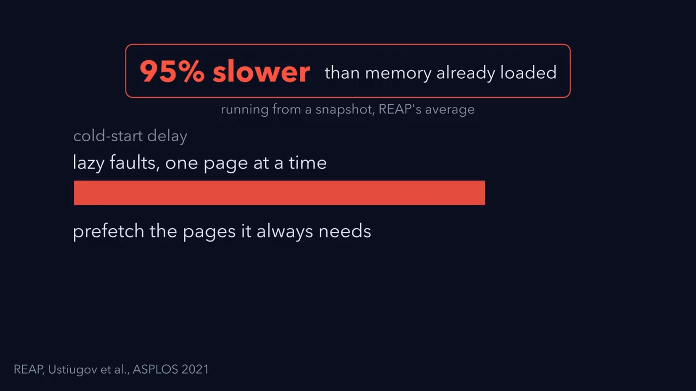

**代价二：可靠性。** 如果那个负责缺页的程序崩了，机器就会在**下一次缺页**时冻住——不是报错，是停在那里不动。恢复路径上凭空多了一个必须活着的组件，这是懒加载换来的结构性问题。[【跳转到 15:14】](https://www.youtube.com/watch?v=HhW1lnN6xc0&t=914)

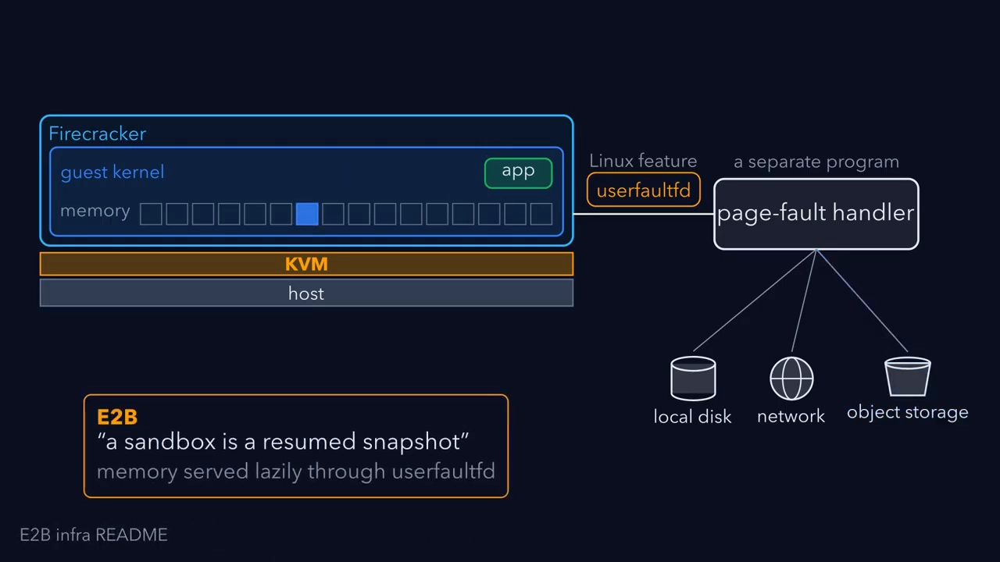

所以「懒加载」正确的用法是**分层**：先让机器跑起来，再把「一定会用到」的那批页一次预取，剩下的留给缺页。纯懒加载省的是恢复时间，付的是运行时的抖动。
## 五、同一份快照被恢复一百次，就是一百台机器在掷同一副骰子

前面几节讲的都是「一台机器怎么醒过来」。真实平台上是「同一份快照醒过来一百次」，于是问题换了性质：**这一百台机器记得的是同一个瞬间**，包括它们随机数发生器的状态。[【跳转到 16:04】](https://www.youtube.com/watch?v=HhW1lnN6xc0&t=964)

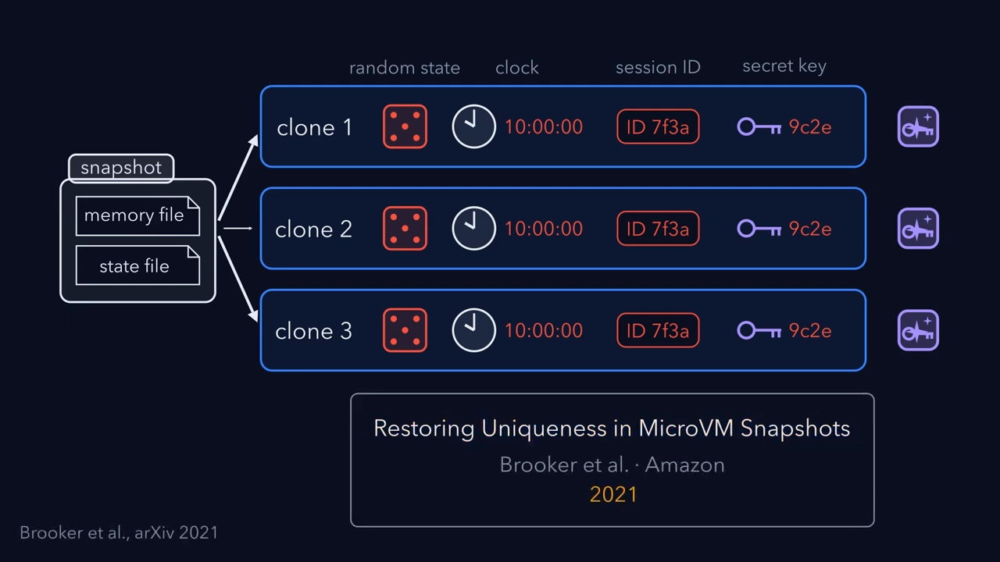

每一台都准备掷出同样的骰子：同样的「随机」密钥、同样的唯一 ID、同样的 nonce。亚马逊的工程师在 2021 年专门为此写了一篇论文，标题就叫 *Restoring Uniqueness in MicroVM Snapshots*。Firecracker 的文档也说得很不客气：**如果没有可靠的办法保证「唯一的东西」真的唯一，它认为把同一份状态恢复多次是不安全的**。[【跳转到 16:29】](https://www.youtube.com/watch?v=HhW1lnN6xc0&t=989)

修法的起点是一个很小的虚拟设备：**VM Generation ID**。每次恢复时，Firecracker 往里面写一个新的、随机的 16 字节值，并通知客户机。从 Linux 5.18 起，内核会看到这个变化并**重新播种随机数发生器**，此后每个克隆抽到的数就不一样了。[【跳转到 16:54】](https://www.youtube.com/watch?v=HhW1lnN6xc0&t=1014)

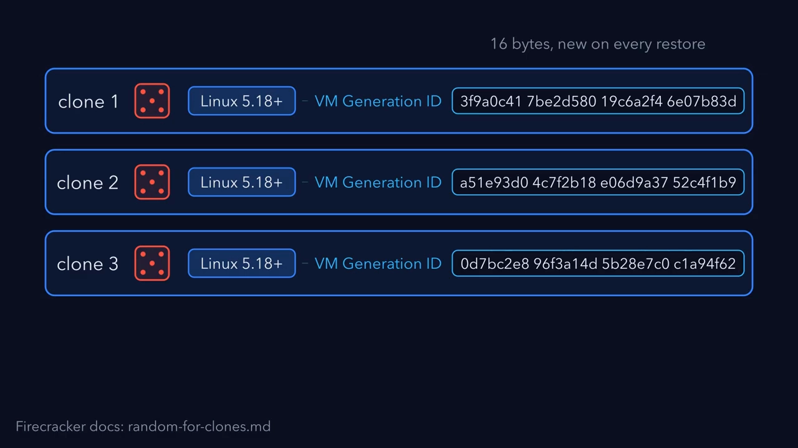

注意这里有个窗口期：从机器醒来，到内核真正重新播种之间，还有一小段时间是「旧的随机状态」。所以这条修法并不是免费的午餐，只是把风险压到了可接受的范围。

**时间是第二个问题。** 恢复后的机器坚信自己还停在快照那一刻。Firecracker 在 2026 年加了一个时钟设备，让客户机能把时间追上来。[【跳转到 16:54】](https://www.youtube.com/watch?v=HhW1lnN6xc0&t=1014)

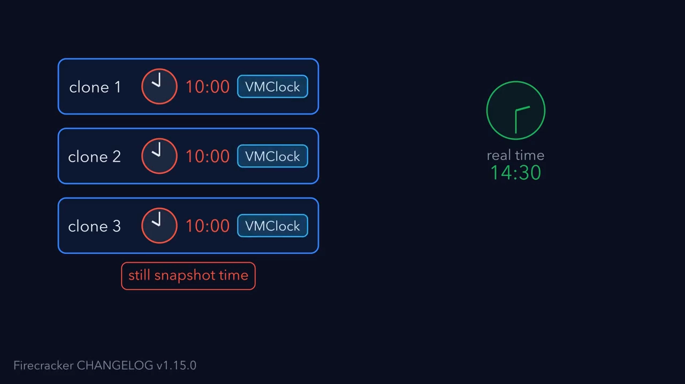

**网络连接是第三个问题。** 机器记得这些连接，但对端服务器可能早就放弃了。所以程序自己也得配合。AWS Lambda 为此给了函数两个钩子：一个在快照**之前**跑，一个在每次恢复**之后**跑。它的建议只有一句话：**把唯一 ID、密钥和随机数放在恢复之后生成，永远不要放在恢复之前。**[【跳转到 17:19】](https://www.youtube.com/watch?v=HhW1lnN6xc0&t=1039)

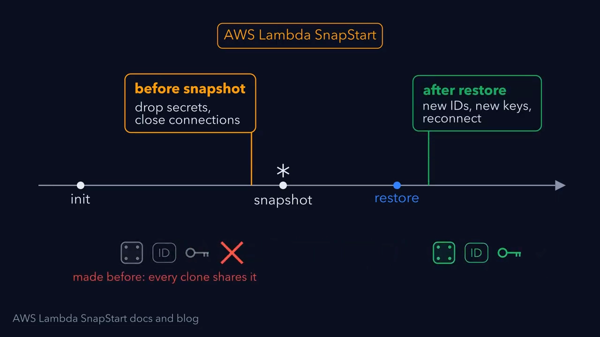

这一节的结论值得单独记住：**每个克隆醒来时带着同一份记忆，所以任何「唯一」的东西都必须在恢复之后才产生**。[【跳转到 17:44】](https://www.youtube.com/watch?v=HhW1lnN6xc0&t=1064)

## 六、生产里的样子：SnapStart 与「沙箱即恢复的快照」

这套机制在 AWS Lambda 里已经跑了几年，功能叫 SnapStart。发布函数时，Lambda 把初始化跑一次，对内存和磁盘各拍一张 Firecracker 快照，加密后缓存起来；之后每个新的函数副本都从这份快照恢复，**按需分块拉取**。[【跳转到 18:09】](https://www.youtube.com/watch?v=HhW1lnN6xc0&t=1089)

2022 年的发布演示里，一个 Java Spring Boot 函数从启动 6 秒多降到 **200 毫秒以内**；2024 年这套东西扩展到 Python 和 .NET，并带上了前面说的「快照前 / 恢复后」两个钩子；2026 年 6 月，AWS 把同一套机器指向了 AI agent，也就是 Lambda MicroVMs——隔离、有状态、最长跑 8 小时，**从快照恢复而不是启动**。[【跳转到 18:24】](https://www.youtube.com/watch?v=HhW1lnN6xc0&t=1104)

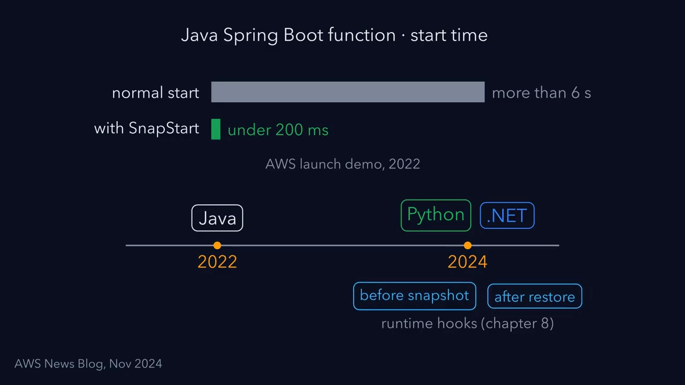

E2B 的说法更简洁：**一个沙箱就是一份被恢复的快照**；模板是一台已经启动过、被拍成快照存起来的机器；创建一个沙箱，就是恢复那份快照，内存通过 `userfaultfd` 懒加载。[【跳转到 19:14】](https://www.youtube.com/watch?v=HhW1lnN6xc0&t=1154) Vercel Sandbox、Cloudflare 的每个容器、Fly.io 的挂起/恢复、Bedrock AgentCore 的每个会话，底下都是同一套积木。[【跳转到 20:04】](https://www.youtube.com/watch?v=HhW1lnN6xc0&t=1204)

所以把恢复路径抽象出来，其实只有三块积木：

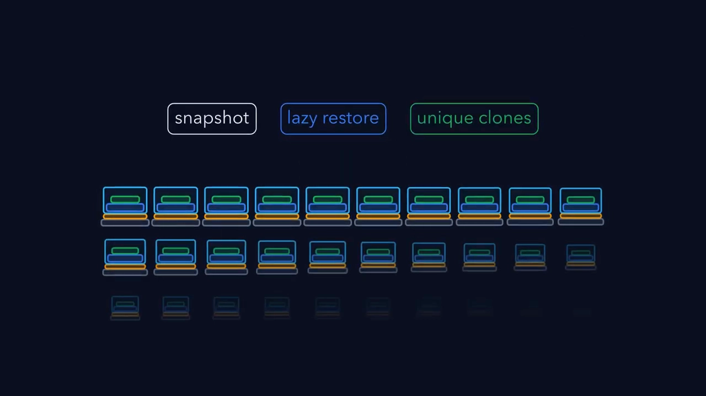

1. **快照**：一台已经热好的机器，冻成两个文件；
2. **懒恢复**：内存先映射、后补齐，机器比它的内存先到；
3. **唯一克隆**：醒来之后立刻把自己变得和别人不一样。

## 七、恢复路径上的坑：一张清单

把视频里散落在各章的约束收拢，恢复路径上的坑可以分成三类——**文件与版本**、**运行时状态**、**外部依赖**。

| 坑 | 现象 | 对策 |
| --- | --- | --- |
| 内存文件被改动 | 私有映射与写时复制的前提被破坏，多个克隆互相污染 | 文件只读，写入落到私有副本；文件本身永不修改 |
| 硬件/软件不匹配 | 快照只能在同类型的硬件与软件上恢复 | 把快照与 VMM 版本绑定，恢复前先校验 |
| 快照文件当普通文件 | 内存里的一切都在里面，包括密钥 | 按机密对待：加密、限权、别随手复制 |
| 随机数状态重复 | 多个克隆生成同样的「随机」密钥、ID、nonce | VM Generation ID + 恢复后重新播种 |
| 时钟停在过去 | 客户机以为还是快照那一刻 | 时钟设备，恢复后把时间追上来 |
| 网络连接已断 | 机器记得连接，对端早已放弃 | 快照前关连接，恢复后重连 |
| 页服务进程崩了 | 机器在下一次缺页时冻住 | 把缺页处理当作关键路径组件来运维 |
| 纯懒加载太慢 | 逐页缺页，函数平均慢 95% | 记录必用页，一次性预取 |

前两条在视频里被反复强调。关于版本，Firecracker 的文档给的原话是：**快照要在同类型的硬件和软件上恢复**。[【跳转到 12:37】](https://www.youtube.com/watch?v=HhW1lnN6xc0&t=757)

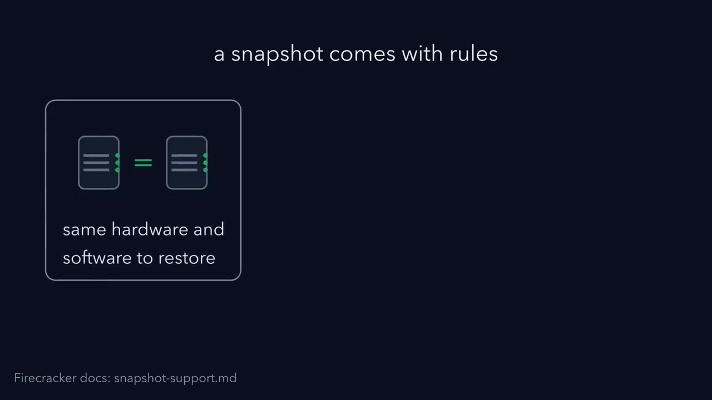

关于机密性：快照文件里装着内存里的一切，密钥也在里面，所以文档要求你像保护任何机密一样保护它；快照在 Firecracker 1.13（2025 年）才正式 GA。[【跳转到 12:50】](https://www.youtube.com/watch?v=HhW1lnN6xc0&t=770)

还有一条容易被忽略的边界：**恢复不是万能的隔离**。视频最后一章讲了一个真实事件——攻击者没有攻破虚拟机，走的是网络那条唯一开着的门。Firecracker 自己不过滤网络流量，这件事和「沙箱里放什么」一样，都是使用者的责任。[【跳转到 22:40】](https://www.youtube.com/watch?v=HhW1lnN6xc0&t=1360)

## 小结

- **恢复快的根源不是「读得快」，而是「不用读」**：内存文件被私有映射进来，机器立刻开跑，页在第一次被访问时才补上。
- **恢复路径的顺序是固定的**：建机器 → 映射内存 → 写回 vCPU 与设备状态 → `KVM_RUN`；前两步便宜，第三步决定「像不像原来那台机器」。
- **私有映射 + 写时复制让一份快照能同时喂给多台机器**：只读页共享，改过的页各留副本，文件本身永不改变。
- **`userfaultfd` 把缺页处理搬到用户态**，于是页可以从网络或对象存储来，快照可以分块、压缩、放远端。
- **懒加载要付两笔账**：逐页缺页的性能损失（REAP 测到平均慢 95%，预取后延迟降到约 1/3.7），以及页服务进程成为新的单点。
- **同一份快照恢复多次，等于多台机器共享同一份记忆**：随机数、时钟、连接都会重复，唯一的东西必须在恢复之后生成。
- **恢复有三条硬约束**：文件不能变、版本必须匹配、文件内容要当机密保护。

## 关键术语速查

| 术语 | 一句话解释 |
| --- | --- |
| 快照（snapshot） | 一台运行中的 MicroVM 被冻住后的两个文件：内存 + 其余状态（vCPU、设备） |
| 内存文件（memory file） | 客户机内存的逐字节副本，恢复时被映射进新机器而不是拷贝 |
| 私有映射（private mapping） | `mmap` 的一种方式：读共享底层文件，写则产生本进程的私有副本，文件不变 |
| 缺页（page fault） | 访问一个当前不在内存里的页时触发的事件，由内核或用户态程序补齐 |
| 写时复制（CoW） | 多个使用者共享只读页，谁写谁复制一份，从而省掉复制与内存 |
| `userfaultfd` | Linux 特性，让一个用户态程序接管缺页，决定页从哪里来 |
| 懒加载（lazy loading） | 恢复时不搬内存，页在第一次被访问时才加载 |
| 预取（prefetch） | 提前把「一定会用到」的页批量加载，抵消逐页缺页的开销 |
| VM Generation ID | 每次恢复写入新随机值的虚拟设备，客户机据此重新播种随机数 |
| 恢复（restore） | 用快照重建机器：建 VM 与设备、映射内存、写回状态、开始执行 |
