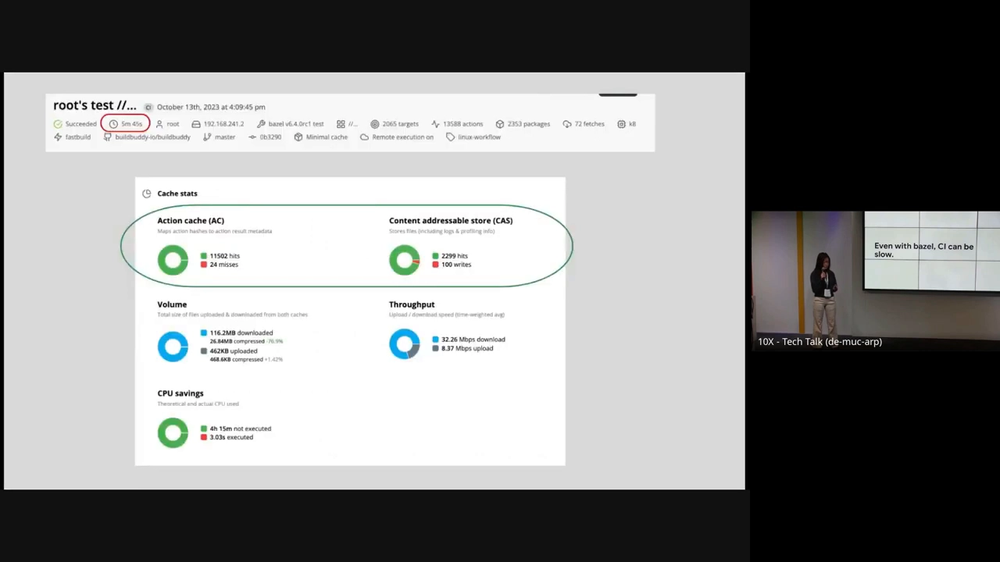
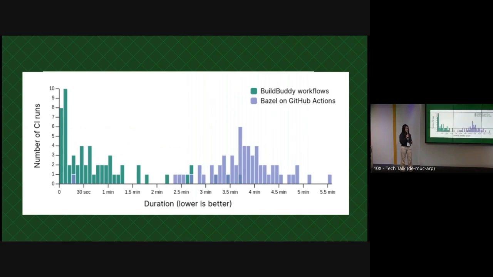
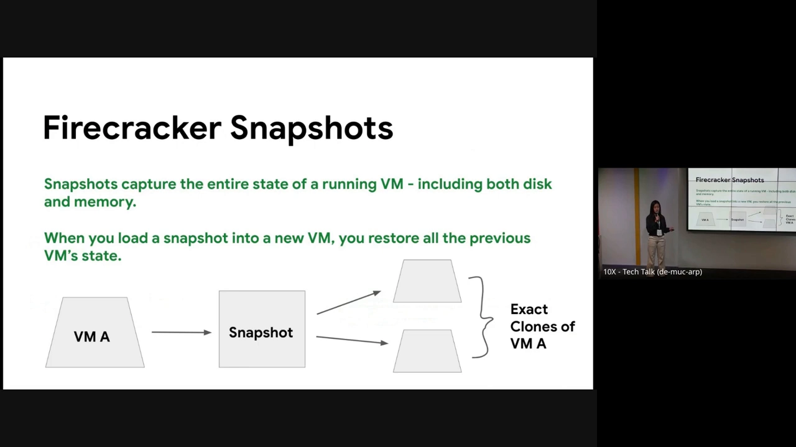
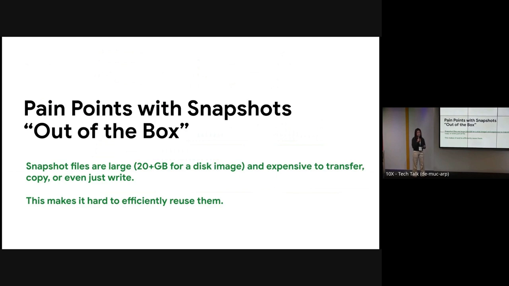
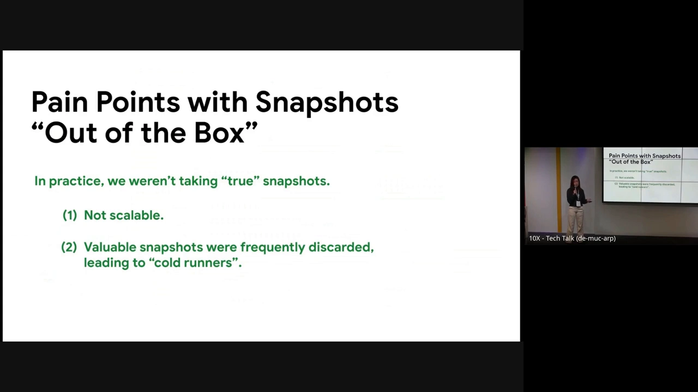
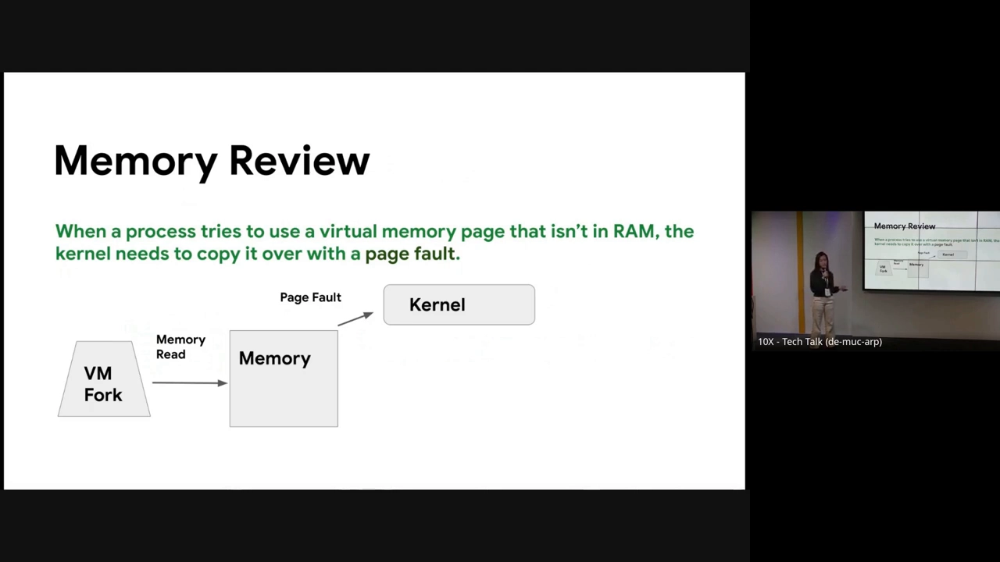
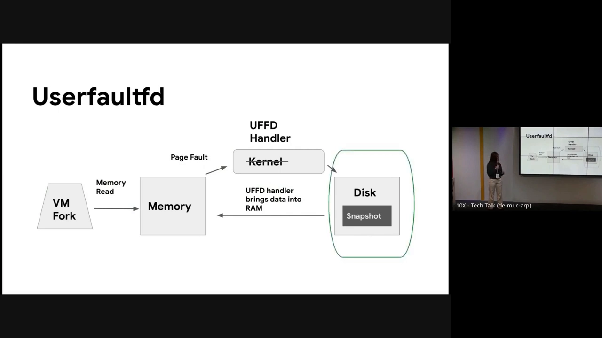
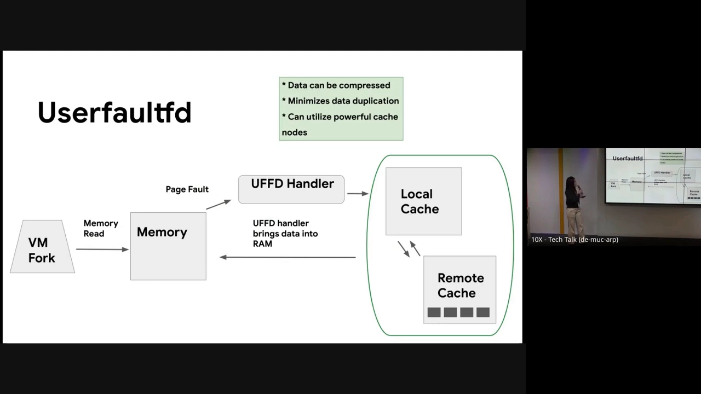
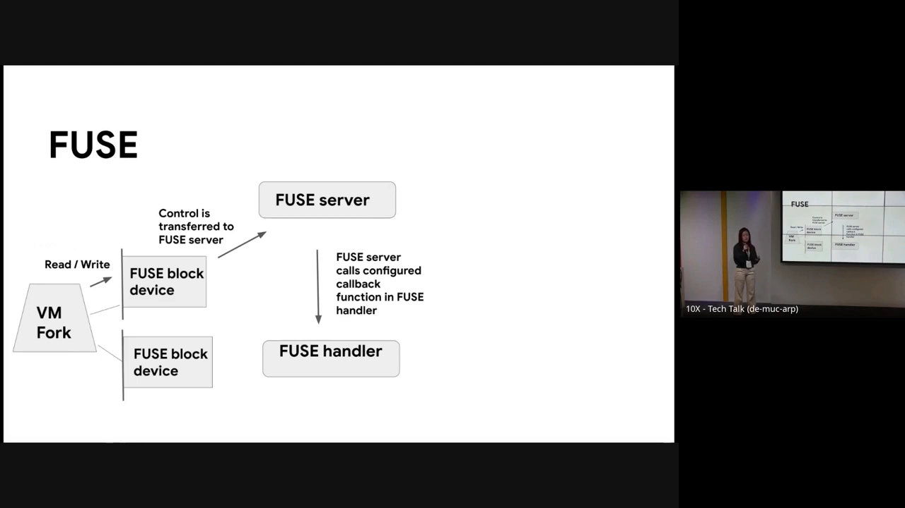
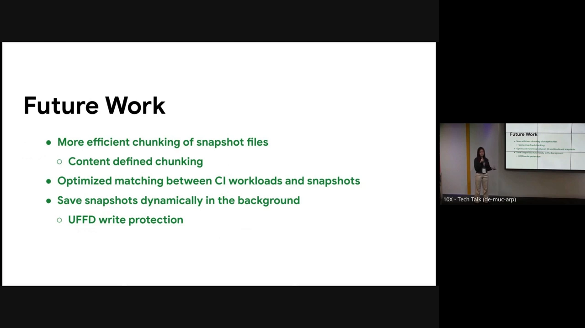

# 克隆 MicroVM 复用 Bazel 分析缓存：CI 运行器的模板化

> 视频来源：[Reusing bazel's analysis cache by cloning micro-VMs](https://www.youtube.com/watch?v=k30xZfiRZYo)（YouTube · Linux Foundation 频道，讲者来自 BuildBuddy）｜时长约 27 分钟
> 简要导读：这是一场"工程复盘"式的演讲——BuildBuddy 把 CI 运行器从"每次冷启动"改成"冷启动一次、之后从快照克隆"。本文只讲**模板**这个做法本身：模板由哪几块组成、省下的时间到底来自哪里、以及把模板当资产管理时会撞上的四堵墙。快照的冻结顺序与恢复路径细节见 5.2.1 / 5.2.2，模板文件的持久化格式与跨机传输归 S07。

## 本讲要解决的核心问题（SCQA）

**背景**：BuildBuddy 提供基于 Bazel 的远程缓存与远程执行。Bazel 是 Google 开源的构建系统，"分析阶段"（analysis phase）是它在真正编译之前，把 BUILD 文件解析成一张动作图的过程。

**冲突**：即使已经用上远程缓存和远程执行，CI 仍然慢。慢的地方不在编译，而在"把一台机器准备好"：拉镜像、clone 仓库、启动 Bazel 服务、跑完分析阶段。大仓库的分析阶段要几分钟，而且它**完全活在内存里**，没法像编译产物那样丢进缓存。

**疑问**：既然每次 CI 都在重复"准备同一台机器"这件事，能不能只准备一次？

**回答（中心思想）**：能。做法是**把一次冷启动的结果固化成模板**——一台已经预热好的 MicroVM 的整机快照（磁盘 + 内存 + 设备与 vCPU 状态），之后每个 CI 任务都从这个模板"恢复"而不是"重装"。模板省下的是"准备"的时间，而不是"计算"的时间；而模板一旦成为要长期管理的资产，体积、独占、信任和版本绑定这四个约束就会立刻浮上来。

## 一、慢的不是编译，是"把机器准备好"

演讲者先给了一条时间线。一次 6 分钟的 CI 里，clone 仓库、下载并启动 Bazel、跑分析阶段加起来占掉很大一块，其中**分析阶段单独就花了 1 分半，占整个构建的 25%**（[【跳转到 03:05】](https://www.youtube.com/watch?v=k30xZfiRZYo&t=185)）。

这就是关键判断：**当缓存命中率已经很高时，继续优化编译是徒劳的，要优化的是"环境准备"**。用讲者的话说，大家都熟悉"本地第二次构建几乎瞬间完成"的爽感，他们想把这种感觉搬到 CI 上（[【跳转到 03:27】](https://www.youtube.com/watch?v=k30xZfiRZYo&t=207)）。

于是他们做了一个决定：**克隆 CI 运行器**。一台运行器被完整准备好一次之后，后续的 CI 任务不再从零开始，而是被分配到"已经带着热 Bazel 实例的克隆机器"上。

结果：CI 中位时长降低到原来的八分之一；示例里 6 分钟的构建变成 9 秒，演示里 6 分 2 秒的构建变成 20 秒（[【跳转到 04:57】](https://www.youtube.com/watch?v=k30xZfiRZYo&t=297)）。注意基线本身已经是"Bazel + 远程缓存 + 远程执行"，所以这 8 倍不是从慢变快，而是从快变更快。

## 二、模板的三块内容：磁盘、内存、设备与 vCPU 状态

他们选 Firecracker 做底座，理由有四个：被 AWS Lambda 大规模验证过、隔离性强（同一批 executor 上跑多家公司的 CI）、足够轻（普通虚拟机启动要几秒，microVM 只要几百毫秒）、以及"VM 里跑 Docker"比"容器里跑容器"容易得多（[【跳转到 05:22】](https://www.youtube.com/watch?v=k30xZfiRZYo&t=322)）。

真正让模板成立的是 Firecracker 的快照能力。讲者的定义很干脆：**快照捕获一台运行中虚拟机的全部状态，包括磁盘和内存；把快照加载到一台完全不同的机器上，它就拥有和原来一模一样的状态**——包括那个我们想保留下来的、热的 Bazel 缓存（[【跳转到 06:42】](https://www.youtube.com/watch?v=k30xZfiRZYo&t=402)）。

把这句话拆开，一个可反复恢复的模板其实由三块拼成：

| 组成 | 里面有什么 | 在 CI 场景里对应什么 |
| --- | --- | --- |
| 根文件系统（rootfs） | 只读的块设备镜像，或 virtio-fs 共享目录 | 装好 Bazel、工具链、依赖的操作系统盘 |
| 内存快照 | 客户机 RAM 的完整镜像 | 已经跑完分析阶段、缓存全在内存里的 Bazel 服务进程 |
| 设备与 vCPU 状态 | 寄存器、MSR、virtio 队列状态 | 让恢复出来的机器"接着上次的指令继续跑"，而不是重新引导 |

第三块最容易被忽略，但它决定了"恢复"和"重启"的区别：恢复出来的不是一台刚开机的机器，而是**一台在某一瞬间被按了暂停键的机器**。所以 Bazel 服务不需要重新启动，分析阶段也不需要重跑——它只是被"接着跑"。

### 为什么模板比"暂停的容器"更适合当资产

讲者顺手做了一个对比，很值得记住（[【跳转到 07:32】](https://www.youtube.com/watch?v=k30xZfiRZYo&t=452)）：

- 暂停一个 Docker 容器，它仍然要在后台占着内存和 CPU，而这两样比磁盘贵得多；
- 暂停的容器扛不住宿主机重启，而磁盘上的文件可以；
- 暂停的容器没法像文件一样跨网络传输，而快照文件可以。

一句话：**模板的价值在于它能被"序列化成文件"，从而脱离原来那台机器存在**。这也是模板和"预热池里挂着的一台待命 VM"的分界线——后者还是活的进程，前者是可以复制、可以分发、可以不占 CPU 的资产。

## 三、省下的时间来自哪里：冷路径与克隆路径的对照

把两条路径并排看，省时间的来源就一目了然（[【跳转到 07:57】](https://www.youtube.com/watch?v=k30xZfiRZYo&t=477)）：

| 步骤 | 冷路径（每次从零） | 克隆路径（从模板恢复） |
| --- | --- | --- |
| 启动 microVM | 要 | 要（但只是恢复，不是引导） |
| 拉取/构建镜像 | 要（几分钟） | 不要，已经在 rootfs 里 |
| clone git 仓库 | 要 | 要（但只需增量同步） |
| 启动 Bazel 服务 | 要 | 不要，进程还在内存快照里 |
| 分析阶段 | 要（大仓库几分钟） | 不要，结果还在内存里 |
| 总耗时 | 6~7 分钟 | 约 10 秒 |

注意克隆路径里**并没有省掉"同步代码"和"构建"**——这两步是真正的工作，省不掉。省掉的全是"准备"：装环境、起服务、重建分析结果。这正是模板的定位：**它把一次性的准备工作摊薄到很多次执行上**。

这里也顺带回答了"为什么恢复时间和内存大小基本无关"这个问题的一半：恢复时并不需要把整个内存镜像读进物理内存，只需要把内存**映射**进来，等客户机真正访问某一页时再去取。这个"按需取页"的机制，下一节会变成工程上的主角。

## 四、模板不是免费的：四堵墙

演讲最有价值的部分，是讲者坦白"开箱即用的快照"在生产里撞上的问题。这四条约束几乎是所有"模板化"方案的通用陷阱。

### 4.1 体积：20GB 的快照没法复制

**单个磁盘快照可以超过 20GB**，传输、复制、甚至只是写盘都很贵。他们最初不得不准备四倍于原计划的本地 SSD 来承受这些写入（[【跳转到 09:07】](https://www.youtube.com/watch?v=k30xZfiRZYo&t=547)）。

这条约束的推论很重要：**模板如果大到不能复制，它就不是模板，而是一台不能动的机器**。

### 4.2 独占：可变快照一次只能给一个实例用

因为复制整份快照太贵，他们一度让快照"可变"——克隆出来的 VM 直接往同一份快照文件里写。后果是：**同一个快照同一时刻只能被一台克隆 VM 使用**，否则多台 VM 会互相覆盖对方的数据（[【跳转到 09:32】](https://www.youtube.com/watch?v=k30xZfiRZYo&t=572)）。

于是系统退化成"快照数量决定并发上限"：任务数超过快照数，多出来的任务只能回到慢的干净运行器上。更糟的是扩容——新机器本地没有快照文件，而快照又太大没法走网络共享，所以**每次扩容都等于一次集体冷启动**。

### 4.3 信任：出过错就丢掉，模板会被"状态污染"拖累

这是最容易被忽视的一条。他们的做法是：**只要某台 CI 运行器出过错，就把它的快照整个丢掉**，因为不敢冒险让后续 CI 任务继承一个可能已经损坏的状态（[【跳转到 10:22】](https://www.youtube.com/watch?v=k30xZfiRZYo&t=622)）。

问题在于机器重启随时会发生（发版、云厂商的节点升级），一次重启就会让几乎所有快照作废，后续所有 CI 又变慢。这里其实藏着模板最本质的风险：**模板里的客户机内存带着"上一次运行"的全部痕迹**。CI 场景里这些痕迹是"热的 Bazel 缓存"（这是我们要的），但在别的场景里，同样的痕迹可能是过期的随机数种子、旧时钟、旧的主机密钥、上一个租户的日志。所以模板必须回答"哪些状态该留、哪些必须重新播种"——这支视频给出的答案是保守的：**不确定就丢掉重建**。

### 4.4 版本绑定：模板要按"配置"分池

问答环节有人问：同一个 CI 任务的不同构建配置怎么办？讲者的回答是：**快照的 key 里哈希了配置**，配置不同就得到完全不同的快照（[【跳转到 24:16】](https://www.youtube.com/watch?v=k30xZfiRZYo&t=1456)）。

这条看似平淡，其实是模板管理的基本原则：模板不是一个"通用镜像"，而是**某个运行时版本 + 某套配置**的产物。VMM 版本、内核版本、CPU 特性、构建配置，任何一项变了，旧模板都不该被复用。因此模板必须按版本分池，而不是只留一份"最新的"。

关于"主模板怎么更新"，他们的做法也很克制：**只有当 master 分支跑成功时，才更新那份主状态**（[【跳转到 25:06】](https://www.youtube.com/watch?v=k30xZfiRZYo&t=1506)）。也就是说，模板的演进被绑定在"可信的成功"上，而不是随便一次运行。

## 五、把模板拆成块：让恢复变成"按需取页"

四堵墙的解法指向同一个方向：**不要再把快照当成一个大文件，而要当成一堆可以被按需取用的小块**。但这件事不能靠内核直接做——讲者的原话是：内核期望"磁盘就在那里"，它并不是为了"从远端缓存里取压缩块"而设计的（[【跳转到 11:37】](https://www.youtube.com/watch?v=k30xZfiRZYo&t=697)）。

所以他们自己接管了两条访问路径。

**内存侧用 userfaultfd（UFFD）**。先回顾缺页：进程访问一个不在 RAM 里的虚拟内存页时触发缺页，内核把数据从磁盘搬进内存，再让进程继续（[【跳转到 13:17】](https://www.youtube.com/watch?v=k30xZfiRZYo&t=797)）。

userfaultfd 把"处理缺页"这件事从内核搬到用户态：缺页发生时控制权交给用户实现的 handler，由它决定数据从哪儿来（[【跳转到 14:07】](https://www.youtube.com/watch?v=k30xZfiRZYo&t=847)）。

一旦这个 handler 由自己实现，"数据必须在本地磁盘上"这个假设就不成立了：可以从远端缓存取块，可以取压缩过的块，可以让多台机器共享同一份块（[【跳转到 14:32】](https://www.youtube.com/watch?v=k30xZfiRZYo&t=872)）。

**磁盘侧用 FUSE**。思路完全对称：把磁盘镜像挂成 FUSE 块设备，VM 的读写被转给 FUSE server，server 再回调用户实现的 handler，于是磁盘访问也能走自定义缓存（[【跳转到 16:12】](https://www.youtube.com/watch?v=k30xZfiRZYo&t=972)）。

这套组合带来三个直接好处：快照可以压缩、可以去重、可以放在为数据传输优化的缓存节点上；而且**并发上限被彻底打开**——不再是"一份快照只能一台机器用"，而是任意多台机器可以同时从同一份模板分叉。讲者还提到，他们用**写时复制（CoW）**保证一台 VM 的写入不会污染其他 VM 正在使用的快照块（[【跳转到 22:11】](https://www.youtube.com/watch?v=k30xZfiRZYo&t=1331)）——这正是本系列 2.3 讲过的页级 CoW 在工程上的用法：共享只读、谁写谁复制。

顺带一个有意思的细节：有人问为什么不用 ZFS 或 btrfs 这类自带 CoW 的文件系统。回答是他们的 VM 用的是 ext4，考虑过换文件系统，但最终选择自己实现，因为这样能保留更多灵活性（[【跳转到 23:01】](https://www.youtube.com/watch?v=k30xZfiRZYo&t=1381)）。

## 六、还没做完的部分，恰好指出了模板的下一步

讲者在结尾列了三项未来工作（[【跳转到 17:02】](https://www.youtube.com/watch?v=k30xZfiRZYo&t=1022)）：

- **更聪明的分块**：目前只是等分成块，改成内容定义分块（content-defined chunking）能进一步减少重复；
- **模板与任务的匹配**：即使某个提交从没构建过，也可以按创建时间等信息挑一个"最省时间"的模板来恢复；
- **后台动态保存快照**：现在必须等 VM 跑完再整体序列化（要几秒），若用 UFFD 的写保护捕获写入，就能边跑边更新远端缓存里的块。

这三项合起来说明：**模板不是一个静态文件，而是一个需要持续维护、持续匹配、持续更新的资产池**。

## 小结

- 模板 = 一次冷启动的完整结果：rootfs + 内存快照 + 设备与 vCPU 状态。它把"准备环境"从每次执行里拿出来，只做一次。
- 省时间的地方很明确：镜像拉取、服务启动、分析阶段这些"准备"被跳过；同步代码和真正构建省不掉。
- 模板必须能被序列化成文件，才能脱离原机器存在——这是它优于"暂停的容器"和"待命 VM"的根本原因。
- 四堵墙：体积大到无法复制、可变快照导致独占、出错即丢弃带来的信任问题、以及模板与配置/版本的强绑定。
- 解法是把模板拆成块，用 userfaultfd 接管内存缺页、用 FUSE 接管磁盘访问，从而让恢复变成"按需取页"，并让任意多台机器共享同一份模板（写入靠 CoW 隔离）。
- 与相邻脉络的边界：镜像分层与镜像仓库归 S03，本文只讲"从镜像冷启动一次 → 存成模板 → 反复恢复"这条链路；模板文件的持久化格式与跨机传输归 S07。

## 关键术语速查

| 术语 | 一句话解释 |
| --- | --- |
| MicroVM | 只保留最小设备集的虚拟机，启动在几百毫秒量级，Firecracker 是代表实现 |
| 快照（snapshot） | 把一台运行中 VM 的磁盘、内存、设备与 vCPU 状态完整序列化下来的结果 |
| 模板 | 一份被当作"起点"反复恢复的快照，加上它的版本与配置标识 |
| 分析阶段（analysis phase） | Bazel 在编译前把 BUILD 文件解析成动作图的过程，结果只存在内存里 |
| userfaultfd | 让用户态程序接管缺页处理的 Linux 机制，可自定义内存页从哪里加载 |
| FUSE | 用户态文件系统，把文件/块设备的读写转成对用户态进程的回调 |
| CoW（写时复制） | 多个使用者共享同一份只读数据，谁写谁复制一份，避免互相污染 |
| 内容定义分块 | 按内容而不是固定长度切块，使相似文件产生更多相同的块，便于去重 |