# 虚拟机跨节点搬运：libvirt 热迁移的传输通道与加速手段

> 视频来源：[云平台 libvirt 虚拟机热迁移流程简介](https://www.bilibili.com/video/BV1Fo4y1u7nQ/)（Bilibili · 龙蜥大讲堂 81 期 · 龙蜥社区_小龙）｜时长约 37 分钟
> 简要导读：这支分享从 libvirt 源码里的迁移 flag 讲起，落到"数据走哪条链路、由谁中转、分几个阶段完成、带宽不够时怎么加速"。本文聚焦"把一台虚拟机搬到另一台机器要传什么、怎么保证它在对面起来"，预拷贝与后拷贝的收敛细节、以及快照的版本兼容性分别属于相邻小节，这里只讲到能支撑"搬运"为止。

## 本讲要解决的核心问题（SCQA）

**背景**：云平台上的一台虚拟机跑在某台宿主机上，它的内存、CPU 寄存器、设备状态都只存在于这台机器的物理内存里。宿主机要维护、要缩容、要腾出资源时，这台虚拟机得换个地方继续跑。

**冲突**：直接关机再在另一台机器上开机最省事，但业务会中断；而"不关机搬走"意味着要在一个还在不停变化的内存镜像上做拷贝——你刚拷完一页，客户机可能又把它改了。更麻烦的是，这些数据要从一台机器送到另一台机器，中间的链路、协议、谁负责中转、带宽够不够，每一项都会决定这次搬运是几分钟完成还是干脆失败。

**疑问**：一次跨节点的虚拟机搬运，究竟要传哪些数据？这些数据走哪条通道、由谁主导？到了目标节点，怎么保证它真的能接着跑起来？带宽成为瓶颈时又该怎么办？

**回答（中心思想）**：跨节点搬运的本质是"把内存镜像 + 设备与 CPU 状态（必要时再加磁盘）通过一条确定的链路送到目标节点，并让目标节点先以"待接收"状态准备好，收完最后一份增量后由它接管 CPU"。libvirt 把这件事拆成了三个可独立选择的维度——**传什么**（内存/状态/非共享盘）、**走哪条通道**（URI 里的传输协议 + 数据面是否经 libvirtd 中转）、**怎么加速**（自动收敛、多线程压缩、XBZRLE 差量传输），再配一条固定的七阶段流程来保证"对面先准备好、最后才切换"。

## 一、要搬的不是文件，是一台正在运行的机器

### 1.1 热迁移的定义里藏着"要传什么"

热迁移也叫在线迁移：虚拟机在开机状态下、不影响内部业务正常运行，从一台宿主机迁移到另一台宿主机上（[【跳转到 00:38】](https://www.bilibili.com/video/BV1Fo4y1u7nQ/?t=38)）。

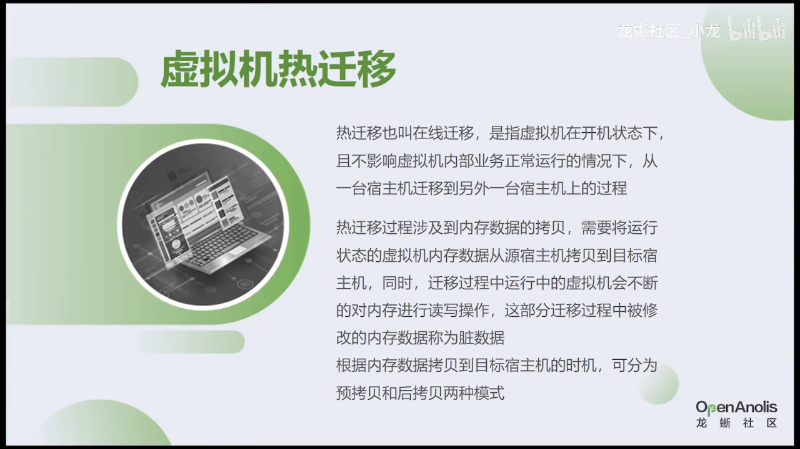

这个定义直接推出了要传的三类东西：

- **内存数据**：客户机正在用的全部内存页，这是体积的大头；
- **CPU 与设备状态**：CPU 状态、寄存器状态，以及 non-pageable 内存页（不可换出、不会被换到磁盘上的那部分内存）——后拷贝模式会先把这些送过去（[【跳转到 03:06】](https://www.bilibili.com/video/BV1Fo4y1u7nQ/?t=186)）；而设备配置由 begin 阶段生成的那份 XML 描述（[【跳转到 24:04】](https://www.bilibili.com/video/BV1Fo4y1u7nQ/?t=1444)）；
- **磁盘数据（可选）**：只有当虚拟机挂载的是**非共享盘**时才需要跨主机传；如果对接的是共享存储（目前云平台大部分如此），磁盘本来就在两边都能访问的地方，不用搬（[【跳转到 15:07】](https://www.bilibili.com/video/BV1Fo4y1u7nQ/?t=907)、[【跳转到 07:57】](https://www.bilibili.com/video/BV1Fo4y1u7nQ/?t=477)）。

换句话说，"搬运量"不是固定的：共享存储 + 小内存的虚拟机可能只有几百 MB 要传，非共享盘 + 大内存的虚拟机则要连磁盘一起搬。

### 1.2 脏数据决定了"什么时候搬内存"

因为虚拟机在迁移过程中一直在运行，它会不断读写内存，这部分被改动的数据叫**内存脏数据**（[【跳转到 01:03】](https://www.bilibili.com/video/BV1Fo4y1u7nQ/?t=63)）。脏数据的存在，让"搬内存"从一个一次性动作变成了一个需要收敛的过程。

根据内存数据拷贝到目标宿主机的时机，分为预拷贝和后拷贝两种模式（[【跳转到 01:28】](https://www.bilibili.com/video/BV1Fo4y1u7nQ/?t=88)）：

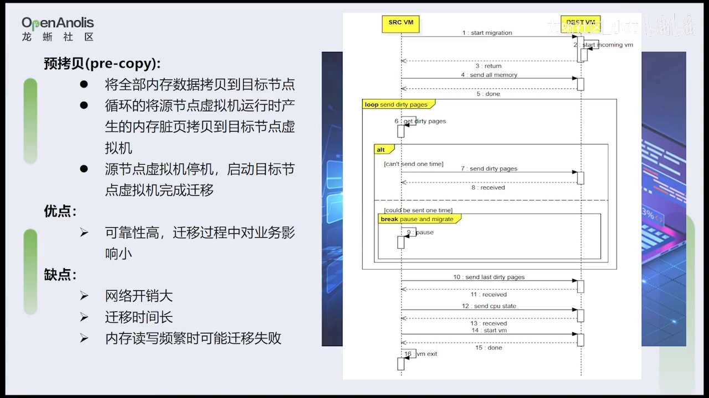

- **预拷贝（pre-copy）**：先把全部内存拷到目标节点，再把过程中产生的脏页循环拷过去，直到脏页量收敛，才停机切换。它可靠性高、对业务影响小，但网络开销大、迁移时间长；如果内存读写太频繁，脏页产生速度持续高于传输速度，就永远收敛不了，迁移会失败（[【跳转到 02:16】](https://www.bilibili.com/video/BV1Fo4y1u7nQ/?t=136)、[【跳转到 02:41】](https://www.bilibili.com/video/BV1Fo4y1u7nQ/?t=161)）。
- **后拷贝（post-copy）**：先把 CPU 状态、寄存器和 non-pageable 内存页送过去，目标节点立刻把虚拟机启动起来，剩余内存随后动态传；目标节点访问到还没传过来的页时触发 page fault，回源节点读。它网络开销低（按需传输，没有脏数据概念），但稳定性差、对网络要求高，迁移中虚拟机性能下降明显（[【跳转到 03:31】](https://www.bilibili.com/video/BV1Fo4y1u7nQ/?t=211)、[【跳转到 03:56】](https://www.bilibili.com/video/BV1Fo4y1u7nQ/?t=236)）。

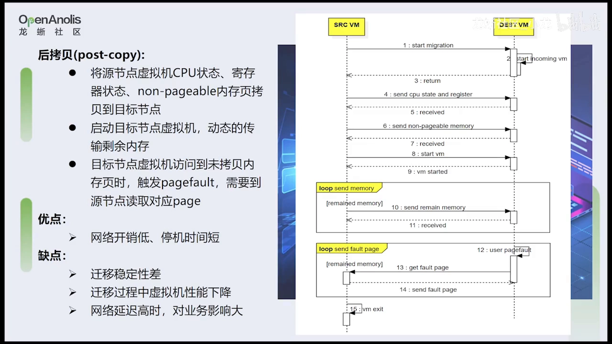

两种模式的收敛过程与停机时间对比属于「5.3.1 预拷贝与后拷贝」的内容。对"跨节点搬运"这件事来说，只需要记住一个结论：**无论哪种模式，跨节点链路上跑的都是"内存页 + 状态"这条字节流，区别只在于发送的时机和顺序。**

## 二、搬运走哪条通道：URI 定协议，数据面定谁中转

### 2.1 迁移 URI：一行字符串决定了传输协议

libvirt 迁移虚拟机时必须指定一个目标 URI，标识这台虚拟机要迁到哪里。它的格式是（[【跳转到 13:42】](https://www.bilibili.com/video/BV1Fo4y1u7nQ/?t=822)）：

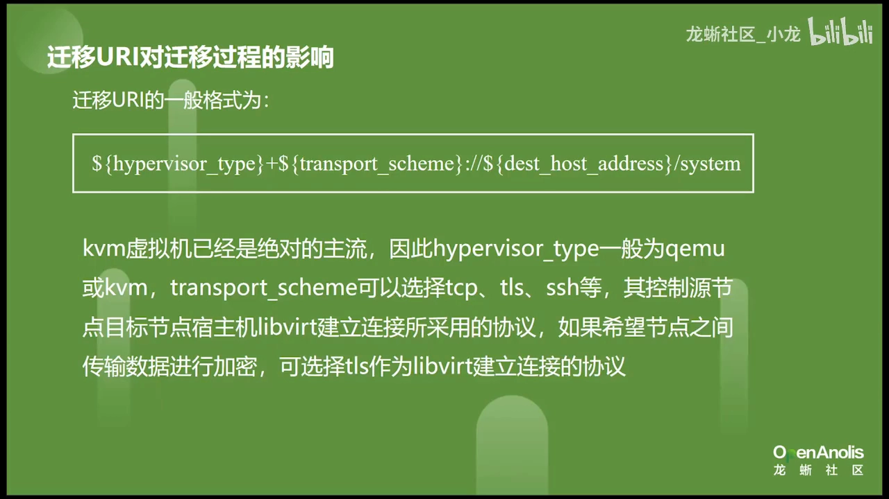

```
${hypervisor_type}+${transport_scheme}://${dest_host_address}/system
```

- `hypervisor_type`：因为 KVM 虚拟机已经是绝对主流，一般选 `qemu` 或 `kvm`；
- `transport_scheme`：可以是 `tcp`、`tls`、`ssh` 等，它控制源节点和目标节点宿主机上的 libvirt 建立连接时采用的协议；**如果希望节点之间传输的数据加密，就选 `tls`**（[【跳转到 14:07】](https://www.bilibili.com/video/BV1Fo4y1u7nQ/?t=847)、[【跳转到 14:32】](https://www.bilibili.com/video/BV1Fo4y1u7nQ/?t=872)）；
- `/system`：这一段一般是固定的。

这一行字符串是"传输通道"的第一层选择：它决定了两个节点之间那条连接本身是明文 TCP、TLS 加密，还是走 SSH。对多租户云来说，这一层的选择直接对应"跨节点传输的数据要不要加密"。

### 2.2 数据面：让 hypervisor 直连，还是让 libvirtd 中转

URI 决定连接协议，但字节流具体怎么走还有第二种选择。libvirt 提供了两种虚拟机内存和状态数据的传输方式（[【跳转到 15:07】](https://www.bilibili.com/video/BV1Fo4y1u7nQ/?t=907)）：

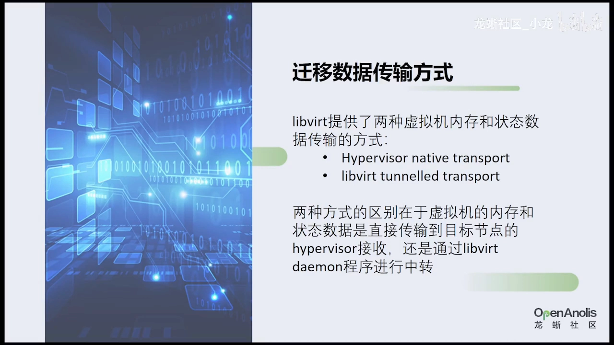

**Hypervisor native transport（直连）**：源节点和目标节点的虚拟机（QEMU 进程）之间直接建立一条网络连接，内存和状态数据通过这条连接送到目标节点，libvirt 不干预，QEMU 自己完成传输并把结果返回给 libvirt 中的 QEMU monitor（[【跳转到 16:02】](https://www.bilibili.com/video/BV1Fo4y1u7nQ/?t=962)、[【跳转到 16:27】](https://www.bilibili.com/video/BV1Fo4y1u7nQ/?t=987)）。

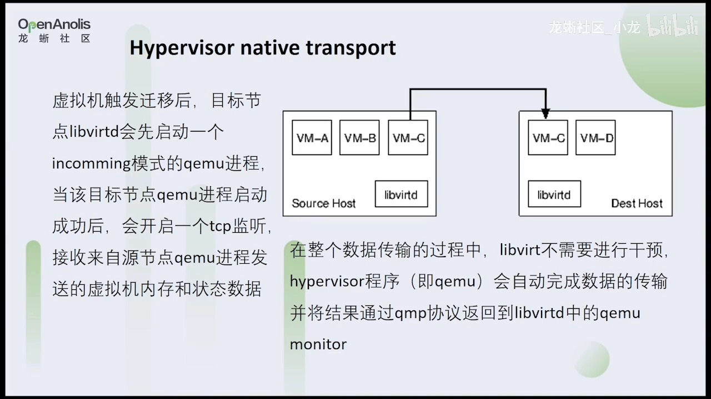

**libvirt tunnelled transport（中转）**：QEMU 先把数据用 socket 发给源节点的 libvirtd，源节点 libvirtd 再发给目标节点 libvirtd，目标节点 libvirtd 最后转发给目标节点上的虚拟机进程。两个 libvirtd 之间的连接形成一条"隧道"，这就是前面 flag 里 `VIR_MIGRATE_TUNNELLED` 的含义（[【跳转到 16:52】](https://www.bilibili.com/video/BV1Fo4y1u7nQ/?t=1012)、[【跳转到 17:17】](https://www.bilibili.com/video/BV1Fo4y1u7nQ/?t=1037)、[【跳转到 17:42】](https://www.bilibili.com/video/BV1Fo4y1u7nQ/?t=1062)）。

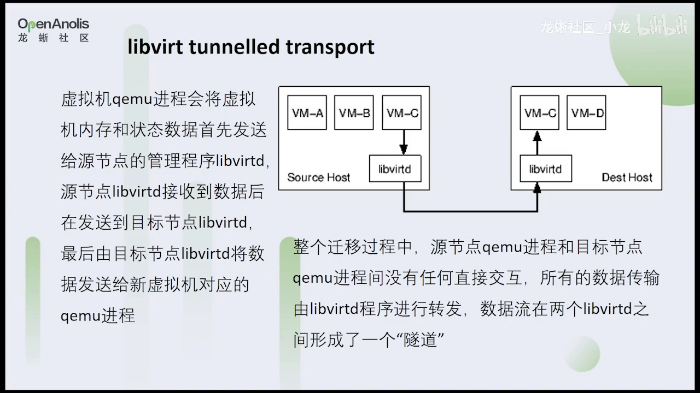

两者的取舍很直白：直连少一次中转、路径更短，但要求两个 QEMU 进程之间网络可达；隧道把数据统一收进 libvirtd 的通道，便于集中管控（比如统一走管理网络的加密连接），代价是多两次用户态转发。

### 2.3 控制面：谁在指挥这次搬运

数据面回答"字节怎么走"，控制面回答"谁在指挥"。libvirt 提供三种控制方式（[【跳转到 18:12】](https://www.bilibili.com/video/BV1Fo4y1u7nQ/?t=1092)）：

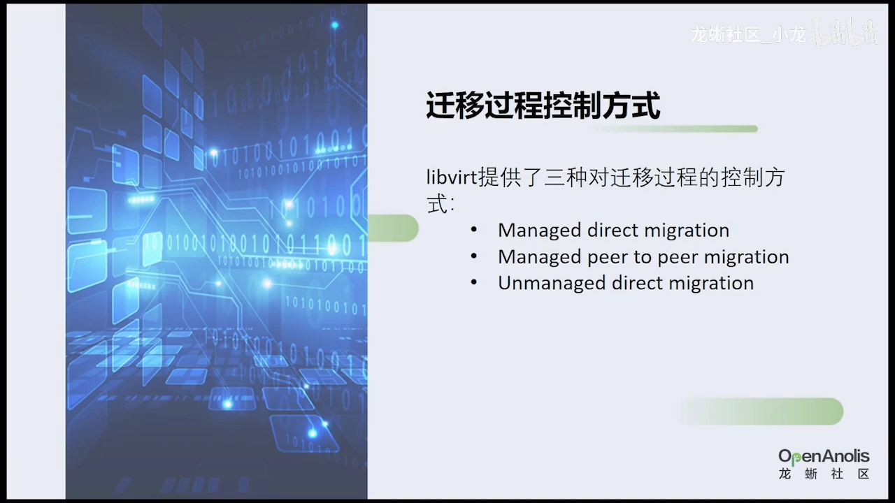

- **managed direct migration**：整个过程由 libvirt 的 client 控制（比如 `virsh` 命令，或 OpenStack 的 Nova 服务）。client 分别与源节点和目标节点的 libvirtd 建立连接，用 RPC 控制各个步骤；两个 libvirtd 之间不需要建连，也不知道对方的情况（[【跳转到 18:32】](https://www.bilibili.com/video/BV1Fo4y1u7nQ/?t=1112)、[【跳转到 18:57】](https://www.bilibili.com/video/BV1Fo4y1u7nQ/?t=1137)、[【跳转到 19:22】](https://www.bilibili.com/video/BV1Fo4y1u7nQ/?t=1162)）。
- **managed peer to peer migration**：由源节点的 libvirtd 主导，client 只负责触发，之后源节点 libvirtd 与目标节点 libvirtd 直接协调（[【跳转到 19:47】](https://www.bilibili.com/video/BV1Fo4y1u7nQ/?t=1187)、[【跳转到 20:12】](https://www.bilibili.com/video/BV1Fo4y1u7nQ/?t=1212)）。
- **unmanaged direct migration**：client 直接向 hypervisor 发迁移命令，client 和 libvirtd 都不控制过程，控制权交给 QEMU 这类程序。这属于偏底层的操作，难度稍大、安全性可能偏低，所以不常用（[【跳转到 20:37】](https://www.bilibili.com/video/BV1Fo4y1u7nQ/?t=1237)、[【跳转到 21:02】](https://www.bilibili.com/video/BV1Fo4y1u7nQ/?t=1262)）。

把控制面和数据面组合起来，就是云平台实际部署的样子。OpenStack Nova 在不改配置的情况下默认是：**控制面 managed peer to peer + 数据面 hypervisor native transport**——Nova 调 libvirt 接口连上源节点 libvirtd，之后由源节点 libvirtd 主导；对 QEMU 虚拟机来说，就是源节点和目标节点两个 QEMU 进程之间直接建一条 TCP 连接传内存和状态（[【跳转到 21:26】](https://www.bilibili.com/video/BV1Fo4y1u7nQ/?t=1286)、[【跳转到 21:51】](https://www.bilibili.com/video/BV1Fo4y1u7nQ/?t=1311)、[【跳转到 22:16】](https://www.bilibili.com/video/BV1Fo4y1u7nQ/?t=1336)）。

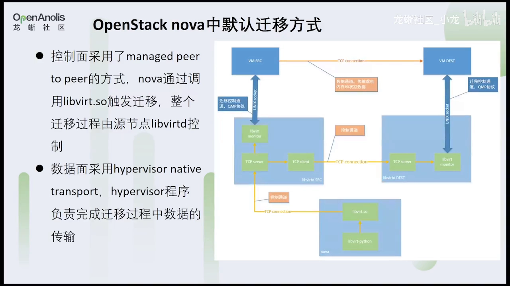

## 三、一次搬运的七个阶段：目标节点先"待接收"，最后才接管

通道选好了，接下来是顺序问题。跨节点搬运最容易出的错不是"传不过去"，而是"对面还没准备好就开始传"或者"数据传完了但两边同时以为自己是主人"。libvirt 的流程用七个阶段把这件事固定下来（[【跳转到 22:49】](https://www.bilibili.com/video/BV1Fo4y1u7nQ/?t=1369)）：

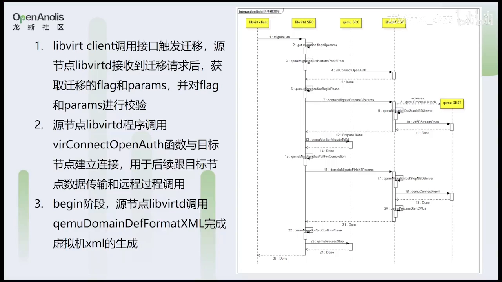

1. **触发与校验**：libvirt client 调用接口触发迁移，源节点 libvirtd 收到请求后，获取客户端指定的 flag 和参数并进行校验（[【跳转到 23:14】](https://www.bilibili.com/video/BV1Fo4y1u7nQ/?t=1394)）。这一步就是"能不能搬"的守门人——比如缓存模式不是 `none` 的 QEMU 虚拟机会被判定为不安全而被拦下。
2. **建连接**：源节点 libvirtd 调用 `virConnectOpenAuth` 与目标节点建立连接，用于后续的数据传输和远程过程调用（RPC）（[【跳转到 23:39】](https://www.bilibili.com/video/BV1Fo4y1u7nQ/?t=1419)）。
3. **begin**：源节点 libvirtd 调用 `qemuDomainDefFormatXML` 完成虚拟机 XML 的生成（[【跳转到 24:04】](https://www.bilibili.com/video/BV1Fo4y1u7nQ/?t=1444)）。这份 XML 就是目标节点"照着长出一台同样的机器"的图纸。
4. **prepare**：源节点通过 RPC 调用目标节点的 `domainMigratePrepare3Params`，在目标节点启动一个**带 incoming 参数的虚拟机**，然后启动 NBD server（[【跳转到 24:24】](https://www.bilibili.com/video/BV1Fo4y1u7nQ/?t=1464)）。带 incoming 参数的虚拟机本身就能接收来自另一台虚拟机的数据传输，但它此时还没有真正运行。
5. **perform**：源节点调用 `qemuMigrationRun` 正式开始迁移，把虚拟机的内存、状态等数据迁移到目标节点（[【跳转到 24:49】](https://www.bilibili.com/video/BV1Fo4y1u7nQ/?t=1489)）。这是整个流程中最耗时的阶段，由 QEMU 进程主导：QEMU 要收集虚拟机占用的内存发给目标节点，迁移过程中产生的脏数据也要被标记并传输过去（[【跳转到 25:14】](https://www.bilibili.com/video/BV1Fo4y1u7nQ/?t=1514)、[【跳转到 25:39】](https://www.bilibili.com/video/BV1Fo4y1u7nQ/?t=1539)）。
6. **finish**：内存和状态传完后，源节点 libvirtd 通过 RPC 调用目标节点的方法，停止 NBD server，并调用 `qemuProcessStartCPUs` 让目标节点虚拟机进入运行状态（[【跳转到 26:04】](https://www.bilibili.com/video/BV1Fo4y1u7nQ/?t=1564)）。
7. **confirm**：源节点调用 `qemuProcessStop` 停止源节点虚拟机对应的进程并做资源删除，迁移最终完成（[【跳转到 26:29】](https://www.bilibili.com/video/BV1Fo4y1u7nQ/?t=1589)）。

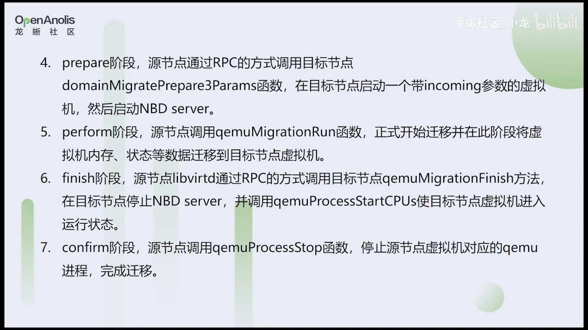

这个顺序里有两个设计值得单独记住：

- **"起机器"和"跑 CPU"是两件事**。prepare 阶段目标节点就已经把虚拟机进程拉起来了（带着 incoming 参数），但直到 finish 阶段调用 `qemuProcessStartCPUs` 才真正执行客户机的指令。中间这段时间，它是一个只进不出的"接收容器"——这就是"怎么保证能起来"的答案：先把容器备好，数据灌满，最后才点火。
- **confirm 在 finish 之后**。源节点只有在目标节点已经接管 CPU 之后才销毁自己，避免出现"两边都停了"的窗口。这也是为什么 flag 里有 `VIR_MIGRATE_PERSIST_DEST`（在目标节点持久化）和 `VIR_MIGRATE_UNDEFINE_SOURCE`（成功后删除源端定义）这类控制"收尾动作"的开关。

## 四、带宽不够时，怎么让传输收敛

跨节点搬运的时间下限由一条很朴素的式子决定：

$$
T \approx \frac{M}{B}
$$

其中 $M$ 是要搬的字节数（主要是内存镜像），$B$ 是两节点之间实际可用的带宽。10 GiB 内存在 1 Gbps 链路上理论下限就是八十多秒，这还没算协议开销和重传——**跨节点搬运的时延首先是一个带宽问题，其次才是软件问题**。

比"传得慢"更糟的是"传不完"。预拷贝要能结束，必须满足收敛条件：

$$
R_{\text{dirty}} < B
$$

$R_{\text{dirty}}$ 是客户机产生脏页的速率。如果客户机在疯狂写内存，脏页产生速度持续高于链路带宽，拷贝就永远追不上，迁移只能失败（[【跳转到 27:02】](https://www.bilibili.com/video/BV1Fo4y1u7nQ/?t=1622)、[【跳转到 27:27】](https://www.bilibili.com/video/BV1Fo4y1u7nQ/?t=1647)）。所以加速手段其实只有两条路：**要么把 $R_{\text{dirty}}$ 压下去，要么把有效的 $B$ 提上去。**

### 4.1 压脏页速率：auto-converge

`VIR_MIGRATE_AUTO_CONVERGE` 走的是第一条路：迁移过程中如果长时间内存不收敛，它就启动类似 CPU 降频的机制，让虚拟机跑慢一点，脏数据产生速率随之降低，最终达到收敛（[【跳转到 10:59】](https://www.bilibili.com/video/BV1Fo4y1u7nQ/?t=659)）。代价是迁移期间虚拟机性能明显下降，所以要根据业务场景决定开不开（[【跳转到 11:24】](https://www.bilibili.com/video/BV1Fo4y1u7nQ/?t=684)）。

这本质上是用"业务变慢"换"迁移能结束"——对延迟不敏感的批处理任务可以接受，对在线服务就要谨慎。

### 4.2 提高有效带宽：多线程压缩

多线程压缩走第二条路：用宿主机 CPU 的算力，把要传的内存数据先压缩，传到目标节点再解压。带宽一定的情况下，传输的数据体积变小了，等效带宽就上去了（[【跳转到 28:17】](https://www.bilibili.com/video/BV1Fo4y1u7nQ/?t=1697)、[【跳转到 28:42】](https://www.bilibili.com/video/BV1Fo4y1u7nQ/?t=1722)）。

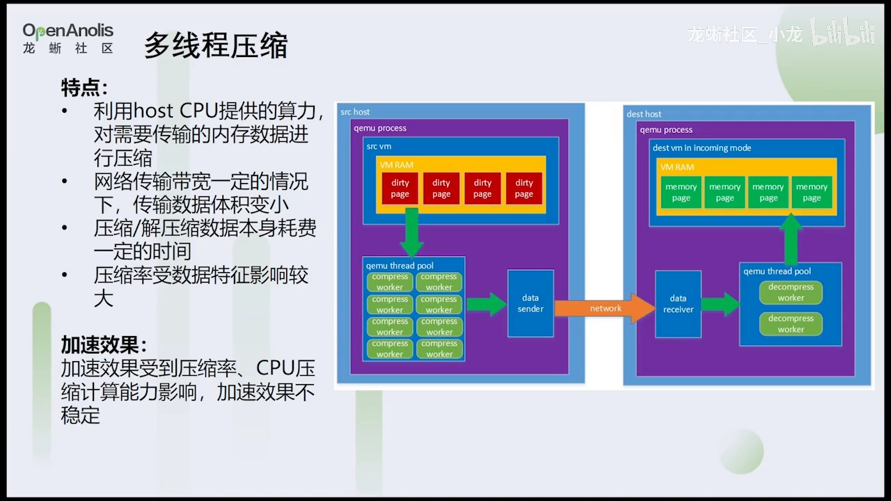

设压缩比为 $r$（压缩后体积为原来的 $1/r$），则链路上的传输时间变成：

$$
T_{\text{net}} \approx \frac{M}{r \cdot B}
$$

但压缩本身要花时间。设压缩吞吐为 $C$（字节/秒），压缩耗时约 $M/C$。只有当

$$
C > r \cdot B
$$

时，压缩才不会变成新的瓶颈——否则你省下的带宽时间，又被 CPU 压缩时间吃回去了。这解释了讲者反复强调的一点：**压缩的加速效果不稳定**，它既受压缩率影响（内存数据里规律内容多则压缩率高，熵大则压缩率低），也受 CPU 性能影响（[【跳转到 29:07】](https://www.bilibili.com/video/BV1Fo4y1u7nQ/?t=1747)、[【跳转到 29:32】](https://www.bilibili.com/video/BV1Fo4y1u7nQ/?t=1772)）。

多线程压缩有三个可调参数（[【跳转到 29:57】](https://www.bilibili.com/video/BV1Fo4y1u7nQ/?t=1797)）：

- **压缩线程数**：源节点上压缩内存数据的线程数，一般按宿主机 CPU 数量配置；
- **解压线程数**：目标节点上解压的线程数，一般与压缩线程数是 **4:1** 的关系——因为压缩对 CPU 消耗高、解压消耗低，这个比例由压缩算法本身的特性决定（[【跳转到 30:22】](https://www.bilibili.com/video/BV1Fo4y1u7nQ/?t=1822)、[【跳转到 30:47】](https://www.bilibili.com/video/BV1Fo4y1u7nQ/?t=1847)）；
- **压缩级别**：从 1 到 9 共九级，级别越高压缩率越高，但消耗的 CPU 更多、压缩时间更长。级别怎么选取决于宿主机 CPU 算力，CPU 越强越可以用高级别；具体最佳值要针对不同 CPU 实测（[【跳转到 31:12】](https://www.bilibili.com/video/BV1Fo4y1u7nQ/?t=1872)、[【跳转到 31:37】](https://www.bilibili.com/video/BV1Fo4y1u7nQ/?t=1897)、[【跳转到 32:02】](https://www.bilibili.com/video/BV1Fo4y1u7nQ/?t=1922)）。

### 4.3 少传一些：XBZRLE 只发差异字节

第三条路是"别传那么多"。热迁移里脏数据标记的最小单位是**页**：一个 4096 字节的页，只要有一个字节被改，整页都会被标记为脏，整页 4K 都要传给目标节点（[【跳转到 32:42】](https://www.bilibili.com/video/BV1Fo4y1u7nQ/?t=1962)、[【跳转到 33:07】](https://www.bilibili.com/video/BV1Fo4y1u7nQ/?t=1987)）。

XBZRLE 的核心思想就是用**异或算法**算出脏页与它被写入之前的数据之间的差异，只把差异数据传过去，从而减少传输量（[【跳转到 32:17】](https://www.bilibili.com/video/BV1Fo4y1u7nQ/?t=1937)、[【跳转到 33:32】](https://www.bilibili.com/video/BV1Fo4y1u7nQ/?t=2012)）。

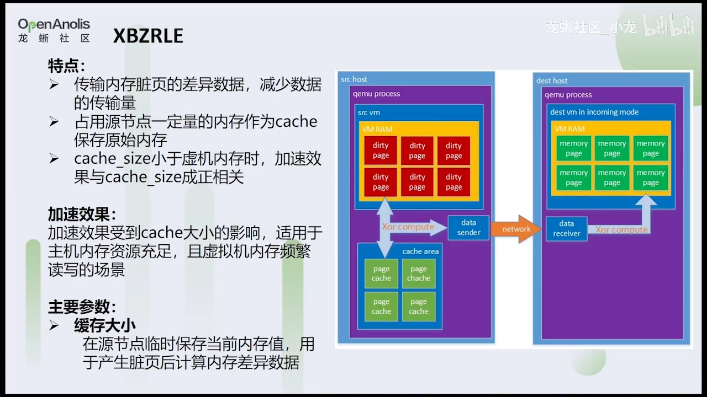

代价是源节点要占用一块内存做缓存，保存原始内存页——要算差异，必须先知道"写之前是什么样"（[【跳转到 33:57】](https://www.bilibili.com/video/BV1Fo4y1u7nQ/?t=2037)、[【跳转到 34:22】](https://www.bilibili.com/video/BV1Fo4y1u7nQ/?t=2062)）。缓存大小（cache size）直接决定效果：当 cache size 小于虚拟机内存时，加速效果与 cache size **正相关**；一旦 cache 装不下被改的页，命中不了缓存就只能退回传原始数据，压缩效果消失（[【跳转到 34:47】](https://www.bilibili.com/video/BV1Fo4y1u7nQ/?t=2087)、[【跳转到 35:12】](https://www.bilibili.com/video/BV1Fo4y1u7nQ/?t=2112)）。

所以它的适用场景很明确：**宿主机内存资源充足、且虚拟机内存读写频繁**时效果明显（[【跳转到 35:37】](https://www.bilibili.com/video/BV1Fo4y1u7nQ/?t=2137)）。它唯一的参数就是缓存大小（[【跳转到 36:02】](https://www.bilibili.com/video/BV1Fo4y1u7nQ/?t=2162)）。

### 4.4 三种加速手段怎么选

| 手段 | 作用在哪一项 | 代价 | 适用场景 |
| --- | --- | --- | --- |
| auto-converge | 压低 $R_{\text{dirty}}$ | 迁移期间业务变慢 | 脏页速率持续高于带宽、且业务能容忍降速 |
| 多线程压缩 | 提高等效 $B$ | 源端与目标端 CPU 开销，效果随数据特征波动 | 带宽紧张、CPU 有余量 |
| XBZRLE | 减少实际传输字节 | 源端占用额外内存做 cache | 宿主机内存充足、内存频繁读写 |

还有两个不属于"加速"但会影响传输路径的开关：`VIR_MIGRATE_PARALLEL` 用多条网络连接同时拷内存（现实中迁移一般走管理网络，管理网络通常不会配多条网线，只有在借用存储网等场景才有意义，[【跳转到 12:53】](https://www.bilibili.com/video/BV1Fo4y1u7nQ/?t=773)、[【跳转到 13:18】](https://www.bilibili.com/video/BV1Fo4y1u7nQ/?t=798)）；`VIR_MIGRATE_TLS` 要求两个节点都用 TLS 加密传输，任意一方不满足 TLS 配置就会导致迁移失败（[【跳转到 12:03】](https://www.bilibili.com/video/BV1Fo4y1u7nQ/?t=723)、[【跳转到 12:28】](https://www.bilibili.com/video/BV1Fo4y1u7nQ/?t=748)）。

## 五、搬运开关速查：flag 分成四组看

libvirt 源码里的迁移 flag 一共十几个，讲者按源码顺序逐个过了一遍。与其死记，不如按"它管哪件事"分成四组。

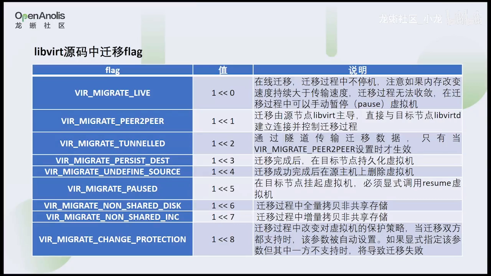

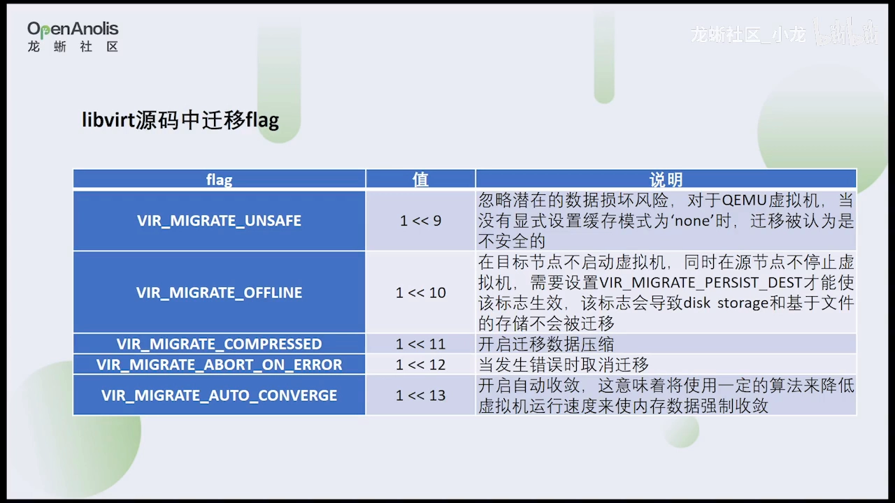

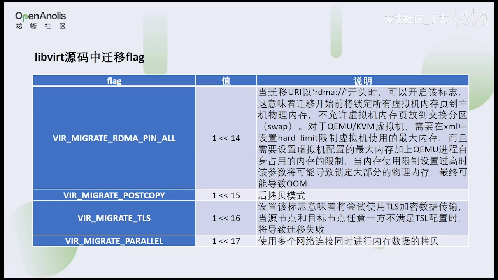

| 分组 | flag | 它决定什么 |
| --- | --- | --- |
| 迁移语义 | VIR_MIGRATE_LIVE | 在线还是离线；内存改动速度持续大于传输速度时无法收敛，过程中可手动暂停虚拟机 |
| 迁移语义 | VIR_MIGRATE_PAUSED | 目标节点上挂起，必须显式 resume |
| 控制面 | VIR_MIGRATE_PEER2PEER | 由源节点 libvirt 主导，直接与目标 libvirtd 建连并控制过程 |
| 数据面 | VIR_MIGRATE_TUNNELLED | 数据经 libvirtd 中转，仅在 PEER2PEER 设置时生效 |
| 数据面 | VIR_MIGRATE_PARALLEL | 多条网络连接同时拷内存 |
| 数据面 | VIR_MIGRATE_TLS | 尝试用 TLS 加密传输，任一方不满足配置则迁移失败 |
| 收尾动作 | VIR_MIGRATE_PERSIST_DEST | 完成后在目标节点持久化虚拟机 |
| 收尾动作 | VIR_MIGRATE_UNDEFINE_SOURCE | 成功后删除源主机上的虚拟机定义 |
| 收尾动作 | VIR_MIGRATE_ABORT_ON_ERROR | 出错时取消迁移，便于回滚 |
| 磁盘 | VIR_MIGRATE_NON_SHARED_DISK | 全量拷贝非共享存储 |
| 磁盘 | VIR_MIGRATE_NON_SHARED_INC | 增量拷贝非共享存储 |
| 磁盘 | VIR_MIGRATE_OFFLINE | 目标不启动、源不停止；需配合 PERSIST_DEST，且 disk storage 与基于文件的存储不会被迁移 |
| 安全 | VIR_MIGRATE_UNSAFE | 忽略潜在数据损坏风险；QEMU 虚拟机未显式把缓存模式设为 none 时，迁移被视为不安全 |
| 安全 | VIR_MIGRATE_CHANGE_PROTECTION | 迁移中改变保护策略；双方都支持时自动设置，显式指定但一方不支持则失败 |
| 加速 | VIR_MIGRATE_COMPRESSED | 开启迁移数据压缩 |
| 加速 | VIR_MIGRATE_AUTO_CONVERGE | 自动收敛，降低虚拟机运行速度强制内存收敛 |
| 加速 | VIR_MIGRATE_POSTCOPY | 采用后拷贝模式 |
| 加速 | VIR_MIGRATE_RDMA_PIN_ALL | URI 以 rdma:// 开头时可开启，迁移前锁定全部内存页到物理内存、不允许换出；内存限制设置过高可能导致 OOM |

对"跨节点搬运"最关键的其实只有四个：`PEER2PEER` 和 `TUNNELLED` 决定控制面与数据面谁主导、`NON_SHARED_DISK` 决定磁盘要不要一起搬、`TLS` 决定链路上是否加密。其余多数是收尾动作与调优开关。

## 小结

- 跨节点搬运要传的是**内存镜像 + CPU 与设备状态**，磁盘只在非共享存储时才需要一起搬；共享存储省掉的正是最大的一块搬运量。
- 脏数据的存在让"搬内存"变成收敛问题：预拷贝追脏页、后拷贝按需回源，两者跑在同一条跨节点链路上，区别只在发送时机。
- 传输通道由两层决定：URI 里的 `transport_scheme`（tcp / tls / ssh）决定连接协议，数据面的 native 或 tunnelled 决定字节流是否经 libvirtd 中转。
- 控制面的三种方式里，Nova 默认是 managed peer to peer 控制 + hypervisor native 数据面，即两个 QEMU 进程直连传内存。
- 七阶段流程的关键是"目标节点先以 incoming 状态待接收，finish 阶段才 `qemuProcessStartCPUs` 点火，confirm 阶段源端才销毁"，这保证了不会出现两边都停或两边都跑的窗口。
- 搬运时间下界是 $T \approx M/B$，能否完成取决于 $R_{\text{dirty}} < B$；加速手段要么压脏页速率（auto-converge），要么提高等效带宽（多线程压缩），要么减少传输字节（XBZRLE）。
- 压缩不是免费的：只有当压缩吞吐 $C > r \cdot B$ 时才真正省时间，这就是压缩加速效果不稳定的原因。
- XBZRLE 用异或只传页内差异，效果取决于 cache size 能否装下被改的页；内存不足时它会退化成传原始页。

## 关键术语速查

| 术语 | 一句话解释 |
| --- | --- |
| 热迁移（在线迁移） | 虚拟机开机状态下从一台宿主机搬到另一台，业务不中断 |
| 脏数据 / 脏页 | 迁移过程中被客户机改写过的内存页，需要再传一次 |
| 预拷贝 | 先传全量内存，再循环追脏页，收敛后停机切换 |
| 后拷贝 | 先传 CPU 状态与 non-pageable 页，目标端先跑，缺页回源取 |
| non-pageable 内存页 | 不允许被换出到磁盘的内存页，后拷贝必须先送过去 |
| 迁移 URI | 形如 `类型+协议://目标地址/system`，决定连接协议（tcp/tls/ssh） |
| hypervisor native transport | 两个 QEMU 进程直连传数据，libvirt 不干预 |
| libvirt tunnelled transport | 数据经两端 libvirtd 中转，形成一条隧道 |
| managed peer to peer | 源节点 libvirtd 主导整个迁移过程，client 只负责触发 |
| incoming 虚拟机 | 目标节点上带 incoming 参数启动、只接收数据尚未执行指令的虚拟机 |
| NBD server | prepare 阶段在目标节点启动的块设备服务，配合非共享盘迁移 |
| auto-converge | 通过降低虚拟机运行速度压低脏页速率，强制内存收敛 |
| 多线程压缩 | 源端多线程压缩、目标端多线程解压，用 CPU 换带宽 |
| XBZRLE | 用异或算页内差异，只传差异字节，需要源端 cache 保存原始页 |
| cache size | XBZRLE 在源端保存原始内存页的缓存大小，直接决定加速效果 |
| VIR_MIGRATE_TLS | 要求两端都用 TLS 传输迁移数据，配置不满足则迁移失败 |
